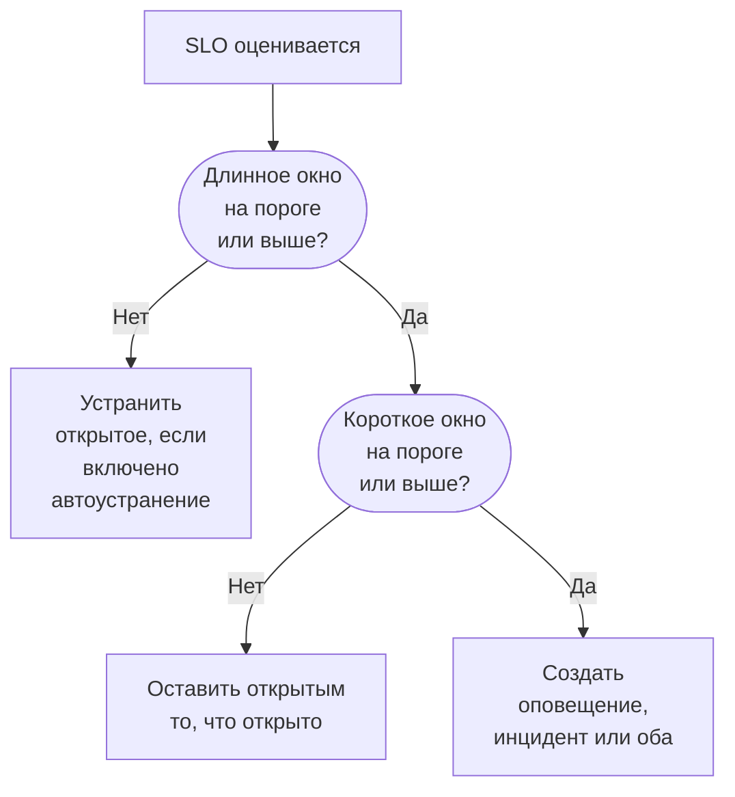

# Оповещения и инциденты по скорости расхода бюджета

Бюджеты ошибок показывают, где вы находитесь; правила скорости расхода говорят, когда пора вставать с постели. Когда SLO тратит свой бюджет ошибок достаточно быстро, чтобы это имело значение, правило скорости расхода создаёт оповещение, объявляет инцидент или делает и то и другое — с вашими собственными заголовком и описанием, серьёзностью, владельцами, метками, эскалацией на дежурных и уведомлениями в рабочем пространстве.

:::cards
- [Как правило принимает решение](#как-правило-решает-сработать): Два окна, оба выше порога.
- [Правила по умолчанию](#правила-по-умолчанию): Fast burn и Slow burn, подогнанные под окно SLO.
- [Создание правила](#создание-и-редактирование-правила): Пять шагов на странице Burn Rate Rules этого SLO.
- [Переменные шаблона](#что-сообщает-каждое-оповещение-и-инцидент): Пишите собственные заголовки и описания.
:::

## Что означает скорость расхода

Скорость расхода показывает, насколько быстро вы тратите бюджет ошибок по сравнению с равномерным темпом:

```text
burn rate = (share of time that was bad) ÷ (share of time the target allows to be bad)
```

При скорости расхода 1 вы тратите бюджет ровно за окно и достигаете цели, ничего не оставив. Более высокие значения исчерпывают его раньше. Для SLO с целью 99,9 % за 30 дней:

| Скорость расхода, если она сохранится | Бюджет закончится через |
| --- | --- |
| 1 | 30 дней |
| 2 | 15 дней |
| 6 | 5 дней |
| 14.4 | около 2 дней (50 часов) |

Скорость расхода не зависит от того, сколько бюджета осталось. Она отвечает на вопрос «насколько всё плохо прямо сейчас?», а именно это нужно знать, чтобы решить, будить ли кого-то.

## Как правило решает сработать

OneUptime проверяет каждое включённое правило скорости расхода при каждой оценке SLO, каждые 5 минут. Каждое правило измеряет скорость расхода в двух окнах и срабатывает, только когда обе скорости на его пороге или выше:

- **Длинное окно** (например, 1 час) показывает, что расход устойчивый и существенный, а не одна неудачная проверка.
- **Короткое окно** (например, 5 минут) показывает, что это всё ещё происходит. Без него всплеск часовой давности продолжал бы вызывать оповещения ещё долго после восстановления.

Это схема с несколькими окнами и несколькими скоростями расхода из Google SRE Workbook, и именно её OneUptime настраивает за вас.



Правило не может сработать, пока у SLO нет полного длинного окна истории наблюдения: иначе самая первая неудачная проверка монитора, поделённая на несколько минут истории, дала бы огромную скорость расхода. Поэтому новый SLO не может вызвать срабатывание своего правила **Fast burn** в первый час, а своего правила **Slow burn** — в первые шесть. Если позже у SLO больше нет такой истории, например после замены его мониторов новыми, правило устраняет то, что открыло, а не оставляет его висеть. Правило также не срабатывает, пока любой из мониторов SLO находится на плановом обслуживании: см. [Плановое обслуживание](#плановое-обслуживание).

## Правила по умолчанию

Каждый новый SLO получает два правила скорости расхода. Для окна в 30 дней:

| Правило | Порог | Длинное окно | Короткое окно | Срабатывает, когда |
| --- | --- | --- | --- | --- |
| **Fast burn** | 14.4× | 1 час | 5 минут | Около 2 % бюджета расходуется за час: он закончился бы примерно за 2 дня. |
| **Slow burn** | 6× | 6 часов | 30 минут | Около 5 % бюджета расходуется за шесть часов: он закончился бы примерно за 5 дней. |

Пороги 14.4× и 6× рассчитаны на 30-дневный бюджет, поэтому OneUptime подгоняет их под окно вашего SLO. Каждое правило всегда означает «2 % бюджета за 1 час» или «5 % бюджета за 6 часов»:

| Окно SLO | Порог Fast burn | Порог Slow burn |
| --- | --- | --- |
| 7 дней | 3.36× | 1.4× |
| 28 дней | 13.44× | 5.6× |
| 30 дней | 14.4× | 6× |
| 90 дней | 43.2× | 18× |

SLO с календарным месяцем получают значения для 30 дней. Оба правила создают оповещение с самой высокой серьёзностью оповещений проекта, со стандартными заголовком и описанием, устраняют его автоматически и не добавляют владельцев или метки. Они не объявляют инцидентов, поэтому обновление OneUptime никогда не начнёт объявлять инциденты за вас. Редактируйте их, удаляйте или добавляйте свои.

## Создание и редактирование правила

Вам нужно разрешение на создание правил скорости расхода SLO.

:::steps
### Откройте Burn Rate Rules

Откройте SLO, перейдите на страницу **Burn Rate Rules** и нажмите **Создать: SLO Burn Rate Rule** или отредактируйте одно из правил по умолчанию.

### Задайте имя правила

В разделе **Rule** введите **Имя**, например «Fast burn». Переключатель **Включено** включён.

### Задайте окно расхода

В разделе **Burn Window** задайте **Burn Rate Threshold** (например, `14.4`), **Long Window (Minutes)** и **Short Window (Minutes)**, а при желании и **Re-fire Suppression (Minutes)**.

### Выберите, что оно объявляет

В разделе **What It Declares** включите **Создать оповещение**, **Объявить инцидент** или оба. **Add SLO Owners as Owners** также делает владельцев SLO владельцами всего, что создаёт правило.

### Опишите оповещение и инцидент

Шаги **Оповещение** и **Инцидент** появляются только для того, что объявляет правило. У каждого есть заголовок и серьёзность, а также свёрнутые разделы: **Описание**, **Владение и метки**, **Дежурство** и **Дополнительные поля**, где находятся автоустранение, приватность и заметки об устранении. Новые правила начинают со стандартных заголовка и описания, готовых к правке. На последнем шаге нажмите **Создать: SLO Burn Rate Rule**.
:::

OneUptime проверяет числа правила при сохранении:

| Параметр | Должен быть |
| --- | --- |
| **Burn Rate Threshold** | Больше 0. |
| **Short Window (Minutes)** | Больше 0. |
| **Long Window (Minutes)** | Длиннее короткого окна. |
| **Re-fire Suppression (Minutes)** | 0 или больше. Пустое значение означает длину длинного окна. |

Правило должно создавать оповещение, объявлять инцидент или делать и то и другое: правило, у которого выключено и то и другое, отклоняется, потому что оно проверялось бы при каждой оценке, ничего не объявляя.

Таблица правил показывает для каждого правила порог, окна и подавление, что оно объявляет (и устраняется ли оповещение или инцидент только вручную или является приватным), уровни серьёзности, политики дежурств, владельцев и метки.

> [!TIP]
> Хорошее начало: оставьте два правила по умолчанию, направьте правило быстрого расхода в политику дежурств, которая будит людей, с высокой серьёзностью, а правило медленного расхода пусть создаёт оповещение с более низкой серьёзностью для рабочего времени. Если ваша команда работает через инциденты, включите **Объявить инцидент** в правиле быстрого расхода и выключите там **Создать оповещение**, если не хотите получать и то и другое.

## Что объявляет правило

|  | **Создать оповещение** | **Объявить инцидент** |
| --- | --- | --- |
| Изначально | Включено | Выключено |
| Что это | Лёгкий сигнал: попадает в список оповещений. | Тяжёлый сигнал: получает номер инцидента и запускает весь процесс реагирования. |
| Заголовок и описание | Собственные или стандартный текст | Собственные или стандартный текст |
| Серьёзность | **Серьёзность оповещения**: если пусто, самая высокая в проекте | **Серьёзность инцидента**: если пусто, самая высокая в проекте |
| Эскалация | **Alert On-Call Duty Policies** | **Incident On-Call Duty Policies** |
| Владельцы и метки | **Владельцы оповещения** и **Метки оповещений** | **Владельцы инцидента** и **Метки инцидента** |
| Приватно | Выключено | Выключено |
| Автоустранение | Включено | Включено |
| Страницы статуса | Никогда не публикуется | Никогда не публикуется |

Поскольку каждое из них настраивается отдельно, можно отправить короткое оповещение в график дежурств команды-владельца, а подробный инцидент — в график дежурств по крупным инцидентам. Они и живут отдельно: каждое дедуплицируется, устраняется и подавляется само по себе, поэтому устранение инцидента не сбрасывает подавление оповещения, и наоборот.

### SLO — затронутый ресурс

Каждое оповещение и инцидент, созданные правилом скорости расхода, указывают свой SLO в разделе **Затронутые ресурсы** и ссылаются на него. Фильтр **Затронутые ресурсы** в списках оповещений и инцидентов ограничивает их одним SLO, а страницы **Оповещения** и **Инциденты** этого SLO перечисляют их, и значки в боковом меню считают открытые. OneUptime создаёт эту связь сам, и редактирование оповещения или инцидента никогда её не удаляет.

### Инциденты по скорости расхода остаются внутренними

Быстро расходуемый бюджет ошибок — это сигнал для инженеров, а не объявленный сбой. Инцидент по скорости расхода никогда не показывается на страницах статуса и никогда не уведомляет подписчиков страниц статуса. Он также не связывается ни с какими мониторами, потому что иначе его устранение переписало бы ту самую историю статусов мониторов, по которой измеряется SLO.

Если вы устраните такой инцидент вручную, ничто не объявит его снова, пока расход не восстановится и правило действительно не сработает заново, так что вам никогда не придётся бороться с правилом, пока вы работаете над инцидентом.

## Что сообщает каждое оповещение и инцидент

Новые правила начинают со стандартных заголовка и описания — и у оповещения, и у инцидента. Очистите заголовок или описание, чтобы вернуться к стандартному тексту. Стандартный заголовок:

```text
SLO burn rate: {{sloName}} — {{ruleName}}
```

Стандартное описание называет правило, указывает скорость расхода в обоих окнах относительно порога и оставшийся бюджет ошибок.

Чтобы написать собственный текст, используйте переменные шаблона в заголовке, описании и заметках об устранении. Каждое из этих полей показывает их в разделе **Переменные шаблона**: нажмите переменную, чтобы вставить её в позицию курсора, или введите `{{` в поле и выберите переменную. У описания и заметок об устранении на панели инструментов есть также **Вставить переменную**. Переменные заполняются, когда правило срабатывает:

| Переменная | Что содержит | Пример |
| --- | --- | --- |
| `{{sloName}}` | Имя SLO. | `Checkout availability` |
| `{{sloId}}` | ID SLO. | `b7f4c2d8-1f3e-4a5b-9c6d-7e8f9a0b1c2d` |
| `{{sloLink}}` | Ссылка на SLO в панели OneUptime. | `https://oneuptime.com/dashboard/project-id/slos/slo-id` |
| `{{sloStatus}}` | Статус SLO после этой оценки. | `At Risk` |
| `{{ruleName}}` | Имя сработавшего правила скорости расхода. | `Fast burn` |
| `{{burnRateThreshold}}` | Порог скорости расхода правила (кратное устойчивого темпа). | `14.4` |
| `{{longWindowBurnRate}}` | Скорость расхода, измеренная в длинном окне правила. | `21.5` |
| `{{shortWindowBurnRate}}` | Скорость расхода, измеренная в коротком окне правила. | `36` |
| `{{longWindowInMinutes}}` | Длина длинного окна правила в минутах. | `60` |
| `{{shortWindowInMinutes}}` | Длина короткого окна правила в минутах. | `5` |
| `{{targetPercentage}}` | Цель SLO в процентах. | `99.9` |
| `{{currentSliPercentage}}` | SLI, измеренный в окне соответствия SLO, в процентах. | `99.87` |
| `{{errorBudgetRemainingPercentage}}` | Доля ещё доступного бюджета ошибок в процентах. Отрицательная, когда бюджет превышен. | `42.5` |
| `{{errorBudgetRemaining}}` | Ещё доступный бюджет ошибок в виде длительности. Начинается со знака минус, когда бюджет превышен. | `18m 22s` |
| `{{errorBudgetRemainingMinutes}}` | Ещё доступный бюджет ошибок в минутах. | `18.37` |
| `{{windowDescription}}` | Окно соответствия SLO словами. | `rolling 30-day window` |

Например, заголовок `{{ruleName}}: {{sloName}} is burning {{longWindowBurnRate}}x` превращается в `Fast burn: Checkout availability is burning 21.5x`.

:::details Как заполняются переменные
- Числа округляются до двух знаков после запятой.
- Пробелы внутри фигурных скобок допустимы: `{{ sloName }}` работает.
- Переменная с опечаткой остаётся как есть, чтобы ошибка была видна в оповещении, а не пропала незаметно.
- Заголовки могут быть длиной до 500 символов, а описания и заметки об устранении — до 50 000. Заголовок, который после подстановки переменных длиннее 500 символов, сводится в одну строку и укорачивается с многоточием, чтобы оповещение или инцидент всё равно были созданы.
- Если ссылку на SLO нельзя построить в момент срабатывания правила, `{{sloLink}}` остаётся пустой, а оповещение или инцидент всё равно создаются.
:::

## Владельцы, метки и приватность

- **Владельцы оповещения** и **Владельцы инцидента** — это люди и команды, выбранные из одного списка с помощью **Добавить владельца**. Они добавляются в оповещение или инцидент сразу при его создании и получают уведомление. Люди должны быть участниками проекта.
- **Add SLO Owners as Owners** также добавляет владельцев SLO — его пользователей-владельцев и участников его команд-владельцев — во всё, что создаёт правило. Владельцы SLO и так узнают об изменениях статуса самого SLO, поэтому так они могут получить уведомление дважды. По умолчанию выключено.
- Каждый владелец добавляется один раз: пользователь, который уже является владельцем оповещения или инцидента, например через правила владельцев проекта, или входит в добавленную команду-владельца, повторно не добавляется.
- **Метки оповещений** и **Метки инцидента** добавляются в оповещение или инцидент, чтобы по ним могли срабатывать фильтры, правила владельцев и правила уведомлений рабочего пространства.
- Приватное оповещение или инцидент видят только его владельцы, администраторы проекта и владельцы проекта.

Метки, команды-владельцы и политики дежурств должны принадлежать проекту SLO.

## Устранение и подавление повторных срабатываний

- **Устранение следует за длинным окном.** При включённом автоустранении (по умолчанию) OneUptime устраняет оповещение и инцидент правила, как только скорость расхода в длинном окне опускается ниже порога. Устранение по короткому окну давало бы дребезг: перемежающийся сбой устранялся бы после пяти спокойных минут и будил бы людей снова всю ночь.
- **Автоустранение выключено.** Выключите **Автоустранение оповещения** или **Автоустранение инцидента**, и запись останется открытой, пока её кто-нибудь не устранит, даже после восстановления расхода. Правило не открывает поверх неё новую, а после ручного устранения, когда длинное окно ниже порога, правило может сработать снова по истечении подавления.
- **Подавление повторных срабатываний.** После устранения записи правило не объявляет такую запись снова в течение периода подавления — по умолчанию это длина длинного окна. Так восстанавливающаяся система получает время прийти в себя, не будя людей из-за остаточного шума.

Некоторые изменения всегда устраняют то, что открыло правило, независимо от его настроек автоустранения, чтобы ничего не продолжало эскалироваться из-за правила, которое уже не может этого обосновать:

- выключение **Создать оповещение** или **Объявить инцидент** закрывает то, что открыл этот выход;
- выключение или удаление правила;
- выключение оценки SLO, архивирование SLO или его удаление;
- переход SLO в статус **Приостановлено** или **Misconfigured**, потому что тогда он ничего не измеряет;
- потеря правилом порога или окон, а также отсутствие у SLO полного длинного окна истории.

## Плановое обслуживание

Пока монитор SLO находится в текущем плановом обслуживании, правила скорости расхода этого SLO не создают оповещений и не объявляют инцидентов: запланированные работы не должны никого будить. То, что правила уже открыли, по-прежнему устраняется как обычно. Время всё равно учитывается в бюджете ошибок согласно статусам простоя SLO.

## Лента SLO

Лента **Feed** SLO публикует каждое оповещение, созданное правилом, и каждый объявленный им инцидент со ссылкой и скоростями расхода, которые их объясняют, а также момент устранения каждого — автоматического или ручного. Запись, которую правило подхватывает снова, потому что она ещё открыта, не публикуется дважды. Создание, изменение и удаление правила тоже публикуются и записываются в **Журналы аудита** SLO. См. [Лента и журналы аудита SLO](/docs/slo/feed-and-audit-logs).

## Устранение неполадок

:::details Правило не сработало сразу после создания SLO
Правило срабатывает, только когда у SLO есть полное длинное окно истории наблюдения: час для правила быстрого расхода по умолчанию и шесть часов для правила медленного расхода.
:::

:::details Оповещение устранилось, пока сбой ещё продолжался
Автоустранение следует за длинным окном: как только скорость расхода в длинном окне опускается ниже порога, оповещение устраняется. Задайте правилу более длинное длинное окно или выключите **Автоустранение оповещения** и устраняйте оповещение вручную.
:::

:::details Во время планового обслуживания ничего не сработало
Правила скорости расхода молчат, пока любой из мониторов SLO находится в текущем плановом обслуживании. Простой всё равно учитывается в бюджете.
:::

:::details Есть ли минимальное число замеров?
Не для SLO, которые измеряются по доступности мониторов. Доступность измеряется в секундах, поэтому каждая секунда окна — это замер, и защищаться от случая низкого трафика не нужно. Минимальное число замеров имеет значение только для SLI на основе событий, которых пока нет.
:::

## Дальнейшие шаги

:::cards
- [Бюджеты ошибок](/docs/slo/error-budget): Что такое бюджет и на сколько его хватает.
- [Правила эскалации](/docs/on-call/escalation-rules): Кого вызывают и в каком порядке.
- [Лента и журналы аудита SLO](/docs/slo/feed-and-audit-logs): Каждое оповещение и инцидент, созданные правилом.
:::
