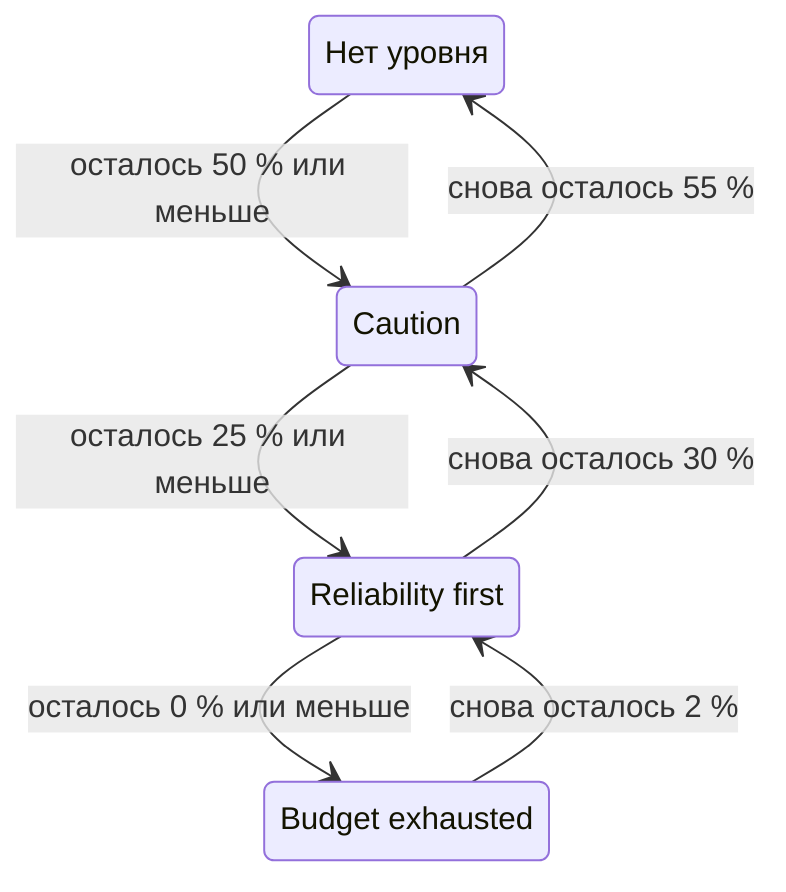

# Политика бюджета ошибок

Политика бюджета ошибок записывает, что ваша команда договорилась делать по мере того, как расходуется бюджет ошибок SLO, например проверять рискованные изменения, когда потрачена половина, или замораживать релизы, когда потрачено всё. OneUptime ставит SLO на тот уровень политики, до которого дошёл его бюджет, показывает договорённость команды для этого уровня на страницах SLO и может создать оповещение или объявить инцидент, когда SLO переходит на уровень. Это практика политики бюджета ошибок из [Google SRE Workbook](https://sre.google/workbook/error-budget-policy/).

:::cards
- [Как работают уровни](#как-работают-уровни): Какой уровень действует и когда SLO его покидает.
- [Настройка политики](#настройка-политики): Начните с рекомендуемой политики или напишите свои уровни.
- [Оповещения и инциденты](#оповещения-и-инциденты): Оповещайте команду, когда SLO переходит на уровень.
- [Чтение уровня через API](#чтение-уровня-через-api): Проверяйте уровень из CI и скриптов.
:::

## Как работают уровни

Политика — это набор уровней. У каждого уровня три поля:

| Поле | Что в нём |
| --- | --- |
| **Имя** | Как команда называет уровень, например «Reliability first». |
| **Порог оставшегося бюджета (%)** | Доля оставшегося бюджета ошибок, при которой или ниже которой уровень действует. От 0 до 100, допускаются дробные значения. У каждого уровня SLO свой порог. |
| **Что мы делаем** | Что команда договорилась делать, пока SLO находится на уровне, в Markdown. Обязательно, до 10 000 символов. |

Уровень действует, пока оставшийся бюджет равен его порогу или ниже, поэтому уровень на 0 % — это уровень исчерпанного бюджета. Когда действуют несколько уровней, SLO находится на уровне с самым низким порогом: самом серьёзном. Когда не действует ни один, SLO не находится ни на одном уровне. С уровнями на 50 %, 25 % и 0 % SLO, у которого осталось 30 % бюджета, находится на уровне 50 %, а SLO, у которого осталось 10 %, — на уровне 25 %.

### Переход на уровень и уход с него

Уровень следует за оставшимся бюджетом так же, как статус SLO:

- Переход на уровень происходит сразу: оценка, которая находит бюджет на пороге уровня или ниже, ставит SLO на этот уровень. Бюджет, который за раз опускается ниже нескольких порогов, сразу попадает на самый серьёзный уровень.
- Уход с уровня на менее серьёзный ждёт, пока бюджет явно не вернётся. Уровень на 0 % покидается, когда снова остаётся 2 % бюджета. Любой другой уровень покидается, когда бюджет на 5 пунктов выше его порога.

Поэтому уровень на 0 % меняется вместе со статусом **Бюджет исчерпан**, а уровень на пороге риска SLO — вместе со статусом **Под угрозой**: см. [Смена статусов и порог риска](/docs/slo/error-budget#смена-статусов-и-порог-риска). Скользящее окно, которое колеблется у порога, не заставляет уровень переключаться туда и обратно.



## Настройка политики

Вам нужно разрешение на создание уровней политики бюджета ошибок SLO.

:::steps
### Откройте Политика бюджета ошибок

Откройте SLO и перейдите в **Политика бюджета ошибок** в разделе **Правила** его бокового меню. На странице перечислены уровни SLO, у каждого — имя, оставшийся бюджет, при котором он действует, и то, что делает команда.

### Начните с рекомендуемой политики

Пока у SLO нет уровней, страница предлагает **Использовать рекомендуемую политику**. Нажмите кнопку, проверьте три уровня, которые она перечисляет, и подтвердите. Затем переделайте текст каждого уровня в собственную договорённость вашей команды.

### Или добавьте уровень сами

Нажмите **Создать: Уровень политики бюджета ошибок SLO**. Введите **Имя** и **Порог оставшегося бюджета (%)** и запишите договорённость команды в **Что мы делаем**.

### Выберите, что создаёт уровень

Уровень записывает и показывает договорённость. Чтобы ещё и оповещать кого-то, когда SLO переходит на уровень, откройте свёрнутые настройки оповещения и инцидента и включите оповещение, инцидент или оба. По умолчанию оба выключены. См. [Оповещения и инциденты](#оповещения-и-инциденты).
:::

Добавление, изменение или удаление уровня действует сразу: OneUptime снова оценивает SLO примерно в течение минуты. Если бюджет уже на пороге уровня или ниже, SLO переходит на этот уровень, и уровень создаёт то, что он настроен создавать. Выключение или удаление уровня разрешает то, что он создал, и SLO переходит на уровень, на котором находится его бюджет. Выключение оповещения или инцидента уровня разрешает это оповещение или этот инцидент.

### Рекомендуемая политика

**Использовать рекомендуемую политику** добавляет три уровня — на половине бюджета, на четверти и на нуле — с таким текстом на английском:

| Уровень | Действует при | Что делает команда |
| --- | --- | --- |
| **Caution** | Осталось 50 % или меньше | Half of the error budget is spent. Review risky changes before they ship, and find out what has been spending the budget. |
| **Reliability first** | Осталось 25 % или меньше | Reliability comes first. Only reliability improvements and critical fixes ship until the budget recovers. |
| **Budget exhausted** | Осталось 0 % или меньше | The error budget is spent. Freeze non-critical releases: only fixes for this SLO's reliability and security fixes ship until the budget is back. |

Ни один из них не создаёт оповещение и не объявляет инцидент, пока вы это не включите. Добавляются только уровни, которых у SLO нет: уровень с тем же именем или с тем же порогом считается существующим, включён он или выключен. Поэтому повторный запрос, из второй вкладки или через API, ничего не добавляет дважды. Каждый добавленный так уровень записывается в журналы аудита SLO как добавленный вами.

## Где виден уровень

- **Обзор** SLO показывает уровень, на котором он находится, и то, что команда договорилась на нём делать, чтобы каждый, кто открывает SLO, видел договорённость, действующую сейчас.
- График **Расход бюджета ошибок** рисует подписанную линию на пороге каждого уровня рядом с линией порога риска.
- **Лента** SLO публикует каждую смену уровня: уровень, который SLO покинул, и уровень, на который перешёл, оставшийся бюджет и то, что команда договорилась делать на новом уровне.
- **Журналы аудита** SLO записывают каждую смену уровня как изменение, которое внёс сам OneUptime, поэтому показывают её только при включённом **Хранить системные события**: см. [Включение журналов аудита](/docs/slo/feed-and-audit-logs#включение-журналов-аудита). Добавление, изменение и удаление уровня записываются от имени человека, который это сделал.
- API чтения SLO возвращает уровень: см. [Чтение уровня через API](#чтение-уровня-через-api).

## Оповещения и инциденты

Каждый уровень может создать оповещение, объявить инцидент или и то и другое, когда SLO переходит на него. У них те же параметры, что у оповещения и инцидента правила скорости расхода: серьёзность, политики дежурств, шаблоны заголовка, описания и заметок по устранению, приватность, автоматическое разрешение, метки, команды и пользователи-владельцы, а также добавление владельцев SLO в качестве владельцев. См. [Что объявляет правило](/docs/slo/burn-rate-alerts#что-объявляет-правило). По умолчанию оба выключены, поэтому уровень никого не оповещает, пока вы не включите что-то одно.

- Переход на более серьёзный уровень разрешает то, что создал предыдущий уровень, независимо от его настройки автоматического разрешения, потому что новый уровень его заменяет. Поэтому одновременно открыты не более чем оповещение и инцидент одного уровня, и они относятся к уровню, на котором находится SLO.
- Восстановление до менее серьёзного уровня или выход со всех уровней разрешает их, когда у уровня включено автоматическое разрешение, как по умолчанию. Если автоматическое разрешение выключено, они остаются открытыми, пока кто-нибудь их не разрешит.
- Подавления повторного срабатывания нет. Уровень создаёт снова, только когда SLO явно покинул его и снова на него перешёл, поэтому он не может «мигать». Если кто-то вручную разрешит то, что он создал, пока SLO ещё на этом уровне, оно останется разрешённым.
- Пока какой-либо монитор SLO находится в плановом обслуживании, уровни ничего не создают. Сам уровень при этом меняется, а открытое по-прежнему разрешается. Если SLO всё ещё на уровне, когда обслуживание заканчивается, уровень тогда создаёт то, что он настроен создавать.

Как и у правила скорости расхода, оповещение или инцидент, созданный уровнем, указывает SLO в разделе **Затронутые ресурсы**, а инцидент никогда не показывается на страницах статуса. Лента SLO публикует каждое из них, а также момент их разрешения.

### Что в них написано

Заголовок, описание и заметки по устранению уровня принимают переменные шаблона, как у правила: см. [Что сообщает каждое оповещение и инцидент](/docs/slo/burn-rate-alerts#что-сообщает-каждое-оповещение-и-инцидент). Поля уровня предлагают переменные SLO и его бюджета, а также три собственные переменные уровня: `{{sloName}}`, `{{sloId}}`, `{{sloLink}}`, `{{sloStatus}}`, `{{policyTier}}`, `{{policyTierThresholdPercentage}}`, `{{policyTierWhatWeDo}}`, `{{targetPercentage}}`, `{{currentSliPercentage}}`, `{{errorBudgetRemainingPercentage}}`, `{{errorBudgetRemaining}}`, `{{errorBudgetRemainingMinutes}}` и `{{windowDescription}}`. Собственные переменные правила, например `{{ruleName}}` и скорости расхода, не предлагаются и пусты в шаблонах уровня.

Три переменные уровня работают и в шаблонах правил скорости расхода:

| Переменная | Что в ней |
| --- | --- |
| `{{policyTier}}` | Название уровня, на котором SLO находится после оценки, или `None`, когда он не находится ни на одном уровне. |
| `{{policyTierThresholdPercentage}}` | Порог этого уровня, например `25`. Пусто, когда SLO не находится ни на одном уровне. |
| `{{policyTierWhatWeDo}}` | Что команда договорилась делать на этом уровне. Пусто, когда SLO не находится ни на одном уровне. |

Уровень, у которого заголовок оставлен пустым, использует встроенный заголовок:

```text
SLO error budget policy: {{sloName}} — {{policyTier}}
```

Встроенное описание называет уровень, сравнивает оставшийся бюджет с порогом уровня и говорит, что команда договорилась на нём делать.

## Когда бюджет не измеряется

- SLO в статусе **Приостановлено** или **Неправильно настроен** не измеряет бюджет, поэтому его уровень остаётся прежним, а созданное уровнем остаётся открытым, пока измерение не возобновится. Правила скорости расхода, напротив, тогда разрешают то, что у них открыто.
- Выключение оценки SLO или архивирование SLO разрешает то, что создали его уровни. Уровень, на котором находится SLO, остаётся прежним.
- Удаление SLO удаляет его уровни и разрешает то, что они создали.

## Чтение уровня через API

Собственный API чтения SLO возвращает уровень, на котором он находится, чтобы задание CI или скрипт могли проверить его, прежде чем действовать, например перед релизом. Все три поля пусты, пока SLO не находится ни на одном уровне:

| Поле | Что в нём |
| --- | --- |
| `currentErrorBudgetPolicyTierId` | ID уровня. |
| `currentErrorBudgetPolicyTierName` | Название уровня. |
| `currentErrorBudgetPolicyTierEnteredAt` | Когда SLO перешёл на уровень. |

Они читаются с собственным разрешением SLO на чтение — тем же, которое нужно и для его бюджета. Например, с [ключом API](/docs/api-reference/api-reference) проекта:

```bash
curl -X POST 'https://oneuptime.com/api/service-level-objective/<slo-id>/get-item' \
  -H "ApiKey: $ONEUPTIME_API_KEY" \
  -H 'Content-Type: application/json' \
  -d '{ "select": { "name": true, "errorBudgetRemainingPercentage": true, "currentErrorBudgetPolicyTierName": true, "currentErrorBudgetPolicyTierEnteredAt": true } }'
```

Сами уровни — отдельный ресурс, `/api/service-level-objective-error-budget-policy-tier`, с запросами на получение списка, чтение, создание, изменение и удаление, которые есть у каждого ресурса. Ещё два запроса обслуживают рекомендуемую политику. Оба принимают `{ "serviceLevelObjectiveId": "..." }` и отвечают уровнями в `tiers`:

| Запрос | Что он делает |
| --- | --- |
| `POST /api/service-level-objective-error-budget-policy-tier/recommended-policy` | Перечисляет рекомендуемые уровни, которых не хватает SLO. Ничего не записывает. |
| `POST /api/service-level-objective-error-budget-policy-tier/recommended-policy/add` | Добавляет их и перечисляет добавленное. Повторный запрос ничего не добавляет. |

## Разрешения

| Разрешение | Позволяет роли |
| --- | --- |
| **Read SLO Error Budget Policy Tier** | Видеть уровни SLO. |
| **Create SLO Error Budget Policy Tier** | Добавлять уровни, вручную или с помощью **Использовать рекомендуемую политику**. |
| **Edit SLO Error Budget Policy Tier** | Изменять уровни, а также включать и выключать их. |
| **Delete SLO Error Budget Policy Tier** | Удалять уровни. |

Эти разрешения находятся в группе SLO роли. У ролей Project Owner и Project Admin есть все они, а роли Project Member и Viewer могут читать уровни.

## Пока недоступно

Некоторые части политики бюджета ошибок пока недоступны: барьер развёртывания, который сам блокирует релизы (вместо этого задание CI может прочитать уровень через API), триггеры рабочих процессов и уведомления в Slack или Microsoft Teams для каждого уровня, политика, общая для нескольких SLO, подтверждение уровня или исключение из него, а также уровни, основанные на запасе бюджета, а не на оставшемся бюджете.

## Дальнейшие шаги

:::cards
- [Бюджеты ошибок](/docs/slo/error-budget): Что такое бюджет и как статус следует за ним.
- [Оповещения и инциденты по скорости расхода бюджета](/docs/slo/burn-rate-alerts): Оповещайте команду, когда бюджет расходуется слишком быстро.
- [Лента и журналы аудита SLO](/docs/slo/feed-and-audit-logs): Каждая смена уровня и то, что создали уровни.
:::
