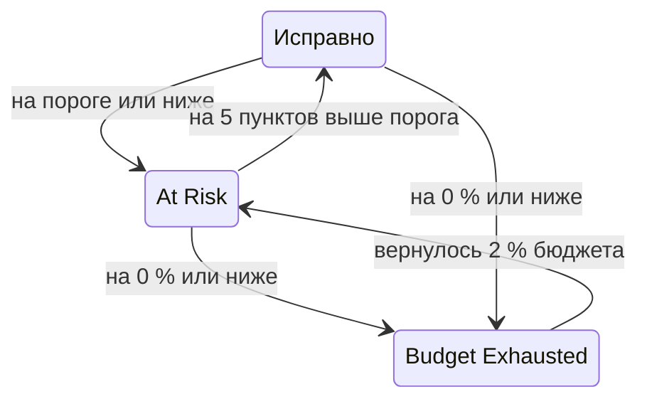

# Бюджеты ошибок

Бюджет ошибок — это простой, который допускает цель SLO. Цель 99,9 % означает не «никогда не падать», а «вы можете быть недоступны до 43 минут за 30 дней, так что тратьте их с умом». На этой странице объясняется, как OneUptime считает бюджет, на сколько его хватает, как он возвращается и кто об этом узнаёт.

:::cards
- [Как рассчитывается бюджет](#как-рассчитывается-бюджет): Формула и бюджет для распространённых целей.
- [Запас бюджета](#запас-бюджета): На сколько хватит бюджета при текущем темпе.
- [Как восстанавливается бюджет](#как-восстанавливается-бюджет): Скользящие окна и календарные месяцы.
- [Уведомления владельцев](#уведомления-владельцев): Кто узнаёт, когда бюджет на исходе.
:::

## Как рассчитывается бюджет

Общий бюджет — это часть окна, которую ваша цель не обещает:

```text
total budget = (100% − target) × window length
```

| Цель | Окно 7 дней | Окно 28 дней | Окно 30 дней | Окно 90 дней |
| --- | --- | --- | --- | --- |
| 99% | 1h 40m 48s | 6h 43m 12s | 7h 12m | 21h 36m |
| 99.5% | 50m 24s | 3h 21m 36s | 3h 36m | 10h 48m |
| 99.9% | 10m 5s | 40m 19s | 43m 12s | 2h 9m 36s |
| 99.95% | 5m 2s | 20m 10s | 21m 36s | 1h 4m 48s |
| 99.99% | 1m 0s | 4m 2s | 4m 19s | 12m 58s |

Страница **Настройки** SLO показывает рядом с целью бюджет, который она допускает, например «43m 12s простоя за окно в 30 дней».

### Бюджет SLO с несколькими мониторами

В режиме **Any Monitor Down** бюджет равен `(100% − target) × window` независимо от того, сколько мониторов измеряет SLO: окно — это одна временная шкала.

В режиме **Monitor Seconds Average** бюджет считается в монитор-секундах, суммированных по мониторам, поэтому он растёт с числом мониторов: у SLO с тремя мониторами и целью 99,9 % за 30 дней бюджет около 129 минут вместо 43. Проценты (SLI, оставшийся бюджет, скорость расхода) означают то же самое; меняются только длительности.

### Бюджет календарного месяца

У SLO с календарным месяцем весь бюджет месяца есть с первого дня: у SLO с целью 99,9 % в месяце из 31 дня все его 44m 38s есть уже 1-го числа. Бюджет не начисляется пропорционально прошедшей части месяца, поэтому минутный сбой утром 1-го числа расходует минуту бюджета месяца.

## Оставшийся бюджет

По мере накопления простоя страница **Обзор** показывает оставшийся бюджет в плитке **Error budget left**:

- в процентах от общего бюджета — это значение также определяет статус SLO и заполняет полосу. На полосе есть отметка на пороге риска SLO;
- в виде длительности, например "31m 4s left of 43m 12s".

Когда бюджет закончился, плитка показывает **No budget left**. Когда простой его превышает, плитка показывает **Budget exceeded** и превышение во времени, например "4d 23m over budget · 5m 47s allowed": SLO израсходовал все 5 минут 47 секунд своего бюджета и ещё 4 дня 23 минуты сверх того. Полоса остаётся пустой и красной.

Для расчётов и графиков истории оставшийся бюджет хранится как число со знаком, поэтому там превышенный бюджет выглядит как отрицательный процент. Сильно отрицательный процент означает, что превышение велико относительно бюджета; это не доля времени, в течение которого сервис был недоступен.

Какие секунды считаются простоем, определяют статусы простоя SLO, а для SLO с несколькими мониторами — ещё и его режим нескольких мониторов; оба параметра находятся в **Настройки** → **Downtime Calculation**. См. [Обзор SLO](/docs/slo/introduction).

## Запас бюджета

Плитка **Budget runway** на странице **Обзор** отвечает на вопрос «если так пойдёт и дальше, когда закончится бюджет?». Она делит оставшийся бюджет на скорость расхода за последние 60 минут:

```text
runway = budget left ÷ (burn rate × (100% − target))
```

| Плитка показывает | Что это значит |
| --- | --- |
| Длительность, например **~2d 5h** | При текущем темпе бюджет закончится примерно через это время. Жёлтым, а красным — если остаётся день или меньше. **Under 1m** означает меньше минуты. |
| **Not burning** | За последние 60 минут бюджет не расходовался. |
| **Sustainable** | Только для скользящих окон: запаса хватает как минимум на целое окно, поэтому бюджет тратится не быстрее, чем старый простой выходит из окна. При таком темпе он не закончится. |
| **Lasts until reset** | Только для календарных месяцев: бюджет сбросится в начале следующего месяца раньше, чем закончится. |
| **Overspent** | Бюджет уже израсходован. Плитка показывает, на сколько он превышен. |

Для SLO с календарным месяцем плитка также сообщает, когда бюджет сбросится.

Запас — это линейный прогноз. В скользящем окне старый простой, выходя из окна, возвращает бюджет, а прогноз этого не учитывает: считайте его минимальным временем, которое у вас осталось. Он не показывается до первой оценки, а также для SLO в режиме **Monitor Seconds Average**, бюджет которых считается в монитор-секундах, а не в реальном времени.

## Расход бюджета ошибок

График **Error budget burn-down** на странице **Обзор** показывает оставшийся бюджет в процентах на протяжении текущего окна соответствия:

- Линия на 0 % отмечает момент, когда бюджет заканчивается, а пунктирная линия — порог риска SLO.
- Для SLO с календарным месяцем бледная линия равномерно опускается от полного бюджета в начале месяца до пустого в момент сброса. Если график ниже этой линии, месяц тратит бюджет слишком быстро.
- Точка записывается при каждой оценке, каждые 5 минут, поэтому график нового SLO пуст до его первой оценки.
- Проведите по графику, чтобы приблизить часть окна. Дважды щёлкните или нажмите **Reset zoom**, чтобы снова увидеть всё окно.

**Open metrics** открывает страницу **Метрики** SLO, вкладка **Error Budget History** которой охватывает до 400 дней. См. [Метрики и дашборды SLO](/docs/slo/metrics).

## Как восстанавливается бюджет

То, как возвращается бюджет, зависит от типа окна SLO:

:::tabs
@tab Rolling
Скользящее окно всегда смотрит назад на одно и то же расстояние от текущего момента, поэтому простой со временем из него выходит: сбой перестаёт учитываться ровно через одно окно после того, как произошёл. 30-минутный сбой 1 июня выйдет из расчёта 30-дневного SLO 1 июля, и бюджет будет возвращаться постепенно — по мере того как каждая секунда простоя покидает окно, а не весь сразу.

Поэтому восстановление нужно заслужить, его нельзя запланировать. Если небольшие сбои продолжаются, старый простой выходит, а новый входит, и бюджет стоит на месте вместо того, чтобы восстанавливаться.
@tab Calendar Month
SLO с календарным месяцем сбрасывается в полночь первого числа каждого месяца в своём часовом поясе. Весь бюджет возвращается разом, а предыдущий месяц закрывается. Ничего не переносится из месяца в месяц ни в одну сторону: плохой месяц не вредит следующему, а хороший не даёт ему запаса.
:::

### Молодые SLO

SLO со скользящим окном, который моложе своего окна, измеряется по уже имеющимся данным, и его общий бюджет растёт вместе с ними: у 30-дневного SLO, созданного неделю назад, пока бюджет на 7 дней. Пока окно не заполнится, страница **Обзор** показывает, насколько оно заполнено, с помощью индикатора **Window 23% full** и такой же пометки в плитке **Error budget left**. Ожидайте, что числа устоятся по мере заполнения окна.

## Смена статусов и порог риска

Оставшийся бюджет определяет статус SLO:

| Статус | Когда |
| --- | --- |
| **Исправно** | Бюджета осталось больше, чем порог риска. |
| **At Risk** | Оставшийся бюджет на пороге риска или ниже: по умолчанию 20 %. |
| **Budget Exhausted** | Оставшийся бюджет равен нулю или ниже. |

Задайте порог риска в **Настройки** → **Objective**.

Скользящие окна восстанавливаются посекундно, поэтому SLO у самой границы мог бы прыгать между двумя статусами туда и обратно. Чтобы каждая смена статуса что-то значила, SLO покидает статус только тогда, когда явно перешёл границу:



С порогом по умолчанию 20 % SLO в зоне риска снова становится исправным при 25 % оставшегося бюджета, а SLO с исчерпанным бюджетом возвращается в зону риска при 2 %. Каждая смена статуса появляется в ленте **Feed** SLO вместе с SLI, бюджетом и скоростью расхода, которые её объясняют.

## Уведомления владельцев

Когда SLO переходит в статус **At Risk** или **Budget Exhausted**, OneUptime уведомляет его владельцев:

- Владельцы — это пользователи и участники команд на странице **Владельцы** SLO, которые всё ещё состоят в проекте. SLO без владельцев вместо этого уведомляет владельцев проекта.
- Каждый владелец по умолчанию получает письмо, а также уведомление по любому другому каналу, который он включил для **SLO status changed** в **Настройки пользователя** → **Настройки уведомлений** → **Мониторинг**.
- В теме письма указаны статус и SLO, например `[SLO At Risk] API Availability`.

Чтобы SLO у самой границы не уведомлял без конца, его владельцы получают не больше одного уведомления в час. Переход в **Budget Exhausted** отправляется всегда, даже в пределах этого часа.

> [!TIP]
> Уведомления владельцев сообщают ответственным за SLO, что с его бюджетом проблемы. Чтобы вызвать дежурную команду через политики эскалации, используйте [Оповещения и инциденты по скорости расхода бюджета](/docs/slo/burn-rate-alerts). Правило скорости расхода также может добавлять владельцев SLO в каждое создаваемое им оповещение и инцидент.

## Дальнейшие шаги

:::cards
- [Оповещения и инциденты по скорости расхода бюджета](/docs/slo/burn-rate-alerts): Предупредите команду, когда бюджет расходуется слишком быстро.
- [Метрики и дашборды SLO](/docs/slo/metrics): Постройте график бюджета во времени.
- [Обзор SLO](/docs/slo/introduction): Цели, окна и статусы простоя.
:::
