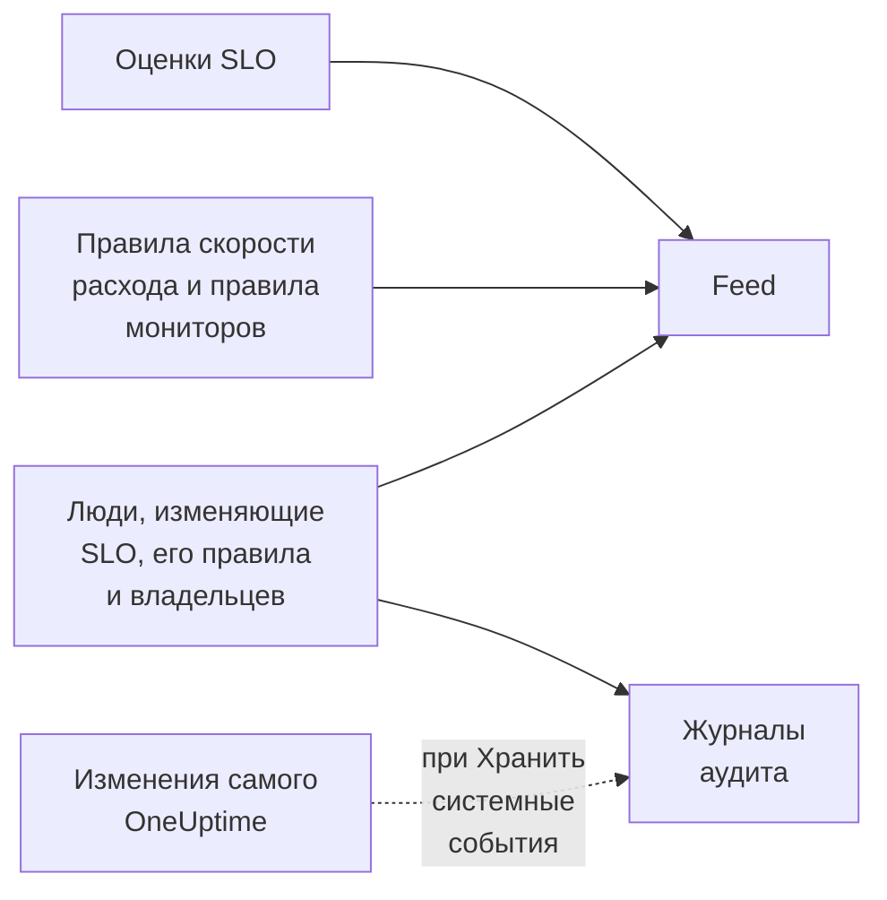

# Лента и журналы аудита SLO

SLO ведёт две записи своей истории, и они отвечают на разные вопросы. **Feed** отвечает на вопрос «что происходило с этим SLO?» и написан для людей, которые за ним следят. **Журналы аудита** отвечают на вопрос «кто и что именно изменил?» — поле за полем, для проверок и соответствия требованиям.

## Лента или журналы аудита?

| | **Feed** | **Журналы аудита** |
| --- | --- | --- |
| Отвечает на вопрос | Что происходило с SLO | Кто что изменил и когда |
| Записывает | Смены статусов, оповещения и инциденты по скорости расхода, а также изменения SLO, его правил, мониторов и владельцев | Каждое изменение, которое люди внесли в SLO, его правила скорости расхода, правила мониторов и владельцев, со старым и новым значением |
| Включает работу самого OneUptime | Да: оценки и правила мониторов, прикрепляющие мониторы | Только при включённом **Хранить системные события** |
| Тарифы | Все тарифы | Тариф Enterprise в OneUptime Cloud или Enterprise Edition в самостоятельно размещённой установке |
| Срок хранения | Три года в OneUptime Cloud | 7 дней по умолчанию, до 180 |

## Лента SLO

Лента находится на странице **Feed** SLO, а её последние записи — в разделе **Recent activity** на странице **Обзор** SLO. Записи ссылаются на SLO, мониторы, оповещения и инциденты, которые в них упоминаются, и у большинства есть раздел **More Information** с числами или старыми и новыми значениями.

| Событие | Публикуется, когда |
| --- | --- |
| SLO создан | SLO создаётся. Перечисляет его цель, окно соответствия, SLI, порог риска, описание и правила скорости расхода по умолчанию, с которыми он был создан. |
| SLO обновлён | Меняются имя, описание, метки, цель, окно соответствия, часовой пояс, порог риска, режим нескольких мониторов или статусы простоя. Показывает каждое старое и новое значение. |
| SLO включён или отключён | Оценка включается или выключается. |
| SLO архивирован или восстановлен | SLO архивируется или извлекается из архива. |
| Статус изменён | Оценка переводит SLO в новый статус. Показывает SLI, бюджет ошибок, скорость расхода и порог риска, которые это объясняют, а для **Приостановлено** или **Misconfigured** — причину. |
| Создано оповещение по скорости расхода | Правило скорости расхода создаёт оповещение. Ссылается на него и показывает скорости расхода, которые его вызвали. |
| Объявлен инцидент по скорости расхода | Правило скорости расхода объявляет инцидент. Ссылается на него и показывает скорости расхода, которые его вызвали. |
| Оповещение или инцидент по скорости расхода устранены | Оповещение или инцидент правила закрываются: автоматически или вручную, пока автоустранение было выключено. |
| Правило скорости расхода добавлено, изменено или удалено | Кто-то создаёт, редактирует или удаляет правило скорости расхода. Правила по умолчанию нового SLO вместо этого указаны в его записи «SLO создан». |
| Правило мониторов добавлено, изменено или удалено | Кто-то создаёт, редактирует или удаляет правило мониторов. Сохранение, которое ничего существенного не меняет, не публикуется. |
| Мониторы прикреплены или откреплены | Мониторы добавляются в SLO или убираются из него — вручную или правилом мониторов. В длинных списках названы первые несколько мониторов «и ещё N». |
| Владелец добавлен или удалён | Пользователь или команда добавляется в число владельцев SLO или убирается из него. |
| Применено правило меток | Правило меток прикрепило метки к SLO — при его создании или когда кто-то запустил правило. Называет правила, которые совпали. См. [Правила меток и владельцев](/docs/slo/label-and-owner-rules). |
| Применено правило владельцев | Правило владельцев добавило владельцев в SLO. Называет правила, которые совпали; каждый добавленный им владелец также получает собственную запись «Владелец добавлен». |

Несколько подробностей:

- Записи указывают, кто внёс изменение, если это был человек. Изменения, которые OneUptime вносит сам, например оценка или правило мониторов, прикрепляющее монитор, а также изменения через API или автоматизацию, пользователя не содержат.
- Оповещение или инцидент, которые правило подхватывает снова, потому что они ещё открыты, не публикуются дважды.
- Для приватного оповещения или инцидента запись не показывает его заголовок, номер и ссылку, потому что ленту SLO может читать любой, кто может читать SLO. Она всё равно сообщает, что была создана приватная запись, и показывает скорости расхода, которые её вызвали.
- Никто не может редактировать или удалять записи ленты. В OneUptime Cloud записи старше трёх лет удаляются.

## Журналы аудита

Страница **Журналы аудита** SLO показывает изменения, внесённые в:

- сам SLO: его сведения, настройки, метки, мониторы и архивирование;
- его правила скорости расхода;
- его правила мониторов;
- его пользователей-владельцев и команды-владельцы.

Изменения правил и владельцев записываются на правило или владельца и сводятся к SLO, поэтому его страница показывает всю историю в одном месте, а каждая запись ссылается на страницу, к которой относится. Связанные элементы, например метки и мониторы, записываются со своими именами, а не только с ID.

Две вещи туда не попадают:

- **Результаты оценок.** SLI, бюджет ошибок, скорость расхода, статус и время оценки меняются каждые несколько минут. Их история — на странице **Обзор**, на странице **Метрики** и в ленте **Feed**.
- **Изменения, которые OneUptime вносит сам**, например когда правило мониторов прикрепляет или открепляет монитор, если только для проекта не включено **Хранить системные события**. Лента **Feed** в любом случае записывает прикрепление и открепление мониторов.

### Включение журналов аудита

Журналы аудита — функция Enterprise: им нужен тариф **Enterprise** в OneUptime Cloud или Enterprise Edition в самостоятельно размещённой установке. На других тарифах страница **Журналы аудита** SLO объясняет, как её получить. В самостоятельно размещённой установке журнал аудита перестаёт вести запись без действующей лицензии (после 14-дневного пробного периода или через 30 дней после истечения лицензии) и возобновляет её, как только лицензия активирована (см. [When a license expires or is missing](/docs/self-hosted/enterprise#когда-лицензия-истекла-или-отсутствует)). Страницы **Журналы аудита** сообщают, когда запись не ведётся.

Кроме того, журналы аудита по умолчанию выключены в каждом проекте. Чтобы включить их:

:::steps
### Откройте настройки журналов аудита

Перейдите в **Настройки проекта**, откройте **Журналы аудита** в боковом меню и нажмите **Настройки**.

### Отредактируйте настройки

Нажмите **Edit Audit Log Settings** и включите **Включить журналы аудита**.

### Выберите, что хранить

Задайте **Хранение (дней)** — от 7 (по умолчанию) до 180 — и включите **Хранить системные события**, чтобы записывать также изменения, которые OneUptime вносит сам. Сохраните. Изменение вступает в силу примерно через минуту.
:::

Пока журнал аудита выключен, страница **Журналы аудита** SLO показывает сообщение **Audit logging is off** со ссылкой для его включения. Записи, сделанные до выключения, остаются видимыми. Полный журнал аудита проекта по всем ресурсам находится в **Настройки проекта** → **Журналы аудита** → **Журналы аудита**.

## Дальнейшие шаги

:::cards
- [Обзор SLO](/docs/slo/introduction): Все страницы SLO.
- [Мониторы и правила мониторов](/docs/slo/monitor-rules): Что прикрепляет и открепляет мониторы.
- [Оповещения и инциденты по скорости расхода бюджета](/docs/slo/burn-rate-alerts): Что создаёт и устраняет оповещения и инциденты в ленте.
- [Правила меток и владельцев](/docs/slo/label-and-owner-rules): Что автоматически добавляет метки и владельцев.
:::
