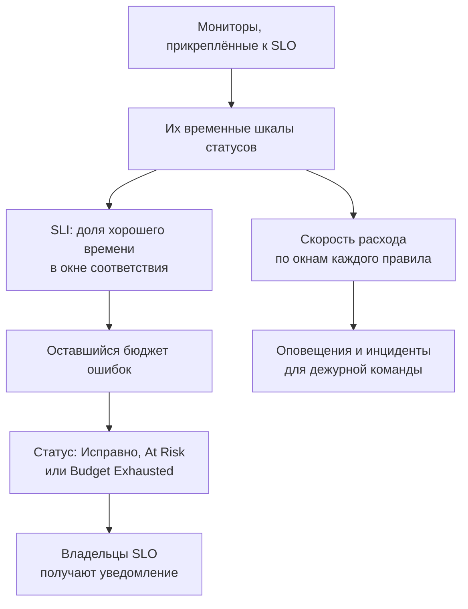

# Обзор SLO

Целевой уровень обслуживания (SLO) — это цель надёжности для того, что вы эксплуатируете, например «доступно 99,9 % времени за скользящие 30 дней» или «99,9 % запросов оформления заказа выполняются успешно». OneUptime сверяет каждый SLO с его целью каждые 5 минут, поэтому вместо вопроса «работает ли это прямо сейчас?» вы можете ответить на вопрос «были ли мы достаточно надёжны за период, который важен нашим пользователям, и сколько права на ошибку у нас осталось?». Страница [Глоссарий](/docs/introduction/glossary#slo) ставит SLO в один ряд с другими словами, которые использует OneUptime.

:::cards
- [Создание SLO](#создание-slo): Что он измеряет, имя и цель. Всё остальное начинается со значения по умолчанию.
- [Мониторы и правила мониторов](/docs/slo/monitor-rules): Выберите мониторы, которые измеряет SLO.
- [SLO по запросам и задержке](/docs/slo/request-slos): Измеряйте запросы сервисов по их трассировкам.
- [Бюджеты ошибок](/docs/slo/error-budget): Сколько простоя допускает цель и как бюджет восстанавливается.
- [Оповещения и инциденты по скорости расхода бюджета](/docs/slo/burn-rate-alerts): Предупредите команду, когда бюджет расходуется слишком быстро.
:::

## Как это работает

SLO измеряет одно из двух. SLO по времени работы мониторов читает временные шкалы статусов прикреплённых к нему мониторов — те же данные, что показывают ваши страницы статуса. SLO по запросам подсчитывает запросы, которые обслуживают его сервисы, по их трассировкам: см. [SLO по запросам и задержке](/docs/slo/request-slos). Остальная часть этой страницы описывает SLO по времени работы мониторов, а SLO по запросам работают так же, если не сказано иное. По этим данным OneUptime вычисляет, какая доля окна соответствия пришлась на хорошее время, сколько бюджета ошибок осталось и как быстро он расходуется. Время, когда мониторинг монитора выключен, не учитывается: в это время монитор никто не проверяет, поэтому это время не расходует бюджет ошибок и не считается хорошим. Время до первой проверки монитора тоже не учитывается: пока ничто не проверило монитор, его статус — лишь рабочий, с которым создаётся каждый монитор, поэтому SLO измеряется с первых проверок его мониторов, а у SLO, мониторы которого ещё ничто не проверило, нечего измерять, пока их не проверят.



## Основные понятия

Слова, которые используются во всём OneUptime, собраны на странице [Глоссарий](/docs/introduction/glossary).

| Понятие | Значение |
| --- | --- |
| **SLI** (индикатор уровня обслуживания) | Измерение: процент окна соответствия, в течение которого мониторы SLO были доступны, или процент хороших запросов его сервисов. |
| **SLO** (целевой уровень обслуживания) | Цель для SLI, например «не менее 99,9 % за последние 30 дней». |
| **Бюджет ошибок** | Простой, который допускает цель: `(100% − target) × window`. При 99,9 % за 30 дней это 43 минуты и 12 секунд. Для SLO по запросам это плохие запросы, которые допускает цель: один из каждых 1 000 при 99,9 %. |
| **Скорость расхода** | Насколько быстро расходуется бюджет по сравнению с равномерным темпом. При скорости расхода 1 бюджет заканчивается ровно в конце окна. |

Бюджет ошибок превращает надёжность в то, что можно тратить. Если его осталось много, выпускайте изменения быстрее и рискуйте; если мало — притормозите и вложитесь в стабильность. SLO даёт этому разговору число, которое видят все.

## Создание SLO

Вам нужна роль, которой разрешено создавать SLO: Владелец проекта, Администратор проекта или пользовательская роль с разрешением Create Service Level Objective.

:::steps
### Откройте SLO

Откройте **SLOs** в меню **Продукты** на верхней панели. Этот пункт находится в первой группе, рядом с мониторами и инцидентами. Нажмите **Создать: Целевой уровень обслуживания**.

### Выберите, что измеряет SLO

В поле **Что измеряется** оставьте **Время работы мониторов**, чтобы измерять долю времени, когда мониторы доступны. Выберите **Успешность запросов** или **Задержка запросов**, чтобы вместо этого измерять запросы сервисов, и выберите их **Сервисы**: см. [SLO по запросам и задержке](/docs/slo/request-slos). Выберите **Метрика**, чтобы подсчитывать хорошие события в счётчике или гистограмме, которые отправляют ваши сервисы: см. [SLO по метрике](/docs/slo/request-slos#slo-по-метрике). Нажмите **Далее**.

### Задайте имя и цель

Введите **Имя**, например «API Availability», и **Цель (%)** — долю времени или запросов, которая должна быть хорошей. Цель начинается с `99.9`. Она должна быть больше 0 и не больше 99,999, потому что при цели 100 % не остаётся бюджета ошибок, за которым можно следить.

### Проверьте значения по умолчанию в разделе «Дополнительные поля»

Раздел **Дополнительные поля** свёрнут, а строка рядом объясняет, что делают значения по умолчанию: SLO измеряется по скользящему окну в 30 дней и переходит в зону риска, когда остаётся меньше 20 % бюджета ошибок. Разверните его, чтобы изменить любое из полей в таблице ниже.

### Сохраните SLO

Нажмите **Создать: Целевой уровень обслуживания**. OneUptime откроет новый SLO. Страница **Обзор** SLO по времени работы мониторов показывает **Choose what this SLO measures**, потому что у него ещё нет мониторов.

### Прикрепите мониторы

Для SLO по времени работы мониторов нажмите **Создать правило мониторов**, чтобы прикрепить все подходящие мониторы — сейчас и в будущем, или **Добавить мониторы**, чтобы выбрать их вручную. См. [Мониторы и правила мониторов](/docs/slo/monitor-rules).

### Дождитесь первых чисел

OneUptime оценивает включённые SLO каждые 5 минут. SLI, бюджет ошибок и график расхода появляются после первой оценки, в которой есть мониторы для измерения или запросы для подсчёта.
:::

Поля в разделе **Дополнительные поля**:

| Поле | Что вы задаёте | По умолчанию |
| --- | --- | --- |
| **Описание** | Для чего нужен SLO. | Пусто |
| **Порог риска (%)** | Доля оставшегося бюджета ошибок, при которой SLO переходит в статус **Под угрозой**. Целое число от 0 до 100. | 20 |
| **Тип окна** | **Скользящее**: последние N дней, которые восстанавливаются по мере того, как старый простой выходит из окна. **Календарный месяц**: каждый месяц сам по себе, со сбросом 1-го числа. | **Скользящее** |
| **Окно (дни)** | Только для скользящих окон: на сколько дней смотреть назад, от 1 до 366. Обычно 28 или 30. | 30 |
| **Часовой пояс** | Только для календарных месяцев: часовой пояс, в котором начинается и заканчивается каждый месяц. | UTC |
| **Метки** | Метки для упорядочивания и фильтрации SLO. | Нет |

Всё, что определяет, как SLO измеряет, начинается со значения по умолчанию, которое вы меняете позже:

| Параметр | Новый SLO начинает с | Где изменить |
| --- | --- | --- |
| Мониторы | Нет | **Мониторы** или **Правила мониторов** |
| Статусы простоя | Все неработающие статусы проекта | **Настройки** → **Расчёт простоя** |
| Режим нескольких мониторов | **Любой монитор недоступен** | **Настройки** → **Расчёт простоя** |
| Оценка | Включена | **Настройки** → **Оценка** |
| Правила скорости расхода | Правило **Fast burn**, правило **Slow burn** и правило **Slow leak**, подогнанные под окно | **Правила скорости расхода** |

## Из чего состоит SLO

| Часть | Что она определяет |
| --- | --- |
| Что измеряется | **Время работы мониторов**, **Успешность запросов** или **Задержка запросов**. |
| Мониторы или сервисы | Откуда берётся SLI: мониторы, прикреплённые вручную или с помощью правил мониторов (см. [Мониторы и правила мониторов](/docs/slo/monitor-rules)), или сервисы, запросы которых подсчитывает SLO по запросам. |
| Цель | Доля хорошего времени, которую обещает SLO: больше 0 и не больше 99,999. |
| Окно соответствия | Период, за который измеряются SLI и бюджет: скользящее окно от 1 до 366 дней или календарный месяц. |
| Порог риска | Доля оставшегося бюджета, при которой SLO переходит в статус **Под угрозой**. |
| Статусы простоя | Какие статусы мониторов считаются простоем. |
| Режим нескольких мониторов | Как объединяется простой нескольких мониторов. |

### Какие статусы считаются простоем

У каждого SLO есть свой список статусов мониторов, которые считаются простоем. Новый SLO начинает со всех статусов проекта, которые не отмечены как рабочие, например Degraded и Offline, — так же, как ваши страницы статуса. Измените список в **Настройки** → **Расчёт простоя**. Оставьте его пустым, чтобы учитывать все неработающие статусы, включая те, что позже добавят в проект.

> [!TIP]
> Измеряйте одни и те же мониторы двумя способами с помощью двух SLO: строгий SLO доступности, в котором учитываются и Degraded, и Offline, и более мягкий SLO полного отказа, в котором учитывается только Offline.

### Окна соответствия

| Тип окна | Как работает |
| --- | --- |
| **Скользящее** | Смотрит назад на фиксированное число дней от текущего момента. Старый простой выходит из окна, поэтому бюджет возвращается постепенно. |
| **Календарный месяц** | Измеряет с первого числа месяца в часовом поясе SLO (по умолчанию UTC). Весь бюджет возвращается в начале каждого месяца. |

### Несколько мониторов в одном SLO

Когда SLO измеряет больше одного монитора, его **Режим нескольких мониторов** определяет, как объединяется их простой. Новый SLO использует **Любой монитор недоступен**.

| Режим | Как считается простой | Когда использовать |
| --- | --- | --- |
| **Любой монитор недоступен** | Любой момент, когда недоступен хотя бы один монитор, считается простоем всего SLO. Пересекающиеся сбои учитываются один раз. | Мониторы вместе образуют один сервис: если откажет любой из них, пользователи это заметят. |
| **Среднее по секундам мониторов** | Простой каждого монитора учитывается отдельно и усредняется по всему времени наблюдения: SLI = 1 − (секунды простоя всех мониторов ÷ секунды наблюдения всех мониторов). | Мониторы — это парк однотипных ресурсов, и частичное воздействие должно учитываться частично. |

Например, монитор A недоступен с 10:00 до 11:00, а монитор B всё это время доступен. **Любой монитор недоступен** засчитывает 60 минут простоя; **Среднее по секундам мониторов** засчитывает эквивалент 30 минут, потому что один из двух мониторов был недоступен час. В этом режиме бюджет тоже считается в монитор-секундах: см. [Бюджеты ошибок](/docs/slo/error-budget).

## Статус SLO

OneUptime присваивает каждому оценённому SLO статус:

| Статус | Что он означает |
| --- | --- |
| **Исправно** | Бюджета осталось больше, чем порог риска. |
| **Под угрозой** | Оставшийся бюджет опустился до порога риска или ниже: по умолчанию 20 %. |
| **Бюджет исчерпан** | Бюджет израсходован полностью или превышен. |
| **Ожидание** | Его мониторы ещё ни разу не проверялись: монитор создан минуту назад или не подключён самостоятельно размещённый зонд. SLO измеряется с их первой проверки. |
| **Неправильно настроен** | SLO невозможно измерить: у него нет мониторов, его мониторы больше не существуют или ещё не записали ни одного статуса в его окне, либо его цель вне допустимого диапазона. SLO по запросам неправильно настроен, если у него нет сервисов или порога задержки или если его сервисы ещё не обслужили ни одного запроса в его окне. |
| **Приостановлено** | Все измеряемые им мониторы архивированы или у них выключено активное наблюдение — вручную, ручным инцидентом или плановым обслуживанием. Измерение возобновляется само, как только хотя бы один из них снова начинают отслеживать. |

Отключённый или архивированный SLO не оценивается, поэтому его статус остаётся прежним; вместо него список SLO показывает значок **Отключено** или **Архивировано**. Владельцы SLO получают уведомление, когда статус меняется на **Под угрозой** или **Бюджет исчерпан**: см. [Бюджеты ошибок](/docs/slo/error-budget). Правило может также публиковать изменения статуса в Slack, Microsoft Teams или Mattermost: см. [Изменения статуса](/docs/slo/error-budget-policy#изменения-статуса).

## Список SLO

Страница **SLOs** показывает каждый неархивированный SLO с его статусом, SLI, оставшимся бюджетом, скоростью расхода, целью, окном, мониторами, метками и владельцами. Столбец **Что измеряется** показывает сервисы SLO по запросам там, где для SLO по доступности мониторов показывает мониторы, а фильтр **Сервисы** находит SLO, которые измеряют сервис.

- Плитки над списком считают SLO по статусам: **Исправно**, **Под угрозой**, **Бюджет исчерпан**, **Ожидание**, **Неправильно настроен**, **Приостановлено** и **Отключено**. Они появляются, как только есть SLO не в архиве. Нажмите плитку, чтобы видеть только эти SLO, и нажмите ещё раз, чтобы снова видеть все.
- Выберите SLO, чтобы разом добавить или убрать метки и владельцев, включить или отключить их, добавить им недостающие [рекомендуемые правила скорости расхода](/docs/slo/burn-rate-alerts#добавление-сразу-во-многие-slo) или [рекомендуемую политику бюджета ошибок](/docs/slo/error-budget-policy#рекомендуемая-политика), архивировать их или удалить.
- Фильтр **Развертывания** показывает SLO, чья политика бюджета ошибок прямо сейчас замораживает развёртывания, или те, где она их разрешает. Покажите столбец **Развертывания** через выбор столбцов списка, чтобы видеть, с какого времени заморожен каждый из них: см. [Барьер развёртывания](/docs/slo/error-budget-policy#барьер-развёртывания).
- Раздел **Настройки** бокового меню содержит **Правила меток** и **Правила владельца**, которые добавляют новым SLO метки и владельцев: см. [Правила меток и владельцев](/docs/slo/label-and-owner-rules).
- Раздел **Расширенный** бокового меню содержит **Архивировано** — список архивированных SLO.

## Страницы SLO

Откройте SLO, чтобы увидеть его страницы в боковом меню:

| Страница | Что показывает |
| --- | --- |
| **Обзор** | Статус, ключевые показатели, расход бюджета ошибок, последнюю активность, открытые оповещения и инциденты и правила скорости расхода. |
| **Метрики** | Метрики `oneuptime.slo.*` этого SLO, долгосрочную историю его бюджета ошибок и метрики инцидентов и оповещений, которые его затрагивают. См. [Метрики и панели SLO](/docs/slo/metrics). |
| **Ежемесячный отчёт** | Как SLO выполнялся в каждом календарном месяце и за весь период. См. [Ежемесячный отчёт](#ежемесячный-отчёт). |
| **Инциденты** | Инциденты, объявленные его правилами скорости расхода и его политикой бюджета ошибок. Значок считает открытые. |
| **Оповещения** | Оповещения, созданные его правилами скорости расхода и его политикой бюджета ошибок. Значок считает открытые. |
| **Лента** | Что происходило с SLO, в виде хронологии. См. [Лента и журналы аудита SLO](/docs/slo/feed-and-audit-logs). |
| **Мониторы** | Мониторы, которые он измеряет, и кто прикрепил каждый из них — человек или правило. Только для SLO по времени работы мониторов. |
| **Правила мониторов** | Правила, которые прикрепляют подходящие мониторы. Только для SLO по времени работы мониторов. |
| **Правила скорости расхода** | Правила, которые создают оповещения и объявляют инциденты, когда бюджет расходуется слишком быстро. |
| **Политика бюджета ошибок** | Что команда договорилась делать по мере расхода бюджета ошибок, а также оповещения и инциденты, которые создаёт каждый уровень политики. См. [Политика бюджета ошибок](/docs/slo/error-budget-policy). |
| **Владельцы** | Пользователи и команды, которые узнают об изменениях его статуса. |
| **Настройки** | Что измеряет SLO, цель, период соответствия, расчёт простоя, переключатель оценки и карточка архивирования. |
| **Журналы аудита** | Кто и когда менял SLO, его правила и его владельцев. |
| **Удалить SLO** | Удаляет SLO навсегда и устраняет открытые им оповещения и инциденты по скорости расхода. |

**Мониторы** находятся в разделе **Обзор**, под пунктом **Обзор**; **Правила мониторов**, **Правила скорости расхода** и **Политика бюджета ошибок** — в разделе **Правила**; а **Владельцы**, **Настройки**, **Журналы аудита** и **Удалить SLO** — в разделе **Управление**. Разделы **Правила** и **Управление** изначально свёрнуты, как и раздел **Для разработчиков** для управления SLO из кода: нажмите заголовок раздела, чтобы открыть его.

Когда что-то мешает SLO измерять, баннер вверху каждой его страницы сообщает, в чём проблема, и ведёт на страницу, где её можно исправить: см. [Устранение неполадок](#устранение-неполадок).

### Обзор

Страница **Обзор** отвечает на вопрос «укладываемся ли мы в бюджет?», сверху вниз:

- **Сводка**: статус, фраза о том, что он означает, и описание. Рядом — **Обновить** и время последней оценки SLO. Ниже — цель, **Окно соответствия** (с индикатором заполнения, пока молодое скользящее окно заполняется: см. [Молодые SLO и индикатор заполнения окна](#молодые-slo-и-индикатор-заполнения-окна)), число мониторов (или сервисов SLO по запросам) и владельцы, а **Добавить владельцев** добавляет владельца прямо там.
- **Ключевые показатели**:
  - **SLI**: доля хорошего времени в окне и насколько она выше или ниже цели.
  - **Осталось бюджета ошибок**: процент, длительность вроде "Осталось 12 мин 30 с из 43 мин 12 с" (для SLO по запросам — число плохих запросов) и полоса с отметкой на пороге риска. Когда бюджет превышен, показывает **Бюджет превышен** и размер превышения.
  - **Скорость расхода**: как быстро расходуется бюджет за последние 60 минут — период, который использует правило быстрого расхода по умолчанию. Становится жёлтым выше 1× и красным, с надписью **Порог правила достигнут**, на самом низком пороге среди включённых правил скорости расхода этого SLO, которые охватывают не больше 6 часов. Час мало что говорит о правиле, которое охватывает несколько дней, например **Slow leak**, поэтому с таким правилом показатель не сравнивается.
  - **Запас бюджета по времени**: на сколько хватит бюджета при таком темпе. См. [Бюджеты ошибок](/docs/slo/error-budget#запас-бюджета).
- **Расход бюджета ошибок**: оставшийся бюджет на протяжении текущего окна. См. [Бюджеты ошибок](/docs/slo/error-budget#расход-бюджета-ошибок).
- **Недавние действия**: последние записи ленты SLO.
- **Сведения об SLO**: имя, описание и метки — единственные параметры, которые редактируются на странице обзора.
- **Открытые оповещения и инциденты**: то, что правила скорости расхода держат открытым прямо сейчас.
- **Burn rate rules**: порог каждого включённого правила рядом с текущей скоростью расхода — для правил, которые охватывают не больше 6 часов, — и то, что правило объявляет.

Когда SLO находится на уровне своей политики бюджета ошибок, **Обзор** показывает и этот уровень, и то, что команда договорилась на нём делать: см. [Политика бюджета ошибок](/docs/slo/error-budget-policy).

Карточка **Используется** перечисляет правила скорости расхода и уровни политики бюджета ошибок, действующие на SLO, и панели, на которых оно показано. Архивация или удаление SLO сначала показывает их: его правила и уровни удаляются вместе с ним.

### Настройки

Страница **Настройки** собирает всё, что определяет, как SLO измеряет, — по карточке на каждый аспект:

| Карточка | Что вы меняете | Полезно знать |
| --- | --- | --- |
| **Что измеряется** | **Что измеряется**, **Сервисы**, **Порог задержки (мс)**, **Фильтр запросов** и **Метрика** с помощью **Изменить, что измеряется**. | После изменения SLO по запросам заново подсчитывает свои запросы с самого начала. |
| **Цель** | **Цель (%)** и **Порог риска (%)** с помощью **Изменить цель**. | Показывает простой, который допускает цель, например «43 мин 12 с простоя на окно, дней: 30». |
| **Период соответствия** | **Тип окна**, **Окно (дни)** и **Часовой пояс** с помощью **Изменить период**. | Правила скорости расхода сохраняют свои пороги при изменении окна, поэтому после этого проверьте их. |
| **Расчёт простоя** | **Режим нескольких мониторов** и **Статусы мониторов при простое** с помощью **Изменить расчёт простоя**. | Только для SLO по времени работы мониторов. Если статусы не выбраны, учитываются все неработающие статусы, включая добавленные позже. |
| **Оценка** | Переключатель **Оценивать этот SLO**, который сохраняется сразу при переключении. | При выключении запрашивается подтверждение, потому что это также устраняет открытые оповещения и инциденты SLO по скорости расхода. |
| **Архивировать: SLO** | **Архивировать** или **Извлечь из архива**. | См. [Архивирование SLO](#архивирование-slo). |

После изменения того, что измеряет SLO, цели, периода или расчёта простоя OneUptime заново оценивает SLO при следующем запуске.

### Ежемесячный отчёт

**Ежемесячный отчёт** показывает, как SLO выполнялся в каждом календарном месяце за последние **3 месяца**, **6 месяцев**, **9 месяцев** или **12 месяцев** либо за календарный год. Для каждого месяца показаны его SLI, простой (для SLO запросов — неудачные или медленные запросы, для SLO по метрике — плохие события), доля израсходованного бюджета ошибок и результат:

| Результат | Что он означает |
| --- | --- |
| Выполнено | Месяц завершён, и его SLI достиг цели. |
| Не выполнено | Месяц завершён и не достиг цели, либо месяц ещё идёт, а простоя в нём уже больше, чем допускает весь месяц. |
| По плану | Месяц ещё идёт, и его SLI на данный момент достигает цели. |
| Ниже цели | Месяц ещё идёт, и его SLI на данный момент ниже цели. |
| Нет данных | В этом месяце ничего не измерялось. |

Строка **Всего** измеряет весь период целиком. У SLO с несколькими мониторами есть ещё таблица **По мониторам**: собственный SLI каждого монитора за каждый месяц, первым идёт монитор, который обошёлся SLO дороже всего. **Скачать CSV** сохраняет отчёт в файл для электронной таблицы.

Для отчёта ничего дополнительно не хранится. Каждый месяц вычисляется по истории статусов мониторов при открытии отчёта — с мониторами, статусами простоя и целью SLO в их нынешнем виде, поэтому отчёт охватывает и время до создания SLO. Месяцы SLO запросов берутся из запросов, которые OneUptime подсчитал для него, а месяцы SLO по метрике — из событий его метрики; OneUptime хранит их 400 дней. Границы месяцев определяются часовым поясом SLO или UTC, если пояс не задан.

API отвечает тем же отчётом:

```bash
curl -sS "https://oneuptime.com/api/service-level-objective/<slo-id>/monthly-report?months=12" \
  -H "ApiKey: $ONEUPTIME_API_KEY"
```

Запросите через `months` от 1 до 24 месяцев, заканчивая текущим, или календарный год через `year`, например `year=2025`.

## Архивирование SLO

Архивируйте SLO, который вы больше не измеряете, но хотите сохранить, например выведенный из эксплуатации сервис или прошлогоднюю цель. Архивируйте его через **Настройки** → **Архивировать: SLO** или выберите SLO в списке и нажмите **Архивировать**.

Архивированный SLO:

- скрыт из списка SLO, его плиток статусов, а также из селекторов и списков SLO на панелях;
- не оценивается: его числа остаются такими, какими были при последней оценке, его правила скорости расхода не срабатывают, и он не отправляет метрики;
- получает устранёнными свои открытые оповещения и инциденты по скорости расхода;
- сохраняет свои настройки, историю, правила и владельцев. Его правила мониторов поддерживают список мониторов в актуальном состоянии, поэтому он возобновляется с правильными мониторами.

Архивированные SLO перечислены на странице **Архивировано** в разделе **Расширенный** бокового меню списка SLO. Выберите их там и нажмите **Извлечь из архива**, чтобы вернуть: они снова оцениваются при следующем запуске, а SLI и бюджет пересчитываются по истории их мониторов.

Архивирование и выключение оценки — разные переключатели. SLO, который был отключён до архивирования, остаётся отключённым после извлечения из архива: снова включите его кнопкой **Включить оценку** в его баннере или переключателем **Оценивать этот SLO** в **Настройки** → **Оценка**.

| Вы хотите | Сделайте так |
| --- | --- |
| На время перестать измерять, оставив SLO в списке | Выключите оценку |
| Вывести его из работы, сохранив историю и настройки | Архивируйте его |
| Убрать его навсегда | Удалите его |

## SLO в оповещениях, инцидентах и мониторах

Каждое оповещение и инцидент, созданные правилом скорости расхода, связаны со своим SLO:

- Страница оповещения или инцидента показывает SLO в разделе **Затронутые ресурсы** со ссылкой на него.
- Списки оповещений и инцидентов показывают SLO среди затронутых ресурсов, а фильтр **Затронутые ресурсы** ограничивает список одним SLO.
- Страницы **Оповещения** и **Инциденты** этого SLO перечисляют их, а значки в боковом меню считают открытые.

OneUptime создаёт эту связь, когда правило создаёт оповещение или инцидент; добавить её вручную нельзя, а редактирование оповещения или инцидента никогда её не удаляет.

В боковом меню монитора тоже есть страница **SLOs**: SLO, которые измеряют этот монитор, чтобы вы знали, какие цели от него зависят, прежде чем приостановить или изменить его.

## Молодые SLO и индикатор заполнения окна

SLO со скользящим окном, который моложе своего окна, измеряется по уже имеющимся данным: у 30-дневного SLO, созданного вчера, данные за один день. Его бюджет ошибок начинается с малого и растёт по мере заполнения окна, поэтому первые числа колеблются сильнее, чем будут колебаться позже.

Пока это так, страница **Обзор** об этом сообщает: в сводке есть индикатор **Окно заполнено на 23%** (**Окно заполнено меньше чем на 1%** в первый день), а плитка **Осталось бюджета ошибок** повторяет это под своим числом. Оба исчезают, когда окно заполнено. У SLO с календарным месяцем их не бывает, потому что их бюджет покрывает весь месяц с первого дня, а также у SLO в режиме **Среднее по секундам мониторов**, бюджет которых считается по всем мониторам. SLO по запросам показывает их, пока OneUptime ещё подсчитывает более ранние запросы его сервисов: см. [SLO по запросам и задержке](/docs/slo/request-slos#как-подсчитываются-запросы).

## Устранение неполадок

Баннер вверху страниц SLO сообщает, что мешает ему измерять:

| Баннер | Что он означает | Что делать |
| --- | --- | --- |
| **Мониторы не подключены** | У SLO нет мониторов, поэтому измерять нечего. | Прикрепите мониторы или создайте правило мониторов. |
| **Ожидание оценки SLO** | Мониторы прикреплены, но при последней оценке от них не было данных о статусе. | Убедитесь, что мониторы проверяются. Числа появятся после следующей оценки с данными. |
| **Ожидание первой проверки** | Мониторы прикреплены, но их ещё ни разу не проверяли: монитор создан минуту назад или не подключён самостоятельно размещённый зонд. | Ничего: SLO измеряется с их первой проверки. Если она не приходит, откройте мониторы, чтобы узнать почему. |
| **Измерение приостановлено** | Все измеряемые им мониторы архивированы или у них выключено активное наблюдение. | Снова включите наблюдение хотя бы для одного монитора или дождитесь окончания обслуживания. |
| **Цель вне допустимого диапазона** | Цель не попадает в диапазон: больше 0 и меньше 100. | Задайте цель, например 99,9, в **Настройки** → **Цель**. |
| **Этот SLO отключён** | Оценка выключена. | Нажмите **Включить оценку**. |
| **Этот SLO в архиве** | SLO архивирован. | Извлеките его из архива в **Настройки**. |
| **Ещё не оценивалось** | SLO только что создан. | Дождитесь первой оценки — не больше нескольких минут. |
| **Сервисы не выбраны** | У SLO по запросам нет сервисов, поэтому ему нечего подсчитывать. | Выберите его сервисы в **Настройки** → **Что измеряется**. |
| **Порог задержки не задан** | У SLO по задержке запросов нет порога, поэтому ни один запрос не может считаться достаточно быстрым. | Задайте **Порог задержки (мс)** в **Настройки** → **Что измеряется**. |
| **Ожидание запросов** | Ни один из сервисов SLO по запросам ещё не обслужил ни одного запроса в его окне. | Убедитесь, что сервисы отправляют трассировки в OneUptime. Числа появятся после следующей оценки, которая подсчитает хотя бы один запрос. |
| **Нет метрики для подсчёта** | У SLO по метрике нет метрики, которую он может подсчитать: метрика не выбрана или не задано, как отличать её хорошие события. | Выберите метрику, а также условие или значение для хороших событий, в **Настройки** → **Что измеряется**. |
| **Ожидание метрики** | Ни один из сервисов SLO по метрике ещё не отправил ни одного события его метрики в его окне. | Убедитесь, что сервисы отправляют метрику в OneUptime под тем именем, которое подсчитывает SLO. Числа появятся после следующей оценки, которая подсчитает хотя бы одно событие. |

## Дальнейшие шаги

:::cards
- [Мониторы и правила мониторов](/docs/slo/monitor-rules): Прикрепляйте мониторы вручную или с помощью правил.
- [SLO по запросам и задержке](/docs/slo/request-slos): Измеряйте запросы сервиса по его трассировкам.
- [Бюджеты ошибок](/docs/slo/error-budget): Расчёт бюджета, его запас и то, как бюджет возвращается.
- [Проверки релизов](/docs/slo/release-checks): Откатывайте релиз, который расходует бюджет ошибок.
:::
