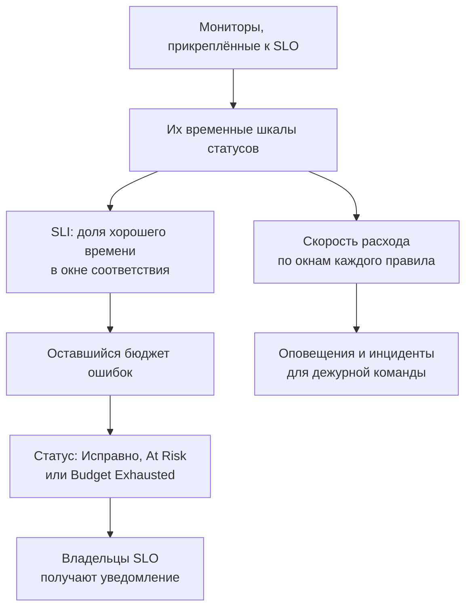

# Обзор SLO

Целевой уровень обслуживания (SLO) — это цель надёжности для того, что вы отслеживаете, например «доступно 99,9 % времени за скользящие 30 дней». OneUptime сверяет каждый SLO с его целью каждые 5 минут, поэтому вместо вопроса «работает ли это прямо сейчас?» вы можете ответить на вопрос «были ли мы достаточно надёжны за период, который важен нашим пользователям, и сколько права на ошибку у нас осталось?».

:::cards
- [Создание SLO](#создание-slo): Имя и цель. Всё остальное начинается со значения по умолчанию.
- [Мониторы и правила мониторов](/docs/slo/monitor-rules): Выберите мониторы, которые измеряет SLO.
- [Бюджеты ошибок](/docs/slo/error-budget): Сколько простоя допускает цель и как бюджет восстанавливается.
- [Оповещения и инциденты по скорости расхода бюджета](/docs/slo/burn-rate-alerts): Предупредите команду, когда бюджет расходуется слишком быстро.
:::

## Как это работает

SLO читает временные шкалы статусов прикреплённых к нему мониторов — те же данные, что показывают ваши страницы статуса. По ним OneUptime вычисляет, какая доля окна соответствия пришлась на хорошее время, сколько бюджета ошибок осталось и как быстро он расходуется.

## Основные понятия

| Понятие | Значение |
| --- | --- |
| **SLI** (индикатор уровня обслуживания) | Измерение: процент окна соответствия, в течение которого мониторы SLO были доступны. |
| **SLO** (целевой уровень обслуживания) | Цель для SLI, например «не менее 99,9 % за последние 30 дней». |
| **Бюджет ошибок** | Простой, который допускает цель: `(100% − target) × window`. При 99,9 % за 30 дней это 43 минуты и 12 секунд. |
| **Скорость расхода** | Насколько быстро расходуется бюджет по сравнению с равномерным темпом. При скорости расхода 1 бюджет заканчивается ровно в конце окна. |

Бюджет ошибок превращает надёжность в то, что можно тратить. Если его осталось много, выпускайте изменения быстрее и рискуйте; если мало — притормозите и вложитесь в стабильность. SLO даёт этому разговору число, которое видят все.

## Создание SLO

Вам нужна роль, которой разрешено создавать SLO: Project Owner, Project Admin или пользовательская роль с разрешением Create Service Level Objective.

:::steps
### Откройте SLO

Откройте **SLOs** в меню **Продукты** на верхней панели. Этот пункт находится в первой группе, рядом с мониторами и инцидентами. Нажмите **Создать: Service Level Objective**.

### Задайте имя и цель

Введите **Имя**, например «API Availability», и **Target (%)** — долю времени, в течение которой его мониторы должны быть доступны. Цель начинается с `99.9`. Она должна быть больше 0 и не больше 99,999, потому что при цели 100 % не остаётся бюджета ошибок, за которым можно следить.

### Проверьте значения по умолчанию в разделе «Дополнительные поля»

Раздел **Дополнительные поля** свёрнут, а строка рядом объясняет, что делают значения по умолчанию: SLO измеряется по скользящему окну в 30 дней и переходит в зону риска, когда остаётся меньше 20 % бюджета ошибок. Разверните его, чтобы изменить любое из полей в таблице ниже.

### Сохраните SLO

Нажмите **Создать: Service Level Objective**. OneUptime откроет новый SLO. Его страница **Обзор** показывает **Choose what this SLO measures**, потому что у нового SLO ещё нет мониторов.

### Прикрепите мониторы

Нажмите **Create a monitor rule**, чтобы прикрепить все подходящие мониторы — сейчас и в будущем, или **Add monitors**, чтобы выбрать их вручную. См. [Мониторы и правила мониторов](/docs/slo/monitor-rules).

### Дождитесь первых чисел

OneUptime оценивает включённые SLO каждые 5 минут. SLI, бюджет ошибок и график расхода появляются после первой оценки, в которой есть мониторы для измерения.
:::

Поля в разделе **Дополнительные поля**:

| Поле | Что вы задаёте | По умолчанию |
| --- | --- | --- |
| **Описание** | Для чего нужен SLO. | Пусто |
| **Порог риска (%)** | Доля оставшегося бюджета ошибок, при которой SLO переходит в статус **At Risk**. Целое число от 0 до 100. | 20 |
| **Window Type** | **Rolling**: последние N дней, которые восстанавливаются по мере того, как старый простой выходит из окна. **Calendar Month**: каждый месяц сам по себе, со сбросом 1-го числа. | **Rolling** |
| **Window (Days)** | Только для скользящих окон: на сколько дней смотреть назад, от 1 до 366. Обычно 28 или 30. | 30 |
| **Часовой пояс** | Только для календарных месяцев: часовой пояс, в котором начинается и заканчивается каждый месяц. | UTC |
| **Метки** | Метки для упорядочивания и фильтрации SLO. | Нет |

Всё, что определяет, как SLO измеряет, начинается со значения по умолчанию, которое вы меняете позже:

| Параметр | Новый SLO начинает с | Где изменить |
| --- | --- | --- |
| Мониторы | Нет | **Мониторы** или **Monitor Rules** |
| Статусы простоя | Все неработающие статусы проекта | **Настройки** → **Downtime Calculation** |
| Режим нескольких мониторов | **Any Monitor Down** | **Настройки** → **Downtime Calculation** |
| Оценка | Включена | **Настройки** → **Оценка** |
| Правила скорости расхода | Правило **Fast burn** и правило **Slow burn**, подогнанные под окно | **Burn Rate Rules** |

## Из чего состоит SLO

| Часть | Что она определяет |
| --- | --- |
| Мониторы | Откуда берётся SLI. Прикрепляйте их вручную или с помощью правил мониторов: см. [Мониторы и правила мониторов](/docs/slo/monitor-rules). |
| Цель | Доля хорошего времени, которую обещает SLO: больше 0 и не больше 99,999. |
| Окно соответствия | Период, за который измеряются SLI и бюджет: скользящее окно от 1 до 366 дней или календарный месяц. |
| Порог риска | Доля оставшегося бюджета, при которой SLO переходит в статус **At Risk**. |
| Статусы простоя | Какие статусы мониторов считаются простоем. |
| Режим нескольких мониторов | Как объединяется простой нескольких мониторов. |

### Какие статусы считаются простоем

У каждого SLO есть свой список статусов мониторов, которые считаются простоем. Новый SLO начинает со всех статусов проекта, которые не отмечены как рабочие, например Degraded и Offline, — так же, как ваши страницы статуса. Измените список в **Настройки** → **Downtime Calculation**. Оставьте его пустым, чтобы учитывать все неработающие статусы, включая те, что позже добавят в проект.

> [!TIP]
> Измеряйте одни и те же мониторы двумя способами с помощью двух SLO: строгий SLO доступности, в котором учитываются и Degraded, и Offline, и более мягкий SLO полного отказа, в котором учитывается только Offline.

### Окна соответствия

| Тип окна | Как работает |
| --- | --- |
| **Rolling** | Смотрит назад на фиксированное число дней от текущего момента. Старый простой выходит из окна, поэтому бюджет возвращается постепенно. |
| **Calendar Month** | Измеряет с первого числа месяца в часовом поясе SLO (по умолчанию UTC). Весь бюджет возвращается в начале каждого месяца. |

### Несколько мониторов в одном SLO

Когда SLO измеряет больше одного монитора, его **Multi Monitor Mode** определяет, как объединяется их простой. Новый SLO использует **Any Monitor Down**.

| Режим | Как считается простой | Когда использовать |
| --- | --- | --- |
| **Any Monitor Down** | Любой момент, когда недоступен хотя бы один монитор, считается простоем всего SLO. Пересекающиеся сбои учитываются один раз. | Мониторы вместе образуют один сервис: если откажет любой из них, пользователи это заметят. |
| **Monitor Seconds Average** | Простой каждого монитора учитывается отдельно и усредняется по всему времени наблюдения: SLI = 1 − (секунды простоя всех мониторов ÷ секунды наблюдения всех мониторов). | Мониторы — это парк однотипных ресурсов, и частичное воздействие должно учитываться частично. |

Например, монитор A недоступен с 10:00 до 11:00, а монитор B всё это время доступен. **Any Monitor Down** засчитывает 60 минут простоя; **Monitor Seconds Average** засчитывает эквивалент 30 минут, потому что один из двух мониторов был недоступен час. В этом режиме бюджет тоже считается в монитор-секундах: см. [Бюджеты ошибок](/docs/slo/error-budget).

## Статус SLO

OneUptime присваивает каждому оценённому SLO статус:

| Статус | Что он означает |
| --- | --- |
| **Исправно** | Бюджета осталось больше, чем порог риска. |
| **At Risk** | Оставшийся бюджет опустился до порога риска или ниже: по умолчанию 20 %. |
| **Budget Exhausted** | Бюджет израсходован полностью или превышен. |
| **Misconfigured** | SLO невозможно измерить: у него нет мониторов, его мониторы больше не существуют или ещё не записали ни одного статуса в его окне, либо его цель вне допустимого диапазона. |
| **Приостановлено** | Все измеряемые им мониторы архивированы или у них выключено активное наблюдение — вручную, ручным инцидентом или плановым обслуживанием. Измерение возобновляется само, как только хотя бы один из них снова начинают отслеживать. |

Отключённый или архивированный SLO не оценивается, поэтому его статус остаётся прежним; вместо него список SLO показывает значок **Отключено** или **Архивировано**. Владельцы SLO получают уведомление, когда статус меняется на **At Risk** или **Budget Exhausted**: см. [Бюджеты ошибок](/docs/slo/error-budget).

## Список SLO

Страница **SLOs** показывает каждый неархивированный SLO с его статусом, SLI, оставшимся бюджетом, скоростью расхода, целью, окном, мониторами, метками и владельцами.

- Плитки над списком считают SLO по статусам: **Исправно**, **At Risk**, **Budget Exhausted**, **Misconfigured**, **Приостановлено** и **Отключено**. Нажмите плитку, чтобы видеть только эти SLO, и нажмите ещё раз, чтобы снова видеть все.
- Выберите SLO, чтобы разом добавить или убрать метки и владельцев, архивировать их или удалить.
- Раздел **Настройки** бокового меню содержит **Правила меток** и **Правила владельца**, которые добавляют новым SLO метки и владельцев: см. [Правила меток и владельцев](/docs/slo/label-and-owner-rules).
- Раздел **Расширенный** бокового меню содержит **Архивировано** — список архивированных SLO.

## Страницы SLO

Откройте SLO, чтобы увидеть его страницы в боковом меню:

| Страница | Что показывает |
| --- | --- |
| **Обзор** | Статус, ключевые показатели, расход бюджета ошибок, последнюю активность, открытые оповещения и инциденты и правила скорости расхода. |
| **Метрики** | Метрики `oneuptime.slo.*` этого SLO, долгосрочную историю его бюджета ошибок и метрики инцидентов и оповещений, которые его затрагивают. См. [Метрики и дашборды SLO](/docs/slo/metrics). |
| **Инциденты** | Инциденты, объявленные его правилами скорости расхода. Значок считает открытые. |
| **Оповещения** | Оповещения, созданные его правилами скорости расхода. Значок считает открытые. |
| **Feed** | Что происходило с SLO, в виде хронологии. См. [Лента и журналы аудита SLO](/docs/slo/feed-and-audit-logs). |
| **Мониторы** | Мониторы, которые он измеряет, и кто прикрепил каждый из них — человек или правило. |
| **Monitor Rules** | Правила, которые прикрепляют подходящие мониторы. |
| **Burn Rate Rules** | Правила, которые создают оповещения и объявляют инциденты, когда бюджет расходуется слишком быстро. |
| **Владельцы** | Пользователи и команды, которые узнают об изменениях его статуса. |
| **Настройки** | Цель, период соответствия, расчёт простоя, переключатель оценки и карточка архивирования. |
| **Журналы аудита** | Кто и когда менял SLO, его правила и его владельцев. |
| **Delete SLO** | Удаляет SLO навсегда и устраняет открытые им оповещения и инциденты по скорости расхода. |

**Мониторы**, **Monitor Rules** и **Burn Rate Rules** находятся в разделе **Конфигурация**, а **Владельцы**, **Настройки**, **Журналы аудита** и **Delete SLO** — в разделе **Management**. Оба раздела изначально свёрнуты, как и раздел **Для разработчиков** для управления SLO из кода: нажмите заголовок раздела, чтобы открыть его.

Когда что-то мешает SLO измерять, баннер вверху каждой его страницы сообщает, в чём проблема, и ведёт на страницу, где её можно исправить: см. [Устранение неполадок](#устранение-неполадок).

### Обзор

Страница **Обзор** отвечает на вопрос «укладываемся ли мы в бюджет?», сверху вниз:

- **Сводка**: статус, фраза о том, что он означает, и описание. Рядом — **Обновить** и время последней оценки SLO. Ниже — цель, **Compliance window** (с индикатором заполнения, пока молодое скользящее окно заполняется: см. [Молодые SLO и индикатор заполнения окна](#молодые-slo-и-индикатор-заполнения-окна)), число мониторов и владельцы.
- **Ключевые показатели**:
  - **SLI**: доля хорошего времени в окне и насколько она выше или ниже цели.
  - **Error budget left**: процент, длительность вроде "12m 30s left of 43m 12s" и полоса с отметкой на пороге риска. Когда бюджет превышен, показывает **Budget exceeded** и размер превышения.
  - **Burn rate**: как быстро расходуется бюджет за последние 60 минут — период, который использует правило быстрого расхода по умолчанию. Становится жёлтым выше 1× и красным, с надписью **Rule threshold reached**, на самом низком пороге среди включённых правил скорости расхода этого SLO.
  - **Budget runway**: на сколько хватит бюджета при таком темпе. См. [Бюджеты ошибок](/docs/slo/error-budget#запас-бюджета).
- **Error budget burn-down**: оставшийся бюджет на протяжении текущего окна. См. [Бюджеты ошибок](/docs/slo/error-budget#расход-бюджета-ошибок).
- **Recent activity**: последние записи ленты SLO.
- **SLO Details**: имя, описание и метки — единственные параметры, которые редактируются на странице обзора.
- **Open alerts & incidents**: то, что правила скорости расхода держат открытым прямо сейчас.
- **Burn rate rules**: порог каждого включённого правила рядом с текущей скоростью расхода и то, что правило объявляет.

### Настройки

Страница **Настройки** собирает всё, что определяет, как SLO измеряет, — по карточке на каждый аспект:

| Карточка | Что вы меняете | Полезно знать |
| --- | --- | --- |
| **Objective** | **Target (%)** и **Порог риска (%)** с помощью **Edit Objective**. | Показывает простой, который допускает цель, например «43m 12s простоя за окно в 30 дней». |
| **Compliance Period** | **Window Type**, **Window (Days)** и **Часовой пояс** с помощью **Edit Period**. | Правила скорости расхода сохраняют свои пороги при изменении окна, поэтому после этого проверьте их. |
| **Downtime Calculation** | **Multi Monitor Mode** и **Статусы мониторов при простое** с помощью **Edit Downtime Calculation**. | Если статусы не выбраны, учитываются все неработающие статусы, включая добавленные позже. |
| **Оценка** | Переключатель **Оценивать этот SLO**, который сохраняется сразу при переключении. | При выключении запрашивается подтверждение, потому что это также устраняет открытые оповещения и инциденты SLO по скорости расхода. |
| **Archive SLO** | **Архивировать** или **Извлечь из архива**. | См. [Архивирование SLO](#архивирование-slo). |

После изменения цели, периода или расчёта простоя OneUptime заново оценивает SLO при следующем запуске.

## Архивирование SLO

Архивируйте SLO, который вы больше не измеряете, но хотите сохранить, например выведенный из эксплуатации сервис или прошлогоднюю цель. Архивируйте его через **Настройки** → **Archive SLO** или выберите SLO в списке и нажмите **Архивировать**.

Архивированный SLO:

- скрыт из списка SLO, его плиток статусов, а также из селекторов и списков SLO на дашбордах;
- не оценивается: его числа остаются такими, какими были при последней оценке, его правила скорости расхода не срабатывают, и он не отправляет метрики;
- получает устранёнными свои открытые оповещения и инциденты по скорости расхода;
- сохраняет свои настройки, историю, правила и владельцев. Его правила мониторов поддерживают список мониторов в актуальном состоянии, поэтому он возобновляется с правильными мониторами.

Архивированные SLO перечислены на странице **Архивировано** в разделе **Расширенный** бокового меню списка SLO. Выберите их там и нажмите **Извлечь из архива**, чтобы вернуть: они снова оцениваются при следующем запуске, а SLI и бюджет пересчитываются по истории их мониторов.

Архивирование и выключение оценки — разные переключатели. SLO, который был отключён до архивирования, остаётся отключённым после извлечения из архива: снова включите его кнопкой **Включить оценку** в его баннере или переключателем **Оценивать этот SLO** в **Настройки** → **Оценка**.

| Вы хотите | Сделайте так |
| --- | --- |
| На время перестать измерять, оставив SLO в списке | Выключите оценку |
| Вывести его из работы, сохранив историю и настройки | Архивируйте его |
| Убрать его навсегда | Удалите его |

## SLO в оповещениях, инцидентах и мониторах

Каждое оповещение и инцидент, созданные правилом скорости расхода, связаны со своим SLO:

- Страница оповещения или инцидента показывает SLO в разделе **Затронутые ресурсы** со ссылкой на него.
- Списки оповещений и инцидентов показывают SLO среди затронутых ресурсов, а фильтр **Затронутые ресурсы** ограничивает список одним SLO.
- Страницы **Оповещения** и **Инциденты** этого SLO перечисляют их, а значки в боковом меню считают открытые.

OneUptime создаёт эту связь, когда правило создаёт оповещение или инцидент; добавить её вручную нельзя, а редактирование оповещения или инцидента никогда её не удаляет.

В боковом меню монитора тоже есть страница **SLOs**: SLO, которые измеряют этот монитор, чтобы вы знали, какие цели от него зависят, прежде чем приостановить или изменить его.

## Молодые SLO и индикатор заполнения окна

SLO со скользящим окном, который моложе своего окна, измеряется по уже имеющимся данным: у 30-дневного SLO, созданного вчера, данные за один день. Его бюджет ошибок начинается с малого и растёт по мере заполнения окна, поэтому первые числа колеблются сильнее, чем будут колебаться позже.

Пока это так, страница **Обзор** об этом сообщает: в сводке есть индикатор **Window 23% full** (**Window under 1% full** в первый день), а плитка **Error budget left** повторяет это под своим числом. Оба исчезают, когда окно заполнено. У SLO с календарным месяцем их не бывает, потому что их бюджет покрывает весь месяц с первого дня, а также у SLO в режиме **Monitor Seconds Average**, бюджет которых считается по всем мониторам.

## Устранение неполадок

Баннер вверху страниц SLO сообщает, что мешает ему измерять:

| Баннер | Что он означает | Что делать |
| --- | --- | --- |
| **No monitors attached** | У SLO нет мониторов, поэтому измерять нечего. | Прикрепите мониторы или создайте правило мониторов. |
| **Waiting for SLO evaluation** | Мониторы прикреплены, но при последней оценке от них не было данных о статусе. | Убедитесь, что мониторы проверяются. Числа появятся после следующей оценки с данными. |
| **Measurement is paused** | Все измеряемые им мониторы архивированы или у них выключено активное наблюдение. | Снова включите наблюдение хотя бы для одного монитора или дождитесь окончания обслуживания. |
| **The target is out of range** | Цель не попадает в диапазон: больше 0 и меньше 100. | Задайте цель, например 99,9, в **Настройки** → **Objective**. |
| **This SLO is disabled** | Оценка выключена. | Нажмите **Включить оценку**. |
| **This SLO is archived** | SLO архивирован. | Извлеките его из архива в **Настройки**. |
| **Not evaluated yet** | SLO только что создан. | Дождитесь первой оценки — не больше нескольких минут. |

## Дальнейшие шаги

:::cards
- [Мониторы и правила мониторов](/docs/slo/monitor-rules): Прикрепляйте мониторы вручную или с помощью правил.
- [Бюджеты ошибок](/docs/slo/error-budget): Расчёт бюджета, его запас и то, как бюджет возвращается.
- [Оповещения и инциденты по скорости расхода бюджета](/docs/slo/burn-rate-alerts): Предупредите дежурную команду, когда бюджет расходуется слишком быстро.
- [Метрики и дашборды SLO](/docs/slo/metrics): Стройте графики SLO и создайте дашборд SLO.
:::
