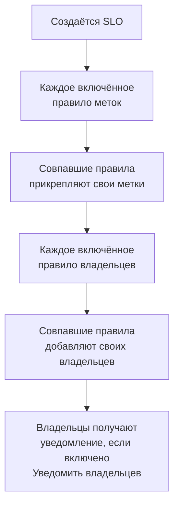

# Правила меток и владельцев

Правила меток и правила владельцев наводят порядок в ваших SLO за вас. **Правило меток** прикрепляет метки к каждому новому SLO, который ему соответствует, а **правило владельцев** добавляет ему пользователей и команды в качестве владельцев, поэтому новый SLO для checkout получает метку _Checkout_ и принадлежит команде checkout, и никому не нужно об этом помнить. Оба работают так же, как правила меток и владельцев в любом другом продукте: что у них общего, см. в [Правила меток и владельцев](/docs/configuration/label-and-owner-rules).

## Как это работает

Правила выполняются при создании SLO — из панели или через API. Сначала выполняются правила меток, поэтому правило владельцев может сработать по метке, которую только что прикрепило правило меток.

Оба вида действуют на весь проект. Их можно найти в боковом меню списка SLO в разделе **Настройки**: **Правила меток** и **Правила владельца**. Раздел **Настройки** изначально свёрнут; нажмите его заголовок, чтобы открыть.

## Создание правила

:::steps
### Откройте список правил

Откройте **SLOs**, затем **Настройки** → **Правила меток** или **Настройки** → **Правила владельца** в боковом меню и нажмите **Создать: SLO Label Rule** или **Создать: SLO Owner Rule**.

### Выберите, чему соответствует правило

На шаге **Совпадение** нажмите **Добавить условие** для каждого условия, которому должен отвечать SLO (см. [Критерии совпадения](#критерии-совпадения)). Если условий два или больше, выберите **Соответствие всем** или **Соответствие любому**. Правило без условий соответствует каждому новому SLO.

### Выберите, что добавляет правило

Второй шаг правила меток — **Метки**, где вы выбираете **Метки для добавления**. У правила владельцев это шаг **Владельцы**, где в поле **Владельцы** вы выбираете, кого добавить, — людей и команды из одного списка с помощью **Добавить владельца**. Правило должно добавлять хотя бы одну метку или одного владельца.

### Проверьте имя и свёрнутые поля

**Имя** заполняется по вашему выбору, например _Добавить Checkout, Production_ или _Добавить Checkout team как владельцев_, и следует за вашим выбором, пока вы не введёте собственное имя. В разделе **Дополнительные поля** находятся необязательное **Описание** и, у правила владельцев, **Уведомить владельцев**.

### Сохраните правило

На последнем шаге снова нажмите **Создать: SLO Label Rule** или **Создать: SLO Owner Rule**. Правило создаётся включённым.
:::

**Уведомить владельцев** (в разделе **Дополнительные поля**) по умолчанию включено: владельцы, которых добавляет правило владельцев, получают то же уведомление «вас добавили в качестве владельца», что и владелец, добавленный вручную. Выключите его, чтобы добавлять владельцев без уведомления.

Чтобы приостановить правило, не удаляя его, выключите **Включено** в его форме редактирования. Форма редактирования никогда не требует меток или владельцев: старое правило, которое ничего не добавляет, всё равно можно переименовать, выключить или удалить, а список помечает его как **Ничего не добавляет**.

Когда правило соответствует SLO:

- Правило меток прикрепляет каждую метку из **Метки для добавления**. Метки, которые у SLO уже есть, не добавляются повторно, а когда совпадает несколько правил, SLO получает метки всех из них.
- Правило владельцев добавляет в качестве владельца каждого пользователя и каждую команду из правила. Владельцы, которые у SLO уже есть, пропускаются, а когда совпадает несколько правил, SLO получает владельцев всех из них. Пользователь, который больше не состоит в проекте, или команда из другого проекта никогда не добавляются; остальные владельцы правила добавляются.

Владельцы SLO — это люди, которые узнают об изменениях его статуса: см. [Бюджеты ошибок](/docs/slo/error-budget).

## Критерии совпадения

Каждое условие сравнивает одно поле SLO:

| Поле | С чем сравнивается | Операторы |
| --- | --- | --- |
| **Метки SLO** | Метки SLO. | **Содержит любое из**, **Содержит все из**, **Не содержит ни одного из** |
| **Название SLO** | Имя SLO. | **Содержит**, **Не содержит**, **Равно**, **Не равно**, **Начинается с**, **Заканчивается на**, **Соответствует шаблону**, **Не соответствует шаблону** |
| **Описание SLO** | Описание SLO. | Те же, что для **Название SLO** |

Новое условие по имени или описанию начинается с **Содержит**. Шаблон — это регулярное выражение, например `^checkout-.*`, или подстановочный знак `*`, например `*checkout*`; регистр не учитывается. Шаблон, который не является ни тем ни другим, например `checkout-(01`, отклоняется при сохранении, а не тихо перестаёт чему-либо соответствовать.

| Вам нужно | Условия |
| --- | --- |
| Каждый SLO сервиса checkout | **Название SLO** содержит `checkout` |
| Каждый рабочий SLO | **Метки SLO** содержит любое из _Production_ |
| SLO для checkout, кроме staging | **Соответствие всем**: **Название SLO** содержит `checkout`, и **Метки SLO** не содержит ни одного из _Staging_ |

## Когда выполняются правила

- **При создании SLO** — из панели или через API: каждое включённое правило меток, затем каждое включённое правило владельцев.
- **При запуске правила** кнопкой **Run Now**: см. ниже.

Редактирование SLO не применяет правила заново, и правило никогда ничего не удаляет: ни метки и владельцев, добавленных кем-то вручную, ни те, что добавило оно само. Выключенное правило ничего не делает.

## Применение правила к существующим SLO

Правило, написанное сегодня, применяется к SLO, созданным после него. Чтобы применить его к уже существующим SLO, нажмите **Run Now** в строке правила или **Просмотр**, а затем **Run Now** на собственной странице правила. Можно также выбрать несколько правил и запустить их через массовые действия таблицы.

Запуск проверяет каждый SLO проекта, включая архивированные, и сообщает, скольким он соответствовал и сколько изменил. Владельцы, добавленные запуском, получают уведомление, только если вы выбрали это в диалоге запуска и у правила включено **Уведомить владельцев**. См. [Применение правил к существующим ресурсам](/docs/configuration/run-rules-now).

Правила меток также можно копировать между проектами: см. [Импорт и экспорт правил меток](/docs/configuration/label-rule-import-export).

## История

Каждый раз, когда правило меняет SLO, лента **Feed** этого SLO записывает, какие правила это сделали. Каждый владелец, добавленный правилом, также получает собственную запись ленты «добавлен в качестве владельца», поэтому лента показывает, кого добавили и почему. См. [Лента и журналы аудита SLO](/docs/slo/feed-and-audit-logs).

## Разрешения

| Чтобы | Нужно |
| --- | --- |
| Работать с правилами меток | **Create SLO Label Rule**, **Edit SLO Label Rule**, **Delete SLO Label Rule** или **Read SLO Label Rule** |
| Работать с правилами владельцев | **Create SLO Owner Rule**, **Edit SLO Owner Rule**, **Delete SLO Owner Rule** или **Read SLO Owner Rule** |
| Запустить правило меток | **Edit SLO Label Rule** и **Edit Service Level Objective** |
| Запустить правило владельцев | **Edit SLO Owner Rule**, **Edit Service Level Objective**, **Create SLO User Owner** и **Create SLO Team Owner** |

Эти разрешения находятся в группе SLO роли, и у ролей Project Owner и Project Admin есть все они. Запуск меняет каждый SLO проекта, поэтому разрешения, ограниченного некоторыми метками или SLO, владельцем которых вы являетесь, недостаточно для запуска правила.

## Дальнейшие шаги

:::cards
- [Правила меток и владельцев](/docs/configuration/label-and-owner-rules): Как работают правила меток и владельцев в каждом продукте.
- [Применение правил к существующим ресурсам](/docs/configuration/run-rules-now): Как Run Now работает для каждого вида правил.
- [Обзор SLO](/docs/slo/introduction): Все страницы SLO и список SLO.
:::
