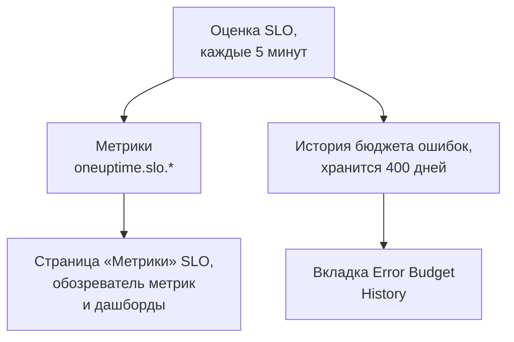

# Метрики и дашборды SLO

Каждый раз, когда OneUptime оценивает SLO, — каждые 5 минут — он записывает результаты в виде метрик с именами `oneuptime.slo.*`. Они хранятся в том же хранилище метрик, что и метрики ваших мониторов, поэтому SLO можно показать на графике на его странице **Метрики**, открыть в обозревателе метрик и вывести на любой дашборд, с фильтрацией и группировкой, как любой другой ряд.

:::cards
- [Метрики](#метрики): Шесть рядов, их единицы и способы агрегирования.
- [Страница «Метрики»](#страница-метрики): Графики SLO, его история и метрики инцидентов и оповещений.
- [SLO на дашбордах](#slo-на-дашбордах): Виджет SLO и шаблон SLO Dashboard.
:::

## Как это работает

## Метрики

| Метрика | Единица | Агрегирование | Что содержит |
| --- | --- | --- | --- |
| `oneuptime.slo.sli.percent` | `%` | Avg | SLI в окне соответствия SLO: доля измеренного времени, которая была хорошей. |
| `oneuptime.slo.target.percent` | `%` | Avg | Цель SLO, отправляемая при каждой оценке, чтобы график мог нарисовать её поверх SLI. |
| `oneuptime.slo.error.budget.remaining.percent` | `%` | Avg | Доля бюджета ошибок, ещё не потраченная в окне. Отрицательная, когда бюджет превышен. |
| `oneuptime.slo.error.budget.remaining.seconds` | `seconds` | Avg | Простой, который SLO ещё может выдержать до нарушения. Отрицательный, когда бюджет превышен. |
| `oneuptime.slo.burn.rate` | `x` | Max | Насколько быстро тратится бюджет за последние 60 минут. 1x тратит бюджет ровно за окно. |
| `oneuptime.slo.status` | — | Max | Статус SLO при каждой оценке: `0` — Исправно, `1` — At Risk, `2` — Budget Exhausted. |

Агрегирование — это то, как собственные графики SLO и шаблон SLO Dashboard объединяют точки, попавшие в один интервал графика. Проценты и длительности усредняются. Для скорости расхода и статуса берётся максимум, чтобы короткий всплеск расхода или краткий заход в Budget Exhausted не потерялся при усреднении.

Для SLO в режиме **Monitor Seconds Average** `oneuptime.slo.error.budget.remaining.seconds` считает монитор-секунды, суммированные по его мониторам, как и его бюджет ошибок: см. [Бюджеты ошибок](/docs/slo/error-budget).

### Когда точка не записывается

- Отключённый или архивированный SLO не оценивается, поэтому ничего не отправляет.
- SLO в статусе **Приостановлено** или **Misconfigured** ничего не измеряет, поэтому отправляет только `oneuptime.slo.target.percent` — это конфигурация, а не измерение. Его графики SLI, бюджета, скорости расхода и статуса показывают разрыв.
- Значение, которое не является настоящим числом, например скорость расхода в окне без данных, пропускается и никогда не записывается как 0.

### Атрибуты

Каждая точка несёт эти атрибуты:

| Атрибут | Значение |
| --- | --- |
| `sloId` | ID SLO. Собственные страницы SLO фильтруют по нему, поэтому переименование SLO никогда не разбивает его графики. |
| `sloName` | Имя SLO на момент записи точки. |
| `projectId` | ID проекта. |
| `oneuptime.label.<key>` | По одному атрибуту на каждую метку SLO. Метка с именем `Tier 1` превращается в `oneuptime.label.tier_1` = `true`, а метка с именем `product:checkout` — в `oneuptime.label.product` = `checkout`. Ключи приводятся к нижнему регистру, а пробелы и знаки препинания заменяются на `_`. |

Ряды принадлежат SLO, а не какому-либо из его мониторов, и не учитываются как использование телеметрии.

Метрики инцидентов и оповещений несут два соответствующих атрибута, `serviceLevelObjectiveIds` и `serviceLevelObjectiveNames`: списки через запятую тех SLO, которые затрагивает инцидент или оповещение.

### Хранение

Метрики `oneuptime.slo.*` хранятся столько же, сколько метрики мониторов: по умолчанию **30 дней**. В самостоятельно размещённой установке главный администратор может изменить это с помощью **Monitor Metric Retention (Days)** в настройках **Хранение данных** в Admin Dashboard.

Это не ограничивает вкладку **Error Budget History** на странице **Метрики** SLO. Эта история хранится отдельно, 400 дней.

## Страница «Метрики»

На странице **Метрики** SLO четыре вкладки:

| Вкладка | Что показывает |
| --- | --- |
| **SLO Metrics** | Ряды `oneuptime.slo.*` в трёх карточках с общим временным диапазоном, по умолчанию за последние сутки: **Objective** (SLI с целью поверх него и оставшийся бюджет), **Burn** (скорость расхода и оставшееся время бюджета) и **Статус**. |
| **Error Budget History** | SLI, оставшийся бюджет и скорость расхода за долгосрочную историю, с линиями на уровне цели, на границах риска и исчерпания и на пороге каждого включённого правила скорости расхода. |
| **Метрики инцидентов** | Количество, время до подтверждения, время до устранения и длительность инцидентов, затрагивающих этот SLO, по умолчанию за последнюю неделю. Инциденты, объявленные его правилами скорости расхода, включены. |
| **Метрики оповещений** | То же для оповещений. Оповещения, созданные его правилами скорости расхода, включены. |

Вкладки **SLO Metrics**, **Метрики инцидентов** и **Метрики оповещений** читают хранилище метрик, для чего нужно разрешение на чтение телеметрии. Пользовательская роль, которая может читать SLO, но не телеметрию, видит эти вкладки пустыми, а **Error Budget History** продолжает работать.

## SLO на дашбордах

### Постройте график любой метрики SLO

:::steps
#### Добавьте график

В режиме редактирования дашборда добавьте виджет графика или значения и выберите одну из метрик `oneuptime.slo.*`.

#### Сгруппируйте или отфильтруйте

Группируйте по `sloName` и `sloId`, чтобы получить по линии на SLO; `sloId` разделяет два SLO с одинаковым именем. Или фильтруйте по `sloName` либо по атрибуту `oneuptime.label.*`.

#### Выберите агрегирование

Используйте агрегирование из таблицы выше: Avg для процентов и длительностей, Max для скорости расхода и статуса.
:::

### Виджет SLO

[Виджет SLO](/docs/dashboards/widgets#slo) показывает SLI, оставшийся бюджет или скорость расхода одного SLO в виде плитки или графика. Он получает свой SLO одним из двух способов:

| Параметр | Как работает |
| --- | --- |
| **Service Level Objective** | Закрепляет виджет за одним SLO. Селектор показывает неархивированные SLO. |
| **Follow SLO Variable** | Показывает SLO, выбранный в переменной дашборда: переменной **Telemetry Attribute** по ключу `sloName`. Игнорируется, пока SLO закреплён. |

На [публичном дашборде](/docs/dashboards/sharing) виджет, следующий за переменной, позволяет зрителям выбрать по имени любой неархивированный SLO проекта. Закреплённый виджет показывает только свой SLO и продолжает показывать последние числа SLO, архивированного позже.

### Шаблон SLO Dashboard

При создании дашборда выберите шаблон **SLO Dashboard**, чтобы получить готовую доску со всеми SLO проекта в трёх полосах:

1. **Service Level Objectives**: список всех неархивированных SLO с их статусом, SLI относительно цели, полосой бюджета и скоростью расхода, а также подсчёт SLO по статусам. Включённые SLO идут первыми, начиная с того, у кого меньше всего бюджета; отключённый SLO идёт последним с пометкой **Отключено**, а его последние числа приглушены.
2. **Error Budget & Burn Rate**: плитки **Lowest Error Budget Remaining**, **Least Error Budget Time Left** и **Peak Burn Rate** и графики **Error Budget Remaining by SLO** и **Burn Rate by SLO** с линией на каждый SLO, сгруппированные по `sloName` и `sloId`.
3. **Selected SLO**: плитки **SLI**, **Error Budget Remaining** и **Burn Rate** и графики **SLI History**, **Error Budget History** и **Burn Rate History** одного SLO.

Одна переменная SLO на панели инструментов задаёт область всей доски. Это переменная Telemetry Attribute по `sloName`, поэтому её варианты — это имена SLO, найденные в метриках. Выбор SLO сужает список до него, ограничивает графики и плитки полосы и заполняет виджеты **Selected SLO**, которые следуют за переменной. Пока вы его не выберете, они просят выбрать SLO на панели инструментов.

## Устранение неполадок

:::details SLO нет в селекторе SLO на панели инструментов
Селектор показывает имена SLO, отправленные за последние сутки. Новый SLO появляется после своей первой оценки; SLO в статусе **Приостановлено** или **Misconfigured** остаётся доступным для выбора, потому что всё ещё отправляет свою цель; отключённый или архивированный SLO исчезает примерно через сутки после своей последней точки.
:::

:::details При выборе имени показываются два SLO
У двух SLO одинаковое имя. Список и графики показывают оба, а виджеты **Selected SLO** сообщают, что имя неоднозначно. Давайте SLO разные имена.
:::

:::details Вкладка SLO Metrics пуста
Ваша роль не может читать телеметрию, или SLO ещё не оценивался. **Error Budget History** читает сам SLO и продолжает работать.
:::

## Дальнейшие шаги

:::cards
- [Виджеты дашборда](/docs/dashboards/widgets): Все виджеты, включая виджет SLO.
- [Переменные дашборда](/docs/dashboards/variables): Задайте область целой доски одним селектором.
- [Бюджеты ошибок](/docs/slo/error-budget): Что означают числа бюджета.
:::
