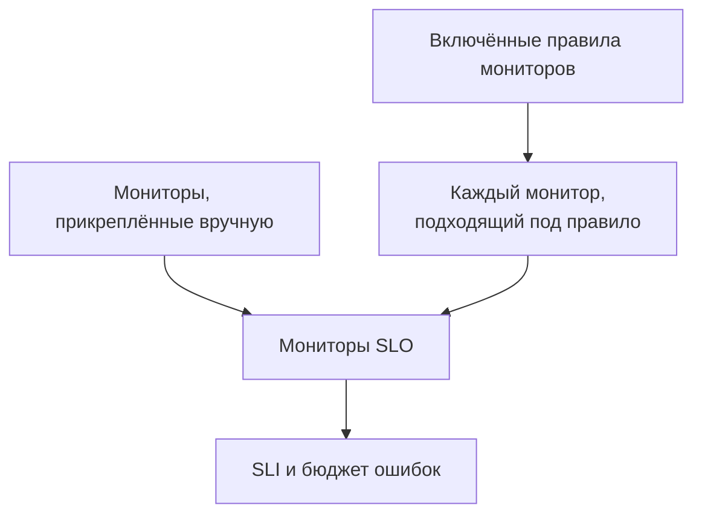

# Мониторы и правила мониторов

SLO измеряет доступность прикреплённых к нему мониторов. Прикрепляйте их вручную, позвольте правилам мониторов прикреплять каждый подходящий монитор или делайте и то и другое. На этой странице описаны страницы SLO **Мониторы** и **Monitor Rules** — обе находятся в разделе **Конфигурация** его бокового меню.

:::cards
- [Выбор мониторов вручную](#прикрепление-мониторов-вручную): Лучше всего для небольшого постоянного набора.
- [Прикрепление мониторов правилом](#прикрепление-мониторов-правилом): «Каждый монитор с меткой Production», с автоматическим обновлением.
- [Критерии совпадения](#критерии-совпадения): Поля и операторы, по которым может срабатывать правило.
:::

## Какие мониторы измеряет SLO

SLO измеряет объединение мониторов, прикреплённых вручную, и всех мониторов, которым соответствует хотя бы одно из его включённых правил мониторов.

У нового SLO нет мониторов, потому что форма создания их не запрашивает. Пока у него нет хотя бы одного, его нельзя оценить: его страницы показывают **No monitors attached**, а страница **Обзор** предлагает оба способа прикрепить мониторы.

## Прикрепление мониторов вручную

Вам нужно разрешение на редактирование SLO.

:::steps
### Откройте страницу «Мониторы»

Откройте SLO и перейдите на страницу **Мониторы**.

### Выберите мониторы

Нажмите **Add Monitors** и выберите мониторы проекта. В списке есть только мониторы, которые ещё не прикреплены.

### Сохраните список

Нажмите **Add Monitors**. Мониторы появятся в списке с источником **Manual** и начнут учитываться в SLI со следующей оценки.
:::

Чтобы убрать монитор из SLO, нажмите **Удалить** в его строке. Сам монитор не меняется; он просто перестаёт учитываться в SLI и бюджете ошибок этого SLO.

Страница **Мониторы** показывает для каждого монитора:

| Столбец | Что показывает |
| --- | --- |
| **Текущий статус** | Текущий статус монитора или **Архивировано**, **Отключено**, **Зонды не включены**, **Зонды отключены** либо **Неизвестно**, когда он не проверяется или ещё ничего не сообщил. |
| **Источник** | **Rule**, если его прикрепило одно из правил мониторов SLO, и **Manual**, если его прикрепили вручную. |
| **Метки** | Метки монитора. |

## Прикрепление мониторов правилом

Правило мониторов описывает мониторы, которые должен измерять SLO, например «каждый монитор с меткой Production» или «каждый монитор, имя которого начинается с api-». Каждый подходящий монитор прикрепляется сейчас и каждый раз, когда мониторы создаются или меняются, поэтому никому не нужно помнить о мониторе, который кто-то добавит в следующем месяце.

:::steps
### Откройте Monitor Rules

Откройте SLO, перейдите на страницу **Monitor Rules** и нажмите **Создать: SLO Monitor Rule**.

### Задайте имя правила

В разделе **Основная информация** введите **Имя** и при желании **Описание** того, почему эти мониторы относятся к этому SLO.

### Выберите, чему оно соответствует

В разделе **Критерии совпадения** нажмите **Добавить условие**, выберите поле и оператор, затем введите или выберите значение. Если условий два или больше, выберите **Соответствие всем** или **Соответствие любому**. Правилу мониторов нужно хотя бы одно условие.

### Сохраните правило

Нажмите **Создать: SLO Monitor Rule**. Правило создаётся включённым, и мониторы SLO сразу пересматриваются: каждый подходящий монитор прикрепляется с источником **Rule**.
:::

Таблица правил показывает для каждого правила имя, критерии совпадения простыми словами и то, включено ли оно. Чтобы приостановить правило, выключите **Включено** в его форме редактирования. **View Monitors** открывает страницу **Мониторы** этого SLO.

### Критерии совпадения

Каждое условие сравнивает одно поле монитора:

| Поле | С чем сравнивается | Операторы |
| --- | --- | --- |
| **Метки монитора** | Метки монитора. | **Содержит любое из**, **Содержит все из**, **Не содержит ни одного из** |
| **Тип монитора** | Тип монитора, выбранный из списка типов. | **Равно**, **Не равно** |
| **Имя монитора** | Имя монитора. | **Содержит**, **Не содержит**, **Равно**, **Не равно**, **Начинается с**, **Заканчивается на**, **Соответствует шаблону**, **Не соответствует шаблону** |
| **Описание монитора** | Описание монитора. | Те же, что для **Имя монитора** |

Шаблон — это регулярное выражение, например `^api-.*`, или подстановочный знак `*`, например `*checkout*`; регистр не учитывается. Шаблон, который не является ни тем ни другим, например `api-(01`, отклоняется при сохранении, а не тихо перестаёт чему-либо соответствовать. Чтобы прикрепить все мониторы проекта, добавьте условие по полю **Имя монитора**, соответствующее шаблону `.*`.

| Вам нужно | Условия |
| --- | --- |
| Каждый рабочий монитор | **Метки монитора** содержит любое из _Production_ |
| Каждый монитор API | **Тип монитора** равно _API_ |
| Каждый монитор, кроме ручных | **Тип монитора** не равно _Manual_ |
| Каждый монитор, имя которого начинается с api- | **Имя монитора** соответствует шаблону `^api-` |
| Мониторы checkout, кроме staging | **Соответствие всем**: **Имя монитора** соответствует шаблону `*checkout*`, и **Метки монитора** не содержит ни одного из _Staging_ |

### Когда выполняются правила

- Когда вы создаёте, редактируете, включаете, выключаете или удаляете правило, мониторы SLO сразу пересматриваются.
- Когда монитор создаётся или меняются его метки, имя или описание, его проверяет каждое правило мониторов проекта, включая метки, которые ему дают ваши правила меток мониторов.
- Когда метка удаляется, SLO, правила которых её использовали, пересматриваются.
- Правила поддерживают список мониторов SLO в актуальном состоянии, даже пока SLO отключён или архивирован, поэтому он возобновляется с правильными мониторами.

Правила синхронизируются при каждом сохранении, поэтому **Run Now** нужен, чтобы наверстать то, что SLO пропустил. Эта кнопка есть в каждой строке, на собственной странице правила (**Просмотр**) и в массовых действиях таблицы. Запуск правила пересматривает сразу все включённые правила мониторов SLO, после чего диалог сообщает, сколько мониторов прикреплено и откреплено. Для запуска правила нужно разрешение на редактирование правил мониторов SLO. См. [Применение правил к существующим ресурсам](/docs/configuration/run-rules-now).

### Какие мониторы принадлежат правилу

- Монитор остаётся прикреплённым, пока ему соответствует хотя бы одно включённое правило, и открепляется, как только не соответствует ни одно.
- Выключение или удаление правила открепляет только те мониторы, которым больше не соответствует ни одно другое включённое правило.
- Правила открепляют только мониторы, прикреплённые правилом. Монитор, прикреплённый вручную, никогда не перехватывается правилом, которое случайно ему соответствует, и не открепляется, когда перестаёт соответствовать. Его источник остаётся **Manual**.

## Ручной выбор при включённых правилах

Пока включено хотя бы одно правило, мониторами SLO управляют правила:

- вручную добавлять мониторы нельзя: **Add Monitors** неактивна, а баннер сообщает **This SLO's monitors are managed by its monitor rules** со ссылкой **Manage Monitor Rules**;
- мониторы, прикреплённые правилом, нельзя убрать вручную, потому что правило прикрепит их снова: их кнопка **Удалить** заблокирована, а подсказка объясняет почему;
- мониторы, прикреплённые вручную до включения правил, по-прежнему можно убрать.

Это касается и API. Выключите все правила, чтобы снова выбирать мониторы самостоятельно.

## SLO, в которых учитывается монитор

Страница монитора показывает SLO, которые его измеряют: откройте монитор и перейдите на страницу **SLOs** в его боковом меню. Загляните туда, прежде чем приостанавливать или менять монитор, чтобы увидеть, какие цели от него зависят. Архивированные SLO там не показываются, потому что они не оцениваются.

## Переход с Auto-Add Monitors With Labels

В прежних версиях в форме SLO была настройка **Auto-Add Monitors With Labels**. При обновлении каждый SLO, который её использовал, получает включённое правило мониторов с именем **Auto-add monitors with labels**, соответствующее тем же меткам, поэтому продолжает измерять точно те же мониторы. Поле `monitorLabels` в API SLO устарело: используйте вместо него правила мониторов SLO.

:::details Что, если что-то всё ещё сохраняет старую настройку?
Вкладка дашборда, открытая до обновления, а также API-клиент или рабочий процесс, написанные для прежней версии, всё ещё могут сохранять старую настройку. Чтобы SLO не терял так мониторы незаметно:

- **SLO без правил мониторов** превращает сохранённые метки в правило **Auto-add monitors with labels**, и его мониторы сразу пересматриваются. Сохранение пустого списка открепляет мониторы, которые прикрепила настройка, как и раньше.
- **SLO, у которого есть правила мониторов**, включённые или нет, игнорирует метки, сохранённые через старую настройку, потому что то, что он измеряет, определяют его правила.
- **Создание первого правила мониторов** для SLO, мониторы которого прикрепила старая настройка, сначала превращает настройку в правило, поэтому новое правило добавляется рядом, а не заменяет её.

Удалённое вами преобразованное правило остаётся удалённым, если только его мониторы не оказались прикреплены и после этого — например, потому что сервер, всё ещё работающий на прежней версии, снова прикрепил их во время обновления: тогда следующее изменение мониторов или следующее новое правило снова преобразует метки. Удалите это правило ещё раз, когда обновление завершится.
:::

## История

Каждое прикрепление и открепление, а также каждое созданное, изменённое или удалённое правило появляется в ленте **Feed** этого SLO. Изменения правил также записываются в его **Журналы аудита**. См. [Лента и журналы аудита SLO](/docs/slo/feed-and-audit-logs).

## Устранение неполадок

:::details Кнопка Add Monitors неактивна
Хотя бы одно из правил мониторов SLO включено, поэтому его мониторами управляют правила. Измените правила или выключите их все, чтобы выбирать мониторы вручную.
:::

:::details Кнопка «Удалить» у монитора заблокирована
Этот монитор прикрепило правило мониторов, и оно прикрепило бы его снова. Измените или выключите правило, которое ему соответствует.
:::

:::details Монитор, которому должно соответствовать правило, не прикреплён
Проверьте, что правило включено и что при **Соответствие всем** выполняется каждое условие. Метки, которые добавляет правило меток мониторов, тоже учитываются. Нажмите **Run Now** у правила, чтобы заново синхронизировать SLO.
:::

:::details Сохранение правила завершается ошибкой шаблона
Значение не является ни регулярным выражением, ни подстановочным знаком `*`, например из-за незакрытой скобки. Исправьте шаблон или используйте **Содержит**.
:::

## Дальнейшие шаги

:::cards
- [Обзор SLO](/docs/slo/introduction): Как объединяется простой нескольких мониторов.
- [Бюджеты ошибок](/docs/slo/error-budget): На что расходуется простой мониторов.
- [Применение правил к существующим ресурсам](/docs/configuration/run-rules-now): Как Run Now работает для каждого вида правил.
:::
