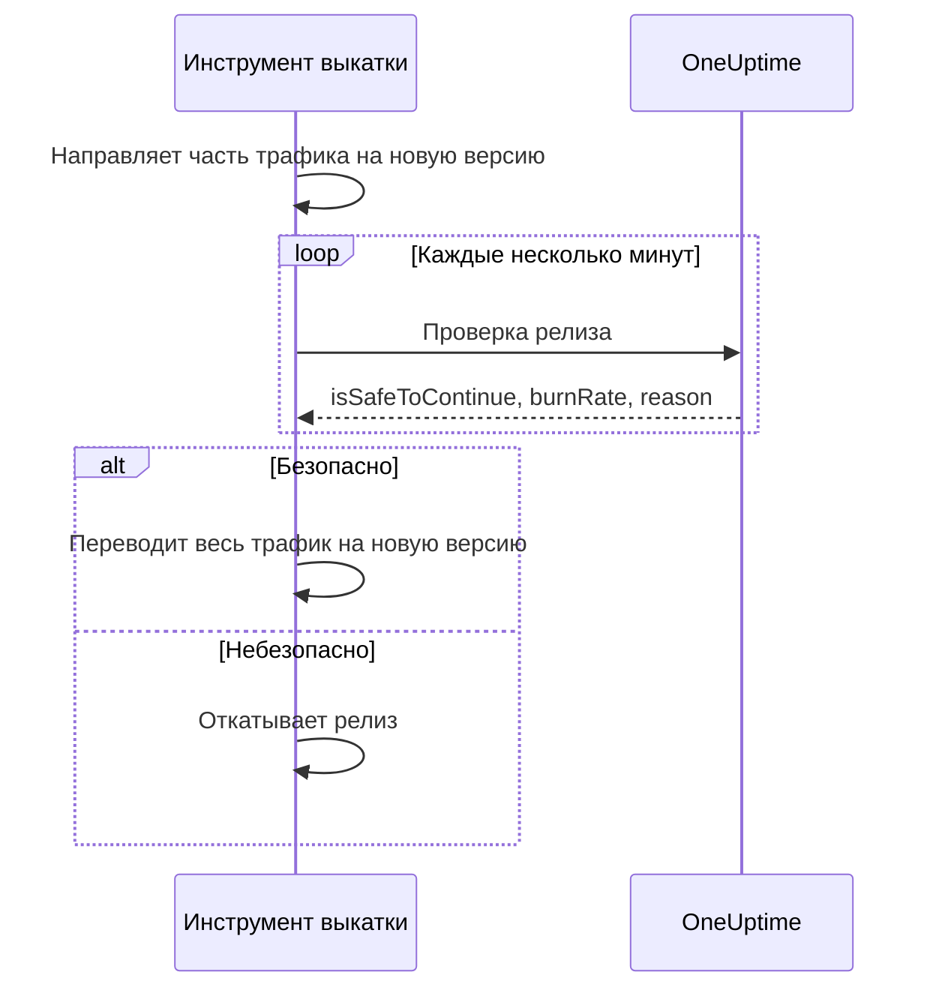

# Проверки релизов

Проверка релиза задаёт SLO вопрос «безопасно ли продолжать выкатку этого релиза?», пока релиз выходит, и отвечает по тому, как быстро SLO расходовал свой бюджет ошибок за последние несколько минут. Argo Rollouts, Flagger или конвейер развёртывания задаёт этот вопрос, пока канареечная версия получает трафик, и откатывает релиз, если ответ — «нет». OneUptime сам ничего не развёртывает: выкаткой по-прежнему занимается ваш инструмент выкатки, а OneUptime сообщает ему, как идёт релиз.

:::cards
- [Запрос проверки](#запрос-проверки): Один запрос с ключом API и то, что приходит в ответ.
- [Argo Rollouts](#argo-rollouts): Анализ, который прерывает выкатку.
- [Flagger](#flagger): Вебхук, который останавливает канареечный релиз.
- [GitHub Actions](#github-actions): Шаг, который откатывает релиз после развёртывания.
:::

## Как это работает

[Барьер развёртывания](/docs/slo/error-budget-policy#барьер-развёртывания) отвечает до релиза, по бюджету ошибок всего окна соответствия. Релиз, который что-то ломает, за первые десять минут почти не тратит месячного бюджета, поэтому проверка релиза читает то, что меняет релиз: скорость расхода за последние несколько минут.



Проверка отвечает одним из трёх вердиктов:

| Вердикт | Когда | `isSafeToContinue` |
| --- | --- | --- |
| `Pass` | Окно расходовало бюджет ошибок со скоростью `maxBurnRate` или медленнее. | `true` |
| `Fail` | Оно расходовало его быстрее, или политика бюджета ошибок SLO замораживает развёртывания. | `false` |
| `NotEnoughData` | В окне было меньше запросов, чем `minimumRequestCount`, или мониторы SLO не записали в нём ни одного статуса. Этого слишком мало, чтобы назвать релиз безопасным. | `false` |

При скорости расхода 1 окно ровно выполнило цель SLO, поэтому значение `maxBurnRate` по умолчанию, `1`, не пропускает релиз, который работает хуже цели.

Что читает проверка, зависит от того, что измеряет SLO:

- [SLO по запросам](/docs/slo/request-slos) оценивается по запросам его сервисов в окне, которые читаются из их спанов по мере поступления. Добавьте `serviceVersion`, чтобы оценивать только запросы новой версии: OneUptime сопоставляет это значение с атрибутом ресурса `service.version` спанов, который SDK OpenTelemetry задаёт из `OTEL_RESOURCE_ATTRIBUTES=service.version=1.4.2`. Так канареечная версия оценивается по её собственным запросам, и запросы старой версии не размывают картину.
- [SLO по метрике](/docs/slo/request-slos#slo-по-метрике) оценивается по событиям его метрики в окне, подсчитанным так же, как их считает его SLI, поэтому `minimumRequestCount`, `goodRequestCount` и `totalRequestCount` — это события. С `serviceVersion` учитываются только точки метрики, у которых атрибут ресурса `service.version` имеет это значение: SDK OpenTelemetry задаёт его для своих метрик так же, как для своих спанов.
- SLO по времени работы мониторов оценивается по временным шкалам статусов его мониторов за окно. `minimumRequestCount` к нему не применяется, а проверка с `serviceVersion` отклоняется: у мониторов нет версий.

## Перед началом

Вам нужен SLO, который измеряет то, на что влияет релиз. Лучше всего канареечную версию оценивает SLO по запросам того сервиса, который вы выпускаете, потому что он читает собственные запросы этого сервиса.

## Настройка проверки релиза

:::steps
### Дайте выкатке ключ

Создайте [ключ API](/docs/api-reference/api-reference) проекта с ролью, которой разрешено читать SLO, и сохраните его как секрет вашего инструмента выкатки или конвейера.

### Скопируйте ID SLO

Откройте SLO и скопируйте его ID из адреса: `/slos/<slo-id>`.

### Запросите проверку один раз вручную

Выполните запрос из раздела [Запрос проверки](#запрос-проверки) с ключом и ID. В ответе будут `isSafeToContinue` и `reason`.

### Добавьте проверку в выкатку

Запрашивайте проверку из [Argo Rollouts](#argo-rollouts), [Flagger](#flagger) или [GitHub Actions](#github-actions) и откатывайте релиз, когда `isSafeToContinue` равно `false`.
:::

## Запрос проверки

Проверка — это `GET` или `POST` на адрес `release-check` этого SLO. Передавайте параметры в строке запроса или в теле JSON с `POST`:

```bash
curl -sS "https://oneuptime.com/api/service-level-objective/<slo-id>/release-check?windowInMinutes=10&serviceVersion=1.4.2" \
  -H "ApiKey: $ONEUPTIME_API_KEY"
```

Ответ начинается с вердикта, а затем показывает, по каким данным он получен:

```json
{
  "isSafeToContinue": false,
  "verdict": "Fail",
  "reason": "The last 10 minutes burned the error budget at 3.2x, faster than the 1x this check allows (SLI 99.68% against the 99.9% target).",
  "sloId": "<slo-id>",
  "sloName": "Checkout requests",
  "sliType": "Request Success",
  "targetPercentage": 99.9,
  "windowInMinutes": 10,
  "maxBurnRate": 1,
  "burnRate": 3.2,
  "sliPercentage": 99.68,
  "deploymentsAllowed": true,
  "errorBudgetPolicyTier": null,
  "sloStatus": "Healthy",
  "checkedAt": "2026-11-15T12:00:00.000Z",
  "goodRequestCount": 2492,
  "totalRequestCount": 2500,
  "minimumRequestCount": 1,
  "serviceVersion": "1.4.2"
}
```

Параметры:

| Параметр | По умолчанию | Что он делает |
| --- | --- | --- |
| `windowInMinutes` | `10` | Насколько далеко назад смотрит проверка, в целых минутах от 1 до 360. |
| `maxBurnRate` | `1` | Самая высокая скорость расхода, при которой проверка проходит. `2` позволяет окну расходовать бюджет вдвое быстрее, чем допускает цель. |
| `minimumRequestCount` | `1` | SLO по запросам: наименьшее число запросов, по которому проверка выносит вердикт. При `0` окно без запросов проходит проверку. |
| `serviceVersion` | Нет | SLO по запросам: оценивать только те запросы, спаны которых несут эту `service.version`. |
| `includeDeploymentGate` | `true` | Не пропускать релиз, пока политика бюджета ошибок SLO замораживает развёртывания. При `false` решает только скорость расхода. |
| `failWithStatusCode` | `false` | Отвечать «нет» с HTTP-статусом 412 вместо 200 — для инструментов, которые читают только код статуса. |

Поля ответа:

| Поле | Что в нём |
| --- | --- |
| `isSafeToContinue` | `true` — продолжать выкатку, `false` — откатить её. |
| `verdict` | `Pass`, `Fail` или `NotEnoughData`. |
| `reason` | Одно предложение для журнала выкатки: что было измерено и почему проверка ответила именно так. |
| `burnRate` и `sliPercentage` | Как быстро окно расходовало бюджет ошибок, и SLI за окно. |
| `goodRequestCount` и `totalRequestCount` | SLO по запросам: сколько запросов было в окне и сколько из них оказались хорошими. |
| `deploymentsAllowed` и `errorBudgetPolicyTier` | Разрешает ли политика бюджета ошибок SLO развёртывания и на каком уровне этой политики находится SLO. |
| `checkedAt` | Когда было выполнено измерение. |

На SLO, который невозможно измерить, — SLO по запросам без сервисов, SLO по задержке без порога, SLO по метрике без пригодной для подсчёта метрики, SLO по времени работы мониторов без мониторов — проверка отвечает HTTP 400 и сообщает, что нужно исправить, поэтому выкатка останавливается на понятной ошибке, а не на догадке. В самостоятельно размещённой установке используйте её собственный адрес вместо oneuptime.com.

## Argo Rollouts

Анализ с метрикой типа `web` запрашивает проверку на каждом шаге канареечного релиза, а Argo Rollouts прерывает выкатку и сворачивает канареечную версию, когда проверка не проходит. Сначала сохраните ключ API как секрет:

```bash
kubectl create secret generic oneuptime --from-literal=api-key="$ONEUPTIME_API_KEY"
```

Затем добавьте шаблон и запускайте его после первого шага канареечного релиза:

:::tabs
@tab AnalysisTemplate
```yaml title="oneuptime-release-check.yaml"
apiVersion: argoproj.io/v1alpha1
kind: AnalysisTemplate
metadata:
  name: oneuptime-release-check
spec:
  args:
    - name: version
    - name: api-key
      valueFrom:
        secretKeyRef:
          name: oneuptime
          key: api-key
  metrics:
    - name: slo-burn-rate
      interval: 2m
      count: 5
      failureLimit: 0
      successCondition: result == true
      provider:
        web:
          url: "https://oneuptime.com/api/service-level-objective/<slo-id>/release-check?windowInMinutes=10&serviceVersion={{args.version}}"
          headers:
            - key: ApiKey
              value: "{{args.api-key}}"
          jsonPath: "{$.isSafeToContinue}"
```
@tab Rollout
```yaml title="rollout.yaml"
apiVersion: argoproj.io/v1alpha1
kind: Rollout
metadata:
  name: checkout
spec:
  strategy:
    canary:
      steps:
        - setWeight: 10
        - analysis:
            templates:
              - templateName: oneuptime-release-check
            args:
              - name: version
                value: "1.4.2"
        - setWeight: 50
        - pause: { duration: 10m }
```
:::

Анализ спрашивает пять раз с интервалом в две минуты, и первое «нет» прерывает выкатку. Передавайте ту же версию, которую поды канареечной версии задают в `OTEL_RESOURCE_ATTRIBUTES`. Если на первом весе канареечная версия может не получить трафика, добавьте к адресу `&minimumRequestCount=0`, иначе канареечная версия без трафика провалит анализ с `NotEnoughData`.

## Flagger

Flagger вызывает вебхук типа `rollout` на каждом шаге своего анализа, а если вебхук раз за разом завершается ошибкой, останавливает канареечный релиз и откатывает его. Вебхуки Flagger не отправляют заголовков, поэтому запрашивайте проверку через нагрузочный тестер Flagger, который выполняет команду для вебхука:

```yaml title="canary.yaml"
apiVersion: flagger.app/v1beta1
kind: Canary
metadata:
  name: checkout
spec:
  analysis:
    interval: 1m
    threshold: 2
    maxWeight: 50
    stepWeight: 10
    webhooks:
      - name: oneuptime-release-check
        type: rollout
        url: http://flagger-loadtester.test/
        timeout: 30s
        metadata:
          type: bash
          cmd: "curl -sSf -H \"ApiKey: $ONEUPTIME_API_KEY\" 'https://oneuptime.com/api/service-level-objective/<slo-id>/release-check?windowInMinutes=5&failWithStatusCode=true'"
```

С `failWithStatusCode=true` ответ «нет» — это HTTP 412, поэтому `curl -f` завершается с ошибкой и вебхук не проходит. Передайте нагрузочному тестеру ключ в переменной окружения `ONEUPTIME_API_KEY` из секрета Kubernetes. Как только наберётся `threshold` неудачных проверок, Flagger откатывает канареечный релиз.

## GitHub Actions

Конвейер, который развёртывает всё за один раз, тоже может следить за релизом: разверните его, несколько раз запросите проверку и откатите релиз, если она ответит «нет».

```yaml title=".github/workflows/deploy.yml"
name: Deploy
on:
  push:
    branches: [main]

jobs:
  deploy:
    runs-on: ubuntu-latest
    steps:
      - uses: actions/checkout@v4
      - name: Deploy
        run: ./deploy.sh
      - name: Watch the release against the SLO
        env:
          ONEUPTIME_API_KEY: ${{ secrets.ONEUPTIME_API_KEY }}
          SLO_ID: <slo-id>
          VERSION: ${{ github.sha }}
        run: |
          for attempt in 1 2 3 4 5; do
            sleep 120
            CHECK=$(curl -sS "https://oneuptime.com/api/service-level-objective/$SLO_ID/release-check?windowInMinutes=10&serviceVersion=$VERSION" \
              -H "ApiKey: $ONEUPTIME_API_KEY")
            echo "$CHECK" | jq -r '.reason'
            if [ "$(echo "$CHECK" | jq -r '.isSafeToContinue')" != "true" ]; then
              exit 1
            fi
          done
      - name: Roll back
        if: failure()
        run: ./rollback.sh
```

Шаг завершается ошибкой при ответе «нет» и при любом ответе без `isSafeToContinue: true` — неверный ID, ключ, который не может читать SLO, отсутствие ответа, — поэтому конвейер никогда не продолжает работу по ответу, которого не получил. При запуске сервиса задайте `service.version` равным коммиту (`${{ github.sha }}`), чтобы проверка оценивала только новую версию.

## Дальнейшие шаги

:::cards
- [SLO по запросам и задержке](/docs/slo/request-slos): Измеряйте запросы сервиса — SLI, который лучше всего оценивает канареечный релиз.
- [Политика бюджета ошибок](/docs/slo/error-budget-policy): Замораживайте развёртывания, пока бюджета мало.
- [Оповещения и инциденты по скорости расхода бюджета](/docs/slo/burn-rate-alerts): Предупредите команду, когда бюджет расходуется слишком быстро.
:::
