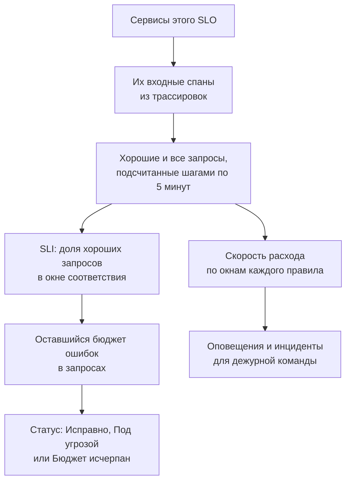

# SLO по запросам и задержке

SLO по запросам измеряет то, что ваши пользователи получают от сервиса: долю его запросов, которые выполняются успешно или обрабатываются достаточно быстро. OneUptime подсчитывает их по трассировкам, которые ваши сервисы уже отправляют, поэтому настраивать монитор не нужно: выберите сервисы и цель, и OneUptime будет измерять их каждые 5 минут.

:::cards
- [Создание SLO по запросам](#создание-slo-по-запросам): Сервисы, порог задержки и цель.
- [Подсчёт только части запросов](#подсчёт-только-части-запросов): Один эндпоинт или все запросы, кроме проверок работоспособности.
- [SLO по метрике](#slo-по-метрике): Счётчик или гистограмма для сервисов, которые не отправляют трассировки.
- [Как подсчитываются запросы](#как-подсчитываются-запросы): Какие спаны учитываются и когда.
- [Проверки релизов](/docs/slo/release-checks): Откатывайте релиз, который расходует бюджет ошибок.
:::

## Успешность и задержка запросов

| Что измеряется | Запрос считается плохим, когда | Бюджет ошибок считает |
| --- | --- | --- |
| **Успешность запросов** | Статус его спана — `Error`. Спан без статуса считается хорошим, как это понимает OpenTelemetry. | Неудачные запросы |
| **Задержка запросов** | Он выполнялся дольше, чем **Порог задержки (мс)** этого SLO, каким бы ни был его статус. | Медленные запросы |

SLI — это доля хороших запросов в окне соответствия, а бюджет ошибок — это плохие запросы, которые допускает цель: при 99,9 % — один из каждых 1 000. SLO по задержке считает хорошим запрос, который быстро завершился ошибкой, поэтому измеряйте важный сервис обоими способами: один SLO следит за тем, что сервис работает, а другой — за тем, что он работает быстро.

## Как это работает

Запрос — это входной спан одного из сервисов SLO: спан, в котором запрос или сообщение входит в сервис; именно такие спаны по умолчанию показывает список [Трассировки](/docs/telemetry/traces-explorer#трассировки-и-спаны). Запрос, который проходит через два сервиса SLO, учитывается по одному разу в каждом из них.

В остальном SLO по запросам работает как любой другой. Его статус, правила скорости расхода, политика бюджета ошибок, владельцы и уведомления устроены так же, только бюджет ошибок считается в запросах, а не в минутах.

## Перед началом

- Сервисы отправляют трассировки в OneUptime: см. [OpenTelemetry](/docs/telemetry/open-telemetry). Каждый из них есть в [каталоге сервисов](/docs/telemetry/services) под своим `service.name`.
- Роль, которой разрешено создавать SLO: Владелец проекта, Администратор проекта или пользовательская роль с разрешением Create Service Level Objective.

## Создание SLO по запросам

:::steps
### Откройте SLO

Откройте **SLOs** в меню **Продукты** на верхней панели и нажмите **Создать: Целевой уровень обслуживания**.

### Выберите, что измеряет SLO

В поле **Что измеряется** выберите **Успешность запросов** или **Задержка запросов**, а затем **Сервисы**, запросы которых учитывает SLO. Для варианта **Задержка запросов** задайте также **Порог задержки (мс)**, например `300`: запрос, обработанный за это время, считается достаточно быстрым. Чтобы учитывать только часть их запросов, введите **Фильтр запросов**: см. [Подсчёт только части запросов](#подсчёт-только-части-запросов). Нажмите **Далее**.

### Задайте имя и цель

Введите **Имя**, например «Checkout requests», и **Цель (%)** — долю запросов, которые должны быть хорошими. Нажмите **Создать: Целевой уровень обслуживания**.

### Дождитесь первых чисел

Первая оценка, не позже чем через 5 минут, подсчитывает запросы за последние 6 часов, поэтому у SLO сразу появляются числа. Следующие оценки подсчитывают и более ранние запросы, пока не будет охвачено всё окно соответствия.
:::

Собственная страница **SLOs** сервиса показывает SLO, которые его измеряют, а **Создать: Целевой уровень обслуживания** на ней открывает ту же форму с уже выбранным сервисом. Чтобы позже изменить, что измеряет SLO, его сервисы, порог или фильтр, откройте его **Настройки** и нажмите **Изменить, что измеряется**.

## Подсчёт только части запросов

SLO по запросам учитывает все запросы своих сервисов. **Фильтр запросов** учитывает только те, что важны, например запросы к эндпоинту checkout, или исключает некоторые, например проверки работоспособности, из-за которых SLI выглядел бы лучше, чем то, что получают пользователи. Запишите его как поиск трассировок, тем же [синтаксисом поиска](/docs/telemetry/search-syntax#сопоставление-значений), что и в обозревателе трассировок:

| Фильтр запросов | Что учитывается |
| --- | --- |
| `@http.route:/checkout*` | Запросы, маршрут которых начинается с `/checkout`. |
| `-@http.route:/health` | Все запросы, кроме проверок работоспособности. |
| `@http.request.method:[POST, PUT]` | Запросы POST и PUT. |
| `name:"POST /checkout"` | Запросы, спан которых называется `POST /checkout`. |

Совпасть должно каждое условие, поэтому `@http.route:/checkout* -@http.route:/checkout/health` учитывает запросы checkout, кроме их проверки работоспособности. Условие с `@` — это атрибут спана запроса, а `name:` — имя спана. Свободный текст и другие поля обозревателя, например `status:` и `duration:`, здесь фильтрами не служат: SLO и так определяет, какие запросы плохие или медленные. В фильтре может быть до 10 условий, всего не более 500 символов.

Страница **Обзор** показывает фильтр под сервисами SLO, а страница **Настройки** — в разделе **Что измеряется**. После его изменения запросы SLO подсчитываются заново с самого начала.

## SLO по метрике

Если ваши сервисы уже подсчитывают свои запросы в виде метрик или не отправляют трассировки, измеряйте SLO вместо этого по счётчику или гистограмме. В поле **Что измеряется** выберите **Метрика** и **Сервисы**, которые её отправляют, а затем на шаге **Метрика** заполните:

| Поле | Что ввести |
| --- | --- |
| **Метрика** | Имя метрики: выберите его из метрик проекта или введите вручную, например `http_requests_total` или `http.server.request.duration`. |
| **Хорошие события** | **Счётчик, по условию** или **Гистограмма, по значению**. |
| **Хорошо, если** | Для счётчика: какие события хорошие, в виде поиска по его атрибутам, например `@http.response.status_code:<500`. |
| **Хорошо, если не больше** | Для гистограммы: значение, которое хорошее наблюдение не превышает, в единицах самой метрики, например `0.3` для 300 мс у гистограммы в секундах. Используйте одну из границ её корзин. |
| **Фильтр метрики** | Необязательно: какие ряды учитываются, например `-@http.route:/health`. |

События счётчика — это то, на сколько он вырос за каждый шаг в 5 минут, так же как его читает `increase()` в Prometheus: перезапущенный счётчик снова считается с нуля, а учитываются и накопительные счётчики, и дельта-счётчики. События гистограммы — это её наблюдения, а хорошие из них — те, что попали в корзины не больше заданного значения. Учитываются только собственные точки метрики, от сервисов SLO: gauge с тем же именем не учитывается вовсе. SLO по gauge, а каждая облачная метрика — gauge, говорит об этом на своей странице, как и выбор метрики: измеряйте облачную метрику монитором метрик и SLO по времени работы этого монитора.

В остальном SLO по метрике работает как SLO по запросам: его бюджет ошибок, правила скорости расхода и проверки релизов считаются в событиях. После изменения метрики её события подсчитываются заново с самого начала.

## Как подсчитываются запросы

OneUptime подсчитывает хорошие и все запросы каждого SLO шагами по 5 минут и сохраняет эти счётчики, поэтому SLO читает своё окно из собственных счётчиков, а не каждый раз из всех спанов:

- Шаг подсчитывается через 2 минуты после своего окончания, чтобы в него попали опоздавшие спаны, а следующая оценка заново подсчитывает два последних шага для спанов, которые приходят ещё позже.
- Новый SLO начинает с последних 6 часов. Каждая следующая оценка подсчитывает до суток более ранних запросов, начиная с самых новых, пока окно не будет охвачено.
- Подсчитать можно только запросы, которые ещё не вышли за [срок хранения телеметрии](/docs/telemetry/data-retention#как-долго-хранится-телеметрия). Подсчитанные шаги хранятся 400 дней, дольше любого окна соответствия, поэтому окно длиннее срока хранения заполняется по мере того, как SLO становится старше.
- После изменения того, что измеряет SLO, его сервисов, порога задержки или фильтра запросов его запросы подсчитываются заново с самого начала. Более длинное окно соответствия заполняется за счёт подсчёта дальше в прошлое.

Пока счётчики охватывают только часть окна соответствия, страница **Обзор** сообщает об этом индикатором **Окно заполнено на 23%**, а плитка **Осталось бюджета ошибок** повторяет это под своим числом. Оба исчезают, как только счётчики охватывают всё окно.

## Бюджет ошибок в запросах

Бюджет — это плохие запросы, которые цель допускает среди запросов, подсчитанных в окне, поэтому он растёт вместе с трафиком: при 99,9 % окно из 2 000 000 запросов допускает 2 000 неудачных. На странице **Обзор**:

- **Осталось бюджета ошибок** показывает, сколько плохих запросов осталось и из скольких или на сколько запросов SLO превысил бюджет.
- **Запас бюджета по времени** показывает, на сколько хватит бюджета при текущей скорости расхода, если трафик останется прежним.
- Сводка показывает число сервисов SLO, а SLO по задержке показывает свой порог под целью.

Оповещения по скорости расхода, уведомления и лента тоже указывают бюджет в запросах. Метрика `oneuptime.slo.error.budget.remaining.seconds` для SLO по запросам не отправляется; вместо неё стройте график `oneuptime.slo.error.budget.remaining.percent`.

SLO по запросам получает те же правила **Fast burn**, **Slow burn** и **Slow leak**, что и любой новый SLO. В тихий час, когда запросов всего горстка, одна ошибка может дать высокую скорость расхода, поэтому правило может игнорировать окна со слишком малым числом запросов: задайте правилу **Минимум запросов**, и правило будет пропускать длинное окно, в котором запросов меньше этого числа.

## Устранение неполадок

:::details SLO показывает Ожидание запросов
Ни один из его сервисов ещё не обработал ни одного запроса в окне. Убедитесь, что сервисы отправляют трассировки в OneUptime и что среди их спанов есть входные: у сервиса, все спаны которого внутренние, нет запросов для подсчёта. Если у SLO есть **Фильтр запросов**, выполните с ним поиск в обозревателе [Трассировки](/docs/telemetry/traces-explorer): если фильтр не находит там ни одного запроса, SLO нечего подсчитывать.
:::

:::details SLI изменился после того, как я изменил сервисы
После изменения того, что измеряет SLO, его сервисов, порога задержки или фильтра запросов его запросы подсчитываются заново, начиная с последних 6 часов, поэтому SLI и бюджет начинают отсчёт заново с этого момента. Индикатор **Окно заполнено на 23%** показывает, какая часть окна уже подсчитана.
:::

## Дальнейшие шаги

:::cards
- [Проверки релизов](/docs/slo/release-checks): Пусть Argo Rollouts, Flagger или конвейер откатывает релиз, который расходует бюджет.
- [Оповещения и инциденты по скорости расхода бюджета](/docs/slo/burn-rate-alerts): Предупредите команду, когда бюджет расходуется слишком быстро.
- [Политика бюджета ошибок](/docs/slo/error-budget-policy): Договоритесь, что команда делает по мере расхода бюджета.
:::
