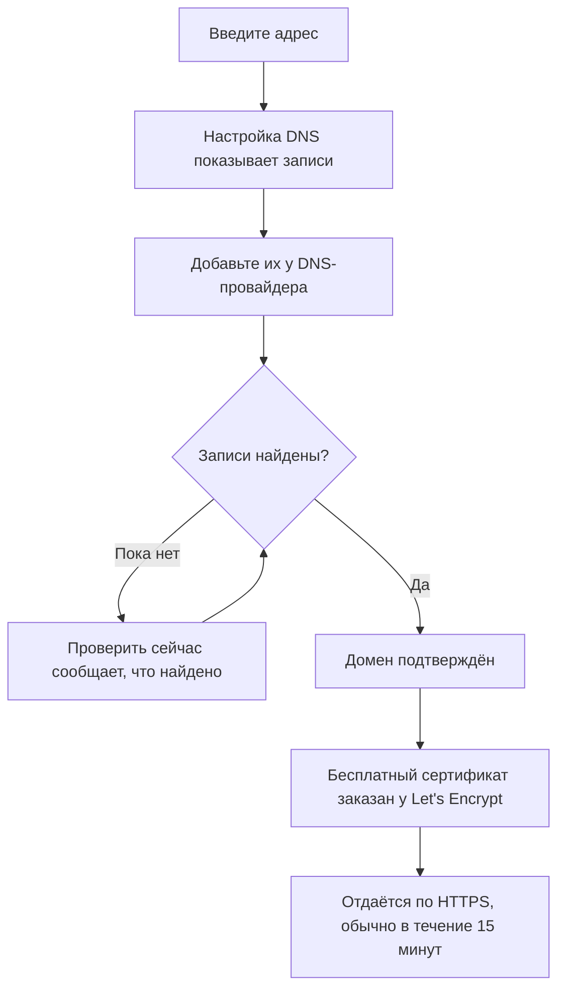

# Оформление и домены страницы статуса

Ваша страница статуса — единственный экран OneUptime, который видят ваши клиенты, поэтому она должна выглядеть как ваша и жить на вашем собственном домене, например `status.yourcompany.com`. Эта страница проходит по странице **Брендинг** карточка за карточкой, а затем переносит страницу статуса на ваш домен: добавьте домен, добавьте его DNS-записи, и бесплатный SSL-сертификат появится сам.

> [!TIP]
> Впервые здесь? Сначала пройдите руководство: [Опубликовать страницу статуса](/docs/guides/status-page).

:::cards
- [Страница «Брендинг»](#страница-брендинг): Логотип, тема, заголовок, favicon, ссылки, нижний колонтитул, цвета и языки.
- [Пользовательские HTML, CSS и JavaScript](#пользовательские-html-css-и-javascript): Всё, что не покрывают встроенные настройки.
- [Пользовательские домены](#пользовательские-домены): Ваше собственное имя хоста с бесплатным сертификатом.
- [Столбец «Статус»](#как-читать-столбец-статус-домена): Где каждый домен находится на пути к HTTPS.
:::

## Где находится каждая настройка оформления

Откройте страницу статуса: в разделе **Брендинг** её бокового меню три пункта:

| Страница | Что вы там задаёте |
| ---- | ------------------ |
| **Брендинг** | Логотип и изображение обложки, тему (светлую, тёмную или как настроено устройство каждого посетителя), заголовок и описание страницы, favicon, ссылки заголовка, описание страницы обзора, строку об авторских правах и ссылки нижнего колонтитула. Свёрнуто в **Дополнительные настройки**: цвета графика истории, языки и индексация поисковыми системами. |
| **Пользовательские домены** | Ваш собственный домен, его DNS-запись и его бесплатный SSL-сертификат. |
| **HTML, CSS и JavaScript** | HTML заголовка, HTML нижнего колонтитула, пользовательский CSS, пользовательский JavaScript. |

Три вещи, похожие на оформление, находятся вместо этого в **Страницы состояния → ваша страница → Расширенный → Расширенные настройки** (`{id}/settings`), потому что они определяют, что страница показывает, а не как она выглядит: общий процент аптайма, какие статусы мониторов засчитываются против аптайма, и строку «Powered by OneUptime». Первые две — строки карточки **Что показывает ваша страница статуса** на этом экране, а у строки «Powered by OneUptime» есть своя карточка, прямо под ней, свёрнутая в разделе **Дополнительные настройки**.

Раньше оформление было разделено на отдельные экраны **Основное оформление**, **Заголовок**, **Нижний колонтитул**, **Страница обзора** и **Языки**. Их старые адреса (`{id}/header-style`, `{id}/footer-style`, `{id}/overview-page-branding` и `{id}/languages`) теперь открывают страницу **Брендинг**, так что старые закладки и ссылки продолжают работать.

## Страница «Брендинг»

**Страницы состояния → ваша страница → Брендинг → Брендинг** (`{id}/branding`). Каждая карточка сохраняется отдельно. После логотипа, темы, заголовка и favicon карточки идут по вашей странице статуса сверху вниз: ссылки заголовка, текст в начале обзора, затем нижний колонтитул. То, что мало кто меняет, свёрнуто в **Дополнительные настройки** внизу.

### Логотип и изображение обложки

У первой карточки, **Логотип и изображение обложки**, есть кнопка **Редактировать изображения**, которая открывает два шага:

| Шаг | Поля |
| ---- | ------ |
| **Логотип** | Загрузка логотипа (подсказка `Upload logo`), **Логотип для тёмной темы** (подсказка `Upload logo for the dark theme`), необязательный логотип, сделанный для тёмного фона, и **Альтернативный текст логотипа** (подсказка `Logo of My Company`). Оставьте альтернативный текст пустым, и вместо него будет использован заголовок страницы статуса. |
| **Изображение обложки** | **Обложка**, загрузка (подсказка `Upload cover image`) широкого баннера за заголовком, и **Альтернативный текст обложки**. Оставьте альтернативный текст пустым, если обложка чисто декоративная. |

Логотип, логотип для тёмной темы, изображение обложки и favicon — это файлы, загруженные в собственный проект страницы статуса, и это проверяется при каждом их сохранении — из панели управления, через API, Terraform или рабочий процесс. Файл, загруженный в другом проекте, отклоняется теми же словами, что и файл, которого больше нет: "The logo's file could not be found. Upload the logo again.", "The dark theme logo's file could not be found. Upload the dark theme logo again.", "The cover image's file could not be found. Upload the cover image again." или "The favicon's file could not be found. Upload the favicon again." Повторная загрузка изображения со страницы решает проблему.

Ваша страница статуса показывает только изображения своего проекта; изображение, которое она не может показать, пропускается, как будто его нет. Панель управления, API и Terraform читают изображения страницы так же: изображение из другого проекта возвращается как отсутствующее. Письма, которые отправляет страница (подписчикам, а также приватным пользователям об их входе), показывают её логотип так же: логотип, который страница не может показать, пропускается и в них, а не отображается как битое изображение.

Эти письма несут логотип внутри себя, поэтому он виден даже там, где почтовый клиент не загружает изображения из интернета или не может достучаться до OneUptime: логотип в формате PNG, JPEG, GIF, WebP или SVG попадает в письмо как изображение по размеру шапки письма. SVG-логотип, в котором слова записаны текстом, а не фигурами, вместо этого показывается со своего адреса, потому что на сервере нет шрифта, которым можно нарисовать эти слова: преобразуйте текст в кривые в своём графическом редакторе или загрузите PNG.

### Тема

Карточка **Тема**, сразу под логотипом, определяет, как страница выглядит для посетителей. Выберите один из трёх вариантов, и он сразу сохранится; кнопки **Редактировать** нет.

| Вариант | Что видят посетители |
| ------ | ----------------- |
| **Светлая** | Светлую страницу, как бы ни было настроено их устройство. У страниц статуса, созданных до появления этой настройки, выбрано **Светлая**, поэтому они выглядят как всегда. |
| **Тёмная** | Тёмную страницу, как бы ни было настроено их устройство. |
| **Как на устройстве посетителя** | Светлую или тёмную, как настроено их устройство, и страница меняется вместе с устройством, пока она открыта. Кнопка с солнцем или луной в нижнем колонтитуле страницы позволяет посетителю переключить тему, и его браузер запоминает выбор. |

На тёмной странице логотип стоит на светлой подложке, поэтому логотип, сделанный для белой страницы, по-прежнему хорошо виден. Если у страницы задан **Логотип для тёмной темы**, на тёмной странице вместо логотипа показывается он, как есть, без подложки, в шапке и на страницах входа. В письмах, которые отправляет страница, всегда показывается логотип.

По адресу страницы на OneUptime, `/status-page/:id`, у страницы со значением **Светлая** или **Тёмная** тоже есть кнопка с солнцем или луной в подвале, чтобы вы могли увидеть её в другой теме, с логотипом из поля **Логотип для тёмной темы**, прежде чем выбрать. Выбор там действует до перезагрузки страницы и не запоминается, так что страница всегда открывается в своей теме — и для вас, и для любого, кто откроет этот адрес. На пользовательских доменах страницы у страницы со значением **Светлая** или **Тёмная** кнопки нет.

Страница статуса, созданная с этого момента, начинает с **Как на устройстве посетителя**. В API и Terraform поле называется `theme`, со значением `Light`, `Dark` или `System` (**Как на устройстве посетителя**), написанным именно так; любое другое значение отклоняется. Конфигурация Terraform, в которой `theme` не задан, получает `Light`, поэтому конфигурация, написанная до появления настройки, никогда не планирует изменений на странице, которой управляет.

Тема передаётся в HTML страницы, поэтому страница с самого начала рисуется в ней: тёмная страница не вспыхивает белым при загрузке, а браузер подстраивает под неё полосы прокрутки, поля форм и, на телефонах, адресную строку. Ей следуют все части страницы, включая страницу входа частной страницы статуса. Полосы безотказной работы сохраняют выбранные вами цвета. На тёмной странице текст в цвете статуса получает более светлый оттенок этого цвета там, где сам цвет читался бы с трудом, а полоса, слишком тёмная, чтобы её было видно, получает более светлую рамку.

Ваши пользовательские CSS и HTML действуют в обеих темах; в разделе [Пользовательские HTML, CSS и JavaScript](#пользовательские-html-css-и-javascript) сказано, как оформить тёмную.

### Заголовок, описание и favicon

- **Заголовок и описание**: название страницы во вкладке браузера и в письмах подписчикам, а также описание, которое показывают поисковые системы. **Редактировать** открывает **Заголовок страницы** (подсказка `e.g., Acme Status`) и **Описание страницы**. Их показывают поисковые системы и превью ссылок, поэтому пишите их для клиента, а не для своей команды.
- **Значок сайта**: **Изменить значок сайта** открывает загрузку **Значок сайта**: маленького значка на вкладке браузера.

### Ссылки заголовка

Таблица **Ссылки заголовка** содержит ссылки в заголовке страницы статуса, например на ваш сайт, документацию или портал поддержки. У каждой ссылки есть **Заголовок** и **Ссылка** (URL, подсказка `https://link.com`), а порядок меняется перетаскиванием. Если ссылок нет, таблица говорит, для чего они, а под этим — **Добавить: Ссылка заголовка**.

### Описание страницы обзора

**Описание страницы обзора** — первое, что есть в обзоре страницы статуса, над объявлениями, общим статусом и вашими ресурсами. **Изменить описание** открывает поле markdown. Используйте его для фразы с контекстом: что охватывает эта страница и куда обращаться за поддержкой. Изображение, которое вы туда вставите, видно каждому посетителю страницы.

### Нижний колонтитул

- **Информация об авторских правах**: **Редактировать авторские права** открывает одно поле, **Информация об авторских правах**, с подсказкой `Acme, Inc.`.
- **Ссылки нижнего колонтитула**: та же пара **Заголовок** и **Ссылка**, что и у ссылок заголовка, порядок меняется перетаскиванием, а добавляются они кнопкой **Добавить: Ссылка нижнего колонтитула**.

Ссылки заголовка нужны для навигации; ссылки нижнего колонтитула — для мелкого шрифта, например юридической информации, конфиденциальности и условий.

### Дополнительные настройки

Последний раздел страницы свёрнут в **Дополнительные настройки**, потому что мало кто когда-либо меняет его содержимое. В свёрнутом виде его заголовок называет четыре раздела (**Цвет полосы по умолчанию**, **Правила цвета полос**, **Языки** и **Индексация поисковыми системами**) и показывает каждый, который отличается от того, с чем начинается новая страница статуса: цвет полосы по умолчанию, отличный от зелёного, с которого начинается каждая страница, правила цвета полос, отличные от рекомендуемых, язык по умолчанию, отличный от английского, более короткий список языков или отключённая индексация поисковыми системами. Нажмите на него, чтобы открыть: это одна карточка с разделами друг под другом, у каждого свой заголовок, разделённые разделителями.

**Цвета графика истории.** Кроме карточки **Тема**, это единственные встроенные настройки цвета на странице статуса. Каждая полоса истории безотказной работы — это один день.

- **Цвет полосы по умолчанию**: **Редактировать цвет полос по умолчанию** открывает выбор **Цвет полосы по умолчанию**. Это цвет дня, которому не соответствует ни одно правило цвета полос. Каждая новая страница статуса начинается с зелёного.
- **Правила цвета полос**: упорядоченная таблица правил, которые сортируются перетаскиванием. У каждого правила есть **Когда % времени безотказной работы больше или равен** и **Тогда используйте этот цвет столбца**; столбцы таблицы называются `When Uptime Percent >=` и `Then, Bar Color is`. Правила проверяются сверху вниз, и цвет дня задаёт первое правило, порог которого достигнут, поэтому держите большие проценты выше меньших: правило под правилом с таким же или меньшим процентом никогда не окрашивает день. Цвет нового правила уже выбран — такой, который другие правила пока не используют; выберите вместо него нужный.
- **Предпросмотр цветов полос**: каждый цвет, который может получить день, — так, как его видит большинство людей (**Нормальное цветовое зрение**), и так, как его видят люди с красно-зелёной цветовой слепотой (**Дейтеранопия (красно-зелёная)**, **Протанопия (красно-зелёная)**). Предупреждает, когда два цвета выглядят для них одинаково, и когда правило никогда не окрашивает день.

День, по которому у страницы нет данных, всегда рисуется серым с диагональной штриховкой, что бы ни говорили правила. Без правил день получает цвет самого серьёзного статуса монитора, который у него был, пусть даже совсем недолго: две минуты в Offline окрашивают весь день в цвет Offline. Поэтому страница статуса, созданная в панели управления, начинается с рекомендуемых правил, которые окрашивают день по тому, сколько длился простой:

| Когда % безотказной работы не меньше | Цвет полосы | За полный день |
| ------------------------- | --------- | ------------- |
| 100 | `#22c55e` зелёный | Без простоя |
| 99 | `#fde047` бледно-жёлтый | До 14 минут 24 секунд простоя |
| 95 | `#c2410c` тёмно-оранжевый | До 72 минут простоя |
| 0 | `#7f1d1d` очень тёмно-красный | Более 72 минут простоя |

Безотказная работа за день измеряется по той части дня, для которой есть данные, с учётом статусов, выбранных в **Считается простоем**. Рекомендуемые цвета различаются по светлоте так же, как по оттенку, поэтому люди с красно-зелёной цветовой слепотой, примерно каждый двенадцатый мужчина, могут их различить; зелёный Operational и красный Offline, с которых начинаются статусы мониторов, выглядят для них почти одинаково. У страницы, созданной до этих правил или через API или Terraform, нет правил, пока вы их не добавите: пустая таблица **Правила цвета полос** и **Предпросмотр цветов полос** обе предлагают **Использовать рекомендуемые правила**. Через API отправьте `"miscDataProps": {"addRecommendedBarColorRules": true}` с запросом, который создаёт страницу статуса.

Сколько дней охватывает график, задаётся не здесь. Это **История безотказной работы** на карточке **Что показывает ваша страница статуса** в **Расширенный → Расширенные настройки**, от 1 до 90 дней. Какие статусы мониторов считаются недоступностью — это **Считается простоем** в той же строке этой карточки.

**Языки.** Раздел **Языки** задаёт переключатель языка, который посетители видят в нижнем колонтитуле страницы. **Изменить языки** открывает два поля:

| Поле | Что делает |
| ----- | ------------ |
| **Язык по умолчанию** | Язык, который видят посетители при первом визите, выбирается из списка, где каждый язык назван на нём самом и по-английски (`Deutsch (German)`). По умолчанию это английский, и посетители всегда могут переключиться в нижнем колонтитуле. На нём пишут и подписчикам, если только при подписке они не читали страницу на другом языке. |
| **Включённые языки** | Множественный выбор, подсказка `All languages`. Оставьте его пустым, и будут предложены все поддерживаемые языки; выберите несколько, и нижний колонтитул покажет только их. |

OneUptime поставляется с восемнадцатью языками: английский, немецкий, французский, испанский, итальянский, португальский, нидерландский, датский, норвежский, шведский, русский, японский, корейский, китайский (упрощённый), китайский (традиционный), хинди, персидский и арабский. Персидский и арабский читаются справа налево, поэтому страница на одном из них выстраивается справа, с первого же момента, если этот язык — её язык по умолчанию. Полосы безотказной работы по-прежнему начинаются слева с самого раннего дня.

**Индексация поисковыми системами.** Один переключатель, **Разрешить поисковым системам индексировать эту страницу статуса**, решает, могут ли Google, Bing и другие поисковые системы показывать страницу. По умолчанию он включён. Кнопки **Редактировать** нет: переключатель сохраняется в момент переключения. Выключите его, и страница будет отдаваться с `noindex, nofollow` (метатег robots и заголовок `X-Robots-Tag`); любой, у кого есть ссылка, по-прежнему сможет её открыть. Поисковым системам может понадобиться несколько недель, чтобы убрать уже проиндексированную страницу. Переключатель действует только для страницы на её пользовательских доменах. URL предпросмотра всегда отдаётся с `noindex, nofollow`, поэтому страница статуса появляется в результатах поиска только после того, как у неё появится пользовательский домен.

> [!TIP]
> Выключайте **Разрешить поисковым системам индексировать эту страницу статуса**, пока страница только внутренняя или ещё настраивается, чтобы недоделанная страница не начала ранжироваться по названию вашего бренда.

## Процент аптайма и статусы простоя

Оба находятся в строке **История безотказной работы** карточки **Что показывает ваша страница статуса** в **Страницы состояния → ваша страница → Расширенный → Расширенные настройки** (`{id}/settings`). Кнопки **Редактировать** нет: каждый параметр сохраняется в момент изменения.

- **Показывать общий процент безотказной работы**: переключатель, по умолчанию выключен. Пока он включён, **Точность** рядом с ним выбирает, сколько знаков после запятой показывает процент: `99%`, `99.9%`, `99.99%` (по умолчанию) или `99.999%`. В OneUptime Cloud для включения процента нужен план **Scale**; его точность можно менять на любом плане.
- **Считается простоем**: статусы мониторов в виде цветных меток, время в которых засчитывается против аптайма на этой странице. Здесь вы решаете, например, засчитывается ли статус ухудшения против аптайма. Хотя бы один статус всегда остаётся выбранным.

Раньше это были две отдельные карточки, **Общий процент аптайма** и **Статусы мониторов при простое**, каждая за кнопкой **Редактировать**. Остальная часть карточки описана в разделе [Выбор того, что показывается на странице](/docs/status-pages/index#выбор-того-что-показывается-на-странице).

## Пользовательские HTML, CSS и JavaScript

**Страницы состояния → ваша страница → Брендинг → HTML, CSS и JavaScript** (`{id}/custom-code`) содержит четыре карточки, каждая редактируется отдельно и хранится в своём столбце страницы статуса:

| Карточка | Столбец | Что содержит |
| ---- | ------ | ------------- |
| **HTML заголовка** | `headerHTML` | HTML, который показывается вместо заголовка страницы с логотипом и ссылками заголовка (подсказка `Insert Custom HTML here.`). |
| **HTML нижнего колонтитула** | `footerHTML` | HTML, который показывается вместо нижнего колонтитула страницы с его ссылками и переключателями языка и темы. |
| **Пользовательский CSS** | `customCSS` | Стили для всей страницы (подсказка `Insert Custom CSS here.`). |
| **Пользовательский JavaScript** | `customJavaScript` | Скрипт, который выполняет страница (подсказка `Insert Custom JavaScript here.`). |

> [!IMPORTANT]
> Пользовательские HTML, CSS и JavaScript отдаются только на подтверждённом пользовательском домене. На адресе по умолчанию `/status-page/:id` они отключены, потому что этот адрес использует тот же origin, на котором выполнен вход в OneUptime.

В OneUptime Cloud для добавления или изменения любого из них нужен план **Growth**. Очистка работает на любом плане, так что пользовательский код, добавленный во время пробного периода, всегда можно убрать.

**Выбора фирменного цвета нет.** Кроме карточки **Тема**, которая делает страницу светлой или тёмной, единственные встроенные настройки цвета где-либо — это **Цвет полосы по умолчанию** и правила цвета полос графика истории в **Дополнительные настройки** на странице **Брендинг**. Шрифты, цвета фона, акцентные цвета и правки макета — всё делается через **Пользовательский CSS**. Если вы искали поле «фирменный цвет», вот ответ: его нет, и это поле — способ сделать это.

**Пользовательский код в тёмной теме.** Ваши пользовательские CSS и HTML действуют в обеих темах. Пока страница тёмная, у её элемента `<html>` есть класс `dark`, поэтому правило CSS, которое начинается с `html.dark`, оформляет только тёмную тему: `html.dark .my-banner { background: #1e293b; }`. Правило без него действует в обеих темах, поэтому цвет фона или текста, заданный для светлой страницы, остаётся и на тёмной: проверяйте свой пользовательский CSS в обеих темах. Если на странице есть пользовательский CSS или HTML в верхнем или нижнем колонтитуле, карточка **Тема** сообщает об этом под своими вариантами.

> [!WARNING]
> Пользовательский JavaScript выполняется в браузерах ваших посетителей, на странице, которую открывают как раз тогда, когда думают, что что-то сломалось. Держите его небольшим, по возможности размещайте у себя то, что он загружает, и протестируйте, прежде чем на него полагаться.

## Пользовательские домены

По умолчанию страница статуса доступна по URL предпросмотра на её экране **Обзор**. Чтобы перенести её на собственное имя хоста, перейдите в **Страницы состояния → ваша страница → Брендинг → Пользовательские домены** (`{id}/domains`).

Карточка **Пользовательские домены** говорит, что делать: направьте CNAME-запись каждого домена на CNAME-запись страниц статуса вашей установки, и OneUptime выпустит SSL-сертификат домена и будет продлевать его за вас. Если ничего не настроено, таблица пишет **Пользовательские домены не найдены**, а под ней — **Добавить пользовательский домен**. У таблицы два столбца, **Домен** и **Статус**, и фильтры **Домен**, **CNAME действителен** и **SSL подготовлен**.

Перенос страницы на ваш домен занимает три шага, все на этой странице, и только первые два — ваши:

1. **Добавьте домен**: введите адрес, который будут открывать люди, например `status.yourcompany.com`.
2. **Добавьте его DNS-записи** у своего DNS-провайдера. Диалог **Настройка DNS** показывает их: CNAME-запись для адреса и, когда проект впервые использует домен, TXT-запись, которая показывает, что домен принадлежит проекту.
3. **Бесплатный SSL-сертификат выпускается автоматически**, как только записи найдены. Нажимать никакую кнопку не нужно.



### Перед началом

- **Вашей установке нужна CNAME-запись для страниц статуса.** У OneUptime Cloud она есть. В самостоятельно размещённой установке задайте её как имя хоста, указывающее на ваш сервер OneUptime (A-запись), и убедитесь, что сервер отвечает на портах 80 и 443: именно через них посетители и Let's Encrypt обращаются к каждому пользовательскому домену. Без неё карточка и диалог **Настройка DNS** пишут "Custom Domains not enabled for this OneUptime installation" вместо того, чтобы показать запись.
- **Самостоятельно размещённый сервер проверяется первым.** **Добавить пользовательский домен** и **Настройка DNS** сообщают, чего ещё не хватает серверу, чтобы мог заработать любой пользовательский домен, под заголовком «Этот сервер пока не готов к пользовательским доменам»: задан ли параметр CNAME-записи, разрешается ли его имя хоста, попадает ли оно на эту установку OneUptime через порт 80 и принимает ли подключения на порту 443, и выпускает ли сервер бесплатные сертификаты. Каждая строка говорит, что изменить и где. Проверки выполняются с самого сервера, поэтому люди за пределами вашей сети должны получать доступ к имени хоста через те же порты.

:::tabs
@tab Docker Compose
```ini title="config.env"
STATUS_PAGE_CNAME_RECORD=oneuptime.yourcompany.com
```
@tab Kubernetes
```yaml title="values.yaml"
statusPage:
  cnameRecord: oneuptime.yourcompany.com
```
:::

### Добавление домена

:::steps
#### Откройте «Добавить пользовательский домен»

На странице **Пользовательские домены** нажмите **Добавить пользовательский домен**. Диалог запрашивает только одно.

#### Введите адрес

В **Домен** (подсказка `status.example.com`) введите полный адрес, который будут открывать люди, например `status.yourcompany.com`. Вставленная ссылка тоже подойдёт: от неё сохраняется только имя хоста. Чтобы использовать корень домена, введите сам домен.

#### Оставьте бесплатный сертификат или загрузите свой

**Дополнительные поля** свёрнуты, и их заголовок говорит, какой сертификат будет использовать домен: «Мы выпускаем бесплатный SSL-сертификат для этого домена и продлеваем его автоматически.» Открывайте их, только чтобы использовать собственный сертификат: включите **Загрузить пользовательский сертификат**, затем вставьте **Сертификат** и **Закрытый ключ сертификата** в формате PEM. Тогда оба становятся обязательными.

#### Нажмите «Продолжить»

Нажмите **Продолжить**. Если проект уже подтвердил домен, на котором находится адрес, домен добавляется и открывается его **Настройка DNS** с CNAME-записью, которую нужно добавить. Если нет, OneUptime добавляет этот домен в **Настройки проекта → Расширенный → Домены**, и **Настройка DNS** открывается с обеими записями, так что вы подтверждаете домен прямо там, не покидая страницу.
:::

Полное имя домена фиксируется при добавлении, поэтому **Редактировать** меняет только его сертификат. Чтобы использовать другой адрес, добавьте его и удалите старый. Имя, которое уже использует дашборд или форма, в любом проекте, отклоняется: один домен показывает одну страницу статуса, один дашборд или одну форму.

Чтобы добавить домен в проект, нужно право на создание доменов проекта (**Create Domain**, либо роль Project Owner или Project Admin), а чтобы подтвердить его — **Edit Domain**. Без них диалог сообщает, кто может это сделать.

### Настройка DNS и подтверждение

Диалог **Настройка DNS** показывает каждую запись, которую ещё нужно добавить у вашего DNS-провайдера, по одному полю в строке, у каждого кнопка копирования:

| Запись | **Тип** | **Имя** | **Значение** |
| ------ | -------- | -------- | --------- |
| Показывает, что домен принадлежит проекту, до его подтверждения | `TXT` | Домен, например `yourcompany.com` | Его проверочный текст, `oneuptime-verification-…` |
| Направляет адрес на OneUptime | `CNAME` | Полный адрес, например `status.yourcompany.com` | CNAME-запись страниц статуса вашей установки |

TXT-запись добавляется один раз на домен: каждому следующему адресу на нём нужна только своя CNAME-запись. Для адреса внутри домена эти две записи находятся на разных именах, потому что у имени с CNAME-записью не может быть других записей; для корня домена запись ALIAS или CNAME flattening находится рядом с TXT-записью.

> [!NOTE]
> Для корневого домена, без поддомена, диалог добавляет примечание: многие DNS-провайдеры не допускают там CNAME-запись. Используйте вместо неё запись ALIAS, ANAME или CNAME flattening вашего провайдера с тем же значением.

Нажмите **Проверить сейчас**, чтобы сразу запросить записи. Сначала проверяется TXT-запись, и как только она найдена, домен добавляется к странице статуса и проверяется его CNAME-запись. Затем у каждой записи появляется свой статус — **Найдена**, **Неверное значение**, **Пока не найдена** или **Не удалось проверить**, — а под ним то, что OneUptime запросил и что получил в ответ, и что нужно изменить:

- «Мы запросили CNAME-запись status.yourcompany.com и ничего не получили.» Записи ещё нет или она пока не видна: новой записи может понадобиться время, чтобы появиться.
- «Мы запросили CNAME-запись status.yourcompany.com и получили other.example.net, а ожидали oneuptime.yourcompany.com.» Запись указывает в другое место: измените её значение.
- «Мы запросили CNAME-запись status.yourcompany.com и ничего не получили, но имя отвечает адресом 203.0.113.10.» У имени есть A-запись, либо его DNS-провайдер проксирует его или применяет к нему flattening (так делает оранжевое облако Cloudflare), из-за чего CNAME-запись не видна никому: замените A-запись или переключите имя в режим «только DNS».

OneUptime проходит всю цепочку CNAME, поэтому засчитывается запись, указывающая на ваше собственное имя, которое, в свою очередь, указывает на запись вашей установки. Засчитывается и имя, запросы к которому доходят до OneUptime, даже если его DNS-провайдер скрывает CNAME-запись.

Как только CNAME-запись найдена, диалог пишет «Ваша CNAME-запись подтверждена.» и что будет дальше с сертификатом. Бесплатный сертификат заказывается в этот момент. Если запросы к адресу всё ещё не доходят до OneUptime, например потому что прокси перед самостоятельно размещённым сервером не передаёт адрес дальше, диалог сообщает об этом: сертификат нельзя выпустить, пока запросы не начнут доходить.

OneUptime проверяет CNAME-запись каждого неподтверждённого домена каждые 15 минут и подтверждает ваш, как только она начинает работать, вернётесь вы или нет. Пока домен не подтверждён и его сертификат не готов, у его строки есть действие **Настройка DNS**, открывающее тот же диалог. Для подтверждённого домена, заказ сертификата которого продолжает завершаться неудачей или сертификат которого истёк, **Проверить сейчас** там заказывает снова и показывает, почему не удался последний заказ. Он заказывает не чаще одного раза на домен каждые 15 минут; в промежутках OneUptime продолжает повторять попытки сам.

### SSL-сертификаты

Каждый пользовательский домен получает бесплатный сертификат от Let's Encrypt, который выпускается и продлевается автоматически. Нажимать ничего не нужно:

- **Проверить сейчас** заказывает сертификат в тот момент, когда запись найдена. Затем диалог сообщает, что сертификат обычно начинает работать в течение 15 минут.
- Когда проверка каждые 15 минут подтверждает домен, она заказывает его сертификат в той же проверке.
- Продление происходит автоматически, задолго до истечения сертификата. Если ваш DNS на мгновение не отвечает во время продления сертификата, сертификат продолжает отдаваться и продлевается при следующей попытке. Неудачная проверка DNS никогда не удаляет ещё действующий сертификат.

Новый сертификат начинает отдаваться в течение 15 минут после выпуска, потому что с такой частотой сертификаты записываются на серверы, отвечающие за ваш домен. Столбец «Статус» говорит _обычно_ в течение 15 минут: когда ждут сразу много доменов, они обрабатываются по несколько за раз.

Каждый сертификат OneUptime заказывается с одной общей учётной записи Let's Encrypt, а Let's Encrypt ограничивает, сколько новых заказов одна учётная запись может сделать за короткое время и как часто может не удаваться заказ для одного и того же домена. OneUptime держит все свои заказы (новые домены, **Проверить сейчас**, перевыпуски и продления) в этих пределах вместе, и продления всегда идут первыми, так что волна новых доменов никогда не задерживает продления, которые поддерживают работу существующих доменов.

Если заказ не удался, столбец «Статус» домена сообщает об этом, с причиной в строке ниже, и **Проверить сейчас** в **Настройка DNS** тоже это показывает. OneUptime сам продолжает попытки, ожидая чуть дольше после каждой неудачи подряд, чтобы домен, заказ которого всё время не удаётся, не расходовал заказы, нужные всем остальным доменам. Обычные причины — CAA-запись на вашем домене, которая не разрешает `letsencrypt.org`, и, в самостоятельно размещённой установке, сервер, до которого Let's Encrypt не может достучаться на порту 80; в самостоятельно размещённой установке подробности есть в логах воркера. Устранив причину, нажмите **Проверить сейчас**, чтобы сразу заказать снова. Он делает не больше одного заказа на домен каждые 15 минут; нажатие в промежутке показывает, чем закончился последний заказ.

Если вы загрузили собственный сертификат в **Дополнительные поля**, OneUptime отдаёт его, в течение 15 минут после сохранения. Загрузите ему замену до истечения срока, отредактировав домен.

Самостоятельно размещённая установка без ключа учётной записи Let's Encrypt, `LETS_ENCRYPT_ACCOUNT_KEY` (`letsEncrypt.accountKey` в Helm-чарте), не выпускает бесплатные сертификаты. Там домен работает, как только его CNAME-запись подтверждена, и его столбец «Статус» говорит об этом: обеспечьте его HTTPS на своём прокси или балансировщике нагрузки или загрузите сертификат в **Дополнительные поля**.

### Перевыпуск сертификата

Автоматическое продление покрывает обычный случай, но иногда нужен совершенно новый сертификат прямо сейчас: закрытый ключ, который вы предпочли бы не хранить, сертификат, который не нравится вашему собственному сканеру, или домен, изменившийся на стороне источника. Как только для домена заказан бесплатный сертификат, в его строке появляется действие **Reissue SSL**.

Его диалог, **Reissue SSL Certificate for this Status Page**, запрашивает у Let's Encrypt новый сертификат для домена и заменяет им отдаваемый. Тем временем ваша страница статуса остаётся доступной на существующем сертификате, а новый сертификат начинает отдаваться в течение 15 минут. Нажмите **Reissue SSL Certificate**, чтобы заказать его.

> [!NOTE]
> Домен можно перевыпустить только раз в 24 часа. Let's Encrypt ограничивает, как часто можно выпускать сертификат для одного домена, а каждый сертификат OneUptime заказывается с одной общей учётной записи, в том числе автоматические продления, поддерживающие работу страниц всех остальных. Внутри этого окна диалог сообщает, сколько осталось, вместо заказа. Если в этот момент для домена уже заказывается сертификат или заказы Let's Encrypt установки временно исчерпаны, диалог сообщает об этом, ничего не заказывается, и нажатие не засчитывается как ваш перевыпуск.

Действие не появляется у домена, который использует загруженный вами сертификат: перевыпускать сертификат Let's Encrypt нечего, поэтому загрузите новый, отредактировав домен. Оно также не появляется, пока не заказан первый сертификат домена, а это происходит само, как только его CNAME-запись подтверждена.

Та же кнопка, с тем же ограничением в 24 часа, есть у пользовательских доменов дашбордов в **Панели → ваш дашборд → Брендинг → Пользовательские домены**, которые работают так же, как пользовательские домены страниц статуса: см. [Совместный доступ и публичные дашборды](/docs/dashboards/sharing#пользовательские-домены).

### Как читать столбец «Статус» домена

Столбец **Статус** говорит, где каждый домен находится на пути к HTTPS, в одном из восьми состояний. Когда заказ не удался, причина указана в строке ниже.

| Что пишет столбец «Статус» | Что это значит |
| --------------------------- | ------------- |
| Ожидание DNS: добавьте CNAME-запись. | CNAME-запись пока не найдена. Откройте **Настройка DNS**, чтобы увидеть запись, добавьте её у своего DNS-провайдера, затем нажмите **Проверить сейчас** или дождитесь проверки каждые 15 минут. |
| Выпускается бесплатный сертификат, обычно в течение 15 минут. | Запись подтверждена, и сертификат заказывается или записывается. Ничего делать не нужно. |
| Пока не удалось выпустить бесплатный сертификат. Мы продолжаем попытки. | Запись подтверждена, но заказ её сертификата не удался по причине, указанной в строке ниже. Устраните причину, затем откройте **Настройка DNS** и нажмите **Проверить сейчас**, чтобы сразу заказать снова. |
| Срок действия сертификата истёк. Мы продолжаем попытки его обновить. | Сертификат домена истёк, потому что его продления не удались. Откройте **Настройка DNS** и нажмите **Проверить сейчас**, чтобы сразу продлить его и увидеть причину. |
| Сертификат выпущен, обновляется автоматически. | Готово. Домен отдаёт свой сертификат по HTTPS, а OneUptime его продлевает. |
| Сертификат выпущен, но обновить его не удалось. Мы продолжаем попытки. | Домен всё ещё отдаёт действующий сертификат, но его последнее продление не удалось по причине, указанной в строке ниже. OneUptime повторяет попытку задолго до истечения сертификата. |
| Используется ваш загруженный сертификат. | Запись подтверждена, и домен отдаётся с загруженным вами сертификатом. |
| Подтверждено. Используется HTTPS вашего прокси. | В самостоятельно размещённой установке без ключа учётной записи Let's Encrypt запись подтверждена, и домен работает. Его HTTPS обеспечивает ваш собственный прокси, если только вы не загрузите сертификат. |

:::details Домен долго остаётся в состоянии «Ожидание DNS» после добавления записи
Откройте **Настройка DNS** и нажмите **Проверить сейчас**: под записью будет указано, что OneUptime запросил и что получил в ответ. Проверьте, что имя записи — это полный домен, например `status.yourcompany.com`, и что её значение совпадает с CNAME-записью вашей установки. Если там сказано, что имя отвечает адресом, у имени есть A-запись или его проксирует DNS-провайдер: замените A-запись или переключите имя в режим «только DNS». Для корневого домена используйте запись ALIAS, ANAME или flattened CNAME.
:::

:::details Столбец «Статус» пишет, что бесплатный сертификат выпустить не удалось
Поищите на своём домене CAA-запись, которая не включает `letsencrypt.org`, а в самостоятельно размещённой установке проверьте, что ваш сервер отвечает на порту 80. Устраните причину, затем нажмите **Проверить сейчас** в **Настройка DNS**, чтобы заказать снова.
:::

### Кто может проверять и перевыпускать

**Проверить сейчас**, заказ сертификата домена и **Reissue SSL** изменяют домен, поэтому для них нужно право на его редактирование: **Edit Status Page Domain** или роль, которая его включает (Project Owner, Project Admin, Project Member, Status Page Admin или Status Page Member).

Тот, кто может только читать домен, например Viewer или Status Page Viewer, всё равно видит столбец **Статус** и запись для добавления в **Настройка DNS**. Для них **Проверить сейчас** и **Reissue SSL** заблокированы и сообщают, какое право нужно. OneUptime в любом случае сам продолжает проверять каждый домен и заказывать его сертификат.

То же относится к ключам API. Ключ, который может только читать домены страниц статуса, не может вызывать `verify-cname`, `check-dns`, `order-ssl` или `reissue-ssl` на `/status-page-domain`. Дайте ему **Read Status Page Domain** и **Edit Status Page Domain**, если это нужно. Когда запись не найдена, `verify-cname` отвечает отказом, сообщая, что он запросил и что получил в ответ, теми же словами, что показывает **Настройка DNS**; `check-dns` в любом случае возвращает ответ по каждой запрошенной записи.

## Powered by OneUptime

Строка «Powered by OneUptime» — это не настройка оформления. У неё есть своя карточка, **Powered by OneUptime**, свёрнутая в разделе **Дополнительные настройки** под карточкой **Что показывает ваша страница статуса** в **Страницы состояния → ваша страница → Расширенный → Расширенные настройки** (`{id}/settings`): **Показывать брендинг «Powered By OneUptime»**, по умолчанию включён. Выключите его, чтобы скрыть строку; изменение сохраняется сразу. В OneUptime Cloud для скрытия нужен план **Scale**. При самостоятельном размещении скрытие входит в Enterprise Edition: в Community Edition каждая страница статуса показывает эту строку.

## Что дальше

:::cards
- [Обзор страниц статуса](/docs/status-pages/index): Что показывает страница и кто может её видеть.
- [Ресурсы и группы страницы статуса](/docs/status-pages/resources-and-groups): Выберите, что посетители на самом деле видят на странице.
- [Подписчики и объявления](/docs/status-pages/subscribers): Письма с вашим логотипом и ссылками на ваш домен.
- [Публичный API](/docs/status-pages/public-api): Читайте страницу в формате JSON, в том числе на вашем собственном домене.
:::
