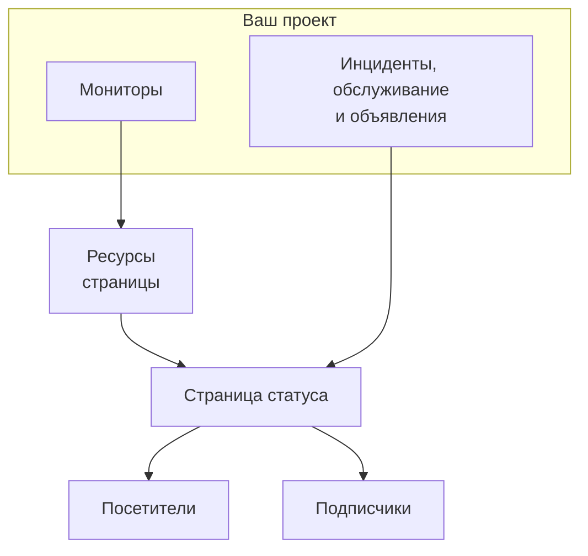

# Обзор страниц статуса

Страница статуса — это публичное лицо всего, что вы отслеживаете: один URL, который ваши клиенты могут открыть, вместо того чтобы писать вам и спрашивать, только ли у них проблема. Она показывает текущий статус сервисов, которые вы решили показать, инциденты, над которыми вы работаете, запланированное обслуживание и любое объявление, которое вы хотите закрепить сверху.

Когда что-то ломается в 2 часа ночи, страница статуса — первое, на что ссылается ваша очередь поддержки. Оттуда же уведомляются ваши подписчики, поэтому её стоит настроить заранее, а не посреди сбоя.

:::cards
- [Создать страницу статуса](#создание-страницы-статуса): Два поля для начала, всё остальное потом.
- [Выбрать, что она показывает](#выбор-того-что-показывается-на-странице): Инциденты, эпизоды, объявления, обслуживание и аптайм — на одной карточке.
- [Решить, кто может её видеть](#ограничение-доступа-к-странице): Все, у кого есть ссылка, только вошедшие пользователи или все, у кого есть пароль.
- [Архивировать страницу статуса](#архивирование-страницы-статуса): Отключить страницу, не удаляя её.
:::

## Как это работает

Страницы статуса находятся в разделе **Страницы состояния** меню **Продукты** на верхней панели, среди основных. Всё на этой странице относится к отдельной странице статуса: у проекта их может быть сколько угодно — публичная для клиентов, приватная для внутренней аудитории, по одной на регион для конкретного рынка.

Страница показывает размещённые на ней мониторы как ресурсы. Инциденты и плановое обслуживание попадают на неё через эти мониторы, а объявления публикуются на ней напрямую. Посетители читают страницу, а подписчики получают уведомления о каждом изменении по выбранным ими каналам.

## Коротко о главном

- **Создаётся с двумя полями.** Новая страница статуса запрашивает только **Имя** и **Описание**. Ресурсы, брендинг и домены настраиваются потом.
- **Ресурсы — это то, что видят посетители.** Каждая строка на странице — это **Страница статуса Ресурс**: монитор (или группа мониторов) со своим отображаемым именем, подсказкой и параметрами аптайма. Группы делят длинную страницу на разделы и могут быть вложенными.
- **URL предпросмотра с первого дня.** Каждая страница статуса получает ссылку предпросмотра, чтобы вы могли увидеть её до появления пользовательского домена.
- **Маршруты для посетителей зависят от настроек.** Инциденты, эпизоды, объявления и запланированные события появляются, только пока включён их переключатель в **Что показывает ваша страница статуса** (в **Расширенные настройки**), а страница подписки — только пока включён **Показывать страницу подписчика**.
- **Кто может её видеть — это один выбор.** Все, у кого есть ссылка, только вошедшие пользователи (приватные пользователи, SSO через SAML или OIDC) или все, у кого есть пароль, — на экране **Доступ** страницы, с необязательным списком разрешённых IP в **Дополнительные настройки**.
- **Подписчики уведомляются автоматически.** Подписчики по email, SMS, Slack, Microsoft Teams и webhook могут следить за страницей, каждый канал — за своим переключателем.

## Ключевые понятия

| Понятие | Что оно значит |
| --- | --- |
| **Страница статуса** | Одна публичная (или приватная) страница со своим брендингом, доменами, ресурсами и подписчиками. Модель `StatusPage`. |
| **Ресурс** | Одна строка, которую видят посетители: монитор или группа мониторов, показанные на странице с отображаемым именем и параметрами аптайма. |
| **Группа** | Именованный раздел, содержащий ресурсы. Группы вкладываются в группы, и каждый уровень сводит статус всего, что находится под ним. |
| **Объявление** | Сообщение, которое вы публикуете на одной или нескольких страницах статуса, с временем начала и необязательным временем окончания. |
| **Подписчик** | Кто-то (или что-то), кто следит за страницей по email, SMS, Slack, Microsoft Teams или через webhook. |
| **Пользовательский домен** | Ваш собственный домен, `status.example.com`, направленный на страницу записью CNAME. OneUptime бесплатно выпускает для него SSL-сертификат и продлевает его. |
| **Приватный пользователь** | Учётная запись, которая может входить на приватную страницу статуса. Отдельна от пользователей вашего проекта OneUptime. |

## Создание страницы статуса

:::steps
### Откройте форму создания

Откройте **Страницы состояния → Все страницы состояния** и нажмите **Создать страницу статуса**.

### Назовите страницу

В окне **Создать: Страница статуса** заполните **Имя** (обязательно, не менее двух символов) и, если хотите, **Описание**, затем нажмите **Создать страницу статуса**.

Это вся форма. Список, в который вы вернётесь, показывает **Имя**, **Описание**, **Метки** и **Владельцы** и фильтруется по **ID страницы статуса**, **Имя** и **Описание**.

### Откройте новую страницу

Откройте новую страницу, и вы попадёте на её экран **Обзор** с двумя карточками: **Status Page Preview URL** со ссылкой на саму страницу и **Сведения о странице статуса**, где можно изменить только что заданные имя, описание и метки. Если у проекта есть пользовательские поля страниц статуса, за ними следует карточка **Пользовательские поля**.
:::

На страницу, созданную через API или Terraform, распространяются те же тарифы, что и на описанные ниже настройки. В OneUptime Cloud создание страницы с включённой настройкой, которую ваш тариф не включает (например, приватная страница, скрытый список, пользовательские HTML, CSS или JavaScript, отчёты по email, подписчики по SMS, Slack, Microsoft Teams или webhook, список разрешённых IP), отклоняется с `402 Payment Required`, и в сообщении указан тариф. Тариф каждой настройки указан рядом с ней ниже. Настройки, оставленные по умолчанию, как их оставляет эта форма, работают на любом тарифе.

Дальше, примерно в порядке полезности:

- Добавьте ресурсы, чтобы страница что-то показывала: см. [Ресурсы и группы страницы статуса](/docs/status-pages/resources-and-groups).
- Задайте заголовок страницы, favicon, логотип и обложку, затем подключите пользовательский домен: см. [Оформление и домены страницы статуса](/docs/status-pages/branding-and-domains).
- Решите, по каким каналам можно подписаться: см. [Подписчики и объявления](/docs/status-pages/subscribers).
- Настройте то, что появляется на странице, в **Расширенные настройки**.

## Где что находится

Когда вы открываете страницу статуса, её собственное левое меню разбито на девять разделов. Используйте его как карту для остальной части этого раздела документации.

| Раздел | Что в нём |
| --- | --- |
| **Базовый** | **Обзор**, **Объявления**, **Владельцы**. |
| **Ресурсы** | Один экран **Ресурсы** (группы слева, мониторы выбранной группы справа) и **Monitor Rules**. |
| **Подписчики** | **Подписчики email**, **Подписчики SMS**, **Подписчики Slack**, **Подписчики MS Teams**, **Подписчики вебхуков**, **Настройки подписчиков**. |
| **Журналы уведомлений** | **Журналы уведомлений**: что было отправлено подписчикам. |
| **Брендинг** | **Брендинг** (логотип, заголовок, favicon, ссылки, подвал, цвета и языки — на одной странице), **Пользовательские домены**, **HTML, CSS и JavaScript**. |
| **Безопасность** | **Доступ** (кто может видеть страницу), **Приватные пользователи**, **SSO**, **OIDC**, **SCIM**. |
| **ИИ** | **MCP**. |
| **Для разработчиков** | **Terraform**, **API**, **ИИ-ассистенты**: страница как код. |
| **Расширенный** | **Встроенный статус**, **Отчеты**, **Пользовательские поля**, **Расширенные настройки**, **Журналы аудита**, **Удалить страницу состояния**. |

Открытыми изначально показываются только **Базовый** и **Ресурсы** — то, что показывает страница. Все остальные разделы изначально свёрнуты, как редко используемые разделы любого меню OneUptime: нажмите на заголовок раздела, чтобы показать его страницы. Раздел открывается сам, когда вы находитесь на одной из его страниц, например **Расширенные настройки** или **Подписчики email**.

Две особенности названий, которые стоит знать до начала поиска:

- Пункт **Ресурсы** называется **Ресурсы**, только когда в проекте включены группы мониторов. Иначе он называется **Мониторы**. В обоих случаях это один и тот же экран.
- Отдельной страницы групп нет. Группы и ресурсы объединены, и старый маршрут `/groups` теперь перенаправляет на экран ресурсов.

За пределами конкретной страницы сам раздел **Страницы состояния** показывает **Все страницы состояния**, а раздел **Ещё** содержит **Объявления**. Свёрнутый раздел **Настройки** содержит **Шаблоны объявлений**, **Шаблоны подписчиков**, **Пользовательские поля**, **Правила владельца** и **Правила меток**, которые действуют на весь проект и общие для всех страниц статуса. Свёрнутый раздел **Расширенный** содержит **Архивировано**: страницы статуса, которые вы отключили (см. [Архивирование страницы статуса](#архивирование-страницы-статуса)).

**Правила меток** и **Правила владельца** ставят метки новым страницам статуса и назначают им владельцев. У правила два шага (**Совпадение** — условия, которым должна соответствовать страница статуса, затем **Метки** или **Владельцы** — то, что правило добавляет), а его **Имя** заполняется по сделанному выбору. Новое правило должно добавлять хотя бы одну метку или одного владельца; при редактировании на этом никогда не настаивают, а старое правило, которое ничего не добавляет, отмечено в списке как **Ничего не добавляет**. См. [Правила меток и владельцев](/docs/configuration/label-and-owner-rules).

## Что видит посетитель

Публичная страница — это отдельное приложение с небольшим набором маршрутов:

- `/`: **Обзор**.
- `/incidents` и `/incidents/:id`: список инцидентов и отдельный инцидент.
- `/announcements` и `/announcements/:id`.
- `/scheduled-events` и `/scheduled-events/:id`.
- `/subscribe/email`, `/subscribe/sms`, `/subscribe/slack`, `/subscribe/microsoft-teams`, `/subscribe/webhooks`.
- `/confirm-subscription/:id`, `/update-subscription/:id` и `/unsubscribe/:token`: ссылки в сообщениях, которые получают подписчики.
- `/rss`: лента.
- `/login`, `/sso` и `/master-password`: имеют значение только на приватной странице.

Верхняя панель навигации всегда показывает **Обзор**; остальное появляется, только когда включено. Для **Инциденты**, **Объявления** и **Запланированные события** нужен свой переключатель; для **Подписаться** нужны и **Показывать страницу подписчика**, и хотя бы один включённый канал подписки. На приватной странице есть ещё пункт **Выйти**.

Отдельный инцидент, эпизод, объявление или запланированное событие открывается, только если страница показала бы его в списке, независимо от окна истории: приватный инцидент или эпизод, скрытый со страниц статуса, запланированное событие, скрытое со страниц статуса, или объявление, запланированное на будущее, не находится и по своей ссылке.

### Страница обзора

Обзор — это страница, которую видит большинство посетителей. Сверху вниз она показывает:

1. **Текущие объявления**: объявления, время начала которых прошло, а время окончания — нет.
2. **Баннер общего статуса**: одна строка, которая сообщает, затронуты все ресурсы или только некоторые.
3. **Общий процент аптайма**, если вы его включили: в конце баннера общего статуса, пока все ресурсы работают. По умолчанию выключен.
4. **Группы ресурсов**, каждая со своими ресурсами, их текущим статусом и полосами истории аптайма.
5. **Активные инциденты**, с активными эпизодами.
6. **Запланированные работы по обслуживанию**.

Только что созданная страница без содержимого показывает пустое состояние с предложением добавить ресурсы из панели управления — знак, что пора перейти на экран **Ресурсы**.

Обзор, который видит посетитель, отстаёт не более чем на 15 секунд, а всё, что вы убираете со страницы, исчезает с неё менее чем за секунду: инцидент, эпизод или запланированное событие, которое вы скрываете со страниц статуса, делаете приватным, ограничиваете другими страницами или удаляете, объявление, которое вы завершаете, откладываете или удаляете, публичная заметка, которую вы удаляете, и ресурс, группа или монитор, которые вы убираете со страницы или удаляете. Другие изменения, например новый заголовок, появляются в течение этих 15 секунд.

О том, что помещает инцидент на эту страницу и что его с неё убирает, читайте в [Состояния и уровни серьёзности инцидентов](/docs/incidents/states-and-severities).

## Выбор того, что показывается на странице

То, что видят посетители, задаётся на одной карточке: **Что показывает ваша страница статуса** в **Страницы состояния → ваша страница → Расширенный → Расширенные настройки**. На ней есть строка для каждого списка, который может показывать страница, затем **История безотказной работы** (с общим процентом аптайма и статусами, которые считаются простоем) и строка «Powered by OneUptime». Кнопки редактирования нет: переключатель сохраняется, как только вы его переключите, число дней — когда вы покидаете поле или нажимаете Enter, а выбор из списка — как только вы его сделаете.

- **Показывать инциденты** (`showIncidentsOnStatusPage`): включён по умолчанию. Под ним **Показывать за последние … дн.** (`showIncidentHistoryInDays`, по умолчанию 14) задаёт, насколько далеко в прошлое уходит список инцидентов, а **Показывать метки инцидентов** (`showIncidentLabelsOnStatusPage`) по умолчанию выключен.
- **Показывать только инциденты, ограниченные этой страницей** (`onlyShowScopedIncidents`): тоже в строке инцидентов, по умолчанию выключен. Включите его, и страница будет показывать — и уведомлять своих подписчиков — только об инцидентах, ограниченных ею через **Ограничить этими страницами состояния**. Инциденты, не ограниченные ни одной страницей, в том числе те, что сами открывают монитор, Slack, Microsoft Teams, API или ИИ, никогда не попадают на неё, пока кто-нибудь не добавит к ним эту страницу. Он также решает, какие инциденты приносят на страницу свои эпизоды, поэтому остаётся доступным, когда **Показывать инциденты** выключен. О страницах, которые делят мониторы, но обслуживают разные аудитории, см. [Отдельная страница статуса для каждой аудитории](/docs/status-pages/one-status-page-per-audience).
- **Показывать эпизоды** (`showEpisodesOnStatusPage`): включён по умолчанию, с **Показывать за последние … дн.** (`showEpisodeHistoryInDays`, по умолчанию 14) и **Показывать метки эпизодов** (`showEpisodeLabelsOnStatusPage`, по умолчанию выключен). Эпизоды — отдельная модель со своими эндпоинтами, а не представление инцидентов.
- **Показывать объявления** (`showAnnouncementsOnStatusPage`): включён по умолчанию, с **Показывать за последние … дн.** (`showAnnouncementHistoryInDays`, по умолчанию 14).
- **Показывать события планового обслуживания** (`showScheduledMaintenanceEventsOnStatusPage`): включён по умолчанию, с **Показывать за последние … дн.** (`showScheduledEventHistoryInDays`, по умолчанию 14) и **Показывать метки событий** (`showScheduledEventLabelsOnStatusPage`, по умолчанию выключен).
- **История безотказной работы**: всё об аптайме страницы — в одной строке:
  - **Показывать за последние … дн.** (`showUptimeHistoryInDays`) — длина полосы аптайма рядом с каждым ресурсом. По умолчанию 90, значение должно быть от 1 до 90. Все параметры **Показывать % безотказной работы** и **Показывать график истории статуса** ресурса или группы читают это число, как и общий процент аптайма.
  - **Показывать общий процент безотказной работы** (`showOverallUptimePercentOnStatusPage`): по умолчанию выключен. Включите его, и баннер общего статуса завершится процентом аптайма для всей страницы — средним по её ресурсам и группам, — пока всё работает. Пока он включён, **Точность** (`overallUptimePercentPrecision`) выбирает, сколько знаков после запятой он показывает: `99%`, `99.9%`, `99.99%` (по умолчанию) или `99.999%`. У каждого ресурса и каждой группы своя точность.
  - **Считается простоем** (`downtimeMonitorStatuses`): статусы мониторов, время в которых засчитывается против каждого процента аптайма на странице — каждого ресурса, каждой группы и общего. Каждый статус — метка своего цвета. Добавьте статус из списка или уберите его через **×**, и изменение сохранится сразу. Новая страница статуса начинает со всех статусов проекта, которые не являются рабочими. Хотя бы один статус всегда остаётся: последний убрать нельзя, потому что без статусов любой аптайм на странице показывал бы 100%.
- **Показывать брендинг «Powered By OneUptime»**: включён по умолчанию, поэтому подвал для посетителей гласит «Powered by OneUptime». Выключите его, чтобы скрыть строку. Столбец хранит это наоборот, как `hidePoweredByOneUptimeBranding`.

**Выключенный список** исчезает со страницы вместе со своим пунктом на панели навигации, если он есть; его публичный эндпоинт отклоняет запрос, а подписчики страницы не уведомляются о таком типе событий. Его строка тогда показывает только свой переключатель: насколько далеко уходит скрытый список и показывает ли он метки, ничего не меняет.

**Тарифы.** В OneUptime Cloud рядом с настройкой, которую ваш тариф не может изменить, показан нужный ей тариф. Четыре переключателя списков, три переключателя меток и история эпизодов требуют **Growth**; показ общего процента аптайма и скрытие строки «Powered by OneUptime» требуют **Scale**. Остальные окна истории, **История безотказной работы**, **Точность**, **Считается простоем** и **Показывать только инциденты, ограниченные этой страницей** можно менять на любом тарифе, и каждый из них сохраняется сам по себе: страница, у которой общий процент аптайма уже включён, может менять его точность на любом тарифе. Возврат настройки к значению новой страницы (снова показать список, скрыть метки или общий процент аптайма, показать строку «Powered by OneUptime», вернуть историю эпизодов к 14 дням) работает на любом тарифе, поэтому ничто, изменённое во время пробного периода, не остаётся таким из-за отсутствия тарифа: переключатель сообщает, что его ещё можно вернуть, и какой тариф нужен, чтобы снова его изменить.

Показывает ли страница пункт **Подписаться** (**Показывать страницу подписчика**, `showSubscriberPageOnStatusPage`, включён по умолчанию) и по каким каналам посетители могут подписаться, задаётся не на этом экране: и то и другое находится на карточке **Каналы** в **Подписчики → Настройки подписчиков** (см. [Каналы подписки](/docs/status-pages/subscribers#каналы-подписки)).

Под карточкой находятся **Экспорт в JSON: Страница статуса**, который скачивает собственные настройки страницы статуса в файл, который можно импортировать снова, и **Archive status page** (см. [Архивирование страницы статуса](#архивирование-страницы-статуса)). Общий процент аптайма и статусы простоя раньше были здесь двумя отдельными карточками, каждая за кнопкой **Редактировать**; теперь это строки карточки.

**Где цвета.** Цветов полос аптайма здесь нет: **Цвет полосы по умолчанию** и правила цвета полос находятся в **Дополнительные настройки** в **Страницы состояния → ваша страница → Брендинг → Брендинг**. Настройки темы или фирменного цвета нет нигде; всё, что выходит за пределы этих элементов управления, делается через **Пользовательский CSS**.

## Предпросмотр до запуска

На экране **Обзор** каждой страницы статуса есть карточка **Status Page Preview URL** с прямой ссылкой на страницу. Пользуйтесь ею, пока вы ещё добавляете ресурсы и пока нет пользовательского домена.

За кулисами у каждого публичного маршрута есть двойник для предпросмотра в `/status-page/{statusPageId}/...`: обзор для предпросмотра, список инцидентов для предпросмотра, страница подписки для предпросмотра и так далее. Поэтому URL или снимок экрана из предпросмотра в панели управления не совпадут с тем, что видит клиент после подключения пользовательского домена, — проверяйте любую ссылку, которую вставляете в ранбук или письмо.

## Ограничение доступа к странице

Не каждая страница статуса предназначена для публики. Кто может видеть страницу — это один выбор, первая карточка **Страницы состояния → ваша страница → Безопасность → Доступ**, **Кто может видеть эту страницу статуса**:

- **Все, у кого есть ссылка**: страница публичная. С этого начинается каждая новая страница статуса.
- **Только вошедшие пользователи**: посетители попадают на `/login` и входят как приватный пользователь или через вашего провайдера SSO или OIDC (см. ниже). Под выбором карточка перечисляет настроенный для страницы вход (сколько у неё приватных пользователей и включены ли SSO и OIDC, каждый со ссылкой на свой экран) и, пока это текущий выбор, предупреждает, когда войти ещё никто не может.
- **Все, у кого есть пароль**: посетители попадают на `/master-password` и открывают страницу паролем, которым вы с ними делитесь. Учётная запись никому не нужна. При выборе этого варианта пароль запрашивается в том же диалоге, если у страницы его нет; если он уже есть, можно оставить его или ввести другой. Затем **Изменить пароль** под выбором заменяет его. Пароль хранится в виде хеша и не может быть показан снова, а те, кто ввёл старый, могут видеть страницу ещё до 7 дней.

Выбор варианта запрашивает подтверждение, сообщая, что изменится для посетителей, и сохраняется сразу. Кнопки редактирования нет.

**Изображения.** Изображение в том, что показывает страница (публичная заметка, объявление, описание), открывается по собственному длинному адресу, который невозможно угадать и который работает без входа, чтобы его могли показывать и письма вашим подписчикам. Сама страница по-прежнему требует входа или пароля.

**Что сохраняется.** Выбор — это три столбца, которые API и Terraform читают и записывают как раньше: `isPublicStatusPage`, `enableMasterPassword` и `masterPassword`. Пароль запрашивается у посетителей только на непубличной странице с включённым `enableMasterPassword` и заданным паролем; приватная страница с включённым переключателем, но без пароля — это страница входа. Выбор **Все, у кого есть ссылка** также выключает `enableMasterPassword`, потому что публичная страница никогда его не запрашивает. Экран **Доступ** записывает только те столбцы, которые меняет выбор.

**Тарифы.** В OneUptime Cloud, чтобы сделать страницу приватной, нужен тариф **Growth**: на более низком тарифе два приватных варианта показывают нужный им тариф и не могут быть выбраны. Снова сделать её публичной (**Все, у кого есть ссылка**) можно на любом тарифе, поэтому страницу, оставшуюся приватной после окончания пробного периода или перехода на более низкий тариф, всегда можно снова открыть; диалог сообщает, что для повторного перевода в приватный режим нужен **Growth**. Переход с **Только вошедшие пользователи** на **Все, у кого есть пароль** работает на любом тарифе, как и **Изменить пароль**.

### Приватные пользователи

Добавьте людей, которые могут входить, в **Страницы состояния → ваша страница → Безопасность → Приватные пользователи**. Там есть действие **Добавить массово**: вставьте список адресов email, и каждый получит письмо с приглашением. У приватных пользователей свой процесс восстановления и сброса пароля, отдельный от учётных записей вашего проекта OneUptime.

**Приватные пользователи и пароль не суммируются.** Пока выбран вариант **Все, у кого есть пароль**, приватные пользователи не могут войти (они тоже вводят пароль), и экран **Приватные пользователи** сообщает об этом со ссылкой обратно на **Доступ**.

### SSO и OIDC

Для приватной страницы, связанной с вашим провайдером удостоверений, **Страницы состояния → ваша страница → Безопасность → SSO** настраивает SAML: вы вводите URL входа, издателя и сертификат x509, а методы подписи и дайджеста заполняются в **Дополнительные поля**. **Страницы состояния → ваша страница → Безопасность → OIDC** настраивает OpenID Connect: вы вводите издателя, ID клиента и секрет, а URL обнаружения, области (scopes) и имена утверждений (claims) заполняются в **Дополнительные поля**. **SCIM** автоматически создаёт приватных пользователей из IdP. В OneUptime Cloud все три требуют тарифа Scale или выше. В самостоятельно размещённой установке SSO и OIDC входят во все редакции, а SCIM требует [Редакция Enterprise](/docs/self-hosted/enterprise).

Выключение или удаление провайдера SSO или OIDC страницы статуса завершает сеансы приватных пользователей, которых он впустил: их сеансы заканчиваются при следующем запросе, и повторное включение провайдера их не возвращает — они входят через него заново. Новый сертификат или секрет клиента, другие URL или новое имя сохраняют вход для всех. На странице, требующей SSO, выключение её последнего провайдера оставляет всех без доступа, пока вы снова не включите один или не выключите **Требовать SSO для входа**; чтобы перейти на другого провайдера, настройте и проверьте нового, прежде чем выключать старого.

Под провайдерами карточка **Настройки SSO** содержит переключатель **Требовать SSO для входа** (`requireSsoForLogin`, по умолчанию выключен), который сохраняется, как только вы его переключите. Его включение сначала запрашивает подтверждение, потому что после этого приватные пользователи не смогут входить по email и паролю: страницу смогут видеть только люди, которых впускает ваш провайдер SSO или OIDC. Проверьте SSO по ссылке на том экране, прежде чем включать. Он имеет значение, только пока выбран вариант **Только вошедшие пользователи**, и экран **Доступ** показывает его как **SSO обязателен** под этим выбором. Пока он включён, приватный пользователь, вошедший по email и паролю, тоже выходит из системы при следующем запросе: учитываются только сеансы, начатые провайдером SSO или OIDC. В OneUptime Cloud для его включения нужен тариф **Scale**, а выключение работает на любом тарифе. Страница, которая продолжает требовать SSO после окончания пробного периода Scale или перехода на более низкий тариф, требует его, пока кто-нибудь это не выключит: её страницы **SSO** и **OIDC** показывают переключатель для этого под предложением тарифа.

### Список разрешённых IP

В **Дополнительные настройки** экрана **Доступ** раздел **Список разрешённых IP** (столбец `ipWhitelist`) ограничивает страницу известными сетями. Он действует независимо от аудитории страницы: посетитель с любого другого адреса получает отказ, даже с паролем или учётной записью приватного пользователя. Вводите по одной записи в строке: адрес IPv4 или IPv6 либо диапазон IPv4, например `10.0.0.0/8`; строка, которая не является ни тем ни другим, отклоняется при сохранении. Оставьте его пустым, чтобы разрешить все адреса. Пока список действует, свёрнутый заголовок **Дополнительные настройки** показывает **Список разрешённых IP** с числом записей в нём. В OneUptime Cloud для его изменения нужен тариф **Scale**; очистить его можно на любом тарифе.

## Встраиваемый значок и RSS-лента

Два способа показать статус где-то помимо самой страницы.

**Встроенный значок статуса.** В **Страницы состояния → ваша страница → Расширенный → Встроенный статус** включите **Включить встроенный значок статуса** (`enableEmbeddedOverallStatus`, по умолчанию выключен), затем нажмите **Перегенерировать токен** на карточке **Токен безопасности**, чтобы выдать значку его токен (`embeddedOverallStatusToken`). Значок отдаётся с `/api/status-page/badge/<status-page-id>?token=<token>`, а экран показывает его в **Предварительный просмотр значка** с фрагментами для копирования, чтобы вы могли разместить текущий общий статус в своей документации, в подвале своего приложения или на маркетинговой странице.

**RSS-лента.** Каждая страница статуса отдаёт `/rss`: ленту с названием «{заголовок страницы} Updates», где используется **Заголовок страницы**, заданный в **Брендинг**, или имя страницы, если заголовка нет, а элементы начинаются с `Incident: `, `Announcement: ` и `Scheduled Maintenance: `. Удобно для тех, кто предпочитает получать ваши обновления в RSS-читалке или чат-боте, а не подписываться по email.

Если вы предпочитаете получать данные сами, страница статуса опирается на публичные эндпоинты чтения для обзора, инцидентов, событий планового обслуживания, объявлений и эпизодов: см. [Публичный API](/docs/status-pages/public-api).

## Архивирование страницы статуса

Архивируйте страницу статуса, чтобы отключить её, не удаляя. Архивированная страница статуса:

- **Отключена.** Её URL, её пользовательские домены, её встроенный значок, её публичный API и её сервер MCP отвечают так, будто страницы не существует («Status Page not found»), поэтому посетитель не может отличить архивированную страницу от никогда не существовавшей. Ссылка предпросмотра в панели управления тоже перестаёт работать.
- **Ничего не отправляет своим подписчикам.** Никаких уведомлений об инцидентах, эпизодах, обслуживании или объявлениях, никаких отчётов и никаких подтверждений подписки. Подписаться на неё никто не может.
- **Исчезает из списка страниц статуса.** Её можно найти в **Страницы состояния → Расширенный → Архивировано**.
- **Сохраняет всё.** Её ресурсы, группы, брендинг, домены, приватные пользователи и подписчики сохраняются, поэтому извлечение из архива возвращает страницу в онлайн точно такой, какой она была.

Чтобы архивировать страницу статуса, откройте её и перейдите в **Расширенный → Расширенные настройки → Archive status page**. Чтобы архивировать несколько, выберите их в списке **Страницы состояния** и выберите **Архивировать**. Чтобы вернуть страницу, откройте **Страницы состояния → Расширенный → Архивировано**, выберите её и выберите **Извлечь из архива** либо откройте её и нажмите **Извлечь из архива** на баннере вверху её страниц.

## Следующие шаги

:::cards
- [Ресурсы и группы страницы статуса](/docs/status-pages/resources-and-groups): Разместить мониторы на странице и разложить их по разделам.
- [Оформление и домены страницы статуса](/docs/status-pages/branding-and-domains): Ваш логотип и цвета, и страница на вашем собственном домене.
- [Подписчики и объявления](/docs/status-pages/subscribers): Пять каналов подписки и публикация объявлений.
- [Отдельная страница статуса для каждой аудитории](/docs/status-pages/one-status-page-per-audience): Страница для каждого клиента, площадки или региона — и какие из них узнают о каждом инциденте.
:::
