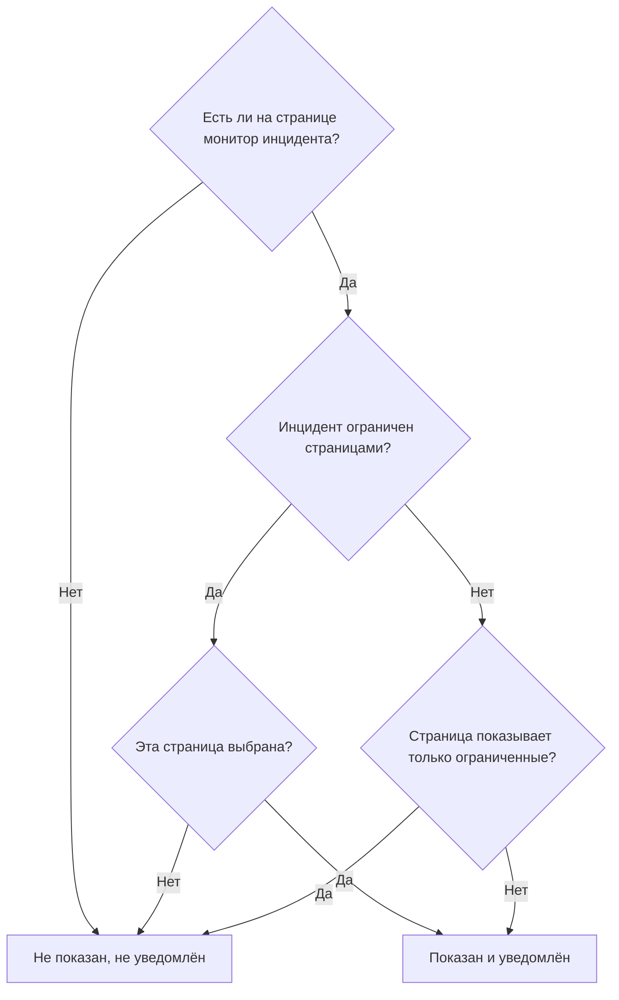

# Отдельная страница статуса для каждой аудитории

Разным людям нужны разные новости. Клиент не хочет знать о сбое у другого клиента, а сотрудники одной площадки не хотят получать письмо каждый раз, когда другая площадка теряет сеть. В OneUptime единица аудитории — это страница статуса: у каждой свои подписчики, своё оформление и своя приватность. Поэтому дайте каждой аудитории свою страницу и решайте для каждого инцидента, какие страницы о нём узнают.

Раньше общая инфраструктура это усложняла. Инцидент попадает на страницу статуса через свои мониторы, поэтому монитор, общий для десяти страниц площадок, сообщал всем десяти площадкам о сбое, затронувшем две. Единственным обходным путём была страница или монитор для каждой комбинации площадок. Эта страница описывает настройки, которые это решают:

- **Ограничить этими страницами состояния** на инциденте, чтобы он показывался и уведомлял только на выбранных вами страницах.
- **Показывать только инциденты, ограниченные этой страницей** на странице статуса, чтобы инцидент, который ещё никто не ограничил, не попадал ни на одну из этих страниц, пока кто-нибудь не решит. Это касается и инцидентов, которые сами открывают монитор, Slack, Microsoft Teams, API или ИИ.
- Запись о том, каким страницам сообщили о создании инцидента, чтобы страница, добавленная позже, получила уведомление один раз, а остальные не получили его повторно.
- Сводка **Будут уведомлены**, которая показывает, кто узнает об инциденте, прежде чем вы его объявите или опубликуете публичную заметку, и **Предпросмотр**, который показывает, что получат подписчики каждой страницы.

:::cards
- [Настроить](#настройка-отдельной-страницы-для-каждой-аудитории): Страница на аудиторию и переключатель, который не пускает на них неограниченные инциденты.
- [Ограничить инцидент](#ограничение-инцидента-страницами-статуса): Выберите страницы при объявлении или позже.
- [Добавить или убрать страницы](#добавление-и-удаление-страниц-статуса): Кто узнаёт о добавленной странице и что отменяет её удаление.
- [Что содержит каждое сообщение](#что-содержит-каждое-сообщение): Значения, которые получает каждая страница, и что они сообщают каждой аудитории.
:::

## Когда это использовать

- **Поставщик управляемых услуг** со страницей статуса для каждого клиента, на мониторах, общих для клиентов.
- **Организация с площадками, заводами или регионами**, у каждого из которых свои сотрудники, которых нужно уведомлять.
- **Внутренняя ИТ-служба** со страницей для каждого отдела или здания.

Если ваша аудитория готова выбирать сама, может хватить одной страницы: позвольте подписчикам выбирать интересующие их ресурсы (см. [Подписчики и объявления](/docs/status-pages/subscribers)). Используйте отдельную страницу для каждой аудитории, когда выбор за них делаете вы — для каждого инцидента — или когда одна аудитория вообще не должна видеть инциденты другой.

## Как инцидент попадает на страницу статуса

Инцидент попадает на страницу статуса через свои мониторы. Страница показывает инцидент и уведомляет о нём своих подписчиков, когда один из ресурсов страницы — один из мониторов инцидента, напрямую или через группу мониторов на странице. Две настройки это сужают:

- **Ограничить этими страницами состояния** на инциденте (`statusPages`). Если оставить его пустым, инцидент попадает на все страницы, где есть его мониторы, как и всегда. С выбранными страницами он попадает только на выбранные страницы **среди** тех, где есть его мониторы.
- **Показывать только инциденты, ограниченные этой страницей** на странице статуса (`onlyShowScopedIncidents`, по умолчанию выключен). Когда он включён, страница никогда не показывает инцидент, не ограниченный конкретными страницами статуса, и никого о нём не уведомляет.



Для страницы, на которой есть один из мониторов инцидента:

| Инцидент | Страница с выключенным **Показывать только инциденты, ограниченные этой страницей** | Страница с включённым |
| --- | --- | --- |
| Не ограничен ни одной страницей статуса | Показан и уведомлён | Не показан, не уведомлён |
| Ограничен страницами статуса, и эта страница выбрана | Показан и уведомлён | Показан и уведомлён |
| Ограничен страницами статуса, но не этой | Не показан, не уведомлён | Не показан, не уведомлён |

Страница, на которой нет ни одного из мониторов инцидента, никогда его не показывает, что бы вы ни выбрали, а инцидент без мониторов вообще не уведомляет подписчиков страниц статуса. Обычные правила по-прежнему действуют поверх этого: инцидент должен быть **Видно на странице статуса** и не приватным, на странице должно быть включено **Показывать инциденты**, а подписчик, выбравший только некоторые ресурсы или типы событий, получает только то, что выбрал.

Те же правила определяют всё, что зависит от того, на какие страницы попадает инцидент:

- списки инцидентов, обзор и собственную страницу инцидента на публичной странице статуса, а также [Публичный API](/docs/status-pages/public-api) страницы статуса;
- сообщения по email, SMS, Slack, Microsoft Teams и webhook, отправляемые, когда инцидент создаётся, меняет состояние, получает публичную заметку или постмортем;
- количество инцидентов в отчётах страниц статуса, отправляемых по email, которые учитывают только инциденты, показываемые страницей.

Эпизод инцидента попадает на страницу, когда туда попадает хотя бы один из его инцидентов. Его уведомления уходят на все страницы, куда попадают его инциденты, а его страница на странице статуса, куда не попадает ни один из них, не находится. Приватный инцидент не попадает ни на одну страницу, поэтому никогда не приносит туда свой эпизод, а приватный эпизод вообще не показывается ни на одной странице.

## Настройка отдельной страницы для каждой аудитории

:::steps
### Создайте страницу статуса для каждой аудитории

Создайте по странице на аудиторию, например от `Site 01` до `Site 10`. Сделайте их приватными, если аудитория внутренняя (см. [Ограничение доступа к странице](/docs/status-pages/index#ограничение-доступа-к-странице)). Подписчики приватной страницы всё равно могут отписаться без входа, по ссылке в каждом сообщении (см. [Управление подпиской и отказ от неё](/docs/status-pages/subscribers#управление-подпиской-и-отказ-от-неё)). Дайте им метки вроде `Region East`, чтобы элемент выбора мог одним щелчком добавить все страницы с меткой.

### Добавьте общий монитор на каждую страницу

Добавьте общий монитор на каждую страницу как ресурс (см. [Ресурсы и группы страницы статуса](/docs/status-pages/resources-and-groups)). Правило в **Ресурсы → Monitor Rules** может сделать это за вас по меткам монитора.

### Включите Показывать только инциденты, ограниченные этой страницей

Включите его на каждой из этих страниц. Он находится на карточке **Что показывает ваша страница статуса** в **Страницы состояния → ваша страница → Расширенный → Расширенные настройки**, под **Показывать инциденты**, и сохраняется в момент переключения. С этого момента на страницу площадки ничего не попадает, пока кто-нибудь её не выберет.

### Добавьте подписчиков каждой аудитории

Для сотрудников используйте **Добавить массово** в **Подписчики email** и предпочитайте собственный адрес каждого человека списку рассылки вроде `site03-all@`: любой участник списка может отписать его для всех, кто в нём есть. Если добавленный вами подписчик отписывается, владельцы страницы и тот, кто его добавил, получают письмо (см. [Общие адреса и списки рассылки](/docs/status-pages/subscribers#общие-адреса-и-списки-рассылки)).

### Дайте дежурным читать страницы статуса

Элемент выбора перечисляет только страницы статуса, которые человек может читать, а роли инцидентов читать страницы статуса не могут. Дайте дежурным роль **Status Page Viewer** рядом с их ролью для инцидентов; её можно ограничить страницами с определёнными метками. Без неё элемент выбора пуст.

### Решите, что говорит каждое сообщение

В **Инциденты → Настройки → Пользовательские поля** определите пользовательские поля инцидентов, на которые ваша команда отвечает каждый раз, например `Impact` (раскрывающийся список), `Expected Resolution` (дата и время) и `Acknowledgement` (переключатель «да/нет»). Перетащите их в нужный **Порядок**, в котором их нужно запрашивать и перечислять, и включите **Показывать при создании**, чтобы форма объявления их запрашивала, **Обязательно при создании** там, где ответ обязателен, и **Включать в уведомления подписчикам** для тех, которые может читать любая аудитория. Тогда они будут в письме по умолчанию каждой страницы. См. [Пользовательские поля](/docs/incidents/settings#пользовательские-поля).

### Оформите письмо каждой страницы (необязательно)

На тарифе **Scale** дайте каждой странице **Пользовательская конфигурация SMTP** и привяжите пользовательские шаблоны для событий инцидента; они могут разместить любое поле с помощью `{{incident.customFields.<key>}}`. Пока вы пишете шаблон, **Предпросмотр в реальном времени** под ним показывает его заполненным примерными значениями. См. [Что нужно пользовательскому шаблону](/docs/status-pages/subscribers#что-нужно-пользовательскому-шаблону) и [Что содержит каждое сообщение](#что-содержит-каждое-сообщение), прежде чем использовать `{{affectedStatusPages}}`.

### Сохраните шаблоны инцидентов с выбранными страницами (необязательно)

Шаблон `Region East outage` может содержать страницы восточных площадок и ответы по умолчанию для пользовательских полей.

### Проверьте письмо каждой страницы до первого сбоя

Запустите **Объявить инцидент** с общим монитором и двумя выбранными страницами площадок, а в сводке перед отправкой откройте **Предпросмотр** рядом с **Да**: он показывает письмо, которое получили бы подписчики каждой страницы, и какой шаблон оно использует и почему. **Отправить тест мне** отправляет одно письмо в ваш собственный ящик. Никому больше ничего не отправляется, пока вы не объявите инцидент, поэтому по завершении просто покиньте форму, не отправляя её. См. [Кто будет уведомлён](#кто-будет-уведомлён).
:::

## Ограничение инцидента страницами статуса

### При объявлении

В **Инциденты → Все инциденты → Объявить инцидент** на шаге **Затронутые ресурсы** есть **Ограничить этими страницами состояния** в **Дополнительные поля**, после мониторов и других ресурсов. Его текст-подсказка, **Все страницы состояния, где указаны мониторы**, — это то, что означает пустое поле. Выбирайте страницы по названию или откройте вкладку **Метки** элемента выбора и выберите метку, чтобы добавить все страницы с ней.

Форма предупреждает вас:

- когда на выбранной странице нет ни одного из мониторов инцидента или монитор не прикреплён вообще. Инцидент не будет показан на этой странице и не уведомит её подписчиков;
- когда вы также задаёте **Изменить статус монитора на**, прямо под мониторами на том же шаге. См. [Статус монитора общий](#статус-монитора-общий);
- когда вы также отмечаете **Приватный инцидент** в **Дополнительные поля** на шаге **Сведения об инциденте**. Приватные инциденты скрыты со всех страниц статуса, включая выбранные вами.

Шаг **Подробности**, сразу после **Затронутые ресурсы**, запрашивает пользовательские поля инцидентов, отмеченные **Показывать при создании** (см. [Объявление инцидента](/docs/incidents/declaring-incidents)). Его ответы уходят на все страницы, куда попадает инцидент: значения пользовательских полей принадлежат инциденту, а не странице статуса.

**Создать из шаблона** заполняет поле из шаблона. Страницы шаблона задаются на его шаге **Затронутые ресурсы** при создании, а затем на его карточке **Охват страниц состояния** (**Инциденты → Настройки → Шаблоны инцидентов**). Как и для других полей шаблона, список, который вы задаёте сами, побеждает. Страницы шаблона заполняются даже для дежурного, который не может читать страницы статуса: тот, кто настроил шаблон, выбрал их для всех, кто объявляет по нему.

### Кто будет уведомлён

Под **Уведомить подписчиков страницы статуса**, прямо под элементом выбора в **Дополнительные поля** на шаге **Затронутые ресурсы**, и ещё раз в сводке перед отправкой форма показывает, до кого дойдёт инцидент:

> Будут уведомлены:
>
> - Site 03 (до 41 по эл. почте)
> - Site 07 (до 18 по эл. почте)

Ниже, в **Не получат уведомление:**, перечислены страницы, на которых есть мониторы, но которые не получат уведомление, и почему: это не одна из страниц, которыми ограничен инцидент, это страница, которая показывает только ограниченные ею инциденты, или это страница, которая не показывает инциденты.

Когда никто не будет уведомлён, сводка ничего не показывает: у инцидента нет мониторов, ни одна страница статуса их не показывает, у страниц ещё нет подписчиков, **Уведомить подписчиков страницы статуса** выключено или инцидент приватный. Она предупреждает, только когда причина — охват страниц статуса, и называет страницы, которые остаются в стороне: инцидент не ограничен, а страницы, где есть его мониторы, показывают только ограниченные ими инциденты; он ограничен другими страницами; или страницы, которыми он ограничен, не содержат ни одного из его мониторов. В сводке **Уведомить подписчиков страницы статуса** показывает **Да** или **Нет**, как любой другой флажок, с **Предпросмотр** рядом с **Да**; он не предлагается, пока флажок выключен, инцидент приватный или монитор не прикреплён.

Та же сводка появляется под **Уведомить подписчиков страницы статуса**, когда вы пишете заметку на странице инцидента **Публичные заметки**, для инцидента в его текущем виде. Там она также сообщает, когда инцидент скрыт со страниц статуса, поскольку тогда ничего не будет отправлено.

Количества — это «до». Они считают по каждому каналу подтверждённых подписчиков каждой страницы, которые не отписались, а подписчик, выбравший только некоторые ресурсы или типы событий, может и не получить это сообщение. Страницы, которые вы не можете читать, не называются. Они считаются как «ещё страницы состояния, к которым у вас нет доступа».

**Предпросмотр** рядом с **Да** в сводке и рядом с флажком заметки показывает, что они получат: выберите страницу, чтобы увидеть её письмо так, как его получат подписчики, с темой, и какой шаблон оно использует и почему, например что пользовательский шаблон страницы не используется, потому что у страницы нет **Пользовательская конфигурация SMTP**. **Отправить тест мне** отправляет письмо страницы на email вашей учётной записи и никому больше. Страницы, которые вы не можете читать, подсчитываются, но предпросмотр для них не показывается. См. [Предпросмотр письма перед отправкой](/docs/status-pages/subscribers#предпросмотр-письма-перед-отправкой).

### После объявления

Откройте инцидент и перейдите в **Расширенный → Настройки**. Карточка **Охват страниц состояния** перечисляет страницы, которыми ограничен инцидент, а **Изменить охват страниц состояния** их меняет. **Обзор** инцидента показывает тот же список как **Охват страниц состояния**, только для чтения, со ссылкой **Изменить в настройках**.

В **Инциденты → Все инциденты** фильтр **Страница статуса** находит инциденты, ограниченные выбранными вами страницами, или инциденты, не ограниченные ни одной страницей.

### Через API

`statusPages` — это список ID страниц статуса в `POST /api/incident` и в обновлениях инцидента, а также в шаблонах инцидентов. Каждая страница должна принадлежать проекту инцидента; страница из другого проекта отклоняется. Каждая добавляемая страница также должна быть страницей, которую вы можете читать, как в элементе выбора, иначе запрос отклоняется. Страницы, которые уже есть у инцидента или шаблона, сохраняются независимо от того, можете ли вы их читать, а страницу шаблона инцидента, который вы можете читать, можно выбрать при объявлении инцидента. Из этого следуют ещё два столбца, и задавать ни один из них не вам:

- `isScopedToStatusPages` вычисляется из `statusPages`. Всё, что вы для него передаёте, игнорируется.
- `statusPagesNotifiedOnCreation` — это запись страниц, которым сообщили о создании инцидента. См. [Добавление страниц статуса](#добавление-страниц-статуса).

Чтобы увидеть, до кого дошёл бы инцидент, ничего не отправляя, вызовите эндпоинт аудитории:

```bash
curl -X POST https://oneuptime.com/api/incident/subscriber-audience \
  -H "apikey: $ONEUPTIME_API_KEY" \
  -H "Content-Type: application/json" \
  -d '{
    "monitorIds": ["<monitor-id>"],
    "statusPageIds": ["<status-page-id>"]
  }'
```

Для уже существующего инцидента передайте вместо этого `{"incidentId": "<incident-id>"}`. Ответ перечисляет каждую страницу, которая будет уведомлена, с количеством по каждому каналу (`email`, `sms`, `slack`, `microsoftTeams`, `webhook`), страницы, оставшиеся в стороне, и причину, а также `hiddenStatusPageCount` для страниц, которые вызывающий не может читать. Адресов он никогда не возвращает.

## Инциденты, которые ещё никто не ограничил

Критерии мониторов, Slack, Microsoft Teams, API и ИИ могут сами открывать инциденты, и никто из них не знает, каких площадок касается сбой на общем мониторе. Такой инцидент не ограничен ни одной страницей, поэтому каждая страница, на которой есть монитор, показала бы его и уведомила своих подписчиков примерно в течение минуты. Письмо, однажды отправленное подписчику, вернуть нельзя.

**Показывать только инциденты, ограниченные этой страницей** — то, что это предотвращает. Страница с включённой настройкой игнорирует каждый неограниченный инцидент. Инцидент по-прежнему открывается, политики дежурств по-прежнему вызывают дежурных, а его владельцы по-прежнему получают уведомления, но ни одна из этих страниц о нём не узнаёт. Затем дежурный выясняет, кого это затронуло, и добавляет эти страницы на вкладке инцидента **Настройки**, отметив **Отправить уведомление о создании инцидента на новые добавленные страницы**. Их подписчики получают уведомление примерно в течение минуты.

## Добавление и удаление страниц статуса

### Добавление страниц статуса

Подписчики страницы узнают о создании инцидента один раз. Поэтому, когда вы добавляете страницы на карточке **Охват страниц состояния**, форма редактирования предлагает **Отправить уведомление о создании инцидента на новые добавленные страницы**, по умолчанию отмеченное:

- Если отмечено, уведомление инцидента «создан» снова ставится в очередь и уходит только на страницы, которым ещё не сообщили. Инцидент ведёт запись страниц, которым сообщили, поэтому остальные не получают его дважды.
- Если не отмечено, добавленные страницы начинают показывать инцидент и узнают обо всём дальнейшем, но им не сообщают, что он был создан.

Флажок появляется, только когда его отметка что-то отправила бы: хотя бы одной добавляемой странице ещё не сообщили, а инцидент объявлен с включённым **Уведомить подписчиков страницы статуса**, виден на страницах статуса и не приватный. Некоторые случаи обрабатываются за вас:

- **Уведомление ещё в очереди или отправляется прямо сейчас.** Отправка из очереди читает страницы в момент отправки, а идущая отправка перечитывает их по завершении и затем сообщает страницам, добавленным за это время. Поэтому флажка нет: добавляемым страницам сообщат в любом случае. (Если эта отправка не удастся, страницы, добавленные за это время, окажутся среди тех, куда отправит её **Повторить**.)
- **Всем добавляемым страницам уже сообщили**, например странице, которую вы убрали и добавляете снова, или инциденту, который дошёл до всех площадок, а теперь сужен до двух. Никому не сообщают повторно, поэтому флажка нет.
- **Об инциденте так и не объявили.** Когда он был опубликован без **Уведомить подписчиков о создании этого инцидента** или объявлен без мониторов, никому не сообщили. Отметка флажка сообщает только добавляемым страницам, но не страницам, которыми он уже был ограничен.
- **Инцидент объявлен до выхода этой функции.** Его уведомление «создан» ушло на все страницы, где были его мониторы, и записи об этих страницах нет. Добавление страниц не отправляет его повторно, поэтому флажок не предлагается.
- **Инцидент скрыт.** Пока он скрыт, ничего не отправляется. Когда вы снова включаете **Видно на странице статуса**, карточка **Настройки инцидентов** предлагает **Уведомить подписчиков о создании этого инцидента** для страниц его охвата, которым так и не сообщили, например добавленных, пока он был скрыт.

Страница, добавленная позже, узнаёт о том, что происходит дальше: о последующих публичных заметках, сменах состояния и постмортеме. Заметки и смены состояния, ушедшие до её добавления, ей не отправляются. Если ей нужно наверстать упущенное, опубликуйте публичную заметку.

Та же запись позволяет **Повторить** для неудавшегося уведомления «создан» продолжить с того места, где оно остановилось: страницы, которым уже сообщили, пропускаются. Страница считается уведомлённой, только когда сообщение отправлено всем её подписчикам; страница, где сообщение не удалось или где отправка остановилась на полпути, получает его заново целиком. Запись ведётся по мере завершения каждой страницы, поэтому это верно даже для прерванной отправки. Она хранится по страницам, а не по подписчикам: подписчики страницы, где отправка остановилась на полпути, которым сообщение уже было отправлено, получают его второй раз.

Чтобы вместо этого начать заново, например после исправления шаблона или настройки SMTP, отметьте **Отправить его ещё раз на все страницы состояния, включая уже охваченные** в подтверждении **Повторить**: кнопка превращается в **Отправить повторно на все страницы**, запись очищается, и все страницы, до которых сейчас доходит инцидент, получают уведомление заново. После уведомления, ушедшего полностью, **Статус уведомления подписчика** на **Обзор** инцидента предлагает **Отправить повторно**, что делает то же самое. Оба подтверждения перечисляют страницы, до которых оно дошло бы сейчас, или сообщают, что оно ни до кого не дошло бы; простое подтверждение **Повторить** перечисляет уже охваченные страницы как не отправляемые повторно, поскольку пропускает их. Ни одно из них не предлагается для пропущенного уведомления или для уведомления, которое ещё в очереди или отправляется, и не предлагается тому, кто не может редактировать инцидент.

Через API передайте `"miscDataProps": {"notifyAddedStatusPagesOfIncidentCreated": true}` вместе с обновлением, которое меняет `statusPages`. Если вы сами вернёте `subscriberNotificationStatusOnIncidentCreated` в `Pending`, уведомление «создан» по-прежнему будет отправлено повторно на все страницы, до которых доходит инцидент, как и всегда: запись при этом очищается. После неудачи оно вместо этого продолжает с того места, где остановилась неудавшаяся отправка. Чтобы и после неудачи отправить его на все страницы, добавьте к этому обновлению `"miscDataProps": {"resendIncidentCreatedToAllStatusPages": true}`. Такой запрос отклоняется для пропущенного уведомления или для уведомления, которое в очереди или отправляется.

Запись `shouldStatusPageSubscribersBeNotifiedOnIncidentCreated` к этим случаям не относится. Он выбирается при объявлении инцидента, и ни одна роль проекта не может изменить его через API впоследствии. Рабочий процесс, который пишет от имени системы, и главный администратор экземпляра могут, но это лишь сохраняет новое значение. Запись его обратно без изменений, как делает рабочий процесс, копирующий весь инцидент, ничего не отправляет повторно, а его включение позже не отправляет уведомление «создан», без которого инцидент был объявлен. Если его выключить до отправки этого уведомления, оно пропускается.

### Удаление страниц статуса

Удаление страницы ничего не отменяет. Страница перестаёт показывать инцидент, а её подписчики больше ничего о нём не узнают — даже то, что он устранён. Когда вы удаляете страницу, которой уже сообщили об инциденте, форма редактирования предупреждает вас и предлагает заключительную публичную заметку. Сначала опубликуйте эту заметку, пока страница ещё в списке, а затем удалите страницу.

Очистка всего списка — не то же самое, что удаление страниц: тогда инцидент вообще не ограничен. Он снова показывается на всех страницах, где есть его мониторы, и уведомляет их, кроме страниц, которые показывают только ограниченные ими инциденты. Форма предупреждает и об этом.

### Когда выбранная страница статуса удалена

Удаление страницы статуса убирает её из всех инцидентов, которые были ею ограничены. Инцидент, все выбранные страницы которого удалены, остаётся ограниченным — ничем: он скрыт со всех страниц статуса, а не показывается на всех страницах, где есть его мониторы. Карточка **Охват страниц состояния** сообщает об этом. Выберите другие страницы или очистите список, чтобы снова его показать.

Шаблоны инцидентов работают так же. Шаблон, все страницы которого удалены, остаётся ограниченным: инцидент, который по нему объявляет [форма](/docs/forms/on-submit#the-incident-template) или шаг рабочего процесса **Create One Incident**, скрыт со всех страниц статуса, карточка шаблона **Охват страниц состояния** предупреждает вас, а **Объявить инцидент** начинается без выбранных страниц и просит выбрать страницы, для которых предназначен инцидент. Выберите в шаблоне другие страницы или сохраните его список пустым, чтобы перестать ограничивать инциденты, объявляемые по нему.

## Одно письмо на человека

Для инцидента, ограниченного конкретными страницами статуса, адрес email или номер телефона, подписанный более чем на одной из этих страниц, получает одно письмо или SMS за отправку, а не по одному на страницу. Страницы обходятся в порядке названий, поэтому человек получает шаблон, оформление и ссылку для отписки первой страницы.

Сообщения webhook, Slack и Microsoft Teams никогда не объединяются. Их полезные нагрузки называют страницу статуса, для которой они предназначены, а интеграция, которая слушает по страницам, должна видеть каждую страницу.

Это действует только в пределах одной отправки. Тот, кто подписан на `Site 03` и `Site 05` и получил письмо «создан» через `Site 03`, получит его снова, когда позже будет добавлена `Site 05`. Инцидент, не ограниченный ни одной страницей, отправляет одно сообщение на подписку, как и всегда.

## Что содержит каждое сообщение

Каждая страница, до которой доходит инцидент, получает одни и те же значения: они принадлежат инциденту, а не странице статуса.

- **Пользовательские поля в сообщениях по умолчанию.** Пользовательские поля инцидентов с включённым **Включать в уведомления подписчикам** перечисляются в сообщениях каждой страницы о создании, смене состояния, публичной заметке и постмортеме, в их **Порядок**: email, Slack, Microsoft Teams и вебхуки, но не SMS. Для этого не нужны ни тариф Scale, ни пользовательский SMTP. См. [Пользовательские поля инцидентов в уведомлениях](/docs/status-pages/subscribers#пользовательские-поля-инцидентов-в-уведомлениях).
- **Обновления.** Изменение одного лишь пользовательского поля никого не уведомляет. Следующая публичная заметка или смена состояния содержит текущие значения, поэтому, чтобы сообщить площадкам, что `Expected Resolution` сдвинулось, измените поле, а затем опубликуйте публичную заметку.
- **Шаблоны заметок.** Выбор шаблона заметки заполняет заполнители вроде `{{incident.title}}` и `{{incident.customFields.<key>}}` текущими значениями инцидента, а заметку всё ещё можно отредактировать перед публикацией. См. [Шаблоны заметок](/docs/incidents/settings#шаблоны-заметок).
- **Названия других аудиторий.** `{{affectedStatusPages}}` в пользовательском шаблоне подписчиков и `{{incident.affectedStatusPages}}` в шаблоне заметки перечисляют страницы, до которых доходит инцидент, и этот список читает каждый, кому уходит сообщение: подписчики `Site 03` узнают, что `Site 07` тоже затронута. Между площадками одной организации это может быть именно тем, что вам нужно. Между клиентами это рассказывает одному клиенту о другом, поэтому не используйте ни то ни другое в шаблонах и заметках, которые получают эти страницы.

## Чем это отличается от планового обслуживания

У событий планового обслуживания тоже есть список **Страницы состояния**, но работает он иначе:

- **Плановое обслуживание заменяет.** Событие показывается ровно на страницах из его списка, есть на них его мониторы или нет.
- **Инцидент сужает.** Его список выбирает только среди страниц, на которых уже есть его мониторы. Выбор страницы, где нет ни одного из них, ничего не даёт, и форма об этом сообщает. Сначала добавьте монитор на эту страницу.

Это не даёт ошибочному выбору поместить инцидент на страницу совсем о другом. Это также означает, что инцидент без мониторов не попадает ни на одну страницу статуса, сколько бы страниц вы ни выбрали.

## Статус монитора общий

У монитора один статус, и каждая страница статуса, на которой есть монитор, его показывает. Ограничение инцидента этого не меняет. Если инцидент задаёт **Изменить статус монитора на** или монитор падает сам, монитор становится красным на каждой странице, где он есть, включая страницы, которыми инцидент не ограничен, и страницы, которые показывают только ограниченные ими инциденты. Форма объявления предупреждает вас, когда вы сочетаете смену статуса с выбранными страницами.

**Когда каждой площадке нужен свой статус, дайте каждой площадке ручной монитор.** Создайте [Ручной мониторинг](/docs/monitor/manual-monitor) для каждой площадки, например `Site 03 network`, и разместите его только на странице этой площадки. Прикрепите к инциденту ручные мониторы затронутых площадок — с **Изменить статус монитора на**, если хотите, чтобы их статус менялся, — а общий монитор оставьте для страниц, которые должны его видеть. Тогда инцидент доходит ровно до тех площадок, мониторы которых он содержит, а смена статуса видна только на их страницах.

## Что записывается

- **Лента инцидента.** Запись «создан» ограниченного инцидента перечисляет страницы, которыми он ограничен. Каждое изменение списка добавляет запись с перечнем добавленных и удалённых страниц и с тем, получат ли добавленные страницы уведомление «создан».
- **Каждое уведомление подписчикам.** У записи **Уведомление подписчикам отправлено** в ленте инцидента есть панель **More Information**, которая перечисляет каждую страницу, куда ушла отправка: сколько сообщений отправлено и сколько не удалось по каждому каналу, и тему, с которой ушло её письмо. Она также перечисляет страницы, которые отправка пропустила, и почему (уже уведомлены или не показывают инциденты), страницы, оставленные охватом в стороне, и были ли email и SMS отправлены по одному на адрес. Когда отправка поместила в сообщение значения пользовательских полей, панель заканчивается ими в **Custom fields sent**.
- **Статус уведомления.** Сообщение о статусе каждого уведомления говорит для каждой страницы, сколько сообщений отправлено и сколько не удалось по каждому каналу, а после неудачи — что сделает **Повторить**. Отправка, прерванная на полпути, потому что её сервер перезапустился или перестал отвечать, помечается как неудавшаяся с сообщением, которое начинается с `Interrupted:`, а не остаётся в процессе. См. [Проверка отправленного](/docs/status-pages/subscribers#проверка-отправленного).
- **Журналы уведомлений** на каждой странице статуса показывают каждое сообщение, которое отправила эта страница.

О самой ленте см. [Заметки, владельцы и лента инцидента](/docs/incidents/notes-owners-and-feed).

## Разрешения

- **Выбор страницы статуса требует доступа на чтение к ней.** Страницы статуса читаются по ролям страниц статуса, а не по ролям инцидентов, и страницу статуса можно ограничить по метке. Дайте дежурным **Status Page Viewer**, при желании ограниченную метками. Без неё элемент выбора пуст, а API отклоняет страницу, которую вызывающий не может читать, — как для инцидентов, так и для шаблонов инцидентов.
- **Страницы, которые редактор не видит, сохраняются.** Редактор, который может читать только некоторые страницы инцидента, видит в элементе выбора только их, а при сохранении страницы, которые он не видит, сохраняются.
- **Страницы, которыми ограничен инцидент, — часть инцидента.** Как и его мониторы, их названия видит каждый, кто может читать инцидент, — на карточке **Охват страниц состояния**, в обзоре и в ленте инцидента, — независимо от того, может ли он читать эти страницы статуса.
- **То, до чего дошла отправка, — тоже часть инцидента.** Как только уведомление ушло, его сообщение о статусе и его запись в ленте называют каждую страницу статуса, куда оно ушло, с тем, что было отправлено и что не удалось на каждой, и их видит каждый, кто может читать инцидент, независимо от того, может ли он читать эти страницы статуса. Только сводка и предпросмотр ниже, которые смотрят вперёд, ограничиваются страницами, которые человек может читать.
- **Сводка аудитории** открыта ролям, которые могут объявлять или редактировать инцидент или публиковать к нему публичную заметку. Она называет только страницы, которые человек может читать. Другие страницы, которые уведомит инцидент, считаются как «ещё страницы состояния, к которым у вас нет доступа», и адресов она никогда не показывает.
- **Предпросмотр** открыт тем же ролям и показывает предпросмотр только страниц, которые человек может читать, не чаще шестидесяти раз за десять минут. Как и сводка, он никогда не показывает адрес. **Отправить тест мне** отправляет только на email собственной учётной записи человека, после его подтверждения, не чаще десяти раз за 15 минут.
- **Повторная отправка уведомления** требует разрешения на редактирование инцидента — для его уведомления «создан» — и одновременно разрешения на редактирование публичных заметок и разрешения на публикацию публичных заметок, уведомляющих подписчиков, — для заметки; то же требуется, чтобы уведомить подписчиков об изменении заметки. Ни одна из этих операций не принимается, пока это уведомление отправляется.

## Обновление самостоятельно размещённого сервера

Воркеры, которые отправляют уведомления подписчикам, — это то, что удерживает инцидент на страницах, которыми он ограничен. Пока разворачивается обновление до версии с этой функцией, воркер, оставшийся на предыдущей версии, отправляет подхваченные им уведомления как раньше: на все страницы статуса, где есть мониторы инцидента, включая страницы, которые показывают только ограниченные ими инциденты. Поэтому дайте развёртыванию воркеров завершиться или уменьшите число старых воркеров до нуля, прежде чем кто-либо ограничит инцидент страницами статуса или включит **Показывать только инциденты, ограниченные этой страницей**. С Helm `migrate.hook: true` также выполняет миграции базы данных до запуска любого нового пода.

## Следующие шаги

:::cards
- [Подписчики и объявления](/docs/status-pages/subscribers): Каналы подписчиков и то, что отправляет каждое событие.
- [Объявление инцидента](/docs/incidents/declaring-incidents): Форма объявления, шаг за шагом.
- [Состояния и уровни серьёзности инцидентов](/docs/incidents/states-and-severities): Что ещё не пускает инцидент на страницу статуса.
- [Ручной мониторинг](/docs/monitor/manual-monitor): Мониторы, статус которых вы задаёте сами.
:::
