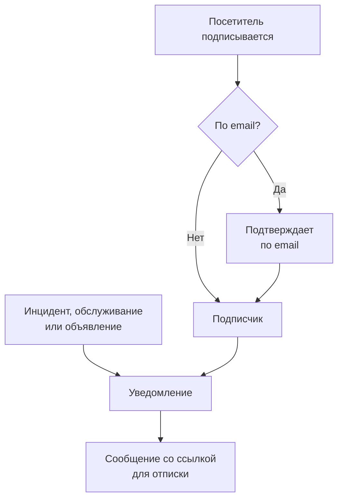

# Подписчики и объявления

Страница статуса — это место, куда люди заходят. Подписчики — это те, кто предпочёл бы не заходить: они один раз дают вам адрес email, номер телефона, webhook Slack или HTTP-эндпоинт, и после этого ваши обновления приходят к ним сами.

Объявления — вторая половина той же работы. Монитор может сообщить посетителям, что оформление заказа возвращает ошибки 500; ни один монитор не сообщит им, что в субботу вы переносите базы данных, что у стороннего поставщика плохой день или что инцидент, о котором они читали вчера, полностью закрыт. Объявления — это канал свободного текста для всего, чего не видят ваши проверки, и они доходят до того же списка подписчиков.

Эта страница охватывает и то и другое: пять каналов подписки и то, как посетители подписываются, о чём подписчики могут выбрать получать уведомления, процессы двойного подтверждения и отписки, отчёт по email, который подписчики могут получать каждый месяц, а также то, как объявления пишутся, планируются и превращаются в шаблоны.

:::cards
- [Каналы подписки](#каналы-подписки): Каналы, по которым посетители могут подписаться, и страница, на которой они это делают.
- [Что сообщают подписчикам](#о-чём-уведомляют-подписчиков): Объявления, обслуживание, инциденты и эпизоды, а также их изменения.
- [Проверка отправленного](#проверка-отправленного): Статус каждого уведомления, а также Повторить и Отправить повторно.
- [Объявления](#объявления): Опубликовать сообщение на одной или нескольких страницах статуса.
:::

## Как это работает



У каждой страницы статуса свои подписчики. Посетитель подписывается на странице **Подписаться** страницы статуса, где адрес email подтверждается по ссылке, прежде чем что-либо получить, либо ваша команда добавляет его в панели управления. С этого момента каждый инцидент, каждое событие планового обслуживания и каждое объявление, которые попадают на страницу, уведомляют её подписчиков — каждого по каналу, через который он подписался, — и каждое сообщение содержит ссылку, отменяющую подписку.

## Каналы подписки

Страница статуса поддерживает пять каналов. Они, а также страница, на которой подписываются посетители, включаются в одном месте: на карточке **Каналы** в **Страницы состояния → ваша страница → Подписчики → Настройки подписчиков**. Каждый переключатель сохраняется, как только вы его переключите:

- **Показывать страницу подписчика** (`showSubscriberPageOnStatusPage`) — включено по умолчанию. Добавляет пункт **Подписаться** на панель навигации страницы статуса, где посетители подписываются по каналам ниже.
- **Электронная почта** (`enableEmailSubscribers`) — включено по умолчанию. Всё остальное выключено, пока вы его не включите.
- **SMS** (`enableSmsSubscribers`) — по умолчанию выключено. В OneUptime Cloud каждое SMS оплачивается из баланса проекта на SMS и звонки, если у страницы нет собственной **Конфигурация Twilio** (см. [ниже](#подвал-письма-собственный-smtp-и-twilio)). Для включения также нужно, чтобы **SMS** был включён для проекта на карточке **Каналы уведомлений** в **Настройки проекта > Уведомления > Настройки уведомлений**, что может сделать владелец проекта, **Billing Admin** или пользователь с **Manage Billing**.
- **Slack** (`enableSlackSubscribers`) — по умолчанию выключено.
- **Microsoft Teams** (`enableMicrosoftTeamsSubscribers`) — по умолчанию выключено.
- **Webhook** (`enableWebhookSubscribers`) — по умолчанию выключено.

Переключатели определяют, как посетители могут подписываться сами, и страница статуса отклоняет подписку по выключенному каналу. Уведомления они не останавливают: подписчики, которых ваша команда добавляет в панели управления, через API или рабочим процессом, получают обновления, какие бы каналы ни были включены.

В OneUptime Cloud рядом с переключателем, который не входит в ваш тариф, указано название тарифа: **Growth** для **SMS** и **Показывать страницу подписчика**, **Scale** для **Slack**, **Microsoft Teams** и **Webhook**. Выключить канал можно на любом тарифе, поэтому канал, включённый во время пробного периода, всегда можно снова выключить; переключатель сообщает об этом под собой.

У каждого канала также есть свой список в боковом меню страницы статуса в разделе **Подписчики**: **Подписчики email**, **Подписчики SMS**, **Подписчики Slack**, **Подписчики MS Teams** и **Подписчики вебхуков**. Там вы смотрите, кто подписан, добавляете кого-то вручную или оставляете себе запись **Заметки** (`internalNote`) о конкретном подписчике. Пока канал выключен, верх его списка сообщает об этом, и переключатель канала находится прямо там, чтобы его можно было включить, не покидая список.

**Одного переключателя недостаточно.** Пункт **Подписаться** на панели навигации страницы статуса появляется, только когда включены **Показывать страницу подписчика** *и* хотя бы один канал. Если вы включите **Электронная почта**, но оставите **Показывать страницу подписчика** выключенным, посетители не смогут добраться до формы.

## Что видит посетитель на странице подписки

На странице **Подписаться** есть подменю с вкладкой для каждого включённого канала. Каждая вкладка запрашивает минимум необходимого:

| Вкладка | Адрес | Заголовок | Что она запрашивает |
| --- | --- | --- | --- |
| **Эл. почта** | `/subscribe/email` | **Подписаться по электронной почте** | **Ваш email**, с примером `subscriber@company.com`. |
| **SMS** | `/subscribe/sms` | **Подписаться по SMS** | **Ваш номер телефона**, с примером `+11234567890`. |
| **Slack** | `/subscribe/slack` | **Подписаться через Slack** | **Название рабочего пространства Slack** (используется для проверки) и **URL входящего веб-перехватчика Slack**, с примером `https://hooks.slack.com/services/...`. |
| **MS Teams** | `/subscribe/microsoft-teams` | **Подписаться через Microsoft Teams** | **Название рабочего пространства Microsoft Teams** и **URL входящего веб-перехватчика Microsoft Teams**, с примером `https://outlook.office.com/webhook/...`. |
| **Webhooks** | `/subscribe/webhooks` | **Подписаться через webhook** | **URL webhook**, с примером `https://example.com/webhook`. При каждом событии страницы статуса на него отправляется JSON-запрос `POST`. |

Кнопка отправки называется **Подписаться**. Подписка по SMS, Slack, Microsoft Teams или webhook показывает *Вы успешно подписаны.* Подписка по email сообщает, что отправлена ссылка для подтверждения, и предлагает проверить папку со спамом, если письмо не пришло (см. [Двойное подтверждение подписки по email](#двойное-подтверждение-подписки-по-email)). На вкладках **Эл. почта**, **SMS**, **Slack** и **MS Teams** также есть разделение **Новая подписка** / **Управление существующей подпиской**, чтобы тот, кто уже подписан, мог вернуться к своим настройкам, не разыскивая старое сообщение.

## Как дать подписчикам выбирать ресурсы и типы событий

По умолчанию подписчик получает всё, что есть на странице. Два переключателя на карточке **Расширенные настройки подписчиков** меняют это:

- **Разрешить подписчикам выбирать ресурсы** (`allowSubscribersToChooseResources`) — по умолчанию выключено. Включите его, и в форме подписки появится переключатель **Подписаться на все ресурсы**; выключите его, и появится **Выберите ресурсы для подписки**, чтобы посетитель мог выбрать отдельные ресурсы.
- **Разрешить подписчикам выбирать типы событий** (`allowSubscribersToChooseEventTypes`) — по умолчанию выключено. Та же схема: переключатель **Подписаться на все типы событий**, а под ним **Выберите типы событий для подписки**, когда он выключен.

Когда включён любой из них, форма подписки остаётся одной страницей. Под тем, куда отправлять обновления (адрес email, номер телефона, рабочее пространство или webhook), идёт **Настройки**, свёрнутые в одну строку, которая говорит, что получит посетитель. Все ресурсы и все виды событий уже выбраны, поэтому строка начинается с «Вы будете получать все обновления этой страницы статуса.», и посетитель, которому нужно всё, нажимает **Подписаться**, не раскрывая её. Остальные раскрывают **Настройки** и сужают ресурсы или типы событий; после повторного сворачивания строка следует их выбору («Вы будете получать обновления только по выбранным ресурсам.»). Когда оба выключены, **Настройки** нет: форма — это куда отправлять обновления, а затем **Подписаться**.

Страница **Обновить подписку** (см. ниже) показывает те же варианты раскрытыми, поскольку подписчик приходит туда как раз за тем, чтобы их изменить.

Типы событий: `Incident`, `Announcement` и `Scheduled Event`.

**Группа мониторов означает каждый монитор в ней.** Ресурс на странице — это либо монитор, либо группа мониторов, и подписчик, выбравший группу мониторов, получает уведомления об инцидентах, событиях планового обслуживания (включая их заметки) и объявлениях по любому монитору группы — точно так же, как если бы он выбрал этот монитор, и именно так их показывает страница статуса. Тот, кто выбрал только другие ресурсы, уведомление не получает, а тот, кто выбрал монитор и содержащую его группу, получает одно уведомление, а не два.

Выбор попадает в запись подписчика как **Is Subscribed to All Resources** (`isSubscribedToAllResources`, по умолчанию true), **Is Subscribed to All Event Types** (`isSubscribedToAllEventTypes`, по умолчанию true), **Subscribed to Resources** и **Subscribed to Event Types**.

**Подписчик выбирает среди ресурсов своей страницы.** **Subscribed to Resources** называет ресурсы собственной страницы статуса подписчика, кто бы это ни записывал: посетитель на странице, коллега в панели управления, ключ API или рабочий процесс. Посетитель выбирает из того, что ему показывает страница, поэтому ресурс, монитор которого заархивирован и который страница скрывает, выбрать нельзя. Ресурс другой страницы статуса или ресурс, который страница скрывает от посетителя, отклоняется с `400`, где указаны поле и ID, — так же, как ID, который ничему не соответствует. Изменение проверяет только добавляемые им ресурсы, поэтому подписка сохраняет ресурс, который уже называет, например ресурс, монитор которого заархивировали после выбора. Подписчик получает уведомление о событии только через ресурсы своей страницы.

Подходит для: страницы, охватывающей несколько продуктов. Клиент, который пользуется только вашим API, не хочет получать уведомление каждый раз, когда сбоит маркетинговый сайт, — пусть он сам сузит список, а не отписывается полностью.

На той же карточке находится и **Часовые пояса подписчиков**.

## Двойное подтверждение подписки по email

Подписчики по email всегда подтверждают подписку. Когда подписчик создаётся с адресом email и не был создан уже подтверждённым, **Is Subscription Confirmed** (`isSubscriptionConfirmed`) принудительно ставится в `false` и генерируется шестизначный **Subscription Confirmation Token**. Затем OneUptime отправляет по email ссылку для подтверждения вида `{statusPageUrl}/confirm-subscription/{statusPageSubscriberId}?verification-token={token}`. Посетитель попадает на страницу **Подтвердить подписку** и, когда подтверждение проходит, видит *Подписка успешно подтверждена*.

Подписчики по SMS, Slack, Microsoft Teams и webhook пропускают этот шаг — они создаются с `isSubscriptionConfirmed`, уже равным `true`. Так же и подписчики по email, которых ваша команда добавляет в **Подписчики email**: там **Не отправлять ссылку для подтверждения** включено по умолчанию. Выключите его, чтобы адрес подтверждался так же, как при подписке.

**Неподтверждённый — значит, молчит.** Запрос, который выбирает подписчиков для уведомления, фильтрует по `isUnsubscribed: false` и `isSubscriptionConfirmed: true`. Адрес email, владелец которого так и не нажал ссылку, будет висеть в вашем списке **Подписчики email** и ничего не получать. Если кто-то клянётся, что подписан, но ничего не получает, сначала проверьте этот столбец.

Переключателя, отключающего подтверждение по email, нет — оно обязательно для всех, кто подписывается через страницу статуса. Отдельный столбец для каждого подписчика, **Send You Have Subscribed Message** (`sendYouHaveSubscribedMessage`, по умолчанию true), управляет письмом «вы подписаны», которое уходит после подтверждения подписчика.

## Управление подпиской и отказ от неё

Каждое сообщение, которое получает подписчик, содержит ссылку для отписки вида `{statusPageUrl}/unsubscribe/{statusPageSubscriberId}-{token}`: внизу письма, в тексте SMS, сообщения Slack или Microsoft Teams и как `unsubscribeUrl` в полезной нагрузке webhook. Токен — это случайный секрет, принадлежащий именно этой подписке, поэтому ссылка работает без входа. Это относится и к приватной странице статуса, где всё остальное требует вошедшего посетителя.

Единственное исключение — SMS с **public** страницы статуса: оно вместо этого содержит ссылку подписчика на **Обновить подписку** (см. ниже). Эта страница работает на публичной странице статуса без входа, и её ссылка на 57 символов короче. SMS тарифицируется по сегментам по 160 символов, поэтому более длинная ссылка переносила бы большинство стандартных текстов ещё в один сегмент. `{{unsubscribeUrl}}` в пользовательском шаблоне SMS подчиняется тому же правилу. SMS с приватной страницы статуса содержит ссылку для отписки.

Журнал SMS (вкладка **SMS** в **Журналы уведомлений** — на странице статуса и в настройках проекта) хранит текст каждого SMS, и читать его могут больше участников проекта, чем управлять подписчиками. Поэтому журнал показывает ссылку для отписки, в которой токен заменён на `[redacted]`, например `{statusPageUrl}/unsubscribe/{statusPageSubscriberId}-[redacted]`. Рабочую ссылку получает только телефон самого подписчика. API тоже никогда не возвращает токен нового подписчика — даже в ответе на запрос, который его создал.

**Открытие ссылки ничего не меняет.** Страница показывает название и логотип страницы статуса и подписку, к которой относится ссылка: адрес email целиком, номер телефона, скрытый до последних четырёх цифр, название рабочего пространства Slack или Microsoft Teams или хост webhook. Она спрашивает *Вы хотите перестать получать уведомления с этой страницы статуса?*, и только нажатие **Отписаться** отменяет подписку, поэтому почтовые сканеры и предпросмотрщики ссылок, открывающие каждую ссылку в сообщении, никого не могут отписать. Больше ничего со страницы не показывается, и никакой её пользовательский JavaScript не выполняется. Повторное подтверждение или открытие ссылки уже отменённой подписки просто сообщает, что она отменена. На публичной странице статуса страница отписки также ведёт на страницу подписчика **Обновить подписку**, чтобы вместо этого выбрать, какие уведомления получать.

Страница **Обновить подписку**, `{statusPageUrl}/update-subscription/{statusPageSubscriberId}`, озаглавлена **Обновить подписку** и сообщает посетителю, что там можно обновить свои настройки или отписаться. На ней есть:

- Те элементы выбора ресурсов и типов событий, которые разрешает страница.
- Переключатель **Отписаться**, описанный как отписка от всех ресурсов. Он записывает **Отписан** (`isUnsubscribed`, по умолчанию false).
- Кнопка отправки с надписью **Обновить подписку**; при сохранении показывается *Ваши изменения сохранены.*

На приватной странице статуса она требует вошедшего посетителя, как и вся остальная страница. Тот, кто потерял ссылку, использует **Управление существующей подпиской** на странице **Подписаться** и нажимает **Отправить ссылку для управления**. Ссылка уходит самой подписке — на её адрес email, её номер телефона или её канал Slack или Microsoft Teams, — а не на адрес из запроса, и страница отвечает одинаково, совпала ли подписка или нет, поэтому её нельзя использовать, чтобы выяснить, кто подписан. Это сообщение ведёт на страницу **Обновить подписку** и передаёт пользовательскому шаблону обе ссылки: `manageSubscriptionUrl` и `unsubscribeUrl`.

За всем этим стоят эндпоинты `POST .../subscribe/:statusPageId`, `POST .../manage-subscription/:statusPageId`, `POST .../get-subscription/:statusPageId/:subscriberId`, `PUT .../update-subscription/:statusPageId/:subscriberId`, а также `GET` и `POST .../unsubscribe/:statusPageId/:subscriberId/:token`. `GET` отписки только описывает ссылку. `POST` отменяет подписку при любом теле запроса, включая тело `List-Unsubscribe=One-Click` запроса на отписку в один клик. Оба дают одинаковый ответ для неверного токена, удалённого подписчика и подписчика другой страницы статуса, поэтому их нельзя использовать, чтобы выяснить, кто подписан.

Отписка переключает флаг, а не удаляет строку, поэтому запись остаётся в списке канала с установленным **Отписан** — это пригодится, когда позже понадобится объяснить, почему конкретный адрес перестал получать письма. Она также записывает **Отписан** (`unsubscribedAt`), кто бы ни отменил подписку: подписчик по ссылке или со страницы **Обновить подписку** либо коллега в панели управления или через API. В каждом списке подписчиков есть столбец и фильтр **Отписан**. Повторное выключение **Отписан** очищает его. У подписок, отменённых до того, как OneUptime начал это записывать, даты нет.

Ссылки в сообщениях, отправленных до появления страницы отписки, продолжают работать: ссылка **Обновить подписку** по-прежнему открывает эту страницу. Очень старые сообщения содержали `/api/status-page-subscriber/unsubscribe/{statusPageSubscriberId}`, которая раньше отписывала сразу при открытии. Теперь она ничего не меняет: она ведёт на страницу отписки, которая сообщает, что ссылка устарела и что нужно воспользоваться ссылкой из недавнего сообщения.

### Общие адреса и списки рассылки

Любой, кто может читать почтовый ящик, может его отписать. Для адреса, который кто-то подписал сам, в этом и смысл. Для адреса, который добавила ваша команда, например списка рассылки площадки вроде `site03-all@`, это означает, что один читатель может убрать со страницы всех, кто в списке, до следующего сбоя. Поэтому:

- **По возможности добавляйте людей по их собственным адресам.** Форма **Добавить массово** и форма подписчика по email говорят об этом в описании поля email.
- **Команда получает уведомление.** Подписчик, добавленный вашей командой, — это подписчик, добавленный из панели управления, с ключом API (REST API, Terraform, скрипт) или рабочим процессом; API считывает это как **Is Added By Team** (`isAddedByTeam`). Когда такой подписчик отписывается — по своей ссылке или со страницы **Обновить подписку**, — владельцы страницы статуса (её пользователи-владельцы и участники её команд-владельцев) получают по одному письму с именем подписчика и ссылкой на список подписчиков страницы. Его получает и коллега, который добавил подписчика, если это был коллега. Страница без владельцев отправляет письмо только этому коллеге, поэтому о подписчике, которого ключ API или рабочий процесс добавил на страницу без владельцев, не сообщается. О людях, которые сами подписались на странице статуса, не сообщается никогда. Подписчиков, которых ключ API или рабочий процесс добавил до того, как OneUptime начал это записывать, невозможно отличить от подписавшихся самостоятельно, и о них тоже не сообщается.
- **Списки подписчиков это показывают.** Над каждым списком уведомление называет подписчиков, добавленных вашей командой, которые отписались за последние 30 дней.

Страница отписки предупреждает читателя такой подписки, прежде чем он подтвердит: если это общий адрес, отписка прекращает уведомления для всех, кто их получает, и команда получит об этом уведомление.

## О чём уведомляют подписчиков

Подписчики получают уведомления о трёх типах событий, перечисленных выше, но у каждого источника свой переключатель, поэтому ничего не отправляется случайно.

### Уведомления об объявлениях

У самого объявления есть **Should subscribers be notified?** (`shouldStatusPageSubscribersBeNotified`), который в форме создания показан как флажок **Уведомить подписчиков страницы статуса** в **Расписание и уведомления** и по умолчанию включён. Подписчики получают уведомление один раз, когда объявление начинает показываться, поэтому это решается при создании объявления; редактирование этого не изменит. Рабочий процесс, записывающий это поле позже, только сохраняет его: запись без изменений никогда не отправляет объявление повторно, включение его не отправляет, а выключение до отправки уведомления пропускает уведомление. Если в объявлении указаны мониторы в **Затронутые мониторы**, уведомление ограничивается этими мониторами: на странице, где подписчики выбирают ресурсы, оно уходит подписчикам этих мониторов, групп мониторов, которые их содержат, и всех ресурсов. Оставьте поле пустым — и уведомление получат все подписчики. На странице статуса, где нет ни одного из этих мониторов ни напрямую, ни через группу, объявление адресовано всем, кто читает эту страницу, поэтому уведомление получает каждый её подписчик, который получает объявления.

### Плановые работы

У события планового обслуживания свой набор столбцов для подписчиков: **Should subscribers be notified when event is created?**, **Should subscribers be notified when event is changed to ongoing?**, **Should subscribers be notified when event is changed to ended?**, а также **Subscriber notifications before the event** и **Next subscriber notification before the event at?** для заблаговременных предупреждений. **Страницы состояния** на событии определяет, на каких страницах оно появляется, а **Should be visible on status page?** — появляется ли оно вообще.

**Создать событие планового обслуживания** проходит два шага, затем проверку, как и **Объявить инцидент**:

1. **Событие** — **Заголовок**, **Описание**, **Начинается** и **Заканчивается**. Новое событие начинается в следующий полный час по вашим часам и длится час; меняйте время, только если оно неверно. Перенос **Начинается** переносит вместе с ним **Заканчивается**, так что окно сохраняет свою длительность, а событие должно заканчиваться после начала. **Владельцы** и **Метки** ждут в **Дополнительные поля**.
2. **Затронутые ресурсы** — сначала **Мониторы**, а сразу под ними **Изменить статус монитора на**, как только выбран монитор: мониторы переходят в этот статус, когда событие начинается, и возвращаются в рабочий, когда оно заканчивается. Затем **Другие затронутые ресурсы**: хосты, кластеры, хосты контейнеров, базы данных, парки IoT, сетевые площадки и сервисы, которых касается обслуживание. Затем **Показывать событие на этих страницах статуса**, затем **Уведомления подписчиков**, свёрнутые в одну строку, которая говорит, что произойдёт. По умолчанию она гласит «Подписчики страниц статуса события получают уведомления, когда оно запланировано, когда начинается и когда заканчивается.» Раскройте её, чтобы изменить **Когда событие запланировано**, **Когда событие начинается**, **Когда событие заканчивается** и **Напоминания перед событием**; строка следует отмеченному, и шаг проверки тоже её показывает.

С вкладки **Плановое обслуживание** хоста, кластера Kubernetes, Proxmox, Ceph или Docker Swarm, хоста Docker или Podman, vCenter, системы хранения данных, парка IoT, базы данных, сервиса или сетевой площадки **Создать событие планового обслуживания** (и **Создать из шаблона**) открывает ту же форму с этим ресурсом, уже выбранным в **Другие затронутые ресурсы**, а «хлебные крошки» ведут обратно на эту вкладку. Вкладка **Плановое обслуживание** элемента инвентаря выбирает хост, сервис или кластер Kubernetes, на который указывает элемент, а «хлебные крошки» ведут обратно через вкладку этого ресурса.

Вводить нужно только заголовок: у всего остального есть значения по умолчанию, поэтому **Далее** проходит остальные шаги, ничего не спрашивая, а **Создать событие планового обслуживания** находится на итоговой проверке. Никто не получает уведомления, пока вы не выберете страницу статуса. Три настройки **Когда событие…** выбираются при создании события, а рабочий процесс, записывающий **Когда событие запланировано** позже, только сохраняет его: записанное без изменений или включённое, оно ничего не отправляет, а выключенное до отправки уведомления «запланировано» это уведомление пропускает. Кнопка **Редактировать** на карточке события **Maintenance Details** меняет его заголовок, окно и метки (**Событие**) и его страницы статуса и напоминания (**Страницы состояния**). Кнопка **Редактировать** на его карточке **Затронутые ресурсы** спрашивает так же, как форма: **Мониторы**, затем **Изменить статус монитора на**, когда есть монитор, затем **Другие затронутые ресурсы**, а карточка показывает статус под мониторами. Любой, кто может редактировать событие, может менять статус его мониторов до начала события. Когда оно начинается — в своё время начала или когда кто-то переводит его в текущее состояние вручную, из Slack или Microsoft Teams или через API, — его мониторы переходят в статус, который у события в этот момент, как и мониторы, добавленные во время его хода. Перевод из **Scheduled** сразу в собственное состояние, расположенное между **Ongoing** и **Ended**, например "Verifying", запускает его так же: его мониторы переходят в его статус, как перешли бы в **Ongoing**, и возвращаются в рабочий, когда оно заканчивается. С этого момента статус больше нельзя изменить: **Редактировать** на карточке показывает его только для чтения с текстом «Событие уже началось, поэтому это больше нельзя изменить.», а API отклоняет изменение с "Change Monitor Status to can no longer be changed: this event has already started." Запись того статуса, который у события уже есть, по-прежнему принимается. Шаблоны планового обслуживания (**Настройки → Шаблоны событий**) используют те же шаги, с названием шаблона в начале и его повторяющимся расписанием в конце. Шаблон запрашивает **Изменить статус монитора на** независимо от того, указаны ли в нём мониторы, потому что его статус применяется и к мониторам, выбранным при планировании события по нему. Карточка **Затронутые ресурсы** существующего шаблона спрашивает так же и показывает статус, который выбирает шаблон, или **Мониторы сохраняют свой статус.**, если он ничего не выбирает; любой, кто может редактировать шаблон, может изменить это там.

**Какие страницы статуса?** Как только в событии указаны мониторы, страницы статуса, которые их показывают, предлагаются в **Показывать событие на этих страницах статуса**: «Страницы состояния, на которых показаны затронутые мониторы:», а затем название каждой страницы. Нажмите на название, чтобы добавить эту страницу, или на **Добавить все**, чтобы добавить все. Страница учитывается, когда на ней есть один из мониторов — напрямую или через группу мониторов. Предлагаются только страницы статуса, которые вы можете видеть, а архивированные страницы и страницы, не показывающие события планового обслуживания, не предлагаются. Ничего не выбирается за вас: выбранная вами страница статуса показывает событие и, при уведомлениях по умолчанию, уведомляет своих подписчиков, так что выбор остаётся за вами. Шаг **Страницы состояния** в **Редактировать** события и формы шаблона планового обслуживания предлагают так же — по мониторам события или шаблона.

**Собственные состояния.** Событие идёт в **Ongoing** и в каждом собственном состоянии, расположенном между **Ongoing** и **Ended**, — например, на шаге "Verifying". Собственное состояние, расположенное до **Ongoing**, ещё не началось, а расположенное после **Ended** — "Reviewing" — уже закончилось. Всё, что спрашивает, идёт ли событие, применяет это одно правило. Такое событие числится текущим на своих страницах статуса — в обзоре, на собственной странице события и в RSS-ленте — и в списках **Ongoing** в **Плановое обслуживание** и **Главная**, их значках в меню и плитке **Текущее обслуживание** на **Главная**, а приложение Microsoft Teams показывает его как текущее обслуживание. Его мониторы остаются в обслуживании, сетевые площадки и ряды телеметрии, которые оно охватывает, остаются заглушёнными, а оповещения о скорости расходования SLO по его мониторам придерживаются. В его **Заканчивается** оно завершается так же, как текущее событие, и его подписчики получают уведомление, если включено **Когда событие заканчивается**. Перевод из **Ongoing** или "Verifying" сразу в собственное состояние, расположенное после **Ended**, завершает его так же, как **Ended**: его мониторы возвращаются в рабочий статус, а заголовок события показывает, сколько оно длилось. Перевод из **Ongoing** в "Verifying" или из **Ended** в "Reviewing" ничего заново не начинает и не завершает. Место состояния — это его место в списке на странице **Состояние события** в **Плановое обслуживание → Настройки**.

**Ожидание начала, завершение и окончание.** То же место определяет и остальное. Событие ждёт своего **Начинается** в **Scheduled** и в каждом собственном состоянии, расположенном между **Scheduled** и **Ongoing**, — например, на шаге "Confirmed". В своё время начала оно стартует оттуда так же, как стартует из **Scheduled**: переходит в **Ongoing**, его мониторы переходят в его **Изменить статус монитора на**, его владельцы получают уведомление, а его подписчики тоже, если включено **Когда событие начинается**. До этого оно числится среди предстоящих событий — в обзоре, на странице запланированных событий и в RSS-ленте его страниц статуса, а также когда кто-то спрашивает приложение Microsoft Teams о плановом обслуживании, — и напоминания перед событием по-прежнему уходят его подписчикам. Его лента и хронология его страницы статуса показывают такое состояние с теми же часами, что и для **Scheduled**. Собственное состояние, расположенное до **Scheduled**, — "Draft" или шаг согласования — тоже ещё не началось, но ждёт человека: ничто не запускает там событие в его время, и оно не числится предстоящим. Событие завершено в **Ended**, в **Completed** и в каждом собственном состоянии, расположенном после **Ended**, и **Обзор** события везде считает его завершённым — его заголовок, его карточка **Измерения** и показываемая им хронология. Оно окончено в **Completed** и в каждом собственном состоянии, расположенном после него, — "Archived": именно это останавливает напоминания его владельцам (**Remind until event is Completed**), именно для этого Slack и Microsoft Teams отклоняют **Mark as Complete**, и именно это его лента и хронология его страницы статуса отмечают как выполненное. В **Ended** или в "Reviewing" между **Ended** и **Completed** оно завершено, но ещё не окончено.

**Сетевые площадки следуют за каждой сменой состояния.** Сетевые площадки, которые охватывает событие, перестают засчитывать его плановый простой против площадок над ними, пока оно идёт. Каждая смена состояния события сразу пересчитывает их статус в обе стороны — в том числе когда оно откатывается назад, как бывает, когда из его **Хронология состояний** удаляется запись того состояния, в котором оно находится: возвращённое из "Verifying" в **Scheduled**, оно сразу перестаёт их заглушать, а не при следующем проходе, который по-прежнему выполняется каждые пять минут как страховка.

**Что лента записывает при изменении.** Изменение добавляет запись **Scheduled Maintenance was updated.** в **Запланированный Обслуживание Лента** события — она публикуется и в его каналы Slack и Microsoft Teams — со строкой для каждой изменённой вещи: заголовка, **Начинается**, **Заканчивается**, описания, напоминаний перед событием, того, что затрагивает событие, **Изменить статус монитора на**, страниц статуса, на которых оно показывается, и его меток, каждая с новым значением. Значение, сохранённое без изменений, строки не получает, поэтому сохранение карточки **Maintenance Details** без изменений — она каждый раз отправляет заголовок, окно, метки, страницы статуса и напоминания — или клиент API, рабочий процесс или Terraform, записывающие событие обратно как есть, вообще не добавляют записи. Время одно и то же, когда оно обозначает тот же момент, как бы оно ни было записано, — время без часового пояса считается UTC, как оно и хранится, — а напоминания, страницы статуса, затронутые ресурсы и метки являются одним и тем же набором в любом порядке. Удаление всех напоминаний, страниц статуса или меток записывается как "No reminders before the event.", "Not shown on any status page." или "All labels removed.", а удаление последнего затронутого ресурса помимо мониторов — последнего хоста, кластера или сервиса, например, — как "No other affected resources.". Правило напоминаний события сопоставляется заново, а ожидание его следующего напоминания начинается заново, только когда меняются его метки или переключается его **Отправлять напоминания**. Правило напоминаний (**Плановое обслуживание → Правила → Reminder Rules**) с выключенным **Remind While Event is Scheduled** отсчитывает первое напоминание от начала события, поэтому перенос **Начинается** на другое время переносит это напоминание вместе с ним, пока начало ещё впереди; напоминания правила, которое напоминает, пока событие запланировано, остаются на месте. Лента монитора так же записывает изменение его имени, описания и меток.

Если событие создано с выключенным **Когда событие запланировано** (в **Уведомления подписчиков** на шаге **Затронутые ресурсы** формы создания), новые публичные заметки к нему начинаются с выключенным **Notify status page subscribers** и строкой под флажком, объясняющей почему. Это действует на странице события **Публичные заметки** и в **Add Public Note** в **Запланированный Обслуживание Лента**, которая открывает тот же редактор заметок. Заметки, опубликованные без явного выбора, следуют той же настройке **Когда событие запланировано**: заметки из Slack и Microsoft Teams, рабочие процессы и запросы API, в которых нет `shouldStatusPageSubscribersBeNotifiedOnNoteCreated`. Явное `true` или `false` всегда сохраняется. **Когда событие запланировано** отключает только объявление, отправляемое при создании события. Напоминания (**Subscriber notifications before the event**, задаваемые через **Напоминания перед событием** в форме создания) и уведомления, задаваемые **Когда событие начинается** и **Когда событие заканчивается**, — это отдельные настройки, и они по-прежнему отправляются. Если подписчики уже узнали о событии таким образом, например из напоминания или уведомления о начале, отметьте флажок, чтобы сообщить им о заметке.

Окно **Отметить плановое обслуживание как «`<state name>`»**, которое открывается кнопками вверху страницы события **Обзор**, содержит один флажок **Уведомить подписчиков страницы статуса**, который охватывает и смену состояния, и **Публичная заметка** окна (свёрнутую под **Добавить публичную заметку**). На событии, созданном с включённым **Когда событие запланировано**, он изначально включён, как и раньше. На событии, созданном с выключенным, он изначально выключен, с той же строкой под ним, кроме двух случаев, когда он изначально включён в соответствии с тем, что объявила бы автоматическая смена состояния:

- Вы переводите событие в его текущее состояние или из состояния, где оно ещё не началось, в собственное состояние, расположенное между **Ongoing** и **Ended** (оно начинается), и включено **Когда событие начинается**.
- Вы переводите событие в завершённое или оконченное состояние или из состояния, где оно идёт, в собственное состояние, расположенное после **Ended** (оно заканчивается), и включено **Когда событие заканчивается**.

**Заметка, отправленная со сменой состояния, — единственное сообщение.** Напишите **Публичная заметка** в этом окне (или в массовом действии **Изменить состояние**) с включённым **Уведомить подписчиков страницы статуса**, и подписчики получат заметку по всем каналам вместо отдельного сообщения о смене состояния: одно сообщение, а не два. Смена состояния показывает **Отправленные уведомления**, а её сообщение о статусе говорит, что её передала заметка. Заметка публикуется после сохранения смены состояния: она следует за сменой в ленте события и в Slack и Microsoft Teams, а несохранённая смена состояния не публикует заметку и никого не уведомляет. Заметка из одних пробелов не публикуется, и подписчики получают сообщение о смене состояния. При выключенном флажке ни смена состояния, ни её заметка никого не уведомляют. Через API заметка передаётся вместе со сменой состояния в `"miscDataProps": {"publicNote": "..."}` на `POST /api/scheduled-maintenance-state-timeline`, а `shouldStatusPageSubscribersBeNotified` решает за обе (если его нет, смена состояния уведомляет, а её заметка — нет). Инциденты работают так же; см. [Состояния и уровни серьёзности инцидентов](/docs/incidents/states-and-severities#уведомление-подписчиков-страницы-статуса-о-смене-состояния).

**Заметка называет новое состояние.** Поскольку это единственное сообщение, заметка, отправленная со сменой состояния, говорит, каково событие сейчас, по всем каналам — так, как это делало сообщение о смене состояния: тема письма — `[Ongoing Scheduled Maintenance] <title>`, а в его подробностях есть строка **Статус**, SMS гласит `Maintenance <title> on <status page> is Ongoing.`, сообщения Slack и Microsoft Teams содержат строку `**Status:** Ongoing`, а полезная нагрузка webhook `ScheduledMaintenanceNoteCreated` содержит `scheduledMaintenanceState` в `data`. Заметка, опубликованная сама по себе, читается как всегда. Для публикации заметки нужно **Create Scheduled Maintenance Status Page Note** (оно есть у встроенных ролей планового обслуживания и проекта): тому, у кого его нет, не предлагается **Добавить публичную заметку**, а смена состояния, которую он отправляет с заметкой, отклоняется, поэтому событие сохраняет своё состояние, а не меняется без уведомления.

Ручная форма на странице события **Хронология состояний** и массовое действие **Изменить состояние** в списке планового обслуживания не смотрят на эти настройки: их флажок **Уведомить подписчиков страницы статуса** всегда изначально включён.

События, созданные из шаблона, берут **Когда событие запланировано** из шаблона вместе с его остальными настройками подписчиков. **Создать из шаблона** заполняет форму создания значениями шаблона, а повторяющиеся события, запланированные шаблоном в **Настройки → Шаблоны событий**, копируют их.

### Инциденты

`Incident` — третий тип событий. Что вообще приводит инцидент на страницу статуса — какие ресурсы он затрагивает и какие состояния сохраняют его видимым, — описано в [Состояния и уровни серьёзности инцидентов](/docs/incidents/states-and-severities). Публичные заметки к инциденту, объявленному без уведомления подписчиков, начинаются с выключенным **Уведомить подписчиков страницы статуса**; см. [Заметки, владельцы и лента инцидента](/docs/incidents/notes-owners-and-feed#опубликуйте-публичную-заметку).

Сообщения инцидента — о создании, смене состояния, публичной заметке и постмортеме — уходят подписчикам каждой страницы статуса, на которой есть один из его мониторов. Две настройки это сужают. **Ограничить этими страницами состояния** на инциденте оставляет его на выбранных вами из них страницах, а **Показывать только инциденты, ограниченные этой страницей** на странице статуса отсекает любой инцидент, не ограниченный ею. Для инцидента, ограниченного конкретными страницами, адрес email или номер телефона, подписанный на нескольких из них, получает одно письмо или SMS за отправку, а не по одному на страницу; сообщения webhook, Slack и Microsoft Teams никогда не объединяются. Форма объявления и страница **Публичные заметки** показывают, кто будет уведомлён, прежде чем что-либо будет отправлено. См. [Отдельная страница статуса для каждой аудитории](/docs/status-pages/one-status-page-per-audience).

#### Постмортем

Подписчики узнают о постмортеме инцидента один раз, когда он публикуется: в первый раз, когда страница статуса его показывает. Страница статуса показывает постмортем, когда включено **Опубликовать на странице статуса** и у постмортема есть заметка; его вложения показываются вместе с заметкой, но никогда без неё. Поэтому включение публикации над написанной заметкой публикует его, как и написание заметки для включённого постмортема. **Уведомить подписчиков** в той же форме решает, будут ли они вообще уведомлены. После этого:

- **Повторное сохранение никого не уведомляет.** Форма **Редактировать заметку ретроспективы** отправляет весь постмортем при каждом сохранении, а клиент API, Terraform или рабочий процесс может записать весь инцидент обратно; то, что уже опубликовано, — не новость.
- **Редактирование опубликованного постмортема тоже никого не уведомляет.** Страница статуса сразу показывает новую заметку, а лента инцидента записывает это один раз, как **Postmortem Note updated**, но подписчики уже уведомлены. Пробелы вокруг заметки изменением не считаются.
- **Снятие его со страницы статуса никого не уведомляет, а повторная публикация уведомляет их снова**: они видели, как он исчез. Очистка заметки опубликованного постмортема тоже снимает его со страницы статуса.
- **Включённый постмортем без заметки ничего не показывает**, поэтому никто не уведомляется, пока его заметка не написана.
- **Постмортем, опубликованный, пока его инцидент скрыт, отправляется, когда инцидент становится видимым.** Страница статуса показывает постмортем только для инцидента, который она показывает, — с включённым **Видно на странице статуса** и неприватного, — поэтому никто не уведомляется, пока инцидент скрыт, а статус уведомления гласит **Ещё не отправлено: инцидент скрыт со страниц состояния**. Включение **Видно на странице статуса** отправляет его один раз (для приватного инцидента — вместе с выключением **Приватный инцидент**), и переключатель на странице инцидента **Настройки** сообщает вам об этом перед сохранением. Скрытие инцидента и повторный показ ничего больше не отправляют, а показ инцидента, постмортем которого уже отправлен или не опубликован, ничего не отправляет. Постмортем, который более ранний выпуск пропустил таким образом, отправляется так же, если его инцидент ещё был скрыт на момент вашего обновления; постмортем, инцидент которого с тех пор стал видимым, остаётся неотправленным, потому что страница статуса с тех пор его показала.
- **Уведомить подписчиков считывается в момент отправки уведомления.** Постмортем, опубликованный с выключенной настройкой, не объявляется, а её включение потом не отправляет уведомление, без которого он был опубликован.

Статус уведомления находится на странице инцидента **Постмортем**; для неудавшегося есть **Повторить** (см. [Повторить и отправить повторно](#повторить-и-отправить-повторно)). Через API запись `showPostmortemOnStatusPage` как `true` над написанной `postmortemNote` публикует его, даже когда запрос записывает весь инцидент обратно, включая его статус уведомления как есть, а перевод скрытого инцидента в видимые — запись `isVisibleOnStatusPage` как `true`, а для приватного ещё и `isPrivate` как `false` — отправляет ожидающий этого постмортем. Запись `subscriberNotificationStatusOnPostmortemPublished` как `Pending` отправляет его повторно. Уведомление, которое уже ждёт или отправляется, второй раз в очередь не ставится, а постмортем, опубликованный во время подготовки уведомления, всё равно объявляется один раз. Автоматический черновик постмортема от ИИ никогда не записывается во включённый постмортем, поэтому непроверенный черновик никогда не доходит до подписчиков.

#### Предпросмотр письма перед отправкой

**Предпросмотр** — это маленькая ссылка рядом со значением, которое она показывает заранее: рядом с **Да** в **Уведомить подписчиков страницы статуса** на последнем шаге **Объявить новый инцидент** и рядом с флажком **Уведомить подписчиков страницы статуса**, пока вы пишете публичную заметку. Она открывает **Предпросмотр уведомления**, который показывает письмо, которое получат подписчики каждой страницы статуса, собранное и отрисованное тем же кодом, шаблоном и настройками, с которыми отправляется уведомление, поэтому вы видите ровно то, что они получат:

- выберите страницу статуса, чтобы увидеть её письмо, с темой и количествами «до» по каналам;
- строка сообщает, какой шаблон используется и почему, например что пользовательский шаблон страницы не используется, потому что у страницы нет **Пользовательская конфигурация SMTP**;
- когда ничего не будет отправлено (нет мониторов, приватный или скрытый инцидент, выключен **Уведомить подписчиков страницы статуса** или нет страницы статуса, которая показывает инцидент), он сообщает об этом вместо показа письма.

Предпросмотр показывается только для страниц статуса, которые вы можете видеть; остальные подсчитываются. Письмо показывается в изолированной рамке, которая не выполняет скрипты. Ссылка для отписки в нём — пример, потому что письмо каждого подписчика содержит его собственную.

**Отправить тест мне** отправляет письмо показанной страницы на email вашей учётной записи с `[Test]` в начале темы, через **Пользовательская конфигурация SMTP** страницы, если она есть. Он никогда не отправляет на другой адрес, требует, чтобы email вашей учётной записи был подтверждён, и каждый человек может отправить десять тестовых писем каждые 15 минут.

#### Пользовательские поля инцидентов в уведомлениях

Пользовательские поля инцидентов с включённым **Включать в уведомления подписчикам** (в **Инциденты → Настройки → Пользовательские поля**) уходят вместе с сообщениями инцидента — о создании, смене состояния, публикации или обновлении публичной заметки и постмортеме. Это работает на любом тарифе, где есть пользовательские поля; не нужны ни пользовательский шаблон, ни пользовательский SMTP.

- **Электронная почта** перечисляет их в блоке подробностей под собственными строками инцидента, в **Порядок** полей. Поле, для которого у инцидента нет значения, пропускается. Поле «да/нет» показывает **Да** или **Нет**, дата — это выбранный день (один и тот же день для каждого получателя, где бы он ни был, для даты, выбранной в любом часовом поясе от UTC−10:59 до UTC+13), дата и время показываются в часовых поясах подписчиков страницы статуса, длинный текст сохраняет свои строки, а форматированный текст показывается с форматированием, с теми же правилами для ссылок, что и у заметок. Его встроенные изображения становятся доступными для просмотра тем, кому он отправляется, когда отправляется первое сообщение, которое его содержит.
- **Slack** и **Microsoft Teams** перечисляют их так же, по одному в строке.
- Полезные нагрузки **Webhook** содержат их в `data.customFields` с **Переменная шаблона** каждого поля в качестве ключа: `{ "name": ..., "type": ..., "value": ... }`, со значением как оно хранится (`null`, если у инцидента его нет). Ключи не меняются при переименовании поля.
- **SMS** их пропускает. Текстовое сообщение тарифицируется по сегментам, а стандартное уже почти занимает один; пользовательский шаблон SMS может разместить любое поле с помощью `{{incident.customFields.<key>}}`.
- Уведомления **Incident episode** не содержат пользовательских полей: эпизод группирует инциденты, у каждого из которых свои значения. Собственные уведомления каждого инцидента-участника содержат его поля.

Запись **Уведомление подписчикам отправлено** в ленте инцидента перечисляет в **Custom fields sent** значения, которые каждая отправка поместила в сообщение. Подписчики обычно находятся вне вашей команды, поэтому включайте эту настройку только для полей, которыми с ними безопасно делиться.

Раздел **Журналы уведомлений** в боковом меню страницы статуса (`{id}/notification-logs`) — это то место, куда вы идёте, когда нужно увидеть, что страница действительно отправила.

### Эпизоды инцидентов

Эпизод инцидента записывает в `shouldStatusPageSubscribersBeNotifiedOnEpisodeCreated`, были ли подписчики уведомлены о его создании. У эпизодов, созданных кнопкой **Создать эпизод** или **Правила группировки**, оно включено; запрос API может создать эпизод со значением `false`.

У эпизода, созданного со значением `false`, новые публичные заметки начинаются с выключенным **Notify status page subscribers** и строкой под ним, объясняющей почему, — на странице эпизода **Публичные заметки** и в **Add Public Note** в **Лента эпизода**, которая открывает тот же редактор заметок. Вы всё равно можете отметить его. Заметки, опубликованные без явного выбора, следуют той же настройке: заметки из Slack, рабочие процессы и запросы API, в которых нет `shouldStatusPageSubscribersBeNotifiedOnNoteCreated`. Явное `true` или `false` всегда сохраняется. Учитывается только эта настройка: в отличие от инцидента, перевод эпизода в приватные не меняет начальное состояние флажка.

Это касается только публичных заметок. Смены состояния эпизода (**Подтвердить**, **Устранить** и автоматическое устранение) по-прежнему уведомляют подписчиков, потому что ни окно смены состояния эпизода, ни форма на его странице **Хронология состояний** не содержат флажка **Уведомить подписчиков страницы статуса**.

Эпизод, созданный сразу в более позднем состоянии — через **Начальное состояние** в форме **Создать эпизод** или с состоянием, переданным через API, — объявляется один раз, уведомлением о создании: его первое состояние никогда не отправляется отдельно как смена состояния, каким бы оно ни было, а эпизод, созданный с `shouldStatusPageSubscribersBeNotifiedOnEpisodeCreated`, равным `false`, вообще его не объявляет. Первая строка его хронологии состояний записывает это уведомление как пропущенное, с причиной.

### Уведомление подписчиков об изменении

Подписчики узнают об объявлении или публичной заметке один раз, когда они публикуются. Последующее редактирование меняет то, что показывает страница статуса, но никого не уведомляет, если только вы не попросите об этом при этом редактировании.

В форме редактирования объявления, а также публичной заметки инцидента, события планового обслуживания или эпизода инцидента есть флажок **Уведомить подписчиков об этом обновлении**. Он каждый раз изначально снят, поэтому исправление опечатки проходит тихо; отмечайте его, когда изменение важно, — новое окно обслуживания, пересмотренное влияние, исправленное обновление для клиентов. Его нет в формах создания, у которых свой выбор **Уведомить подписчиков страницы статуса**. В объявлении он находится на шаге **Объявление**, прямо под описанием.

Когда вы сохраняете с отмеченным флажком, подписчики получают отредактированное содержимое, помеченное как обновление, а не как новая публикация:

- **Электронная почта** использует собственный шаблон — например, тему `[Announcement Updated] <title>` и заголовок `Announcement Updated: <title>` или **Updated Note** в блоке подробностей письма с заметкой.
- **SMS**, **Slack** и **Microsoft Teams** сообщают, что объявление или заметка обновлены.
- Подписчики **Webhook** получают `AnnouncementUpdated`, `IncidentNoteUpdated`, `ScheduledMaintenanceNoteUpdated` или `EpisodeNoteUpdated` в качестве `eventType`, с последним содержимым в `data`.

Обновление уходит тем же людям, до которых оригинал дошёл бы сегодня: те же переключатели каналов, те же предпочтения по ресурсам и типам событий и те же проверки видимости (скрытый инцидент или страница с выключенным **Показывать объявления** по-прежнему ничего не отправляют).

Два случая намеренно ничего не отправляют и записывают почему:

- **Исходное уведомление ещё не отправлено.** Если объявление или заметка ещё ждут объявления, это уведомление прочитает элемент при отправке и уже будет содержать ваше изменение, поэтому отдельное сообщение «обновлено» только запутало бы людей. Если оригинал отправляется именно в этот момент, обновление вместо этого ждёт и уходит, когда оригинал закончен: та отправка прочитала элемент до вашего изменения, так что подписчикам мог уйти текст до него.
- **Объявление запланировано на будущее.** Пока не наступит **Начать показ объявления с**, его нет ни на одной странице статуса, и тот, кто получит уведомление при его выходе, увидит отредактированную версию.

Отредактированный элемент показывает **Статус уведомления об обновлении** рядом с исходным, с теми же состояниями (**Sending Soon**, **Отправленные уведомления**, **Не удалось** и так далее). **Повторить** для неудавшегося уведомления об обновлении повторно отправляет обновление, но никогда не исходное сообщение «опубликовано». Каждая страница статуса может настроить эти сообщения с помощью типов событий шаблонов **Subscriber Announcement Updated**, **Subscriber Incident Note Updated**, **Subscriber Scheduled Maintenance Note Updated** и **Subscriber Episode Note Updated**; без пользовательского шаблона используется встроенная формулировка обновления.

Через API передайте выбор рядом с изменяемыми полями, в `miscDataProps`:

```json
{
  "data": {
    "description": "The maintenance now starts on Sunday at 02:00 UTC."
  },
  "miscDataProps": {
    "notifySubscribersOfUpdate": true
  }
}
```

как тело `PUT /api/status-page-announcement/<announcement-id>` (или `incident-public-note`, `scheduled-maintenance-public-note`, `incident-episode-public-note`). Не передавайте `miscDataProps`, и изменение пройдёт тихо, как раньше.

## Проверка отправленного

У каждого уведомления подписчикам есть собственный статус рядом с тем, к чему оно относится. Для инцидента это его уведомление «создан» на **Обзор** инцидента, каждая строка его **Хронология состояний**, каждая публичная заметка и его **Постмортем**. События планового обслуживания и объявления показывают свои так же, а эпизоды инцидентов — на своих публичных заметках. Нажмите на статус, чтобы прочитать его сообщение, которое говорит, что произошло. Публичные заметки показывают статус значком со своей формулировкой:

| Статус | На публичной заметке | Что это значит |
| --- | --- | --- |
| **Sending Soon** | **Notifying subscribers soon** | В очереди. Задача, которая его отправляет, запускается каждую минуту. |
| **Notifications Being Sent** | **Notifying subscribers** | Задача проходит по подписчикам. |
| **Отправленные уведомления** | **Subscribers notified** | Отправлено. Что это значит, см. ниже. |
| **Не удалось** | **Notification failed** | Отправлено не всем подписчикам, или отправка остановилась. Сообщение говорит, что было отправлено и что сделает **Повторить**. |
| **Notifications skipped.** | **Subscribers not notified** | Отправлять было нечего, например потому что инцидент скрыт со страниц статуса. Сообщение говорит почему. |

### Как считается отправка

Уведомления инцидентов и эпизодов инцидентов — о создании, смене состояния, публикации или обновлении публичной заметки и постмортеме — считаются по сообщениям:

- **Сообщение считается отправленным**, когда почтовый сервер или SMS-провайдер его принял или когда ответил эндпоинт Slack, Microsoft Teams или webhook. «Отправлено» — это всё, что может увидеть OneUptime: почтовый сервер ещё может вернуть письмо позже.
- **Сообщение считается неудавшимся**, когда оно отклонено, когда при отправке возникла ошибка или когда за 4 минуты не пришёл ответ. Одна неудача делает уведомление **Не удалось**; остальным подписчикам оно всё равно отправляется.
- **Охватывается каждый подписчик.** Подписчики страницы статуса читаются по 10 000 за раз до последнего, по 20 сообщений одновременно. Уведомление перестаёт начинать новые сообщения через 20 минут после старта: страницы статуса и подписчики, до которых оно к этому времени не дошло, перечисляются как неотправленные, и оно помечается как **Не удалось**.
- **Количества записываются по страницам статуса.** Сообщение о статусе перечисляет для каждой страницы статуса, сколько сообщений было отправлено и не удалось по каждому каналу, например `Site 03: 41 email sent. Site 07: 16 email, 2 SMS sent; 2 email failed.` Запись **Уведомление подписчикам отправлено** в ленте инцидента перечисляет те же количества с темой, с которой ушло письмо каждой страницы. **Журналы уведомлений** на каждой странице статуса показывает каждое сообщение.

Уведомления планового обслуживания и объявлений пока так не считаются. Их сообщения передаются отправителям без ожидания ответа, поэтому **Отправленные уведомления** означает, что они переданы, а одна отправка охватывает не более 10 000 подписчиков каждой страницы статуса.

### Прерванные отправки

Отправка, сервер которой перезапускается или перестаёт отвечать на полпути, не может завершиться, и больше ничто её не закроет. Поэтому уведомление, которое всё ещё в **Notifications Being Sent** через 40 минут — дольше, чем разрешено длиться любой отправке, — помечается как **Не удалось** с сообщением, которое начинается с `Interrupted:` и говорит, что сделает **Повторить**. Это касается всех уведомлений выше, включая плановое обслуживание и объявления. Проверка выполняется каждые 5 минут.

### Повторить и отправить повторно

**Повторить** предлагается для уведомления в состоянии **Не удалось**. Оно возвращает уведомление в очередь, и следующий запуск задачи отправки в течение минуты отправляет его снова. Для инцидента также предлагается повторная отправка после того, как уведомление ушло: **Отправить уведомление повторно** на публичной заметке и **Отправить повторно** на уведомлении инцидента «создан» на его **Обзор**. Оба сначала спрашивают, перечисляя страницы статуса, до которых оно дошло бы сейчас, с количеством «до» по каждому каналу. Ни одно из них не предлагается для пропущенного уведомления или пока уведомление ещё в очереди или отправляется. См. [Заметки, владельцы и лента инцидента](/docs/incidents/notes-owners-and-feed#когда-публичная-заметка-действительно-доходит-до-подписчиков).

Повторно отправленное уведомление отправляется по положению дел на момент отправки: на страницы статуса, до которых оно доходит тогда, и их подписчикам на тот момент. Для инцидента это значит, что учитываются страницы, добавленные в его охват или удалённые из него с тех пор, а также люди, которые с тех пор подписались или отписались.

**Прогресс хранится по страницам статуса, а не по подписчикам.**

- **Уведомление инцидента «создан»** записывает каждую страницу статуса, как только его получили все её подписчики, и **Повторить** пропускает эти страницы. Страница, где сообщение не удалось или где отправка остановилась на полпути, получает его заново целиком, поэтому подписчики этой страницы, которые его уже получили, получают его второй раз. Чтобы отправить его снова на все страницы, используйте **Отправить повторно на все страницы** (см. [Добавление страниц статуса](/docs/status-pages/one-status-page-per-audience#добавление-страниц-статуса)).
- **Любое другое уведомление** — о смене состояния, публичной заметке, постмортеме, а также уведомления эпизодов, событий планового обслуживания и объявлений — такой записи не ведёт. **Повторить** отправляет его снова на все страницы статуса, включая подписчиков, которые его уже получили.

Для инцидента, ограниченного конкретными страницами статуса, правило «одно письмо или SMS на человека» действует в пределах каждой отправки, поэтому повтор, который является отдельной отправкой, может дойти до того, кто получил первую. См. [Одно письмо на человека](/docs/status-pages/one-status-page-per-audience#одно-письмо-на-человека).

## Отчёты по email

Страница статуса может по расписанию отправлять своим подписчикам отчёт по email: для каждого ресурса на странице — его аптайм, его простой и его инциденты за период. Это задаётся на карточке **Отчёты по email** в **Страницы состояния → ваша страница → Расширенный → Отчеты**.

- **Отправлять отчёты по email** включает и выключает отчёты и сохраняется, как только вы его переключите. Заполнять ничего не нужно ни в том, ни в другом случае.
- **При первом включении отчётов** страница получает расписание: отчёт 1-го числа каждого месяца в 09:00, начиная со следующего 1-го числа, каждый за весь предыдущий календарный месяц, так что отчёт, отправленный 1 ноября, охватывает октябрь. 09:00 — в часовом поясе отчёта, который равен UTC, если вы его не измените.
- **Пока отчёты включены**, карточка сообщает, когда уйдёт следующий отчёт и какие даты он охватывает, как часто уходят отчёты, что охватывает каждый и часовой пояс. **Изменить расписание** меняет их на одной странице: **Как часто** и **Первый отчёт**, за которым каждый следующий отчёт следует с выбранной вами частотой в то же время суток. В **Дополнительные поля** находятся **Часовой пояс отчёта** и **Отчётный период**: предыдущий полный календарный период (недельный отчёт охватывает с понедельника по воскресенье) или скользящее число дней, которое заканчивается в момент отправки отчёта. Следующий отчёт и его даты вычисляются по мере редактирования, до сохранения. Если карточка говорит **Ещё не запланировано**, пока отчёты включены, сохраните расписание через **Изменить расписание**: это вычислит, когда уйдёт следующий отчёт.
- **Выключение отчётов** сохраняет расписание. После повторного включения отчёты снова уходят по нему начиная со следующей даты, поэтому страница, которая месяц была выключена, не отправляет пропущенный отчёт.
- **Отправить тестовый отчёт** под карточкой отправляет отчёт по email на указанный вами адрес, чтобы вы видели, что получают подписчики, независимо от того, включены ли отчёты. Для него нужно то же, что и для включения отчётов: разрешение на редактирование страницы и, в OneUptime Cloud, тариф **Growth**.

Отчёты уходят подписчикам страницы по email; подписчики по SMS, Slack, Microsoft Teams и webhook их не получают. Шаблон **Subscriber Report**, привязанный к странице, заменяет встроенное письмо, когда у страницы есть **Пользовательская конфигурация SMTP** (см. [Настройка шаблонов уведомлений](#настройка-шаблонов-уведомлений)). В OneUptime Cloud для включения отчётов нужен тариф **Growth** или выше, а на более низком тарифе рядом с переключателем указано название тарифа. Выключить их можно на любом тарифе, поэтому страница, которую пробный период оставил отправляющей отчёты, всегда может остановиться: переключатель сообщает об этом под собой, а для повторного включения отчётов нужен **Growth**.

**Через API или Terraform** включение `isReportEnabled` без `reportStartDateTime` или `reportRecurringInterval` даёт странице то же расписание по умолчанию, вместо того чтобы оставить отчёты включёнными без расписания. Расписание, которое вы передаёте вместе с ним, сохраняется, как и то, что у страницы уже есть. Передайте `reportRecurringInterval` без `reportStartDateTime`, и первый отчёт уйдёт в 09:00 в начале следующего периода этого интервала: на следующий день для ежедневного расписания, в следующий понедельник для еженедельного, 1-го числа следующего месяца для ежемесячного и 1 января для ежегодного; почасовое расписание начинается со следующего полного часа. Сервер вычисляет `sendNextReportBy` — время отправки следующего отчёта — и отклоняет `reportStartDateTime` или `reportRecurringInterval`, которые не может прочитать.

## Настройка шаблонов уведомлений

Вкладка **Шаблоны уведомлений** в **Настройки подписчиков** перечисляет шаблоны, которые использует эта страница статуса, со столбцами **Название шаблона**, **Тип события** и **Способ уведомления** — чтобы вы могли менять формулировку для каждого типа события и каждого канала, а не принимать одно стандартное сообщение для всего.

Шаблоны для всего проекта находятся уровнем выше, в **Страницы состояния → Настройки → Шаблоны подписчиков**, рядом с **Шаблоны объявлений**.

### Что нужно пользовательскому шаблону

В OneUptime Cloud шаблоны уведомлений подписчикам — функция тарифа **Scale**; у самостоятельно размещённых установок нет ограничений тарифа. Шаблон используется, только когда он привязан к странице статуса на вкладке **Шаблоны уведомлений** этой страницы, а для двух каналов ещё нужно, чтобы страница отправляла через вашего собственного провайдера:

| Канал | Привязанный шаблон используется, когда у страницы есть |
| --- | --- |
| **Электронная почта** | **Пользовательская конфигурация SMTP** (см. [ниже](#подвал-письма-собственный-smtp-и-twilio)) |
| **SMS** | **Конфигурация Twilio** |
| **Slack** и **Microsoft Teams** | больше ничего |

Без них страница отправляет своё письмо или SMS по умолчанию. Когда привязанный шаблон email или SMS не может быть использован по этой причине, вкладка **Шаблоны уведомлений** сообщает об этом с помощью **Пользовательские шаблоны требуют настройки**. Пользовательским конфигурациям SMTP и Twilio нужен тариф **Growth** или выше. Подписчики webhook всегда получают стандартную полезную нагрузку JSON.

Ничего из этого не нужно, чтобы включить пользовательские поля инцидентов в сообщения. Поля, отмеченные **Включать в уведомления подписчикам**, есть в сообщениях по умолчанию по email, в Slack, Microsoft Teams и webhook на любом тарифе, где есть пользовательские поля (см. [Пользовательские поля инцидентов в уведомлениях](#пользовательские-поля-инцидентов-в-уведомлениях)). Пользовательский шаблон нужен, чтобы разместить их самостоятельно, в любом месте своего макета.

### Переменные инцидента

Шаблоны для пяти типов событий инцидента — **Subscriber Incident Created**, **Subscriber Incident State Changed**, **Subscriber Incident Note Created**, **Subscriber Incident Note Updated** и **Subscriber Incident Postmortem Published** — могут использовать эти переменные помимо своих собственных:

| Переменная | Заполняется |
| --- | --- |
| `{{incidentLabels}}` | Метками инцидента через запятую. |
| `{{affectedStatusPages}}` | Названиями всех страниц статуса, на которых показан инцидент, через запятую. |
| `{{incident.customFields.<key>}}` | Значением пользовательского поля инцидента по **Переменная шаблона** поля, независимо от того, отмечено ли поле **Включать в уведомления подписчикам**. |

Ключ — это **Переменная шаблона** поля, которая не меняется при переименовании поля; форма шаблона перечисляет пользовательские поля инцидентов проекта, каждое со своей переменной, под телом шаблона (см. [Вставка переменных](#вставка-переменных)). Шаблоны, сохранённые со старым `{{customFields.<key>}}`, заполняются так же. Поле, для которого у инцидента нет значения, остаётся пустым. В теле письма обычное поле экранируется, как любое другое значение, а поле с форматированным текстом, длинным текстом или датой и временем вставляется как HTML: отформатированный Markdown, его строки или по строке на каждый часовой пояс подписчиков. Встроенные изображения поля с форматированным текстом становятся доступными для просмотра тем, кому оно отправляется.

**Две из них — внутренние данные.** `{{affectedStatusPages}}` называет каждую аудиторию, до которой доходит инцидент: при [отдельной странице статуса для каждой аудитории](/docs/status-pages/one-status-page-per-audience) подписчики одной площадки узнают, какие ещё площадки затронуты, а один клиент узнаёт названия других. Пользовательское поле может содержать заметки, предназначенные для вашей команды. Размещайте их только в шаблонах, подписчикам которых можно их видеть.

**Размещение меток и пользовательских полей требует доступа к инцидентам.** `{{incidentLabels}}` и `{{incident.customFields.<key>}}` читают записи инцидентов вашей команды, которые страница статуса не показывает. Поэтому шаблон, который их размещает, может сохранить только тот, кто может читать все инциденты и их пользовательские поля, — **Project Owner**, **Project Admin**, **Project Member** или **Viewer**, либо **Incident Admin**, **Incident Member** или **Incident Viewer**, без ограничения некоторыми метками или инцидентами, которыми он владеет. **Status Page Admin** и **Status Page Member** сами по себе могут писать шаблоны, но не добавлять эти заполнители; редактировать остальную часть шаблона, в котором они уже есть, они по-прежнему могут. `{{affectedStatusPages}}` не требует ничего сверх того, что требует сам шаблон.

### Состояние в шаблонах заметок

Шаблоны для **Subscriber Incident Note Created** и **Subscriber Scheduled Maintenance Note Created** могут называть состояние события с помощью `{{incidentState}}` и `{{scheduledMaintenanceState}}`. Для заметки, опубликованной со сменой состояния, это состояние, в которое перевела смена, даже если к моменту отправки сообщения событие ушло дальше; для любой другой заметки это состояние события в момент отправки сообщения. Шаблоны **Note Updated** получают состояние события на момент отправки обновления. Пользовательский шаблон письма без собственной темы для заметки, опубликованной со сменой состояния, использует тему смены состояния: `[Incident Resolved] <title>` или `[Scheduled Maintenance Ongoing] <title>`.

### Вставка переменных

Вам никогда не нужно вводить имя переменной вручную. Под телом шаблона — и под темой шаблона письма — **Переменные шаблона** перечисляет все переменные, которые может использовать событие шаблона, с тем, чем они заполняются: переменные страницы статуса, самого события и, для события инцидента, пользовательские поля инцидентов проекта по названию. Список остаётся свёрнутым, пока вы его не раскроете, а щелчок по переменной вставляет её туда, где стоит курсор. В HTML-редакторе шаблона письма также есть **Вставить переменную** на панели инструментов, а в любом из этих полей ввод `{{` открывает список под курсором: продолжайте печатать, чтобы сузить его, выбирайте стрелками и нажимайте Enter или Tab. Для шаблона отчёта список заканчивается тем, до чего доходят его циклы, например `{{this.resourceName}}` внутри `{{#each report.resources}}`. На собственной странице шаблона есть полный **Справочник по переменным шаблонов**.

### Значения в шаблонах

Тело шаблона **Электронная почта** отправляется как HTML, поэтому значения, которые OneUptime в него вставляет, экранируются: заголовок, имя, уровень серьёзности или состояние и URL читаются как символы, которые они содержат, а разметка в них (инцидент с заголовком `<a href="...">`, например) показывается как текст, а не превращается в ссылку. Описания, заметки, постмортем и `{{resourcesAffected}}` уже являются HTML и вставляются как есть. Собственный HTML шаблона отправляется так, как вы его написали. Тема и SMS показывают текст как он написан, поэтому получают каждое обычное значение без изменений, а описания, заметки, постмортем и поля с форматированным текстом — как простой текст: их форматирование Markdown убирается, как и HTML-теги и комментарии, например `<b>`, `</p>` или `<!-- draft -->`. Символ `<`, который ничего из этого не открывает, как в `p99 < 200 ms`, остаётся. Чтобы сохранить угловые скобки, поместите текст во встроенный фрагмент кода, как в `Map<String, Integer>` между одиночными обратными апострофами: огороженный блок кода опускается, как и всё внутри комментария. Сообщение Slack или Microsoft Teams — это Markdown, поэтому в каждом сообщении подписчикам — об инциденте, эпизоде инцидента, событии планового обслуживания или объявлении, а также в приветственных и тестовых сообщениях — каждое обычное значение (заголовок, название страницы статуса, уровень серьёзности или состояние, затронутые ресурсы, текст пользовательского поля) экранируется для Markdown как в сообщениях по умолчанию, так и в ваших собственных шаблонах: оно читается как символы, которые содержит, в одной строке, а скобки, `<` или упоминание вроде `<!channel>` в нём показываются как текст, а не превращаются в ссылку, изображение или оповещение. Описания и заметки уже являются Markdown и вставляются как есть.

Ссылки и изображения в Markdown, который попадает в письмо (описания, заметки, объявления), сохраняются только для адресов `http`, `https` и `mailto` (`http` и `https` для изображений); любая другая ссылка показывается как её текст.

### Предпросмотр в реальном времени

Пока вы пишете шаблон, **Предпросмотр в реальном времени** под телом шаблона заполняет его примерными значениями — так же, как каждое уведомление заполняется настоящими. Шаблон письма показывается так, как выглядело бы письмо, в изолированной рамке, со значениями HTML как HTML и всеми остальными значениями в экранированном виде; другие каналы показывают текст, который они бы отправили. Заполнители, которые событие шаблона не предлагает, перечисляются под предпросмотром: они отправляются как написаны. У шаблонов отчётов предпросмотра нет, потому что они заполняются собственными данными отчёта при его отправке.

## Подвал письма, собственный SMTP и Twilio

Ещё три карточки в **Настройки подписчиков** управляют тем, как сообщения подписчикам покидают ваш проект:

- **Настройки нижнего колонтитула письма** — **Включить пользовательский текст нижнего колонтитула письма** и **Текст нижнего колонтитула email-уведомлений для подписчиков** добавляют ваш собственный подвал к письмам подписчикам.
- **Пользовательский SMTP** — **Пользовательская конфигурация SMTP** отправляет письма подписчикам через ваш собственный почтовый сервер вместо стандартного.
- **Конфигурация Twilio** — **Конфигурация Twilio** — это учётная запись Twilio, используемая для подписчиков по SMS.

Пользовательский SMTP стоит настроить пораньше, если у вас есть подписчики по email: письма с вашего собственного домена гораздо реже попадают в фильтры и гораздо чаще вызывают доверие у клиента, который читает их в 2 часа ночи.

## Объявления

Объявление — это запись уровня проекта (модель `StatusPageAnnouncement`), которую вы рассылаете на одну или несколько страниц статуса, при необходимости ограничивая конкретными мониторами, с окном, в течение которого оно показывается.

Вы создаёте его из **Страницы состояния → Ещё → Объявления** или из **Объявления** в боковом меню отдельной страницы статуса. Если создавать со страницы статуса, эта страница уже выбрана, поэтому запрашиваются только заголовок и описание: **Далее** проходит остальное, а **Создать объявление** на итоговой проверке возвращает вас к списку **Объявления** страницы (или к списку проекта, если вы по пути сняли выбор с этой страницы). У формы создания два шага, затем проверка:

1. **Объявление** — **Заголовок** (обязателен, не менее двух символов) и **Описание** (Markdown, обязательно: это текст, который люди читают на странице статуса). **Вложения** — для файлов, которые должны быть доступны вместе с объявлением на странице статуса, — ждут в **Дополнительные поля**.
2. **Страницы состояния** — **Показывать объявление на этих страницах статуса**, обязательный множественный выбор (одно объявление может быть адресовано нескольким страницам сразу), и **Затронутые мониторы**: если вы ничего не выберете, уведомление получат все подписчики. Когда мониторы выбраны, страницы статуса, которые их показывают, предлагаются под выбором страниц статуса («Страницы состояния, на которых показаны затронутые мониторы:», а затем название каждой страницы). Нажмите на название, чтобы добавить эту страницу, или на **Добавить все**; ничего не выбирается за вас. Ниже **Расписание и уведомления** свёрнуто в одну строку, которая говорит, что произойдёт: «Показывается сейчас и остаётся, пока вы его не завершите. Подписчики получат уведомление, когда начнётся показ.» Раскройте её, чтобы изменить **Начать показ объявления с** (по умолчанию — сейчас), **Прекратить показ объявления в** (пусто: объявление остаётся, пока вы не зададите окончание) или **Уведомить подписчиков страницы статуса** (по умолчанию включено). Строка следует вашим ответам. Окончание должно быть после начала и, для нового объявления, ещё впереди: уже закончившееся объявление никогда бы не показалось.

Шаг проверки показывает ту же строку. **Создать из шаблона** заполняет форму из шаблона; при создании со страницы статуса собственные страницы статуса шаблона сохраняются рядом с этой страницей.

Собственная страница объявления редактирует его в тех же двух шагах. **Уведомить подписчиков об этом обновлении** находится под описанием (см. [Уведомление подписчиков об изменении](#уведомление-подписчиков-об-изменении)), а **Расписание** содержит начало и окончание. Задать уже прошедшее окончание — это способ снять объявление.

Посетители читают объявления на `/announcements`, разделённые на **Активные объявления** и **Прошлые объявления**, каждое с отметкой **Объявлено**. Объявления, которые активны прямо сейчас, также закреплены вверху страницы обзора. Когда показывать нечего, страница сообщает *Нет объявлений* с пояснением, что пока ни одного не опубликовано.

Вложения отдаются с `GET {statusPageCrudPath}/status-page-announcement/attachment/:statusPageId/:announcementId/:fileId` за той же проверкой чтения, что и сама страница статуса, — поэтому вложение на приватной странице остаётся приватным.

## Как работает планирование объявлений

**Show At** (`showAnnouncementAt`) и **End At** (`endAnnouncementAt`) управляют всем, но страница обзора и список объявлений задают разные вопросы, и эта разница сбивает людей с толку.

- **Страница обзора** показывает объявление, когда `showAnnouncementAt` в прошлом, а `endAnnouncementAt` в будущем или пусто.
- **Список `/announcements`** показывает объявления, чей `showAnnouncementAt` попадает в окно истории объявлений (`showAnnouncementHistoryInDays`, по умолчанию 14), а затем на стороне клиента делит их на активные и прошлые.

Два следствия, которые стоит учитывать при планировании:

- **Объявление без даты окончания никогда не истекает.** Оставьте **Прекратить показ объявления в** пустым, и оно останется закреплённым на странице обзора бессрочно. Задавайте дату окончания для всего, что ограничено по времени.
- **Старое, но всё ещё активное объявление может исчезнуть из списка.** Если оно началось больше `showAnnouncementHistoryInDays` дней назад, оно выпадает из `/announcements`, оставаясь в обзоре. Увеличьте окно истории, если у вас бывают долгие объявления.

**Изображения следуют за объявлением.** Изображение в описании объявления открывается для всех начиная с **Начать показ объявления с**, но не раньше. Пока объявление запланировано на будущее, его изображения открываются только для участников вашего проекта — так же, как само объявление видно только в панели управления. Как только оно начинает показываться, его изображения открываются для всех — на странице статуса и в письмах, которые получают подписчики. Так остаётся и после его окончания, потому что его страницы статуса по-прежнему показывают его в **Прошлые объявления**, а его ссылка продолжает работать. Перенесите объявление на более позднее время, и его изображения снова станут приватными до этого момента.

Показываются ли объявления вообще, задаётся на карточке **Что показывает ваша страница статуса** в **Расширенные настройки**: **Показывать объявления** (`showAnnouncementsOnStatusPage`, по умолчанию true) и под ним **Показывать за последние … дн.** (`showAnnouncementHistoryInDays`, по умолчанию 14). При выключенном **Показывать объявления** эндпоинт объявлений сразу отклоняет запрос.

## Шаблоны объявлений

Если вы снова и снова публикуете однотипные сообщения — ежемесячное предупреждение об обслуживании, повторяющуюся деградацию у стороннего сервиса, — подготовьте их заранее. **Страницы состояния → Настройки → Шаблоны объявлений** хранит модель `StatusPageAnnouncementTemplate`. Её форма проходит **Информация о шаблоне** (**Название шаблона**, **Описание шаблона**), а затем собственные шаги объявления: **Объявление** (**Заголовок**, **Описание**) и **Страницы состояния** (**Показывать объявление на этих страницах статуса**, **Затронутые мониторы** и **Уведомить подписчиков страницы статуса**, по умолчанию включено), так что рассылка и решение об уведомлении принимаются один раз, а не каждый раз. Шаблон не хранит расписания: объявление, созданное по нему, начинает показываться при создании, если вы не измените это в **Расписание и уведомления**.

## Подписчики-вебхуки и защита от SSRF

Подписчики по webhook получают JSON-запрос `POST` при каждом событии страницы статуса, что делает их самым простым способом передавать обновления страницы статуса в собственную систему — чат-бота, внутреннюю панель, очередь заявок. Полезные нагрузки инцидентов включают `data.customFields` — пользовательские поля инцидента, отмеченные **Включать в уведомления подписчикам** (см. [Пользовательские поля инцидентов в уведомлениях](#пользовательские-поля-инцидентов-в-уведомлениях)).

Поскольку подписка — это публичная операция на публичной странице, OneUptime защищает цель:

- Обычный **URL webhook** проверяется перед принятием, а приватные адреса, адреса loopback, link-local и метаданных облака отклоняются. Направить подписку на что-либо внутри собственной сети развёртывания OneUptime нельзя.
- **URL входящего веб-перехватчика Slack** должен начинаться с `https://hooks.slack.com/services/`.
- **URL входящего веб-перехватчика Microsoft Teams** должен быть адресом `https` на `office.com`, `office365.com`, `logic.azure.com` или `environment.api.powerplatform.com` либо на поддомене одного из них.

Если подписка через webhook отклоняется при оформлении, первым делом проверьте, не внутренний ли или некорректный URL.

## Следующие шаги

:::cards
- [Обзор страниц статуса](/docs/status-pages/index): Что такое страница статуса и как она устроена.
- [Ресурсы и группы страницы статуса](/docs/status-pages/resources-and-groups): Мониторы и группы, между которыми выбирают подписчики.
- [Отдельная страница статуса для каждой аудитории](/docs/status-pages/one-status-page-per-audience): Ограничить инцидент страницами, подписчики которых должны о нём узнать.
- [Оформление и домены страницы статуса](/docs/status-pages/branding-and-domains): Внешний вид страницы, на которую ссылаются ваши сообщения.
:::
