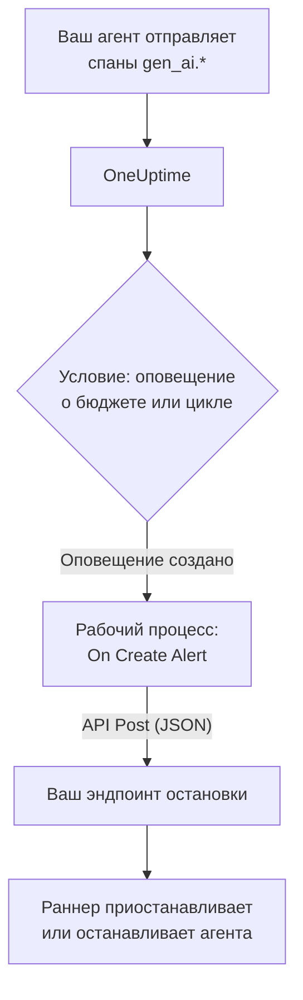

# Предохранители для ИИ-агентов

ИИ-агент редко ломается, падая. Он ломается, продолжая работать: повторяет вызов сломанного инструмента, снова планирует тот же шаг или запускает всё новых субагентов, а каждый ход оплачивается новыми токенами. На этой странице мы соберём для этого предохранитель из того, что в OneUptime уже есть: оповещения, которое замечает вышедшего из-под контроля агента, и рабочего процесса, который вызывает ваш эндпоинт, чтобы его остановить.

:::cards
- [Выберите условие срабатывания](#выберите-условие-срабатывания): Оповещение о расходах или об одном инструменте, который вызывается снова и снова.
- [Соберите эндпоинт остановки](#соберите-эндпоинт-остановки): Небольшой сервис, который ставит вашего агента на паузу.
- [Соберите рабочий процесс](#соберите-рабочий-процесс): От нового оповещения до вызова вашего эндпоинта.
- [Проверьте предохранитель](#проверьте-предохранитель): Вызовите срабатывание вручную, а затем в реальных условиях.
:::

## Как это работает



Предохранитель следит за OpenTelemetry, которую ваш агент уже отправляет напрямую или [через шлюз](/docs/telemetry/ai-gateways), и действует рядом с путём запросов, а не на нём. К каждому вызову модели ничего не добавляется, и смена провайдера, SDK или шлюза его не ломает.

Цена — скорость: он останавливает неуправляемого агента за минуты, а не за миллисекунды. Оставьте ограничения на число шагов и тайм-ауты в самом агенте, а предохранитель пусть ловит то, что прошло мимо них.

| Условие срабатывания | Что ловит | Время до оповещения |
| --- | --- | --- |
| Оповещение о бюджете от монитора метрик | Расходы, которые продолжают расти, какой бы ни была причина | До 15 минут плюс минута на монитор |
| Оповещение о зацикливании от монитора трассировок | Один и тот же инструмент, вызываемый снова и снова | От 1 до 5 минут |

## Перед началом

- Ваш агент отправляет GenAI-спаны в OneUptime. См. [Наблюдаемость ИИ / LLM](/docs/telemetry/ai-llm-observability).
- HTTPS-эндпоинт, который может приостановить или остановить раннер вашего агента и доступен из OneUptime. Вы создадите его в разделе [Соберите эндпоинт остановки](#соберите-эндпоинт-остановки).
- Право создавать мониторы и рабочие процессы в проекте.

## Выберите условие срабатывания

Оба условия заканчиваются одинаково: монитор создаёт оповещение, а новое оповещение запускает рабочий процесс. Можно настроить оба: рабочему процессу всё равно, какое из них сработало.

### Оповещение о бюджете

Расходы — самый надёжный признак неуправляемого агента. Бюджет каждые 15 минут суммирует расходы на ИИ за день и публикует их в виде двух метрик, `oneuptime.llm.budget.spend.usd` и `oneuptime.llm.budget.percent.used`, каждая с ID бюджета в `oneuptime.llm.budget.id`.

:::steps
1. Откройте **Продукты → AI / LLM → Бюджеты** и нажмите **Создать: LLM Cost Budget**. Задайте **Дневной бюджет (USD)** и выберите сервис агента в поле **Сервис (необязательно)**, чтобы бюджет следил только за этим агентом.
2. В меню строки нового бюджета выберите **Показать ID** и скопируйте ID.
3. Создайте [монитор метрик](/docs/monitor/metrics-monitor) по `oneuptime.llm.budget.percent.used` с фильтром по атрибуту `oneuptime.llm.budget.id`, равному скопированному ID, и установите **Диапазон времени** в значение **Past 30 Minutes**.
4. Добавьте критерий **Greater Than Or Equal To** `100`, который создаёт оповещение, и задайте **Заголовок оповещения** с именем агента, например `LLM budget exceeded: support-bot`. Этот заголовок читают и рабочий процесс, и ваш эндпоинт.
:::

Фильтруйте по ID, а не по имени: при переименовании бюджета переименовывается и его ряд, и монитор с фильтром по старому имени тихо перестанет находить совпадения. Оставьте диапазон времени равным 30 минутам: бюджет публикует одну точку каждые 15 минут, поэтому более короткий диапазон не находит ничего между двумя точками, и оповещение открывается и закрывается снова и снова.

Второй критерий на `80` с меньшей серьёзностью сначала предупредит человека через политику дежурств оповещения, прежде чем предохранитель сработает на `100`.

### Оповещение о зацикливании

Застрявший агент оставляет узнаваемый след: один и тот же спан инструмента снова и снова. Здоровый запуск не вызывает один инструмент десятки раз за несколько минут, поэтому подсчёт ловит цикл задолго до бюджета.

:::steps
1. Откройте **Мониторы**, нажмите **Создать монитор** и выберите **Трассировки** в разделе **Другие типы мониторов**.
2. В разделе **Дополнительные поля** укажите в **Фильтровать по сервису телеметрии** сервис агента, а в **Фильтровать по атрибутам** — `gen_ai.tool.name`, равный инструменту, на котором вы ожидаете зацикливания, например `search_web`. Если ваша инструментация называет спан каждого инструмента по его имени, укажите это имя в **Имя span**.
3. Установите **Трассировка монитора за (время)** в значение **Последние 5 минут**.
4. Добавьте критерий **Span Count** **Greater Than** с числом, которого ни один здоровый запуск не достигает за пять минут, например `50`, и пусть он создаёт оповещение с заголовком вида `Agent loop: support-bot`.
:::

Второй монитор трассировок с **Фильтровать по статусу span**, равным **Ошибка**, и меньшим порогом ловит лавины повторных попыток: инструмент, который продолжает падать, и агента, который продолжает вызывать его снова.

## Соберите эндпоинт остановки

Рабочий процесс отправляет `POST` с телом в формате JSON на эндпоинт, который вы запускаете. Что значит «остановить», решаете вы. От самого мягкого действия к самому сильному:

| Действие | Результат |
| --- | --- |
| Остановить новую работу | Раннер не начинает новых запусков этого агента |
| Отменить его запуски | Выполняющиеся запуски этого агента отменяются |
| Приостановить пул | Все воркеры завершают работу, пока кто-нибудь не сбросит предохранитель |

Минимальный эндпоинт на Express, который размыкает предохранитель отдельно для каждого агента:

```typescript title="circuit-breaker.ts"
import express from "express";

const app = express();
app.use(express.json());

const tripped = new Set<string>(); // agents whose breaker is open

app.post("/circuit-breaker", (req, res) => {
  if (req.headers["authorization"] !== `Bearer ${process.env.KILL_TOKEN}`) {
    return res.status(401).end();
  }

  const alertTitle: string = req.body.alertTitle ?? "";

  // "LLM budget exceeded: support-bot" -> "support-bot"
  const agent: string = alertTitle.split(": ").pop() ?? "unknown";

  tripped.add(agent); // your run loop checks this set
  abortActiveRuns(agent); // cancel that agent's runs in flight

  // Answer fast; do the slow cleanup in the background.
  return res.status(200).json({ tripped: agent });
});
```

Соберите его по этим правилам:

- Сделайте срабатывание идемпотентным. Предупреждение и превышение или оповещения о бюджете и о зацикливании одновременно могут вызвать срабатывание несколько раз, и повторное срабатывание не должно ничего менять.
- Отвечайте за секунду или две, а очистку выполняйте в фоне. Рабочий процесс считает успехом любой ответ 2xx.
- Требуйте секрет. Любой, кто может вызвать эндпоинт, может остановить ваших агентов, поэтому проверяйте bearer-токен, который рабочий процесс отправляет из секретной глобальной переменной.
- Сбрасывайте вручную. Сработавший предохранитель остаётся разомкнутым, пока кто-нибудь не посмотрит на запуск: откройте разговор агента в **Продукты → AI / LLM → Разговоры**, чтобы прочитать или воспроизвести, что он делал.

Запрос отправляется из OneUptime. В OneUptime Cloud ваш эндпоинт должен быть доступен из интернета. Самостоятельно размещённая установка отклоняет частные сетевые адреса, если администратор их не разрешил: см. [Исходящий сетевой доступ](/docs/workflows/configuration#исходящий-доступ-в-сеть).

## Соберите рабочий процесс

Сначала сохраните токен эндпоинта там, где рабочий процесс сможет использовать его, не показывая: откройте **Рабочие процессы → Глобальные переменные**, нажмите **Создать: Рабочий процесс Переменная**, назовите переменную `AGENT_KILL_TOKEN`, вставьте токен в **Содержимое** и включите **Секрет**. Секретное значение вырезается из журналов запусков и трассировок шагов.

:::steps
### Создайте рабочий процесс

Откройте **Продукты → Рабочие процессы** и нажмите **Создать рабочий процесс**. Нажмите **Начать с нуля**, назовите его `AI agent circuit breaker` и нажмите **Создать рабочий процесс**. Он откроется на вкладке **Конструктор** в выключенном состоянии.

### Добавьте триггер

Нажмите на пунктирный блок **Choose what starts this workflow** и выберите **On Create Alert** на панели **Add Trigger**. Нажмите на триггер, отметьте заголовок и описание в **Select Fields** и нажмите **Сохранить**. ID на блоке, `alert-on-create-1`, — это то, по чему на него ссылаются следующие блоки.

### Проверьте заголовок

Нажмите **Добавить компонент**, выберите **If / Else** и соедините с ним точку **Success** триггера. Задайте в **Value to check** заголовок оповещения (нажмите **{ }** и выберите его), в **Comparison** — **содержит**, а в **Compare with** — начало, общее для заголовков ваших условий срабатывания, например `LLM budget exceeded`.

### Вызовите ваш эндпоинт

Добавьте **API Post (JSON)** и соедините с ним точку **Yes** блока **If / Else**. Укажите в его поле **URL** ваш эндпоинт, например `https://agents.example.com/circuit-breaker`, и заполните заголовки и тело, приведённые ниже.

### Сообщите о сбое

Добавьте **Send Message to Slack** или **Send Email** и соедините с ним точку **Error** блока API. Предохранитель, который не смог сработать, — это то единственное оповещение, которое человек обязан увидеть.

### Включите его

Включите переключатель **Включено** в верхней части вкладки **Конструктор**.
:::

**Request Headers** блока API:

```json title="Request Headers"
{
  "Authorization": "Bearer {{global.variables.AGENT_KILL_TOKEN}}",
  "Content-Type": "application/json"
}
```

Его **Request Body**:

```json title="Request Body"
{
  "source": "oneuptime-circuit-breaker",
  "alertId": "{{local.components.alert-on-create-1.returnValues.model._id}}",
  "alertTitle": "{{local.components.alert-on-create-1.returnValues.model.title}}",
  "alertDescription": "{{local.components.alert-on-create-1.returnValues.model.description}}"
}
```

Чтобы реагировать на несколько условий срабатывания, начинайте все их заголовки одинаково или стройте цепочку из дополнительных блоков **If / Else** от точки **No**. О холсте см. [Создание рабочего процесса](/docs/workflows/authoring), а о ссылках `{{…}}` — [Переменные](/docs/workflows/variables).

## Проверьте предохранитель

:::steps
1. Вызовите срабатывание вручную. Откройте **Оповещения**, нажмите **Создать оповещение** и создайте оповещение с заголовком `LLM budget exceeded: test`. Запуск появится в **Рабочие процессы → Журналы → Запуски**, а ваш эндпоинт получит запрос.
2. Вызовите срабатывание в реальных условиях. Создайте бюджет с крошечным лимитом, например `0.01` USD, на сервисе тестового агента, направьте на него монитор бюджета и дайте агенту поработать: процент превысит 100, оповещение откроется, рабочий процесс запустится, и предохранитель сработает. Для оповещения о зацикливании дайте тестовому агенту инструмент, который всегда завершается ошибкой.
3. Вызовите срабатывание дважды. Создайте то же оповещение ещё раз: ваш эндпоинт должен принять второе срабатывание, ничего не меняя.
:::

## Как предохранитель ведёт себя со временем

- Рабочий процесс запускается при создании оповещения, поэтому условие срабатывания размыкает предохранитель один раз на оповещение, а не на каждую оценку.
- Бюджет считает сутки по UTC, поэтому его процент снова начинается с 0 в полночь по UTC. Тогда оповещение о бюджете может закрыться, а следующий плохой день откроет новое оповещение, которое снова разомкнёт предохранитель.
- Монитор держит своё оповещение открытым, пока выполняются его критерии. Если включено **Автоустранение оповещения**, оповещение закрывается, когда они перестают выполняться, а следующее превышение открывает новое оповещение.
- Сброс — решение человека с обеих сторон: закройте оповещение в OneUptime и сбросьте предохранитель в вашем раннере.
- Каждое новое оповещение в проекте запускает рабочий процесс. Именно **If / Else** не подпускает другие оповещения к предохранителю: не убирайте его.

## Устранение неполадок

:::details Рабочий процесс не запускается
Проверьте, что переключатель **Включено** в верхней части вкладки **Конструктор** включён: рабочие процессы создаются выключенными. Затем проверьте, что оповещение было создано после того, как вы включили рабочий процесс: триггер запускает выполнение только для нового оповещения.
:::

:::details Рабочий процесс запускается, но всегда идёт по ветке No
Заголовок пуст или не совпадает. Поле, не отмеченное в **Select Fields** триггера, приходит пустым, поэтому отметьте заголовок. Затем сравните заголовок оповещения со значением **Compare with**: **содержит** должно найти в нём именно этот текст.
:::

:::details Ваш эндпоинт отвечает 401
Заголовок `Authorization` не совпадает с токеном, который ожидает ваш эндпоинт. Проверьте имя в `{{global.variables.AGENT_KILL_TOKEN}}` и значение, сохранённое в глобальной переменной. Значение секретной переменной нельзя прочитать обратно, поэтому при сомнениях введите его заново через **Update Content**.
:::

:::details Оповещение о бюджете открывается и закрывается снова и снова
**Диапазон времени** монитора короче 15 минут между точками бюджета. Установите его в значение **Past 30 Minutes**.
:::

:::details Запрос так и не доходит до вашего эндпоинта
Откройте запуск в **Рабочие процессы → Журналы → Запуски** и шаг **API Post (JSON)**: там указано, почему запрос не удался. В OneUptime Cloud эндпоинт должен быть доступен из интернета; самостоятельно размещённая установка отклоняет частные сетевые адреса, если администратор их не разрешил.
:::

## Дальнейшие шаги

:::cards
- [Наблюдаемость ИИ / LLM](/docs/telemetry/ai-llm-observability): Бюджеты, стоимость и спаны, за которыми следит предохранитель.
- [Мониторинг трассировок](/docs/monitor/traces-monitor): Фильтры спанов и критерии в подробностях.
- [Рабочие процессы](/docs/workflows/index): Триггеры, компоненты, переменные и запуски.
- [Шлюзы ИИ](/docs/telemetry/ai-gateways): Вызовы моделей всех агентов через один экспорт.
:::
