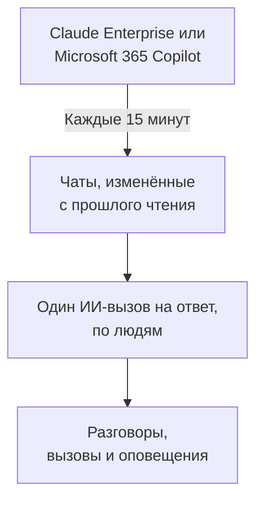

# ИИ-инструменты компании

Смотрите, о чём ваши сотрудники спрашивают ИИ-инструменты, за которые платит компания, в виде разговоров по людям. Подключите Claude Enterprise или Microsoft 365 Copilot с учётными данными, которые могут только читать, и OneUptime будет каждые 15 минут приносить каждый новый чат в **Разговоры**. Читать их могут только владельцы и администраторы проекта, если вы не решите иначе.

:::cards
- [Сначала предупредите сотрудников](#сначала-предупредите-сотрудников): Их чаты — это их собственные слова.
- [Подключить инструмент](#подключить-инструмент): Вставьте учётные данные, выберите, кто может читать, проверьте и подключите.
- [Конфиденциальность](#конфиденциальность): Кто может читать разговоры и сохраняются ли слова.
- [Другие ИИ-инструменты](#другие-ии-инструменты): ChatGPT Enterprise, Gemini, Open WebUI, LibreChat и ассистенты для программирования.
:::

## Сначала предупредите сотрудников

> [!IMPORTANT]
> Это собственные слова ваших сотрудников. Прежде чем подключать инструмент, скажите им, что их чаты с ним сохраняются и кто может их читать, и уточните у юристов или HR, чего требуют ваши правила и местные законы.

## Как это работает

Каждые 15 минут OneUptime запрашивает у инструмента чаты, изменившиеся с прошлого чтения. Каждый ответ становится одним ИИ-вызовом того, кто спрашивал, с вопросами, заданными после предыдущего ответа, а каждый чат — одним разговором.

Чаты приходят так же, как ИИ-вызовы ваших приложений, поэтому к ним применяются правила очистки, фильтры отбрасывания, хранение и ИИ-оповещения. Инструменты оплачиваются за место, поэтому у этих вызовов нет ни токенов, ни стоимости. Вопрос без ответа в течение часа приходит отдельно, так что виден даже чат, на который ИИ так и не ответил.

## Прежде чем начать

- Роль Project Owner или Project Admin. Только они могут подключить, изменить или удалить инструмент.
- Администратор инструмента, чтобы создать учётные данные: раздел каждого инструмента ниже говорит, кто именно.
- Предупреждённые сотрудники и ответ ваших юристов или HR.

## Подключить инструмент

:::steps
### Откройте «Подключить»

Откройте **Продукты → AI / LLM → Подключить**. В **ИИ-инструменты вашей компании** нажмите на плитку инструмента.

### Вставьте учётные данные

В **Учётные данные** заполните то, что просит инструмент. Секреты хранятся в зашифрованном виде и больше никогда не показываются.

### Выберите, кто может читать

В **Конфиденциальность** задайте **Кто может читать разговоры** и **Сохранять написанное**, как объясняет [Конфиденциальность](#конфиденциальность).

### Проверьте

В **Тест** нажмите **Проверить подключение**. OneUptime считает чаты за последние 7 дней: ничего из написанного не читается, не показывается и не сохраняется.

### Подключите

Нажмите **Подключить**. Первое чтение начинается в течение минуты и приносит последние 7 дней.
:::

## Claude Enterprise

OneUptime читает каждый чат claude.ai вашей организации через Compliance API: кто спрашивал, что спросили у Claude, что он ответил и какую модель использовал. Чат с новым сообщением читается заново, а уже принесённые ответы распознаются и пропускаются.

:::steps
### Включите Compliance API

Основной владелец вашей организации открывает Organization settings, API в claude.ai и включает Compliance API.

### Создайте ключ доступа для соответствия требованиям

Там создайте ключ с областью `read:compliance_user_data`. Он начинается с `sk-ant-api01-`.

### Подключите Claude Enterprise

Вставьте ключ в **Ключ доступа соответствия**.
:::

## Microsoft 365 Copilot

OneUptime читает историю взаимодействий каждого человека с Copilot из Microsoft Graph: о чём он спрашивал Copilot в Teams, Outlook, Word, Excel, PowerPoint, Loop или Copilot Chat, что тот ответил и в каком приложении. Промпт и ответы на него становятся одним ИИ-вызовом, а сеанс Copilot — одним разговором. Большой тенант читается частями, продолжая с места, где остановилось прошлое чтение.

:::steps
### Зарегистрируйте приложение

В Microsoft Entra ID зарегистрируйте приложение и создайте для него секрет клиента.

### Выдайте разрешения

Выдайте приложению разрешения приложения `AiEnterpriseInteraction.Read.All` и `User.Read.All` в Microsoft Graph и дайте согласие администратора.

### Подключите Copilot

Заполните **Идентификатор каталога (клиента)**, **Идентификатор приложения (клиента)** и **Секрет клиента**. Чтобы читать только часть людей, укажите ID объекта группы в **Только люди из этой группы** в **Дополнительные поля** и выдайте приложению также `GroupMember.Read.All`. Для Azure Government измените там же **Облако**.
:::

## Конфиденциальность

| Настройка | Что она делает |
| --- | --- |
| **Кто может читать разговоры** | **Владельцы и администраторы проекта**, по умолчанию: никто другой в проекте не видит эти разговоры и ИИ-вызовы, из которых они состоят, нигде в OneUptime. **Все, кто может читать вызовы ИИ**: все, кто может читать трассировки проекта. |
| **Сохранять написанное** | Включено по умолчанию: вопросы и ответы сохраняются. Выключено: OneUptime сохраняет, кто спрашивал, когда, с какой моделью и в каком приложении, но не слова. |

Изменение того, кто может читать, применяется в течение минуты. Выключение **Сохранять написанное** действует для чатов, прочитанных после него; сохранённое раньше остаётся до конца срока хранения.

Чтобы сохранять слова, но маскировать их части, например адреса электронной почты или номера карт, используйте **Правила очистки** в **Трассировка → Настройки**: они применяются до того, как что-либо сохраняется. Разговоры хранятся, пока сервис подключения хранит свои трассировки: см. [Хранение данных](/docs/telemetry/data-retention). Удаление подключения останавливает его чтение; прочитанное остаётся доступным тем же людям до конца срока хранения.

## Другие ИИ-инструменты

У этих инструментов нет API, через который OneUptime мог бы читать чаты людей, или им нужен другой путь.

### ChatGPT Enterprise

OpenAI открывает свой Compliance API для workspace только по запросу и не публикует, что содержат его записи, поэтому OneUptime пока не может читать чаты ChatGPT Enterprise. Подключение вашей организации OpenAI как [аккаунта провайдера](/docs/telemetry/ai-provider-accounts#openai) показывает её использование и стоимость API, в которые ChatGPT не входит.

### Gemini для Google Workspace

Google не предлагает API для чтения чатов Gemini. Google Vault хранит их для eDiscovery.

### Ассистенты для программирования

Claude Code, Codex, Gemini CLI, GitHub Copilot и Cursor отправляют собственный OpenTelemetry: см. [ИИ-ассистенты для программирования](/docs/telemetry/ai-coding-assistants).

### Open WebUI и LibreChat

Самостоятельно размещённые чат-приложения вызывают модели через API, который задаёте вы. Поставьте прокси LiteLLM перед моделями и отправляйте его трассировки в OneUptime, как показано в [Шлюзы ИИ](/docs/telemetry/ai-gateways#litellm-proxy): промпты и ответы каждого чата приходят как ИИ-вызовы. Виртуальный ключ на человека показывает, кто спрашивал; общий для всех ключ не называет никого. Собственный экспорт OpenTelemetry в Open WebUI трассирует его веб-запросы и обращения к базе данных, а не чаты.

## Устранение неполадок

:::details Проверка не находит чатов
Никто не пользовался инструментом последние 7 дней, или учётные данные принадлежат другой организации или другому тенанту. Для Copilot проверьте, что группа в **Только люди из этой группы** — та, что вы имеете в виду.
:::

:::details Учётные данные работают, но не могут читать то, что нужно подключению
Для Copilot дайте согласие администратора на разрешения Graph приложения, а также `GroupMember.Read.All`, если вы указываете группу. Для Claude Enterprise создайте ключ с областью `read:compliance_user_data`.
:::

:::details Кто-то не видит разговоры
**Кто может читать разговоры** установлено в **Владельцы и администраторы проекта**. Владелец или администратор может изменить это через **Редактировать** в строке подключения.
:::

:::details Разговоры показывают, кто спрашивал, но без слов
**Сохранять написанное** было выключено, когда их читали. Включение действует для чатов, прочитанных после него.
:::

## Дальнейшие шаги

:::cards
- [Наблюдаемость ИИ / LLM](/docs/telemetry/ai-llm-observability): Читайте и воспроизводите разговоры и узнавайте, когда ответы идут не так.
- [Аккаунты ИИ-провайдеров](/docs/telemetry/ai-provider-accounts): Использование и стоимость ваших аккаунтов OpenAI, Anthropic, Azure, Bedrock и Vertex AI.
- [ИИ-ассистенты для программирования](/docs/telemetry/ai-coding-assistants): Расходы на инструменты программирования по инженерам.
- [Хранение данных](/docs/telemetry/data-retention): Как долго хранятся разговоры.
:::
