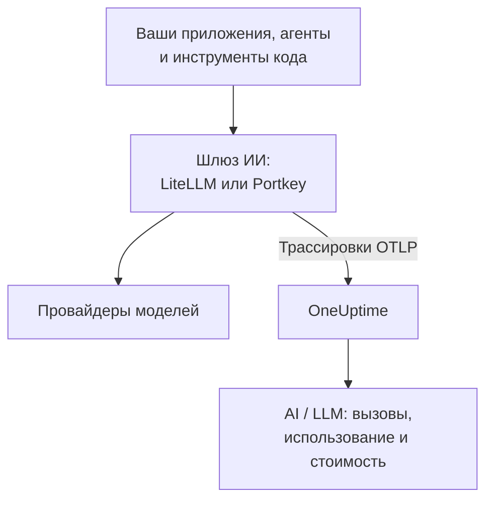

# Шлюзы ИИ (LiteLLM, Portkey)

Шлюз ИИ стоит между вашими приложениями и провайдерами моделей, поэтому через него проходит каждый вызов модели. Отправьте OpenTelemetry шлюза в OneUptime один раз, и каждый вызов за ним появится в [AI / LLM](/docs/telemetry/ai-llm-observability) с моделью, токенами, стоимостью и, если вы это не отключите, промптом и ответом, без инструментирования каждого приложения.

:::cards
- [LiteLLM Proxy](#litellm-proxy): Встроенный экспорт, настраиваемый тремя переменными.
- [Кто сколько потратил](#один-виртуальный-ключ-на-сотрудника): Один виртуальный ключ LiteLLM на сотрудника называет каждого человека.
- [Portkey](#portkey): Встроенный экспорт на самостоятельно размещённых шлюзах; в остальных случаях инструментируйте приложение.
- [Проверьте, что вызовы приходят](#проверьте-что-вызовы-приходят): Что вы должны увидеть и что делать, если это не так.
:::

## Как это работает



| | LiteLLM Proxy | Portkey, самостоятельно размещённый или Enterprise | Portkey, с открытым исходным кодом или облачный |
| --- | --- | --- | --- |
| Экспорт в OneUptime | Встроенный | Встроенный, экспериментальный | Нет: инструментируйте приложение |
| Какой эндпоинт указать | `https://oneuptime.com/otlp/v1/traces` | `https://oneuptime.com/otlp` | Собственный экспортёр приложения |
| Называет каждого человека | Да, с одним виртуальным ключом на сотрудника | Нет | Только то, что отправляет приложение |
| Промпты и ответы | Отправляются, если вы их не отключите | Отправляются всегда | Зависит от инструментации |

## Перед началом

- Ключ приёма: откройте **Настройки проекта → Телеметрия и APM → Ключи приема** и нажмите **Создать ключ приёма**.
- Базовый URL OTLP: `https://oneuptime.com/otlp` или `https://YOUR-ONEUPTIME-HOST/otlp`, если вы размещаете OneUptime самостоятельно. OneUptime принимает OTLP по HTTP, в protobuf и в JSON.
- Ключ передаётся в заголовке `x-oneuptime-token` каждого запроса экспорта.

## LiteLLM Proxy

OpenTelemetry-колбэк LiteLLM входит в прокси с открытым исходным кодом, а в официальном Docker-образе (`ghcr.io/berriai/litellm`) уже есть нужные ему пакеты.

:::steps
### Включите колбэк otel

Добавьте `otel` в колбэки в `config.yaml` прокси:

```yaml title="config.yaml"
model_list:
  - model_name: gpt-4o
    litellm_params:
      model: openai/gpt-4o
      api_key: os.environ/OPENAI_API_KEY

litellm_settings:
  callbacks: ["otel"]
```

### Направьте экспортёр в OneUptime

Задайте на прокси три переменные:

```bash
export OTEL_EXPORTER="otlp_http"
export OTEL_ENDPOINT="https://oneuptime.com/otlp/v1/traces"
export OTEL_HEADERS="x-oneuptime-token=YOUR_INGESTION_TOKEN"
```

### Запустите прокси

:::tabs
@tab Docker
```bash
docker run \
  -v $(pwd)/config.yaml:/app/config.yaml \
  -e OPENAI_API_KEY="sk-..." \
  -e OTEL_EXPORTER="otlp_http" \
  -e OTEL_ENDPOINT="https://oneuptime.com/otlp/v1/traces" \
  -e OTEL_HEADERS="x-oneuptime-token=YOUR_INGESTION_TOKEN" \
  -e OTEL_SERVICE_NAME="litellm-gateway" \
  -p 4000:4000 \
  ghcr.io/berriai/litellm:main-stable \
  --config /app/config.yaml
```
@tab pip
```bash
pip install 'litellm[proxy]' opentelemetry-api opentelemetry-sdk opentelemetry-exporter-otlp
litellm --config config.yaml
```
:::

Сам по себе `litellm[proxy]` не включает пакеты OpenTelemetry, поэтому установите их вместе с ним.

### Отправьте через него запрос

Вызовите прокси один раз, а затем проверьте AI / LLM, как описано в разделе [Проверьте, что вызовы приходят](#проверьте-что-вызовы-приходят).
:::

| Переменная | Значение | Примечания |
| --- | --- | --- |
| `OTEL_EXPORTER` | `otlp_http` | Также читается как `OTEL_EXPORTER_OTLP_PROTOCOL` |
| `OTEL_ENDPOINT` | `https://oneuptime.com/otlp/v1/traces` | Полный путь `/v1/traces` работает с любой версией LiteLLM; также читается как `OTEL_EXPORTER_OTLP_ENDPOINT` |
| `OTEL_HEADERS` | `x-oneuptime-token=YOUR_INGESTION_TOKEN` | Пары `key=value` через запятую; также читается как `OTEL_EXPORTER_OTLP_HEADERS` |
| `OTEL_SERVICE_NAME` | Имя вашего шлюза | Сервис, под которым появляются вызовы; `litellm`, если ничего не задано |

### Что отправляет LiteLLM

Каждый вызов несёт `gen_ai.system`, `gen_ai.request.model`, `gen_ai.response.model`, `gen_ai.usage.input_tokens` и `gen_ai.usage.output_tokens`, свои параметры, а также промпт и ответ: всё, что нужно OneUptime, чтобы [прочитать вызов](/docs/telemetry/ai-llm-observability).

Начиная с LiteLLM 1.81 эти атрибуты находятся на спане запроса `Received Proxy Server Request`, а отдельного спана `litellm_request` больше нет. Когда один запрос делает несколько вызовов модели, каждый вызов перезаписывает там атрибуты предыдущего, поэтому задайте `USE_OTEL_LITELLM_REQUEST_SPAN=true`, чтобы получать спан `litellm_request` для каждого вызова.

LiteLLM сам рассчитывает цену каждого вызова, включая собственные тарифы, настроенные на прокси, и сообщает её как `gen_ai.cost.total_cost`. OneUptime предпочитает сообщённую цену собственной оценке и [оценивает по токенам](/docs/telemetry/ai-llm-observability), только если LiteLLM не смог рассчитать цену вызова, например для собственной модели без заданной цены.

### Один виртуальный ключ на сотрудника

Выдайте каждому человеку собственный виртуальный ключ LiteLLM, и каждый его вызов будет приходить с указанием, кто он. LiteLLM записывает на спан ID, электронную почту и команду владельца ключа, а OneUptime читает их как сотрудника и команду, поэтому вкладка **Использование** ранжирует расходы по людям без какой-либо настройки на их машинах.

Виртуальным ключам нужны база данных и мастер-ключ на прокси (`DATABASE_URL` и `LITELLM_MASTER_KEY`). Создайте пользователя с его электронной почтой, а затем ключ для этого пользователя:

```bash
curl -X POST "http://localhost:4000/user/new" \
  -H "Authorization: Bearer YOUR_MASTER_KEY" \
  -H "Content-Type: application/json" \
  -d '{"user_email": "alice@example.com"}'

curl -X POST "http://localhost:4000/key/generate" \
  -H "Authorization: Bearer YOUR_MASTER_KEY" \
  -H "Content-Type: application/json" \
  -d '{"user_id": "USER_ID_FROM_THE_FIRST_CALL", "team_id": "platform"}'
```

| Атрибут спана от LiteLLM | OneUptime читает его как |
| --- | --- |
| `metadata.user_api_key_user_id` | ID сотрудника |
| `metadata.user_api_key_user_email` | Электронную почту сотрудника |
| `metadata.user_api_key_team_id` | Команду |
| `metadata.user_api_key_end_user_id` | Никогда не сотрудника: это `user`, который ваше приложение отправляет для своего клиента |

В режиме OpenTelemetry v2 у LiteLLM те же значения приходят с префиксом `litellm.` (`litellm.metadata.user_api_key_user_email` и так далее), и OneUptime их тоже читает.

### Не отправляйте промпты

Колбэк `otel` по умолчанию отправляет промпты и ответы целиком. Чтобы не отправлять их, используйте один из этих вариантов:

:::tabs
@tab Все колбэки
```yaml title="config.yaml"
litellm_settings:
  callbacks: ["otel"]
  turn_off_message_logging: true
```
@tab Только колбэк OTel
```yaml title="config.yaml"
litellm_settings:
  callbacks: ["otel"]

callback_settings:
  otel:
    message_logging: False
```
@tab Переменная окружения
```bash
export OTEL_INSTRUMENTATION_GENAI_CAPTURE_MESSAGE_CONTENT="NO_CONTENT"
```
:::

`callback_settings` — ключ верхнего уровня, а не ключ внутри `litellm_settings`. Чтобы сохранять промпты, но маскировать их части, используйте вместо этого правила очистки в **Трассировка → Настройки**.

:::details Режим OpenTelemetry v2 в LiteLLM
В новых версиях LiteLLM есть необязательный режим OpenTelemetry v2 (`LITELLM_OTEL_V2=true`, без изменений в `config.yaml`). Он отправляет одну трассировку на запрос: обработку HTTP, аутентификацию, guardrails и вызов модели в виде GenAI-спанов с именами вроде `chat gpt-4o`. В режиме v2 промпты по умолчанию выключены; включите их через `OTEL_INSTRUMENTATION_GENAI_CAPTURE_MESSAGE_CONTENT`. Стоимость приходит как `litellm.cost.total`, и OneUptime её тоже читает. Используйте один режим или другой, но не оба сразу.
:::

## Portkey

Что может отправлять Portkey, зависит от того, как вы его запускаете:

| Развёртывание | Экспорт в OneUptime |
| --- | --- |
| Самостоятельно размещённый шлюз или шлюз Enterprise | Встроенный (экспериментальный): задайте переменные ниже |
| Шлюз с открытым исходным кодом (`portkey-ai/gateway`) | Нет: инструментируйте приложение, которое его вызывает |
| Облачный шлюз (portkey.ai) | Нет на шлюзе: инструментируйте приложение, которое его вызывает |

У Portkey есть и собственный эндпоинт OpenTelemetry (`api.portkey.ai/v1/otel`). Он принимает трассировки в Portkey, то есть работает в обратном направлении по сравнению с этой страницей.

### Самостоятельно размещённые шлюзы и шлюзы Enterprise

Задайте эти переменные в контейнере шлюза:

```yaml title="docker-compose.yml"
services:
  portkey-gateway:
    environment:
      EXPERIMENTAL_GEN_AI_OTEL_TRACES_ENABLED: "true"
      EXPERIMENTAL_GEN_AI_OTEL_EXPORTER_OTLP_ENDPOINT: "https://oneuptime.com/otlp"
      EXPERIMENTAL_GEN_AI_OTEL_EXPORTER_OTLP_HEADERS: "x-oneuptime-token=YOUR_INGESTION_TOKEN"
```

- Укажите базовый URL OTLP: Portkey сам добавляет `/v1/traces`.
- Заголовки задаются парами `key=value` через запятую. `EXPERIMENTAL_GEN_AI_OTEL_RESOURCE_ATTRIBUTES` так же добавляет атрибуты ресурса, например `deployment.environment=production`.
- Portkey отправляет OTLP по HTTP только в JSON, и OneUptime принимает его без коллектора посередине.
- Каждый вызов — это спан с именем `{operation} {model}`, например `chat gpt-4o`, в сервисе `portkey`, с `gen_ai.provider.name`, запрошенной и фактической моделью, счётчиками токенов, `gen_ai.conversation.id` и сообщениями в `gen_ai.input.messages` и `gen_ai.output.messages`.
- Промпты и ответы включены всегда и целиком. Маскируйте то, что нужно, правилами очистки в **Трассировка → Настройки**.
- Каждый вызов отправляется отдельно после ответа, без пакетирования и без повторов: неудачный экспорт теряется. Относитесь к этому как к наблюдаемости, а не как к журналу аудита.
- Если ваш `x-portkey-trace-id` — корректный ID трассировки (32 шестнадцатеричных символа), Portkey использует его повторно, и спаны шлюза присоединяются к трассировке вашего приложения.

Portkey помечает этот экспорт как экспериментальный. Если переменные ни на что не влияют, сверьте актуальную документацию Portkey с версией вашего шлюза.

### Шлюзы с открытым исходным кодом и облачные шлюзы

У шлюза с открытым исходным кодом нет экспортёра, а в облачном шлюзе нельзя задать его переменные. Вместо этого инструментируйте приложение, которое вызывает Portkey. Portkey говорит на API OpenAI, поэтому GenAI-инструментации из раздела [Наблюдаемость ИИ / LLM](/docs/telemetry/ai-llm-observability) (OpenLLMetry, OpenInference, OpenLIT) трассируют вызовы вашего SDK, даже когда базовый URL указывает на Portkey:

```python
from traceloop.sdk import Traceloop
from openai import OpenAI

Traceloop.init(
    app_name="my-ai-agent",
    api_endpoint="https://oneuptime.com/otlp",
    headers={"x-oneuptime-token": "YOUR_INGESTION_TOKEN"},
)

client = OpenAI(
    base_url="https://api.portkey.ai/v1",   # or your gateway's URL
    default_headers={"x-portkey-api-key": "PORTKEY_API_KEY"},
)
# Calls through Portkey are now traced to OneUptime.
```

Эти спаны описывают вызов так, как его сделало ваше приложение: модель, которую оно запросило, время ожидания, полученные токены. То, что шлюз решил по пути, например резервный вариант, повтор или попадание в кеш, остаётся в Portkey. Чтобы видеть это в OneUptime, используйте экспорт самостоятельно размещённого шлюза.

## Проверьте, что вызовы приходят

:::steps
1. Отправьте запрос через шлюз и подождите несколько секунд.
2. Откройте **Продукты → AI / LLM → Вызовы**. Вызов будет в списке с провайдером, моделью и токенами.
3. Нажмите на вызов, чтобы открыть его трассировку, и откройте вкладку спана **LLM**: модель, токены, параметры и, если вы их не отключили, промпт и ответ.
4. Откройте **Использование**: вызов учтён в итогах со стоимостью, которую сообщил шлюз или оценил OneUptime.
:::

## Устранение неполадок

:::details Из LiteLLM ничего не приходит
Ненадолго задайте `OTEL_EXPORTER="console"`. Если в выводе прокси появляются спаны, LiteLLM трассирует, и проблема в эндпоинте или ключе. `DEBUG_OTEL="true"` показывает, что делает экспортёр.
:::

:::details Ключ отклоняется
OneUptime отвечает `401` на отсутствующий, неизвестный или истёкший ключ и `422` на отключённый ключ или ключ браузера. Создайте серверный ключ в **Настройки проекта → Телеметрия и APM → Ключи приема** и отправляйте его в `x-oneuptime-token`.
:::

:::details Неверный эндпоинт
LiteLLM принимает полный путь, `https://oneuptime.com/otlp/v1/traces`. Portkey принимает базовый URL, `https://oneuptime.com/otlp`, и сам добавляет `/v1/traces`.
:::

:::details Спаны приходят, но не в AI / LLM
Отфильтруйте **Трассировка** по сервису шлюза (`litellm`, `portkey` или ваш `OTEL_SERVICE_NAME`), чтобы увидеть исходные спаны. Спан считается вызовом модели, только если несёт атрибуты `gen_ai.*`: проверьте, что колбэк — `otel` и что вызов шёл к модели.
:::

:::details Расходы показываются без привязки
Вызовы не называют человека. Выдайте каждому сотруднику собственный виртуальный ключ, как в разделе [Один виртуальный ключ на сотрудника](#один-виртуальный-ключ-на-сотрудника). Поле `user`, которое отправляет ваше приложение, называет его клиента, а не сотрудника, и никогда не читается как сотрудник.
:::

:::details Из нескольких вызовов виден только последний
Начиная с LiteLLM 1.81 вызовы модели в рамках одного запроса делят один спан. Задайте `USE_OTEL_LITELLM_REQUEST_SPAN=true`, чтобы получать спан на каждый вызов.
:::

## Дальнейшие шаги

:::cards
- [Наблюдаемость ИИ / LLM](/docs/telemetry/ai-llm-observability): Разговоры, оповещения, использование и дневные бюджеты стоимости для этих вызовов.
- [ИИ-ассистенты для программирования](/docs/telemetry/ai-coding-assistants): Поставьте шлюз перед инструментами, которые сами не отправляют телеметрию.
- [Предохранители для ИИ-агентов](/docs/telemetry/ai-agent-circuit-breaker): Остановите неуправляемого агента, когда сработает его оповещение.
- [Мониторинг трассировок](/docs/monitor/traces-monitor): Оповещения по шаблонам спанов, например по инструменту, вызываемому в цикле.
:::
