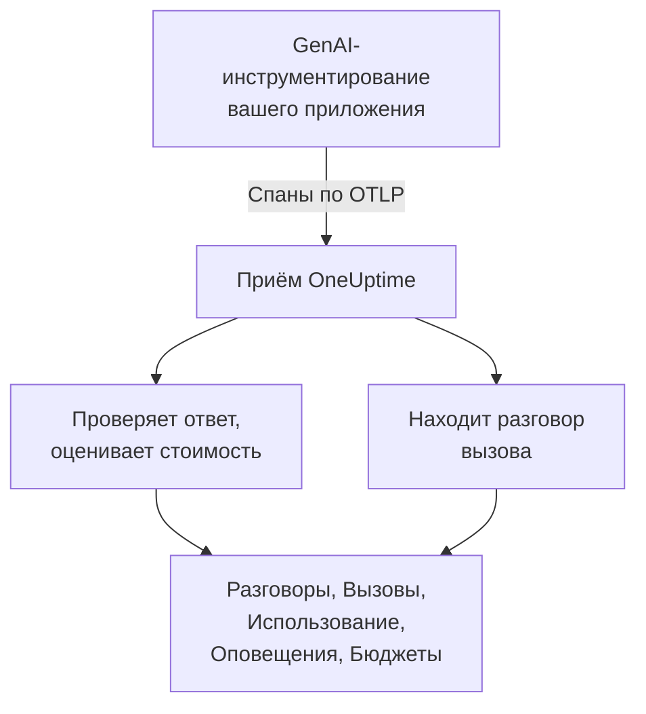
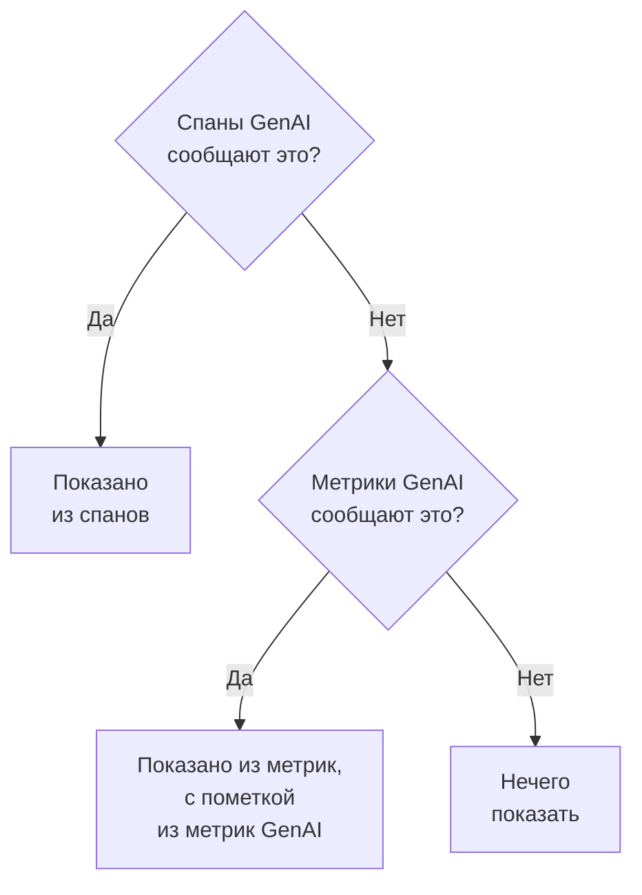

# Наблюдаемость ИИ / LLM

Читайте каждый разговор, который вёл ваш ИИ, воспроизводите его так, как он проходил, и узнавайте, когда ИИ отвечает плохо. OneUptime строит всё это на стандартном OpenTelemetry: если ваше приложение отправляет спаны по **семантическим конвенциям GenAI** (`gen_ai.*`), вы получаете разговоры, оповещения, использование и стоимость без проприетарного SDK.

:::cards
- [Настройка](#настройка-в-пять-шагов): Пять шагов — от первого спана до помеченных ответов.
- [Воспроизведение разговора](#чтение-и-воспроизведение-разговора): Читайте чат так, как его видел человек, в том темпе, в каком он шёл.
- [Оповещения](#узнавайте-когда-ии-отвечает-плохо): Готовые оповещения об ответах с ошибкой, отказом, обрывом, пометкой или задержкой.
- [Контроль расходов](#кто-сколько-тратит): Стоимость по людям, командам, моделям и приложениям, с дневными бюджетами.
:::

## Как это работает

GenAI-инструментирование вашего приложения экспортирует каждый вызов модели как спан OpenTelemetry. Когда спан приходит, OneUptime читает его атрибуты `gen_ai.*`, проверяет ответ на проблемы, оценивает стоимость вызова и относит его к нужному разговору.



Откройте **Продукты → AI / LLM** в разделе **Наблюдаемость**. У продукта семь вкладок:

| Вкладка | Что показывает |
| --- | --- |
| **Разговоры** | Каждый разговор вашего ИИ; те, что требуют внимания, — первыми. Над списком: разговоры, ответы ИИ, сколько требуют внимания, стоимость и типичное время ответа. |
| **Вызовы** | Каждый вызов модели, эмбеддингов, агента и инструмента. Фильтруйте по сервису, провайдеру, модели, операции, человеку, команде или разговору; щёлкните вызов, чтобы открыть его в просмотрщике трассировок. |
| **Использование** | Вызовы, токены и стоимость за период с рейтингом по сотруднику, команде, модели, провайдеру или приложению. |
| **Оповещения** | Готовые оповещения на случай, когда ИИ отвечает плохо, и ваши мониторы ИИ / LLM. |
| **Бюджеты** | Дневные лимиты стоимости, публикуемые как метрики, по которым можно настроить оповещения. |
| **Цены** | Ваши собственные цены для моделей, которых нет во встроенном прайс-листе. |
| **Настройка** | Пять шагов ниже с адресом вашего проекта. |

В просмотрщике трассировок у спана каждого ИИ-вызова есть также вкладка **LLM**: провайдер, модель, токены, стоимость, параметры запроса, а также промпт и ответ.

## Перед началом

- Проект OneUptime, в котором вы можете создать ключ приёма телеметрии.
- Приложение, вызывающее модель, и GenAI-инструментирование для его языка: **OpenLLMetry** (Traceloop), **OpenInference** (Arize), **Vercel AI SDK** или инструментирование OpenTelemetry для OpenAI, Anthropic и Gemini.

> [!TIP]
> Трафик к моделям, идущий через шлюз вроде LiteLLM или Portkey, можно экспортировать из шлюза, а не из каждого приложения: см. [Шлюзы ИИ](/docs/telemetry/ai-gateways). Об ассистентах для программирования, которыми пользуются ваши инженеры, см. [ИИ-ассистенты для программирования](/docs/telemetry/ai-coding-assistants).

## Настройка в пять шагов

Первого шага достаточно, чтобы увидеть вызовы. Каждый следующий шаг показывает больше.

:::steps
### Отправляйте ИИ-вызовы

Создайте ключ приёма в разделе **Настройки проекта → Телеметрия и APM → Ключи приема** (это описано в [быстром старте OpenTelemetry](/docs/telemetry/open-telemetry#создайте-ключ-приёма)). Затем направьте инструментирование на OneUptime:

:::tabs
@tab Python
```bash
pip install traceloop-sdk opentelemetry-exporter-otlp
```

```python
from traceloop.sdk import Traceloop

Traceloop.init(
    app_name="my-ai-agent",
    api_endpoint="https://oneuptime.com/otlp",
    headers={"x-oneuptime-token": "YOUR_INGESTION_TOKEN"},
)
# Your OpenAI, Anthropic and LangChain calls are now traced.
```
@tab Node.js
```bash
npm install @traceloop/node-server-sdk
```

```typescript
import * as traceloop from "@traceloop/node-server-sdk";

traceloop.initialize({
  appName: "my-ai-agent",
  baseUrl: "https://oneuptime.com/otlp",
  headers: { "x-oneuptime-token": "YOUR_INGESTION_TOKEN" },
});
```
@tab OpenTelemetry SDK
```bash
export OTEL_EXPORTER_OTLP_ENDPOINT="https://oneuptime.com/otlp"
export OTEL_EXPORTER_OTLP_HEADERS="x-oneuptime-token=YOUR_INGESTION_TOKEN"
export OTEL_EXPORTER_OTLP_PROTOCOL="http/protobuf"
export OTEL_SERVICE_NAME="my-ai-agent"
```
:::

Размещаете OneUptime у себя? Используйте `https://YOUR-ONEUPTIME-HOST/otlp` вместо `https://oneuptime.com/otlp`. Вызовите модель один раз, и вызов появится на вкладке **Вызовы**.

### Записывайте, что было сказано

Разговор показывает, что спрашивали люди и что отвечал ИИ, только если ваше инструментирование это записывает. OpenLLMetry записывает промпты и ответы, если вы не задали `TRACELOOP_TRACE_CONTENT=false`. Инструментирование OpenTelemetry записывает их, только когда вы об этом просите:

```bash
export OTEL_INSTRUMENTATION_GENAI_CAPTURE_MESSAGE_CONTENT=true
```

Более новые версии инструментирования OpenTelemetry принимают `span_only`, `event_only` или `span_and_event` вместо `true`. Без записанного содержимого разговор всё равно показывает свои тайминги, стоимость и проблемы. Промпты могут содержать конфиденциальные данные: в разделе [Конфиденциальность и маскирование](#конфиденциальность-и-маскирование) показано, как замаскировать их до сохранения.

### Группируйте вызовы в разговоры

Чат-приложение делает один вызов модели за реплику. Задайте `gen_ai.conversation.id` (или `session.id`) равным идентификатору чата в каждом ИИ-вызове, и каждый чат будет показан как один разговор, сколько бы вызовов и трассировок он ни занял. С OpenLLMetry задайте его один раз на запрос:

```python
from traceloop.sdk import Traceloop

Traceloop.set_association_properties({
    "session_id": chat.id,
    "user_email": user.email,
})
```

С Vercel AI SDK передайте идентификатор чата как `experimental_telemetry: { metadata: { sessionId } }`. Вызовы без идентификатора разговора всё равно отображаются — по одному запросу (одной трассировке) за раз.

### Укажите, кто спрашивал

Задайте `user.id` или `user.email` в каждом ИИ-вызове (свойство ассоциации выше задаёт email). Тогда каждый разговор показывает, с кем он был, список можно искать по человеку, а вкладка **Использование** ранжирует расходы по сотрудникам. В разделе [Привязка к сотрудникам и командам](/docs/telemetry/ai-coding-assistants#привязка-к-сотрудникам-и-командам) перечислены все ключи идентичности, которые читает OneUptime.

### Помечайте плохие ответы

OneUptime проверяет каждый ответ по мере поступления и отмечает, что с ним пошло не так:

| Проблема | Что это значит | Как обнаруживается |
| --- | --- | --- |
| Ошибка | Вызов завершился ошибкой, поэтому ответа нет | Статус спана Error, `error.type` или причина завершения `error` |
| Отказ | ИИ отказался отвечать, или фильтр безопасности заблокировал ответ | Причина завершения из-за отказа или безопасности (`content_filter`, `refusal`, `SAFETY` и подобные), отказ в ответе или ответ, начинающийся со стандартного отказа на английском |
| Обрыв | Ответ остановился на лимите токенов | Причина завершения `length`, `max_tokens` или `MAX_TOKENS` |
| Пусто | Нет ни текста, ни вызова инструмента | Записанное содержимое, в котором ничего нет, или 0 выходных токенов |
| Помечен | Оценка, отправленная вашим приложением, признала ответ плохим | Событие `gen_ai.evaluation.result` |

Первые четыре ничего от вас не требуют. Чтобы пометить ответ, который отклоняет ваш guardrail, ваша оценка или кнопка «палец вниз», добавьте событие `gen_ai.evaluation.result` к спану ответа, пока спан открыт, со значением `gen_ai.evaluation.score.label`, равным `fail`:

```python
from opentelemetry import trace

trace.get_current_span().add_event(
    "gen_ai.evaluation.result",
    {
        "gen_ai.evaluation.name": "relevance",
        "gen_ai.evaluation.score.label": "fail",
        "gen_ai.evaluation.explanation": "The answer is about another product.",
    },
)
```

Метки вроде `incorrect`, `wrong`, `unhelpful`, `toxic`, `unsafe` и `hallucination` тоже считаются неудачными. OneUptime никогда не отправляет ваши разговоры другому ИИ для оценки: каждая проверка читает только то, что несёт сам вызов.
:::

## Чтение и воспроизведение разговора

Разговор открывается целиком, как чат-приложение показывает историю: слова человека справа, ответы ИИ слева с моделью, временем, токенами и стоимостью, вызовы инструментов между ними, а проблемы отмечены там, где они произошли. **Подробности** под ответом показывают, почему он остановился, его оценки и ссылку на вызов в разделе Трассировка.

Панель внизу воспроизводит разговор так, как его прожил человек:

| Элемент | Что делает |
| --- | --- |
| **Воспроизвести заново** | Воспроизводит разговор с первого сообщения в том темпе, в каком он шёл. «ИИ отвечает…» отсчитывает время, пока ответ в пути. Щёлкните время любого сообщения, чтобы воспроизвести с него. |
| **Пропускать ожидание** | Включено по умолчанию: сокращает любую паузу длиннее 3 секунд. |
| `1x` | Меняет скорость: 1x, 2x, 4x или 8x. |
| **K**, **J** или **←**, **L** или **→** | Воспроизведение или пауза, на сообщение назад, на сообщение вперёд. |

Адрес страницы хранит сообщение, на котором остановилось воспроизведение (`?step=`), поэтому ссылка, которой вы делитесь, открывается на этом моменте.

## Узнавайте, когда ИИ отвечает плохо

На вкладке **Оповещения** перечислены оповещения, которые нужны большинству ИИ-приложений. Выбор одного из них открывает **Создать монитор** с уже заполненными полями, и перед сохранением можно изменить что угодно:

| Оповещение | Когда сообщает | Важность |
| --- | --- | --- |
| Ответы идут не так | Более 5 % ответов за 15 минут завершаются ошибкой, отказом, обрывом, пусты или помечены | Warning |
| Вызовы ИИ завершаются ошибкой | Более 10 % вызовов модели за 5 минут завершаются ошибкой | Critical |
| ИИ отказывается отвечать | Более 5 % ответов за 30 минут — отказы | Warning |
| Ответы обрываются | 3 или более ответов за 30 минут останавливаются на лимите токенов | Warning |
| Ответы помечаются | Оценка помечает ответ как плохой | Warning |
| Ответы медленные | Более 10 % ответов за 15 минут занимают больше 30 секунд | Warning |
| ИИ перестаёт отвечать | ИИ не даёт ответов 30 минут | Critical |

Оповещения по доле ответов также ждут как минимум 3 плохих ответа, поэтому один плохой ответ из двух никого не поднимает. Оповещение Critical получает самый высокий уровень важности оповещений вашего проекта, а оповещение Warning — следующий: High и Low в новом проекте.

Каждое оповещение — это монитор **ИИ / LLM**. Его настройки определяют, что считается плохим ответом (**Считать ответ плохим, когда он**, **Или длится дольше, чем (секунд)**), насколько далеко назад смотрит каждая проверка (**Временное окно**, по умолчанию 15 минут), какие **Приложения** он отслеживает и, в разделе **Дополнительные поля**, какую **Модель**. **Предпросмотр** показывает, что монитор насчитал бы прямо сейчас. Его критерии сравнивают три числа: **Плохие ответы ИИ (в %)**, **Плохие ответы ИИ** и **Ответы ИИ**.

Готовое оповещение создаёт оповещение, которое разрешается само, и показывает монитор как **Degraded**, пока ответы плохие. Его инцидент заполнен, но выключен: включите его, чтобы вызвать дежурного.

## Кто сколько тратит

Вкладка **Использование** показывает вызовы, токены и стоимость за период (последние 7 дней, если не выбрать другой) и таблицу 25 крупнейших по одной из пяти разбивок: **Сотрудник**, **Команда**, **Модель**, **Провайдер** и **Приложение / Сервис**. Вызовы, в которых никто не назван, учитываются в строке **Без привязки** и никогда не отбрасываются.

Люди и команды берутся из атрибутов идентичности вызова: см. [Привязка к сотрудникам и командам](/docs/telemetry/ai-coding-assistants#привязка-к-сотрудникам-и-командам).

### Сначала спаны, метрики дополняют

Спаны GenAI несут модель, токены и стоимость одного вызова, поэтому там, где они есть, они отвечают на всё. Некоторые инструменты публикуют метрики токенов и стоимости и не отправляют спанов GenAI — так делает большинство ассистентов для программирования. OneUptime читает эти метрики только для значения, о котором спаны ничего не сообщили, и никогда не складывает одно с другим: многие инструментирования отправляют и то и другое для одного вызова, и сложение посчитало бы каждый доллар дважды.



| Где | Что берётся из метрик | Когда |
| --- | --- | --- |
| Входные и выходные токены | Оба итога | Итоги токенов по спанам оба равны 0 |
| Стоимость (USD) | Стоимость; стоимость Codex в микро-USD пересчитывается в USD | Итог стоимости по спанам равен 0 |
| Вызовы LLM | Ничего: только спаны | — |
| Таблицы **Сотрудник**, **Команда**, **Модель** | Только стоимость; ячейки вызовов и токенов показывают `—` | Эта таблица не нашла строк из спанов |
| Таблицы **Провайдер**, **Приложение / Сервис** | Ничего: только спаны | — |
| Разговоры | Ничего: разговоры строятся из спанов | — |

Значение, взятое из метрик, помечено как **из метрик GenAI**, потому что у него нет соответствующих строк на вкладке **Вызовы**. Поэтому, как только ваши спаны GenAI сообщают значение, доля инструмента, отправляющего только метрики, не отображается. Чтобы увидеть расходы такого инструмента отдельно, отправляйте его в отдельный проект, куда не приходят спаны GenAI.

## Сколько стоит вызов

Стоимость, которую сообщает ваше инструментирование (`gen_ai.usage.cost`), используется как есть, даже если она равна 0. Если стоимость не сообщается, OneUptime оценивает её при поступлении спана по числу токенов и встроенному прайс-листу для распространённых моделей OpenAI, Anthropic, Google Gemini, Mistral, DeepSeek, xAI, Cohere, Amazon Nova и Meta Llama. Сначала оценивается модель, которая ответила, затем запрошенная модель.

Модели сопоставляются по самому длинному префиксу имени, поэтому идентификаторы с датой или с префиксом поставщика, такие как `gpt-4o-2024-08-06` и `us.anthropic.claude-sonnet-4-5-20250929-v1:0`, находят цену своего семейства. Модель, которой нет в списке, даже новый релиз, никогда не угадывается: её стоимость остаётся 0, пока вы не зададите цену. Оценки используют прейскурантные цены без скидок на кэш и пакетную обработку.

Чтобы задать цену модели самостоятельно (договорная ставка, дообученная модель или модель, которую вы размещаете сами), добавьте её на вкладке **Цены** в разделе **Собственные цены LLM**: **Префикс модели**, **Цена входа (USD за 1 млн токенов)** и **Цена выхода (USD за 1 млн токенов)**. Побеждает самый длинный совпавший префикс среди ваших цен и встроенного списка; при равенстве побеждает ваша цена. Цена применяется к вызовам, пришедшим примерно через минуту после сохранения; уже сохранённые вызовы сохраняют свою стоимость.

## Дневные бюджеты стоимости

Бюджет отслеживает расходы за один день в USD по суткам UTC. Каждые 15 минут OneUptime суммирует расходы на ИИ за день (из спанов или из метрик стоимости GenAI, если ни один спан не сообщил расходов), показывает их в бюджете и публикует две метрики:

| Метрика | Что это |
| --- | --- |
| `oneuptime.llm.budget.spend.usd` | Расходы за день на текущий момент, в USD |
| `oneuptime.llm.budget.percent.used` | Расходы в процентах от дневного лимита |

Обе несут `oneuptime.llm.budget.id` и `oneuptime.llm.budget.name`, а также область бюджета, если она задана.

:::steps
### Создайте бюджет

На вкладке **Бюджеты** нажмите **Создать: LLM Cost Budget**. Задайте имя и **Дневной бюджет (USD)** и оставьте область пустой для всего проекта или выберите **Сервис (необязательно)**, **Провайдер LLM (необязательно)** или **Модель LLM (необязательно)**. Несколько бюджетов могут следить за разными областями.

### Настройте оповещение

Создайте [мониторинг метрик](/docs/monitor/metrics-monitor) по `oneuptime.llm.budget.percent.used` с фильтром по `oneuptime.llm.budget.id` (имя меняется при переименовании бюджета). Добавьте критерий `>= 80`, который поднимает предупреждение, и критерий `>= 100`, который поднимает критическое оповещение.

### Расширьте окно

Задайте скользящее окно монитора в 30 минут. Бюджет публикует одну точку каждые 15 минут, поэтому окно по умолчанию в 1 минуту не нашло бы ничего между двумя точками.
:::

Оповещение бюджета может также запустить рабочий процесс, который остановит вышедшего из-под контроля агента: см. [Предохранители для ИИ-агентов](/docs/telemetry/ai-agent-circuit-breaker).

## Дашборды и оповещения по метрикам

Метрики GenAI, такие как `gen_ai.client.token.usage` и `gen_ai.client.operation.duration`, приходят как обычные метрики OpenTelemetry. Выводите их на [дашборд](/docs/dashboards/index) или настраивайте по ним оповещения с помощью [мониторинга метрик](/docs/monitor/metrics-monitor), например когда p95 для `gen_ai.client.operation.duration` превышает порог, с группировкой по модели.

## Конфиденциальность и маскирование

ИИ-вызовы хранятся как спаны трассировок, поэтому к ним применяются **Правила очистки** и **Фильтры отбрасывания** трассировок: замаскируйте атрибут или отбросьте спан до сохранения. Оба находятся в разделе **Трассировка → Настройки**. Колонка email сотрудника очищается вместе с атрибутом, из которого она была прочитана, поэтому правило, маскирующее email, покрывает и её.

Разговоры читаются с тем же разрешением, что и трассировки: кто может читать трассировки проекта, может читать и его разговоры, и больше никто.

## Атрибуты, которые читает OneUptime

OneUptime читает конвенции GenAI OpenTelemetry, а также варианты написания, которые используют OpenLLMetry, OpenInference, Vercel AI SDK и LiteLLM, поэтому распространённые библиотеки работают как есть. Для каждого значения побеждает первый ключ, который несёт спан:

| Значение | Ключи в порядке проверки |
| --- | --- |
| Провайдер | `gen_ai.system`, `gen_ai.provider.name`, `llm.system`, `llm.provider` |
| Операция | `gen_ai.operation.name`, `llm.request.type`, `openinference.span.kind` |
| Запрошенная модель | `gen_ai.request.model`, `llm.model_name`, `llm.request.model` |
| Ответившая модель | `gen_ai.response.model`, `llm.response.model` |
| Входные токены | `gen_ai.usage.input_tokens`, `gen_ai.usage.prompt_tokens`, `llm.token_count.prompt`, `llm.usage.prompt_tokens` |
| Выходные токены | `gen_ai.usage.output_tokens`, `gen_ai.usage.completion_tokens`, `llm.token_count.completion`, `llm.usage.completion_tokens` |
| Всего токенов | `gen_ai.usage.total_tokens`, `llm.token_count.total`, `llm.usage.total_tokens` |
| Стоимость (USD) | `gen_ai.usage.cost`, `gen_ai.usage.cost_usd`, `gen_ai.usage.total_cost`, `llm.usage.total_cost`, `gen_ai.cost.total_cost`, `litellm.cost.total` |
| Разговор | `gen_ai.conversation.id`, `session.id`, `langfuse.session.id`, `traceloop.association.properties.session_id`, `ai.telemetry.metadata.sessionId` |
| Агент | `gen_ai.agent.name`, `agent.name` |
| Инструмент | `gen_ai.tool.name`, `tool.name`, `ai.toolCall.name` |
| Причина завершения | `gen_ai.response.finish_reasons`, `gen_ai.response.finish_reason`, `llm.response.finish_reason`, `ai.response.finishReason` |
| Ошибка | `error.type` |

Спан считается ИИ-вызовом, когда несёт любое из этих значений или любой атрибут, начинающийся с `gen_ai.`, `llm.` или `traceloop.`. Если итог не сообщается, всего токенов — это входные плюс выходные. Ключи `gen_ai.usage.total_tokens` и `gen_ai.usage.cost` не входят в конвенции, которые не определяют ни один из них; OneUptime читает их, потому что их отправляют распространённые инструментирования.

Ключи идентичности (кто сделал вызов и его команда) перечислены в разделе [Привязка к сотрудникам и командам](/docs/telemetry/ai-coding-assistants#привязка-к-сотрудникам-и-командам).

### Откуда читаются промпты и ответы

Представление разговора читает сообщения вызова в таком порядке:

- событие `gen_ai.client.inference.operation.details`;
- атрибуты `gen_ai.input.messages`, `gen_ai.output.messages` и `gen_ai.system_instructions`;
- старые события по ролям: `gen_ai.system.message`, `gen_ai.user.message`, `gen_ai.assistant.message`, `gen_ai.tool.message` и `gen_ai.choice`;
- индексированные атрибуты: `gen_ai.prompt.N.content` и `gen_ai.completion.N.content` от OpenLLMetry, `llm.input_messages.N.message.content` и `llm.output_messages.N.message.content` от OpenInference;
- массивы сообщений в `gen_ai.prompt`, `gen_ai.completion`, `ai.prompt.messages`, `ai.response.text`, `input.value` и `output.value`.

## Устранение неполадок

:::details Вызовы приходят, но ни один разговор не показывает текст
Ваше инструментирование не записывает содержимое. Включите запись, как показано в разделе [Записывайте, что было сказано](#записывайте-что-было-сказано); вызовы, сделанные до этого, останутся без текста.
:::

:::details Каждый вызов чата отображается как отдельный разговор
Вызовы не несут идентификатора разговора. Задайте `gen_ai.conversation.id` или `session.id` в каждом вызове чата, как показано в разделе [Группируйте вызовы в разговоры](#группируйте-вызовы-в-разговоры).
:::

:::details Вызовы показывают токены, но стоят $0
Модели нет во встроенном прайс-листе, или спан не называет модель. Добавьте цены модели на вкладке **Цены**; вызовы, пришедшие после этого, получат стоимость.
:::

:::details Вкладка Использование пишет «из метрик GenAI» и показывает `—` для вызовов и токенов
Значения пришли от инструмента, который отправляет метрики и не отправляет спанов GenAI, например от ассистента для программирования. Метрика несёт стоимость, но не детали по вызовам, поэтому эти ячейки остаются пустыми. См. [Сначала спаны, метрики дополняют](#сначала-спаны-метрики-дополняют).
:::

:::details Монитор бюджета переключается между двумя состояниями
Скользящее окно монитора короче 15 минут, поэтому иногда он не находит ни одной точки. Задайте 30 минут.
:::

## Дальнейшие шаги

:::cards
- [ИИ-ассистенты для программирования](/docs/telemetry/ai-coding-assistants): Расходы по инженерам для Claude Code, Cursor, Codex, Gemini CLI и Copilot.
- [Шлюзы ИИ](/docs/telemetry/ai-gateways): Трассируйте вызовы моделей из всех приложений через один шлюз LiteLLM или Portkey.
- [Предохранители для ИИ-агентов](/docs/telemetry/ai-agent-circuit-breaker): Остановите вышедшего из-под контроля агента, когда срабатывает оповещение бюджета.
- [OpenTelemetry](/docs/telemetry/open-telemetry): Адреса, ключи приёма и ограничения для каждого сигнала.
:::
