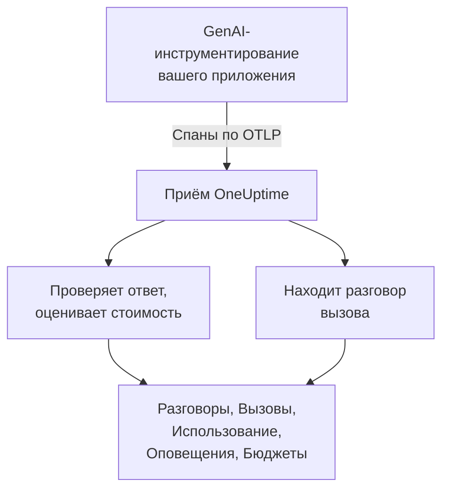
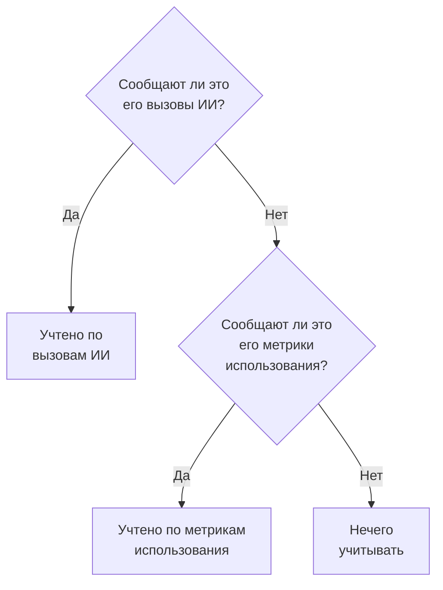

# Наблюдаемость ИИ / LLM

Читайте каждый разговор, который вёл ваш ИИ, воспроизводите его так, как он проходил, и узнавайте, когда ИИ отвечает плохо. OneUptime строит всё это на стандартном OpenTelemetry: если ваше приложение отправляет спаны по **семантическим конвенциям GenAI** (`gen_ai.*`), вы получаете разговоры, оповещения, использование и стоимость без проприетарного SDK.

:::cards
- [Три пути внутрь](#три-пути-внутрь): Ваши приложения, ваши аккаунты ИИ-провайдеров и ИИ-инструменты вашей компании.
- [Настройка](#настройка-в-пять-шагов): Пять шагов — от первого спана до помеченных ответов.
- [Воспроизведение разговора](#чтение-и-воспроизведение-разговора): Читайте чат так, как его видел человек, в том темпе, в каком он шёл.
- [Оповещения](#узнавайте-когда-ии-отвечает-плохо): Готовые оповещения об ответах с ошибкой, отказом, обрывом, пометкой или задержкой.
- [Контроль расходов](#кто-сколько-тратит): Стоимость по людям, командам, моделям и приложениям, с дневными бюджетами.
:::

## Как это работает

GenAI-инструментирование вашего приложения экспортирует каждый вызов модели как спан OpenTelemetry. Когда спан приходит, OneUptime читает его атрибуты `gen_ai.*`, проверяет ответ на проблемы, оценивает стоимость вызова и относит его к нужному разговору.



Откройте **Продукты → ИИ / LLM** в разделе **Наблюдаемость**. У продукта семь вкладок:

| Вкладка | Что показывает |
| --- | --- |
| **Разговоры** | Каждый разговор вашего ИИ; те, что требуют внимания, — первыми. Над списком: разговоры, ответы ИИ, сколько требуют внимания, стоимость и типичное время ответа. |
| **Вызовы** | Каждый вызов модели, эмбеддингов, агента и инструмента. Фильтруйте по сервису, провайдеру, модели, операции, человеку, команде или разговору; щёлкните вызов, чтобы открыть его в просмотрщике трассировок. |
| **Использование** | Вызовы, токены и стоимость за период с рейтингом по сотруднику, команде, модели, провайдеру или приложению; в **Аккаунты провайдеров** — сколько выставлено вашим подключённым аккаунтам. |
| **Оповещения** | Готовые оповещения на случай, когда ИИ отвечает плохо, и ваши мониторы ИИ / LLM. |
| **Бюджеты** | Дневные лимиты стоимости, публикуемые как метрики, по которым можно настроить оповещения. |
| **Цены** | Ваши собственные цены для моделей, которых нет во встроенном прайс-листе. |
| **Подключить** | Три пути внутрь, рядом друг с другом; каждый отмечается, как только заработает. |

В просмотрщике трассировок у спана каждого ИИ-вызова есть также вкладка **LLM**: провайдер, модель, токены, стоимость, параметры запроса, а также промпт и ответ.

## Три пути внутрь

Все три находятся в **Продукты → ИИ / LLM → Подключить**. Используйте один, два или все три: всё попадает в одни и те же **Разговоры**, **Использование**, **Оповещения** и **Бюджеты**.

| Путь внутрь | Что вы получаете | Как |
| --- | --- | --- |
| **Ваши приложения** | Каждый ИИ-вызов в момент, когда он происходит: разговор, человек, промпт и ответ, токены, стоимость и ошибки | OpenTelemetry из вашего кода или шлюза, за пять шагов |
| **Ваши аккаунты ИИ-провайдеров** | Сколько израсходовал и стоил каждый аккаунт OpenAI, Anthropic, Azure, Bedrock, Vertex AI или Cursor, по дням или по часам | Учётные данные только для чтения и никакого кода: [Аккаунты ИИ-провайдеров](/docs/telemetry/ai-provider-accounts) |
| **ИИ-инструменты вашей компании** | О чём ваши сотрудники спрашивают Claude Enterprise или Microsoft 365 Copilot, по людям | Учётные данные только для чтения и никакого кода: [ИИ-инструменты компании](/docs/telemetry/ai-company-tools) |

Аккаунты провайдеров и помощники по программированию приносят использование и стоимость, но никогда не вызовы: они заполняют **Использование**, а **Разговоры** и **Вызовы** остаются пустыми, пока ваши приложения не отправят свои ИИ-вызовы или не будет подключён ИИ-инструмент компании. [Проверьте, что поступает](#проверьте-что-поступает) показывает, какой путь что приносит.

## Проверьте, что поступает

**Проверка настройки** вверху страницы **Подключить** показывает, что приносит каждый путь прямо сейчас, а **Проверить снова** читает её заново. Пустой список **Разговоры** или **Вызовы** начинается с того же вывода и кнопки для следующего шага.

| Что она находит | Что делать |
| --- | --- |
| Ни одно приложение не отправило ИИ-вызов | [Отправляйте ИИ-вызовы](#отправляйте-ии-вызовы): подключённые аккаунты провайдеров приносят использование и стоимость по дням, но никогда не вызовы |
| Приложение обращается к API ИИ-провайдера, и ни одна инструментация GenAI этого не записывает | Добавьте её для языка приложения: проверка нашла HTTP-клиентские спаны приложения к `api.openai.com`, `*.openai.azure.com`, `*.services.ai.azure.com` или к API другого ИИ-провайдера |
| Вызовы приходят без промптов и ответов | [Записывайте, что было сказано](#записывайте-что-было-сказано), в спаны или как события логов |
| Промпты и ответы приходят как события логов | Ничего: разговоры их читают, а кто может читать логи приложения, может прочитать их и на странице **Логи** |
| Вызовы лежат чуть за пределами периода | Список предлагает период, в который попадает последний из них |
| Аккаунт провайдера не читает использования | Его строка называет последний день с использованием или первый прочитанный день; подключению Azure, которое не находит ресурсов, нужна роль Monitoring Reader там, где находятся ресурсы |

## Перед началом

- Проект OneUptime, в котором вы можете создать ключ приёма телеметрии.
- Приложение, вызывающее модель, и GenAI-инструментирование для его языка: **OpenLLMetry** (Traceloop), **OpenInference** (Arize), **Vercel AI SDK** или инструментирование OpenTelemetry для OpenAI, Anthropic и Gemini.

> [!TIP]
> Трафик к моделям, идущий через шлюз вроде LiteLLM или Portkey, можно экспортировать из шлюза, а не из каждого приложения: см. [Шлюзы ИИ](/docs/telemetry/ai-gateways). Об ассистентах для программирования, которыми пользуются ваши инженеры, см. [ИИ-ассистенты для программирования](/docs/telemetry/ai-coding-assistants).

## Настройка в пять шагов

Первого шага достаточно, чтобы увидеть вызовы. Каждый следующий шаг показывает больше.

:::steps
### Отправляйте ИИ-вызовы

В **Ваши приложения** на странице **Подключить** выберите ключ приёма или создайте его и скопируйте фрагмент для вашего языка с уже подставленными адресом и ключом. Или создайте ключ в разделе **Настройки проекта → Телеметрия и APM → Ключи приема** (это описано в [быстром старте OpenTelemetry](/docs/telemetry/open-telemetry#создайте-ключ-приёма)) и направьте инструментирование на OneUptime:

:::tabs
@tab Python
```bash
pip install traceloop-sdk opentelemetry-exporter-otlp
```

```python
from traceloop.sdk import Traceloop

Traceloop.init(
    app_name="my-ai-agent",
    api_endpoint="https://oneuptime.com/otlp",
    headers={"x-oneuptime-token": "YOUR_INGESTION_TOKEN"},
)
# Your OpenAI, Anthropic and LangChain calls are now traced.
```
@tab Node.js
```bash
npm install @traceloop/node-server-sdk
```

```typescript
import * as traceloop from "@traceloop/node-server-sdk";

traceloop.initialize({
  appName: "my-ai-agent",
  baseUrl: "https://oneuptime.com/otlp",
  headers: { "x-oneuptime-token": "YOUR_INGESTION_TOKEN" },
});
```
@tab .NET
```bash
dotnet add package OpenTelemetry.Extensions.Hosting
dotnet add package OpenTelemetry.Exporter.OpenTelemetryProtocol
```

```csharp
// Before any OpenAI or Azure OpenAI client is created:
AppContext.SetSwitch("OpenAI.Experimental.EnableOpenTelemetry", true);

builder.Services.AddOpenTelemetry()
    .WithTracing(tracing => tracing.AddSource("OpenAI.*").AddOtlpExporter())
    .WithMetrics(metrics => metrics.AddMeter("OpenAI.*").AddOtlpExporter());
```
@tab Java
```bash
curl -L -O https://github.com/open-telemetry/opentelemetry-java-instrumentation/releases/latest/download/opentelemetry-javaagent.jar
java -javaagent:opentelemetry-javaagent.jar -jar my-ai-agent.jar
```
@tab OpenTelemetry SDK
```bash
export OTEL_EXPORTER_OTLP_ENDPOINT="https://oneuptime.com/otlp"
export OTEL_EXPORTER_OTLP_HEADERS="x-oneuptime-token=YOUR_INGESTION_TOKEN"
export OTEL_EXPORTER_OTLP_PROTOCOL="http/protobuf"
export OTEL_SERVICE_NAME="my-ai-agent"
```
:::

Каждый из них одинаково трассирует вызовы OpenAI, Azure OpenAI и Microsoft Foundry. Для .NET и Java задайте также переменные с вкладки OpenTelemetry SDK: библиотеки OpenAI и Azure.AI.OpenAI трассируют свои вызовы, когда включён их переключатель, а Java-агент трассирует OpenAI Java SDK.

Размещаете OneUptime у себя? Используйте `https://YOUR-ONEUPTIME-HOST/otlp` вместо `https://oneuptime.com/otlp`. Вызовите модель один раз, и вызов появится на вкладке **Вызовы**.

### Записывайте, что было сказано

Разговор показывает, что спрашивали люди и что отвечал ИИ, только если ваше инструментирование это записывает. OpenLLMetry записывает промпты и ответы, если вы не задали `TRACELOOP_TRACE_CONTENT=false`. Инструментирование OpenTelemetry записывает их, только когда вы об этом просите:

```bash
export OTEL_INSTRUMENTATION_GENAI_CAPTURE_MESSAGE_CONTENT=true
```

Более новые версии инструментирования OpenTelemetry принимают `span_only`, `event_only` или `span_and_event` вместо `true`. Без записанного содержимого разговор всё равно показывает свои тайминги, стоимость и проблемы. Промпты могут содержать конфиденциальные данные: в разделе [Конфиденциальность и маскирование](#конфиденциальность-и-маскирование) показано, как замаскировать их до сохранения.

Разговоры читают то, что записано в спан вызова, и события логов, которые приложение отправляет с идентификаторами трассировки и спана вызова. Инструментация OpenTelemetry для Python записывает это в спан с `span_only`; инструментации для JavaScript и Java, а также для Python с `true` или `event_only` отправляют это как события логов, которые приходят в OneUptime вместе с логами приложения. SDK Azure AI Inference записывает это в спан с `AZURE_TRACING_GEN_AI_CONTENT_RECORDING_ENABLED=true`, Microsoft.Extensions.AI — с `EnableSensitiveData`; библиотека OpenAI для .NET ничего не записывает.

### Группируйте вызовы в разговоры

Чат-приложение делает один вызов модели за реплику. Задайте `gen_ai.conversation.id` (или `session.id`) равным идентификатору чата в каждом ИИ-вызове, и каждый чат будет показан как один разговор, сколько бы вызовов и трассировок он ни занял. С OpenLLMetry задайте его один раз на запрос:

```python
from traceloop.sdk import Traceloop

Traceloop.set_association_properties({
    "session_id": chat.id,
    "user_email": user.email,
})
```

С Vercel AI SDK передайте идентификатор чата как `experimental_telemetry: { metadata: { sessionId } }`. Вызовы без идентификатора разговора всё равно отображаются — по одному запросу (одной трассировке) за раз.

### Укажите, кто спрашивал

Задайте `user.id` или `user.email` в каждом ИИ-вызове (свойство ассоциации выше задаёт email). Тогда каждый разговор показывает, с кем он был, список можно искать по человеку, а вкладка **Использование** ранжирует расходы по сотрудникам. В разделе [Привязка к сотрудникам и командам](/docs/telemetry/ai-coding-assistants#привязка-к-сотрудникам-и-командам) перечислены все ключи идентичности, которые читает OneUptime.

### Помечайте плохие ответы

OneUptime проверяет каждый ответ по мере поступления и отмечает, что с ним пошло не так:

| Проблема | Что это значит | Как обнаруживается |
| --- | --- | --- |
| Ошибка | Вызов завершился ошибкой, поэтому ответа нет | Статус спана Error, `error.type` или причина завершения `error` |
| Отказ | ИИ отказался отвечать, или фильтр безопасности заблокировал ответ | Причина завершения из-за отказа или безопасности (`content_filter`, `refusal`, `SAFETY` и подобные), отказ в ответе или ответ, начинающийся со стандартного отказа на английском |
| Обрыв | Ответ остановился на лимите токенов | Причина завершения `length`, `max_tokens` или `MAX_TOKENS` |
| Пусто | Нет ни текста, ни вызова инструмента | Записанное содержимое, в котором ничего нет, или 0 выходных токенов |
| Помечен | Оценка, отправленная вашим приложением, признала ответ плохим | Событие `gen_ai.evaluation.result` |

Первые четыре ничего от вас не требуют. Чтобы пометить ответ, который отклоняет ваш guardrail, ваша оценка или кнопка «палец вниз», добавьте событие `gen_ai.evaluation.result` к спану ответа, пока спан открыт, со значением `gen_ai.evaluation.score.label`, равным `fail`:

```python
from opentelemetry import trace

trace.get_current_span().add_event(
    "gen_ai.evaluation.result",
    {
        "gen_ai.evaluation.name": "relevance",
        "gen_ai.evaluation.score.label": "fail",
        "gen_ai.evaluation.explanation": "The answer is about another product.",
    },
)
```

Метки вроде `incorrect`, `wrong`, `unhelpful`, `toxic`, `unsafe` и `hallucination` тоже считаются неудачными. OneUptime никогда не отправляет ваши разговоры другому ИИ для оценки: каждая проверка читает только то, что несёт сам вызов.
:::

## Чтение и воспроизведение разговора

Разговор открывается целиком, как чат-приложение показывает историю: слова человека справа, ответы ИИ слева с моделью, временем, токенами и стоимостью, вызовы инструментов между ними, а проблемы отмечены там, где они произошли. **Подробности** под ответом показывают, почему он остановился, его оценки и ссылку на вызов в разделе Трассировка.

Панель внизу воспроизводит разговор так, как его прожил человек:

| Элемент | Что делает |
| --- | --- |
| **Воспроизвести заново** | Воспроизводит разговор с первого сообщения в том темпе, в каком он шёл. «ИИ отвечает…» отсчитывает время, пока ответ в пути. Щёлкните время любого сообщения, чтобы воспроизвести с него. |
| **Пропускать ожидание** | Включено по умолчанию: сокращает любую паузу длиннее 3 секунд. |
| `1x` | Меняет скорость: 1x, 2x, 4x или 8x. |
| **K**, **J** или **←**, **L** или **→** | Воспроизведение или пауза, на сообщение назад, на сообщение вперёд. |

Адрес страницы хранит сообщение, на котором остановилось воспроизведение (`?step=`), поэтому ссылка, которой вы делитесь, открывается на этом моменте.

## Узнавайте, когда ИИ отвечает плохо

На вкладке **Оповещения** перечислены оповещения, которые нужны большинству ИИ-приложений. Выбор одного из них открывает **Создать монитор** с уже заполненными полями, и перед сохранением можно изменить что угодно:

| Оповещение | Когда сообщает | Важность |
| --- | --- | --- |
| Ответы идут не так | Более 5 % ответов за 15 минут завершаются ошибкой, отказом, обрывом, пусты или помечены | Предупреждение |
| Вызовы ИИ завершаются ошибкой | Более 10 % вызовов модели за 5 минут завершаются ошибкой | Critical |
| ИИ отказывается отвечать | Более 5 % ответов за 30 минут — отказы | Предупреждение |
| Ответы обрываются | 3 или более ответов за 30 минут останавливаются на лимите токенов | Предупреждение |
| Ответы помечаются | Оценка помечает ответ как плохой | Предупреждение |
| Ответы медленные | Более 10 % ответов за 15 минут занимают больше 30 секунд | Предупреждение |
| ИИ перестаёт отвечать | ИИ не даёт ответов 30 минут | Critical |

Оповещения по доле ответов также ждут как минимум 3 плохих ответа, поэтому один плохой ответ из двух никого не поднимает. Оповещение Critical получает самый высокий уровень важности оповещений вашего проекта, а оповещение Warning — следующий: High и Low в новом проекте.

Каждое оповещение — это монитор **ИИ / LLM**. Его настройки определяют, что считается плохим ответом (**Считать ответ плохим, когда он**, **Или длится дольше, чем (секунд)**), насколько далеко назад смотрит каждая проверка (**Временное окно**, по умолчанию 15 минут), какие **Приложения** он отслеживает и, в разделе **Дополнительные поля**, какую **Модель**. **Предпросмотр** показывает, что монитор насчитал бы прямо сейчас. Его критерии сравнивают три числа: **Плохие ответы ИИ (в %)**, **Плохие ответы ИИ** и **Ответы ИИ**.

Готовое оповещение создаёт оповещение, которое разрешается само, и показывает монитор как **Degraded**, пока ответы плохие. Его инцидент заполнен, но выключен: включите его, чтобы вызвать дежурного.

## Кто сколько тратит

Вкладка **Использование** показывает вызовы, токены и стоимость за период (последние 7 дней, если не выбрать другой) и таблицу 25 крупнейших по одной из пяти разбивок: **Сотрудник**, **Команда**, **Модель**, **Провайдер** и **Приложение / Сервис**. Вызовы, в которых никто не назван, учитываются в строке **Без привязки** и никогда не отбрасываются.

Это **Ваши вызовы ИИ**. Выберите вместо этого **Аккаунты провайдеров**, чтобы увидеть, сколько выставлено вашим подключённым аккаунтам OpenAI, Anthropic, Azure, Bedrock, Vertex AI и Cursor: см. [Аккаунты ИИ-провайдеров](/docs/telemetry/ai-provider-accounts#посмотреть-использование). Одно и другое никогда не складываются.

Люди и команды берутся из атрибутов идентичности вызова: см. [Привязка к сотрудникам и командам](/docs/telemetry/ai-coding-assistants#привязка-к-сотрудникам-и-командам).

### Каждый сервис учитывается по тому, что он отправляет

Использование ИИ приходит в двух видах. Спаны GenAI — это вызовы ИИ: по одному на вызов, с моделью, токенами и стоимостью. Метрики GenAI — это метрики использования: счётчики токенов и стоимости, которые большинство ассистентов для программирования отправляют вместо спанов, а некоторые инструментирования — рядом со своими спанами, для тех же вызовов. Сложение того и другого учло бы эти вызовы дважды, поэтому OneUptime учитывает каждый сервис по одному из них: его токены — по его вызовам ИИ, если они сообщают токены, а иначе по его метрикам использования, и его стоимость так же, отдельно. Так ассистент, отправляющий только метрики, учитывается рядом с приложениями, отправляющими спаны, в том же проекте, а приложение, отправляющее и то и другое, — один раз.



| Где | Из вызовов ИИ | Из метрик использования |
| --- | --- | --- |
| Входные и выходные токены | Токены каждого вызова модели, один раз | Токены сервиса, если его вызовы ИИ их не сообщают |
| Стоимость (USD) | Стоимость каждого вызова модели, один раз | Стоимость сервиса, если его вызовы ИИ её не сообщают; стоимость Codex в микро-USD пересчитывается в USD |
| Вызовы ИИ | Каждый вызов ИИ, как их перечисляет вкладка **Вызовы** | Никогда: метрика не считает вызовов |
| Таблицы **Сотрудник**, **Команда**, **Модель**, **Провайдер**, **Приложение / Сервис** | Вызовы, токены и стоимость каждой строки | Токены и стоимость сервисов, учитываемых по метрикам, под человеком, командой, моделью или провайдером, которых называют их точки |
| Разговоры | Строятся из вызовов ИИ | Никогда |

Под каждым числом вкладка «Использование» пишет, откуда оно взято: **Из вызовов ИИ**, **Из метрик использования** или **Из вызовов ИИ и метрик использования**, если одни сервисы отправили вызовы, а другие метрики. Строка таблицы, учтённая по метрикам использования, говорит об этом под своим именем, а её ячейка вызовов показывает `—`, если у неё нет вызовов ИИ, потому что у метрики нет деталей по вызовам; заголовок таблицы называет сервисы, учтённые по метрикам использования, кроме таблицы **Приложение / Сервис**, строки которой и есть сервисы. Метрика использования, которая не называет сервис, учитывается в строке **Неизвестный сервис** — это сервис, как любой другой. Если ваша роль может читать трассировки, но не метрики, метрики использования не учитываются, и таблица об этом сообщает.

Каждый вызов модели учитывается один раз. Запуск агента или спан фреймворка вокруг собственного спана SDK часто повторяет токены и стоимость вызовов внутри него: токены спана или его стоимость не учитываются везде, где их сообщает вызов внутри него, а запуск агента сохраняет свои собственные значения, если ни один вызов внутри него их не сообщает. Бюджеты и список **Разговоры** считают так же, а вкладка **Вызовы** показывает каждый спан с его собственными значениями.

Метрика токенов или стоимости — это счётчик. Точки дельта-счётчика складываются; накопительный счётчик, принятый по умолчанию в SDK OpenTelemetry, считает, на сколько он вырос за период, каждую серию отдельно, так что текущий итог, экспортируемый каждую минуту, учитывается один раз, а падение читается как перезапуск с 0, так же как его читает `increase()` в Prometheus. Бюджеты считают метрики GenAI так же.

## Сколько стоит вызов

Стоимость, которую сообщает ваше инструментирование (`gen_ai.usage.cost`), используется как есть, даже если она равна 0. Если стоимость не сообщается, OneUptime оценивает её при поступлении спана по числу токенов и встроенному прайс-листу для распространённых моделей OpenAI, Anthropic, Google Gemini, Mistral, DeepSeek, xAI, Cohere, Amazon Nova и Meta Llama. Сначала оценивается модель, которая ответила, затем запрошенная модель.

Каждая модель оценивается по собственной цене, в какой бы форме ни пришёл её идентификатор: `gpt-4o-2024-08-06` — это GPT-4o, а `claude-opus-4-5-20251101`, `us.anthropic.claude-opus-4-5-20251101-v1:0`, `claude-opus-4-5@20251101` и `anthropic/claude-opus-4.5` — всё это Claude Opus 4.5. Новый релиз никогда не получает цену более старой модели: модель, которой нет в списке, никогда не угадывается, и её стоимость остаётся 0, пока вы не зададите цену.

Токены, которые спан указывает как прочитанные из кэша промптов провайдера или записанные в него, оцениваются по тарифам кэша провайдера, запись — по 5-минутному тарифу, а модель, которая берёт больше за длинный промпт, например Claude Haiku 5.5 свыше 100 000 токенов, оценивается по длине промпта. Оценки — это прейскурантные цены: пакетные скидки, быстрые режимы и региональные надбавки не учитываются.

Чтобы задать цену модели самостоятельно (договорная ставка, дообученная модель или модель, которую вы размещаете сами), добавьте её на вкладке **Цены** в разделе **Собственные цены LLM**: **Префикс модели**, **Цена входа (USD за 1 млн токенов)** и **Цена выхода (USD за 1 млн токенов)**. Побеждает самый длинный совпавший префикс среди ваших цен и встроенного списка; при равенстве побеждает ваша цена. Ваша цена применяется к каждому входному токену, кэшированному или нет. Цена применяется к вызовам, пришедшим примерно через минуту после сохранения; уже сохранённые вызовы сохраняют свою стоимость.

## Дневные бюджеты стоимости

Бюджет отслеживает расходы за один день в USD по суткам UTC. Каждые 15 минут OneUptime суммирует расходы на ИИ за день (каждый сервис по его вызовам ИИ или по его метрикам стоимости, если его вызовы не сообщают стоимости), показывает их в бюджете и публикует две метрики. Бюджет, у которого **Учитывать расходы из** равно **Аккаунты провайдеров**, вместо этого считает, сколько выставлено вашим подключённым аккаунтам: см. [Аккаунты ИИ-провайдеров](/docs/telemetry/ai-provider-accounts#бюджеты-и-оповещения).

| Метрика | Что это |
| --- | --- |
| `oneuptime.llm.budget.spend.usd` | Расходы за день на текущий момент, в USD |
| `oneuptime.llm.budget.percent.used` | Расходы в процентах от дневного лимита |

Обе несут `oneuptime.llm.budget.id` и `oneuptime.llm.budget.name`, а также область бюджета, если она задана.

:::steps
### Создайте бюджет

На вкладке **Бюджеты** нажмите **Создать: LLM Cost Budget**. Задайте имя и **Дневной бюджет (USD)** и оставьте область пустой для всего проекта или выберите **Сервис (необязательно)**, **Провайдер LLM (необязательно)** или **Модель LLM (необязательно)**. Несколько бюджетов могут следить за разными областями.

### Настройте оповещение

Создайте [мониторинг метрик](/docs/monitor/metrics-monitor) по `oneuptime.llm.budget.percent.used` с фильтром по `oneuptime.llm.budget.id` (имя меняется при переименовании бюджета). Добавьте критерий `>= 80`, который поднимает предупреждение, и критерий `>= 100`, который поднимает критическое оповещение.

### Расширьте окно

Задайте скользящее окно монитора в 30 минут. Бюджет публикует одну точку каждые 15 минут, поэтому окно по умолчанию в 1 минуту не нашло бы ничего между двумя точками.
:::

Оповещение бюджета может также запустить рабочий процесс, который остановит вышедшего из-под контроля агента: см. [Предохранители для ИИ-агентов](/docs/telemetry/ai-agent-circuit-breaker).

## Дашборды и оповещения по метрикам

Метрики GenAI, такие как `gen_ai.client.token.usage` и `gen_ai.client.operation.duration`, приходят как обычные метрики OpenTelemetry. Выводите их на [дашборд](/docs/dashboards/index) или настраивайте по ним оповещения с помощью [мониторинга метрик](/docs/monitor/metrics-monitor), например когда p95 для `gen_ai.client.operation.duration` превышает порог, с группировкой по модели.

## Конфиденциальность и маскирование

ИИ-вызовы хранятся как спаны трассировок, поэтому к ним применяются **Правила очистки** и **Фильтры отбрасывания** трассировок: замаскируйте атрибут или отбросьте спан до сохранения. Оба находятся в разделе **Трассировка → Настройки**. Колонка email сотрудника очищается вместе с атрибутом, из которого она была прочитана, поэтому правило, маскирующее email, покрывает и её.

Промпты и ответы, отправленные как события логов, хранятся как логи, поэтому к ним применяются **Правила очистки** и **Фильтры отбрасывания** логов, в разделе **Логи → Настройки**: правило, маскирующее email в трассировках, не маскирует их в событиях логов. Разговор показывает их только тем, кто может читать и логи этого приложения, а они могут найти их и на странице **Логи**.

Разговоры читаются с тем же разрешением, что и трассировки: кто может читать трассировки проекта, может читать и его разговоры, и больше никто. Исключение — разговоры ИИ-инструмента компании: читать их могут только владельцы и администраторы проекта, если его подключение не задаёт иначе ([ИИ-инструменты компании](/docs/telemetry/ai-company-tools#конфиденциальность)).

## Атрибуты, которые читает OneUptime

OneUptime читает конвенции GenAI OpenTelemetry, а также варианты написания, которые используют OpenLLMetry, OpenInference, Vercel AI SDK и LiteLLM, поэтому распространённые библиотеки работают как есть. Для каждого значения побеждает первый ключ, который несёт спан:

| Значение | Ключи в порядке проверки |
| --- | --- |
| Провайдер | `gen_ai.system`, `gen_ai.provider.name`, `llm.system`, `llm.provider` |
| Операция | `gen_ai.operation.name`, `llm.request.type`, `openinference.span.kind` |
| Запрошенная модель | `gen_ai.request.model`, `llm.model_name`, `llm.request.model` |
| Ответившая модель | `gen_ai.response.model`, `llm.response.model` |
| Входные токены | `gen_ai.usage.input_tokens`, `gen_ai.usage.prompt_tokens`, `llm.token_count.prompt`, `llm.usage.prompt_tokens` |
| Выходные токены | `gen_ai.usage.output_tokens`, `gen_ai.usage.completion_tokens`, `llm.token_count.completion`, `llm.usage.completion_tokens` |
| Всего токенов | `gen_ai.usage.total_tokens`, `llm.token_count.total`, `llm.usage.total_tokens` |
| Токены, прочитанные из кэша | `gen_ai.usage.cache_read.input_tokens`, `gen_ai.usage.cache_read_input_tokens`, `llm.token_count.prompt_details.cache_read` |
| Токены, записанные в кэш | `gen_ai.usage.cache_write.input_tokens`, `gen_ai.usage.cache_creation.input_tokens`, `gen_ai.usage.cache_creation_input_tokens`, `llm.token_count.prompt_details.cache_write` |
| Стоимость (USD) | `gen_ai.usage.cost`, `gen_ai.usage.cost_usd`, `gen_ai.usage.total_cost`, `llm.usage.total_cost`, `gen_ai.cost.total_cost`, `litellm.cost.total` |
| Разговор | `gen_ai.conversation.id`, `session.id`, `langfuse.session.id`, `traceloop.association.properties.session_id`, `ai.telemetry.metadata.sessionId` |
| Агент | `gen_ai.agent.name`, `agent.name` |
| Инструмент | `gen_ai.tool.name`, `tool.name`, `ai.toolCall.name` |
| Причина завершения | `gen_ai.response.finish_reasons`, `gen_ai.response.finish_reason`, `llm.response.finish_reason`, `ai.response.finishReason` |
| Ошибка | `error.type` |

Спан считается ИИ-вызовом, когда несёт любое из этих значений или любой атрибут, начинающийся с `gen_ai.`, `llm.` или `traceloop.`. Если итог не сообщается, всего токенов — это входные плюс выходные. Ключи `gen_ai.usage.total_tokens` и `gen_ai.usage.cost` не входят в конвенции, которые не определяют ни один из них; OneUptime читает их, потому что их отправляют распространённые инструментирования.

Провайдер сохраняется под именем из соглашений, в каком бы написании он ни пришёл: `az.ai.openai` и `azure_openai` — как `azure.ai.openai`, `az.ai.inference` — как `azure.ai.inference`, `OpenAI` — как `openai`. Вызов, который SDK OpenAI называет `openai`, но отправляет на эндпоинт Azure OpenAI или Microsoft Foundry, что видно по его `server.address` или по `gen_ai.openai.api_base` у OpenLLMetry, сохраняется как `azure.ai.openai`. **Вызовы** показывают провайдера по имени, а вызов развёртывания Azure показывает запрошенное развёртывание и под ним модель, которая его обслужила и определяет его стоимость.

Входные токены включают и кэшированные, как их считают соглашения: если счётчики кэша спана больше его счётчика входа, счётчик входа их не учёл, и OneUptime добавляет их. Бета-трассировки Claude Code не отправляют ключей `gen_ai.usage.*`: на спане, который называет свою модель, OneUptime читает его `input_tokens`, `output_tokens`, `cache_read_tokens` и `cache_creation_tokens` и прибавляет оба счётчика кэша к `input_tokens`, который их не включает.

Ключи идентичности (кто сделал вызов и его команда) перечислены в разделе [Привязка к сотрудникам и командам](/docs/telemetry/ai-coding-assistants#привязка-к-сотрудникам-и-командам).

### Откуда читаются промпты и ответы

Представление разговора читает сообщения вызова в таком порядке:

- событие `gen_ai.client.inference.operation.details`;
- атрибуты `gen_ai.input.messages`, `gen_ai.output.messages` и `gen_ai.system_instructions`;
- старые события по ролям: `gen_ai.system.message`, `gen_ai.user.message`, `gen_ai.assistant.message`, `gen_ai.tool.message` и `gen_ai.choice`, с сообщением в `gen_ai.event.content`, когда их отправили SDK Azure AI Inference или Semantic Kernel;
- индексированные атрибуты: `gen_ai.prompt.N.content` и `gen_ai.completion.N.content` от OpenLLMetry, `llm.input_messages.N.message.content` и `llm.output_messages.N.message.content` от OpenInference;
- массивы сообщений в `gen_ai.prompt`, `gen_ai.completion`, `ai.prompt.messages`, `ai.response.text`, `input.value` и `output.value`.

Если в спане вызова нет промпта или ответа, они читаются из записей логов с идентификаторами трассировки и спана вызова: это те же события, отправленные по сигналу логов, с именем в атрибуте `event.name` записи или в её поле имени события. Запись с идентификатором трассировки, но без идентификатора спана относится к единственному вызову модели в трассировке или к вызову, во время которого она была отправлена, и пропускается, если это не один вызов. Записанное в спане имеет приоритет, поэтому вызов, записанный обоими способами, показывает каждое сообщение один раз.

## Устранение неполадок

:::details Аккаунты провайдеров подключены, но Разговоры и Вызовы пусты
Аккаунт провайдера приносит то, сколько он использовал и стоил, по дням, но никогда не вызов или разговор: они приходят из ваших приложений. **Проверка настройки** на странице **Подключить** показывает, отправляет ли какое-либо приложение ИИ-вызовы; отправьте их, как показано в разделе [Отправляйте ИИ-вызовы](#отправляйте-ии-вызовы).
:::

:::details Вызовы приходят, но ни один разговор не показывает текст
Ваше инструментирование не записывает содержимое или отправляет его как события логов, а логи приложения не доходят до OneUptime. Включите запись, как показано в разделе [Записывайте, что было сказано](#записывайте-что-было-сказано), и отправляйте логи вместе с трассировками; вызовы, сделанные до этого, останутся без текста.
:::

:::details Каждый вызов чата отображается как отдельный разговор
Вызовы не несут идентификатора разговора. Задайте `gen_ai.conversation.id` или `session.id` в каждом вызове чата, как показано в разделе [Группируйте вызовы в разговоры](#группируйте-вызовы-в-разговоры).
:::

:::details Вызовы показывают токены, но стоят $0
Модели нет во встроенном прайс-листе, или спан не называет модель. Добавьте цены модели на вкладке **Цены**; вызовы, пришедшие после этого, получат стоимость. Вызов Azure OpenAI получает стоимость модели, которая его обслужила, `gen_ai.response.model`: если спан её не называет, задайте цену для имени развёртывания.
:::

:::details Вкладка Использование пишет «Из метрик использования» и показывает `—` для вызовов
Значения приходят от сервиса, который отправляет метрики и ни одного спана GenAI, например от ассистента для программирования. Метрика несёт стоимость и токены, но не детали по вызовам, поэтому ячейки вызовов остаются пустыми. См. [Каждый сервис учитывается по тому, что он отправляет](#каждый-сервис-учитывается-по-тому-что-он-отправляет).
:::

:::details Стоимость на вкладке Использование меньше суммы стоимостей на вкладке Вызовы
Некоторые спаны повторяют токены и стоимость вызовов внутри них, например запуск агента или спан фреймворка вокруг собственного спана SDK. Вкладка **Вызовы** показывает каждый спан с его собственными значениями, а вкладка «Использование», бюджеты и список **Разговоры** учитывают каждый вызов модели один раз.
:::

:::details Монитор бюджета переключается между двумя состояниями
Скользящее окно монитора короче 15 минут, поэтому иногда он не находит ни одной точки. Задайте 30 минут.
:::

## Дальнейшие шаги

:::cards
- [Аккаунты ИИ-провайдеров](/docs/telemetry/ai-provider-accounts): Использование и стоимость ваших аккаунтов OpenAI, Anthropic, Azure, Bedrock, Vertex AI и Cursor без кода.
- [ИИ-инструменты компании](/docs/telemetry/ai-company-tools): О чём ваши сотрудники спрашивают Claude Enterprise и Microsoft 365 Copilot.
- [ИИ-ассистенты для программирования](/docs/telemetry/ai-coding-assistants): Расходы по инженерам для Claude Code, Cursor, Codex, Gemini CLI и Copilot.
- [Шлюзы ИИ](/docs/telemetry/ai-gateways): Трассируйте вызовы моделей из всех приложений через один шлюз LiteLLM или Portkey.
- [Предохранители для ИИ-агентов](/docs/telemetry/ai-agent-circuit-breaker): Остановите вышедшего из-под контроля агента, когда срабатывает оповещение бюджета.
- [OpenTelemetry](/docs/telemetry/open-telemetry): Адреса, ключи приёма и ограничения для каждого сигнала.
:::
