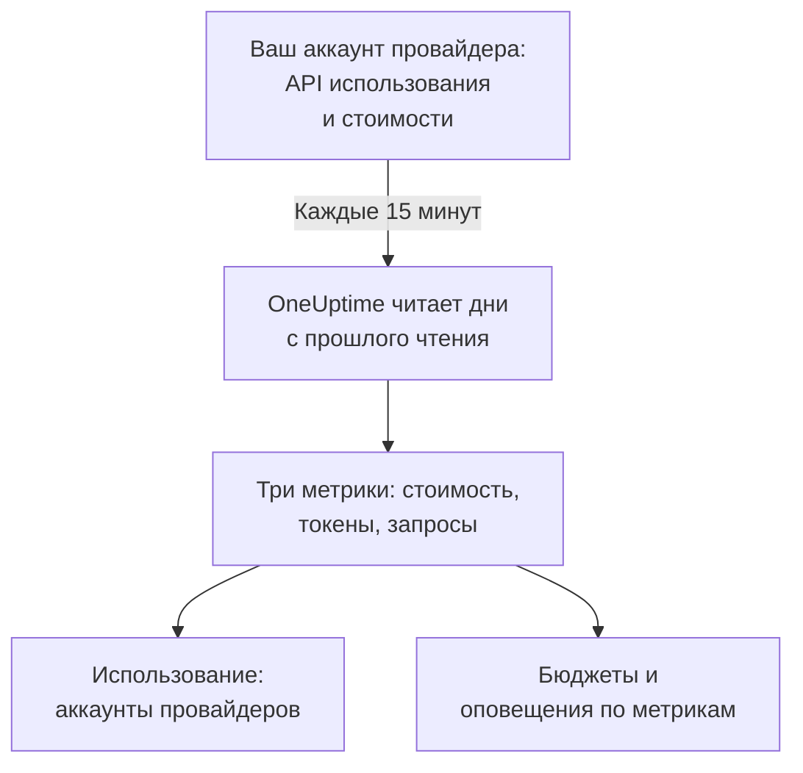

# Аккаунты ИИ-провайдеров

Смотрите, сколько израсходовали ваши аккаунты ИИ-провайдеров и во что это обошлось, ничего не меняя в приложениях. Подключите аккаунт OpenAI, Anthropic, Azure OpenAI и Microsoft Foundry, Amazon Bedrock или Google Vertex AI с учётными данными, которые могут только читать, и OneUptime будет каждые 15 минут считывать его использование в **Использование**, **Бюджеты** и метрики, по которым можно настроить оповещения.

:::cards
- [Подключить аккаунт](#подключить-аккаунт): Выберите провайдера, вставьте учётные данные, проверьте их и подключите.
- [Что даёт каждый провайдер](#что-даёт-каждый-провайдер): Стоимость, токены и запросы, и как каждый провайдер их группирует.
- [Посмотреть использование](#посмотреть-использование): По модели, человеку, проекту или ресурсу, API-ключу и подключению.
- [Бюджеты и оповещения](#бюджеты-и-оповещения): Дневной бюджет по счёту и оповещения по метрикам.
:::

## Как это работает

Каждые 15 минут OneUptime запрашивает у каждого подключённого аккаунта его использование по суткам UTC и сохраняет его как три метрики собственного сервиса подключения. Каждое чтение берёт дни с прошлого чтения и заново последние 3 дня, включая сегодняшний, потому что провайдеры продолжают дополнять сегодняшний день и исправляют только что прошедшие.

Использование аккаунта — это то, что ему выставили в счёте, день за днём. В нём нет разговоров, промптов или ответов: для этого отправляйте ИИ-вызовы ваших приложений, как показано в [Наблюдаемость ИИ / LLM](/docs/telemetry/ai-llm-observability). Одно хранится отдельно от другого, поэтому ничего не учитывается дважды.

## Прежде чем начать

- Роль Project Owner или Project Admin. Только они могут подключить, изменить или удалить аккаунт; все, кто читает телеметрию проекта, видят подключения и использование.
- Учётные данные аккаунта от того, кто им управляет. Раздел каждого провайдера ниже говорит, какие нужны и где их создать.
- Ничего не нужно устанавливать: OneUptime вызывает API провайдера со своих серверов.

## Подключить аккаунт

:::steps
### Откройте «Подключить»

Откройте **Продукты → AI / LLM → Подключить**. В **Ваши аккаунты ИИ-провайдеров** нажмите на плитку провайдера.

### Вставьте учётные данные

В **Учётные данные** заполните то, что просит провайдер. Секреты хранятся в зашифрованном виде и больше никогда не показываются ни в Dashboard, ни через API. **Имя** и настройки, которые почти никто не меняет, находятся в **Дополнительные поля**.

### Проверьте их

В **Тест** нажмите **Проверить подключение**. OneUptime читает использование за последние 7 дней и показывает, что нашёл: стоимость, токены, запросы, модели, людей, ключи и проекты. Ничего не сохраняется, пока вы не подключите.

### Подключите

Нажмите **Подключить**. Первое чтение начинается в течение минуты и приносит последние 30 дней.
:::

Подключённые аккаунты перечислены под плитками со своими **Статус** и **Последнее чтение**. **Прочитать сейчас** читает сразу, **Тест** заново проверяет сохранённые настройки, **Выключить** прекращает чтение и сохраняет прочитанное, а **Редактировать** меняет настройки: оставленный пустым секрет сохраняет прежний. **View error** показывает, почему чтение не удалось, без каких-либо секретов.

## Что даёт каждый провайдер

| Провайдер | Стоимость | Группировка | Учётные данные |
| --- | --- | --- | --- |
| OpenAI | Сообщает OpenAI | Проект, API-ключ, человек и модель | Ключ администратора |
| Anthropic | Сообщает Anthropic | Workspace, API-ключ, человек и модель | Ключ администратора |
| Azure OpenAI и Microsoft Foundry | Оценка по токенам | Ресурс и модель | Приложение с ролью Monitoring Reader |
| Amazon Bedrock | Оценка по токенам | Регион и модель | Ключ доступа, читающий CloudWatch |
| Google Vertex AI | Оценка по токенам | Регион и модель | Сервисный аккаунт с ролью Monitoring Viewer |

Все провайдеры, кроме Anthropic, считают и запросы: в отчёте об использовании Anthropic их нет. Оценочная стоимость использует прайс-лист из [Сколько стоит вызов](/docs/telemetry/ai-llm-observability#сколько-стоит-вызов) и ваши собственные цены из **Цены** и помечается как оценка. У модели, которой нет в прайс-листе, нет стоимости, пока вы не зададите для неё цену там.

Ни одни из этих учётных данных не могут вызвать модель: каждые читают только использование, стоимость или метрики.

## OpenAI

OneUptime читает вашу организацию OpenAI с ключом администратора: использование completions и embeddings по дням, моделям, проектам, API-ключам и людям, а также затраты за каждый день по проектам и статьям. Статья затрат делится между ключами и людьми, которые использовали её модель, так что у строки человека тоже есть стоимость. Названия проектов и ключей и адреса электронной почты людей заменяют идентификаторы OpenAI.

:::steps
### Создайте ключ администратора OpenAI

В панели OpenAI откройте Settings, Organization, Admin keys и создайте ключ. Это могут только владельцы организации. Он начинается с `sk-admin-`.

### Подключите OpenAI

Вставьте ключ в **Ключ администратора**.
:::

## Anthropic

OneUptime читает вашу организацию Claude API с ключом администратора: отчёт об использовании сообщений по дням, моделям, workspace, API-ключам и людям и отчёт о затратах по workspace и статьям, разделённый так же. Claude Code, используемый с ключами организации или входами через Console, тоже есть в этих отчётах — под человеком или ключом, который его использовал.

:::steps
### Создайте ключ администратора Anthropic

В Claude Console откройте Settings, Admin keys и создайте ключ. Это могут только администраторы организации. Он начинается с `sk-ant-admin01-`.

### Подключите Anthropic

Вставьте ключ в **Ключ администратора**.
:::

## Azure OpenAI и Microsoft Foundry

OneUptime читает каждый ресурс Azure OpenAI и Foundry подписки из Azure Monitor: токены и запросы по дням, ресурсам и моделям. Azure Monitor считает токены, а не деньги, и не называет ни человека, ни ключ, поэтому стоимость — это оценка OneUptime, а человек и ключ остаются пустыми.

:::steps
### Зарегистрируйте приложение

В Microsoft Entra ID зарегистрируйте приложение и создайте для него секрет клиента.

### Разрешите ему читать метрики

В подписке назначьте приложению роль Monitoring Reader.

### Подключите Azure

Заполните **Идентификатор каталога (клиента)**, **Идентификатор приложения (клиента)**, **Идентификатор подписки** и **Секрет клиента**. Для Azure Government измените **Облако** в **Дополнительные поля**.
:::

## Amazon Bedrock

OneUptime читает метрики CloudWatch `AWS/Bedrock` каждого указанного вами региона: входные, выходные и кешированные токены и вызовы по дням и моделям. CloudWatch считает токены, а не деньги, и не называет ни человека, ни ключ: стоимость — это оценка OneUptime, а каждый регион показан как проект.

:::steps
### Создайте ключ доступа

Создайте пользователя или роль IAM, политика которых разрешает `cloudwatch:GetMetricData` и `cloudwatch:ListMetrics`, и ключ доступа для них.

### Подключите Bedrock

Заполните **Идентификатор ключа доступа**, **Секретный ключ доступа** и **Регионы** через запятую: `us-east-1`, если вы это не измените.
:::

## Google Vertex AI

OneUptime читает метрики Cloud Monitoring, которые Vertex AI публикует для своих моделей — Gemini и партнёрских моделей, например Claude: входные и выходные токены и вызовы по дням, регионам и моделям. Cloud Monitoring считает токены, а не деньги, и не называет ни человека, ни ключ: стоимость — это оценка OneUptime.

:::steps
### Создайте сервисный аккаунт

В проекте создайте сервисный аккаунт с ролью Monitoring Viewer и JSON-ключ для него.

### Подключите Vertex AI

Заполните **Идентификатор проекта** и вставьте весь файл ключа в **Ключ сервисного аккаунта (JSON)**.
:::

## Посмотреть использование

Откройте **Использование** и выберите **Аккаунты провайдеров**. Там видны стоимость, токены и запросы, о которых ваши аккаунты сообщили за период, упорядоченные по **Модель**, **Человек**, **Провайдер**, **Проект или ресурс**, **API-ключ** или **Подключение**. Период начинается с полуночи UTC своего первого дня, потому что провайдеры сообщают целые дни.

**Аккаунты провайдеров** и **Ваши вызовы ИИ** никогда не складываются. Вызов, который ваше приложение делает с ключом подключённого аккаунта, есть и там и там, поэтому при сложении он учёлся бы дважды.

## Бюджеты и оповещения

Бюджет считает одно или другое. В **Бюджеты** создайте бюджет и установите **Учитывать расходы из** в **Аккаунты провайдеров**: он считает, сколько подключённым аккаунтам выставлено за сутки UTC, с ограничением по **Провайдер LLM (необязательно)** и **Модель LLM (необязательно)**, если вы их задаёте. Провайдеры сообщают использование за день с опозданием от минут до часов, поэтому для оповещений в пределах минут лучше задайте бюджет на **Ваши вызовы ИИ**.

Использование каждого аккаунта хранится как три метрики, которые можно вывести на [дашборд](/docs/dashboards/index) или отслеживать с помощью [Мониторинга метрик](/docs/monitor/metrics-monitor):

| Метрика | Что это |
| --- | --- |
| `oneuptime.llm.provider.cost` | Стоимость за день в USD |
| `oneuptime.llm.provider.tokens` | Токены за день по `gen_ai.token.type`: `input` (включая кешированные токены), `output`, `cache_read` и `cache_write` |
| `oneuptime.llm.provider.requests` | Запросы за день |

Каждая точка помечена началом своих суток UTC. Она несёт `oneuptime.llm.connection.id` и `oneuptime.llm.connection.name`, а также то, что называет провайдер: `gen_ai.provider.name`, `gen_ai.request.model`, `user.email`, `oneuptime.llm.provider.project` и `oneuptime.llm.provider.api_key`. Оценочная стоимость несёт `oneuptime.llm.cost.estimated`.

## Когда происходит чтение

| Чтение | Когда |
| --- | --- |
| Первое | В течение минуты после подключения, на 30 дней назад |
| Следующие | Каждые 15 минут |
| После отказа в ключе или разрешении | Через 60 минут |
| После любой другой ошибки | Через 15 минут |
| Выключено | Никогда, пока его снова не включат |

Тариф без функций телеметрии ничего не читает. Удаление подключения останавливает его чтение и сохраняет прочитанное, пока хранение сервиса его не удалит.

## Почему у OneUptime нет собственного шлюза

OneUptime читает ваши аккаунты; он никогда не стоит между вашими приложениями и провайдерами. Прокси хранил бы ваши ключи провайдеров и добавлял бы лишний шаг к каждому вызову модели из ваших приложений. Если ваш трафик к моделям уже идёт через LiteLLM, Portkey или OpenRouter, отправляйте трассировки шлюза в OneUptime, как показано в [Шлюзы ИИ](/docs/telemetry/ai-gateways), а аккаунт подключите ради его счёта.

## Устранение неполадок

:::details Проверка говорит, что ключ или секрет не принят
Проверьте, что скопировали его целиком, что он не отозван и что это тот тип, который просит провайдер: ключ администратора OpenAI или Anthropic, а не ключ проекта или API.
:::

:::details Учётные данные работают, но не могут читать то, что нужно подключению
Назначьте им роль, которую эта страница называет для провайдера: Monitoring Reader в подписке Azure, два действия CloudWatch в AWS, Monitoring Viewer в проекте Google Cloud.
:::

:::details Проверка проходит, но за сегодня ничего нет
Провайдеры сообщают использование за день через минуты или часы и исправляют его ещё день-два. Следующие чтения его принесут.
:::

:::details Стоимость отличается от счёта
Сообщённая стоимость — это сумма провайдера до налогов, кредитов и скидок. Оценочная стоимость — это токены по прайс-листу или по вашим собственным ценам из **Цены**.
:::

## Дальнейшие шаги

:::cards
- [Наблюдаемость ИИ / LLM](/docs/telemetry/ai-llm-observability): Разговоры, оповещения и стоимость ИИ-вызовов ваших собственных приложений.
- [ИИ-инструменты компании](/docs/telemetry/ai-company-tools): Что ваши сотрудники спрашивают у Claude Enterprise и Microsoft 365 Copilot.
- [Шлюзы ИИ](/docs/telemetry/ai-gateways): Трассируйте каждый вызов модели через LiteLLM, Portkey или OpenRouter.
- [Мониторинг метрик](/docs/monitor/metrics-monitor): Оповещения по метрикам провайдеров.
:::
