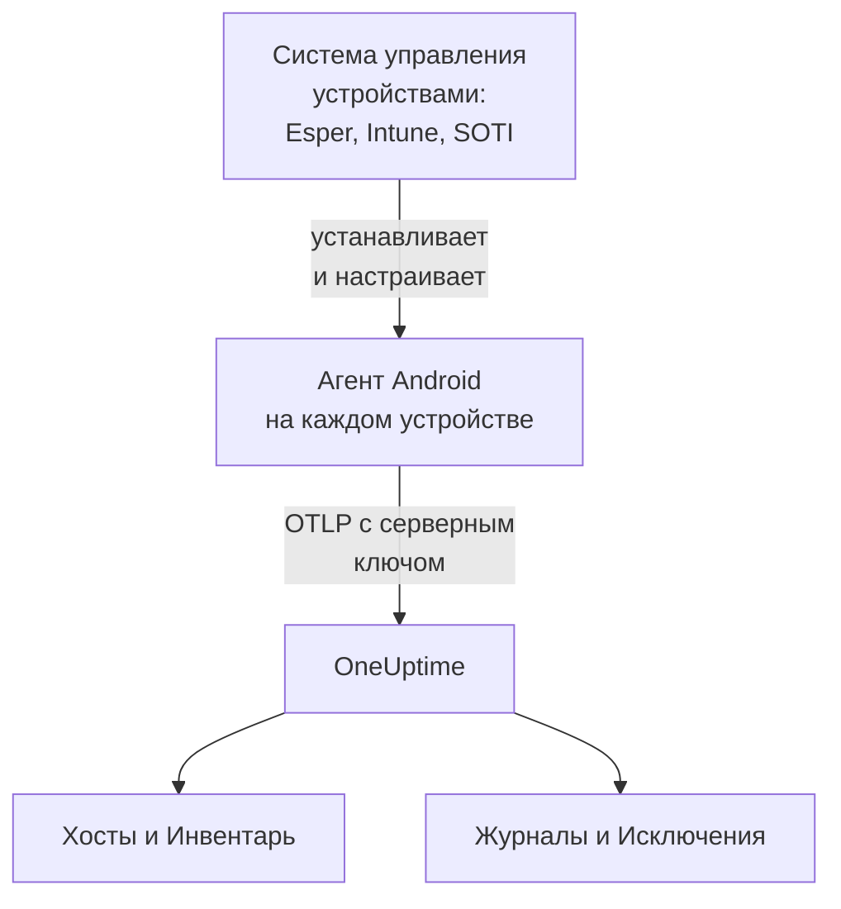

# Агент Android

Агент Android от OneUptime передаёт в OneUptime данные с Android-устройства, которое принадлежит вашей организации, например с киоска для заказов, POS-терминала, ручного терминала или плеера цифровых вывесок: показатели памяти, хранилища, сети, батареи и температуры, сведения о перезагрузках и установленных приложениях, а также сбои и журналы приложений на устройстве. Ваша система управления устройствами устанавливает и настраивает агент сразу на всём парке. Каждое устройство становится хостом в разделе **Хосты** и элементом в разделе **Инвентарь** рядом с вашими серверами и машинами с Windows.

:::cards
- [Когда использовать агент](#агент-или-инструментация-приложения): Агент видит устройство, а инструментация приложения — ваше приложение.
- [Развёртывание через Esper](#развёртывание-через-esper): Загрузите APK, передайте настройки и один раз запустите агент.
- [Настройки](#настройки): Все ключи управляемой конфигурации агента.
- [Чтение журналов других приложений](#чтение-журналов-других-приложений): Один раз выдайте READ_LOGS через adb или систему управления устройствами.
- [Сеансы сбора журналов](#сеансы-сбора-журналов): Журналы всех приложений в течение некоторого времени с разрешения человека у устройства.
:::

## Как это работает

Агент — это небольшое приложение, которое работает как служба переднего плана. Каждую минуту он считывает показатели состояния устройства и отправляет их в ваш OneUptime по OTLP с ключом приёма типа **Сервер**, а вместе с ними — перезагрузки, установленные приложения и журналы устройства. Агент сам запускается при загрузке устройства, хранит собранное на устройстве, пока нет сети, и отправляет, как только сеть вернётся. Он никогда не мешает устройству переходить в спящий режим и сжимает всё, что отправляет.



## Агент или инструментация приложения

| | [OpenTelemetry Android](/docs/rum/android-setup) в вашем приложении | Агент Android |
| --- | --- | --- |
| Что он видит | Ваше приложение: его сбои, ANR, экраны, сеансы, запросы и рабочие процессы | Устройство: память, хранилище, сеть, батарея, перезагрузки, установленные приложения, а также сбои и ANR всех приложений |
| Где это видно | **Мониторинг реальных пользователей**, **Трассировки** и **Исключения** | **Хосты**, **Инвентарь**, **Журналы** и **Исключения** |
| Как его установить | В коде вашего приложения | Как приложение, через систему управления устройствами |

На собственных устройствах используйте оба варианта и дайте устройству одно и то же имя в обоих: в настройке агента `device_name` и в `host.name`, который задаёт ваше приложение. Тогда устройство будет одним элементом в разделе **Инвентарь**, где телеметрия приложения и телеметрия устройства собраны вместе.

## Перед началом

- Устройства с Android 7.0 или новее, подключённые к системе управления устройствами, которая поддерживает управляемые конфигурации Android: Esper, Microsoft Intune, Workspace ONE, SOTI и другие системы управления устройствами с поддержкой Android Enterprise. Для одного устройства достаточно adb.
- Ключ приёма типа **Сервер**, созданный в **Настройки проекта → Телеметрия и APM → Ключи приёма** кнопкой **Создать ключ приёма**.
- Сам агент: файл `oneuptime-android-agent.apk`, прикреплённый к каждому [выпуску OneUptime](https://github.com/OneUptime/oneuptime/releases/latest).
- Исходящий HTTPS с устройств на ваш URL OneUptime. Агент не принимает URL, который не начинается с `https://`, ведь каждый запрос несёт ключ приёма.

## Развёртывание через Esper

:::steps
### Загрузите APK

В консоли Esper загрузите `oneuptime-android-agent.apk` в **App Library** и добавьте его в blueprint устройств, которые нужно отслеживать.

### Передайте настройки

В blueprint откройте **Managed Configuration** агента и вставьте его настройки. Esper подставляет значения вместо заполнителей на каждом устройстве с Esper Agent 8.00.0764 или новее:

```json title="Managed configuration"
{
  "oneuptime_url": "https://oneuptime.com",
  "oneuptime_token": "YOUR_TELEMETRY_INGESTION_TOKEN",
  "device_name": "${esper.deviceName}",
  "device_serial": "${esper.serialNumber}",
  "device_type": "kiosk",
  "labels": "region=emea"
}
```

Если вы размещаете OneUptime сами, укажите свой URL в `oneuptime_url`. Затем выполните для устройств Converge, чтобы они прочитали новые настройки.

### Запустите агент один раз

Android не запускает только что установленное приложение при загрузке устройства, пока его хотя бы раз не откроют. Включите для агента **Launch on Start** в blueprint в режиме нескольких приложений (Multi-App mode) или откройте агент один раз на каждом устройстве. После этого он будет сам запускаться при каждой загрузке устройства и после каждого обновления.

### Найдите устройства в OneUptime

В течение минуты каждое устройство появится в разделе **Хосты** под именем из своего `device_name`, а также в разделе **Инвентарь**. Экран самого агента на устройстве показывает, передаёт ли он данные, а если нет, то что ему мешает.
:::

Другие системы управления устройствами работают так же: добавьте APK как бизнес-приложение или внутреннее приложение, задайте те же ключи в его конфигурации приложения и откройте его один раз на каждом устройстве.

## Настройки

Агент читает эти ключи из своей управляемой конфигурации. Устройство без неё можно настроить на экране самого агента, указав URL, ключ приёма и имя устройства. Введённый там ключ хранится в зашифрованном виде с помощью Android Keystore.

| Ключ | Что задаёт | По умолчанию |
| --- | --- | --- |
| `oneuptime_url` | URL вашего OneUptime | `https://oneuptime.com` |
| `oneuptime_token` | Ключ приёма типа **Сервер** | Нет: без него агент ничего не отправляет |
| `device_name` | Имя устройства в разделах **Хосты** и **Инвентарь**, которое служит там его идентификатором | Модель устройства и начало его Android ID |
| `device_serial` | Серийный номер, который Android не передаёт приложениям начиная с Android 10 | Нет |
| `device_type` | Что это за устройство, например киоск, POS-терминал или ручной терминал | `Android device` |
| `device_location` | Где находится устройство, например номер магазина | Нет |
| `labels` | Метки для хоста в виде пар `name=value`, разделённых запятыми | Нет |
| `collection_interval_seconds` | Как часто агент отправляет данные: от 30 до 600 секунд | `60` |
| `logcat_enabled` | Отправлять ли то, что агент читает из Logcat | `true` |
| `logcat_min_level` | Минимальный уровень важности строк Logcat, которые агент отправляет на Android 12 и более ранних версиях: `verbose`, `debug`, `info`, `warn`, `error` или `fatal` | `warn` |
| `installed_apps_enabled` | Отправлять ли список установленных приложений | `true` |

Заполнитель, который система управления устройствами не подставила, например `${esper.deviceName}`, пришедший как есть, игнорируется, и экран агента сообщает об этом. Не меняйте `device_name`, когда устройство уже передаёт данные: новое имя означает новый хост.

Экран агента, его уведомления, а также названия и описания этих ключей, которые показывает система управления устройствами, выводятся на языке устройства — на любом из языков, на которых работает панель управления OneUptime.

## Чтение журналов других приложений

Android позволяет приложению читать журналы других приложений только с разрешением READ_LOGS, а выдать это разрешение может только adb: ни само приложение, ни политика устройства этого не могут. Выдайте его один раз на каждом устройстве, и оно сохранится после перезагрузок и обновлений:

```bash
adb shell pm grant com.oneuptime.androidagent android.permission.READ_LOGS
```

В Esper выполните эту команду через **Secure Remote ADB**: включите для устройства доступ по ADB, подключитесь командой `espercli secureadb connect --device DEVICE_ID`, а затем выполните команду. Когда разрешение выдано, Android перезапускает агент, и тот сразу начинает чтение.

Что агент после этого читает, зависит от версии Android:

- Android 13 и новее: сбои и ANR всех приложений. Android показывает строки журналов других приложений только приложению, открытому на экране, и только после того, как человек у устройства это разрешит, поэтому агент, работающий в фоне, прочитать их не может. Чтобы получить их на время, запросите [сеанс сбора журналов](#сеансы-сбора-журналов).
- Android 12 и более ранние версии: сбои и ANR всех приложений, а также строки журналов всех приложений с уровнем `logcat_min_level` и выше.

Без READ_LOGS агент сообщает обо всём остальном, а его экран и журналы устройства подсказывают, как выдать это разрешение.

### Трассировки стека при сбоях и причины перезагрузок

Android хранит полный отчёт о каждом сбое приложения, нативном сбое и ANR, а также причину каждой перезагрузки в своём DropBox. Агент читает их для всех приложений, когда у него есть READ_LOGS и доступ к истории использования, а на Android 15 и новее — ещё и READ_DROPBOX_DATA. Выдайте их один раз через adb, как и READ_LOGS:

```bash
adb shell pm grant com.oneuptime.androidagent android.permission.READ_DROPBOX_DATA
adb shell appops set com.oneuptime.androidagent GET_USAGE_STATS allow
```

Первая команда нужна для Android 15 и новее; доступ к истории использования можно также включить на устройстве в разделе **Настройки → Доступ к истории использования**. Политика устройства не может их выдать, а экран агента перечисляет команды, которые ещё нужно выполнить. С ними у каждого сбоя в разделе **Исключения** есть полная трассировка стека, у нативного сбоя — его сигнал и библиотека, в которой он произошёл, у ANR — стек главного потока, а у перезагрузки в разделе **Журналы** — причина, которую указывает Android. Номера карт, адреса электронной почты, токены и пароли в том, что читает агент, перед отправкой заменяются на `[card number]`, `[email]`, `[token]` и `[redacted]`.

### Выдача разрешений на всём парке устройств

В каждом отчёте агент указывает, каких из этих разрешений у него ещё нет. Чтобы получить список устройств, которым они нужны, откройте **Инвентарь**, затем **Все элементы**, и задайте фильтр **Права доступа агента**: **Отсутствует**. Включите столбец **Права доступа агента**, чтобы увидеть, чего не хватает каждому устройству, и экспортируйте список в CSV.

Политика устройства не может их выдать: READ_LOGS и READ_DROPBOX_DATA — это разрешения, которые может дать только adb, система или производитель устройства, а доступ к истории использования задаётся через adb или самим человеком у устройства. Что предлагает Esper и почему ничто из этого их не выдаёт:

- **Разрешения приложений**, заданные в blueprint или командой `SET_APP_PERMISSION`, проходят через API владельца устройства Android, который выдаёт только те разрешения, о которых приложение спрашивает человека у устройства. Эти разрешения Android выдать отказывается.
- **Управляемая конфигурация** задаёт собственные настройки агента, но никогда не разрешения Android.
- **Run Shell Script** работает на устройствах с Linux и Windows, а не на устройствах Android.
- **Secure Remote ADB** подключается к одному устройству за раз с компьютера, на котором работает `espercli`. На устройствах Esper Foundation человек у устройства для этого не нужен. На других устройствах кто-то у устройства принимает запрос **Allow USB debugging?** при первом подключении.

Поэтому выдавайте их через adb:

- **Перед отправкой устройства** — когда его готовят к работе через USB-кабель. Этот код выдаёт все три разрешения на каждом устройстве, подключённом к компьютеру:

  ```bash
  for serial in $(adb devices | awk 'NR > 1 && $2 == "device" { print $1 }'); do
    adb -s "$serial" shell pm grant com.oneuptime.androidagent android.permission.READ_LOGS
    adb -s "$serial" shell pm grant com.oneuptime.androidagent android.permission.READ_DROPBOX_DATA
    adb -s "$serial" shell appops set com.oneuptime.androidagent GET_USAGE_STATS allow
  done
  ```

  На Android 14 и более ранних версиях вторая команда сообщает, что разрешение неизвестно: такому устройству оно не нужно.
- **На устройстве в эксплуатации** — через Secure Remote ADB, по одному устройству из списка **Отсутствует** за раз.
- **Только доступ к истории использования** может включить сам человек у устройства — в разделе **Настройки → Доступ к истории использования** или кнопкой на экране агента.

Следующий отчёт устройства, который приходит в течение минуты, убирает его из списка **Отсутствует**.

### Загрузка CPU

Начиная с Android 8 система не даёт приложениям данные о загрузке CPU устройства. Читать их может только приложение — владелец устройства, и только на устройствах, оборудование которых их сообщает. Агент читает их, когда он является владельцем устройства; это назначается через adb на устройстве без аккаунтов и без другого владельца устройства:

```bash
adb shell dpm set-device-owner com.oneuptime.androidagent/.admin.AgentDeviceAdminReceiver
```

У устройства, которым уже владеет ваша система управления устройствами, не может быть второго владельца, поэтому его загрузка CPU недоступна, и экран агента сообщает об этом. Тогда загрузка CPU не попадает в список хостов, а шаблон **High CPU Utilization** для него не предлагается.

## Сеансы сбора журналов

Сеанс сбора журналов в течение некоторого времени отправляет журналы всех приложений с устройства, чтобы можно было разобраться с его неполадками. На Android 13 и новее это единственный способ прочитать строки журналов других приложений, потому что Android показывает их только приложению, открытому на экране, и только после того, как человек у устройства это разрешит.

:::steps
### Запросите сеанс

Откройте устройство в разделе **Хосты**, затем **Журналы**, и нажмите **Запросить сеанс сбора журналов** в разделе **Сеансы сбора журналов**. Выберите, как долго устройство будет отправлять журналы — от 15 минут до 4 часов, — и самый низкий уровень, который оно отправляет: **Информация**, **Отладка** или **Подробности**. В поле **Заметка** укажите, зачем вы его запрашиваете, например «Выясняем, почему приложение оплаты падает после 18:00».

### Разрешите его на устройстве

В течение минуты устройство показывает уведомление о том, что кто-то запросил его журналы, с именем этого человека и вашей заметкой. Человек у устройства открывает агент, где запрос показан вместе с вашей заметкой под ним, и нажимает **Разрешить**. На Android 13 и новее Android затем просит разрешить доступ ко всем журналам устройства, и это тоже нужно разрешить.

### Прочитайте строки

Сеанс переходит в состояние **Сбор идёт**, и строки всех приложений поступают в журналы устройства. Нажмите **Показать строки**, чтобы увидеть только строки этого сеанса, или **Скачать строки**, чтобы сохранить их в файл. Сеанс заканчивается, когда истекает его время или когда кто-то останавливает его на устройстве или отменяет в OneUptime.
:::

Заметка — это одна строка длиной до 200 символов. Устройство показывает её так, как вы её написали, в кавычках, в уведомлении и на экране агента, пока сеанс ожидает или идёт; она никогда не переводится. Переводы строк превращаются в пробелы, а номера карт, адреса электронной почты, токены и пароли в ней перед сохранением заменяются на `[card number]`, `[email]`, `[token]` и `[redacted]`, как и в том, что отправляет агент. В списке сеансов она показана под именем того, кто запросил сеанс, а **Журналы аудита** хоста хранят её вместе с запросом.

**Скачать строки** сохраняет строки сеанса в текстовый файл в формате, который выводит `logcat -v threadtime` и который может прочитать служба поддержки поставщика: каждая строка со временем с точностью до миллисекунды, процессом и потоком, уровнем, тегом и сообщением. Время указано в UTC. Первые строки файла сообщают, к какому сеансу, устройству и заметке он относится и кто его запросил. В нём те же строки, что показывает раздел **Журналы**, в том виде, в каком их замаскировал агент, поэтому для его скачивания нужно то же право, что и для чтения журналов устройства. Файл вмещает не более 100 000 строк и 32 MB; файл более длинного сеанса заканчивается сообщением о том, сколько строк в сеансе.

Сеансу нужны READ_LOGS и `logcat_enabled`; без них он получает состояние **Недоступно**. На устройстве одновременно идёт только один сеанс. Запрос, который никто не разрешил в течение часа, истекает, а сеанс, во время которого устройство перезагрузилось, на этом заканчивается, так как разрешение Android заканчивается вместе с процессом агента. Чтобы запросить сеанс, нужно право на изменение хоста, а **Журналы аудита** хоста хранят, кто и когда его запросил.

## Что сообщает агент

| Что | Где это видно в OneUptime |
| --- | --- |
| Память, хранилище, сеть и время работы | Страница устройства в разделе **Хосты**: те же метрики, что отправляет коллектор сервера, поэтому шаблоны оповещений для хостов работают |
| Заряд и температура батареи, а также подключено ли устройство к внешнему питанию | Метрики `hw.battery.charge`, `hw.temperature` и `android.battery.plugged` |
| Тепловое состояние | Метрики `android.thermal.status` и `android.thermal.headroom` |
| Загрузка CPU | Метрика `system.cpu.utilization`: на Android 7, а на Android 8 и новее — когда агент является [владельцем устройства](#загрузка-cpu) |
| Перезагрузки | **Журналы**, с `@event.name:device.boot`: сколько устройство проработало, штатно ли оно выключилось, сколько оно было выключено, почему оно перезагрузилось, а также циклы перезагрузок |
| Установленные приложения | **Журналы**, с `@event.name:android.package.inventory` раз в день, а также каждая установка, обновление и удаление |
| Сбои и ANR всех приложений | **Исключения**, как необработанные, под именем приложения, со стеками, когда агент читает [DropBox](#трассировки-стека-при-сбоях-и-причины-перезагрузок) |
| Производитель, модель, серийный номер, версия ОС, уровень патча безопасности и прошивка | Элемент устройства в разделе **Инвентарь**, с фильтром и столбцом **Уровень патча безопасности** |
| Возраст уровня патча безопасности | Метрика `android.os.security_patch.age`, в днях |
| Разрешения, которых агенту ещё не хватает | Элемент устройства в разделе **Инвентарь**, с фильтром и столбцом **Права доступа агента** |

В разделе **Хосты** ОС устройства указана как Android, со значком Android.

Устройство отстаёт с патчами безопасности, когда его уровень патча безопасности старше 90 дней. Google каждый месяц публикует бюллетень безопасности Android, а Android Enterprise Recommended обязывает производителя устройства выпускать исправления из каждого бюллетеня в течение 90 дней, поэтому на устройстве, которое отстало сильнее, нет исправлений, которые производитель уже должен был выпустить. В разделе **Инвентарь** фильтр **Уровень патча безопасности** показывает устройства со значением **Неактуально**; шаблон **Security Patch Out of Date** создаёт оповещение по каждому из них.

Число загрузок устройства за последний час — это метрика `android.boot.recent_count`, а устройство, которое раз за разом перезагружается, при каждой загрузке записывает в журнал предупреждение. В разделе **Хосты** устройству Android предлагаются собственные шаблоны оповещений: Device Unplugged, Low Battery, Device Overheating, Restart Loop, Storage Nearly Full и Security Patch Out of Date, вместе с Host Stopped Reporting, Host Restarted и High Memory Utilization, а также High CPU Utilization, когда устройство сообщает загрузку CPU. Первые команды для отладки в каждом оповещении — команды adb. См. [Мониторинг хостов](/docs/monitor/host-monitor#устройства-android).

## Устранение неполадок

:::details Устройство не появляется в разделе Хосты
Откройте агент на устройстве: на его экране написано, чего не хватает, например ключа приёма или пригодного URL, или что отправка не удалась и почему. На устройстве, где агент ни разу не открывали после установки, он не запущен: откройте его один раз или включите **Launch on Start**.
:::

:::details Агент сообщает, что OneUptime отклонил ключ приёма
Используйте ключ **Сервер**, который включён и у которого не истёк срок действия. Ключ **Браузер** с устройства отклоняется.
:::

:::details Нет журналов других приложений
Выдайте READ_LOGS, как описано в разделе [Чтение журналов других приложений](#чтение-журналов-других-приложений). На Android 13 и новее читаются только сбои и ANR других приложений, если не идёт [сеанс сбора журналов](#сеансы-сбора-журналов).
:::

:::details Сеанс сбора журналов остаётся в состоянии «Ожидает одобрения»
Никто у устройства его ещё не разрешил. Кто-то должен открыть агент на устройстве и нажать **Разрешить**, а на Android 13 и новее ещё и разрешить запрос Android, пока агент открыт на экране. Сеанс, который отклонили в запросе Android, получает состояние **Отклонено**: запросите новый.
:::

:::details Два устройства отображаются как один хост
У них одинаковый `device_name`. Используйте заполнитель, значение которого у каждого устройства своё, например `${esper.deviceName}` или `${esper.serialNumber}`.
:::

## Дальнейшие шаги

:::cards
- [Настройка для Android](/docs/rum/android-setup): Инструментировать собственное приложение с помощью OpenTelemetry Android.
- [Хосты](/docs/telemetry/hosts): Страницы хоста, его показания и оповещения.
- [Мониторинг хостов](/docs/monitor/host-monitor): Получать оповещения, когда устройство перестаёт передавать данные или у него заканчивается место.
- [Исключения](/docs/telemetry/exceptions): Разбирать сбои и ANR, о которых сообщают ваши устройства.
:::
