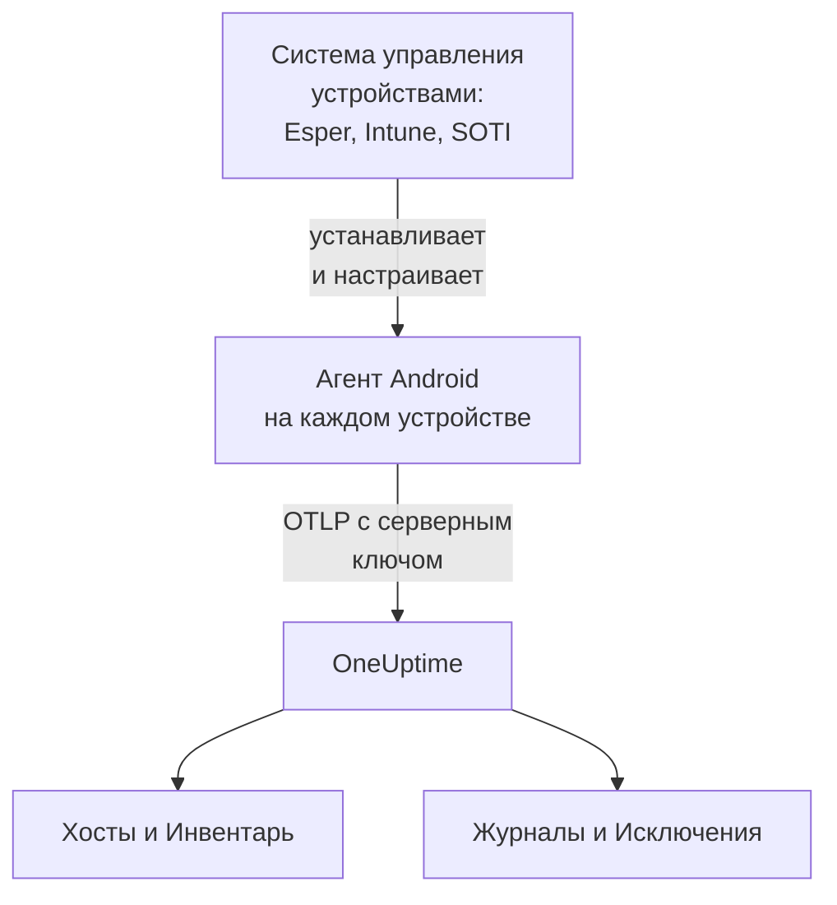

# Агент Android

Агент Android от OneUptime передаёт в OneUptime данные с Android-устройства, которое принадлежит вашей организации, например с киоска для заказов, POS-терминала, ручного терминала или плеера цифровых вывесок: показатели памяти, хранилища, сети, батареи и температуры, сведения о перезагрузках и установленных приложениях, а также сбои и журналы приложений на устройстве. Ваша система управления устройствами устанавливает и настраивает агент сразу на всём парке. Каждое устройство становится хостом в разделе **Хосты** и элементом в разделе **Инвентарь** рядом с вашими серверами и машинами с Windows.

:::cards
- [Когда использовать агент](#агент-или-инструментация-приложения): Агент видит устройство, а инструментация приложения — ваше приложение.
- [Развёртывание через Esper](#развёртывание-через-esper): Загрузите APK, передайте настройки и один раз запустите агент.
- [Настройки](#настройки): Все ключи управляемой конфигурации агента.
- [Чтение журналов других приложений](#чтение-журналов-других-приложений): Один раз выдайте READ_LOGS через adb или систему управления устройствами.
:::

## Как это работает

Агент — это небольшое приложение, которое работает как служба переднего плана. Каждую минуту он считывает показатели состояния устройства и отправляет их в ваш OneUptime по OTLP с ключом приёма типа **Сервер**, а вместе с ними — перезагрузки, установленные приложения и журналы устройства. Агент сам запускается при загрузке устройства, хранит собранное на устройстве, пока нет сети, и отправляет, как только сеть вернётся. Он никогда не мешает устройству переходить в спящий режим и сжимает всё, что отправляет.



## Агент или инструментация приложения

| | [OpenTelemetry Android](/docs/rum/android-setup) в вашем приложении | Агент Android |
| --- | --- | --- |
| Что он видит | Ваше приложение: его сбои, ANR, экраны, сеансы, запросы и рабочие процессы | Устройство: память, хранилище, сеть, батарея, перезагрузки, установленные приложения, а также сбои и ANR всех приложений |
| Где это видно | **Мониторинг реальных пользователей**, **Трассировки** и **Исключения** | **Хосты**, **Инвентарь**, **Журналы** и **Исключения** |
| Как его установить | В коде вашего приложения | Как приложение, через систему управления устройствами |

На собственных устройствах используйте оба варианта и дайте устройству одно и то же имя в обоих: в настройке агента `device_name` и в `host.name`, который задаёт ваше приложение. Тогда устройство будет одним элементом в разделе **Инвентарь**, где телеметрия приложения и телеметрия устройства собраны вместе.

## Перед началом

- Устройства с Android 7.0 или новее, подключённые к системе управления устройствами, которая поддерживает управляемые конфигурации Android: Esper, Microsoft Intune, Workspace ONE, SOTI и другие системы управления устройствами с поддержкой Android Enterprise. Для одного устройства достаточно adb.
- Ключ приёма типа **Сервер**, созданный в **Настройки проекта → Телеметрия и APM → Ключи приёма** кнопкой **Создать ключ приёма**.
- Сам агент: файл `oneuptime-android-agent.apk`, прикреплённый к каждому [выпуску OneUptime](https://github.com/OneUptime/oneuptime/releases/latest).
- Исходящий HTTPS с устройств на ваш URL OneUptime. Агент не принимает URL, который не начинается с `https://`, ведь каждый запрос несёт ключ приёма.

## Развёртывание через Esper

:::steps
### Загрузите APK

В консоли Esper загрузите `oneuptime-android-agent.apk` в **App Library** и добавьте его в blueprint устройств, которые нужно отслеживать.

### Передайте настройки

В blueprint откройте **Managed Configuration** агента и вставьте его настройки. Esper подставляет значения вместо заполнителей на каждом устройстве с Esper Agent 8.00.0764 или новее:

```json title="Managed configuration"
{
  "oneuptime_url": "https://oneuptime.com",
  "oneuptime_token": "YOUR_TELEMETRY_INGESTION_TOKEN",
  "device_name": "${esper.deviceName}",
  "device_serial": "${esper.serialNumber}",
  "device_type": "kiosk",
  "labels": "region=emea"
}
```

Если вы размещаете OneUptime сами, укажите свой URL в `oneuptime_url`. Затем выполните для устройств Converge, чтобы они прочитали новые настройки.

### Запустите агент один раз

Android не запускает только что установленное приложение при загрузке устройства, пока его хотя бы раз не откроют. Включите для агента **Launch on Start** в blueprint в режиме нескольких приложений (Multi-App mode) или откройте агент один раз на каждом устройстве. После этого он будет сам запускаться при каждой загрузке устройства и после каждого обновления.

### Найдите устройства в OneUptime

В течение минуты каждое устройство появится в разделе **Хосты** под именем из своего `device_name`, а также в разделе **Инвентарь**. Экран самого агента на устройстве показывает, передаёт ли он данные, а если нет, то что ему мешает.
:::

Другие системы управления устройствами работают так же: добавьте APK как бизнес-приложение или внутреннее приложение, задайте те же ключи в его конфигурации приложения и откройте его один раз на каждом устройстве.

## Настройки

Агент читает эти ключи из своей управляемой конфигурации. Устройство без неё можно настроить на экране самого агента, указав URL, ключ приёма и имя устройства. Введённый там ключ хранится в зашифрованном виде с помощью Android Keystore.

| Ключ | Что задаёт | По умолчанию |
| --- | --- | --- |
| `oneuptime_url` | URL вашего OneUptime | `https://oneuptime.com` |
| `oneuptime_token` | Ключ приёма типа **Сервер** | Нет: без него агент ничего не отправляет |
| `device_name` | Имя устройства в разделах **Хосты** и **Инвентарь**, которое служит там его идентификатором | Модель устройства и начало его Android ID |
| `device_serial` | Серийный номер, который Android не передаёт приложениям начиная с Android 10 | Нет |
| `device_type` | Что это за устройство, например киоск, POS-терминал или ручной терминал | `Android device` |
| `device_location` | Где находится устройство, например номер магазина | Нет |
| `labels` | Метки для хоста в виде пар `name=value`, разделённых запятыми | Нет |
| `collection_interval_seconds` | Как часто агент отправляет данные: от 30 до 600 секунд | `60` |
| `logcat_enabled` | Отправлять ли то, что агент читает из Logcat | `true` |
| `logcat_min_level` | Минимальный уровень важности строк Logcat, которые агент отправляет на Android 12 и более ранних версиях: `verbose`, `debug`, `info`, `warn`, `error` или `fatal` | `warn` |
| `installed_apps_enabled` | Отправлять ли список установленных приложений | `true` |

Заполнитель, который система управления устройствами не подставила, например `${esper.deviceName}`, пришедший как есть, игнорируется, и экран агента сообщает об этом. Не меняйте `device_name`, когда устройство уже передаёт данные: новое имя означает новый хост.

## Чтение журналов других приложений

Android позволяет приложению читать журналы других приложений только с разрешением READ_LOGS, а выдать это разрешение может только adb: ни само приложение, ни политика устройства этого не могут. Выдайте его один раз на каждом устройстве, и оно сохранится после перезагрузок и обновлений:

```bash
adb shell pm grant com.oneuptime.androidagent android.permission.READ_LOGS
```

В Esper выполните эту команду через **Secure Remote ADB**: включите для устройства доступ по ADB, подключитесь командой `espercli secureadb connect -d DEVICE_ID`, а затем выполните команду. Когда разрешение выдано, Android перезапускает агент, и тот сразу начинает чтение.

Что агент после этого читает, зависит от версии Android:

- Android 13 и новее: сбои и ANR всех приложений. Android показывает строки журналов других приложений только приложению, открытому на экране, и только после того, как человек у устройства это разрешит, поэтому агент, работающий в фоне, прочитать их не может.
- Android 12 и более ранние версии: сбои и ANR всех приложений, а также строки журналов всех приложений с уровнем `logcat_min_level` и выше.

Без READ_LOGS агент сообщает обо всём остальном, а его экран и журналы устройства подсказывают, как выдать это разрешение.

## Что сообщает агент

| Что | Где это видно в OneUptime |
| --- | --- |
| Память, хранилище, сеть и время работы | Страница устройства в разделе **Хосты**: те же метрики, что отправляет коллектор сервера, поэтому шаблоны оповещений для хостов работают |
| Заряд и температура батареи, а также подключено ли устройство к внешнему питанию | Метрики `hw.battery.charge`, `hw.temperature` и `android.battery.plugged` |
| Тепловое состояние | Метрики `android.thermal.status` и `android.thermal.headroom` |
| Перезагрузки | **Журналы**, с `@event.name:device.boot`: сколько устройство проработало, штатно ли оно выключилось, сколько оно было выключено, а также циклы перезагрузок |
| Установленные приложения | **Журналы**, с `@event.name:android.package.inventory` раз в день, а также каждая установка, обновление и удаление |
| Сбои и ANR всех приложений | **Исключения**, как необработанные, под именем приложения |
| Производитель, модель, серийный номер, версия ОС и прошивка | Элемент устройства в разделе **Инвентарь** |

Начиная с Android 8 система не даёт приложениям данные о загрузке CPU устройства, поэтому агент сообщает загрузку CPU только на Android 7 и на сборках, которые это позволяют.

Для устройства подходят шаблоны оповещений для хостов Host Stopped Reporting, High Memory Utilization, High Filesystem Usage и Host Restarted. Устройство, которое раз за разом перезагружается, при каждой загрузке записывает в журнал предупреждение, где `android.boot.recent_count` равно числу его загрузок за последний час.

## Устранение неполадок

:::details Устройство не появляется в разделе Хосты
Откройте агент на устройстве: на его экране написано, чего не хватает, например ключа приёма или пригодного URL, или что отправка не удалась и почему. На устройстве, где агент ни разу не открывали после установки, он не запущен: откройте его один раз или включите **Launch on Start**.
:::

:::details Агент сообщает, что OneUptime отклонил ключ приёма
Используйте ключ **Сервер**, который включён и у которого не истёк срок действия. Ключ **Браузер** с устройства отклоняется.
:::

:::details Нет журналов других приложений
Выдайте READ_LOGS, как описано в разделе [Чтение журналов других приложений](#чтение-журналов-других-приложений). На Android 13 и новее читаются только сбои и ANR других приложений.
:::

:::details Два устройства отображаются как один хост
У них одинаковый `device_name`. Используйте заполнитель, значение которого у каждого устройства своё, например `${esper.deviceName}` или `${esper.serialNumber}`.
:::

## Дальнейшие шаги

:::cards
- [Настройка для Android](/docs/rum/android-setup): Инструментировать собственное приложение с помощью OpenTelemetry Android.
- [Хосты](/docs/telemetry/hosts): Страницы хоста, его показания и оповещения.
- [Мониторинг хостов](/docs/monitor/host-monitor): Получать оповещения, когда устройство перестаёт передавать данные или у него заканчивается место.
- [Исключения](/docs/telemetry/exceptions): Разбирать сбои и ANR, о которых сообщают ваши устройства.
:::
