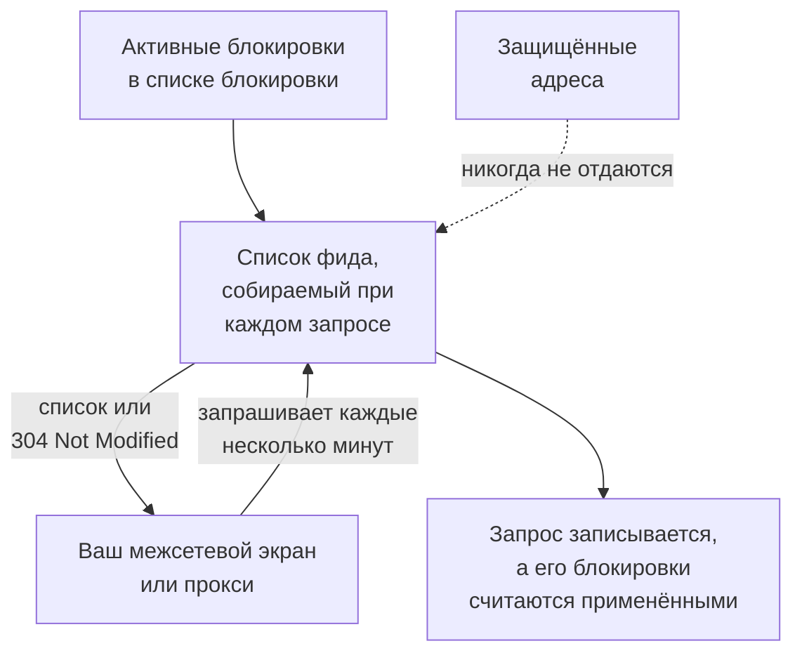

# Фиды списка блокировки для межсетевых экранов и прокси

Фид списка блокировки — это секретный URL, по которому ваш межсетевой экран или прокси каждые несколько минут читает [список блокировки](/docs/telemetry/security-cases#список-блокировки) вашего проекта. Palo Alto Networks, FortiGate, Check Point, Cisco Secure Firewall, OPNsense и pfSense читают его как внешний список, а команды, которые вы копируете из OneUptime, применяют его с помощью nftables, ipset, nginx, HAProxy или брандмауэра Windows. К OneUptime подключается ваш межсетевой экран: OneUptime никогда не нужны ни маршрут в вашу сеть, ни пароль от вашего межсетевого экрана.

:::cards
- [Создайте фид](#создайте-фид): Выберите межсетевой экран, скопируйте секрет и выполните его шаги.
- [Настройте межсетевой экран](#настройте-межсетевой-экран): Шаги для каждого межсетевого экрана и прокси и то, как часто он запрашивает фид.
- [Когда блокировка применяется](#когда-блокировка-применяется): Только после того, как межсетевой экран запросил список, в котором она есть.
- [Смените или отзовите секрет](#смените-или-отзовите-секрет): Новый секрет с перекрытием в сутки — или сразу никакого.
:::

## Как это работает



Каждый запрос собирает список из блокировок, активных в этот момент. Истёкшая или снятая блокировка пропадает из списка при следующем запросе, а защищённого адреса в нём не бывает никогда, даже если адрес защитили уже после блокировки. Блокировка считается применённой в фиде только после того, как межсетевой экран запросил список, в котором она есть.

## Перед началом

- Межсетевой экран или прокси, который читает список адресов по URL `https`, либо хост Linux или Windows, на котором вы можете выполнять команды от имени root или администратора.
- Выход из межсетевого экрана к OneUptime по HTTPS: `https://oneuptime.com` или адрес вашего собственного сервера OneUptime.
- Роль, которая может создавать фиды: Владелец проекта, Администратор проекта или Администратор безопасности. Участник безопасности и Зритель безопасности могут читать фиды и их запросы. См. [Роли](/docs/permissions/reference#роли).

## Создайте фид

:::steps
### Откройте фиды списка блокировки

Откройте **Продукты → События безопасности → Плейбуки → Фиды списка блокировки**.

### Создайте новый фид

Нажмите **Создать: Фид списка блокировки** и выберите **Межсетевой экран**, который будет его читать. **Имя** — это то, как список блокировки называет фид там, где применяется блокировка; если оставить поле пустым, фид получит имя по межсетевому экрану, например «FortiGate feed». В разделе **Дополнительные поля** поле **Отдаёт** задаёт IPv4 и IPv6, только IPv4 или только IPv6, а поле **Разрешённые адреса источника** ограничивает, кто может читать фид.

### Скопируйте секрет

Откроется страница фида с его секретом, который показывается один раз: OneUptime хранит только его хеш. Скопируйте секрет и нажмите **Готово**. Пока вы не уйдёте со страницы, шаги на ней подставляют секрет за вас.

### Выполните шаги для вашего межсетевого экрана

**Настройка межсетевого экрана** показывает URL, который нужно вставить, способ, которым ваш межсетевой экран передаёт секрет, и шаги в его собственной консоли — с уже подставленными значениями. Выберите там другой межсетевой экран, чтобы увидеть его шаги. После первого запроса вашего межсетевого экрана статус фида сменится на **Чтение**, а **Запросы** покажет этот запрос.
:::

## Что отдаёт фид

| Файл | Для кого | Что содержит |
| --- | --- | --- |
| `blocklist.txt` | Palo Alto Networks, pfSense, ipset, HAProxy, брандмауэр Windows и любой другой межсетевой экран | По одному адресу или диапазону в строке. |
| `blocklist.txt?comments=1` | FortiGate, Check Point, Cisco Secure Firewall и OPNsense, которые пропускают строки, начинающиеся с `#` | Каждый адрес или диапазон после строки, в которой сказано, почему он заблокирован. |
| `nftables.nft` | nftables | Файл для `nft -f`, который очищает наборы `blocklist_v4` и `blocklist_v6` таблицы `inet oneuptime` и заполняет их заново. |
| `nginx.conf` | nginx | Строка `deny` для каждого адреса или диапазона. |
| Имя файла с `.md5` на конце, например `blocklist.txt.md5` | Cisco Secure Firewall | MD5 файла, чтобы межсетевой экран скачивал список, только когда он изменился. |

URL фида — `https://oneuptime.com/api/blocklist-feed/<feed ID>/<file>`, и страница фида показывает его уже заполненным для вашего межсетевого экрана. С `?comments=1` список выглядит так:

```text
# OneUptime case CASE-42 until 2026-11-21 10:42 UTC
203.0.113.7
# OneUptime blocklist until lifted
198.51.100.0/24
```

Фид отдаёт активные блокировки с действием **Заблокировать**. Проверку он не отдаёт никогда — межсетевой экран не умеет её выполнять, — а фид, который отдаёт только IPv4 или только IPv6, пропускает остальные адреса. Файл nftables пропускает адрес, который уже входит в диапазон из списка, поскольку nftables не принимает пересекающиеся записи в наборе.

Когда ничего не заблокировано, `blocklist.txt` содержит один адрес — `192.0.2.1` (`2001:db8::1` для фида, который отдаёт только IPv6). Это адрес, зарезервированный для документации, с которого в интернете не приходит никакой трафик: Palo Alto Networks и Cisco, получив пустой список, сохраняют последний прочитанный, поэтому пустой список продолжал бы блокировать то, что вы сняли.

Каждый ответ содержит `ETag`. Межсетевой экран, который возвращает его в `If-None-Match`, получает `304 Not Modified`, пока список не изменился, и команды, которые даёт OneUptime, так и делают.

## Как межсетевой экран передаёт секрет

| Способ | Что отправляет межсетевой экран | Кто использует |
| --- | --- | --- |
| Базовая аутентификация | Любое имя пользователя, например `oneuptime`, и секрет в качестве пароля | Palo Alto Networks (только по HTTPS), FortiGate и Check Point |
| Bearer-токен | `Authorization: Bearer <secret>` | Команды для nftables, ipset, nginx, HAProxy и брандмауэра Windows |
| Секрет в URL | `https://oneuptime.com/api/blocklist-feed/<feed ID>/<secret>/blocklist.txt` | Cisco Secure Firewall, OPNsense и pfSense, в документации которых не описан другой способ передать секрет |

Запрос без секрета или с неверным секретом получает `401 Unauthorized`. URL с неверным секретом получает `404 Not Found`, как и несуществующий адрес. Собственный веб-сервер OneUptime не записывает URL фидов в журнал доступа, поэтому секрет из URL туда не попадает.

## Ограничьте, кто может читать фид

Поле **Разрешённые адреса источника** в разделе **Дополнительные поля** принимает до 50 адресов и диапазонов, по одному в строке, например `203.0.113.7` или `198.51.100.0/24`. Запрос с любого другого адреса получает `403 Forbidden`, даже с правильным секретом. Оставьте поле пустым, чтобы фид мог читать любой адрес, у которого есть секрет.

Каждый адрес может запрашивать один фид 60 раз в минуту, а все фиды вместе — 600 раз в минуту. Сверх этого он получает `429 Too Many Requests` с заголовком `Retry-After`.

## Когда блокировка применяется

Блокировка считается применённой в фиде, когда межсетевой экран после её создания запросил список, в котором она есть, и остаётся такой десять минут после каждого такого запроса. Ответ `304 Not Modified` считается запросом того же списка. Тогда на странице **Список блокировки** чип фида в столбце **Где применяется** становится зелёным, а его подсказка сообщает, через сколько времени после создания блокировки межсетевой экран её получил, например: «Межсетевой экран получил эту блокировку из FortiGate feed через 3 мин после её создания. Последний запрос: 2 минуты назад.»

Если запросов нет десять минут, чип сообщает, что с тех пор межсетевой экран фид не запрашивал: межсетевой экран, возможно, всё ещё блокирует адрес, но OneUptime не может этого знать. Поэтому настройте межсетевой экран так, чтобы он запрашивал фид каждые пять минут или чаще. Межсетевой экран, который запрашивает реже, например OPNsense, всё равно блокирует между запросами, а OneUptime считает блокировку применённой там только в течение десяти минут после каждого из них.

Истёкшая или снятая блокировка пропадает из списка при следующем запросе, а её чип ждёт, пока межсетевой экран запросит список без неё. Если OneUptime не может прочитать, какие адреса защищены, фид отвечает `503 Service Unavailable` с `Retry-After: 60`, а не списком, в котором может оказаться защищённый адрес, и межсетевой экран сохраняет имеющийся у него список.

## Когда межсетевой экран перестаёт читать фид

OneUptime узнаёт, как часто запрашивается каждый фид. Если фид не запрашивали втрое дольше обычного интервала и не меньше десяти минут, его статус сменяется на **Чтение прекращено**, **Список блокировки** называет его над своим списком, а Владельцы проекта получают одно письмо: «Your firewall stopped reading the blocklist feed _имя фида_». Пока межсетевой экран не запросил фид дважды, OneUptime ожидает запрос каждые пять минут, от OPNsense — каждый час, а от pfSense — каждый день.

Следующий запрос снимает это состояние, а новая остановка позже отправит ещё одно письмо. Фид с отозванным секретом никогда не считается остановившимся.

## Смените или отзовите секрет

**Сменить секрет** на странице фида создаёт новый секрет и показывает его один раз. Заменённый секрет продолжает работать 24 часа, чтобы вы успели передать новый каждому межсетевому экрану; **Запросы** помечает запрос, который всё ещё отправил старый секрет, как **Предыдущий секрет**. Повторная смена в течение этих 24 часов сразу прекращает действие самого старого секрета.

**Отозвать секрет** сразу прекращает действие секрета и предыдущего секрета: используйте его, если секрет утёк. После этого фид никому не отвечает, а его межсетевые экраны сохраняют имеющийся список, не обновляя его, пока **Сменить секрет** не создаст новый секрет. Удаление фида удаляет сам фид, его секрет и его запросы.

## Настройте межсетевой экран

Страница фида показывает эти шаги для выбранного межсетевого экрана с уже подставленными URL, именем пользователя и — сразу после создания секрета — самим секретом.

| Межсетевой экран | Файл | Секрет | Интервал запросов | Вмещает не более |
| --- | --- | --- | --- | --- |
| Palo Alto Networks | `blocklist.txt` | Базовая аутентификация | 5 минут — минимум, который он позволяет | 30 пользовательских списков и 50 000 адресов в сумме (150 000 на сериях PA-3200, PA-5200 и PA-7000) |
| FortiGate | `blocklist.txt?comments=1` | Базовая аутентификация | 5 минут (от 1 до 43 200; по умолчанию 5) | 300 000 адресов во всех его фидах угроз вместе |
| Check Point | `blocklist.txt?comments=1`, IPv4 | Базовая аутентификация | 5 минут (по умолчанию каждый час) | 50 000 адресов в фиде |
| Cisco Secure Firewall | `blocklist.txt?comments=1` и его MD5 | В URL | 5 минут (по умолчанию 2 часа) | |
| OPNsense | `blocklist.txt?comments=1` | В URL | 1 час — минимум, который он позволяет | |
| pfSense | `blocklist.txt` | В URL | 1 день — минимум, который он позволяет | |
| nftables, ipset, nginx, HAProxy, брандмауэр Windows | Свои собственные | Bearer-токен | 1 минута | |

### Palo Alto Networks

1. В веб-интерфейсе откройте **Objects → External Dynamic Lists** и нажмите **Add**.
2. Задайте для **Type** значение **IP List**, а для **Source** — URL фида, `https://oneuptime.com/api/blocklist-feed/<feed ID>/blocklist.txt`.
3. Включите **Client Authentication**: **Username** — `oneuptime`, **Password** — секрет фида.
4. Задайте для **Check for updates** значение **Every Five Minutes**, нажмите **OK** и выполните commit.
5. В **Policies → Security** добавьте правило со списком в **Source Address** и действием **Deny**, затем выполните commit.

Palo Alto Networks отправляет имя пользователя и пароль только по HTTPS. Комментарий он читает только после адреса и никогда — на отдельной строке, поэтому его фид — это простой список. См. [Configure the Firewall to Access an External Dynamic List](https://docs.paloaltonetworks.com/pan-os/11-1/pan-os-admin/policy/use-an-external-dynamic-list-in-policy/configure-the-firewall-to-access-an-external-dynamic-list).

### FortiGate

1. Откройте **Security Fabric → External Connectors**, нажмите **Create New** и выберите **IP Address** в разделе **Threat Feeds**.
2. Задайте для **URL of external resource** URL фида, `https://oneuptime.com/api/blocklist-feed/<feed ID>/blocklist.txt?comments=1`.
3. Включите **HTTP basic authentication**: **Username** — `oneuptime`, **Password** — секрет фида.
4. Задайте для **Refresh Rate** 5 минут и нажмите **OK**.
5. В **Policy & Objects → Firewall Policy** укажите фид как **Source** политики и задайте для **Action** значение **DENY**.

См. [Configuring a threat feed](https://docs.fortinet.com/document/fortigate/7.6.0/administration-guide/379433/configuring-a-threat-feed).

### Check Point

1. В SmartConsole откройте **Object Explorer** и выберите **New → More → Network Object → Network Feed**.
2. Задайте для **Feed URL** URL фида, `https://oneuptime.com/api/blocklist-feed/<feed ID>/blocklist.txt?comments=1`, для **Format** — **Flat list**, а для **Data type** — **IP Address**.
3. В **Advanced Settings** введите **Username** `oneuptime` и секрет фида в качестве пароля для **Authentication**.
4. Задайте для **Check feed interval** 5 минут, нажмите **Test Feed**, затем **OK**.
5. Укажите фид как **Source** правила Access Control с действием **Drop** и установите политику.

Check Point описывает для сетевого фида адреса IPv4, поэтому фид, созданный для него, отдаёт только IPv4. См. [Network Feed](https://sc1.checkpoint.com/documents/R82/WebAdminGuides/EN/CP_R82_SecurityManagement_AdminGuide/Content/Topics-SECMG/Network_Feed.htm).

### Cisco Secure Firewall

1. В центре управления выберите **Objects → Security Intelligence** и нажмите **Add Network Lists and Feeds**.
2. Задайте для **Type** значение **Feed**, для **Feed URL** — URL фида, `https://oneuptime.com/api/blocklist-feed/<feed ID>/<secret>/blocklist.txt?comments=1`, а для **MD5 URL** — тот же URL с `.md5` после `blocklist.txt`.
3. Задайте для **Update Frequency** 5 минут и сохраните.
4. В вашей политике управления доступом откройте **Security Intelligence → Networks**, добавьте фид в **Block List**, затем сохраните и разверните.

Cisco требует MD5 URL при частоте обновления 30 минут или меньше, а его управляемые устройства получают обновления из центра управления каждые 30 минут, поэтому блокировка доходит до них в течение 30 минут после запроса фида. См. [Creating Security Intelligence feeds](https://docs.manage.security.cisco.com/cdfmc/t_creating_security_intelligence_feeds.html).

### OPNsense

1. Откройте **Firewall → Aliases** и добавьте псевдоним типа **URL Table (IPs)**.
2. Задайте для **Content** URL фида, `https://oneuptime.com/api/blocklist-feed/<feed ID>/<secret>/blocklist.txt?comments=1`, а для **Refresh Frequency** — 0 дней и 1 час.
3. Сохраните и нажмите **Apply**, затем в **Firewall → Rules** добавьте правило, блокирующее трафик, у которого **Source** — этот псевдоним.

OPNsense запрашивает URL-таблицу не чаще раза в час, поэтому OneUptime подтверждает его блокировки только в течение десяти минут после каждого запроса. Между запросами он всё равно их блокирует. См. [Aliases](https://docs.opnsense.org/manual/aliases.html).

### pfSense

1. Откройте **Firewall → Aliases**, нажмите **Add** и выберите **URL Table (IPs)**.
2. Введите URL фида, `https://oneuptime.com/api/blocklist-feed/<feed ID>/<secret>/blocklist.txt`, и задайте обновление раз в 1 день.
3. Нажмите **Save** и **Apply Changes**, затем в **Firewall → Rules** добавьте правило с псевдонимом в **Source** и действием **Block**.

> [!WARNING]
> pfSense запрашивает URL-таблицу не чаще раза в сутки: это слишком медленно, чтобы заблокировать атаку, пока она идёт. Используйте его для долгих блокировок вместе с межсетевым экраном, который запрашивает список каждые несколько минут.

См. [Alias Types](https://docs.netgate.com/pfsense/en/latest/firewall/aliases-types.html).

### nftables

Один раз выполните от имени root команды, которые показывает страница фида. Они создают таблицу `inet oneuptime` с двумя наборами, `blocklist_v4` и `blocklist_v6`, правила в её цепочках `input` и `forward`, отбрасывающие трафик с адресов из этих наборов, и скрипт `/usr/local/sbin/oneuptime-blocklist`, который хранит секрет в `/etc/oneuptime-blocklist`, доступном для чтения только root.

```bash
# Run once, as root.
install -d -m 700 /etc/oneuptime-blocklist /var/lib/oneuptime-blocklist
printf 'Authorization: Bearer %s\n' 'YOUR_FEED_SECRET' > /etc/oneuptime-blocklist/auth
chmod 600 /etc/oneuptime-blocklist/auth
cat > /usr/local/sbin/oneuptime-blocklist <<'SCRIPT'
#!/bin/sh
# Loads the OneUptime blocklist into nftables when it changed.
set -eu
URL='https://oneuptime.com/api/blocklist-feed/<feed ID>/nftables.nft'
STATE=/var/lib/oneuptime-blocklist
if ! nft list table inet oneuptime >/dev/null 2>&1; then
  rm -f "$STATE/etag"
  nft -f - <<'NFT'
table inet oneuptime {
  set blocklist_v4 { type ipv4_addr; flags interval; auto-merge; }
  set blocklist_v6 { type ipv6_addr; flags interval; auto-merge; }
  chain input {
    type filter hook input priority filter; policy accept;
    ip saddr @blocklist_v4 drop
    ip6 saddr @blocklist_v6 drop
  }
  chain forward {
    type filter hook forward priority filter; policy accept;
    ip saddr @blocklist_v4 drop
    ip6 saddr @blocklist_v6 drop
  }
}
NFT
fi
TMP=$(mktemp)
trap 'rm -f "$TMP" "$TMP.h"' EXIT
ETAG=$(cat "$STATE/etag" 2>/dev/null || true)
CODE=$(curl --silent --show-error --max-time 60 --header @/etc/oneuptime-blocklist/auth \
  ${ETAG:+--header "If-None-Match: $ETAG"} \
  --dump-header "$TMP.h" --output "$TMP" --write-out '%{http_code}' "$URL")
[ "$CODE" = 304 ] && exit 0
[ "$CODE" = 200 ] || { echo "oneuptime-blocklist: the feed answered $CODE" >&2; exit 1; }
nft -f "$TMP"
sed -n 's/^[Ee][Tt][Aa][Gg]:[[:space:]]*//p' "$TMP.h" | tr -d '\r' > "$STATE/etag"
SCRIPT
chmod 700 /usr/local/sbin/oneuptime-blocklist
echo '* * * * * root flock -n /run/oneuptime-blocklist.lock /usr/local/sbin/oneuptime-blocklist' > /etc/cron.d/oneuptime-blocklist
/usr/local/sbin/oneuptime-blocklist
```

Скрипт запускается каждую минуту из `/etc/cron.d/oneuptime-blocklist`. Он загружает `nftables.nft`, только если список изменился, одной транзакцией, поэтому наборы никогда не бывают заполнены наполовину. См. [Sets](https://wiki.nftables.org/wiki-nftables/index.php/Sets).

### ipset и iptables

Один раз выполните от имени root команды, которые показывает страница фида. Они создают два набора, `oneuptime_v4` и `oneuptime_v6`, и правила iptables и ip6tables в цепочке `PREROUTING` таблицы `raw`, отбрасывающие трафик с адресов из этих наборов.

Скрипт запускается каждую минуту из cron. Если список изменился, он заполняет два новых набора и подменяет ими старые, поэтому правила никогда не видят наполовину заполненный набор. См. [ipset](https://ipset.netfilter.org/ipset.man.html).

### nginx

Добавьте строку include в блок `server` каждого защищаемого сайта, затем один раз выполните от имени root команды, которые показывает страница фида:

```nginx
server {
    include /etc/nginx/oneuptime-blocklist.conf;
}
```

```bash
# Run once, as root.
install -d -m 700 /etc/oneuptime-blocklist /var/lib/oneuptime-blocklist
printf 'Authorization: Bearer %s\n' 'YOUR_FEED_SECRET' > /etc/oneuptime-blocklist/auth
chmod 600 /etc/oneuptime-blocklist/auth
touch /etc/nginx/oneuptime-blocklist.conf
cat > /usr/local/sbin/oneuptime-blocklist <<'SCRIPT'
#!/bin/sh
# Writes the OneUptime blocklist for nginx when it changed, and reloads nginx.
set -eu
URL='https://oneuptime.com/api/blocklist-feed/<feed ID>/nginx.conf'
STATE=/var/lib/oneuptime-blocklist
TMP=$(mktemp)
trap 'rm -f "$TMP" "$TMP.h"' EXIT
ETAG=$(cat "$STATE/etag" 2>/dev/null || true)
CODE=$(curl --silent --show-error --max-time 60 --header @/etc/oneuptime-blocklist/auth \
  ${ETAG:+--header "If-None-Match: $ETAG"} \
  --dump-header "$TMP.h" --output "$TMP" --write-out '%{http_code}' "$URL")
[ "$CODE" = 304 ] && exit 0
[ "$CODE" = 200 ] || { echo "oneuptime-blocklist: the feed answered $CODE" >&2; exit 1; }
cp /etc/nginx/oneuptime-blocklist.conf "$STATE/last.conf"
cp "$TMP" /etc/nginx/oneuptime-blocklist.conf
if nginx -t -q; then nginx -s reload; else cp "$STATE/last.conf" /etc/nginx/oneuptime-blocklist.conf; exit 1; fi
sed -n 's/^[Ee][Tt][Aa][Gg]:[[:space:]]*//p' "$TMP.h" | tr -d '\r' > "$STATE/etag"
SCRIPT
chmod 700 /usr/local/sbin/oneuptime-blocklist
echo '* * * * * root flock -n /run/oneuptime-blocklist.lock /usr/local/sbin/oneuptime-blocklist' > /etc/cron.d/oneuptime-blocklist
/usr/local/sbin/oneuptime-blocklist

# Then add this line to the server block of the site to protect, and reload nginx:
#   include /etc/nginx/oneuptime-blocklist.conf;
```

Скрипт запускается каждую минуту из cron. Если список изменился, он записывает `/etc/nginx/oneuptime-blocklist.conf`, проверяет конфигурацию с помощью `nginx -t` и перезагружает nginx, а если проверка не прошла, возвращает предыдущий файл.

За балансировщиком нагрузки или CDN nginx видит адрес балансировщика, а не посетителя, если не настроен модуль realip: укажите в `set_real_ip_from` адреса балансировщика, а в `real_ip_header` — заголовок, который он отправляет, или блокируйте на самом балансировщике. См. [ngx_http_access_module](https://nginx.org/en/docs/http/ngx_http_access_module.html).

### HAProxy

От имени root создайте файл списка и добавьте две строки в `haproxy.cfg`, затем один раз перезагрузите HAProxy: его Runtime API обновляет только список, который HAProxy уже читает.

```text
global
    stats socket /run/haproxy/admin.sock mode 660 level admin

frontend www
    http-request deny if { src -n -f /etc/haproxy/oneuptime-blocklist.lst }
```

Затем выполните остальные команды, которые показывает страница фида. Скрипт запускается каждую минуту из cron и, если список изменился, записывает `/etc/haproxy/oneuptime-blocklist.lst` и обновляет HAProxy через его Runtime API без перезагрузки. См. [The Runtime API](https://docs.haproxy.org/3.4/management.html#9.3).

### Брандмауэр Windows

Один раз выполните в PowerShell от имени администратора команды, которые показывает страница фида. Они сохраняют скрипт и секрет в `C:\ProgramData\OneUptime\Blocklist`, который могут читать только SYSTEM и Administrators, и регистрируют запланированную задачу «OneUptime Blocklist», которая каждую минуту запускает скрипт от имени SYSTEM.

Скрипт поддерживает входящие правила, которые блокируют все адреса из списка, по 1000 на правило: «OneUptime blocklist 0», «OneUptime blocklist 1» и так далее. См. [Set-NetFirewallRule](https://learn.microsoft.com/en-us/powershell/module/netsecurity/set-netfirewallrule).

### Другие межсетевые экраны

1. Направьте межсетевой экран или прокси на URL фида, `https://oneuptime.com/api/blocklist-feed/<feed ID>/blocklist.txt`: по одному адресу или диапазону в строке.
2. Передавайте секрет фида как пароль базовой аутентификации с любым именем пользователя или как Bearer-токен.
3. Настройте запрос списка каждые 5 минут или чаще: блокировка считается применённой там в течение десяти минут после каждого запроса.

### Kubernetes

Блокируйте на edge-сети или в облачном WAF перед кластером, подключив их как место назначения списка блокировки в разделе **Подключения безопасности** или **Облачные подключения**, либо на собственном прокси перед кластером с помощью команд для nginx или HAProxy. Контроллер Ingress NGINX от сообщества выведен из эксплуатации, а его репозиторий архивирован в марте 2026 года, поэтому OneUptime не документирует его аннотации. См. [Ingress NGINX Retirement](https://kubernetes.io/blog/2025/11/11/ingress-nginx-retirement/).

## Ограничения

| Что | Ограничение |
| --- | --- |
| Записей в фиде | 20 000 |
| Разрешённые адреса источника | 50 адресов и диапазонов |
| Запросов одного фида с одного адреса | 60 в минуту |
| Запросов всех фидов с одного адреса | 600 в минуту |
| Заменённый секрет продолжает работать | 24 часа |
| Блокировка считается применённой после запроса | 10 минут |
| Хранение запросов | 30 дней |

## Устранение неполадок

:::details Межсетевой экран получает 401 Unauthorized
Секрет, который он отправляет, не является секретом фида. Убедитесь, что пароль или Bearer-токен — это весь секрет, без лишних символов до или после него. Секрет, заменённый больше 24 часов назад, больше не работает: **Сменить секрет** создаёт новый.
:::

:::details Межсетевой экран получает 404 Not Found
URL указывает на несуществующий фид или на файл, который фид не отдаёт, либо содержит неверный секрет. Скопируйте URL заново со страницы фида.
:::

:::details Межсетевой экран получает 403 Forbidden
Поле **Разрешённые адреса источника** фида не содержит адрес, с которого межсетевой экран запрашивает фид. **Запросы** показывает, с какого адреса пришёл каждый запрос.
:::

:::details Чип блокировки сообщает, что ждёт, пока межсетевой экран запросит фид
Ни один межсетевой экран не запрашивал фид с момента создания блокировки. Проверьте **Запросы** на странице фида: межсетевой экран, который запрашивает фид каждые пять минут, получит блокировку не позже чем через пять минут.
:::

## Дальнейшие шаги

:::cards
- [Кейсы безопасности и плейбуки](/docs/telemetry/security-cases): Блокируйте адрес из кейса — вручную или плейбуком.
- [Аналитика угроз](/docs/telemetry/threat-intelligence): Добавьте в OneUptime известные вредоносные адреса.
- [События безопасности](/docs/telemetry/security-events): Найдите адреса, которые стоит заблокировать.
:::
