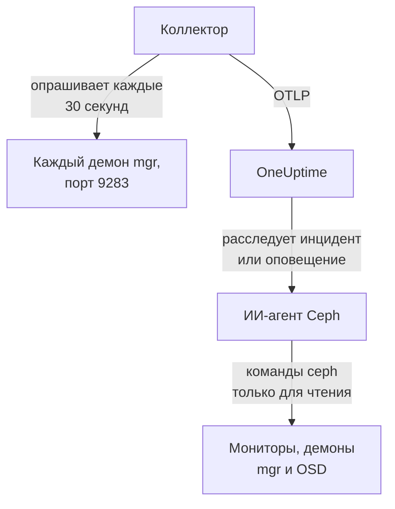

# Агент Ceph

Агент Ceph от OneUptime отслеживает кластер Ceph: его состояние, кворум мониторов, OSD, пулы и группы размещения (placement groups). Он опрашивает модуль `prometheus` менеджера Ceph на каждом демоне mgr, проставляет на каждую метрику имя вашего кластера и отправляет её в OneUptime, где кластер появляется со своими OSD, пулами и демонами. [Мониторы Ceph](/docs/monitor/ceph-monitor) оповещают о том, что поступает.

:::cards
- [Установка агента](#установка-агента): Включите модуль mgr, затем скрипт установки или Docker Compose.
- [Что собирает агент](#что-собирает-агент): Серии, на которых построены страницы Ceph, метрики и шаблоны оповещений.
- [ИИ-агент](#ии-агент): Позвольте OneUptime AI читать кластер во время расследования.
- [Устранение неполадок](#устранение-неполадок): Диагностический скрипт и типичные проблемы.
:::

## Как это работает

Агент — это два контейнера, которые вы запускаете через Docker Compose на одной машине. OpenTelemetry Collector опрашивает модуль `prometheus` на каждом демоне mgr каждые 30 секунд. Метриками отвечает только активный mgr, поэтому при переключении на резервный метрики продолжают поступать без каких-либо изменений. ИИ-агент Ceph рядом с ним позволяет OneUptime AI выполнять команды `ceph` только для чтения, пока она расследует инцидент или оповещение.



Кластер регистрируется по своим первым данным под именем, которое агент проставляет на каждую метрику как `ceph.cluster.name`.

## Перед началом

- Docker Engine 20.10 или новее с плагином Docker Compose v2 на машине, которая может достучаться до ваших демонов mgr Ceph по порту 9283.
- Командная оболочка на административном узле Ceph, где CLI `ceph` работает с правами администратора.
- Ключ приёма. Создайте его в разделе **Настройки проекта → Телеметрия и APM → Ключи приема** и скопируйте значение.
- Исходящий HTTPS с этой машины на ваш URL OneUptime.

## Установка агента

:::steps
### Включите модуль prometheus в mgr

На административном узле Ceph:

```bash
ceph mgr module enable prometheus
```

После этого каждый демон mgr отдаёт метрики Prometheus на порту `9283` по пути `/metrics`. Метрики возвращает только активный mgr: резервные mgr отвечают пустым ответом или ошибкой HTTP, если `mgr/prometheus/standby_behaviour` равно `error`. Поэтому агент опрашивает каждый mgr. Выведите их список:

```bash
ceph mgr stat                    # active mgr
ceph orch ps --daemon-type mgr   # all mgrs (cephadm clusters)
```

### Установите и запустите агент

:::tabs
@tab install.sh
Скачайте скрипт установки и запустите его на машине, где будет работать агент:

```bash
curl -sSL https://raw.githubusercontent.com/OneUptime/oneuptime/master/agents/CephAgent/install.sh -o install.sh
bash install.sh
```

Скрипт спрашивает URL вашего OneUptime, ключ приёма, имя кластера и адреса mgr, а также может ли [ИИ-агент](#ии-агент) применять исправления. Там, где `ceph` работает с правами администратора, он также предлагает создать собственного клиента Ceph для ИИ-агента. Он устанавливает агента в `/opt/oneuptime-ceph-agent`, записывает файл `.env` с правами `0600` и запускает агента через Docker Compose. Повторный запуск скрипта использует всё, что есть в этом `.env`, и ничего не спрашивает снова — так вы [обновляете агента](#обновление-агента).
@tab Docker Compose
Скачайте `docker-compose.yml` и `otel-collector-config.yaml` из [каталога CephAgent](https://github.com/OneUptime/oneuptime/tree/master/agents/CephAgent) в новую папку:

```bash
mkdir oneuptime-ceph-agent && cd oneuptime-ceph-agent
curl -fsSLO https://raw.githubusercontent.com/OneUptime/oneuptime/master/agents/CephAgent/docker-compose.yml
curl -fsSLO https://raw.githubusercontent.com/OneUptime/oneuptime/master/agents/CephAgent/otel-collector-config.yaml
```

Создайте рядом с ними файл `.env`:

```bash title=".env"
ONEUPTIME_URL=YOUR_ONEUPTIME_URL
ONEUPTIME_TELEMETRY_INGESTION_KEY=YOUR_TELEMETRY_INGESTION_TOKEN
CEPH_CLUSTER_NAME=my-ceph-cluster
CEPH_MGR_ENDPOINTS=[ceph-mon-1:9283,ceph-mon-2:9283,ceph-mon-3:9283]
```

Перечислите все демоны mgr, активный и резервные, через запятую и в квадратных скобках: благодаря скобкам коллектор читает значение как список целей опроса. Запустите агента:

```bash
docker compose up -d
```

Контейнер ИИ-агента тоже запускается и ждёт собственного клиента Ceph: см. [ИИ-агент](#ии-агент).
:::

### Убедитесь, что агент работает

```bash
docker compose ps
docker logs -f oneuptime-ceph-agent
```

`docker compose ps` показывает коллектор (`oneuptime-ceph-agent`) и ИИ-агента (`oneuptime-ceph-ai-agent`). После запуска коллектора в его логах должна появиться эта строка:

```text
Everything is ready. Begin running and processing data.
```

### Найдите кластер в OneUptime

Откройте **Продукты → Инфраструктура → Ceph → Все кластеры**. Примерно через минуту кластер появится под своим `CEPH_CLUSTER_NAME` со своими OSD, пулами и демонами.
:::

## Переменные окружения

Скрипт установки записывает их в `/opt/oneuptime-ceph-agent/.env`; при установке через Docker Compose они читаются из `.env` рядом с `docker-compose.yml`. Изменив значение, выполните `docker compose up -d` в этой папке.

| Переменная | Обязательна | Описание |
| --- | --- | --- |
| `ONEUPTIME_URL` | Да | Ваш URL OneUptime, например `https://oneuptime.com`, или ваш собственный экземпляр. Если экземпляр работает только по HTTP, используйте `http://` и его порт. |
| `ONEUPTIME_TELEMETRY_INGESTION_KEY` | Да | Ключ приёма из раздела **Настройки проекта → Телеметрия и APM → Ключи приема**. |
| `CEPH_CLUSTER_NAME` | Да | Имя кластера в OneUptime, проставляемое на каждую метрику как атрибут ресурса `ceph.cluster.name`. Не меняйте его: изменение позже регистрирует второй кластер. По умолчанию `ceph`. |
| `CEPH_MGR_ENDPOINTS` | Да | Все демоны mgr списком `host:port` через запятую в квадратных скобках, например `[ceph-mon-1:9283,ceph-mon-2:9283,ceph-mon-3:9283]`. Скрипт установки добавляет скобки сам. |

Собственные настройки ИИ-агента описаны в разделе [ИИ-агент](#ии-агент).

## Как агент опрашивает кластер

- **Каждый mgr, каждые 30 секунд.** Модуль `prometheus` в mgr кэширует каждый опрос на `mgr/prometheus/scrape_interval` (по умолчанию 15 секунд). Никогда не опрашивайте чаще: вы бы только снова читали кэш.
- **`honor_labels: true`.** Метки, которые экспортирует Ceph (`ceph_daemon`, `pool_id`, метки экземпляра для каждого демона), сохраняются как есть. Без этого метка `instance` переписывалась бы для каждой цели опроса и менялась бы при каждой смене активного mgr, что ломает все серии.

## Что собирает агент

Агент отправляет всё, что экспортирует модуль `prometheus` в mgr. Страницы Ceph, каталог метрик и шаблоны оповещений OneUptime построены на этих сериях:

| Категория | Метрики |
| --- | --- |
| Состояние кластера | `ceph_health_status` (0 = OK, 1 = WARN, 2 = ERR), `ceph_health_detail` (одна серия на каждую активную проверку состояния, с метками `name` и `severity`, начиная с Quincy; на ней построены шаблоны оповещений о проверках состояния и раздел **Active Health Checks** в обзоре), `ceph_healthcheck_slow_ops`, `ceph_daemon_health_metrics` (по демонам, по ключу `type`), `ceph_mon_quorum_status`, `ceph_mon_metadata`, `ceph_cluster_total_bytes`, `ceph_cluster_total_used_bytes` |
| OSD | `ceph_osd_up`, `ceph_osd_in`, `ceph_osd_apply_latency_ms`, `ceph_osd_commit_latency_ms`, `ceph_osd_stat_bytes`, `ceph_osd_stat_bytes_used`, `ceph_osd_numpg`, `ceph_osd_metadata`, по каждому OSD по метке `ceph_daemon` (например, `osd.3`) |
| Пул | `ceph_pool_stored`, `ceph_pool_max_avail`, `ceph_pool_objects`, `ceph_pool_rd`, `ceph_pool_wr`, `ceph_pool_rd_bytes`, `ceph_pool_wr_bytes`, `ceph_pool_metadata`. Серии данных несут только метку `pool_id`; имя пула указано в `ceph_pool_metadata`. |
| Группы размещения | `ceph_pg_total`, `ceph_pg_active`, `ceph_pg_clean`, `ceph_pg_degraded`, `ceph_pg_undersized` (все по пулам, по `pool_id`), `ceph_num_objects_degraded`, `ceph_num_objects_misplaced` |
| Демоны | `ceph_mgr_metadata`, `ceph_mds_metadata` и `ceph_rgw_metadata` — в дополнение к метаданным мониторов и OSD выше. Каждая называет демона и несёт его версию в метке `ceph_version`: страница **Daemons** показывает их список. |

### Другие цели опроса

Модуль mgr охватывает состояние и ёмкость кластера. Чтобы посмотреть подробнее, добавьте другие задания в `scrape_configs` в файле `otel-collector-config.yaml`:

- **`ceph-exporter` (Reef 18.2 и новее).** cephadm запускает демон `ceph-exporter` на каждом хосте кластера, который отдаёт счётчики производительности по каждому демону на порту `9926`. Добавьте по одной цели на хост.
- **`node_exporter`.** Обычный спутник для метрик ЦП, памяти, дисков и сети каждого хоста Ceph, по умолчанию на порту `9100`.

Оба получают атрибут ресурса `ceph.cluster.name` от поставляемого процессора `resource`, поэтому попадают в тот же кластер в OneUptime.

## Необязательно — отправка журнала кластера Ceph

Агент может отслеживать `/var/log/ceph/ceph.log` и отправлять его в OneUptime, заполняя страницу **Cluster Log** кластера. По умолчанию это выключено, потому что для этого агент должен работать на хосте, где есть журнал кластера: по умолчанию на хосте монитора.

:::steps
### Включите приёмник

В `otel-collector-config.yaml` раскомментируйте приёмник `filelog` и конвейер `logs`.

### Смонтируйте каталог журналов

В `docker-compose.yml` раскомментируйте том, который монтирует каталог в коллектор:

```yaml
- /var/log/ceph:/var/log/ceph:ro
```

### Перезапустите агента

```bash
docker compose up -d
```
:::

Строки отправляются по мере записи. OneUptime при показе разбирает формат `ceph.log` (время, демон, уровень `INF`/`WRN`/`ERR`, сообщение), а процессор `resource` проставляет `ceph.cluster.name`, поэтому журнал попадает в этот кластер.

## Пометка кластера метками проекта

Атрибут ресурса, начинающийся с `oneuptime.label.`, становится меткой проекта на кластере: `oneuptime.label.<dimension>=<value>` — это метка `<dimension>:<value>`. Добавьте атрибуты в процессор `resource` в `otel-collector-config.yaml` рядом с `ceph.cluster.name`:

```yaml
processors:
  resource:
    attributes:
      # ...existing attributes...
      - key: oneuptime.label.team
        value: storage
        action: upsert
      - key: oneuptime.label.env
        value: production
        action: upsert
```

Коллектор читает конфигурацию только при запуске: выполните `docker compose restart oneuptime-ceph-agent`. После этого кластер показывает метки `team:storage` и `env:production`. Метки сравниваются без учёта регистра, поэтому существующая метка `Production` используется повторно, а не дублируется, и агент никогда не удаляет метку, добавленную кем-то в OneUptime.

## Запуск как службы systemd

Чтобы агент запускался вместе с машиной и перезапускался при сбое, установите его юнит systemd. Он предполагает, что агент находится в `/opt/oneuptime-ceph-agent`, куда его помещает скрипт установки:

```bash
sudo curl -fsSL https://raw.githubusercontent.com/OneUptime/oneuptime/master/agents/CephAgent/systemd/oneuptime-ceph-agent.service -o /etc/systemd/system/oneuptime-ceph-agent.service
sudo systemctl daemon-reload
sudo systemctl enable --now oneuptime-ceph-agent
```

## Обновление агента

Агент сообщает версию коллектора, закреплённую в его файлах, в поле **Версия агента**. Если она старше версии, которую закрепляет этот выпуск OneUptime, рядом с ней на странице кластера **Обзор** появляется предупреждающий значок. Нажмите на него, чтобы увидеть эти команды. Агент, установленный до того, как его файлы стали сообщать версию, не показывает её, пока не будет обновлён этим способом.

Образ коллектора закреплён в `docker-compose.yml`, а его конфигурация — это файл рядом, поэтому одно лишь скачивание образов не продвигает агента вперёд. Снова запустите `install.sh`: он использует все значения из вашего существующего `.env` (ничего не спрашивается повторно), обновляет `docker-compose.yml` и `otel-collector-config.yaml` (изменённый вами файл сохраняется как `<file>.bak.<timestamp>`), скачивает образы и пересоздаёт агента, чтобы коллектор прочитал новую конфигурацию. Папка `ceph/` ИИ-агента остаётся как есть.

```bash
curl -sSL https://raw.githubusercontent.com/OneUptime/oneuptime/master/agents/CephAgent/install.sh -o install.sh
bash install.sh
```

Устанавливали через Docker Compose? В папке агента снова скачайте оба файла (и повторите изменения, которые в них вносили), затем скачайте образы и пересоздайте агента:

```bash
curl -fsSLO https://raw.githubusercontent.com/OneUptime/oneuptime/master/agents/CephAgent/docker-compose.yml
curl -fsSLO https://raw.githubusercontent.com/OneUptime/oneuptime/master/agents/CephAgent/otel-collector-config.yaml
docker compose pull
docker compose up -d --force-recreate
```

## Удаление агента

```bash
cd /opt/oneuptime-ceph-agent
docker compose down
```

Если вы создавали клиента Ceph для ИИ-агента, удалите его на административном узле командой `ceph auth del client.oneuptime-ai`.

## ИИ-агент

`docker-compose.yml` агента также запускает **ИИ-агент Ceph**, `oneuptime-ceph-ai-agent` (образ `oneuptime/resource-ai-agent:release`). Пока OneUptime AI расследует инцидент или оповещение в этом кластере, она выполняет через него команды `ceph` только для чтения — `ceph health detail`, `ceph osd tree`, `ceph pg dump_stuck`, `ceph crash ls` — и, только если вы это разрешите, применяет исправления, например возвращает OSD в состояние in или снимает `noout`. Он регистрируется, как и коллектор, как кластер с именем `CEPH_CLUSTER_NAME` и появляется в OneUptime на странице **ИИ → ИИ-агент** кластера.

- **ИИ-расследования включены по умолчанию.** Как только агент подключается, OneUptime AI расследует с его помощью инциденты и оповещения в этом кластере, а страница **Обзор** кластера показывает статус агента. Чтобы отключить это, задайте `ONEUPTIME_AI_INVESTIGATION=false` там, где работает агент (как это сделать, показывает **Изменить** в разделе **Что может делать ИИ** на странице ИИ-агента), или не устанавливайте агента.
- **Жёсткая граница — его собственный клиент Ceph.** Он подключается как `client.oneuptime-ai` с минимальным `ceph.conf` кластера и связкой ключей этого клиента в папке `ceph/` рядом с `docker-compose.yml` (смонтирована только для чтения в `/etc/ceph`). С правами (caps) только на чтение ничто из того, что он выполняет, не может изменить кластер. При новой установке `install.sh` предлагает создать клиента; повторный запуск этого никогда не делает. Никогда не кладите в эту папку связку ключей администратора.
- Он работает **только для чтения**, если вы не зададите `ONEUPTIME_AI_ALLOW_WRITES=true` и не выдадите клиенту права (caps) для исправлений (они перечислены в README агента); `ONEUPTIME_AI_WRITE_TARGETS` (например, `osd.*,cluster`) ограничивает, что может затронуть исправление. `ONEUPTIME_AI_FIXES` в том же `.env` задаёт, как выполняются исправления — `ask-for-approval` (каждое одобряет человек), `automatic` или `bypass-approval`, — а страница ИИ-агента показывает это только для чтения ([Что может делать ИИ, заданное агентом](/docs/ai/infrastructure-ai-agents#what-ai-may-do-set-by-the-agent)).
- Он устанавливает исходящие соединения с мониторами (TCP 3300 и 6789) и демонами mgr и OSD (TCP 6800–7300), работает под UID 1000 без capabilities и никогда не выполняет `auth`, `config-key`, `tell` или что-либо, удаляющее данные. Удалите сервис `oneuptime-ceph-ai-agent` из `docker-compose.yml`, если не используете OneUptime AI.

Чтобы создать клиента вручную, выполните это на административном узле Ceph в папке агента (скопируйте два файла в папку `ceph/` на машине агента, если это другая машина):

```bash
mkdir -p ceph
ceph config generate-minimal-conf > ceph/ceph.conf
ceph auth get-or-create client.oneuptime-ai mon 'allow r' mgr 'allow r' osd 'allow r' -o ceph/ceph.client.oneuptime-ai.keyring
sudo chown 1000:1000 ceph/ceph.client.oneuptime-ai.keyring
sudo chmod 600 ceph/ceph.client.oneuptime-ai.keyring
docker compose up -d
```

Что он может выполнять, как работают исправления и как устранять неполадки: [Infrastructure AI Agents](/docs/ai/infrastructure-ai-agents#ceph-clusters).

## Устранение неполадок

:::details Сначала запустите диагностический скрипт
Агент поставляется со скриптом [`troubleshoot.sh`](https://github.com/OneUptime/oneuptime/blob/master/agents/CephAgent/troubleshoot.sh), который проверяет всю цепочку: среду выполнения контейнеров, каждый настроенный адрес mgr, имя кластера, проставленное на каждую метрику, формат токена, собственные метрики коллектора и то, принимает ли OneUptime ключ приёма. Он предупреждает, если ни один адрес не возвращает `ceph_health_status` или если настроен только один, ведь метрики отдаёт только активный mgr. Проверка ключа важнее всего. OneUptime отклоняет неверный ключ с `401` (`422` для отключённого ключа или ключа браузера), и коллектор считает обе ошибки постоянными: он отбрасывает пакет и пишет одну ошибку `Exporting failed`, которую легко пропустить, пока контейнер остаётся исправным. Скрипт запрашивает `GET <url>/otlp/v1/validate` изнутри сети агента, чтобы получить прямой ответ `200` (действителен) или `401` (недействителен), а на старых серверах переходит на `POST /fluentd/v1/logs`.

```bash
curl -sSL https://raw.githubusercontent.com/OneUptime/oneuptime/master/agents/CephAgent/troubleshoot.sh -o troubleshoot.sh
bash troubleshoot.sh    # add -d <dir> if you installed outside /opt/oneuptime-ceph-agent
```

В конце он выводит вердикт с наиболее вероятной причиной.
:::

:::details Кластер не появляется в OneUptime
1. Прочитайте логи коллектора: `docker logs oneuptime-ceph-agent`. `401` при экспорте означает неверный ключ приёма; отказ в соединении означает неверный `ONEUPTIME_URL`.
2. Проверьте, что mgr отдаёт метрики: `curl http://ACTIVE_MGR_HOST:9283/metrics | head` должна вывести строки `ceph_*`. Если нет, включите модуль командой `ceph mgr module enable prometheus`.
3. Проверьте, что `CEPH_MGR_ENDPOINTS` заключено в квадратные скобки. Без них коллектор читает весь список через запятую как одну цель, которой не существует.
:::

:::details Кластер отображается как отключённый
Кластер становится отключённым, когда OneUptime ничего не получал от него 15 минут; OneUptime проверяет это каждые 5 минут, и время, когда он сам не получал данные, не учитывается. Проверьте, что коллектор работает (`docker compose ps`), что в его логах нет ошибок экспорта и что машина по-прежнему достигает вашего URL OneUptime. Со следующими данными кластер снова становится подключённым.
:::

:::details Метрики пропадают после переключения mgr
Скорее всего, вы опрашиваете только тот mgr, который раньше был активным. Перечислите все демоны mgr в `CEPH_MGR_ENDPOINTS`: опрос резервных почти ничего не стоит, и они отвечают пустыми ответами.
:::

:::details Ошибки опроса резервных mgr в логах коллектора
Это ожидаемо, если в вашем кластере `mgr/prometheus/standby_behaviour` равно `error`: резервные mgr тогда отвечают HTTP 500. Опрос активного mgr по-прежнему проходит успешно, так что эти ошибки — просто шум; верните поведение в `default`, чтобы они исчезли.
:::

:::details Метрики попадают не в тот кластер
OneUptime регистрирует кластер Ceph по его `ceph.cluster.name`, которое агент берёт из `CEPH_CLUSTER_NAME`. Изменение после первых данных создаёт второй кластер, а не переименовывает первый.
:::

## Дальнейшие шаги

:::cards
- [Мониторинг Ceph](/docs/monitor/ceph-monitor): Оповещения о состоянии, OSD, группах размещения, ёмкости, сбоях и медленных операциях.
- [Агент Proxmox](/docs/telemetry/proxmox): Ceph работает под Proxmox VE? Отслеживайте и сам кластер.
- [Infrastructure AI Agents](/docs/ai/infrastructure-ai-agents): Что может выполнять ИИ-агент Ceph и как работают исправления.
- [OpenTelemetry-коллектор на хосте](/docs/telemetry/host-otel-collector): Вид каждого хоста Ceph на уровне операционной системы.
:::
