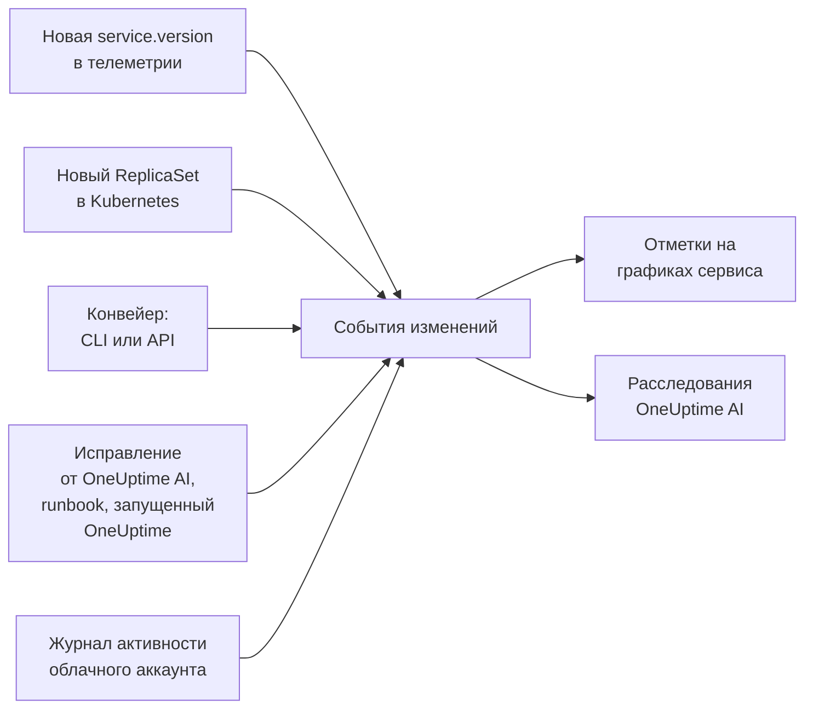

# Развёртывания и изменения

OneUptime записывает, что менялось в вашем проекте: развёртывания, выкатки в Kubernetes, изменения конфигурации, изменения в ваших подключённых облачных аккаунтах и исправления, которые он выполнил сам. Каждое изменение отображается отметкой на графиках своего сервиса или облачного ресурса, а OneUptime AI читает изменения, когда расследует инцидент, поэтому «всё началось сразу после развёртывания в 10:02» — это первое, что вы узнаёте, а не последнее.

:::cards
- [Что OneUptime записывает сам](#что-oneuptime-записывает-сам): Развёртывания и выкатки из телеметрии, изменения ваших облачных аккаунтов и собственные исправления.
- [Запись развёртывания из конвейера](#запись-развёртывания-из-конвейера): CLI, GitHub Actions и API.
- [Как OneUptime AI использует изменения](#как-oneuptime-ai-использует-изменения): Подозреваемые изменения в каждом расследовании.
- [Справочник](#справочник): Поля, атрибуты и ограничения.
:::

## Как это работает



## Что OneUptime записывает сам

Для этого ничего не нужно отправлять. OneUptime записывает такие изменения по телеметрии, которую уже получает, и по тому, что делает сам.

| Изменение | Когда записывается | Источник |
| --- | --- | --- |
| Развёртывание | Сервис начинает сообщать `service.version`, о которой ещё не сообщал в своём окружении | `service-version` |
| Выкатка | Поды Deployment в Kubernetes начинают запускать ReplicaSet, который они ещё не запускали: новый образ, изменённая переменная окружения или ссылка на конфигурацию либо перезапуск | `kubernetes` |
| Исправление от OneUptime AI | ИИ-агент сообщает результат команды, которая что-то меняет, например `kubectl rollout restart` | `oneuptime-ai` |
| Runbook | Runbook, запущенный OneUptime, завершается успешно или сбоем либо отменяется после запуска | `runbook` |
| Изменение в облаке | Журнал активности подключённого облачного аккаунта записывает изменение: AWS CloudTrail, журнал активности Azure или журнал аудита Admin Activity в Google Cloud | `cloud` |
| Событие провайдера | Облачный провайдер публикует событие состояния об аккаунте: AWS Health, Azure Service Health или Resource Health либо Google Cloud Service Health | `cloud-health` |

- **Первая версия, о которой сообщает сервис, — это его исходная точка, а не развёртывание.** Сервис, который работает месяцами, не развёртывается в тот момент, когда OneUptime начинает получать его телеметрию.
- **Откат на версию, которая встречалась за последние 30 дней, не записывается,** потому что эта версия не новая. Откат, который выполняет OneUptime AI, записывается как исправление.
- **После 6 новых версий или ReplicaSet за час следующие не записываются, пока этот час не закончится.** Иначе «версия», которая меняется с каждым подом, например метка времени сборки, записывала бы развёртывание для каждого пода.

Развёртывание записывается только для сервиса, который сообщает `service.version`. Задайте этот атрибут вместе с окружением и коммитом в атрибутах ресурса вашего OpenTelemetry SDK или коллектора:

```bash
OTEL_RESOURCE_ATTRIBUTES="service.version=2.3.1,deployment.environment.name=production,vcs.ref.head.revision=$GIT_SHA"
```

Для выкаток нужен [агент Kubernetes](/docs/telemetry/kubernetes-agent): он помечает телеметрию каждого пода его Deployment и ReplicaSet.

Для изменения в облаке или события провайдера нужен [подключённый облачный аккаунт](/docs/telemetry/cloud-accounts). Каждое из них привязывается к облачному ресурсу, который оно называет, если этот ресурс есть в списке OneUptime, и отображается на графиках этого ресурса. Тип берётся из операции: `deployment`, `scaling` или `rollback`, когда об этом говорит название операции, иначе `config-change`, и `provider-event` для события состояния. Графики, не отфильтрованные ни по одному ресурсу, не показывают журнал активности облачного аккаунта, чтобы загруженный аккаунт не вытеснял ваши развёртывания; события состояния провайдера на них остаются.

## Запись развёртывания из конвейера

Конвейер может записать развёртывание или любое другое изменение в момент, когда оно происходит: изменение конфигурации, миграцию, флаг функции. Он пишет с ключом приёма телеметрии вашего проекта — таким же, с каким ваши приложения отправляют телеметрию. Создайте его в разделе **Настройки проекта → Телеметрия и APM → Ключи приема**.

Ключ, закреплённый за одним сервисом, записывает каждое изменение под этим сервисом.

:::tabs
@tab CLI
```bash
oneuptime deploy \
  --service checkout \
  --service-version 2.3.1 \
  --commit "$GIT_SHA" \
  --environment production \
  --url https://oneuptime.com \
  --ingestion-key "$ONEUPTIME_TELEMETRY_INGESTION_KEY"
```
@tab GitHub Actions
```yaml title=".github/workflows/deploy.yml"
- name: Record the deploy in OneUptime
  env:
    ONEUPTIME_URL: https://oneuptime.com
    ONEUPTIME_TELEMETRY_INGESTION_KEY: ${{ secrets.ONEUPTIME_TELEMETRY_INGESTION_KEY }}
  run: |
    npx -y @oneuptime/cli deploy \
      --service checkout \
      --service-version "${{ github.ref_name }}" \
      --commit "${{ github.sha }}" \
      --repository "${{ github.server_url }}/${{ github.repository }}" \
      --environment production
```
@tab API
```bash
curl -X POST https://oneuptime.com/telemetry/change-events/v1/ingest \
  -H "Content-Type: application/json" \
  -H "x-oneuptime-token: $ONEUPTIME_TELEMETRY_INGESTION_KEY" \
  -d '{"events": [{"serviceName": "checkout", "version": "2.3.1", "commit": "1a2b3c4", "environment": "production"}]}'
```
:::

На собственном экземпляре OneUptime используйте свой адрес вместо `https://oneuptime.com`. API отвечает, сколько событий он сохранил и сколько пропустил:

```json
{ "ingested": 1, "skipped": 0 }
```

Все параметры CLI описаны в разделе [`oneuptime deploy`](/docs/cli/command-reference#oneuptime-deploy).

## Как OneUptime AI использует изменения

Каждое [ИИ-расследование](/docs/ai/ai-sre) инцидента или оповещения начинается с изменений, записанных за 2 часа до него и в течение 10 минут после — для конвейера, который записывает своё развёртывание, когда выкатка уже завершилась. Первыми идут изменения на сервисах, кластерах, хостах и облачных ресурсах, с которыми связан инцидент.

Максимум для 4 из них, в которых указан сервис, OneUptime читает телеметрию сервиса за 30 минут до и после изменения и помечает изменение как **подозреваемое**, если сразу после него работа сервиса заметно ухудшилась:

| Сигнал | Подозреваемое, если |
| --- | --- |
| Неудачные спаны | Доля ошибок как минимум удвоилась и выросла как минимум на один процентный пункт, при не менее чем 10 неудачных спанах |
| Задержка | p99 выросла как минимум в полтора раза и как минимум на 100 мс |
| Исключения | Как минимум втрое больше в минуту и не менее 10 исключений |
| Новые исключения | Тип исключения, впервые замеченный в версии, которую выкатило изменение, в промежутке от 10 минут до изменения до 30 минут после него, встретился не менее 3 раз |

OneUptime решает, какое изменение подозреваемое, по этим числам, а не по тому, что написано в заголовке изменения. Расследование сначала проверяет подозреваемое изменение, говорит, вызвало ли оно инцидент, и говорит, будет ли откат самым быстрым безопасным исправлением.

Если подозреваемое изменение — выкатка в Kubernetes на кластере, где включены [ИИ-исправления](/docs/ai/ai-sre#как-работают-исправления), OneUptime AI первым делом откатывает её командой `kubectl rollout undo`, которую OneUptime строит по записанному изменению. Развёртывание с новым кодом откатывается через свои коммиты: расследование называет коммит или pull request, который всё сломал, чтобы [запрос на слияние с исправлением](/docs/ai/ai-sre#автоматические-исправления-кода) мог отменить именно его.

OneUptime также сам проверяет каждое развёртывание, независимо от того, оповестили ли кого-нибудь. Когда истекают 30 минут после развёртывания, он сравнивает их с 30 минутами до него по тем же порогам, и если сервису стало хуже, [ИИ-инсайт](/docs/ai/ai-sre#инсайты-упреждающее-обнаружение) называет это развёртывание на этом сервисе.

Запрос на слияние с исправлением, который открыл OneUptime AI, проверяется так же: когда записанное развёртывание содержит его коммит, OneUptime следит там за тем, для чего было исправление, - за исключением, за операцией, которую оно ускорило, за монитором, стоящим за инцидентом или оповещением, за телеметрией, которую оно добавляет, - и сообщает, сработало ли исправление (см. [Автоматические исправления кода](/docs/ai/ai-sre#автоматические-исправления-кода)). Развёрнутое исправление читается в версии развёртывания только тогда, когда собственная телеметрия сервиса сообщает эту версию, а иначе с 10 минут после развёртывания, когда старые экземпляры уже остановлены.

В расследовании и в [Спросить ИИ](/docs/ai/ask-ai) инструмент `recent_changes` выводит изменения за любой интервал, а `get_change_details` показывает, что вошло в развёртывание: коммиты с предыдущего развёртывания сервиса, их авторов, pull request'ы и файлы, которые они затронули. Для этого нужен коммит в изменении и его репозиторий, подключённый в разделе «Код»: через [GitHub App](/docs/ai/github-app) или подключение к GitLab, Forgejo или Gitea (см. [Подключение репозитория](/docs/ai/ai-agent#подключение-репозитория)).

## Справочник

### Поля

| Поле | Что это |
| --- | --- |
| `title` | Что изменилось, например `Deploy 2.3.1`. Развёртывание, которое передаёт `version`, может его опустить |
| `eventType` | Вид изменения: `deployment` (по умолчанию), `config-change`, `scaling`, `rollback`, `feature-flag` или ваш собственный |
| `serviceName` | Сервис, к которому относится изменение. Без него изменение относится ко всему проекту |
| `time` | Когда оно произошло: в формате ISO 8601 или в секундах либо миллисекундах Unix-времени. По умолчанию — время поступления |
| `description` | Подробности изменения |
| `version` | Развёрнутая версия |
| `previousVersion` | Версия, которую она заменила |
| `commit` | Развёрнутый коммит (также `commitSha` или `sha`) |
| `repository` | Репозиторий коммита (также `repositoryUrl`) |
| `branch` | Развёрнутая ветка |
| `pullRequest` | Развёрнутый pull request |
| `environment` | Окружение, в которое выполнено развёртывание |
| `attributes` | До 50 дополнительных атрибутов в виде текста, чисел или логических значений |

Поля верхнего уровня сохраняются как атрибуты под именами OpenTelemetry: `version` как `service.version`, `commit` как `vcs.ref.head.revision`, `repository` как `vcs.repository.url.full`, `branch` как `vcs.ref.head.name`, `pullRequest` как `vcs.change.id` и `environment` как `deployment.environment.name`. Атрибут, переданный под одним из этих имён, имеет приоритет над своим полем.

Атрибуты, имена которых начинаются с `oneuptime.`, принадлежат самому OneUptime и отбрасываются из того, что отправляет конвейер. Каждое изменение, записанное конвейером, сообщает об этом в `oneuptime.change.source`, где указано `api`.

Изменение, прочитанное из облачного аккаунта, называет аккаунт и ресурс под именами OpenTelemetry — `cloud.provider`, `cloud.account.id`, `cloud.region` и `cloud.resource_id` — и хранит операцию в `oneuptime.cloud.operation`, того, кто её выполнил, в `oneuptime.cloud.actor`, то, завершилась ли она сбоем, в `oneuptime.change.status`, а облачный аккаунт в `oneuptime.cloud_account.id`.

### Ограничения

| Ограничение | Значение |
| --- | --- |
| События в одном запросе | 100 |
| Заголовок | 500 символов |
| Описание | 5 000 символов |
| Атрибуты | 50 |
| Время | Время более чем на 366 дней в прошлом или более чем на 60 минут в будущем заменяется временем поступления события |

## Дальнейшие шаги

:::cards
- [AI SRE](/docs/ai/ai-sre): Что читает расследование и как оно исправляет найденное.
- [Справочник команд](/docs/cli/command-reference): Каждая команда CLI.
- [OpenTelemetry](/docs/telemetry/open-telemetry): Отправлять телеметрию ваших сервисов вместе с их версиями.
- [Подключение облачного аккаунта](/docs/telemetry/cloud-accounts): Изменения и события состояния ваших аккаунтов AWS, Azure и Google Cloud.
:::
