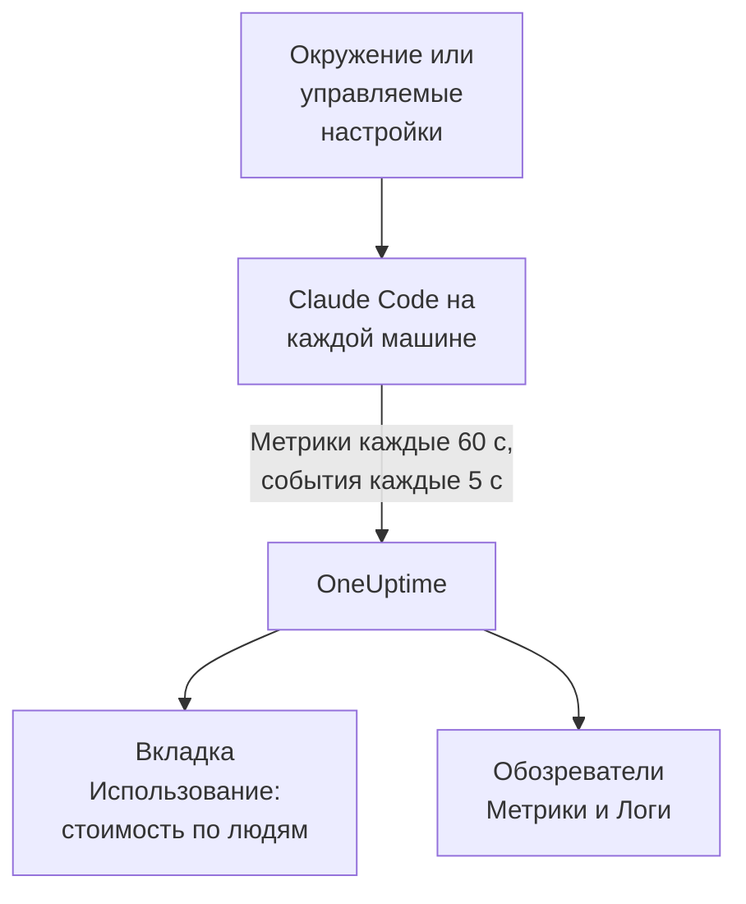

# Claude Code

Claude Code сам экспортирует метрики и события OpenTelemetry прямо в OneUptime: без коллектора и без шлюза посередине. Включите его несколькими переменными окружения или для всего парка одним файлом управляемых настроек и смотрите стоимость, токены, сессии, коммиты и принятые правки по каждому разработчику.

:::cards
- [Настройка одной машины](#настройка-одной-машины): Шесть переменных окружения и перезапуск.
- [Внедрение на весь парк](#внедрение-на-весь-парк): Один файл управляемых настроек на каждой машине.
- [Привязка расходов к людям](#привязка-использования-к-людям-и-командам): Кто выполнил вход и когда идентичность нужно задать самостоятельно.
- [Устранение неполадок](#устранение-неполадок): Что проверить, если ничего не приходит.
:::

## Как это работает



Claude Code отправляет:

- **Стоимость и токены**: `claude_code.cost.usage` (USD) и `claude_code.token.usage` — по модели, по основному агенту или субагенту и по агенту, навыку, плагину или MCP-серверу, сделавшему вызов.
- **Активность**: сессии, коммиты, pull request'ы, добавленные и удалённые строки кода и активное время.
- **Решения по правкам**: `claude_code.code_edit_tool.decision` считает принятые и отклонённые правки, поэтому доля принятых — это `accept / (accept + reject)`, по языку и по инструменту.
- **События**: промпты, результаты инструментов, запросы и ошибки API, смены режима разрешений и подключения к MCP-серверам — в виде записей логов OTLP.

Каждая точка данных метрики и каждое событие несут `user.email`, когда разработчик вошёл с аккаунтом Claude, и OneUptime читает его как сотрудника в метриках, где находятся стоимость и токены.

## Перед началом

1. Создайте ключ приёма телеметрии в разделе **Настройки проекта → Телеметрия и APM → Ключи приема**.
2. Ваш OTLP-адрес — `https://oneuptime.com/otlp` или `https://YOUR-ONEUPTIME-HOST/otlp`, если вы размещаете OneUptime у себя.
3. Используйте один ключ на весь парк. Он окажется на каждой машине разработчика, поэтому относитесь к нему как к общему секрету, который может только отправлять данные, и меняйте его, как любой другой.

## Настройка одной машины

:::steps
### Экспортируйте переменные

Добавьте их в профиль оболочки (`.zshrc` или `.bashrc`) или экспортируйте в терминале, из которого запускаете Claude Code:

```bash
export CLAUDE_CODE_ENABLE_TELEMETRY=1
export OTEL_METRICS_EXPORTER=otlp
export OTEL_LOGS_EXPORTER=otlp
export OTEL_EXPORTER_OTLP_PROTOCOL=http/protobuf
export OTEL_EXPORTER_OTLP_ENDPOINT="https://oneuptime.com/otlp"
export OTEL_EXPORTER_OTLP_HEADERS="x-oneuptime-token=YOUR_INGESTION_TOKEN"
```

| Переменная | Что делает |
| --- | --- |
| `CLAUDE_CODE_ENABLE_TELEMETRY` | Главный переключатель: без него ничего не экспортируется. |
| `OTEL_METRICS_EXPORTER`, `OTEL_LOGS_EXPORTER` | `otlp` отправляет в OneUptime. `otlp,console` дополнительно печатает отправляемое — удобно во время настройки. |
| `OTEL_EXPORTER_OTLP_PROTOCOL` | `http/protobuf`; `http/json` и `grpc` тоже работают. |
| `OTEL_EXPORTER_OTLP_ENDPOINT` | Базовый URL. Claude Code сам добавляет `/v1/metrics` и `/v1/logs`. |
| `OTEL_EXPORTER_OTLP_HEADERS` | Пары `key=value` через запятую; здесь — ваш ключ приёма. |

### Перезапустите Claude Code

Переменные читаются при запуске Claude Code. Метрики отправляются каждые 60 секунд, события — каждые 5 секунд, поэтому поработайте в Claude Code минуту, прежде чем смотреть.

### Проверьте, что данные приходят

Откройте **Метрики** и найдите `claude_code.token.usage`, затем откройте **Продукты → AI / LLM** и перейдите на вкладку **Использование**: ваша стоимость показана под вашим email с пометкой **из метрик GenAI**.
:::

Чтобы отправлять метрики и события в разные места, задайте вместо этого `OTEL_EXPORTER_OTLP_METRICS_ENDPOINT` и `OTEL_EXPORTER_OTLP_LOGS_ENDPOINT` с полным путём (`https://oneuptime.com/otlp/v1/metrics`, `https://oneuptime.com/otlp/v1/logs`).

## Внедрение на весь парк

Для организации распространите те же переменные в файле управляемых настроек. У него форма `settings.json`, а переменные находятся в блоке `env`:

```json title="managed-settings.json"
{
  "env": {
    "CLAUDE_CODE_ENABLE_TELEMETRY": "1",
    "OTEL_METRICS_EXPORTER": "otlp",
    "OTEL_LOGS_EXPORTER": "otlp",
    "OTEL_EXPORTER_OTLP_PROTOCOL": "http/protobuf",
    "OTEL_EXPORTER_OTLP_ENDPOINT": "https://oneuptime.com/otlp",
    "OTEL_EXPORTER_OTLP_HEADERS": "x-oneuptime-token=YOUR_INGESTION_TOKEN",
    "OTEL_RESOURCE_ATTRIBUTES": "team.id=platform,cost_center=eng-123"
  }
}
```

:::steps
### Положите файл туда, где его читает Claude Code

| Платформа | Путь |
| --- | --- |
| macOS | `/Library/Application Support/ClaudeCode/managed-settings.json` |
| Linux и WSL | `/etc/claude-code/managed-settings.json` |
| Windows | `C:\Program Files\ClaudeCode\managed-settings.json` |

Claude Code больше не читает старый путь Windows `C:\ProgramData\ClaudeCode\managed-settings.json`. Если вы уже распространяете файл управляемых настроек, добавьте вместо этого дополнительный файл, например `managed-settings.d/10-telemetry.json` рядом с ним: Claude Code сначала объединяет `managed-settings.json`, затем каждый файл `*.json` в `managed-settings.d/` в алфавитном порядке.

### Проверьте одну машину

Выполните `/status` в Claude Code. Строка `Setting sources` должна показывать `Enterprise managed settings (file)`, либо `(drop-ins)` или `(file + drop-ins)` для дополнительного файла. Другой источник в скобках означает, что победил источник с более высоким приоритетом, а ваш не использовался.

### Наблюдайте, как подключается парк

На вкладке **Использование** каждый разработчик появляется отдельной строкой, как только поработает в Claude Code с новыми настройками.
:::

Тот же JSON может приходить и из управляемых сервером настроек в консоли администратора claude.ai (загружаются при запуске и каждый час), из профиля конфигурации macOS в домене `com.anthropic.claudecode` или из значения `Settings` в `HKLM\SOFTWARE\Policies\ClaudeCode` в Windows.

:::details Какой управляемый источник побеждает и как объединяются переменные телеметрии
По умолчанию Claude Code использует источник с наивысшим приоритетом, задающий хоть один ключ политики, и игнорирует остальные: управляемые сервером настройки, затем политика MDM или ОС, затем файлы управляемых настроек, затем значение реестра `HKCU` для пользователя. Исключение — блок `env`: начиная с версии 2.1.223 он объединяется по отдельным переменным из всех административных источников.

Переменные телеметрии — нет: переменные `OTEL_EXPORTER_OTLP_*`, переключатели содержимого `OTEL_LOG_*`, `OTEL_LOGS_EXPORTER` и переменные бета-трассировки берутся вместе из источника с наивысшим приоритетом, задающего хоть одну из них, поэтому адрес из одного источника никогда не сочетается с учётными данными из другого. Если источник с более высоким приоритетом задаёт хоть одну из них, дополнительный файл телеметрии ничего не добавляет.

Управляемым сервером настройкам нужен ещё один шаг: непустой `OTEL_EXPORTER_OTLP_ENDPOINT` применяется только после того, как каждый разработчик подтвердит диалог безопасности в интерактивной сессии, а изменения настроек экспортёра вступают в силу при следующем запуске. У файлов и политик MDM диалога нет.
:::

:::details Смена ключа приёма без правки каждой машины
Вместо фиксированного заголовка задайте в настройках `"otelHeadersHelper": "/path/to/generate-otel-headers.sh"`. Скрипт печатает плоский JSON-объект заголовков, например `{"x-oneuptime-token":"..."}`. Claude Code запускает его при старте и затем повторно с интервалом `CLAUDE_CODE_OTEL_HEADERS_HELPER_DEBOUNCE_MS` миллисекунд (по умолчанию `1740000`, 29 минут). Ошибки видны в `/status`.
:::

## Привязка использования к людям и командам

**Сотрудник — это `user.email`.** Claude Code отправляет его, когда разработчик вошёл с аккаунтом Claude, и переменной для отключения нет. OneUptime читает его из каждой точки данных стоимости и токенов без настройки.

**Другие способы входа не отправляют email.** С ключом API или с Claude в Amazon Bedrock, Google Cloud или Microsoft Foundry в сессии нет аккаунта Claude, и Claude Code отправляет только `user.id` и `session.id`. Задайте идентичность сами, для каждой машины, в управляемых настройках или в скрипте запуска:

```bash
export OTEL_RESOURCE_ATTRIBUTES="user.email=jdoe@example.com,team.id=platform"
```

**`user.id` — это не человек.** Это случайный идентификатор, который Claude Code записывает в `~/.claude.json` при первом запуске: один на установку и новый, если файл удалён. Без email каждая установка отображается отдельной строкой. Одно исключение: сессия, выполнившая вход через шлюз приложений Claude, отправляет идентичность входа (`user.id` — субъект поставщика удостоверений, `user.email` — email) и игнорирует ключи `user.*`, которые вы задали сами.

**Команды и центры затрат** берутся из `OTEL_RESOURCE_ATTRIBUTES`: OneUptime читает `team.id`, `team`, `cost_center` и `department`. Значения не могут содержать пробелов, и кавычки их не спасают: пишите `team=Platform_Engineering` или используйте процентное кодирование, как в `team=Platform%20Engineering`. Claude Code копирует эти ключи в каждую точку данных (`OTEL_METRICS_INCLUDE_RESOURCE_ATTRIBUTES`, включено по умолчанию), и OneUptime читает их в любом случае. Ключ, заданный вами, никогда не переопределяет ключ, который Claude Code задаёт сам.

## Что показывает OneUptime

На **Продукты → AI / LLM → Использование** метрика `claude_code.cost.usage` питает таблицы **Сотрудник**, **Команда** и **Модель**, а `claude_code.token.usage` — итоги токенов. То, что вы видите, определяют два правила:

- **Метрики дополняют спаны и никогда не прибавляются к ним.** Если тот же проект получает спаны GenAI со стоимостью от ваших собственных приложений, расходы Claude Code не отображаются. Отправляйте Claude Code в отдельный проект. См. [Сначала спаны, метрики дополняют](/docs/telemetry/ai-llm-observability#сначала-спаны-метрики-дополняют).
- **Строка из метрик несёт только стоимость.** Её ячейки вызовов и токенов показывают `—`, а таблицы **Провайдер** и **Приложение / Сервис** остаются пустыми: метрики не называют провайдера и не принадлежат ни одному сервису OneUptime.

Всё остальное — долю принятых правок, строки кода, коммиты и pull request'ы по разработчикам или расходы по `query_source` — вы выводите на [дашборд](/docs/dashboards/index) по метрикам ниже и настраиваете по ним оповещения с помощью [мониторинга метрик](/docs/monitor/metrics-monitor).

## Метрики

Каждая метрика — счётчик и несёт стандартные атрибуты в дополнение к собственным.

| Метрика | Единица | Собственные атрибуты |
| --- | --- | --- |
| `claude_code.session.count` | нет | `start_type`: `fresh`, `resume`, `continue`, `agents_view` |
| `claude_code.lines_of_code.count` | нет | `type`: `added`, `removed`; `model` |
| `claude_code.commit.count` | нет | нет |
| `claude_code.pull_request.count` | нет | нет |
| `claude_code.cost.usage` | USD | `model`; `query_source`: `main`, `subagent`, `auxiliary`; `speed`: `fast`, `normal`; `effort`; `agent.name`, `skill.name`, `plugin.name`, `marketplace.name`, `mcp_server.name`, `mcp_tool.name` |
| `claude_code.token.usage` | токены | `type`: `input`, `output`, `cacheRead`, `cacheCreation`; и те же атрибуты, что у `claude_code.cost.usage` |
| `claude_code.code_edit_tool.decision` | нет | `tool_name`: `Edit`, `Write`, `NotebookEdit`; `decision`: `accept`, `reject`; `source`; `language` |
| `claude_code.active_time.total` | с | `type`: `user` (за клавиатурой), `cli` (инструменты и ответы модели) |

Стандартные атрибуты — `session.id`, `app.version`, `app.entrypoint`, `organization.id`, `user.account_uuid`, `user.account_id`, `user.id`, `user.email` и `terminal.type`, плюс ваши `OTEL_RESOURCE_ATTRIBUTES`. Некоторые из них можно отключить: см. [Снижайте объём метрик](#снижайте-объём-метрик).

- Типы токенов кэша пишутся в camelCase: `cacheRead` и `cacheCreation`. Итоги токенов в OneUptime учитывают только `input` и `output`.
- В метриках стоимости и токенов имена ваших собственных агентов и MCP-серверов, а также сторонних плагинов и навыков отображаются как `custom` или `third-party`, если не задано `OTEL_LOG_TOOL_DETAILS=1` (Claude Code 2.1.273 или новее).

## События

События приходят как записи логов OTLP, каждая с `event.name`, `event.timestamp` и `event.sequence`. Те, что вам понадобятся чаще всего:

| Событие | Что записывает |
| --- | --- |
| `claude_code.user_prompt` | Промпт: его длину и команду; текст — только если вы это включили |
| `claude_code.api_request` | Запрос к модели: `model`, `cost_usd`, `cost_usd_micros`, `duration_ms`, `input_tokens`, `output_tokens`, токены кэша |
| `claude_code.api_error` | Запрос, завершившийся ошибкой после повторов: `model`, `error`, `status_code`, `attempt` |
| `claude_code.tool_result` | Запуск инструмента: `tool_name`, `success`, `duration_ms` и решение, которое его разрешило |
| `claude_code.tool_decision` | Был ли инструмент разрешён и чем |
| `claude_code.mcp_server_connection` | Подключение MCP-сервера или его сбой |

Claude Code отправляет и многие другие события, например отказы, смены режима разрешений и события плагинов, хуков и навыков: все они перечислены в [справочнике по мониторингу](https://code.claude.com/docs/en/monitoring-usage) Anthropic. В `cost_usd_micros` стоимость — целое число миллионных долей USD, которое суммируется без накопления ошибок округления.

## Снижайте объём метрик

По умолчанию Claude Code ставит `session.id` в каждую точку данных, и каждая сессия — это новый ряд. В масштабах парка один этот атрибут раздувает объём метрик, а для отчётов о стоимости он не нужен:

```bash
export OTEL_METRICS_INCLUDE_SESSION_ID=false
```

| Переменная | По умолчанию | Добавляет |
| --- | --- | --- |
| `OTEL_METRICS_INCLUDE_SESSION_ID` | `true` | `session.id`, новое значение в каждой сессии |
| `OTEL_METRICS_INCLUDE_VERSION` | `false` | `app.version` |
| `OTEL_METRICS_INCLUDE_ACCOUNT_UUID` | `true` | `user.account_uuid` и `user.account_id` |
| `OTEL_METRICS_INCLUDE_ENTRYPOINT` | `false` | `app.entrypoint` |
| `OTEL_METRICS_INCLUDE_RESOURCE_ATTRIBUTES` | `true` | Ваши ключи из `OTEL_RESOURCE_ATTRIBUTES` |
| `OTEL_METRICS_INCLUDE_REPOSITORY` | `false` | Атрибуты репозитория `vcs.*` |

У `user.email`, `user.id`, `organization.id` и `terminal.type` переключателя нет. События — самый интенсивный сигнал: каждый активный разработчик отправляет их каждые 5 секунд (`OTEL_LOGS_EXPORT_INTERVAL`, в миллисекундах). Увеличьте значение, чтобы отправлять реже и крупнее, или задайте `OTEL_LOGS_EXPORTER=none`, если вам нужны только стоимость и использование, которые целиком есть в метриках.

## Содержимое промптов и инструментов по умолчанию выключено

Claude Code не экспортирует промпты, ответы, аргументы и вывод инструментов, пока вы не включите каждое из них:

| Переменная | По умолчанию | Что включает `1` |
| --- | --- | --- |
| `OTEL_LOG_USER_PROMPTS` | выкл. | Текст промптов |
| `OTEL_LOG_ASSISTANT_RESPONSES` | выкл. | Текст ответов; если не задана, следует `OTEL_LOG_USER_PROMPTS` |
| `OTEL_LOG_TOOL_DETAILS` | выкл. | Параметры инструментов, команды Bash и настоящие имена агентов, плагинов, навыков и MCP-серверов |
| `OTEL_LOG_TOOL_CONTENT` | выкл. | Ввод и вывод инструментов, только в спанах трассировки |
| `OTEL_LOG_RAW_API_BODIES` | выкл. | Полные тела запросов и ответов API (`file:<dir>` вместо этого пишет их на диск) |

Рекомендуем оставить их выключенными: метрики и замаскированные события уже отвечают, кто что потратил, на какой модели и с какой долей принятых правок. Сбор содержимого переносит промпты, исходный код и вывод инструментов в хранилище телеметрии с иными правами доступа, чем у ваших репозиториев. Если вы включаете его для расследования, `CLAUDE_CODE_OTEL_CONTENT_MAX_LENGTH` (по умолчанию `61440`) ограничивает объём на одну запись, а **Правила очистки** и **Фильтры отбрасывания** трассировок в разделе **Трассировка → Настройки** маскируют или отбрасывают его до сохранения.

## Метрики приходят как дельты

По умолчанию Claude Code отправляет дельта-метрики: каждая точка данных — это прирост с момента последнего экспорта, а не нарастающий итог. Строя графики или настраивая оповещения, суммируйте точки данных за окно и не применяйте функцию скорости или сброса счётчика, как для накопительного счётчика: цифры получатся неверными, но не будут выглядеть сломанными.

```bash
export OTEL_EXPORTER_OTLP_METRICS_TEMPORALITY_PREFERENCE=cumulative
```

Фиксируйте `cumulative`, только если его используют все экспортёры вашей организации, и не смешивайте эти режимы в одном парке.

## Трассировки (бета)

У Claude Code есть и бета-экспортёр трассировок, который рисует каждое взаимодействие как дерево спанов: `claude_code.interaction`, а под ним `claude_code.llm_request` и `claude_code.tool`.

```bash
export CLAUDE_CODE_ENHANCED_TELEMETRY_BETA=1
export OTEL_TRACES_EXPORTER=otlp
```

> [!WARNING]
> Не отправляйте бета-трассировки в проект, который вы используете для учёта расходов. Их спаны модели несут `gen_ai.system` и `gen_ai.request.model`, поэтому OneUptime показывает их на вкладке **Вызовы**, но их токены лежат в `input_tokens` и `output_tokens`, а не в ключах `gen_ai.usage.*`, так что они приходят без токенов и без стоимости. Как только они появляются, таблицы **Сотрудник**, **Команда** и **Модель** показывают именно их строки, по $0, вместо расходов из метрик.

В сессиях Agent SDK и неинтерактивных сессиях `-p` Claude Code подхватывает входящий `TRACEPARENT`, и его спаны присоединяются к трассировке вызывающей стороны; интерактивные сессии его игнорируют. Заголовок `traceparent` отправляется модели, только когда `ANTHROPIC_BASE_URL` не задан или указывает на API Anthropic; за вашим собственным прокси задайте `CLAUDE_CODE_PROPAGATE_TRACEPARENT=1`.

## Устранение неполадок

:::details Не приходит вообще ничего
Сначала проверьте `CLAUDE_CODE_ENABLE_TELEMETRY=1`: без неё никакая другая переменная ничего не делает. Затем добавьте `console` к экспортёрам (`OTEL_METRICS_EXPORTER=otlp,console`) и смотрите в терминал: если точки данных печатаются, Claude Code работает, а проблема в адресе, ключе или сети.
:::

:::details Файл управляемых настроек, похоже, игнорируется
Выполните `/status` и прочитайте строку `Setting sources`. Если управляемый источник не указан, файл лежит не по тому пути, не является корректным JSON или недоступен для чтения учётной записи разработчика. Если указан другой источник, победил он, а ваш не использовался. Управляемые сервером настройки к тому же ждут, пока разработчик подтвердит диалог в интерактивной сессии.
:::

:::details Расходы отображаются как Без привязки или отдельной строкой на каждую установку
Эти разработчики не вошли с аккаунтом Claude: они используют ключ API, Amazon Bedrock, Google Cloud или Microsoft Foundry. Задайте для них `user.email` в `OTEL_RESOURCE_ATTRIBUTES`, как показано в разделе [Привязка использования к людям и командам](#привязка-использования-к-людям-и-командам).
:::

:::details Нет команды или центра затрат
Проверьте, что `OTEL_RESOURCE_ATTRIBUTES` задана на машине, не содержит пробелов и не использует повторно ключ, который Claude Code задаёт сам: побеждает значение Claude Code.
:::

:::details Цифры кажутся слишком маленькими или слишком большими
Claude Code отправляет дельты: суммируйте точки данных за окно, как объясняет раздел [Метрики приходят как дельты](#метрики-приходят-как-дельты). И подождите полную минуту: метрики отправляются каждые 60 секунд.
:::

:::details Ключ отклоняется
OneUptime отклоняет неверный `x-oneuptime-token`. Скопируйте ключ заново из **Настройки проекта → Телеметрия и APM → Ключи приема** и проверьте, что заголовок выглядит как `x-oneuptime-token=YOUR_INGESTION_TOKEN` без пробелов вокруг `=`.
:::

## Дальнейшие шаги

:::cards
- [ИИ-ассистенты для программирования](/docs/telemetry/ai-coding-assistants): Как расходы привязываются для всех ассистентов для программирования.
- [Наблюдаемость ИИ / LLM](/docs/telemetry/ai-llm-observability): Разговоры, оповещения, стоимость и бюджеты для ваших собственных ИИ-вызовов.
- [Мониторинг метрик](/docs/monitor/metrics-monitor): Оповещения о расходах или токенах по разработчикам.
:::
