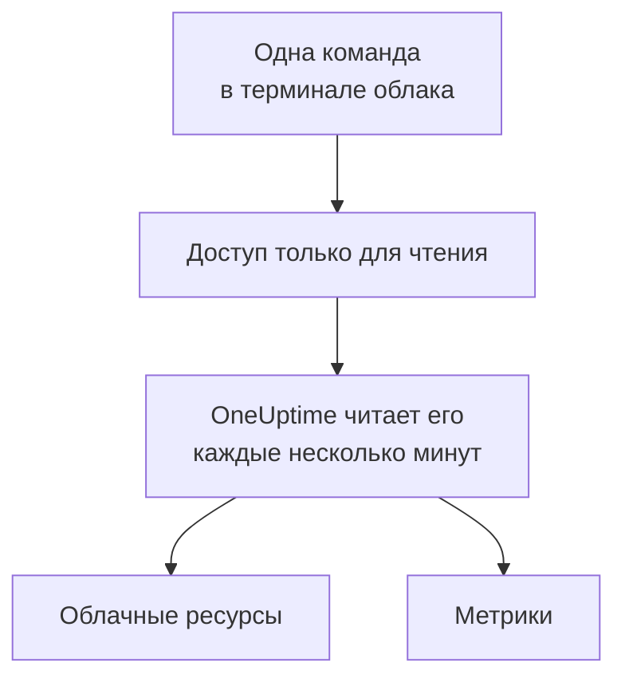

# Подключение облачного аккаунта

Подключите аккаунт AWS, подписку Azure или проект Google Cloud из панели управления, и OneUptime получит список их ресурсов и будет читать их ключевые метрики по расписанию. Вы выполняете одну команду в браузерном терминале своего облака и вставляете то, что она выведет: не нужно запускать коллектор и ничего устанавливать.

:::cards
- [Amazon Web Services](#amazon-web-services): Роль IAM, под которой входит OneUptime, или ключ доступа.
- [Microsoft Azure](#microsoft-azure): Приложение с ролью Monitoring Reader.
- [Google Cloud](#google-cloud): Сервисный аккаунт с ролью Monitoring Viewer.
- [Что читает OneUptime](#что-читает-oneuptime): Какие ресурсы и метрики, как часто и сколько это стоит.
:::

## Как это работает



- **Доступ позволяет только читать.** Команда создаёт доступ, который читает метрики и ничего больше: три действия чтения в AWS, роль **Monitoring Reader** в Azure и роль **Monitoring Viewer** в Google Cloud. Удалите его, чтобы отключить OneUptime.
- **OneUptime читает по расписанию.** Каждые 5 минут для Azure и Google Cloud и каждые 10 минут для AWS, если при подключении вы не выберете другой интервал.
- **У каждого ресурса своя страница.** Ресурсы появляются в разделе **Облако → Все ресурсы** со своими ключевыми метриками, владельцами и метками, как ресурсы, о которых сообщает коллектор.

## Перед началом

- **Владелец или администратор проекта.** Только они могут подключать, проверять и изменять облачные аккаунты.
- **Терминал вашего облака** (AWS CloudShell, Azure Cloud Shell или Google Cloud Shell), в который вошёл тот, кто может создать роль или пользователя IAM, регистрацию приложения или сервисный аккаунт.

## Amazon Web Services

:::steps
### Откройте форму AWS

Перейдите в **Облако → Подключить** и выберите **Amazon Web Services**.

### Выполните команду в AWS CloudShell

Выберите, как будет входить OneUptime. **Роль IAM** — рекомендуемый способ: ничего секретного не хранится, и роль можно удалить в любой момент. Форма показывает команду, написанную для вашего проекта: она создаёт роль, которая доверяет аккаунту AWS OneUptime с внешним ID вашего проекта, и выводит ARN роли. Используйте **Ключ доступа**, если роль невозможна. Эта команда создаёт пользователя с теми же разрешениями и выводит его ключ:

```bash
aws iam create-user --user-name OneUptimeReadOnly > /dev/null 2>&1 || true
aws iam put-user-policy --user-name OneUptimeReadOnly --policy-name OneUptimeReadOnly --policy-document '{"Version":"2012-10-17","Statement":[{"Effect":"Allow","Action":["cloudwatch:GetMetricData","cloudwatch:ListMetrics","tag:GetResources"],"Resource":"*"}]}'
aws iam create-access-key --user-name OneUptimeReadOnly
```

### Вставьте то, что вывела команда AWS

Вставьте всё, что вывела команда, в поле **Что вывела команда**. OneUptime сам найдёт ARN роли или ID ключа доступа и его секрет.

### Проверьте и подключите AWS

OneUptime проверяет подключение, как только открывается этот шаг: входит, подсчитывает найденные ресурсы и сообщает, сколько стоит их чтение. Выберите **Подключить**, чтобы сохранить.
:::

Роль и пользователь могут делать три вещи, и ничего больше:

| Действие | Для чего его использует OneUptime |
| --- | --- |
| `cloudwatch:ListMetrics` | Находить ресурсы, которые отправляют метрики, в каждом регионе |
| `cloudwatch:GetMetricData` | Читать их ключевые метрики |
| `tag:GetResources` | Называть каждый ресурс по его тегу `Name` |

> [!NOTE]
> В самостоятельно размещённом OneUptime для способа **Роль IAM** нужна собственная AWS-идентичность OneUptime: задайте в `CLOUD_CONNECT_AWS_ACCESS_KEY_ID` и `CLOUD_CONNECT_AWS_SECRET_ACCESS_KEY` ключ пользователя IAM, которому разрешено вызывать `sts:AssumeRole`. Без них форма предлагает **Ключ доступа**.

## Microsoft Azure

:::steps
### Откройте форму Azure

Перейдите в **Облако → Подключить** и выберите **Microsoft Azure**.

### Выполните команду в Azure Cloud Shell

Команда создаёт приложение с ролью **Monitoring Reader** в вашей текущей подписке и выводит его данные:

```bash
az ad sp create-for-rbac --name OneUptimeReadOnly --role "Monitoring Reader" --scopes "/subscriptions/$(az account show --query id --output tsv)"
```

### Вставьте то, что вывела команда Azure

Вставьте всё, что вывела команда, в поле **Что вывела команда**. OneUptime сам найдёт `tenant`, `appId` и `password`.

### Проверьте и подключите Azure

OneUptime проверяет подключение, как только открывается этот шаг. Выберите **Подключить**, чтобы сохранить.
:::

Чтобы читать другие подписки тем же приложением, выдайте ему роль в каждой из них:

```bash
az role assignment create --assignee <APP_ID> --role "Monitoring Reader" --scope /subscriptions/<SUBSCRIPTION_ID>
```

OneUptime читает все подписки, доступные приложению, если вы не перечислите некоторые в поле **Подписки**.

## Google Cloud

:::steps
### Откройте форму Google Cloud

Перейдите в **Облако → Подключить** и выберите **Google Cloud**.

### Выполните команду в Google Cloud Shell

Выполните её в проекте, который нужно отслеживать. Она включает API Cloud Monitoring, создаёт сервисный аккаунт с ролью **Monitoring Viewer** и выводит его ключ:

```bash
PROJECT_ID=$(gcloud config get-value project)
gcloud services enable monitoring.googleapis.com
gcloud iam service-accounts create oneuptime-read-only --display-name "OneUptime (read only)"
gcloud projects add-iam-policy-binding "$PROJECT_ID" --member "serviceAccount:oneuptime-read-only@$PROJECT_ID.iam.gserviceaccount.com" --role roles/monitoring.viewer --condition=None > /dev/null
gcloud iam service-accounts keys create oneuptime-key.json --iam-account "oneuptime-read-only@$PROJECT_ID.iam.gserviceaccount.com"
cat oneuptime-key.json && rm oneuptime-key.json
```

### Вставьте ключ

Вставьте всё, что вывела команда. OneUptime читает собственный проект ключа и хранит ключ в зашифрованном виде.

### Проверьте и подключите Google Cloud

OneUptime проверяет подключение, как только открывается этот шаг. Выберите **Подключить**, чтобы сохранить.
:::

Чтобы читать другие проекты тем же сервисным аккаунтом, выдайте ему роль в каждом из них и перечислите их в поле **Проекты**:

```bash
gcloud projects add-iam-policy-binding <PROJECT_ID> --member "serviceAccount:oneuptime-read-only@<KEY_PROJECT_ID>.iam.gserviceaccount.com" --role roles/monitoring.viewer
```

## Что читает OneUptime

| | AWS | Azure | Google Cloud |
| --- | --- | --- | --- |
| Ресурсы | Те, что отправляют метрики в CloudWatch, во всех регионах, которые вы используете | Все ресурсы в подписках | Те, что отправляют метрики в Cloud Monitoring |
| Метрики | Ключевые метрики каждого сервиса, например CPU, сеть и проверки состояния инстанса | До 8 ключевых метрик на ресурс | Ключевые метрики каждого типа ресурсов |
| Чтение каждые | 10 минут | 5 минут | 5 минут |
| Удалённый ресурс | Архивируется через 7 дней без метрик | Архивируется при следующем чтении | Архивируется через 7 дней без метрик |

Каждое чтение продолжается с того места, где остановилось предыдущее, поэтому каждая точка данных записывается один раз. Первое чтение нового подключения начинается в течение минуты и охватывает последний час; после перерыва чтение охватывает не больше 6 часов.

Вызовы OneUptime оплачиваются в вашем облачном аккаунте по ценам вашего облака. Проверка оценивает стоимость найденного, а более редкое чтение стоит дешевле: измените **Как часто читать метрики** в разделе **Дополнительные поля**.

| Облако | Цена |
| --- | --- |
| AWS | CloudWatch `GetMetricData`: $0.01 за 1 000 метрик, и каждая ключевая метрика ресурса — это одна метрика за чтение |
| Azure | Первые 1 000 000 чтений метрик в месяц для каждой подписки бесплатны, затем $0.01 за 1 000 |
| Google Cloud | Первые 1 000 000 прочитанных временных рядов в месяц бесплатны, затем $0.50 за миллион |

## Устранение неполадок

:::details Проверка сообщает, что ключ или секрет не принят
Скопируйте всё, что вывела команда, и вставьте снова. Ключу, созданному минуту назад, может понадобиться минута, чтобы заработать.
:::

:::details Проверка выполняет вход, но не может читать
Выполните команду ещё раз: она выдаёт роль, которая нужна OneUptime. В AWS выполните команду, которую форма показывает для этого проекта: роль, созданная для другого проекта, доверяет внешнему ID того проекта, а не этого.
:::

:::details Google Cloud не даёт команде создать ключ
Политика организации, `iam.disableServiceAccountKeyCreation`, может запрещать ключи сервисных аккаунтов. Попросите администратора вашей организации сделать исключение для проекта или [отправляйте метрики через собственный коллектор](/docs/telemetry/cloud-resources).
:::

:::details Ресурсы не появляются
В AWS и Google Cloud ресурс появляется, когда отправляет метрики. Если подключение не работает, кнопка **View error** в разделе **Облако → Подключить** покажет, почему не удалось его последнее чтение.
:::

## Что дальше

:::cards
- [Облачные ресурсы](/docs/telemetry/cloud-resources): Запустите вместо этого собственный OpenTelemetry Collector или передавайте метрики CloudWatch потоком.
- [Монитор метрик](/docs/monitor/metrics-monitor): Оповещения по метрикам ресурса.
:::
