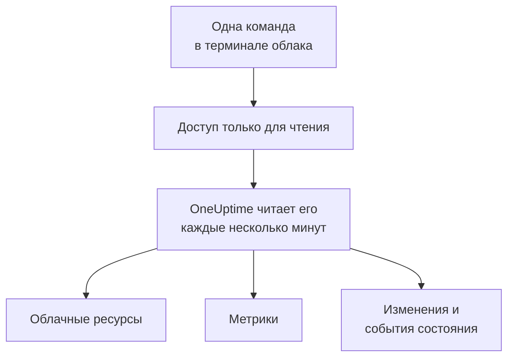

# Подключение облачного аккаунта

Подключите аккаунт AWS, подписку Azure или проект Google Cloud из панели управления, и OneUptime получит список всех ресурсов в нём, будет читать их ключевые метрики и записывать, что в них изменилось и что ваш облачный провайдер сообщает об их состоянии. Вы выполняете одну команду в браузерном терминале своего облака и вставляете то, что она выведет: не нужно запускать коллектор и ничего устанавливать.

:::cards
- [Amazon Web Services](#amazon-web-services): Роль IAM, под которой входит OneUptime, или ключ доступа.
- [Microsoft Azure](#microsoft-azure): Приложение с ролью Monitoring Reader.
- [Google Cloud](#google-cloud): Сервисный аккаунт с четырьмя ролями только для чтения.
- [Что читает OneUptime](#что-читает-oneuptime): Ресурсы, метрики, изменения и события состояния, как часто и сколько это стоит.
- [Разрешить ИИ устранять проблемы](#разрешить-ии-устранять-проблемы): Ещё одна команда, и OneUptime AI сможет исправлять то, что находит.
:::

## Как это работает



- **Доступ позволяет только читать.** Команда создаёт доступ, который читает ваши ресурсы и их настройки, их метрики, что изменилось и события состояния от вашего провайдера, и ничего больше: перечисленные ниже действия в AWS, роль **Monitoring Reader** в Azure и четыре роли просмотра в Google Cloud. OneUptime никогда не читает с ним данные или секреты, кроме строк логов, если вы разрешили ИИ читать логи аккаунта. Удалите его, чтобы отключить OneUptime.
- **OneUptime читает по расписанию.** Каждые 5 минут для Azure и Google Cloud и каждые 10 минут для AWS, если при подключении вы не выберете другой интервал. Каждое чтение также записывает, что изменилось с предыдущего, а каждые 30 минут чтение заново получает список всех ресурсов.
- **У каждого ресурса своя страница.** Ресурсы появляются в разделе **Облако → Все ресурсы** со своими ключевыми метриками, владельцами и метками. Страница ресурса из списка также показывает карточку **Связанные ресурсы** (в чём он работает, что отправляет ему трафик), его конечные точки, теги и настройки, а также вкладки **Инциденты**, **Оповещения** и **Изменения**.
- **У каждого аккаунта своя страница.** Аккаунты появляются в разделе **Облако → Аккаунты** со своими ресурсами по типу и региону, вкладкой **Изменения** и вкладкой **Топология**, которая показывает, как связаны их ресурсы.
- **OneUptime AI читает, что изменилось.** Расследование инцидента или оповещения, связанного с облачным ресурсом, сначала читает изменения этого ресурса, а при запуске заново читает журнал активности аккаунта.

## Перед началом

- **Владелец или администратор проекта.** Только они могут подключать, проверять и изменять облачные аккаунты.
- **Терминал вашего облака** (AWS CloudShell, Azure Cloud Shell или Google Cloud Shell), в который вошёл тот, кто может создать роль или пользователя IAM, регистрацию приложения или сервисный аккаунт.

## Amazon Web Services

:::steps
### Откройте форму AWS

Перейдите в **Облако → Подключить** и выберите **Amazon Web Services**.

### Выполните команду в AWS CloudShell

Выберите, как будет входить OneUptime. **Роль IAM** — рекомендуемый способ: ничего секретного не хранится, и роль можно удалить в любой момент. Форма показывает команду, написанную для вашего проекта: она создаёт роль, которая доверяет аккаунту AWS OneUptime с внешним ID вашего проекта, и выводит ARN роли.

В поле **Что читать** выберите этот аккаунт или все аккаунты вашей AWS Organization. Выполните команду организации в её управляющем аккаунте: она добавляет StackSet, который создаёт ту же роль в каждом аккаунте, сейчас и по мере появления новых аккаунтов, и позволяет роли управляющего аккаунта получать список аккаунтов. Одно подключение читает до 50 аккаунтов.

Используйте **Ключ доступа**, если роль невозможна: он читает только свой аккаунт. Эта команда создаёт пользователя с теми же разрешениями и выводит его ключ:

```bash
aws iam create-user --user-name OneUptimeReadOnly > /dev/null 2>&1 || true
aws iam put-user-policy --user-name OneUptimeReadOnly --policy-name OneUptimeReadOnly --policy-document '{"Version":"2012-10-17","Statement":[{"Effect":"Allow","Action":["cloudwatch:GetMetricData","cloudwatch:ListMetrics","tag:GetResources","iam:ListAccountAliases","cloudformation:ListResources","ec2:DescribeInstances","ec2:DescribeVolumes","ec2:DescribeVpcs","ec2:DescribeNatGateways","autoscaling:DescribeAutoScalingGroups","elasticloadbalancing:DescribeLoadBalancers","elasticloadbalancing:DescribeLoadBalancerAttributes","elasticloadbalancing:DescribeTargetGroups","elasticloadbalancing:DescribeTargetGroupAttributes","elasticloadbalancing:DescribeTargetHealth","elasticloadbalancing:DescribeTags","ecs:ListClusters","ecs:DescribeClusters","ecs:ListServices","ecs:DescribeServices","lambda:ListFunctions","rds:DescribeDBInstances","rds:DescribeDBClusters","elasticache:DescribeReplicationGroups","sqs:ListQueues","sqs:GetQueueAttributes","sns:ListTopics","sns:GetTopicAttributes","sns:ListSubscriptionsByTopic","dynamodb:ListTables","dynamodb:DescribeTable","kinesis:ListStreams","kinesis:DescribeStreamSummary","states:ListStateMachines","states:DescribeStateMachine","cloudfront:ListDistributions","elasticfilesystem:DescribeFileSystems","es:ListDomainNames","es:DescribeDomains","apprunner:ListServices","apprunner:DescribeService","cloudtrail:LookupEvents","health:DescribeEvents","health:DescribeEventDetails","rds:DescribeEvents","autoscaling:DescribeScalingActivities","ec2:DescribeInstanceStatus","ecs:DescribeTaskDefinition","lambda:GetFunctionConfiguration","lambda:GetFunctionConcurrency","lambda:GetAlias","servicequotas:ListServiceQuotas","logs:DescribeLogGroups","logs:FilterLogEvents"],"Resource":"*"},{"Effect":"Allow","Action":["apigateway:GET"],"Resource":["arn:aws:apigateway:*::/restapis","arn:aws:apigateway:*::/restapis/*","arn:aws:apigateway:*::/apis","arn:aws:apigateway:*::/apis/*"]}]}'
aws iam create-access-key --user-name OneUptimeReadOnly
```

### Вставьте то, что вывела команда AWS

Вставьте всё, что вывела команда, в поле **Что вывела команда**. OneUptime найдёт ARN роли или ID ключа доступа и его секрет.

### Проверьте и подключите AWS

OneUptime проверяет подключение, как только открывается этот шаг: он входит, считает найденные ресурсы и сообщает, сколько стоит их чтение. Нажмите **Подключить**, чтобы сохранить.
:::

Роль и пользователь могут делать следующее, и ничего больше:

| Для чего их использует OneUptime | Действия |
| --- | --- |
| Находить ресурсы, которые отправляют метрики, и читать их метрики | `cloudwatch:GetMetricData`, `cloudwatch:ListMetrics` |
| Называть каждый ресурс и читать его теги | `tag:GetResources`, `iam:ListAccountAliases` |
| Получать список всех ресурсов и их настройки через Cloud Control | `cloudformation:ListResources`, `ec2:DescribeInstances`, `ec2:DescribeVolumes`, `ec2:DescribeVpcs`, `ec2:DescribeNatGateways`, `autoscaling:DescribeAutoScalingGroups`, `elasticloadbalancing:DescribeLoadBalancers`, `elasticloadbalancing:DescribeLoadBalancerAttributes`, `elasticloadbalancing:DescribeTargetGroups`, `elasticloadbalancing:DescribeTargetGroupAttributes`, `elasticloadbalancing:DescribeTargetHealth`, `elasticloadbalancing:DescribeTags`, `ecs:ListClusters`, `ecs:DescribeClusters`, `ecs:ListServices`, `ecs:DescribeServices`, `lambda:ListFunctions`, `rds:DescribeDBInstances`, `rds:DescribeDBClusters`, `elasticache:DescribeReplicationGroups`, `sqs:ListQueues`, `sqs:GetQueueAttributes`, `sns:ListTopics`, `sns:GetTopicAttributes`, `sns:ListSubscriptionsByTopic`, `dynamodb:ListTables`, `dynamodb:DescribeTable`, `kinesis:ListStreams`, `kinesis:DescribeStreamSummary`, `states:ListStateMachines`, `states:DescribeStateMachine`, `cloudfront:ListDistributions`, `elasticfilesystem:DescribeFileSystems`, `es:ListDomainNames`, `es:DescribeDomains`, `apprunner:ListServices`, `apprunner:DescribeService`, `apigateway:GET` |
| Читать, что изменилось: события управления аккаунта | `cloudtrail:LookupEvents` |
| Читать собственные события состояния AWS для аккаунта | `health:DescribeEvents`, `health:DescribeEventDetails` |
| Читать текущее состояние и недавние события ресурса во время расследования | `rds:DescribeEvents`, `autoscaling:DescribeScalingActivities`, `ec2:DescribeInstanceStatus`, `ecs:DescribeTaskDefinition`, `lambda:GetFunctionConfiguration`, `lambda:GetFunctionConcurrency`, `lambda:GetAlias` |
| Читать квоты аккаунта во время расследования | `servicequotas:ListServiceQuotas` |
| Читать строки логов, только если вы разрешили ИИ читать логи аккаунта | `logs:DescribeLogGroups`, `logs:FilterLogEvents` |
| Получать список аккаунтов организации из её управляющего аккаунта | `organizations:ListAccounts` |

`apigateway:GET` разрешён только для собственных определений API, никогда для их ключей, и только роль управляющего аккаунта может получать список аккаунтов организации. AWS Health отвечает только аккаунтам с планом поддержки Business, Enterprise On-Ramp или Enterprise: без него OneUptime спрашивает снова через день.

> [!NOTE]
> В самостоятельно размещённом OneUptime для способа **Роль IAM** нужна собственная AWS-идентичность OneUptime: задайте в `CLOUD_CONNECT_AWS_ACCESS_KEY_ID` и `CLOUD_CONNECT_AWS_SECRET_ACCESS_KEY` ключ пользователя IAM, которому разрешено вызывать `sts:AssumeRole`. Без них форма предлагает **Ключ доступа**.

## Microsoft Azure

:::steps
### Откройте форму Azure

Перейдите в **Облако → Подключить** и выберите **Microsoft Azure**.

### Выполните команду в Azure Cloud Shell

Команда создаёт приложение с ролью **Monitoring Reader** в вашей текущей подписке и выводит его данные с датой, когда истекает его секрет:

```bash
SCOPE="/subscriptions/$(az account show --query id --output tsv)"
OUT=$(az ad sp create-for-rbac --name OneUptimeReadOnly --role "Monitoring Reader" --scopes "$SCOPE")
APP=$(echo "$OUT" | jq -r .appId)
END=$(az ad app credential list --id "$APP" --query "max([].endDateTime)" --output tsv)
echo "$OUT" | jq --arg end "$END" '. + {endDateTime: $end}'
```

В поле **Что читать** выберите вместо этого все подписки в клиенте, и роль назначается корневой группе управления клиента:

```bash
SCOPE="/providers/Microsoft.Management/managementGroups/$(az account show --query tenantId --output tsv)"
OUT=$(az ad sp create-for-rbac --name OneUptimeReadOnly --role "Monitoring Reader" --scopes "$SCOPE")
APP=$(echo "$OUT" | jq -r .appId)
END=$(az ad app credential list --id "$APP" --query "max([].endDateTime)" --output tsv)
echo "$OUT" | jq --arg end "$END" '. + {endDateTime: $end}'
```

### Вставьте то, что вывела команда Azure

Вставьте всё, что вывела команда, в поле **Что вывела команда**. OneUptime найдёт `tenant`, `appId`, `password` и дату, когда он истекает.

### Проверьте и подключите Azure

OneUptime проверяет подключение, как только открывается этот шаг. Нажмите **Подключить**, чтобы сохранить.
:::

Чтобы читать больше подписок с тем же приложением, назначьте ему роль в каждой из них:

```bash
az role assignment create --assignee <APP_ID> --role "Monitoring Reader" --scope /subscriptions/<SUBSCRIPTION_ID>
```

OneUptime читает все подписки, которые может читать приложение, до 50, если вы не перечислите некоторые в поле **Подписки**. Секрет приложения перестаёт работать в день истечения: за 30 дней до этого каждое чтение предупреждает об этом. Выполните команду снова и вставьте то, что она выведет, чтобы выдать новый.

## Google Cloud

:::steps
### Откройте форму Google Cloud

Перейдите в **Облако → Подключить** и выберите **Google Cloud**.

### Выполните команду в Google Cloud Shell

Выполните её в проекте, который нужно отслеживать. Она включает API, которые читает OneUptime, создаёт сервисный аккаунт с ролями **Monitoring Viewer**, **Cloud Asset Viewer**, **Logs Viewer** и **Service Health Viewer** и выводит его ключ:

```bash
PROJECT_ID=$(gcloud config get-value project)
gcloud services enable monitoring.googleapis.com cloudasset.googleapis.com logging.googleapis.com cloudresourcemanager.googleapis.com servicehealth.googleapis.com
gcloud iam service-accounts create oneuptime-read-only --display-name "OneUptime (read only)" > /dev/null 2>&1 || true
gcloud projects add-iam-policy-binding "$PROJECT_ID" --member "serviceAccount:oneuptime-read-only@$PROJECT_ID.iam.gserviceaccount.com" --role roles/monitoring.viewer --condition=None > /dev/null
gcloud projects add-iam-policy-binding "$PROJECT_ID" --member "serviceAccount:oneuptime-read-only@$PROJECT_ID.iam.gserviceaccount.com" --role roles/cloudasset.viewer --condition=None > /dev/null
gcloud projects add-iam-policy-binding "$PROJECT_ID" --member "serviceAccount:oneuptime-read-only@$PROJECT_ID.iam.gserviceaccount.com" --role roles/logging.viewer --condition=None > /dev/null
gcloud projects add-iam-policy-binding "$PROJECT_ID" --member "serviceAccount:oneuptime-read-only@$PROJECT_ID.iam.gserviceaccount.com" --role roles/servicehealth.viewer --condition=None > /dev/null
gcloud iam service-accounts keys create oneuptime-key.json --iam-account "oneuptime-read-only@$PROJECT_ID.iam.gserviceaccount.com"
cat oneuptime-key.json && rm oneuptime-key.json
```

В поле **Что читать** выберите вместо этого все проекты в организации, и роли назначаются организации проекта:

```bash
PROJECT_ID=$(gcloud config get-value project)
ORG_ID=$(gcloud projects get-ancestors "$PROJECT_ID" --format="value(id)" | tail -1)
gcloud services enable monitoring.googleapis.com cloudasset.googleapis.com logging.googleapis.com cloudresourcemanager.googleapis.com servicehealth.googleapis.com
gcloud iam service-accounts create oneuptime-read-only --display-name "OneUptime (read only)" > /dev/null 2>&1 || true
gcloud organizations add-iam-policy-binding "$ORG_ID" --member "serviceAccount:oneuptime-read-only@$PROJECT_ID.iam.gserviceaccount.com" --role roles/monitoring.viewer --condition=None > /dev/null
gcloud organizations add-iam-policy-binding "$ORG_ID" --member "serviceAccount:oneuptime-read-only@$PROJECT_ID.iam.gserviceaccount.com" --role roles/cloudasset.viewer --condition=None > /dev/null
gcloud organizations add-iam-policy-binding "$ORG_ID" --member "serviceAccount:oneuptime-read-only@$PROJECT_ID.iam.gserviceaccount.com" --role roles/logging.viewer --condition=None > /dev/null
gcloud organizations add-iam-policy-binding "$ORG_ID" --member "serviceAccount:oneuptime-read-only@$PROJECT_ID.iam.gserviceaccount.com" --role roles/servicehealth.viewer --condition=None > /dev/null
gcloud iam service-accounts keys create oneuptime-key.json --iam-account "oneuptime-read-only@$PROJECT_ID.iam.gserviceaccount.com"
cat oneuptime-key.json && rm oneuptime-key.json
```

### Вставьте ключ

Вставьте всё, что вывела команда. OneUptime читает собственный проект ключа и хранит ключ в зашифрованном виде.

### Проверьте и подключите Google Cloud

OneUptime проверяет подключение, как только открывается этот шаг. Нажмите **Подключить**, чтобы сохранить.
:::

Чтобы читать больше проектов с тем же сервисным аккаунтом, выдайте ему четыре роли в каждом из них и перечислите их в поле **Проекты**:

```bash
for ROLE in roles/monitoring.viewer roles/cloudasset.viewer roles/logging.viewer roles/servicehealth.viewer; do gcloud projects add-iam-policy-binding <PROJECT_ID> --member "serviceAccount:oneuptime-read-only@<KEY_PROJECT_ID>.iam.gserviceaccount.com" --role "$ROLE"; done
```

Подключение организации читает до 50 её проектов, если вы не перечислите некоторые в поле **Проекты**.

## Что читает OneUptime

| | AWS | Azure | Google Cloud |
| --- | --- | --- | --- |
| Ресурсы | Все ресурсы известных OneUptime типов во всех регионах, которые вы используете, через Cloud Control | Все ресурсы в подписках, через Resource Graph | Все ресурсы в проектах, через Cloud Asset Inventory |
| Метрики | Ключевые метрики каждого сервиса, например CPU, сеть и проверки состояния инстанса | До 8 ключевых метрик на ресурс | Ключевые метрики каждого типа ресурсов |
| Изменения | События управления CloudTrail | Административные события журнала активности | Журнал аудита Admin Activity |
| События состояния | AWS Health | Service Health и Resource Health | Service Health |
| Чтение каждые | 10 минут | 5 минут | 5 минут |
| Удалённый ресурс | Архивируется, когда полный список больше его не содержит | Архивируется, когда полный список больше его не содержит | Архивируется, когда полный список больше его не содержит |

Каждое чтение продолжается с того места, где остановилось предыдущее, поэтому каждая точка данных и каждое изменение записываются один раз. Первое чтение нового подключения начинается в течение минуты и охватывает последний час для метрик и последние 2 часа для изменений; после перерыва чтение охватывает не больше 6 часов. Ресурс, который только отправляет метрики и которого нет ни в одном списке, архивируется через 7 дней без метрик.

Вызовы OneUptime оплачиваются в вашем облачном аккаунте по ценам вашего облака. Получение списка ресурсов и чтение изменений и событий состояния ничего не стоят во всех трёх облаках, а чтение метрик стоит. Проверка оценивает стоимость найденного, а более редкое чтение стоит дешевле: измените **Как часто читать метрики** в разделе **Дополнительные поля**.

| Облако | Цена |
| --- | --- |
| AWS | CloudWatch `GetMetricData`: $0.01 за 1 000 метрик, и каждая ключевая метрика ресурса — это одна метрика за чтение |
| Azure | Первые 1 000 000 чтений метрик в месяц для каждой подписки бесплатны, затем $0.01 за 1 000 |
| Google Cloud | Первые 1 000 000 прочитанных временных рядов в месяц бесплатны, затем $0.50 за миллион |

## Что вы видите в OneUptime

- **Страница аккаунта.** В разделе **Облако → Аккаунты** обзор аккаунта считает его ресурсы по типу и региону и сообщает, когда подключение последний раз читало его. Вкладка **Ресурсы** перечисляет их, вкладка **Изменения** перечисляет, что в нём изменилось, начиная с новых, а вкладка **Топология** рисует его регионы, сети в них и то, что работает в каждой, с открытыми инцидентами и оповещениями на ресурсах, с которыми они связаны. Вкладка **Лента** показывает, как аккаунт попал в OneUptime, когда его ИИ-агент облака подключался или сбрасывался, и кто менял то, что OneUptime AI может в нём делать.
- **Изменения ресурса.** Изменение хранится как событие изменения, привязанное к ресурсу, который оно изменило, и к его аккаунту, и отображается как отметка на графиках метрик ресурса вместе с его инцидентами и оповещениями. Графики, не отфильтрованные ни по одному ресурсу, не показывают журнал активности облачного аккаунта, чтобы загруженный аккаунт не вытеснял ваши развёртывания; события состояния провайдера на них остаются.
- **Инциденты и оповещения.** Свяжите облачный ресурс с монитором, инцидентом или оповещением в разделе их связанных ресурсов, и инциденты и оповещения ресурса появятся на его странице. Монитор веб-сайта, API, SSL, ping или порта, чей хост ведёт к конечной точке ресурса напрямую или через его DNS, показывает ресурс в разделе **Предлагаемые облачные ресурсы** на своей карточке **Связанные ресурсы**: нажмите **Связать ресурс**, чтобы связать его.

## Разрешить ИИ устранять проблемы

OneUptime AI читает каждый подключённый аккаунт во время расследования, с доступом только для чтения, описанным выше. Чтобы он мог ещё и устранять проблемы, например перезапускать сервис, масштабировать его или откатывать, откройте аккаунт в разделе **Облако → Аккаунты** и выберите **Разрешить ИИ устранять проблемы** в карточке **ИИ-агент** на вкладке **Обзор**.

Диалог задаёт один вопрос, **Как далеко может заходить ИИ?**: **Сначала спрашивать меня**, вариант по умолчанию, когда OneUptime AI предлагает каждое исправление, а человек подтверждает его одним щелчком, или **Самостоятельно применять безопасные исправления**, когда безопасные изменения выполняются сами, а более рискованные по-прежнему ждут подтверждения. У всего остального есть безопасное значение по умолчанию в разделе **Дополнительные поля**. Затем диалог показывает одну команду, написанную для этого аккаунта: выполните её в AWS CloudShell, Azure Cloud Shell или Google Cloud Shell, войдя от имени того, кто может создавать роли в аккаунте. Команда создаёт роль, которая может вносить только включённые изменения, и запускает с ней ИИ-агент облака в вашем аккаунте. Агент сам подключается в течение нескольких минут, и диалог сообщает об этом: ничего вставлять обратно не нужно.

Агент — это один небольшой контейнер, который работает весь месяц в вашем аккаунте и оплачивается через ваше облако по его прейскуранту:

| Облако | Что работает | Примерно |
| --- | --- | --- |
| AWS | Одна задача ECS Fargate на 0.25 vCPU и 0.5 GB и её публичный адрес IPv4 по ценам `us-east-1` | $13 в месяц |
| Azure | Одна реплика Container Apps на 0.25 vCPU и 0.5 GiB после ежемесячного бесплатного объёма подписки в 180 000 vCPU-секунд и 360 000 GiB-секунд | $14 в месяц |
| Google Cloud | Один экземпляр Cloud Run на 1 vCPU и 0.5 GiB с постоянно выделенным CPU, который занимает целый vCPU, после ежемесячного бесплатного уровня в 240 000 vCPU-секунд и 450 000 GiB-секунд | $45 в месяц |

Что агент может менять, как каждое изменение относится к уровню и отменяется и как читать его журналы: [ИИ-агенты инфраструктуры](/docs/ai/infrastructure-ai-agents#в-облачном-аккаунте).

## Устранение неполадок

:::details Проверка сообщает, что ключ или секрет не принят
Скопируйте всё, что вывела команда, и вставьте снова. Ключу, созданному минуту назад, может понадобиться минута, чтобы заработать. Истёкший секрет Azure тоже отклоняется: выполните команду снова.
:::

:::details Проверка выполняет вход, но не может читать
Выполните команду ещё раз: она выдаёт роли, которые нужны OneUptime. В AWS выполните команду, которую форма показывает для этого проекта: роль, созданная для другого проекта, доверяет внешнему ID того проекта, а не этого.
:::

:::details Google Cloud не даёт команде создать ключ
Политика организации, `iam.disableServiceAccountKeyCreation`, может запрещать ключи сервисных аккаунтов. Попросите администратора вашей организации сделать исключение для проекта или [отправляйте метрики через собственный коллектор](/docs/telemetry/cloud-resources).
:::

:::details Ресурсы не появляются
Первое чтение получает список всех ресурсов аккаунта, независимо от того, отправляют ли они метрики. Если подключение не работает, кнопка **View error** в разделе **Облако → Подключить** покажет, почему не удалось его последнее чтение.
:::

:::details Некоторых аккаунтов организации не хватает
Одно подключение читает до 50 аккаунтов, подписок или проектов, и каждое чтение сообщает, если их больше. Подключите остальные отдельным подключением.
:::

## Что дальше

:::cards
- [Облачные ресурсы](/docs/telemetry/cloud-resources): Запустите вместо этого собственный OpenTelemetry Collector или передавайте метрики CloudWatch потоком.
- [Развёртывания и изменения](/docs/telemetry/change-events): Каждое изменение, которое записывает OneUptime, и как OneUptime AI их читает.
- [Монитор метрик](/docs/monitor/metrics-monitor): Оповещения по метрикам ресурса.
:::
