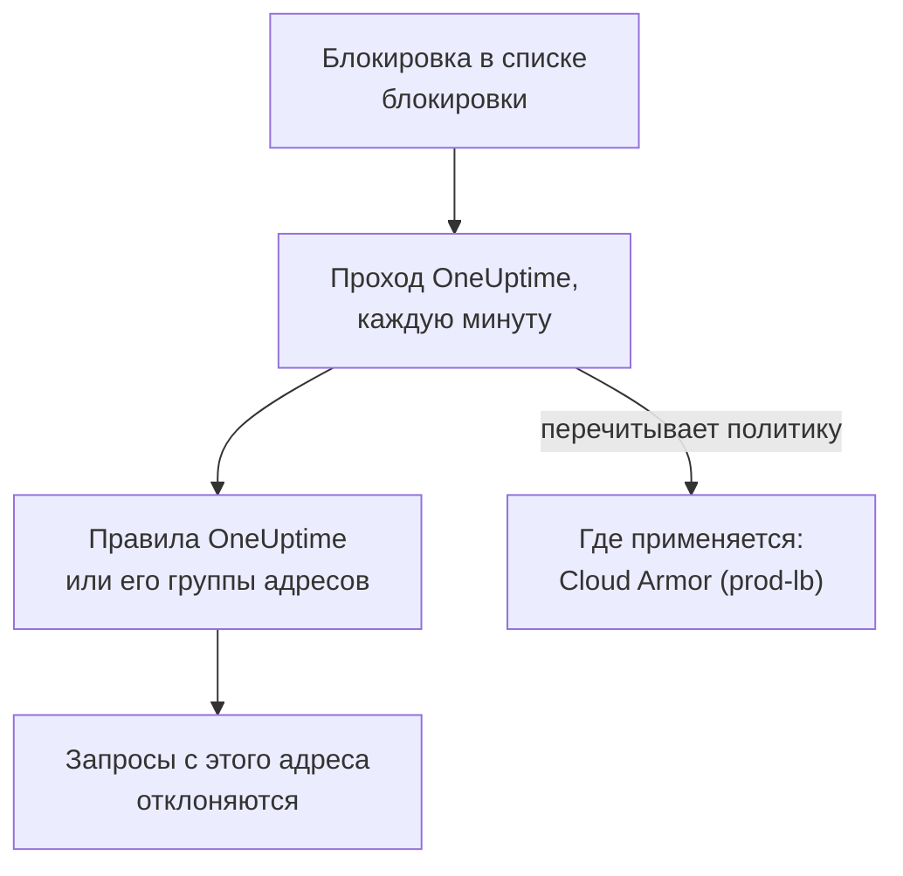

# Блокировка адресов в Cloud Armor

Список блокировки вашего проекта можно применять в политиках безопасности Google Cloud Armor ваших балансировщиков нагрузки. Включите его для уже существующего подключения Google Cloud, выберите политики безопасности — и каждый адрес, который блокирует список блокировки, будет заблокирован и там, кто бы его ни заблокировал: человек, плейбук или OneUptime AI.

:::cards
- [Включение](#включение): Одна настройка в подключении Google Cloud и роль, которая для неё нужна.
- [Что создаёт OneUptime](#что-создаёт-oneuptime): Собственные правила в каждой политике или группы адресов с Cloud Armor Enterprise.
- [Какой адрес сопоставляется](#какой-адрес-сопоставляется): Адрес, который подключился, или IP пользователя за прокси.
:::

## Как это работает

OneUptime ведёт собственные правила в каждой выбранной политике безопасности и помещает в них адреса, которые блокирует список блокировки. Каждую минуту он меняет то, что изменилось, по одному правилу за раз, а затем считывает политику обратно. На странице **Список блокировки** в столбце **Где применяется** у блокировки Cloud Armor (prod-lb) появляется только тогда, когда политика содержит блокировку; до этого блокировка не применяется.

## Перед началом

- Проект Google Cloud, подключённый к OneUptime (см. [Подключение облачного аккаунта](/docs/telemetry/cloud-accounts#google-cloud)).
- Роль, которой разрешено менять, где применяется список блокировки: **Владелец проекта**, **Администратор проекта** или **Администратор безопасности**.
- Человек, которому разрешено создавать роли и выдавать их в проекте Google Cloud, чтобы выполнить одну команду в Cloud Shell.

## Включение

:::steps
### Откройте подключение
Откройте **Облако → Подключить** и измените подключение Google Cloud.

### Включите настройку
В разделе **Дополнительные поля** установите для **Блокировать адреса в Cloud Armor** значение **Включено** и сохраните. Команда настройки, которую показывает форма, теперь выдаёт описанную ниже роль там же, где выдаёт остальные. Уже существующему подключению не нужно выполнять её снова: диалог **Добавить WAF** даёт строки, которые выдают эту роль в проекте политики.

### Добавьте политики безопасности
Откройте **События безопасности → Плейбуки → Список блокировки**. В разделе **Облачные WAF** нажмите **Добавить WAF** и выберите политику безопасности. OneUptime спрашивает у Google Cloud, может ли подключение записывать её, ничего не записывая.

### Выдайте роль, если её нет
Если разрешения не хватает, диалог показывает строки, которые выдают его в проекте политики. Выполните их в Cloud Shell, нажмите **Проверить снова**, а затем добавьте политику. Её **Статус** показывает **Применяется**, когда OneUptime её настроит.
:::

Политики безопасности берутся из инвентаря подключения: политика, которую OneUptime ещё не прочитал, появится после следующего чтения. Пока политика применяет список блокировки, настройку её подключения нельзя выключить, а само подключение нельзя удалить: сначала уберите политику, чтобы OneUptime убрал из неё свои правила.

## Что создаёт OneUptime

OneUptime выбирает, как политика будет хранить список блокировки, когда вы её добавляете.

| Что | Имя | Где |
| --- | --- | --- |
| Правила, которые отклоняют с кодом 403, каждое — до 10 адресов или диапазонов | Их описание начинается с `OneUptime blocklist <project> #1`, `#2`, ... | В каждой выбранной политике, не более 20. |
| Две группы адресов, IPv4 и IPv6 | `oneuptime-<project>-block-ipv4`, `oneuptime-<project>-block-ipv6` | Глобальные, в проекте политики. Только с Cloud Armor Enterprise. |
| Одно правило, которое отклоняет с кодом 403 всё, что есть в любой из групп | Его описание начинается с `OneUptime blocklist <project>, address groups` | В каждой выбранной глобальной политике безопасности бэкенда, с Cloud Armor Enterprise. |

`<project>` — это первые восемь символов внешнего ID вашего проекта, поэтому два проекта OneUptime, выбравшие одну политику, никогда не пишут правила друг друга. Cloud Armor называет правило только по его приоритету, поэтому OneUptime узнаёт свои правила по их описанию.

- **Правила.** Cloud Armor вмещает 10 адресов или диапазонов в одном правиле, поэтому политика вмещает до 200 блокировок в 20 правилах OneUptime; блокировка, которая не помещается, сообщает об этом в своей строке.
- **Группы адресов.** Глобальная политика безопасности бэкенда в проекте с Cloud Armor Enterprise хранит список блокировки вместо этого в двух группах адресов: 10 000 диапазонов IPv4 и 2 000 диапазонов IPv6. Все такие политики проекта используют их совместно, а одно правило в каждой политике отклоняет то, что в них есть. Группы занимают 16 000 единиц квоты групп адресов проекта.

OneUptime добавляет, меняет и удаляет каждое своё правило по отдельности, с помощью методов правил Cloud Armor: он никогда не записывает политику целиком и никогда не записывает ваши правила. Одиночный адрес записывается как `/32` или `/128`.

## Место правил в политике

OneUptime ставит свои правила на свободные приоритеты перед вашим первым правилом, которое пропускает запрос, начиная с наименьшего, чтобы ни одно ваше правило не пропустило заблокированный адрес: правило, которое разрешает, ограничивает скорость, блокирует по частоте или распределяет поровну. Ваше правило, которое отклоняет, может стоять раньше. OneUptime никогда не перенумеровывает, не меняет и не удаляет ваши правила: если перед вашим первым таким правилом нет свободного приоритета, политика показывает **Нет свободного приоритета**, и OneUptime добавит своё правило, как только вы освободите один.

## Какой адрес сопоставляется

| Политика безопасности | Адрес клиента | Когда выбирать |
| --- | --- | --- |
| Бэкенд | **Адрес, который подключился к балансировщику нагрузки (origin.ip)** | Значение по умолчанию. |
| Бэкенд | IP пользователя из заголовков запроса политики (origin.user_ip) | Для балансировщика нагрузки за другим прокси или CDN. |
| Граничная | Адрес, который подключился к балансировщику нагрузки (origin.ip) | Единственный вариант: граничная политика не читает другие адреса. |

`origin.user_ip` — это адрес в заголовках запроса с IP пользователя, заданных в политике (`userIpRequestHeaders`), которые записывает прокси или CDN перед балансировщиком нагрузки. Если они не заданы или в них нет допустимого адреса, это `origin.ip`. Выбирайте этот вариант, только если такой прокси их записывает: клиент, который обращается к балансировщику нагрузки напрямую, может записать их сам. Выбор находится в разделе **Дополнительные поля** диалога **Добавить WAF**, а позже его можно изменить кнопкой **Адрес клиента** в строке политики.

Политику безопасности на границе сети, для сквозных сетевых балансировщиков нагрузки, выбрать нельзя, и диалог **Добавить WAF** объясняет почему: её правила сопоставляют пакеты, а не запросы.

Правила OneUptime в Cloud Armor только отклоняют. Блокировка, которая требует отправить адрес на проверку, в Cloud Armor не применяется и сообщает об этом. Проверка от политики автоматического реагирования применяется там как блокировка на тот же срок.

## Если правило изменено вручную

Если кто-то переводит одно из правил OneUptime в режим предварительного просмотра, меняет или удаляет его либо удаляет одну из его групп адресов, OneUptime оставляет всё так, как оставили. Политика показывает **Изменено вручную**, и блокировки, которые там были, не применяются, с указанием причины, пока кто-нибудь не нажмёт **Вернуть** в строке политики. «Вернуть» записывает правило заново так, как его записывает OneUptime, на его собственный приоритет, пока тот свободен, и заново создаёт удалённую группу адресов.

OneUptime не проверяет, подключена ли политика к сервису бэкенда. Политика, не подключённая ни к одному, ничего не блокирует.

## Ведение политики в Terraform

Ресурс `google_compute_security_policy` с блоками `rule` владеет всеми правилами политики, поэтому его следующий план удаляет правила OneUptime. Ведите свои правила как ресурсы `google_compute_security_policy_rule`, которые не трогают другие правила, или добавьте `ignore_changes = [rule]` в блок `lifecycle` политики.

## Разрешения

Команда настройки добавляет настраиваемую роль `oneuptimeCloudArmorBlocklist` там же, где выдаёт остальные роли подключения, и выдаёт её сервисному аккаунту подключения. Строки, которые показывает диалог **Добавить WAF**, добавляют ту же роль в проекте политики. Политике, которая хранит список блокировки в правилах, а не в группах адресов, нужны только её собственные разрешения.

| Разрешение | Зачем |
| --- | --- |
| `compute.securityPolicies.get`, `compute.securityPolicies.update` | Читать глобальную политику и менять в ней правила OneUptime. |
| `compute.regionSecurityPolicies.get`, `compute.regionSecurityPolicies.update` | Читать региональную политику и менять в ней правила OneUptime. |
| `compute.globalOperations.get`, `compute.regionOperations.get` | Дождаться завершения изменения. |
| `compute.projects.get` | Узнать, есть ли у проекта Cloud Armor Enterprise. |
| `networksecurity.addressGroups.get`, `networksecurity.addressGroups.list`, `networksecurity.addressGroups.create`, `networksecurity.addressGroups.update`, `networksecurity.addressGroups.delete`, `networksecurity.addressGroups.use` | Вести группы адресов OneUptime и ссылаться на них из его правила. Только с Cloud Armor Enterprise. |
| `networksecurity.operations.get` | Дождаться завершения изменения группы адресов. |

Роль не может удалить политику, а OneUptime никогда не записывает ничего другого. Команда настройки также включает API Compute Engine и Network Security.

## Отключение

:::steps
### Уберите политику безопасности
В **События безопасности → Плейбуки → Список блокировки** нажмите **Удалить** в строке политики. OneUptime убирает свои правила из политики и удаляет свои группы адресов, как только их больше не использует ни одна другая политика проекта.

### Выключите настройку
Измените подключение, установите для **Блокировать адреса в Cloud Armor** значение **Выключено** и сохраните. Настройку можно выключить, как только ни одна политика подключения не применяет список блокировки.
:::

Если OneUptime больше не может записывать политику, отметьте **Убрать только из OneUptime** в диалоге **Убрать WAF**. OneUptime убирает политику из списка блокировки и называет правила и группы адресов, которые он оставил: они продолжают блокировать то, что в них есть, пока вы не удалите их в Google Cloud.

## Устранение неполадок

:::details Не применяется
Статус политики сообщает, что ответил Google Cloud и что делать. Отказ называет недостающее разрешение: выполните строки, которые **Добавить WAF** показывает для этой политики, а затем нажмите **Проверить снова**. Отказ из-за квоты называет эту квоту: запросите у Google Cloud её увеличение или удалите правила, которые больше не используете.
:::

:::details Нет свободного приоритета
Все приоритеты перед вашим первым правилом, которое пропускает запрос, заняты. Дайте этому правилу больший номер, а затем нажмите **Проверить снова**.
:::

:::details Политики нет в списке
OneUptime показывает политики безопасности подключений с включённой настройкой, после того как прочитает их. Политика, добавленная позже, появится после следующего чтения подключения.
:::

## Что дальше

:::cards
- [Кейсы безопасности и плейбуки](/docs/telemetry/security-cases): Заблокируйте адрес из кейса и посмотрите, как проверяется его шаг.
- [Подключение облачного аккаунта](/docs/telemetry/cloud-accounts): Подключение, в которое входит эта настройка.
:::
