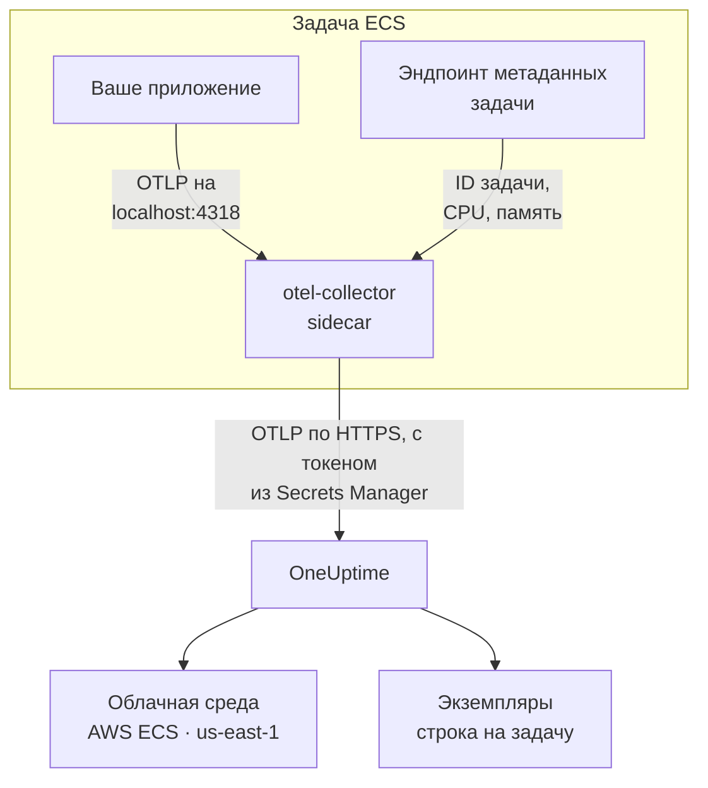

# AWS ECS / Fargate

Отправляйте трассировки, логи и метрики задач Amazon ECS в OneUptime — как с типом запуска Fargate, так и с EC2. Каждая задача, которая сообщает `cloud.platform=aws_ecs`, попадает в один **Cloud Environment** на учётную запись AWS и регион, например _AWS ECS · us-east-1 · 123456789012_, независимо от того, работает в ней один сервис или пятьдесят.

:::cards
- [Как это работает](#как-это-работает): Что делают детектор ECS и коллектор-sidecar.
- [Настройка](#настройка): Сохраните токен, добавьте настройки в определение задачи, разверните и проверьте.
- [Полное определение задачи](#полное-определение-задачи): Готовое определение задачи Fargate для регистрации.
- [Устранение неполадок](#устранение-неполадок): Задачи, зависшие в PENDING, отклонённый экспорт, пустые экземпляры или плитки.
:::

## Как это работает



- **Детектор ECS даёт среде имя.** Детектор ресурсов ECS из OpenTelemetry, в SDK или в коллекторе, читает эндпоинт метаданных задачи, который ECS даёт каждому контейнеру, и проставляет учётную запись, регион и задачу на всё, что отправляет задача. Ничего не зашито в код.
- **Задача даёт имя каждому экземпляру.** Вкладка **Экземпляры** среды показывает работающие задачи по их ID, с их CPU и памятью.
- **Коллектор-sidecar добавляет CPU и память.** Его приёмник `awsecscontainermetrics` читает CPU и память каждой задачи из того же эндпоинта, а токен хранится у коллектора, так что приложение его никогда не видит.

Детектор ECS задаёт следующие атрибуты ресурса:

| Атрибут | Значение от детектора ECS | Для чего используется |
| ------------------------------------------------------------------ | ----------------------- | --------------------------------------------------------------------------------------------------------- |
| `cloud.platform` | `aws_ecs` | Относит телеметрию к разделу **Облачные среды**. Значение должно быть точным |
| `cloud.account.id` | `123456789012` | Часть ключа среды |
| `cloud.region` | `us-east-1` | Часть ключа среды |
| `aws.ecs.task.arn` | ARN задачи | Даёт имя одной работающей задаче в разделе **Экземпляры** по ID задачи в его конце |
| `aws.ecs.task.id` | ID задачи | То же самое; новые версии детектора задают оба |
| `aws.ecs.cluster.arn`, `aws.ecs.task.family`, `aws.ecs.launchtype` | кластер и задача | Сохраняются на каждом спане, логе и метрике, чтобы по ним можно было искать; не входят в среду |

Ключ среды — `aws_ecs|123456789012|us-east-1`. ID задачи даёт имя экземпляру, даже если SDK также задаёт `service.instance.id`: метрики контейнеров от sidecar несут только ID задачи, поэтому ключ по нему держит спаны задачи и её CPU и память в одной строке. Полное правило описано в разделе [Облачные среды](/docs/telemetry/cloud-environments).

## Перед началом

- **Ключ приёма.** Создайте ключ типа **Сервер** в разделе **Настройки проекта → Телеметрия и APM → Ключи приема** и скопируйте его токен.
- **Кластер ECS и определение задачи, которое вы можете изменять**, а также AWS CLI, настроенный для этой учётной записи.
- **Ваше приложение, инструментированное OpenTelemetry SDK**, которое экспортирует OTLP, на любом языке.

## Выберите, как телеметрия покидает задачу

| | Sidecar collector | SDK direct |
| ----------------------- | ---------------------------------------------- | ----------------------------------------------- |
| Дополнительный контейнер | `otel-collector` в каждой задаче | Нет |
| CPU и память каждой задачи | Да, из приёмника `awsecscontainermetrics` | Нет |
| Где хранится токен | В коллекторе | В приложении |
| Что хранит секрет | Только токен | Весь заголовок `x-oneuptime-token=...` |

Большинство команд используют коллектор-sidecar: он проставляет атрибуты `cloud.*` даже на телеметрию библиотек, которые ничего не знают об ECS. SDK direct — самый простой вариант для одного сервиса. У каждого шага ниже есть вкладка для обоих вариантов; выберите один, и все шаги будут следовать ему.

## Настройка

:::steps
### Сохраните токен в Secrets Manager

> [!IMPORTANT]
> Токен — это секрет. Храните его в AWS Secrets Manager и ссылайтесь на него из определения задачи через `secrets` и `valueFrom`. Токен в обычной записи `environment` виден всем, кто может прочитать определение задачи, и появляется в каждом выводе `describe-task-definition` и в каждом diff CloudFormation.

:::tabs
@tab Sidecar collector
```bash
aws secretsmanager create-secret \
  --name oneuptime/ingestion-token \
  --region us-east-1 \
  --secret-string "YOUR_TELEMETRY_INGESTION_TOKEN"
```

Конфигурация коллектора добавляет имя заголовка, поэтому этот секрет содержит только токен.
@tab SDK direct
```bash
aws secretsmanager create-secret \
  --name oneuptime/ingestion-token \
  --region us-east-1 \
  --secret-string "x-oneuptime-token=YOUR_TELEMETRY_INGESTION_TOKEN"
```

ECS помещает значение секрета в переменную как есть, а `OTEL_EXPORTER_OTLP_HEADERS` нужна вся пара `name=value`, поэтому этот секрет содержит весь заголовок.
:::

Запишите ARN, который выводит команда. Он заканчивается случайным суффиксом, например `oneuptime/ingestion-token-AbCdEf`, и его нужно вставить в определение задачи.

### Разрешите задаче читать секрет

Роль выполнения задачи (роль, с которой ECS запускает задачу, а не роль, от имени которой работает ваш код) должна иметь доступ к секрету. Прикрепите эту политику к `ecsTaskExecutionRole`:

```json title="secret-access-policy.json"
{
  "Version": "2012-10-17",
  "Statement": [
    {
      "Effect": "Allow",
      "Action": ["secretsmanager:GetSecretValue"],
      "Resource": "arn:aws:secretsmanager:us-east-1:123456789012:secret:oneuptime/ingestion-token-*"
    }
  ]
}
```

Если секрет шифруется ключом KMS, которым управляет клиент, роли также нужно `kms:Decrypt` для этого ключа. Без любого из них задача не запустится: она остановится с `ResourceInitializationError: unable to pull secrets`.

### Добавьте настройки в определение задачи

:::tabs
@tab Sidecar collector
1. **AWS Console → Amazon Elastic Container Service → Task definitions** → выберите семейство → **Create new revision**.
2. В разделе **Container - 1** (ваше приложение) разверните **Environment variables** и добавьте переменные приложения ниже.
3. **+ Add container**: имя `otel-collector`, образ `otel/opentelemetry-collector-contrib:latest` (закрепите версию, когда всё заработает), **Essential container: No**. В разделе **Docker configuration → Command** укажите `--config=env:OTEL_COLLECTOR_CONFIG`.
4. В контейнере коллектора добавьте переменную окружения `ONEUPTIME_TOKEN` с **Value type: ValueFrom** и ARN секрета, а также `OTEL_COLLECTOR_CONFIG` с **Value type: Value** и конфигурацией коллектора ниже.
5. В разделе **Startup dependency ordering** контейнера приложения добавьте `otel-collector` с условием **Start**, чтобы приложение никогда не запускалось раньше, чем что-то начнёт слушать порт 4318.
6. В разделе **Task execution role** проверьте, что это роль, к которой вы прикрепили политику.

Переменные приложения. В сетевом режиме `awsvpc` (на Fargate всегда) контейнеры задачи делят одну сеть, поэтому `localhost` — это sidecar:

```bash
OTEL_SERVICE_NAME=checkout-api
OTEL_EXPORTER_OTLP_ENDPOINT=http://localhost:4318
OTEL_EXPORTER_OTLP_PROTOCOL=http/protobuf
```

Конфигурация коллектора. Коллектор читает её целиком из переменной `OTEL_COLLECTOR_CONFIG`, поэтому не нужно встраивать файл в образ, а `${env:ONEUPTIME_TOKEN}` он подставляет из секрета, который ECS помещает в его окружение:

```yaml title="OTEL_COLLECTOR_CONFIG"
receivers:
  otlp:
    protocols:
      http:
        endpoint: 0.0.0.0:4318
      grpc:
        endpoint: 0.0.0.0:4317
  # Per-task and per-container CPU / memory from the ECS task metadata
  # endpoint. This is what fills the CPU and memory tiles in OneUptime.
  awsecscontainermetrics:
    collection_interval: 20s
processors:
  # Stamps cloud.provider, cloud.platform=aws_ecs, cloud.account.id,
  # cloud.region and aws.ecs.task.arn on every span, log and metric.
  resourcedetection:
    detectors: [env, ecs]
    timeout: 5s
  batch: {}
exporters:
  otlphttp/oneuptime:
    endpoint: https://oneuptime.com/otlp
    headers:
      x-oneuptime-token: ${env:ONEUPTIME_TOKEN}
service:
  pipelines:
    traces:
      receivers: [otlp]
      processors: [resourcedetection, batch]
      exporters: [otlphttp/oneuptime]
    metrics:
      receivers: [otlp, awsecscontainermetrics]
      processors: [resourcedetection, batch]
      exporters: [otlphttp/oneuptime]
    logs:
      receivers: [otlp]
      processors: [resourcedetection, batch]
      exporters: [otlphttp/oneuptime]
```

Ни детектору `ecs`, ни приёмнику `awsecscontainermetrics` не нужны разрешения IAM: оба читают эндпоинт метаданных, который ECS даёт каждому контейнеру в `ECS_CONTAINER_METADATA_URI_V4`.
@tab SDK direct
1. **AWS Console → Amazon Elastic Container Service → Task definitions** → выберите семейство → **Create new revision**.
2. В разделе **Container - 1** (ваше приложение) разверните **Environment variables** и добавьте переменные ниже. Добавьте `OTEL_EXPORTER_OTLP_HEADERS` с **Value type: ValueFrom** и ARN секрета в качестве значения.
3. Добавьте переключатель, который включает детектор ресурсов ECS для вашего языка, из таблицы ниже.
4. В разделе **Task execution role** проверьте, что это роль, к которой вы прикрепили политику.

```bash
OTEL_SERVICE_NAME=checkout-api
OTEL_EXPORTER_OTLP_ENDPOINT=https://oneuptime.com/otlp
OTEL_EXPORTER_OTLP_PROTOCOL=http/protobuf
# Injected from Secrets Manager (secrets / valueFrom), not typed here.
OTEL_EXPORTER_OTLP_HEADERS=x-oneuptime-token=YOUR_TELEMETRY_INGESTION_TOKEN
```

| Язык | Как включить детектор ECS |
| -------- | --------------------------------------------------------------------------------------------------------------- |
| Node.js | `OTEL_NODE_RESOURCE_DETECTORS=env,host,os,aws` (auto-instrumentations-node) |
| Python | `pip install opentelemetry-sdk-extension-aws`, затем `OTEL_EXPERIMENTAL_RESOURCE_DETECTORS=aws_ecs` |
| Java | `-Dotel.resource.providers.aws.enabled=true` (агент поставляется с выключенным провайдером) |
| Go | `import "go.opentelemetry.io/contrib/detectors/aws/ecs"` и передайте `ecs.NewResourceDetector()` в `resource.New` |
| .NET | Пакет `OpenTelemetry.Resources.AWS`: `.ConfigureResource(r => r.AddAWSECSDetector())` |

В файле определения задачи секрет выглядит так: `"secrets": [{ "name": "OTEL_EXPORTER_OTLP_HEADERS", "valueFrom": "<secret ARN>" }]`.
:::

Если вы размещаете OneUptime самостоятельно, используйте `https://YOUR-ONEUPTIME-HOST/otlp` в качестве эндпоинта.

### Разверните новую ревизию

Нажмите **Create**, затем **Clusters → your cluster → Services → select the service → Update → Task definition revision: latest → Deploy**. Или через CLI:

```bash
aws ecs update-service \
  --cluster production \
  --service checkout-api \
  --task-definition checkout-api
```

### Проверьте подключение

Сначала проверьте токен: это самая дешёвая проверка, и без неё ничего дальше не заработает.

```bash
curl -i https://oneuptime.com/otlp/v1/validate \
  -H "x-oneuptime-token: YOUR_TELEMETRY_INGESTION_TOKEN"
```

`200` с `"valid": true` означает, что токен принят. `401` означает, что он неизвестен, отозван, отключён или истёк. Выполните ту же команду изнутри задачи через ECS Exec, чтобы убедиться, что сама задача может достучаться до OneUptime:

```bash
aws ecs execute-command --cluster production --task <task id> \
  --container app --interactive --command "sh"
```

В потоке логов коллектора в CloudWatch (`otel/otel-collector/...`) должно быть `Everything is ready` и не должно быть строк с `401` или `connection refused`. В течение минуты после первого спана, лога или метрики среда появляется в разделе **Облако → All Environments** как _AWS ECS · us-east-1 · 123456789012_.
:::

## Полное определение задачи

Настройка с sidecar в виде файла, который регистрируется командой `aws ecs register-task-definition --cli-input-json file://task-definition.json`. Замените ID учётной записи, регион, образ и ARN секрета:

```json title="task-definition.json"
{
  "family": "checkout-api",
  "requiresCompatibilities": ["FARGATE"],
  "networkMode": "awsvpc",
  "cpu": "512",
  "memory": "1024",
  "executionRoleArn": "arn:aws:iam::123456789012:role/ecsTaskExecutionRole",
  "taskRoleArn": "arn:aws:iam::123456789012:role/checkout-api-task-role",
  "containerDefinitions": [
    {
      "name": "app",
      "image": "123456789012.dkr.ecr.us-east-1.amazonaws.com/checkout-api:1.4.2",
      "essential": true,
      "portMappings": [{ "containerPort": 8080, "protocol": "tcp" }],
      "environment": [
        { "name": "OTEL_SERVICE_NAME", "value": "checkout-api" },
        {
          "name": "OTEL_EXPORTER_OTLP_ENDPOINT",
          "value": "http://localhost:4318"
        },
        { "name": "OTEL_EXPORTER_OTLP_PROTOCOL", "value": "http/protobuf" }
      ],
      "dependsOn": [
        { "containerName": "otel-collector", "condition": "START" }
      ],
      "logConfiguration": {
        "logDriver": "awslogs",
        "options": {
          "awslogs-group": "/ecs/checkout-api",
          "awslogs-region": "us-east-1",
          "awslogs-stream-prefix": "app"
        }
      }
    },
    {
      "name": "otel-collector",
      "image": "otel/opentelemetry-collector-contrib:latest",
      "essential": false,
      "command": ["--config=env:OTEL_COLLECTOR_CONFIG"],
      "secrets": [
        {
          "name": "ONEUPTIME_TOKEN",
          "valueFrom": "arn:aws:secretsmanager:us-east-1:123456789012:secret:oneuptime/ingestion-token-AbCdEf"
        }
      ],
      "environment": [
        {
          "name": "OTEL_COLLECTOR_CONFIG",
          "value": "receivers:\n  otlp:\n    protocols:\n      http:\n        endpoint: 0.0.0.0:4318\n      grpc:\n        endpoint: 0.0.0.0:4317\n  awsecscontainermetrics:\n    collection_interval: 20s\nprocessors:\n  resourcedetection:\n    detectors: [env, ecs]\n    timeout: 5s\n  batch: {}\nexporters:\n  otlphttp/oneuptime:\n    endpoint: https://oneuptime.com/otlp\n    headers:\n      x-oneuptime-token: ${env:ONEUPTIME_TOKEN}\nservice:\n  pipelines:\n    traces:\n      receivers: [otlp]\n      processors: [resourcedetection, batch]\n      exporters: [otlphttp/oneuptime]\n    metrics:\n      receivers: [otlp, awsecscontainermetrics]\n      processors: [resourcedetection, batch]\n      exporters: [otlphttp/oneuptime]\n    logs:\n      receivers: [otlp]\n      processors: [resourcedetection, batch]\n      exporters: [otlphttp/oneuptime]\n"
        }
      ],
      "logConfiguration": {
        "logDriver": "awslogs",
        "options": {
          "awslogs-group": "/ecs/checkout-api",
          "awslogs-region": "us-east-1",
          "awslogs-stream-prefix": "otel"
        }
      }
    }
  ]
}
```

Значение `OTEL_COLLECTOR_CONFIG` — это конфигурация коллектора в виде одной строки JSON. Чтобы не экранировать её вручную, храните YAML в `collector.yaml`, и пусть это сделает `jq`:

```bash
jq --rawfile cfg collector.yaml \
  '.containerDefinitions[1].environment[0].value = $cfg' \
  task-definition.json > task-definition.rendered.json
aws ecs register-task-definition --cli-input-json file://task-definition.rendered.json
```

## Сеть

Задаче нужно достучаться до двух вещей за пределами вашего VPC: до Secrets Manager, чтобы запуститься, и до OneUptime, чтобы экспортировать данные.

- **Задачам Fargate в частных подсетях** нужен маршрут в интернет: NAT-шлюз в таблице маршрутов подсети или публичная подсеть с `assignPublicIp=ENABLED`. Задача без того и другого зависает в `PENDING` на секрете ещё до того, как коллектор что-либо отправит.
- **Исходящий трафик группы безопасности** должен разрешать TCP 443 к хосту OneUptime: `oneuptime.com` или вашему собственному хосту на порту, который он слушает. Группа безопасности по умолчанию разрешает весь исходящий трафик; ограниченная часто нет. Для телеметрии входящие правила не нужны.
- **Интерфейсные эндпоинты VPC** для `com.amazonaws.us-east-1.secretsmanager` (а также `ecr.api`, `ecr.dkr` и S3 для загрузки образов) уводят вызовы AWS с пути через NAT. Самому OneUptime маршрут в интернет всё равно нужен.

```bash
aws ecs update-service \
  --cluster production \
  --service checkout-api \
  --task-definition checkout-api \
  --network-configuration "awsvpcConfiguration={subnets=[subnet-0abc1234],securityGroups=[sg-0def5678],assignPublicIp=ENABLED}"
```

## Что вы получаете

- **Обзор**: запросы, частота ошибок и задержка p95 по вашим трассировкам, плитки **CPU** и **Память** и **Топ экземпляров по CPU**. Плитки заполняются из `ecs.task.cpu.utilized` и `ecs.task.memory.utilized` приёмника `awsecscontainermetrics` или из любых метрик `container.cpu.utilization` и `container.memory.usage`, несущих идентификатор задачи. SDK direct не отправляет ни то, ни другое.
- **Экземпляры**: одна строка на каждую работающую задачу с её ID в качестве имени (конец `aws.ecs.task.arn`), с последними значениями CPU и памяти и временем последнего появления. Задача, которая перестала передавать данные, становится **Stale**.
- **Журналы**, **Трассировки** и **Метрики**: всё, что несло `cloud.platform=aws_ecs` для этой учётной записи и региона.
- **Службы**: те же задачи, разбитые по `service.name`.

## Устранение неполадок

Сбои ECS в том порядке, в каком они происходят:

:::details Задача зависла в PENDING с "unable to pull secrets"
Полный текст ошибки — `ResourceInitializationError: unable to pull secrets`. Либо у роли выполнения задачи нет `secretsmanager:GetSecretValue` для секрета (или `kms:Decrypt` для его ключа), либо у задачи нет маршрута к Secrets Manager: нет ни NAT-шлюза, ни эндпоинта VPC. См. [Сеть](#сеть).
:::

:::details Коллектор пишет в лог 401
В секрете неверное значение. Для коллектора-sidecar это должен быть только токен; для SDK direct — весь заголовок `x-oneuptime-token=...`. Проверьте сам токен командой из раздела [Проверьте подключение](#проверьте-подключение).
:::

:::details Среда появилась, но раздел Экземпляры пуст
В телеметрии нет идентификатора задачи. Убедитесь, что детектор `ecs` работает: ресурс должен нести `aws.ecs.task.arn`, `aws.ecs.task.id` или `service.instance.id`.
:::

:::details Экземпляры заполняются, но плитки CPU и Память остаются пустыми
Приёмника `awsecscontainermetrics` нет в конвейере `metrics`, или этот конвейер пропускает процессор `resourcedetection`, поэтому метрики контейнеров приходят без `cloud.platform`. SDK direct никогда не заполняет эти плитки.
:::

Среда, которая никогда не появляется, попадает в **Хосты** или **Serverless-функции**, показывает **Отключено** или раздваивается, разобрана на странице [Устранение неполадок в облаке](/docs/telemetry/cloud-troubleshooting).

## Что дальше

:::cards
- [Облачные среды](/docs/telemetry/cloud-environments): Как определяются среды и экземпляры.
- [Устранение неполадок в облаке](/docs/telemetry/cloud-troubleshooting): Сбои, общие для всех платформ.
- [Облачные ресурсы (IaaS и PaaS)](/docs/telemetry/cloud-resources): Ваши балансировщики нагрузки, базы данных RDS и бакеты из CloudWatch.
- [OpenTelemetry](/docs/telemetry/open-telemetry): Инструментирование приложения, эндпоинты и ограничения.
:::
