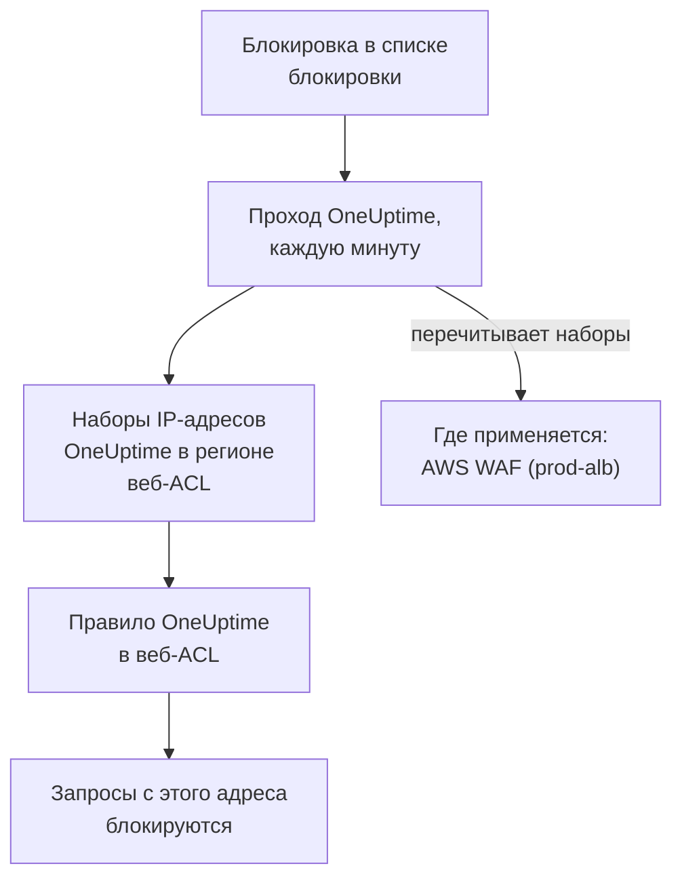

# Блокировка адресов в AWS WAF

Список блокировки вашего проекта можно применять в веб-ACL AWS WAF, которые стоят перед вашими дистрибутивами CloudFront, балансировщиками нагрузки и API Gateway. Включите его для уже существующего облачного подключения AWS, выберите веб-ACL — и каждый адрес, который блокирует список блокировки, будет заблокирован и там, кто бы его ни заблокировал: человек, плейбук или OneUptime AI.

:::cards
- [Включение](#включение): Одна настройка в подключении AWS и повторный запуск его команды настройки.
- [Что создаёт OneUptime](#что-создаёт-oneuptime): Четыре набора IP-адресов на регион и два правила на веб-ACL.
- [Управление веб-ACL в коде](#управление-веб-acl-в-коде): Добавьте правила в Terraform или CloudFormation сами.
:::

## Как это работает

OneUptime ведёт собственные наборы IP-адресов в каждом регионе, где есть выбранный веб-ACL, а в каждом веб-ACL — правило, которое блокирует адреса из этих наборов. Каждую минуту он один раз записывает в каждый набор то, что содержит список блокировки, а затем считывает наборы обратно. На странице **Список блокировки** в столбце **Где применяется** у блокировки AWS WAF (prod-alb) появляется только тогда, когда AWS WAF содержит блокировку, а правило веб-ACL блокирует её набор; до этого блокировка не применяется.

## Перед началом

- Аккаунт AWS, подключённый к OneUptime (см. [Подключение облачного аккаунта](/docs/telemetry/cloud-accounts#amazon-web-services)).
- Роль, которой разрешено менять, где применяется список блокировки: **Владелец проекта**, **Администратор проекта** или **Администратор безопасности**.
- Человек, который может снова выполнить команду настройки подключения в аккаунте AWS.

## Включение

:::steps
### Откройте подключение
Откройте **Облако → Подключить** и измените подключение AWS.

### Выберите, кто добавляет правило
В разделе **Дополнительные поля** установите для **Блокировать адреса в AWS WAF** значение **Включено, и OneUptime добавляет своё правило** или **Включено, и я добавляю правило в коде**, если ваши веб-ACL управляются в Terraform или CloudFormation.

### Снова выполните команду настройки
Команда, которую теперь показывает форма, выдаёт права на наборы IP-адресов, а также на правило, если его добавляет OneUptime. Выполните её в AWS CloudShell, а затем сохраните подключение.

### Добавьте веб-ACL
Откройте **События безопасности → Плейбуки → Список блокировки**. В разделе **Облачные WAF** нажмите **Добавить WAF**, выберите веб-ACL и в разделе **Дополнительные поля** — то, откуда он читает адрес клиента, и добавьте его. OneUptime сразу настраивает его, и его **Статус** показывает **Применяется**, когда его правило блокирует наборы.
:::

Веб-ACL берутся из инвентаря подключения: веб-ACL, который OneUptime ещё не прочитал, появится после следующего чтения. Пока веб-ACL применяет список блокировки, настройку его подключения нельзя выключить или переключить с добавления правила OneUptime на добавление в коде, а само подключение нельзя удалить: сначала уберите веб-ACL, чтобы OneUptime убрал из него своё правило.

## Что создаёт OneUptime

| Что | Имя | Где |
| --- | --- | --- |
| Четыре набора IP-адресов: блокировка и проверка, IPv4 и IPv6 | `oneuptime-<project>-block-ipv4`, `oneuptime-<project>-block-ipv6`, `oneuptime-<project>-challenge-ipv4`, `oneuptime-<project>-challenge-ipv6` | В каждом регионе, где есть выбранный веб-ACL. Веб-ACL CloudFront глобальные, и их наборы находятся в `us-east-1`. |
| Два правила: одно блокирует, другое отправляет на проверку | `OneUptime-Blocklist-<project>`, `OneUptime-Challenge-<project>` | В каждом выбранном веб-ACL, если правило добавляет OneUptime. |

`<project>` — это первые восемь символов внешнего ID вашего проекта, поэтому два проекта OneUptime в одном аккаунте никогда не пишут в наборы друг друга. Веб-ACL одного региона используют общие наборы. Одиночный адрес записывается как `/32` или `/128`. AWS WAF вмещает 10 000 адресов в одном наборе и 100 наборов IP-адресов в регионе, если AWS не повысил для вас этот лимит; блокировка, которая не помещается, сообщает об этом в своей строке.

## Место правила в веб-ACL

OneUptime ставит два своих правила на свободные приоритеты ниже приоритета вашего первого правила, чтобы они выполнялись раньше написанных вами правил. Если в веб-ACL нет правил, они занимают приоритеты 0 и 1. OneUptime никогда не перенумеровывает, не меняет и не удаляет ваши правила: если ниже вашего первого правила нет двух свободных приоритетов, веб-ACL показывает **Нет свободного приоритета**, и OneUptime добавит свои правила, как только вы освободите два.

Каждое правило срабатывает, когда один из его наборов, IPv4 или IPv6, содержит адрес клиента. AWS WAF обновляет веб-ACL целиком, поэтому OneUptime читает его, добавляет свои правила и записывает его обратно с токеном блокировки веб-ACL, а если кто-то другой за это время записал веб-ACL, читает его снова.

## Пересылаемые адреса

Веб-ACL за другим прокси или CDN видит адрес прокси, а не клиента. Выберите, откуда он читает адрес клиента, в поле **Адрес клиента**:

| Адрес клиента | Что читает правило |
| --- | --- |
| **Адрес источника запроса** | Адрес, с которого пришёл запрос. Значение по умолчанию. |
| Последний адрес в заголовке `X-Forwarded-For` | Адрес, который добавил последний прокси. Адрес перед ним — тот, который заявил сам запрос. |
| Заголовок `CF-Connecting-IP` | Единственный адрес, который записывает Cloudflare. |
| Заголовок `True-Client-IP` | Единственный адрес, который записывает Akamai или Cloudflare Enterprise. |

Запрос без этого заголовка не совпадает: AWS WAF пропускает его, а не блокирует адрес прокси.

## Управление веб-ACL в коде

С **Включено, и я добавляю правило в коде** OneUptime создаёт только наборы IP-адресов и никогда не записывает ваш веб-ACL. Нажмите **Показать правило** в строке веб-ACL: оно выдаёт оба правила в виде Terraform (блоки `rule` ресурса `aws_wafv2_web_acl`) и CloudFormation, с ARN каждого набора и заголовком, который читает веб-ACL. Добавьте их в свой код перед остальными правилами и примените его.

Пока правил нет, веб-ACL показывает **Ожидает вашего правила**, и его блокировки не применяются. OneUptime читает веб-ACL при каждом проходе, и его блокировки применяются с первого прохода, который находит правило, блокирующее каждый набор, как бы вы его ни назвали.

## Разрешения

Команда настройки добавляет к роли встроенную политику `OneUptimeWafBlocklist`. С ключом доступа из-за ограничения IAM на собственные политики пользователя она назначается группе `OneUptimeWafBlocklist-<project>`, в которую входит пользователь.

| Действие | Ресурс | Зачем |
| --- | --- | --- |
| `wafv2:ListIPSets` | Любой | Найти наборы IP-адресов OneUptime в регионе. |
| `wafv2:GetIPSet`, `wafv2:CreateIPSet`, `wafv2:UpdateIPSet`, `wafv2:DeleteIPSet` | Только наборы IP-адресов OneUptime (`oneuptime-<project>-*`) | Вести наборы и удалять их, когда вы убираете последний веб-ACL региона. |
| `wafv2:GetSampledRequests` | Веб-ACL | Читать запросы, которые отклонило правило: доказательство, по которому проверяется шаг блокировки в кейсе. |
| `wafv2:UpdateWebACL` | Веб-ACL, а также наборы IP-адресов, наборы регулярных выражений и группы правил, на которые они ссылаются | Добавить правила OneUptime. Только с **Включено, и OneUptime добавляет своё правило**. |

Чтение веб-ACL, `wafv2:GetWebACL`, уже входит в политику только для чтения этого подключения.

## Отключение

:::steps
### Уберите веб-ACL
В **События безопасности → Плейбуки → Список блокировки** нажмите **Удалить** в строке веб-ACL. OneUptime убирает свои правила из веб-ACL, а затем очищает и удаляет свои наборы IP-адресов, как только их больше не использует ни один другой веб-ACL региона.

### Выключите настройку
Измените подключение, установите для **Блокировать адреса в AWS WAF** значение **Выключено** и сохраните. Настройку можно выключить, как только ни один веб-ACL подключения не применяет список блокировки.
:::

Если OneUptime больше не может записывать веб-ACL, отметьте **Убрать только из OneUptime** в диалоге **Убрать WAF**. OneUptime убирает веб-ACL из списка блокировки и называет правила и наборы IP-адресов, которые он оставил в AWS WAF: они продолжают блокировать то, что в них есть, пока вы не удалите их там. Набор, на который ещё ссылается ваше правило, тоже остаётся: OneUptime очищает его и называет.

## Устранение неполадок

:::details Не применяется
Статус веб-ACL сообщает, что ответил AWS и что делать. Отказ называет действие и настройку, которая его разрешает: включите настройку или выберите **Включено, и OneUptime добавляет своё правило**, затем снова выполните команду настройки подключения и нажмите **Проверить снова**.
:::

:::details Нет свободного приоритета
Ваше первое правило стоит на приоритете 0 или 1, поэтому ниже него нет двух свободных приоритетов. Увеличьте номера приоритетов ваших правил на два, а затем нажмите **Проверить снова**.
:::

:::details Веб-ACL нет в списке
OneUptime показывает веб-ACL подключений с включённой настройкой, после того как прочитает их. Для веб-ACL, которые видны только по их метрикам, нужно снова выполнить команду настройки подключения: она позволяет OneUptime их прочитать.
:::

## Что дальше

:::cards
- [Кейсы безопасности и плейбуки](/docs/telemetry/security-cases): Заблокируйте адрес из кейса и посмотрите, как проверяется его шаг.
- [Подключение облачного аккаунта](/docs/telemetry/cloud-accounts): Подключение, в которое входит эта настройка.
:::
