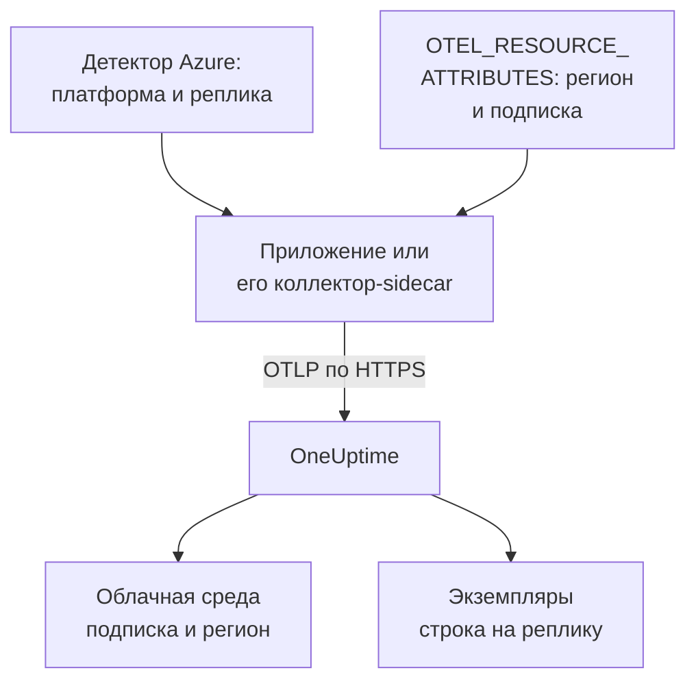

# Azure Container Apps

Отправляйте трассировки, логи и метрики Azure Container Apps в OneUptime. Каждая реплика, которая сообщает `cloud.platform=azure_container_apps`, попадает в один **Cloud Environment** на подписку Azure и регион, например _Azure Container Apps · eastus · 00000000-0000-0000-0000-000000000000_, а работающие реплики перечислены в разделе **Экземпляры**.

:::cards
- [Как это работает](#как-это-работает): Что задают детекторы и какие два атрибута вы задаёте сами.
- [Настройка](#настройка): Сохраните токен, настройте приложение через Azure CLI или портал и проверьте.
- [Управляемый агент OpenTelemetry среды](#управляемый-агент-opentelemetry-среды): Пересылка всех приложений среды без sidecar.
- [Устранение неполадок](#устранение-неполадок): Отклонённый экспорт, отсутствующие среды и пустые экземпляры.
:::

## Как это работает



У Container Apps есть детекторы ресурсов: детектор `azurecontainerapps` в Collector и детекторы для Node.js (`@opentelemetry/resource-detector-azure`) и .NET (`OpenTelemetry.Resources.Azure`). Они читают `CONTAINER_APP_NAME` и `CONTAINER_APP_REPLICA_NAME` и задают `cloud.provider`, `cloud.platform`, `service.name` и ID реплики. Ни один из них не знает региона или подписки, поэтому `cloud.region` и `cloud.account.id` вы задаёте сами, в `OTEL_RESOURCE_ATTRIBUTES`.

| Атрибут | Значение | Для чего используется |
| --------------------------------- | ------------------------------------------------------------------------- | ------------------------------------------------------------ |
| `cloud.provider` | `azure` | Показывается в обзоре |
| `cloud.platform` | `azure_container_apps` | Относит телеметрию к разделу **Облачные среды** |
| `cloud.region` | регион среды, например `eastus`: задаёте вы | Часть ключа среды |
| `cloud.account.id` | ID подписки: задаёте вы | Часть ключа среды |
| `azure.container_app.instance.id` | имя реплики, которое детекторы задают из `CONTAINER_APP_REPLICA_NAME` | Даёт имя одной работающей реплике: по строке на каждую в разделе **Экземпляры** |
| `service.instance.id` | имя реплики, если вы задаёте его сами | Используется, когда ни один детектор не задал ID реплики |

- **Написание через точку работает.** Детекторы для Node.js и .NET пишут платформу как `azure.container_apps`, через точку. При получении OneUptime переписывает её в `azure_container_apps`, поэтому оба варианта попадают в одну и ту же среду.
- **Имя хоста — это имя реплики.** SDK, в котором работает только детектор `host`, сообщает имя реплики как `host.name`, и OneUptime называет экземпляр по нему, если ничего более конкретного нет.

Ключ среды — `azure_container_apps|<subscription id>|eastus`.

## Перед началом

- **Ключ приёма.** Создайте ключ типа **Сервер** в разделе **Настройки проекта → Телеметрия и APM → Ключи приема** и скопируйте его токен.
- **Azure CLI с расширением `containerapp`** (`az extension add --name containerapp --upgrade`), с входом в подписку, или портал Azure.
- **Ваше приложение, инструментированное OpenTelemetry SDK**, которое экспортирует OTLP.

## Выберите, как телеметрия покидает приложение

| | SDK direct | Sidecar collector |
| ------------------ | ------------------------------------------- | ------------------------------------------------------------ |
| Дополнительный контейнер | Нет | `otel-collector` в приложении, который делит CPU и память реплики |
| Кто задаёт атрибуты | SDK и `OTEL_RESOURCE_ATTRIBUTES` в приложении | Коллектор, для всего, что через него проходит |
| Секрет | `oneuptime-otlp-headers`, весь заголовок | `oneuptime-token`, только токен |

Третий способ, управляемый агент OpenTelemetry среды, пересылает данные всех приложений среды без sidecar: см. [Управляемый агент OpenTelemetry среды](#управляемый-агент-opentelemetry-среды). У каждого шага ниже есть вкладка для SDK direct и для коллектора-sidecar; выберите одну, и все шаги будут следовать ей.

## Настройка

:::steps
### Сохраните токен как секрет Container Apps

> [!IMPORTANT]
> Токен — это секрет. Сохраните его как секрет Container Apps и ссылайтесь на него из переменных окружения через `secretref:`. Заданный секрет не показывается ни в `az containerapp show`, ни в портале; обычная переменная окружения показывается.

:::tabs
@tab SDK direct
```bash
az containerapp secret set \
  --name checkout-api \
  --resource-group my-rg \
  --secrets oneuptime-otlp-headers="x-oneuptime-token=YOUR_TELEMETRY_INGESTION_TOKEN"
```

`OTEL_EXPORTER_OTLP_HEADERS` в SDK ожидает весь заголовок `name=value`, поэтому секрет содержит его.
@tab Sidecar collector
```bash
az containerapp secret set \
  --name checkout-api \
  --resource-group my-rg \
  --secrets oneuptime-token=YOUR_TELEMETRY_INGESTION_TOKEN
```

Коллектор сам добавляет имя заголовка, поэтому секрет содержит только токен.
:::

В портале: **Azure portal → Container Apps → your app → Settings → Secrets → + Add**. Введите ключ, выберите тип **Container Apps secret**, вставьте значение и нажмите **Add**.

Если вы храните секреты в Key Vault, ссылайтесь на секрет вместо того, чтобы копировать его значение. Управляемому удостоверению приложения нужна роль **Key Vault Secrets User** в хранилище:

```bash
az containerapp secret set \
  --name checkout-api --resource-group my-rg \
  --secrets "oneuptime-token=keyvaultref:https://my-vault.vault.azure.net/secrets/oneuptime-token,identityref:system"
```

### Настройте приложение-контейнер

:::tabs
@tab SDK direct
Задайте экспортёр и атрибуты, которых не знает ни один детектор, в контейнере приложения. Замените регион и ID подписки своими:

```bash
az containerapp update \
  --name checkout-api \
  --resource-group my-rg \
  --set-env-vars \
    OTEL_SERVICE_NAME=checkout-api \
    OTEL_EXPORTER_OTLP_ENDPOINT=https://oneuptime.com/otlp \
    OTEL_EXPORTER_OTLP_PROTOCOL=http/protobuf \
    OTEL_EXPORTER_OTLP_HEADERS=secretref:oneuptime-otlp-headers \
    "OTEL_RESOURCE_ATTRIBUTES=cloud.provider=azure,cloud.platform=azure_container_apps,cloud.region=eastus,cloud.account.id=00000000-0000-0000-0000-000000000000"
```

Для идентификатора реплики включите детектор Azure в SDK: `OTEL_NODE_RESOURCE_DETECTORS=env,host,os,azure` в Node.js или `.ConfigureResource(r => r.AddAzureContainerAppsDetector())` с `OpenTelemetry.Resources.Azure` в .NET. Он задаёт `azure.container_app.instance.id` из `CONTAINER_APP_REPLICA_NAME`.

Container Apps не умеет подставлять одну переменную окружения в другую, поэтому в других языках `service.instance.id` нельзя поместить в `OTEL_RESOURCE_ATTRIBUTES`. Включите детектор хоста (его `host.name` — это имя реплики) или задайте его в коде:

```js title="tracing.js"
// Node.js: the file you load with --require before the app starts
const { NodeSDK } = require("@opentelemetry/sdk-node");
const { resourceFromAttributes } = require("@opentelemetry/resources");

const sdk = new NodeSDK({
  resource: resourceFromAttributes({
    "service.instance.id": process.env.CONTAINER_APP_REPLICA_NAME,
  }),
});
sdk.start();
```

```python title="tracing.py"
# Python: before the tracer provider is created
import os
from opentelemetry.sdk.resources import Resource

resource = Resource.create({"service.instance.id": os.environ.get("CONTAINER_APP_REPLICA_NAME", "")})
```

Какой бы детектор вы ни использовали, оставьте `cloud.region` и `cloud.account.id` в `OTEL_RESOURCE_ATTRIBUTES`: ни один детектор Container Apps их не задаёт, а ключу среды они нужны.

Или в портале:

1. Откройте **Application → Containers → Edit and deploy**, выберите свой контейнер на вкладке **Container** и нажмите **Edit**.
2. В разделе **Environment variables** добавьте каждую переменную выше с источником **Manual entry**, а `OTEL_EXPORTER_OTLP_HEADERS` — с источником **Reference a secret**, указывающим на `oneuptime-otlp-headers`.
3. Нажмите **Save**.
@tab Sidecar collector
Sidecar работает в той же реплике, поэтому видит те же `CONTAINER_APP_NAME` и `CONTAINER_APP_REPLICA_NAME`. Его детектор `azurecontainerapps` превращает их в `cloud.provider`, `cloud.platform`, `service.name` и `azure.container_app.instance.id`, а его детектор `env` читает `cloud.region` и `cloud.account.id` из `OTEL_RESOURCE_ATTRIBUTES` в собственном окружении коллектора. Приложение экспортирует только в `http://localhost:4318`.

Экспортируйте определение приложения, добавьте коллектор в `template.containers` и примените его:

```bash
az containerapp show --name checkout-api --resource-group my-rg -o yaml > checkout-api.yaml
# edit checkout-api.yaml as below
az containerapp update --name checkout-api --resource-group my-rg --yaml checkout-api.yaml
```

```yaml title="checkout-api.yaml"
properties:
  configuration:
    secrets:
      - name: oneuptime-token
        value: YOUR_TELEMETRY_INGESTION_TOKEN
  template:
    containers:
      - name: app
        image: myregistry.azurecr.io/checkout-api:1.4.2
        env:
          - name: OTEL_SERVICE_NAME
            value: checkout-api
          - name: OTEL_EXPORTER_OTLP_ENDPOINT
            value: http://localhost:4318
          - name: OTEL_EXPORTER_OTLP_PROTOCOL
            value: http/protobuf
        resources:
          cpu: 0.5
          memory: 1Gi
      - name: otel-collector
        image: otel/opentelemetry-collector-contrib:latest
        args:
          - --config=env:OTEL_COLLECTOR_CONFIG
        env:
          - name: ONEUPTIME_TOKEN
            secretRef: oneuptime-token
          # Read by the resourcedetection processor's env detector.
          - name: OTEL_RESOURCE_ATTRIBUTES
            value: cloud.provider=azure,cloud.platform=azure_container_apps,cloud.region=eastus,cloud.account.id=00000000-0000-0000-0000-000000000000
          - name: OTEL_COLLECTOR_CONFIG
            value: |
              receivers:
                otlp:
                  protocols:
                    http:
                      endpoint: 0.0.0.0:4318
                    grpc:
                      endpoint: 0.0.0.0:4317
              processors:
                # env: cloud.region + cloud.account.id from OTEL_RESOURCE_ATTRIBUTES.
                # azurecontainerapps: cloud.provider, cloud.platform, service.name
                # and azure.container_app.instance.id from the CONTAINER_APP_*
                # variables. override: false keeps the service.name the
                # application set instead of the Container App's name.
                resourcedetection:
                  detectors: [env, azurecontainerapps]
                  timeout: 2s
                  override: false
                batch: {}
              exporters:
                otlphttp/oneuptime:
                  endpoint: https://oneuptime.com/otlp
                  headers:
                    x-oneuptime-token: ${env:ONEUPTIME_TOKEN}
              service:
                pipelines:
                  traces:
                    receivers: [otlp]
                    processors: [resourcedetection, batch]
                    exporters: [otlphttp/oneuptime]
                  metrics:
                    receivers: [otlp]
                    processors: [resourcedetection, batch]
                    exporters: [otlphttp/oneuptime]
                  logs:
                    receivers: [otlp]
                    processors: [resourcedetection, batch]
                    exporters: [otlphttp/oneuptime]
        resources:
          cpu: 0.25
          memory: 0.5Gi
```

`az containerapp show` не экспортирует значения секретов, поэтому верните запись `secrets` вручную или не указывайте её, если вы задали секрет на первом шаге: обновление сохраняет существующие секреты. Container Apps суммирует CPU и память всех контейнеров реплики, поэтому `resources` sidecar учитываются в ресурсах приложения.

Или в портале:

1. Откройте **Application → Containers → Edit and deploy**. На вкладке **Container** через **+ Add** добавьте контейнер с именем `otel-collector`, образом `otel/opentelemetry-collector-contrib:latest` и **Arguments override** `--config=env:OTEL_COLLECTOR_CONFIG`.
2. Добавьте его переменные окружения: `ONEUPTIME_TOKEN` (**Reference a secret**: `oneuptime-token`), `OTEL_RESOURCE_ATTRIBUTES` и `OTEL_COLLECTOR_CONFIG` (**Manual entry**, со значениями выше).
3. Нажмите **Save**.
:::

Если вы размещаете OneUptime самостоятельно, используйте `https://YOUR-ONEUPTIME-HOST/otlp` в качестве эндпоинта.

### Разверните новую ревизию

`az containerapp update` сам разворачивает новую ревизию. В портале нажмите **Create**. Если активно несколько ревизий, переведите трафик на новую в разделе **Revisions and replicas**.

### Проверьте подключение

```bash
curl -i https://oneuptime.com/otlp/v1/validate \
  -H "x-oneuptime-token: YOUR_TELEMETRY_INGESTION_TOKEN"
```

`200` с `"valid": true` означает, что токен принят. `401` означает, что он неизвестен, отозван, отключён или истёк. Затем посмотрите вывод коллектора:

```bash
az containerapp logs show --name checkout-api --resource-group my-rg \
  --container otel-collector --follow
```

Ищите `Everything is ready` и отсутствие `401` или `connection refused`. В течение минуты после первого спана, лога или метрики среда появляется в разделе **Облако → All Environments** как _Azure Container Apps · eastus · 00000000-0000-0000-0000-000000000000_.
:::

## Управляемый агент OpenTelemetry среды

Среда Container Apps может запускать управляемый агент OpenTelemetry от Azure. Он принимает OTLP от всех приложений среды и пересылает его на эндпоинт, который вы настроите, без sidecar в каждом приложении. Агент экспортирует **только по OTLP/gRPC**, поэтому не может использовать HTTP-путь `/otlp`. Вместо этого направьте его на хост OneUptime на порт 443, где OneUptime принимает OTLP/gRPC поверх TLS:

```bash
az containerapp env telemetry otlp add \
  --name my-aca-env \
  --resource-group my-rg \
  --otlp-name oneuptime \
  --endpoint oneuptime.com:443 \
  --insecure false \
  --headers "x-oneuptime-token=YOUR_TELEMETRY_INGESTION_TOKEN" \
  --enable-open-telemetry-traces true \
  --enable-open-telemetry-logs true \
  --enable-open-telemetry-metrics true
```

- **Собственная установка:** используйте `YOUR-ONEUPTIME-HOST:443`. Самостоятельно размещённый OneUptime принимает OTLP/gRPC только поверх TLS: см. [OTLP поверх gRPC](/docs/telemetry/open-telemetry#otlp-поверх-grpc).
- **Атрибуты по-прежнему задают приложения.** Агент помещает в каждое приложение собственные `OTEL_EXPORTER_OTLP_ENDPOINT` и `OTEL_EXPORTER_OTLP_PROTOCOL=grpc`, поэтому не задавайте эти две переменные в приложении и оставьте `OTEL_SERVICE_NAME` и `OTEL_RESOURCE_ATTRIBUTES`. Агент пересылает то, что отправляют приложения, поэтому `cloud.*` и ID реплики по-прежнему приходят от каждого приложения.
- **Ваш `OTEL_RESOURCE_ATTRIBUTES` побеждает.** Агент тоже задаёт `OTEL_RESOURCE_ATTRIBUTES`, и значение, заданное в приложении, его заменяет: включите в своё значение имя Container App и ID реплики или задайте их в коде.

## Сеть

- **Исходящий трафик по умолчанию открыт.** Реплика достигает `oneuptime.com:443` без какой-либо настройки, независимо от того, внешний или внутренний вход у среды.
- **Пользовательские виртуальные сети — исключение.** В виртуальной сети с пользовательским маршрутом, который отправляет `0.0.0.0/0` на брандмауэр или NAT-шлюз, или с группой безопасности сети на подсети разрешите TCP 443 к хосту OneUptime (или к порту вашего собственного хоста) на брандмауэре или в NSG.
- **Самостоятельно размещённый OneUptime внутри виртуальной сети** должен разрешаться по имени и быть доступным из подсети среды.
- **Для телеметрии роль Azure не нужна.** Только ссылки на Key Vault требуют, чтобы у управляемого удостоверения приложения была роль **Key Vault Secrets User** в хранилище.

## Что вы получаете

- **Обзор**: запросы, частота ошибок и задержка p95 по вашим трассировкам. Container Apps не показывает sidecar потребление ресурсов реплики, поэтому плитки **CPU** и **Память** заполняются, только если вы отправляете метрики `container.cpu.utilization` и `container.memory.usage` с идентификатором реплики. Большинство команд оставляют это Azure Monitor.
- **Экземпляры**: одна строка на реплику с именем из `azure.container_app.instance.id` детекторов, из `service.instance.id`, если вы задаёте его сами, или из `host.name`, если работал только детектор хоста.
- **Журналы**, **Трассировки** и **Метрики**, отфильтрованные по среде, и представление по сервисам в разделе **Службы**.

## Устранение неполадок

:::details Ничего не появляется, а коллектор пишет в лог 401
В секрете неверное значение. `oneuptime-token` должен содержать только токен; `oneuptime-otlp-headers` — весь заголовок `x-oneuptime-token=...`.
:::

:::details Приложение есть в Службах, но среды нет
`OTEL_RESOURCE_ATTRIBUTES` отсутствует, или `cloud.platform` не равен в точности `azure_container_apps`. Посмотрите, что задано у приложения, командой `az containerapp show ... --query properties.template.containers[].env`.
:::

:::details Среда есть, но раздел Экземпляры пуст
На ресурсе нет ни `service.instance.id`, ни `azure.container_app.instance.id`, ни `host.name`. Добавьте в коллектор детектор `azurecontainerapps`, включите детектор Azure или хоста в SDK или задайте `service.instance.id` в коде.
:::

:::details Две среды для одной подписки
Одно приложение задаёт `cloud.region` (или `cloud.account.id`), а другое нет, или одно пишет регион иначе (`eastus` и `East US`). Значения должны совпадать символ в символ.
:::

Всё остальное — на странице [Устранение неполадок в облаке](/docs/telemetry/cloud-troubleshooting).

## Что дальше

:::cards
- [Облачные среды](/docs/telemetry/cloud-environments): Как определяются среды и экземпляры.
- [Другие облачные платформы](/docs/telemetry/cloud-other-platforms): Azure App Service и Azure Container Instances.
- [Устранение неполадок в облаке](/docs/telemetry/cloud-troubleshooting): Сбои, общие для всех платформ.
- [Облачные ресурсы (IaaS и PaaS)](/docs/telemetry/cloud-resources): Все ресурсы вашей подписки из Azure Monitor.
:::
