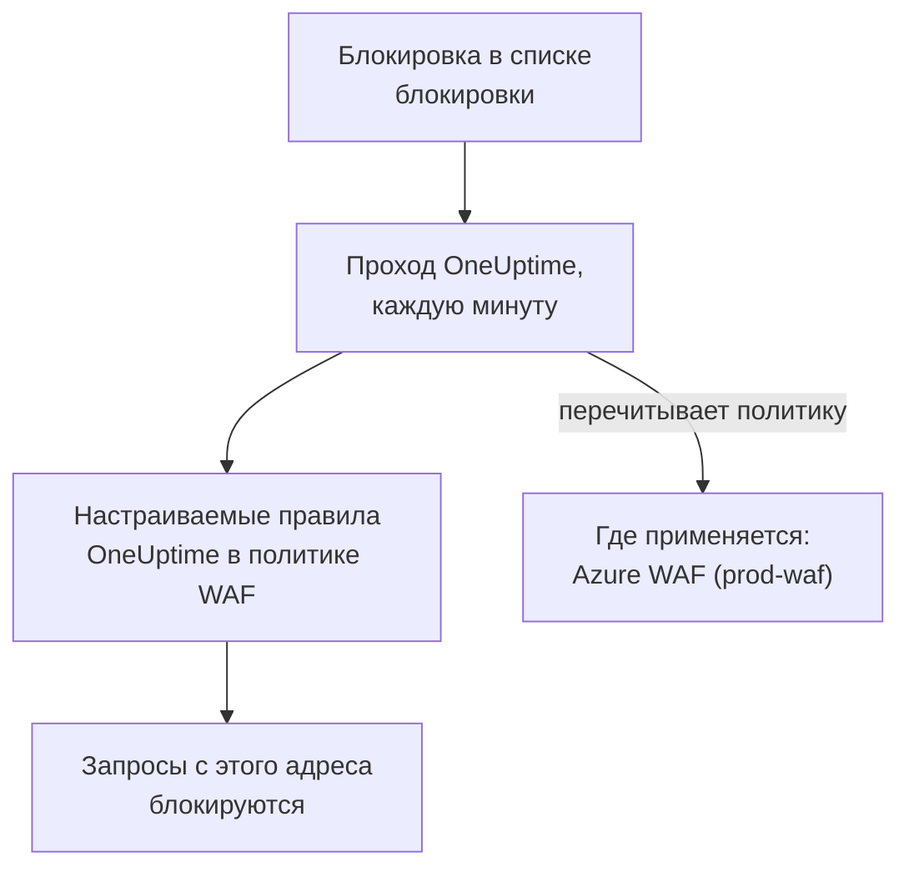

# Блокировка адресов в Azure WAF

Список блокировки вашего проекта можно применять в политиках Azure WAF ваших шлюзов Application Gateway и профилей Front Door. Включите его для уже существующего облачного подключения Azure, выберите политики WAF — и каждый адрес, который блокирует список блокировки, будет заблокирован и там, кто бы его ни заблокировал: человек, плейбук или OneUptime AI.

:::cards
- [Включение](#включение): Одна настройка в подключении Azure и роль, которая для неё нужна.
- [Что создаёт OneUptime](#что-создаёт-oneuptime): Собственные настраиваемые правила в каждой выбранной политике.
- [Какой адрес сопоставляется](#какой-адрес-сопоставляется): Адрес, который подключился, или исходный клиент за прокси.
:::

## Как это работает

OneUptime ведёт собственные настраиваемые правила в каждой выбранной политике WAF и помещает в них адреса, которые блокирует список блокировки. Каждую минуту он один раз записывает политику с тем, что содержит список блокировки, а затем считывает её обратно. На странице **Список блокировки** в столбце **Где применяется** у блокировки Azure WAF (prod-waf) появляется только тогда, когда политика содержит блокировку и Azure применил изменение; до этого блокировка не применяется.

## Перед началом

- Подписка Azure, подключённая к OneUptime (см. [Подключение облачного аккаунта](/docs/telemetry/cloud-accounts#microsoft-azure)).
- Роль, которой разрешено менять, где применяется список блокировки: **Владелец проекта**, **Администратор проекта** или **Администратор безопасности**.
- Человек, которому разрешено назначать роли в подписке Azure, чтобы выполнить одну команду в Azure Cloud Shell.

## Включение

:::steps
### Откройте подключение
Откройте **Облако → Подключить** и измените подключение Azure.

### Включите настройку
В разделе **Дополнительные поля** установите для **Блокировать адреса в Azure WAF** значение **Включено** и сохраните. Команда настройки, которую показывает форма, теперь выдаёт описанную ниже роль на всю подписку. Уже существующему подключению не нужно выполнять её снова: диалог **Добавить WAF** даёт строки, которые выдают эту роль только на одну политику.

### Добавьте политики WAF
Откройте **События безопасности → Плейбуки → Список блокировки**. В разделе **Облачные WAF** нажмите **Добавить WAF** и выберите политику WAF. OneUptime спрашивает у Azure, может ли подключение записывать её, ничего не записывая.

### Выдайте роль, если её нет
Если разрешения не хватает, диалог показывает строки, которые выдают его только на эту политику. Выполните их в Azure Cloud Shell, нажмите **Проверить снова**, а затем добавьте политику. Её **Статус** показывает **Применяется**, когда OneUptime её прочитает.
:::

Политики WAF берутся из инвентаря подключения: политика, которую OneUptime ещё не прочитал, появится после следующего чтения. Пока политика применяет список блокировки, настройку её подключения нельзя выключить, а само подключение нельзя удалить: сначала уберите политику, чтобы OneUptime убрал из неё свои правила.

## Что создаёт OneUptime

| Что | Имя | Где |
| --- | --- | --- |
| Настраиваемые правила, каждое с одним условием совпадения IP и действием Block | `OneUptime<project>Block1`, `OneUptime<project>Block2`, ... | В каждой выбранной политике WAF, не более 10. |

`<project>` — это первые восемь символов внешнего ID вашего проекта, поэтому два проекта OneUptime, выбравшие одну политику, никогда не пишут правила друг друга. Правило вмещает 540 адресов или диапазонов в Application Gateway, 600 с CRS 3.2 или Default Rule Set и 600 в Front Door. С десятью правилами политика вмещает 5 400 или 6 000 блокировок; блокировка, которая не помещается, сообщает об этом в своей строке.

OneUptime меняет в политике только свои правила. Azure записывает политику WAF только целиком, поэтому OneUptime читает политику вместе с её ETag, меняет свои правила и записывает её обратно с ETag в `If-Match`: все остальные правила, настройки и управляемые наборы правил записываются в том виде, в каком были прочитаны. Если кто-то другой за это время записал политику, Azure отклоняет запись, а OneUptime читает её снова и вносит своё изменение поверх того, что записал этот человек.

## Место правил в политике

OneUptime ставит свои правила на свободные приоритеты перед вашим первым правилом, которое пропускает трафик, начиная с наименьшего, чтобы ни одно ваше правило не пропустило заблокированный адрес. Ваше правило, которое блокирует или записывает в журнал, может стоять раньше. OneUptime никогда не перенумеровывает, не меняет и не удаляет ваши правила: если перед вашим первым правилом Allow нет свободного приоритета, политика показывает **Нет свободного приоритета**, и OneUptime добавит своё правило, как только вы освободите один.

## Какой адрес сопоставляется

| Политика WAF | Адрес клиента | Когда выбирать |
| --- | --- | --- |
| Front Door | **Адрес, который подключился к Front Door (SocketAddr)** | Значение по умолчанию. |
| Front Door | Исходный клиент, из X-Forwarded-For (RemoteAddr) | Для Front Door за другим прокси или CDN. |
| Application Gateway | Адрес, который подключился к шлюзу (RemoteAddr) | Единственный вариант: его сопоставление IP не читает другие адреса. |

Front Door берёт `RemoteAddr` из заголовка `X-Forwarded-For`, который клиент, подключающийся к Front Door напрямую, записывает сам. Выбирайте этот вариант, только если другой прокси или CDN перед Front Door записывает этот заголовок. Выбор находится в разделе **Дополнительные поля** диалога **Добавить WAF**, а позже его можно изменить кнопкой **Адрес клиента** в строке политики.

Сопоставление IP в Application Gateway читает только адреса IPv4, поэтому блокировка IPv6 там не применяется, и в её строке указана причина.

Правила OneUptime в Azure WAF только блокируют. Блокировка, которая требует отправить адрес на проверку, в Azure WAF не применяется и сообщает об этом. Проверка от политики автоматического реагирования применяется там как блокировка на тот же срок.

## Сколько времени занимает изменение

Application Gateway применяет изменение, как только Azure его записывает. Front Door принимает изменение и в течение следующих нескольких минут распространяет его по своим узлам: политика показывает **Применение изменений**, а **Где применяется** у новой блокировки ждёт политику, пока Azure не сообщит, что она подготовлена. С этого момента блокировка применяется.

## Если правило изменено вручную

Если кто-то выключает, меняет или удаляет одно из правил OneUptime в Azure, OneUptime оставляет его таким, каким его оставили. Политика показывает **Изменено вручную**, и блокировки, которые были в этом правиле, не применяются, с указанием причины, пока кто-нибудь не нажмёт **Вернуть** в строке политики. «Вернуть» записывает правило заново так, как его записывает OneUptime, на его собственный приоритет, пока тот свободен.

Политика, которая ничего не блокирует, тоже сообщает об этом, и её блокировки не применяются:

- Политика, которая выключена.
- Политика в режиме **Detection**, которая только записывает в журнал то, с чем совпадают правила OneUptime.
- Политика, которая не связана ни со шлюзом приложений, ни с прослушивателем, ни с правилом пути, ни с доменом Front Door.

## Ведение политики в Terraform

Terraform тоже записывает политику WAF целиком, поэтому его следующий план удаляет правила OneUptime. Чтобы OneUptime сохранил их, добавьте `ignore_changes = [custom_rules]` в блок `lifecycle` ресурса `azurerm_web_application_firewall_policy` или `ignore_changes = [custom_rule]` в такой же блок ресурса `azurerm_cdn_frontdoor_firewall_policy` и не описывайте собственные настраиваемые правила в коде этой политики.

## Разрешения

Команда настройки добавляет настраиваемую роль `OneUptime WAF Blocklist` и назначает её приложению подключения на уровне подписки. Строки, которые показывает диалог **Добавить WAF**, назначают ту же роль только на одну политику.

| Действие | Зачем |
| --- | --- |
| `Microsoft.Network/ApplicationGatewayWebApplicationFirewallPolicies/read`, `Microsoft.Network/ApplicationGatewayWebApplicationFirewallPolicies/write` | Читать политику WAF Application Gateway и записывать в неё правила OneUptime. |
| `Microsoft.Network/FrontDoorWebApplicationFirewallPolicies/read`, `Microsoft.Network/FrontDoorWebApplicationFirewallPolicies/write` | Читать политику WAF Front Door и записывать в неё правила OneUptime. |

Роль не может удалить политику, а OneUptime никогда не записывает ничего другого.

## Отключение

:::steps
### Уберите политику WAF
В **События безопасности → Плейбуки → Список блокировки** нажмите **Удалить** в строке политики. OneUptime убирает свои правила из политики и больше ничего в ней не меняет.

### Выключите настройку
Измените подключение, установите для **Блокировать адреса в Azure WAF** значение **Выключено** и сохраните. Настройку можно выключить, как только ни одна политика подключения не применяет список блокировки.
:::

Если OneUptime больше не может записывать политику, отметьте **Убрать только из OneUptime** в диалоге **Убрать WAF**. OneUptime убирает политику из списка блокировки и называет правила, которые он в ней оставил: они продолжают блокировать то, что в них есть, пока вы не удалите их в Azure.

## Устранение неполадок

:::details Не применяется
Статус политики сообщает, что ответил Azure и что делать. Отказ называет недостающее разрешение: выполните строки, которые **Добавить WAF** показывает для этой политики, а затем нажмите **Проверить снова**.
:::

:::details Нет свободного приоритета
Ваше первое правило, которое пропускает трафик, стоит на приоритете 1, или все приоритеты перед ним заняты. Дайте ему больший номер приоритета, а затем нажмите **Проверить снова**.
:::

:::details Политики нет в списке
OneUptime показывает политики WAF подключений с включённой настройкой, после того как прочитает их. Политика, добавленная позже, появится после следующего чтения подключения.
:::

## Что дальше

:::cards
- [Кейсы безопасности и плейбуки](/docs/telemetry/security-cases): Заблокируйте адрес из кейса и посмотрите, как проверяется его шаг.
- [Подключение облачного аккаунта](/docs/telemetry/cloud-accounts): Подключение, в которое входит эта настройка.
:::
