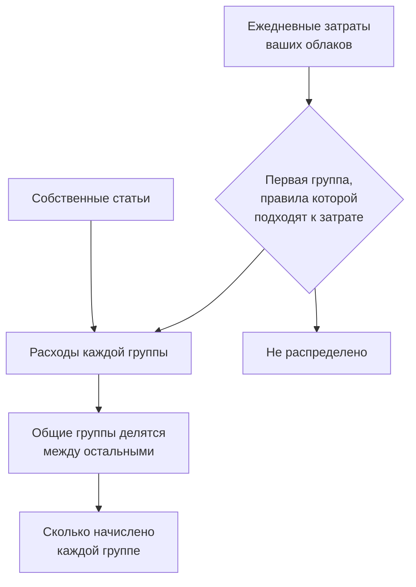

# Распределение затрат на облако

Группы затрат отвечают на первый вопрос каждого месячного счёта за облако: кто потратил деньги. **Представление затрат**, например «По команде» или «По центру затрат», распределяет расходы ваших подключённых аккаунтов по **группам затрат** с помощью правил, ничего не учитывая дважды. То, что не забирает ни одно правило, остаётся на виду как нераспределённые расходы, а общие затраты делятся между группами. Они находятся в разделе **Облако → Расходы → Группы затрат**.

:::cards
- [Создание представления](#создание-представления): По команде из уже заданных владельцев, по тегу или своими группами.
- [Правила группы](#правила-группы): Аккаунты, сервисы, теги, команды-владельцы, метки и многое другое.
- [Нераспределённые расходы](#нераспределённые-расходы): То, что не забирает ни одно правило, и один щелчок, чтобы распределить.
- [Общие затраты](#общие-затраты): План поддержки или общий кластер, разделённые между группами.
:::

## Как это работает



- **Затрату забирает первая подходящая группа.** Группы представления упорядочены, и каждая затрата попадает в первую группу, правила которой ей соответствуют, поэтому ничто не учитывается дважды. Группы вместе с нераспределёнными расходами всегда дают итог за период.
- **Правила читают всё, что есть у затраты.** Аккаунт, облако, сервис, регион, ресурс и его теги, а также то, что OneUptime знает о ресурсе: его команды-владельцы, метки, окружение App Platforms и приложение.
- **Всё рассчитывается при просмотре.** Для отдельных затрат ничего не записывается. Изменённое правило заново распределяет каждый месяц, который хранит OneUptime, до 400 дней назад, без ожидания.
- **Несколько представлений могут распределять одни и те же расходы.** «По команде» и «По центру затрат» распределяют всё, каждое по-своему.

## Перед началом

- **Затраты, которые читаются.** [Подключите облачный аккаунт](/docs/telemetry/cloud-accounts) и дайте ему [прочитать затраты](/docs/telemetry/cloud-costs).
- **Теги или владельцы, если они вам нужны.** Правилам по тегам нужны затраты с этими тегами; в AWS включите [Затраты по ресурсам](/docs/telemetry/cloud-costs#затраты-по-ресурсам). Команды-владельцы берутся из владельцев каждого ресурса, заданных вручную или [правилами владельца](/docs/configuration/label-and-owner-rules).

## Создание представления

Откройте **Облако → Расходы → Группы затрат**. Проекту без представлений предлагаются три способа начать:

| Способ | Что создаётся |
| --- | --- |
| **По команде, по владельцам** | Группа для каждой команды, владеющей облачными ресурсами, связанная с этой командой. |
| **По тегу** | Группа для каждого значения тега, который есть у ваших затрат, например `team` или `cost-center`. |
| **Ваши собственные группы** | Пустое представление. Правила каждой группы вы пишете сами. |

OneUptime создаёт группы представления по тегу или по команде-владельцу при сохранении, а затем каждый час по мере появления новых значений тегов и владельцев. Такие группы можно переименовать, связать с командой или сделать общими. Их правила остаются за OneUptime. Чтобы создать недостающие группы сейчас, откройте представление и нажмите **Создать группы сейчас**.

## Правила группы

Откройте представление, затем **Создать: Группа затрат** в разделе **Группы**. Затрата относится к группе, если ей соответствует **любое** из правил группы, а правило выполняется, когда выполняются **все** его условия. Условие сравнивает что-то, что есть у затраты, со значениями, которые вы выбираете или вводите:

| Поле | Что оно читает |
| --- | --- |
| **Тег** | Значение тега по его ключу. **задано** и **не задано** проверяют, есть ли у затраты этот тег. |
| **Аккаунт** | Подключённый аккаунт, на который выставлена затрата. |
| **Команда-владелец** | Команды, которые владеют ресурсом в OneUptime. |
| **Сервис** | Сервис, как его называет биллинг вашего облака. |
| **Метка** | Метки ресурса или его аккаунта в OneUptime. |
| **Регион** | Регион. Для глобального сервиса оставьте значение пустым. |
| **Облако** | AWS, Azure или Google Cloud. |
| **Ресурс** | Ресурс, как его называет ваше облако. |
| **Окружение App Platforms** и **Приложение** | То, что выставлено окружению или приложению, как это считает **Облако → Расходы → Затраты**. |
| **Пространство имен Kubernetes** и **кластер Kubernetes** | Пространства имен кластера, когда общая группа делится по ним. См. [Кластеры Kubernetes](#кластеры-kubernetes). |

Текст сравнивается без учёта регистра: `Payments` и `payments` — одна команда. Ключ тега сравнивается так, как он написан, как его хранят ваши облака.

Например, группа **Платежи** с тремя правилами забирает затрату с тегом `team: payments`, **или** выставленную на аккаунт payments, **или** принадлежащую команде «Платежи».

### Порядок групп

Перетаскивайте группы в разделе **Группы**, чтобы изменить их порядок. Группа, правила которой уже покрывает предыдущая группа, никогда не получит затрату, и её строка называет группу, которая забирает всё. Группа, правила которой также соответствуют затратам, забираемым предыдущей группой, показывает, сколько из них она получает.

### Ресурсы с несколькими командами-владельцами

Ресурс двух команд делится между ними поровну: половина каждой команды проходит правила отдельно. Правило, которое не спрашивает о владельцах, например тег или аккаунт, по-прежнему забирает затрату целиком. Половина, у команды которой нет группы, остаётся нераспределённой.

## Нераспределённые расходы

Страница представления перечисляет то, что пока не забирает ни одно правило: сервисы, аккаунты, значения тегов и команды-владельцы, из которых это состоит, сначала самые дорогие. Нажмите **Добавить в группу** рядом с одним из них, чтобы добавить для него правило в группу или в новую группу. Его затраты сразу переходят в группу, в том числе за прошлые месяцы.

## Общие затраты

План поддержки, общий кластер или сетевой хаб принадлежат всем. Сделайте для этого отдельную группу, затем в разделе **Дополнительные поля** включите **Общее** и выберите, как её затраты делятся между остальными группами представления:

| Деление | Как |
| --- | --- |
| **Разделить по доле расходов** | Каждая группа получает свою долю облачных расходов остальных групп за этот месяц. Месяц, в котором они ничего не потратили, делится поровну. |
| **Разделить поровну** | Одинаковая сумма каждой группе. |
| **Разделить по фиксированным процентам** | Проценты, которые вы задаёте для каждой группы, в сумме 100. |
| **Разделить по пространствам имен Kubernetes** | Сколько стоило каждое пространство имен кластера в этом месяце. См. ниже. |

Затраты общей группы делятся по дням с долями каждого месяца, поэтому месяц даёт одни и те же цифры, читается ли он по дням или по месяцам. Нераспределённые расходы никогда не получают долю.

### Кластеры Kubernetes

Узлы кластера выставляет ваше облако, а собственный движок затрат кластера сообщает, сколько использовало каждое пространство имен. Чтобы начислять каждой команде её рабочие нагрузки в общем кластере:

1. Создайте группу, правила которой соответствуют узлам кластера, например **Тег** `eks:cluster-name` **равно одному из** `prod`.
2. Включите **Общее**, выберите **Разделить по пространствам имен Kubernetes** и укажите **Kubernetes-кластер**.
3. Дайте группам команд правила, которые читают метки пространств имен, — они считаются тегами. Например, **Тег** `team` **равно одному из** `payments` или **Пространство имен Kubernetes** **начинается с** `payments-`.

Каждый месяц затраты узлов делятся по тому, сколько стоило каждое пространство имен в [движке затрат](/docs/telemetry/kubernetes-cost) кластера, и доля каждого пространства имен уходит в первую группу, правила которой ей соответствуют. Простаивающие мощности и пространство имен, которое не забирает ни одна группа, остаются в группе кластера. Собственные рассчитанные затраты кластера никогда не добавляются к вашему счёту, поэтому ничто не учитывается дважды.

## Собственные статьи

В разделе **Собственные статьи** на странице **Облако → Расходы → Группы затрат** добавьте начисление или кредит, которых нет в счетах ваших облаков: долю договора поддержки, корпоративную скидку, внутреннюю наценку или плату за платформу.

- **Один раз или каждый месяц.** Ежемесячная статья распределяется по дням каждого месяца, поэтому часть месяца получает свою долю.
- **На аккаунт или на группу.** Статья, добавленная к аккаунту, проходит правила каждого представления так же, как затраты аккаунта. Статья, добавленная к группе, идёт прямо в неё.
- **Всегда отдельно.** Каждая цифра держит статьи отдельно от того, что выставили облака, поэтому собственные цифры облаков по-прежнему совпадают с их консолями.

## Расходы каждой группы

- **Облако → Расходы → Затраты**: в разделе **Куда уходят деньги** выберите **Группы затрат** и представление. Расходы каждой группы в сравнении с предыдущим периодом.
- **Страница представления**: сколько начислено каждой группе с её общими затратами, что не забирает ни одно правило, и **Скачать CSV** для перевыставления затрат за месяц.
- **Страница группы**: её расходы по дням, сервисы, ресурсы и аккаунты, за которые ей начисляют больше всего, и её правила. Она показывает только расходы этой группы, поэтому свяжите группу с её **Команда** и отправьте команде страницу: открыть её может любой, кому разрешено читать облачные расходы.

## API, CLI и MCP

Представления, группы и статьи — это ресурсы API (`cloud-cost-view`, `cloud-cost-group`, `cloud-cost-line-item`) с командами CLI и инструментами MCP, как у любого ресурса. Правила группы задаются в JSON:

```json
[
  { "conditions": [{ "field": "tag", "key": "team", "operator": "is", "values": ["payments"] }] },
  { "conditions": [{ "field": "ownerTeam", "operator": "is", "values": ["<team ID>"] }] }
]
```

Чтобы прочитать, что распределяет представление, за целые дни UTC от `startDate` до `endDate`:

```bash
curl -X POST "https://oneuptime.com/api/cloud-cost-view/<view ID>/allocation" \
  -H "apikey: <API key>" -H "tenantid: <project ID>" -H "Content-Type: application/json" \
  -d '{"startDate": "2026-11-01", "endDate": "2026-11-30", "currency": "USD"}'
```

Ответ содержит `total` каждой группы и его состав (`cloud`, `lineItems`, `sharedIn`, `sharedOut`), цифры по дням или по месяцам, предыдущий период и состав нераспределённых расходов. `POST /cloud-cost-group/<group ID>/spend` отвечает для одной группы.

## Ограничения

- В представлении не больше 500 групп. Представление по тегу создаёт группы для 500 самых дорогих значений.
- У группы не больше 25 правил, у правила 20 условий, у условия 200 значений.
- Затраты хранятся 400 дней, поэтому представление читает не больше 400 дней.

## Устранение неполадок

:::details Группа ничего не получает
Возможно, её правилам пока не соответствует ни одна затрата или предыдущая группа забирает все затраты, которым они соответствуют. Тогда её строка в разделе **Группы** называет эту группу: перетащите эту группу выше или сузьте правила предыдущей.
:::

:::details Затрата не в той группе
Затрата попадает в первую группу, правила которой ей соответствуют. Перетащите группу, к которой она относится, выше группы, которая её забирает, или сузьте правила той группы.
:::

:::details Правилу по тегу ничего не соответствует
Затрата сохраняет теги, которые были у неё при чтении: метки экспорта биллинга Google Cloud, а иначе теги ресурса, на который она выставлена, для чего в AWS нужны [Затраты по ресурсам](/docs/telemetry/cloud-costs#затраты-по-ресурсам). Ключ тега сравнивается так, как он написан.
:::

:::details В представлении по тегу или по команде-владельцу не хватает группы
OneUptime создаёт недостающие группы каждый час: по одной на каждое значение тега в затратах за последние 400 дней или на каждую команду, владеющую облачными ресурсами, до 500 групп. Нажмите **Создать группы сейчас** на странице представления, чтобы создать их сразу.
:::

:::details Цифры не учитывают аккаунт
Цифры представления указаны в валюте, в которой выставляется большинство ваших аккаунтов. Аккаунт, выставляемый в другой валюте, в них не входит, как и статья в другой валюте.
:::

## Что дальше

:::cards
- [Затраты на облако и экономия](/docs/telemetry/cloud-costs): Сколько стоят ваши подключённые аккаунты и как тратить меньше.
- [Правила меток и владельцев](/docs/configuration/label-and-owner-rules): Задайте ресурсам команды-владельцы и метки, которые читают правила.
- [Наблюдаемость затрат Kubernetes](/docs/telemetry/kubernetes-cost): Сколько стоит каждая рабочая нагрузка Kubernetes.
:::
