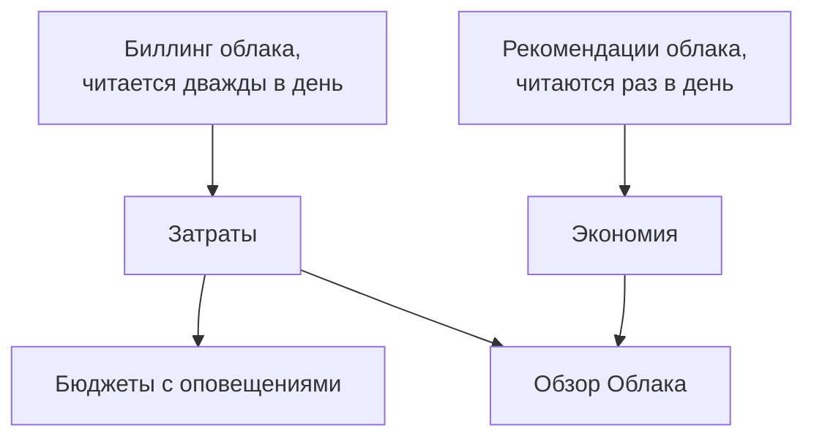

# Затраты на облако и экономия

Подключённый облачный аккаунт также сообщает, сколько он стоит и как мог бы стоить меньше. OneUptime читает затраты за каждый день из собственного биллинга вашего облака и рекомендации собственного сервиса рекомендаций вашего облака, показывает их в разделах **Облако → Расходы → Затраты** и **Облако → Расходы → Экономия** и оповещает, прежде чем месяц обойдётся дороже своего бюджета, в разделе **Облако → Расходы → Бюджеты**.

:::cards
- [Amazon Web Services](#amazon-web-services): Cost Explorer и Cost Optimization Hub, каждый включается один раз.
- [Microsoft Azure](#microsoft-azure): Cost Management и Azure Advisor, с ещё одной ролью.
- [Google Cloud](#google-cloud): Ваш экспорт счетов в BigQuery и Recommender.
- [Бюджеты](#бюджеты): Оповещение, когда расходы месяца превышают долю его бюджета.
:::

## Как это работает



- **Затраты берутся из собственного биллинга вашего облака.** AWS Cost Explorer, Azure Cost Management и экспорт счетов Google Cloud в BigQuery, до кредитов и возвратов, в валюте, в которой выставляются счета аккаунту. Каждая сумма относится к одному дню, в днях UTC, как их считает ваше облако.
- **Облако сообщает о последнем дне-двух с опозданием.** Каждое чтение заново берёт последнюю неделю, а в первые дни месяца — весь прошлый месяц, поэтому затраты за день устанавливаются по мере того, как облако его закрывает. Первое чтение подключения уходит к началу позапрошлого месяца.
- **Прогноз месяца следует темпу последней недели.** Это то, во сколько месяц обошёлся до сих пор, плюс каждый оставшийся день по среднему за последние семь полных дней.
- **Экономия берётся из собственного сервиса рекомендаций вашего облака.** AWS Cost Optimization Hub, Azure Advisor и Recommender в Google Cloud: меньший размер, простаивающий ресурс, выгодное обязательство, каждое с тем, сколько оно сэкономило бы в месяц. Рекомендация, которую вы выполните или отклоните в консоли облака, исчезает при следующем чтении.

## Перед началом

- **Подключённый аккаунт.** [Подключение облачного аккаунта](/docs/telemetry/cloud-accounts) с текущей командой настройки: она позволяет подключению читать затраты и рекомендации. Подключение, созданное раньше, не читает ни того, ни другого, пока вы снова не выполните его команду.

## Amazon Web Services

Подключение читает затраты через `ce:GetCostAndUsage`, а рекомендации — через `cost-optimization-hub:ListRecommendations`. Для каждого сначала нужно кое-что включить в аккаунте:

:::steps
### Включить Cost Explorer

Откройте Cost Explorer один раз в консоли AWS Billing and Cost Management: AWS подготовит затраты аккаунта в течение дня. Подключите управляющий аккаунт организации, чтобы читать затраты каждого аккаунта-участника.

### Включить Cost Optimization Hub

Откройте Cost Optimization Hub в той же консоли и включите его — для организации из её управляющего аккаунта или только для этого аккаунта. Его рекомендации появятся в течение дня.
:::

Cost Explorer берёт $0.01 за каждый запрос, а одно чтение затрат делает несколько запросов. Cost Optimization Hub бесплатен.

## Microsoft Azure

Приложение читает затраты с ролью **Cost Management Reader** в той же области, что и **Monitoring Reader**: команда настройки назначает обе. Рекомендации Azure Advisor читаются с ролью **Monitoring Reader**, поэтому включать ничего не нужно. Чтобы выдать роль приложению, созданному раньше, выполните:

```bash
az role assignment create --assignee <APP_ID> --role "Cost Management Reader" --scope /subscriptions/<SUBSCRIPTION_ID>
```

Cost Management отвечает по каждой подписке, с ресурсом, к которому относятся затраты, и его чтение ничего не стоит. Если он не может ответить по подписке, вкладка **Затраты** аккаунта объясняет почему.

## Google Cloud

У Google Cloud нет API для затрат проекта: OneUptime читает их из экспорта вашего платёжного аккаунта в BigQuery.

:::steps
### Экспортировать счета в BigQuery

В консоли Google Cloud откройте Billing, затем Billing export и включите экспорт подробной стоимости использования в набор данных BigQuery. Google записывает его с отставанием в несколько часов, начиная с дня, когда вы его включили.

### Разрешить сервисному аккаунту его читать

Выдайте сервисному аккаунту подключения роль **BigQuery Data Viewer** на набор данных экспорта. Команда настройки уже выдала ему **BigQuery Job User**, чтобы выполнять запрос в его собственном проекте.

### Указать таблицу экспорта

Измените подключение в разделе **Облако → Подключить** и в разделе **Дополнительные поля** задайте в поле **Таблица экспорта счетов** полное имя таблицы: `<PROJECT_ID>.<DATASET>.gcp_billing_export_resource_v1_<BILLING_ACCOUNT_ID>`.
:::

Подробный экспорт называет ресурс, к которому относятся затраты; стандартный указывает только сервис и регион. BigQuery берёт плату за запрос: первый 1 ТиБ в месяц бесплатен, затем $6.25 за ТиБ, а месяц экспорта занимает от нескольких мегабайт до нескольких гигабайт. Рекомендации Recommender по типам машин и простаивающим ресурсам читаются с ролью **Compute Recommender Viewer**, которую назначает команда настройки, и ничего не стоят.

## Способы тратить меньше

**Облако → Расходы → Экономия** показывает каждую рекомендацию, сначала самую большую экономию: что сделать, с каким ресурсом, что изменится и сколько это сэкономит в месяц. Полоса над ней суммирует их — всего и по видам: меньший размер, простаивающий ресурс, обязательство. Рекомендация ведёт на страницу своего ресурса, если ресурс есть в OneUptime.

### Подбор размера по собственным показаниям OneUptime

Ресурсу, о котором не высказывается ни один сервис рекомендаций — потому что он не включён, не охватывает его тип или считает ресурс слишком новым, — размер подбирает сам OneUptime по показаниям CPU и памяти, которые его подключение сняло за последние 14 дней. OneUptime подбирает размер для инстансов EC2, баз данных RDS и кластеров ElastiCache в AWS, виртуальных машин, гибких серверов PostgreSQL и MySQL и планов App Service в Azure, а также ВМ Compute Engine и инстансов Cloud SQL в Google Cloud:

- **Избыточный ресурс**, когда размеру вдвое или вчетверо меньше всё ещё хватило бы запаса: на меньшем размере 95-й процентиль CPU был бы не выше 60%, самое высокое показание CPU — не выше 100%, а пик памяти — не выше 70%, если память читается.
- **Недостаточный ресурс**, когда 95-й процентиль CPU составляет 85% или больше либо пик памяти — 90% или больше: размер вдвое больше.

Размер ресурса подбирается, как только у него есть 6 дней показаний. Его страница показывает **Подбор размера** рядом с тем, сколько он стоит, а ресурс с избыточным размером попадает в **Облако → Расходы → Экономия** с OneUptime в качестве источника. Экономия от изменения — это его доля в том, сколько ресурс стоил за последние 30 дней, поэтому она известна, как только облако выставляет счёт за ресурс по имени: подробный экспорт Azure и Google Cloud так делает, AWS Cost Explorer — нет. Инстанс EC2 сообщает о памяти только с агентом CloudWatch, а ВМ Compute Engine — только с Ops Agent: без агента размер подбирается только по CPU. Размеры с накоплением производительности, такие как t3, серия B и e2-micro, никогда не подбираются.

## Бюджеты

:::steps
### Создать бюджет

В разделе **Облако → Расходы → Бюджеты** создайте бюджет: его **Сумма в месяц** и **Аккаунт**, к которому он относится, или никакого — для всех аккаунтов.

### Выбрать, когда он оповещает

**Оповещать при** принимает доли бюджета для оповещений в процентах: для начала 80 и 100. **Оповещать о прогнозе превышения** также оповещает раз в месяц, когда темп последней недели вывел бы месяц за пределы бюджета. **Оповещать о необычных днях** также оповещает на следующий день после дня, который обошёлся намного дороже обычного: см. [Необычные дни](#необычные-дни). **Серьёзность оповещения** и **Политики дежурств** задают, насколько серьёзны оповещения и кого вызывают.
:::

Бюджет проверяется после каждого чтения затрат и каждый час. Когда расходы месяца проходят порог, для него создаётся одно оповещение — для самого высокого, если чтение проходит несколько сразу, — а новый месяц закрывает оповещения прошлого. Бюджет учитывает только аккаунты, счета которым выставляются в его валюте.

ИИ-агенты могут создавать и менять бюджеты через [сервер MCP](/docs/ai/mcp-server), а скрипты — командой `oneuptime cloud-budget` в CLI: см. [Операции с ресурсами](/docs/cli/resource-operations).

### Необычные дни

После каждого чтения каждый из последних 14 полных дней аккаунта сравнивается с 14 днями до него. День необычный, когда сервис обошёлся вдвое дороже своего обычного дня или больше либо весь аккаунт — в полтора раза дороже своего обычного дня или больше. В обоих случаях разница должна быть не меньше 10 в валюте аккаунта и не меньше 5% обычного дня аккаунта, чтобы несколько центов никогда не считались всплеском. Обычное значение дня — медиана 14 дней до него, так что один всплеск почти не сдвигает её, а аккаунт оценивается только после недели затрат.

**Облако → Расходы → Затраты** показывает необычные дни под расходами по дням. Бюджет, который учитывает аккаунт, создаёт одно оповещение для каждого аккаунта и дня, на следующий день, и называет каждый сервис, расходы на который выросли. О всплеске, который длится несколько дней, сообщается в день, когда он начался, а о дне старше недели не сообщается. Бюджет, созданный до появления этих оповещений, не создаёт их, пока вы не измените его и не включите их.

## Что вы видите в OneUptime

- **Обзор Облака.** **Облако → Обзор** показывает расходы месяца по сравнению с прошлым месяцем на тот же день, самые дорогие сервисы и крупнейшие способы тратить меньше рядом с тем, что требует внимания.
- **Расходы за каждый день.** **Облако → Расходы → Затраты** рисует каждый из последних 30 дней, показывает дни, которые обошлись намного дороже обычного, и разбивает период по сервисам, регионам, аккаунтам или ресурсам. Аккаунты, затраты которых не читаются, перечислены ниже, каждый с причиной.
- **Затраты аккаунта.** Вкладка **Затраты** аккаунта показывает то же самое только для этого аккаунта, с его способами тратить меньше.
- **Затраты ресурса.** Страница ресурса показывает, во сколько он обошёлся в этом месяце и за последние 30 дней, если облако выставляет ему счёт по имени, с его способами тратить меньше и подбором размера.

## Устранение неполадок

:::details Аккаунт показывает Нужно разрешение
Подключению пока нельзя читать затраты аккаунта. Снова выполните его команду настройки из раздела **Облако → Подключить**: она добавит то, что нужно для чтения затрат. В Google Cloud также выдайте сервисному аккаунту **BigQuery Data Viewer** на набор данных экспорта.
:::

:::details Аккаунт показывает Не настроено
Облаку пока нечего отдать. В AWS включите Cost Explorer; в Google Cloud укажите таблицу экспорта в поле **Таблица экспорта счетов**. Первые суммы придут со следующим чтением, в течение 12 часов.
:::

:::details Суммы не учитывают аккаунт
Суммы указаны в валюте, в которой выставляются счета большинству ваших аккаунтов. Аккаунт с другой валютой перечислен ниже с его валютой, а бюджет учитывает только аккаунты в своей валюте.
:::

:::details Этот месяц ниже, чем в консоли облака
Облако сообщает о последнем дне-двух с опозданием, а суммы указаны до кредитов и возвратов. Следующие чтения догонят.
:::

## Что дальше

:::cards
- [Подключение облачного аккаунта](/docs/telemetry/cloud-accounts): Подключите другой аккаунт или снова выполните его команду.
- [Облачные ресурсы](/docs/telemetry/cloud-resources): Метрики каждого ресурса из собственного коллектора.
- [Наблюдаемость затрат Kubernetes](/docs/telemetry/kubernetes-cost): Сколько стоит каждая рабочая нагрузка Kubernetes.
:::
