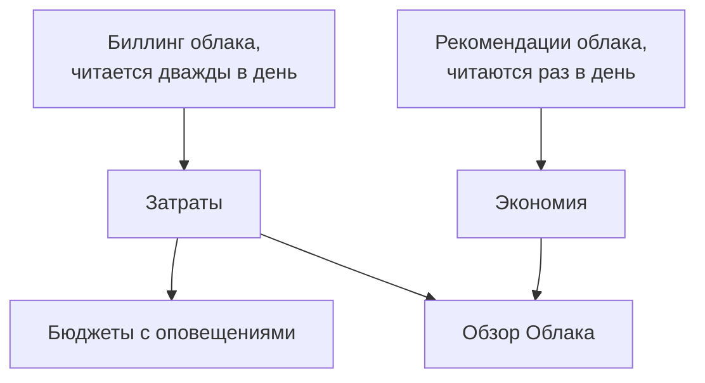

# Затраты на облако и экономия

Подключённый облачный аккаунт также сообщает, сколько он стоит и как мог бы стоить меньше. OneUptime читает затраты за каждый день из собственного биллинга вашего облака и рекомендации собственного сервиса рекомендаций вашего облака, показывает их в разделах **Облако → Расходы → Затраты** и **Облако → Расходы → Экономия**, перечисляет ваши Savings Plans, резервирования и скидки за обязательство использования в разделе **Облако → Расходы → Обязательства** и оповещает, прежде чем месяц обойдётся дороже своего бюджета, в разделе **Облако → Расходы → Бюджеты**. Если вы разрешите, он также применяет экономию, которую одобрил владелец, останавливает ресурсы не из продакшена в нерабочее время и сверяет каждое изменение со счётом.

:::cards
- [Amazon Web Services](#amazon-web-services): Cost Explorer и Cost Optimization Hub, каждый включается один раз.
- [Microsoft Azure](#microsoft-azure): Cost Management и Azure Advisor, с ещё одной ролью.
- [Google Cloud](#google-cloud): Ваш экспорт счетов в BigQuery и Recommender.
- [Начисленные, амортизированные и чистые](#начисленные-амортизированные-и-чистые): Каждая затрата тремя способами, чтобы обязательства и кредиты попадали туда, куда ушли деньги.
- [Обязательства и продления](#обязательства-и-продления): Каждое обязательство, оповещения до его окончания или пока оно недоиспользуется, и что продлить или купить.
- [Применение экономии](#применение-экономии): Применяйте экономию с одобрения владельца и отменяйте её.
- [Расписания нерабочего времени](#расписания-нерабочего-времени): Останавливайте ресурсы не из продакшена ночью и в выходные.
- [Правила ИИ для экономии](#правила-ии-для-экономии): Предложения владельцам или изменения в пределах лимита.
- [Бюджеты](#бюджеты): Оповещение, когда расходы месяца превышают долю его бюджета.
- [Обязательные теги](#обязательные-теги): Какая доля ваших расходов несёт требуемые теги, и новые ресурсы без них.
:::

## Как это работает



- **Затраты берутся из собственного биллинга вашего облака.** AWS Cost Explorer, Azure Cost Management и экспорт счетов Google Cloud в BigQuery, в валюте, в которой выставляются счета аккаунту, и каждая хранится начисленной, амортизированной и чистой: см. [Начисленные, амортизированные и чистые](#начисленные-амортизированные-и-чистые). Каждая сумма относится к одному дню, в днях UTC, как их считает ваше облако.
- **Облако сообщает о последнем дне-двух с опозданием.** Каждое чтение заново берёт последнюю неделю, а в первые дни месяца — весь прошлый месяц, поэтому затраты за день устанавливаются по мере того, как облако его закрывает. Первое чтение подключения уходит к началу позапрошлого месяца.
- **Прогноз месяца следует темпу последней недели.** Это то, во сколько месяц обошёлся до сих пор, плюс каждый оставшийся день по среднему за последние семь полных дней.
- **Экономия берётся из собственного сервиса рекомендаций вашего облака.** AWS Cost Optimization Hub, Azure Advisor и Recommender в Google Cloud: меньший размер, простаивающий ресурс, выгодное обязательство, каждое с тем, сколько оно сэкономило бы в месяц. Рекомендация, которую вы выполните или отклоните в консоли облака, исчезает при следующем чтении.

## Перед началом

- **Подключённый аккаунт.** [Подключение облачного аккаунта](/docs/telemetry/cloud-accounts) с текущей командой настройки: она позволяет подключению читать затраты и рекомендации. Подключение, созданное раньше, не читает ни того, ни другого, пока вы снова не выполните его команду.

## Amazon Web Services

Подключение читает затраты через `ce:GetCostAndUsage`, обязательства — через `ce:GetSavingsPlansCoverage`, `ce:GetSavingsPlansUtilization`, `ce:GetSavingsPlansUtilizationDetails`, `ce:GetReservationCoverage` и `ce:GetReservationUtilization`, купленные Savings Plans — через `savingsplans:DescribeSavingsPlans`, а рекомендации — через `cost-optimization-hub:ListRecommendations` и `cost-optimization-hub:GetRecommendation`. Команда настройки разрешает чтения Cost Explorer тремя семействами, `ce:GetCostAndUsage*`, `ce:GetSavingsPlans*` и `ce:GetReservation*`, и все они только читают, чтобы пользователь ключа доступа по-прежнему укладывался в 2048 символов, которые IAM допускает для его политики. Cost Explorer и Cost Optimization Hub сначала нужно включить в аккаунте:

:::steps
### Включить Cost Explorer

Откройте Cost Explorer один раз в консоли AWS Billing and Cost Management: AWS подготовит затраты аккаунта в течение дня. Подключите управляющий аккаунт организации, чтобы читать затраты каждого аккаунта-участника.

### Включить Cost Optimization Hub

Откройте Cost Optimization Hub в той же консоли и включите его — для организации из её управляющего аккаунта или только для этого аккаунта. Его рекомендации появятся в течение дня.
:::

Cost Explorer берёт $0.01 за каждый запрос: одно чтение затрат делает два запроса или чуть больше, один для начисленных и амортизированных и один для чистых, а обязательства читаются четырьмя запросами в день для их охвата и использования и ещё шестью–двенадцатью в день для каждого по отдельности. API Savings Plans и Cost Optimization Hub бесплатны.

### Затраты по ресурсам

Cost Explorer также сообщает, сколько стоит каждый ресурс, за последние 14 дней, когда включены данные на уровне ресурсов. В консоли AWS Billing and Cost Management откройте настройки Cost Management и включите данные на уровне ресурсов с ежедневной детализацией, для организации — из её управляющего аккаунта. AWS готовит их в течение 48 часов.

Затем измените подключение в **Облако → Подключить** и в **Дополнительные поля** включите **Затраты по ресурсам**. Подключение читает их через `ce:GetCostAndUsageWithResources` раз в день: в первый раз все 14 дней, затем снова последние три, каждый раз несколькими запросами. Прочитанное остаётся с затратами аккаунта и после того, как Cost Explorer его забудет. Подключению, созданному раньше, нужно снова выполнить команду настройки, которая добавит это действие.

## Microsoft Azure

Приложение читает затраты с ролью **Cost Management Reader** в той же области, что и **Monitoring Reader**: команда настройки назначает обе. Рекомендации Azure Advisor читаются с ролью **Monitoring Reader**, поэтому включать ничего не нужно. Чтобы выдать роль приложению, созданному раньше, выполните:

```bash
az role assignment create --assignee <APP_ID> --role "Cost Management Reader" --scope /subscriptions/<SUBSCRIPTION_ID>
```

Cost Management отвечает по каждой подписке, с ресурсом, к которому относятся затраты, и его чтение ничего не стоит. Если он не может ответить по подписке, вкладка **Затраты** аккаунта объясняет почему.

Cost Management ограничивает скорость чтения затрат клиента, одну для всех, кто их читает: каждый запрос стоит одну единицу обработки запросов (QPU) за каждый месяц данных, который он читает, а у клиента есть 12 QPU каждые 10 секунд, 60 в минуту и 600 в час. OneUptime читает подписки клиента одну за другой в пределах двух третей каждой квоты, ждёт столько, сколько просит Cost Management, когда он отклоняет запрос, и продолжает со следующим чтением с того места, где остановился. Ещё не прочитанная подписка показывает **В очереди** и когда она будет прочитана; подписка, у которой уже есть суммы, сохраняет их до тех пор. Её амортизированные затраты читаются при каждом чтении, а фактические — раз в день, поэтому первое чтение подписки обращается к Cost Management дважды и тратит вдвое больше единиц запросов: первые суммы крупного клиента появляются на несколько чтений позже.

Резервирования и планы экономии клиента читаются с ролями **Reservations Reader** и **Savings plan Reader**, которые Azure назначает на уровне самого клиента, где назначить их может только глобальный администратор с повышенным доступом. Команда настройки пытается это сделать и сообщает, если не может. Чтобы назначить их позже, как глобальный администратор с повышенным доступом:

```bash
az role assignment create --assignee <APP_ID> --role "Reservations Reader" --scope /providers/Microsoft.Capacity
az role assignment create --assignee <APP_ID> --role "Savings plan Reader" --scope /providers/Microsoft.BillingBenefits
```

Без них затраты и рекомендации читаются как прежде, а **Облако → Расходы → Обязательства** подсказывает, какую роль назначить.

## Google Cloud

У Google Cloud нет API для затрат проекта: OneUptime читает их из экспорта вашего платёжного аккаунта в BigQuery.

:::steps
### Экспортировать счета в BigQuery

В консоли Google Cloud откройте Billing, затем Billing export и включите экспорт подробной стоимости использования в набор данных BigQuery. Google записывает его с отставанием в несколько часов, начиная с дня, когда вы его включили.

### Разрешить сервисному аккаунту его читать

Выдайте сервисному аккаунту подключения роль **BigQuery Data Viewer** на набор данных экспорта. Команда настройки уже выдала ему **BigQuery Job User**, чтобы выполнять запрос в его собственном проекте.

### Указать таблицу экспорта

Измените подключение в разделе **Облако → Подключить** и в разделе **Дополнительные поля** задайте в поле **Таблица экспорта счетов** полное имя таблицы: `<PROJECT_ID>.<DATASET>.gcp_billing_export_resource_v1_<BILLING_ACCOUNT_ID>`.
:::

Подробный экспорт называет ресурс, к которому относятся затраты; стандартный указывает только сервис и регион. BigQuery берёт плату за запрос: первый 1 ТиБ в месяц бесплатен, затем $6.25 за ТиБ, а месяц экспорта занимает от нескольких мегабайт до нескольких гигабайт. Рекомендации Recommender по типам машин и простаивающим ресурсам читаются с ролью **Compute Recommender Viewer**, которую назначает команда настройки, и ничего не стоят. Обязательства Compute Engine перечисляются из Cloud Asset Inventory с ролью **Cloud Asset Viewer**, которую команда настройки уже назначает: больше ничего выдавать не нужно.

## Начисленные, амортизированные и чистые

Каждая затрата хранится тремя способами, а **Облако → Расходы → Затраты**, **Затраты** аккаунта, обзор раздела «Облако» и бюджеты показывают тот, что вы выберете:

- **Начисленные** — каждое начисление в тот день, когда ваше облако выставило его, до кредитов и возвратов. Предоплаченный Savings Plan или резервирование — это одно крупное начисление в день покупки, а покрытое ими использование выглядит бесплатным до конца срока.
- **Амортизированные** распределяют платежи за каждое обязательство по дням и ресурсам, которые оно покрывает, чтобы деньги попадали туда, где они были потрачены. По-прежнему до кредитов и возвратов. Именно их показывают страницы, если вы не выберете другое.
- **Чистые** — это амортизированные минус кредиты, возвраты и скидки: то, во что складывается счёт.

| | Начисленные | Амортизированные | Чистые |
|---|---|---|---|
| AWS | Несмешанные затраты (unblended) Cost Explorer | Амортизированные затраты Cost Explorer | Чистые амортизированные затраты Cost Explorer, с кредитами и возвратами |
| Azure | Фактические затраты Cost Management | Амортизированные затраты Cost Management | Амортизированные затраты: Azure вычитает кредиты в платёжном аккаунте, который подключение подписки не читает |
| Google Cloud | Затраты из экспорта | Затраты минус кредиты скидок за обязательство использования и подписок | Затраты минус все кредиты |

Переключатель над суммами меняет основу на странице, а OneUptime запоминает ваш выбор для этого проекта в вашем браузере. Собственная основа проекта, с которой открываются страницы и за которой следят бюджеты, находится в **Облако → Настройки → Настройки затрат**. Бюджет может следить за своей основой: измените его и задайте **Основа затрат**.

Затраты, прочитанные до того, как стали храниться все три, показывают начисленную сумму на каждой основе. Каждое подключение один раз перечитывает свои затраты, так далеко назад, как при первом чтении, чтобы заполнилась каждая основа.

## Способы тратить меньше

**Облако → Расходы → Экономия** показывает каждую рекомендацию, сначала самую большую экономию: что сделать, с каким ресурсом, что изменится и сколько это сэкономит в месяц. Полоса над ней суммирует их — всего и по видам: меньший размер, простаивающий ресурс, обязательство. Рекомендация ведёт на страницу своего ресурса, если ресурс есть в OneUptime, а у той, которую OneUptime может применить, есть кнопка **Применить**: см. [Применение экономии](#применение-экономии).

### Подбор размера по собственным показаниям OneUptime

Ресурсу, о котором не высказывается ни один сервис рекомендаций — потому что он не включён, не охватывает его тип или считает ресурс слишком новым, — размер подбирает сам OneUptime по показаниям CPU и памяти, которые его подключение сняло за последние 14 дней. OneUptime подбирает размер для инстансов EC2, баз данных RDS и кластеров ElastiCache в AWS, виртуальных машин, гибких серверов PostgreSQL и MySQL и планов App Service в Azure, а также ВМ Compute Engine и инстансов Cloud SQL в Google Cloud:

- **Избыточный ресурс**, когда размеру вдвое или вчетверо меньше всё ещё хватило бы запаса: на меньшем размере 95-й процентиль CPU был бы не выше 60%, самое высокое показание CPU — не выше 100%, а пик памяти — не выше 70%, если память читается.
- **Недостаточный ресурс**, когда 95-й процентиль CPU составляет 85% или больше либо пик памяти — 90% или больше: размер вдвое больше.

Размер ресурса подбирается, как только у него есть 6 дней показаний. Его страница показывает **Подбор размера** рядом с тем, сколько он стоит, а ресурс с избыточным размером попадает в **Облако → Расходы → Экономия** с OneUptime в качестве источника. Экономия от изменения — это его доля в том, сколько ресурс стоил за последние 30 дней, поэтому она известна, как только облако выставляет счёт за ресурс по имени: подробный экспорт Azure и Google Cloud так делает, а AWS — когда включены «Затраты по ресурсам». Размеры с накоплением производительности, такие как t3, серия B и e2-micro, никогда не подбираются.

Облако читает память ВМ только с собственным агентом внутри ВМ: агентом CloudWatch на инстансе EC2, Ops Agent на ВМ Compute Engine и никаким для ВМ Azure, которая сообщает свободную память, а не занятую. ВМ, на которой работает [коллектор хоста OneUptime](/docs/telemetry/hosts), получает размер по памяти, которую читает коллектор хоста:

- **ВМ и хост — одна машина**, когда совпадают провайдер, аккаунт, регион и ID инстанса: ID инстанса EC2, числовой ID ВМ Compute Engine или `vmId` ВМ Azure. Одно имя хоста никогда не даёт совпадения, а ВМ, на которую претендуют два хоста, например клонированная машина, не связывается ни с одним. Страница ВМ называет её хост, а страница хоста — его ВМ, и каждая ссылается на другую.
- **Память — это занятая память хоста без кеша и буферов**, та величина, что на графике страницы хоста, за те же 14 дней. Загруженный файловый кеш никогда не выглядит как заполненная машина. Хосту тоже нужно 6 дней показаний.
- **Когда память читают оба**, как на ВМ Compute Engine с Ops Agent и коллектором хоста, берётся тот, у кого больше показаний. CPU всегда берётся из показаний облака.

**Подбор размера** ВМ говорит, откуда взята её память, как и её строка в **Облако → Расходы → Экономия**. ВМ, размер которой подбирается только по CPU, сообщает об этом со ссылкой на установку коллектора хоста. Коллектор хоста проставляет данные своего облака шагом `resourcedetection/cloud`, который есть в [конфигурации из руководства по хостам](/docs/telemetry/host-otel-collector). Хост на конфигурации OneUptime по умолчанию получит этот шаг со следующим выпуском OneUptime, а в собственную конфигурацию его нужно добавить. Узлы Kubernetes оставлены [Наблюдаемости затрат Kubernetes](/docs/telemetry/kubernetes-cost), которая подбирает запросы того, что на них работает.

### Обязательства

**Облако → Расходы → Экономия** и вкладка **Затраты** аккаунта показывают, какую часть расходов за последние 30 дней оплатили обязательства каждого аккаунта и какая их часть была использована, по строке на каждый вид:

- AWS: Savings Plans и зарезервированные инстансы, из Cost Explorer. Управляющий аккаунт организации читает их для каждого аккаунта организации.
- Azure: планы экономии и резервирования, из Cost Management, в амортизированной стоимости.
- Google Cloud: скидки за обязательство использования, из вашего экспорта счетов. Экспорт не сообщает, какая часть обязательства осталась неиспользованной, поэтому использование не показывается.

Аккаунт без обязательств показывает, что работало по ценам по запросу и что обязательство оплатило бы дешевле. Цифры каждого вида — собственные цифры его облака, и виды никогда не складываются: резервирование и Savings Plan могут оба считать расходы одной и той же машины своими. Каждое обязательство по отдельности перечислено в **Облако → Расходы → Обязательства**: см. [Обязательства и продления](#обязательства-и-продления).

## Обязательства и продления

**Облако → Расходы → Обязательства** перечисляет каждый Savings Plan, резервирование и скидку за обязательство использования, которые могут прочитать ваши подключения, чтобы ни одно не закончилось незамеченным:

- **Активные обязательства** вверху считают активные и заканчивающиеся в ближайшие 90 дней, **Использование** — какая их часть использовалась за последние 30 дней и что осталось неиспользованным, а **Охват** — какую часть расходов они покрывают.
- **Скоро заканчиваются** перечисляет те, что заканчиваются в ближайшие 90 дней и не продлеваются сами, каждое со своим планом продления: что купить, чтобы сохранить скидку (почасовое обязательство или инстансы, в той части, что использовалась), сколько это стоит и экономит в месяц, когда окупится и какая часть расходов покрыта сейчас и после окончания. **Продлить в консоли** открывает страницу, где ваше облако его продлевает.
- **Все обязательства** — полный список: что представляет собой и что покрывает каждое, его аккаунт, когда оно заканчивается, его срок и вариант оплаты, какая его часть использовалась за последние 30 дней, какое использование оно оплатило и сколько сэкономило.
- **Планы покупки** — то, что сервис рекомендаций вашего облака предлагает купить, каждый с тем, сколько он стоил бы и экономил в месяц, когда окупился бы и как изменился бы охват. **Купить в консоли** открывает страницу, где его купить.
- Под ними — обязательства каждого аккаунта по видам, как их показывают его **Затраты**, и когда обязательства оповещают, с **Изменить оповещения**.

OneUptime только планирует: он никогда не покупает, не продлевает и не возвращает обязательство. Покупаете вы в консоли своего облака.

| | Откуда берутся обязательства | Что известно о каждом |
|---|---|---|
| AWS | Savings Plans и зарезервированные инстансы из Cost Explorer, каждый со своим использованием, и API Savings Plans для купленных планов, включая стоящие в очереди на начало | Окончание, срок, вариант оплаты, почасовое обязательство или инстансы, платежи и использование за последние 30 и 7 дней |
| Azure | Резервирования и планы экономии клиента | Окончание, срок, план оплаты, продлевается ли само, и использование за последние 30 и 7 дней |
| Google Cloud | Обязательства Compute Engine, из Cloud Asset Inventory | Окончание, план, ресурсы и продлевается ли само. Google Cloud не сообщает, какая часть обязательства используется |

Управляющий аккаунт организации перечисляет обязательства всех аккаунтов в AWS. Скидки за обязательство использования, основанные на расходах, которые Google Cloud хранит в платёжном аккаунте, а не в проекте, пока не перечисляются.

### Оповещения об обязательствах

Обязательства создают оповещения, которые вызывают по политикам дежурств, как любое оповещение. В **Облако → Настройки → Настройки затрат** раздел **Оповещения об обязательствах** задаёт, когда:

- **Оповещать до окончания обязательства**: для начала за 90, 30 и 7 дней до окончания. Одно оповещение на ближайший из этих дней, которого достигло обязательство, и каждое более близкое заменяет предыдущее. Обязательство, которое продлевается само или продление которого стоит в очереди на начало после его окончания, не создаёт ни одного.
- **Оповещать при использовании ниже**: для начала 80 %, за последние 7 дней обязательства, после того как оно проработало неделю. Оповещение закрывается, когда использование возвращается.
- **Оповещать при охвате ниже**: для начала 60 %, от расходов, которые могли бы покрыть обязательства одного вида в аккаунте, после того как они покрывали больше. Оно закрывается, когда охват возвращается. Если поле пусто, охват не создаёт оповещений.

**Оповещать об обязательствах** выключает их все, а **Серьёзность оповещения**, **Политики дежурств** и **Владельцы** задают, насколько они серьёзны, кого вызывают и кому они принадлежат. Каждое оповещение говорит, что покрывает обязательство и что оно оплатило, и ведёт к его плану продления. Оповещение закрывается само, когда его обязательство заканчивается, продлевается или перестаёт перечисляться.

## Применение экономии

OneUptime применяет экономию через облачное подключение аккаунта, как только это позволяет его настройка **Действия по экономии**: [Действия по экономии](/docs/telemetry/cloud-accounts#действия-по-экономии) объясняет, что даёт каждый вариант. Он вносит только изменения в один шаг: останавливает простаивающий экземпляр или базу данных, переводит том gp2 на gp3, удаляет неподключённый диск, старый снимок или неиспользуемый образ, освобождает неиспользуемый адрес и, если вы разрешите, меняет размер экземпляра или базы данных на рекомендованный. Он никогда не покупает обязательства: **Купить в консоли** открывает для этого страницу вашего облака.

:::steps
### Нажмите «Применить»

В разделе **Облако → Расходы → Экономия** нажмите **Применить** у экономии. Диалог показывает, что изменится, сколько это сэкономит в месяц, как изменение отменить или что его нельзя отменить, и кто его одобряет.

### Владелец одобряет

Изменение одобряет человек, указанный владельцем ресурса, или участник команды, которой ресурс принадлежит, если он также может редактировать ресурс. Ресурс без владельца одобряет Владелец проекта или Администратор проекта. Если вы можете одобрить изменение сами, **Применить** выполняет его сразу, от вашего имени. Иначе оно ждёт в карточке **Ожидает одобрения**, пока владелец не нажмёт **Одобрить** или **Скрыть** с указанием причины.

### OneUptime вносит изменение

Изменение вносится через подключение и появляется на временных шкалах ресурса и аккаунта с указанием, кто его одобрил. Перед удалением диска сначала создаётся финальный снимок, если вы не выключите **Сначала создать финальный снимок**.
:::

Каждое изменение сообщает, как его отменить: **Отменить** в карточке **Внесённые изменения** снова запускает остановленный экземпляр, возвращает прежний том или размер или воссоздаёт удалённый диск из его финального снимка. То, что удаляет безвозвратно, например снимок, образ или освобождённый адрес, отменить нельзя, и диалог говорит об этом до применения. Если проект требует двух одобрений через **Требовать двух одобрений для более рискованных исправлений**, изменение, которое нельзя отменить, одобряют два человека.

Ресурс, теги которого говорят, что он управляется как код, например Terraform или CloudFormation, меняется вместо этого в коде: диалог предлагает **Открыть пул-реквест** в репозиторий, где он объявлен, чтобы следующий apply не отменил экономию.

### Подтверждено счётом

**Сэкономлено в этом месяце** учитывает только то, что показывает счёт вашего облака. Как только в счёте устоятся три дня после изменения, затраты ресурса в день сравниваются с неделей до изменения: изменение помечается **Видно в счёте**, если затраты упали хотя бы на четверть обещанного, **Не видно в счёте**, если нет, и **Невозможно измерить**, если облако не выставляет счёт за ресурс по имени. **Проверка счёта** считает изменения, которые ещё ждут этих дней.

## Расписания нерабочего времени

В разделе **Облако → Расходы → Расписания** расписание останавливает экземпляры и базы данных не из продакшена в нерабочее время и снова запускает их:

:::steps
### Выберите ресурсы

Укажите облачный тег, по которому они выбираются, например `Schedule` = `office-hours`, в одном аккаунте или во всех.

### Укажите, когда они работают

Выберите рабочие дни, время запуска и время остановки в 24-часовом формате, а также часовой пояс.
:::

Когда рабочее время заканчивается, расписание через подключение своего аккаунта останавливает каждый работающий ресурс, выбранный его тегом, о котором известно, что он не продакшен, а когда начинается — снова запускает только то, что остановило само: ресурс, который кто-то остановил вручную, остаётся остановленным. **Показать ресурсы** перечисляет, что расписание выбирает сейчас и почему оставляет какие-то работающими. Оно останавливает экземпляры EC2 и базы данных RDS в AWS, виртуальные машины в Azure и экземпляры Compute Engine в Google Cloud. AWS сам снова запускает базу данных, остановленную на семь дней.

Расписание никогда не останавливает продакшен и ресурс, об окружении которого ничего не сказано. Известно, что ресурс не продакшен, когда:

- об этом говорит один из его тегов с ключом вроде `environment`, `env`, `stage`, `tier` или `deployment.environment` и словом вроде `dev`, `test`, `qa`, `staging` или `sandbox`;
- его аккаунт отмечен как **Не продакшен** в поле **Окружение** на странице **Настройки** аккаунта;
- или об этом говорит одна из его меток, например `Staging` или `env: dev`.

Продакшен важнее: тег со значением `prod`, `production` или `live` или аккаунт, отмеченный как **Продакшен**, оставляет ресурс работающим, что бы ни говорило остальное. Имя ресурса для этого никогда не читается. Выключите расписание, и оно больше ничего не останавливает, а остановленное снова запускает в начале своего рабочего времени; удалите его, и остановленное им запускается сразу.

## Правила ИИ для экономии

Когда **Включить ИИ** включено, OneUptime AI после каждого чтения экономии аккаунта предлагает владельцам ресурса каждую экономию, которую может применить, и они одобряют или отклоняют её в карточке **Ожидает одобрения**. В разделе **Облако → Настройки → Правила ИИ для экономии** правило говорит, что OneUptime AI делает с подходящей под него экономией, по виду изменения, окружению ресурса и его облаку: **Выключено**, **Предлагать владельцу** или **Действовать без запроса** до месячного лимита. Без правил каждая экономия предлагается и ни одна не применяется; с правилами — только то, что подходит под правило, а из подходящих правил побеждает самое осторожное.

Правило действует без запроса только для ресурса, о котором известно, что он не продакшен, только для изменения, которое можно отменить, только в пределах наименьшего лимита подходящих правил и не чаще 10 раз в час в проекте: всё остальное предлагается. Изменение, внесённое без запроса, появляется на временных шкалах с правилом, которое его внесло, и владельцы могут его отменить. Отклонённая или отменённая экономия не предлагается снова 30 дней.

## Бюджеты

:::steps
### Создать бюджет

В разделе **Облако → Расходы → Бюджеты** создайте бюджет: его **Сумма в месяц**, **Аккаунт**, к которому он относится, или никакого — для всех аккаунтов, и **Основа затрат**, которую он учитывает, или никакой — для основы проекта.

### Выбрать, когда он оповещает

**Оповещать при** принимает доли бюджета для оповещений в процентах: для начала 80 и 100. **Оповещать о прогнозе превышения** также оповещает раз в месяц, когда темп последней недели вывел бы месяц за пределы бюджета. **Оповещать о необычных днях** также оповещает на следующий день после дня, который обошёлся намного дороже обычного: см. [Необычные дни](#необычные-дни). **Серьёзность оповещения** и **Политики дежурств** задают, насколько серьёзны оповещения и кого вызывают.
:::

Бюджет проверяется после каждого чтения затрат и каждый час. Когда расходы месяца проходят порог, для него создаётся одно оповещение — для самого высокого, если чтение проходит несколько сразу, — а новый месяц закрывает оповещения прошлого. Бюджет учитывает только аккаунты, счета которым выставляются в его валюте, на его основе: амортизированный бюджет не срабатывает из-за купленного с предоплатой обязательства, которое начисленный бюджет учитывает в день покупки.

ИИ-агенты могут создавать и менять бюджеты через [сервер MCP](/docs/ai/mcp-server), а скрипты — командой `oneuptime cloud-budget` в CLI: см. [Операции с ресурсами](/docs/cli/resource-operations).

### Необычные дни

После каждого чтения каждый из последних 14 полных дней аккаунта сравнивается с 14 днями до него. День необычный, когда сервис обошёлся вдвое дороже своего обычного дня или больше либо весь аккаунт — в полтора раза дороже своего обычного дня или больше. В обоих случаях разница должна быть не меньше 10 в валюте аккаунта и не меньше 5% обычного дня аккаунта, чтобы несколько центов никогда не считались всплеском. Обычное значение дня — медиана 14 дней до него, так что один всплеск почти не сдвигает её, а аккаунт оценивается только после недели затрат.

**Облако → Расходы → Затраты** отмечает необычные дни на расходах по дням, над их столбцами, и показывает их ниже. По всем аккаунтам каждая отметка открывает вкладку **Затраты** своего аккаунта. Бюджет, который учитывает аккаунт, создаёт одно оповещение для каждого аккаунта и дня, на следующий день, и называет каждый сервис, расходы на который выросли. О всплеске, который длится несколько дней, сообщается в день, когда он начался, а о дне старше недели не сообщается. Бюджет, созданный до появления этих оповещений, не создаёт их, пока вы не измените его и не включите их.

## Куда уходят деньги

**Облако → Расходы → Затраты** разбивает расходы за период по сервисам, регионам, аккаунтам или ресурсам и ещё тремя способами:

- По средам платформ приложений: сервис платформы каждой среды в её аккаунте и регионе, например Amazon ECS или Cloud Run, и ресурсы среды Elastic Beanstalk по тегу, который им даёт AWS.
- По приложениям: то, что платформа выставляет приложению по имени, например сервис Cloud Run или Container App. Amazon ECS выставляет счета за свои задачи, а App Service — за свои планы, поэтому затраты их приложений остаются затратами их среды.
- По тегам: каждое значение выбранного вами тега. Статья затрат сохраняет теги, которые у неё были при чтении: метки экспорта счетов Google Cloud, а иначе теги ресурса, к которому она отнесена, — в AWS для этого нужны «Затраты по ресурсам».

Под списком карточка сообщает, сколько составил остаток: то, что не относится ни к одной среде, то, что выставлено среде целиком, или то, что без тега. Затраты, прочитанные до того, как стали сохраняться теги, перечитываются один раз, так же далеко назад, как первое чтение, чтобы их теги заполнились.

## Обязательные теги

Расходы распределены настолько хорошо, насколько хороши их теги. В **Облако → Расходы → Теги** укажите, какие теги должны быть у каждого ресурса, например `team`, `env` и `cost-center`, и смотрите, какая доля ваших расходов и ресурсов их несёт, у каких ресурсов их нет и кто создал каждый новый ресурс без них.

:::steps
### Сделайте тег обязательным

Нажмите **Сделать тег обязательным** и введите **Ключ тега**. В **Допустимые значения** перечислите значения, которые он может принимать, через запятую, или оставьте поле пустым, чтобы принимать любое значение. Выберите **Аккаунт**, чтобы требовать тег только в нём. **Описание** в **Дополнительные поля** объясняет в письмах, для чего нужен тег.

### Смотрите покрытие

Страница открывается долей расходов за последние 30 дней и ваших ресурсов, у которых есть все обязательные теги. Ниже — ресурсы, которым не хватает тега, сначала самые дорогие, затем каждый тег отдельно, динамика за последние 12 недель и каждый аккаунт.

### Добавьте недостающие теги

Каждый ресурс без тега показывает значение, которое предлагает OneUptime, и команду, которая задаёт его в вашем облаке. Ресурс, описанный в коде, сообщает, какой код его описывает: добавьте тег там, иначе следующее развёртывание снова его удалит.
:::

- **Ключи сравниваются без учёта регистра.** `Team`, `team` и `TEAM` — один ключ, и у ресурса есть тег, если любое его написание содержит допустимое значение. Значения тоже сравниваются без учёта регистра, а пустое значение — не значение.
- **Допустимое значение может быть шаблоном.** `*` означает любые символы, а `?` — один, поэтому `prod-*` подходит для `prod-eu` и `prod-us`. Шаблоны — не регулярные выражения.
- **Собственные теги аккаунта.** Тег, обязательный в одном аккаунте, заменяет в нём тег проекта с тем же ключом, а аккаунт может требовать собственный ключ. **Теги** аккаунта показывают и те, и другие.
- **В вашем облаке ничего не меняется.** OneUptime никогда не останавливает ресурс и не ставит ему теги из-за недостающего тега. Он сообщает людям и предлагает значение.

### Покрытие

- **Расходы с тегами** — доля затрат за последние 30 дней со всеми обязательными тегами, по тегам, с которыми была прочитана каждая статья затрат. Она считается при каждом открытии страницы, поэтому тег, который вы сделали обязательным сегодня, измеряется и за прошлые 30 дней. Затраты AWS несут теги только после включения [Затраты по ресурсам](#затраты-по-ресурсам): до этого расходы аккаунта AWS показывают **Не измерено**, а не 0%.
- **Ресурсы с тегами** — доля ресурсов из ваших подключений, у которых есть все обязательные теги, по их текущим тегам.
- **Покрытие во времени** показывает каждую из последних 12 недель: расходы по затратам, а ресурсы по подсчёту, который OneUptime делает каждый день.

### Новые ресурсы

Ресурс, который подключение перечисляет после первого полного списка его аккаунта, считается новым. Подключение составляет список каждые 30 минут, поэтому новый ресурс находится в течение часа после создания. О ресурсе без обязательного тега сообщается один раз:

- **Кому сообщается.** Человеку, который его создал, когда журнал изменений аккаунта называет участника вашего проекта по адресу электронной почты, и владельцам ресурса по правилам владения и командам. Если сообщить никому из них нельзя, сообщается Владельцам проекта. Каждый из них должен иметь право читать ваши облачные ресурсы.
- **Как часто.** Одно письмо в час со всем новым для каждого человека. В **Дополнительные настройки** параметр **Отдельное письмо для каждого ресурса** присылает каждый ресурс отдельно, а **Создавать оповещение** также создаёт оповещение для каждого аккаунта с серьёзностью и политиками дежурств из **Куда идут оповещения**.
- **Когда тег появился.** Ресурс, получивший теги до отправки письма, в него не попадает, а список **Новые ресурсы** помечает каждый ресурс как **С тегами**, как только они у него есть.

### Предлагаемые значения

OneUptime предлагает значение, только если тег его допускает:

- **Ключ вроде команды**, например `team`, `owner` или `squad`: команда, которой принадлежит ресурс.
- **Ключ вроде окружения**, например `env`, `environment` или `stage`: окружение App Platforms приложения, которое работает как этот ресурс, а для ВМ — окружение развёртывания, о котором сообщает её хост.
- **Любой ключ**: значение, которое несёт большинство соседних ресурсов в том же стеке CloudFormation, той же группе ресурсов Azure или с тем же именем до номера, например `web-1` и `web-2`. Совпасть должны хотя бы два.
- **Тег, допускающий одно значение**: это значение.

Команда задаёт тег за один шаг в оболочке вашего облака: `aws resourcegroupstaggingapi tag-resources` в AWS, `az tag update --operation Merge` в Azure и `gcloud ... add-labels` или `--update-labels` для ВМ и дисков Compute Engine, бакетов Cloud Storage и инстансов Cloud SQL в Google Cloud.

## Что вы видите в OneUptime

- **Обзор Облака.** **Облако → Обзор** показывает расходы месяца по сравнению с прошлым месяцем на тот же день, самые дорогие сервисы и крупнейшие способы тратить меньше рядом с тем, что требует внимания.
- **Расходы за каждый день.** **Облако → Расходы → Затраты** рисует каждый из последних 30 дней, отмечая дни, которые обошлись намного дороже обычного, перечисляет эти дни и разбивает период по сервисам, регионам, аккаунтам, ресурсам, средам платформ приложений, приложениям или тегам — начисленные, амортизированные или чистые. Аккаунты, затраты которых не читаются, перечислены ниже, каждый с причиной.
- **Каждое обязательство.** **Облако → Расходы → Обязательства** перечисляет каждое с тем, когда оно заканчивается и какая его часть используется, скоро заканчивающиеся — с тем, что продлить, и что купить.
- **Затраты аккаунта.** Вкладка **Затраты** аккаунта показывает то же самое только для этого аккаунта, с его обязательствами и способами тратить меньше.
- **Обязательные теги.** **Облако → Расходы → Теги** показывает, какая доля расходов и ресурсов несёт ваши обязательные теги, а **Теги** аккаунта показывают то же для одного аккаунта.
- **Затраты ресурса.** Страница ресурса показывает, во сколько он обошёлся в этом месяце и за последние 30 дней, если облако выставляет ему счёт по имени, с его способами тратить меньше и подбором размера.
- **Что сэкономлено.** **Облако → Расходы → Экономия** открывается тем, сколько внесённые изменения сэкономили в этом месяце по счёту, изменениями, ожидающими одобрения, и внесёнными изменениями, а также часами, когда расписания останавливали ресурсы.

## Устранение неполадок

:::details Аккаунт показывает Нужно разрешение
Подключению пока нельзя читать затраты аккаунта. Снова выполните его команду настройки из раздела **Облако → Подключить**: она добавит то, что нужно для чтения затрат. В Google Cloud также выдайте сервисному аккаунту **BigQuery Data Viewer** на набор данных экспорта.
:::

:::details Аккаунт показывает Не настроено
Облаку пока нечего отдать. В AWS включите Cost Explorer; в Google Cloud укажите таблицу экспорта в поле **Таблица экспорта счетов**. Первые суммы придут со следующим чтением, в течение 12 часов.
:::

:::details Аккаунт показывает В очереди
Его затраты ждут своей очереди: Azure Cost Management ограничивает скорость чтения затрат клиента. Аккаунт показывает, когда они будут прочитаны, при первом чтении подключения с этого момента, и ничего делать не нужно. Аккаунт, у которого уже есть суммы, сохраняет их до тех пор.
:::

:::details «Затраты по ресурсам» показывает Не настроено
Для аккаунта не включены данные на уровне ресурсов. Включите их с ежедневной детализацией в настройках Cost Management консоли AWS Billing and Cost Management, для участников организации — из её управляющего аккаунта. AWS готовит их в течение 48 часов, и чтение на следующий день их подхватит.
:::

:::details Обязательства показывают Нужно разрешение
Подключение пока не может читать Savings Plans и резервирования аккаунта. Снова выполните его команду настройки из **Облако → Подключить**: она добавит действия, которыми они читаются. В Azure **Reservations Reader** и **Savings plan Reader** назначает глобальный администратор с повышенным доступом: см. [Microsoft Azure](#microsoft-azure).
:::

:::details Амортизированные и чистые показывают то же, что начисленные
Затраты, прочитанные до того, как стали храниться все три, показывают начисленную сумму на каждой основе до следующего чтения затрат подключения, которое перечитывает их так далеко назад, как первое. В Azure чистые затраты всегда равны амортизированным.
:::

:::details Обязательство заканчивается, а оповещение не пришло
Обязательство, которое продлевается само или продление которого стоит в очереди на начало после его окончания, не создаёт ни одного, как и обязательство проекта, у которого оповещения об обязательствах выключены в **Облако → Настройки → Настройки затрат**. Для оповещения также нужно, чтобы у проекта была серьёзность оповещения.
:::

:::details Суммы не учитывают аккаунт
Суммы указаны в валюте, в которой выставляются счета большинству ваших аккаунтов. Аккаунт с другой валютой перечислен ниже с его валютой, а бюджет учитывает только аккаунты в своей валюте.
:::

:::details У экономии нет кнопки «Применить»
OneUptime вносит только изменения в один шаг: обязательство или рекомендация, которая меняет больше одного, выполняется в консоли вашего облака. «Применить» открывает диалог, который объясняет, почему изменение нельзя внести отсюда, если подключение аккаунта этого не позволяет: включите в нём **Действия по экономии** и снова выполните его команду настройки.
:::

:::details Расписание оставляет ресурс работающим
**Показать ресурсы** объясняет почему: это продакшен, ничто не говорит, что это не продакшен, или подключение его аккаунта не разрешает действия по экономии. Добавьте тег, например `environment` = `dev`, или отметьте его аккаунт как **Не продакшен**.
:::

:::details Этот месяц ниже, чем в консоли облака
Облако сообщает о последнем дне-двух с опозданием, а начисленные и амортизированные суммы указаны до кредитов и возвратов. Следующие чтения догонят. Сравнивайте с той основой, которую показывает консоль вашего облака: AWS открывается на несмешанных затратах, то есть начисленных.
:::

## Что дальше

:::cards
- [Распределение затрат на облако](/docs/telemetry/cloud-cost-allocation): Распределите расходы по командам, продуктам и центрам затрат.
- [Подключение облачного аккаунта](/docs/telemetry/cloud-accounts): Подключите другой аккаунт или снова выполните его команду.
- [Облачные ресурсы](/docs/telemetry/cloud-resources): Метрики каждого ресурса из собственного коллектора.
- [Наблюдаемость затрат Kubernetes](/docs/telemetry/kubernetes-cost): Сколько стоит каждая рабочая нагрузка Kubernetes.
:::
