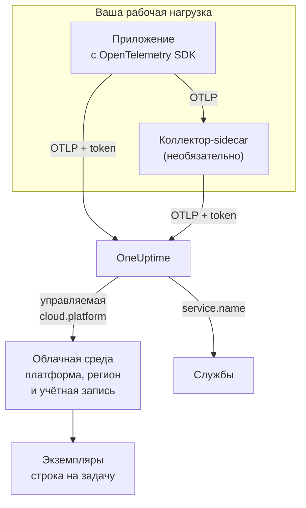

# Облачные среды

**Cloud Environment** — это место, где ваши контейнеры работают на управляемой облачной платформе: учётная запись и регион кластера ECS, проект и регион Cloud Run, подписка и регион Container Apps. OneUptime создаёт среду, когда ваша телеметрия впервые приходит с нужными атрибутами ресурса, и объединяет в ней все рабочие нагрузки, которые там работают. Ничего не нужно регистрировать вручную.

:::cards
- [AWS ECS / Fargate](/docs/telemetry/cloud-aws-ecs): Задачи на Fargate или EC2, с CPU и памятью каждой задачи.
- [Google Cloud Run](/docs/telemetry/cloud-gcp-cloud-run): Сервисы и задания, которые также видны как serverless-функции.
- [Azure Container Apps](/docs/telemetry/cloud-azure-container-apps): Реплики, регион и подписка которых задаются вручную.
- [Другие облачные платформы](/docs/telemetry/cloud-other-platforms): Elastic Beanstalk, App Runner, App Engine, App Service и Container Instances.
:::

## Как это работает



- **Детектор ресурсов сообщает, где работает нагрузка.** Детектор ресурсов OpenTelemetry, в SDK или в коллекторе, читает метаданные платформы и проставляет `cloud.platform`, `cloud.account.id` и `cloud.region` на всё, что отправляет рабочая нагрузка. Там, где детектора нет, вы задаёте их сами.
- **Среда объединяет всё.** Все рабочие нагрузки с одинаковыми платформой, учётной записью и регионом попадают в одну среду. Сервисы сохраняют собственные строки в разделе **Службы**.
- **Каждая работающая задача — это экземпляр.** Вкладка **Экземпляры** среды показывает её работающие задачи, экземпляры или реплики, с текущими CPU и памятью, если платформа может их предоставить.

## Перед началом

- **Ключ приёма.** Создайте ключ типа **Сервер** в разделе **Настройки проекта → Телеметрия и APM → Ключи приема** и скопируйте его токен: см. [Создайте ключ приёма](/docs/telemetry/open-telemetry#создайте-ключ-приёма). Это секрет: на странице каждой платформы показано, где хранить его в хранилище секретов этого облака.
- **OpenTelemetry в вашем приложении.** OpenTelemetry SDK, который экспортирует OTLP, или OpenTelemetry Collector, работающий рядом с приложением.

## Поддерживаемые платформы

| Платформа | `cloud.platform` | Кто заполняет `cloud.*` | Идентификатор экземпляра | Руководство |
| ------------------------- | --------------------------- | ---------------------- | --------------------------------- | ------------------------------------------------------------------ |
| AWS ECS / Fargate | `aws_ecs` | детектор ресурсов | `aws.ecs.task.arn` | [AWS ECS / Fargate](/docs/telemetry/cloud-aws-ecs) |
| AWS Elastic Beanstalk | `aws_elastic_beanstalk` | детектор ресурсов | `host.id` | [Другие облачные платформы](/docs/telemetry/cloud-other-platforms) |
| AWS App Runner | `aws_app_runner` | вручную | `host.name` | [Другие облачные платформы](/docs/telemetry/cloud-other-platforms) |
| Google Cloud Run | `gcp_cloud_run` | детектор ресурсов | `faas.instance` | [Google Cloud Run](/docs/telemetry/cloud-gcp-cloud-run) |
| Google App Engine | `gcp_app_engine` | детектор ресурсов | `faas.instance` | [Другие облачные платформы](/docs/telemetry/cloud-other-platforms) |
| Azure Container Apps | `azure_container_apps` | детектор ресурсов | `azure.container_app.instance.id` | [Azure Container Apps](/docs/telemetry/cloud-azure-container-apps) |
| Azure Container Instances | `azure_container_instances` | вручную | `host.name` | [Другие облачные платформы](/docs/telemetry/cloud-other-platforms) |
| Azure App Service | `azure_app_service` | детектор ресурсов | `host.id` | [Другие облачные платформы](/docs/telemetry/cloud-other-platforms) |

- **Детектор ресурсов:** детектор ресурсов OpenTelemetry, в SDK или в процессоре `resourcedetection` коллектора, задаёт атрибуты `cloud.*` за вас.
- **Вручную:** детектора нет, поэтому вы помещаете атрибуты в `OTEL_RESOURCE_ATTRIBUTES`. На странице платформы приведена точная строка.
- **Детекторы Azure знают меньше.** Детекторы Container Apps не знают ни региона, ни подписки, а детекторы App Service не знают подписки: недостающее задайте сами.
- **Написание Azure через точку работает.** Детекторы Azure для Node.js и .NET пишут `azure.container_apps` и `azure.app_service`. При получении OneUptime переписывает их в приведённые выше значения с подчёркиванием.

## Как OneUptime определяет среду

Для каждой комбинации трёх атрибутов ресурса существует одна среда:

| Атрибут | Обязателен | Что это |
| ------------------ | -------- | ------------------------------------------------------------------------------------------- |
| `cloud.platform` | Да | Одно из значений в разделе [Поддерживаемые платформы](#поддерживаемые-платформы) |
| `cloud.account.id` | Нет | ID учётной записи AWS, ID проекта Google Cloud или ID подписки Azure |
| `cloud.region` | Нет | Регион, например `us-east-1`, `us-central1` или `eastus` |

OneUptime соединяет эти три значения через `|` в **ключ окружения** и называет среду по тем же значениям, например _AWS ECS · us-east-1 · 123456789012_:

```text title="Environment keys"
aws_ecs|123456789012|us-east-1
gcp_cloud_run|my-project|us-central1
azure_container_apps|00000000-0000-0000-0000-000000000000|eastus
```

> [!IMPORTANT]
> Отсутствующая часть остаётся в ключе пустым сегментом: `aws_ecs||us-east-1`. Поэтому рабочая нагрузка без `cloud.account.id` попадает не в ту среду, что нагрузка, в которой он задан. Это обычная причина, по которой вы видите две среды там, где ожидали одну.

### Идентификатор экземпляра

Внутри среды каждая работающая задача, экземпляр или реплика получает одну строку в разделе **Экземпляры**. Её имя берётся из первого из этих атрибутов ресурса, который есть в телеметрии:

1. `aws.ecs.task.id`
2. `aws.ecs.task.arn` (сокращается до ID задачи)
3. `faas.instance`
4. `azure.container_app.instance.id`
5. `service.instance.id`
6. `container.id`
7. `host.id`
8. `host.name`

Собственный идентификатор платформы намеренно идёт первым. Его видят и коллектор-sidecar, и SDK приложения, и он переживает перезапуски. SDK обычно придумывает новый `service.instance.id` для каждого процесса (Node.js SDK делает так по умолчанию), поэтому, если бы ключом служил он, одна задача ECS разделилась бы на две строки. `service.instance.id` используется, когда платформа не задаёт собственного идентификатора. Столбец **Идентификатор экземпляра** в разделе [Поддерживаемые платформы](#поддерживаемые-платформы) называет атрибут, который типичная настройка использует на каждой платформе.

### Среды, созданные вручную

Это редко нужно: приём данных создаёт среды за вас. Чтобы создать среду до прихода её телеметрии, откройте **Облако → All Environments** и нажмите **Создать: Облачный ресурс**. Выберите значение поля **Облачная платформа**, затем введите **ID облачной учётной записи** и **Облачный регион** точно так, как их сообщает ваша телеметрия. OneUptime строит ключ `platform|account|region` из этих трёх значений, а приём данных сопоставляет среду только по ключу. Среда получает то же имя, которое дал бы ей приём данных; чтобы показать другое имя, откройте **Дополнительные поля** и введите **Отображаемое имя**.

## Что не является облачной средой

| Где вы работаете | Где это появляется | Почему |
| ------------------------------------------------------------------------------------------------- | ------------------------ | ---------------------------------------------------------------------------------------------------- |
| EC2, Compute Engine, Azure VM (`aws_ec2`, `gcp_compute_engine`, `azure_vm`) | **Хосты** | Виртуальная машина — это хост. См. [OpenTelemetry-коллектор на хосте](/docs/telemetry/host-otel-collector) |
| EKS, GKE, AKS, самостоятельно управляемый Kubernetes | **Kubernetes** | Маршрутизируется по атрибутам `k8s.*`. См. [Агент Kubernetes](/docs/telemetry/kubernetes-agent) |
| Lambda, Cloud Functions, Azure Functions (`aws_lambda`, `gcp_cloud_functions`, `azure_functions`) | **Serverless-функции** | Маршрутизируется по `faas.name` или по `service.name` при `cloud.platform` для FaaS. См. [Serverless-функции](/docs/telemetry/serverless-functions) |
| Балансировщики нагрузки, бакеты, управляемые базы данных и другие ресурсы IaaS или PaaS | **Cloud Resources** | Обнаруживаются по метрикам, которые публикуют Azure Monitor, CloudWatch и Cloud Monitoring. См. [Облачные ресурсы](/docs/telemetry/cloud-resources) |

> [!NOTE]
> Cloud Run и App Engine намеренно появляются в двух местах. Их детектор задаёт и управляемую `cloud.platform`, и `faas.name`, поэтому каждый сервис — это ещё и отдельная **Serverless-функция**, а **Cloud Environment** объединяет все сервисы этого проекта и региона. Одна и та же телеметрия учитывается в обоих местах.

## Подключение рабочей нагрузки

На странице каждой платформы есть эти шаги с командами и экранами консоли этого облака. В общих чертах:

:::steps
### Добавьте облачные атрибуты в телеметрию

:::tabs
@tab Sidecar collector
Второй контейнер в задаче, экземпляре или реплике. Приложение экспортирует в `localhost:4318`, а процессор `resourcedetection` коллектора проставляет `cloud.*` на всё, что через него проходит. Токен хранится у коллектора, а в ECS он также отправляет CPU и память каждой задачи:

```yaml title="collector.yaml"
processors:
  resourcedetection:
    detectors: [env, ecs] # [env, gcp] on Cloud Run and App Engine; [env, azurecontainerapps] on Container Apps
    timeout: 5s
```
@tab SDK direct
SDK приложения экспортирует напрямую в OneUptime. Включите детектор ресурсов платформы в SDK, например `OTEL_NODE_RESOURCE_DETECTORS=env,host,os,aws` в Node.js: на странице каждой платформы указан переключатель для каждого языка. Дополнительного контейнера нет, как нет и CPU и памяти контейнера.
:::

### Экспортируйте OTLP в OneUptime

:::tabs
@tab Sidecar collector
```yaml title="collector.yaml"
exporters:
  otlphttp/oneuptime:
    endpoint: https://oneuptime.com/otlp
    headers:
      x-oneuptime-token: ${env:ONEUPTIME_TOKEN}

service:
  pipelines:
    traces:
      receivers: [otlp]
      processors: [resourcedetection, batch]
      exporters: [otlphttp/oneuptime]
    metrics:
      receivers: [otlp]
      processors: [resourcedetection, batch]
      exporters: [otlphttp/oneuptime]
    logs:
      receivers: [otlp]
      processors: [resourcedetection, batch]
      exporters: [otlphttp/oneuptime]
```

Коллектор подставляет `${env:ONEUPTIME_TOKEN}` из переменной окружения, которую платформа заполняет из своего хранилища секретов: Secrets Manager, Secret Manager или секретов Container Apps.
@tab SDK direct
```bash
OTEL_EXPORTER_OTLP_ENDPOINT="https://oneuptime.com/otlp"
OTEL_EXPORTER_OTLP_HEADERS="x-oneuptime-token=YOUR_TELEMETRY_INGESTION_TOKEN"
```
:::

Если вы размещаете OneUptime самостоятельно, используйте `https://YOUR-ONEUPTIME-HOST/otlp`.

### Проверьте подключение

```bash
curl -i https://oneuptime.com/otlp/v1/validate \
  -H "x-oneuptime-token: YOUR_TELEMETRY_INGESTION_TOKEN"
```

`200` с `"valid": true` означает, что токен принят. `401` означает, что он неизвестен, отозван, отключён или истёк, а `message` в ответе указывает, что именно. В течение минуты после первого спана, лога или метрики среда появляется в разделе **Облако → All Environments**.
:::

> [!TIP]
> Те же шаги есть в панели управления, с уже подставленным токеном: в разделе **Облако → All Environments**, пока не появится ваша первая среда, и на вкладке **Документация** каждой среды.

## Что вы получаете

**Обзор** среды показывает:

- **Запросы**, **Частота ошибок** и **p95 latency** по вашим трассировкам, с графиками запросов, ошибок и памяти за выбранный период.
- **CPU** и **Память** по работающим экземплярам и список **Топ экземпляров по CPU**. Они берутся из метрик `container.cpu.utilization` и `container.memory.usage` с идентификатором экземпляра; в ECS — из `ecs.task.cpu.utilized` и `ecs.task.memory.utilized` приёмника `awsecscontainermetrics`.
- **Экземпляры**: сколько из них передавали данные за последние 15 минут. На вкладке **Экземпляры** у каждого своя строка.
- Вкладки **Журналы**, **Трассировки** и **Метрики**, отфильтрованные по среде.

Среда, телеметрия которой не поступает 15 минут, показывает **Отключено**, а следующий спан, лог или метрика возвращают её в состояние **Подключено**. Время, когда сам OneUptime не работал или наверстывал отставание, в эти 15 минут не засчитывается.

### Метки и владельцы

- **Из телеметрии:** атрибут ресурса, например `oneuptime.label.team=payments`, добавляет среде метку `team:payments`.
- **Из правил:** **Облако → Настройки → Правила меток** и **Правила владельца** добавляют метки и владельцев подходящим средам. См. [Правила меток и владельцев](/docs/configuration/label-and-owner-rules).

## Устранение неполадок

[Устранение неполадок в облаке](/docs/telemetry/cloud-troubleshooting) разбирает каждый сбой в том порядке, в каком они происходят: среда никогда не появляется, попадает в **Хосты** или только в **Serverless-функции**, не имеет экземпляров или CPU и памяти, показывает **Отключено**, раздваивается или была создана вручную и ни с чем не сопоставляется.

## Что дальше

:::cards
- [AWS ECS / Fargate](/docs/telemetry/cloud-aws-ecs): Самая распространённая настройка, с полным определением задачи.
- [Устранение неполадок в облаке](/docs/telemetry/cloud-troubleshooting): Что проверить, если среда отсутствует или определена неверно.
- [Облачные ресурсы (IaaS и PaaS)](/docs/telemetry/cloud-resources): Балансировщики нагрузки, бакеты и управляемые базы данных из собственного мониторинга вашего облака.
- [Serverless-функции](/docs/telemetry/serverless-functions): Lambda, Cloud Functions и Azure Functions.
:::
