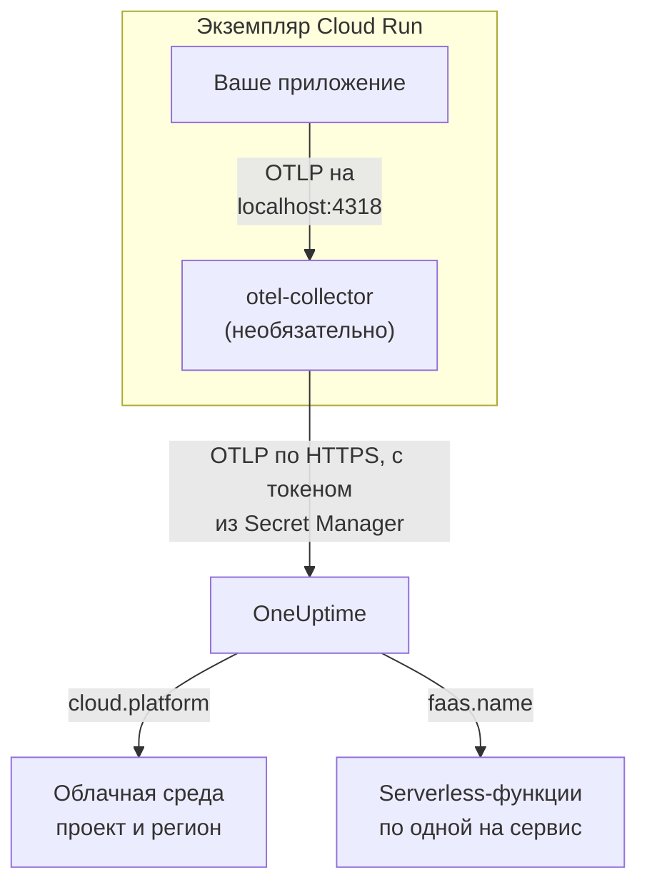

# Google Cloud Run

Отправляйте трассировки, логи и метрики сервисов и заданий Cloud Run в OneUptime. Всё, что сообщает `cloud.platform=gcp_cloud_run`, попадает в один **Cloud Environment** на проект Google Cloud и регион, например _GCP Cloud Run · us-central1 · my-project_, а каждый сервис также появляется в разделе **Serverless-функции**.

:::cards
- [Как это работает](#как-это-работает): Что задаёт детектор GCP и почему сервис появляется в двух местах.
- [Настройка](#настройка): Сохраните токен, настройте сервис, разверните и проверьте.
- [YAML сервиса с sidecar](#yaml-сервиса-с-sidecar): Готовый сервис Cloud Run с коллектором.
- [Устранение неполадок](#устранение-неполадок): Ошибки секретов, порядок запуска sidecar и отсутствующие среды.
:::

## Как это работает



Детектор ресурсов GCP из OpenTelemetry читает сервер метаданных и переменные окружения `K_SERVICE` и `K_REVISION` и задаёт:

| Атрибут | Значение в Cloud Run | Для чего используется |
| ------------------ | ------------------------------ | ----------------------------------------------------------------------------------------- |
| `cloud.platform` | `gcp_cloud_run` | Относит телеметрию к разделу **Облачные среды** |
| `cloud.account.id` | ID проекта | Часть ключа среды |
| `cloud.region` | `us-central1` | Часть ключа среды |
| `faas.name` | имя сервиса (`K_SERVICE`) | Также показывает сервис в разделе **Serverless-функции** |
| `faas.version` | ревизия (`K_REVISION`) | Показывается в обзоре serverless-функции сервиса; среда его не использует |
| `faas.instance` | ID экземпляра | Даёт имя одному работающему экземпляру: по строке на каждый в разделе **Экземпляры** |

> [!NOTE]
> Cloud Run намеренно появляется в двух местах. Поскольку детектор задаёт `faas.name`, каждый сервис — это ещё и **Serverless-функция** со своими вызовами, частотой ошибок и длительностью. **Cloud Environment** объединяет все сервисы этого проекта и региона. Ничего не хранится дважды: одна и та же телеметрия учитывается в обоих местах.

Ключ среды — `gcp_cloud_run|my-project|us-central1`.

## Перед началом

- **Ключ приёма.** Создайте ключ типа **Сервер** в разделе **Настройки проекта → Телеметрия и APM → Ключи приема** и скопируйте его токен.
- **`gcloud`**, с входом в проект и включённым API Secret Manager: `gcloud services enable secretmanager.googleapis.com`.
- **Ваше приложение, инструментированное OpenTelemetry SDK**, которое экспортирует OTLP.

## Выберите, как телеметрия покидает сервис

| | SDK direct | Sidecar collector |
| --------------- | ---------------------------------------------------- | ---------------------------------------------------------------------- |
| Дополнительный контейнер | Нет | `otel-collector` в сервисе |
| Лучше всего подходит | Для одного сервиса и заданий Cloud Run | Для нескольких сервисов в одном проекте или SDK, который не умеет запускать детектор |
| Где хранится токен | В приложении | В коллекторе |
| Секрет | `oneuptime-otlp-headers`, весь заголовок | `oneuptime-ingestion-token`, только токен |

Задание работает до завершения, поэтому держать sidecar запущенным незачем: используйте SDK direct. У каждого шага ниже есть вкладка для обоих вариантов; выберите один, и все шаги будут следовать ему.

## Настройка

:::steps
### Сохраните токен в Secret Manager

> [!IMPORTANT]
> Токен — это секрет. Поместите его в Secret Manager и ссылайтесь на него из сервиса как на переменную окружения на основе секрета. Обычная переменная окружения видна всем, кто может просматривать проект, — в консоли и в `gcloud run services describe`.

:::tabs
@tab SDK direct
```bash
printf '%s' "x-oneuptime-token=YOUR_TELEMETRY_INGESTION_TOKEN" | gcloud secrets create oneuptime-otlp-headers \
  --data-file=- \
  --replication-policy=automatic

gcloud secrets add-iam-policy-binding oneuptime-otlp-headers \
  --member="serviceAccount:checkout-api@my-project.iam.gserviceaccount.com" \
  --role="roles/secretmanager.secretAccessor"
```

Cloud Run помещает значение секрета в переменную как есть, а `OTEL_EXPORTER_OTLP_HEADERS` нужна вся пара `name=value`, поэтому этот секрет содержит весь заголовок.
@tab Sidecar collector
```bash
printf '%s' "YOUR_TELEMETRY_INGESTION_TOKEN" | gcloud secrets create oneuptime-ingestion-token \
  --data-file=- \
  --replication-policy=automatic

gcloud secrets add-iam-policy-binding oneuptime-ingestion-token \
  --member="serviceAccount:checkout-api@my-project.iam.gserviceaccount.com" \
  --role="roles/secretmanager.secretAccessor"
```

Конфигурация коллектора добавляет имя заголовка, поэтому этот секрет содержит только токен.
:::

Укажите в `--member` сервисный аккаунт среды выполнения сервиса, а не своего пользователя. Без `roles/secretmanager.secretAccessor` ревизия не развернётся и завершится ошибкой `Permission denied on secret`. Если сервис всё ещё работает от имени сервисного аккаунта Compute по умолчанию, выдайте роль этому аккаунту и подумайте о том, чтобы дать сервису собственный аккаунт: аккаунт по умолчанию общий для всего проекта.

### Настройте сервис

:::tabs
@tab SDK direct
1. **Google Cloud console → Cloud Run → click the service → Edit & deploy new revision**.
2. На вкладке **Containers** откройте свой контейнер и перейдите в **Variables & Secrets**. Добавьте переменные ниже.
3. Нажмите **Reference a secret**, выберите `oneuptime-otlp-headers`, версию `latest` и предоставьте его как переменную окружения `OTEL_EXPORTER_OTLP_HEADERS`.
4. На вкладке **Security** проверьте, что **Service account** — это аккаунт, которому вы выдали `roles/secretmanager.secretAccessor`.

```bash
OTEL_SERVICE_NAME=checkout-api
OTEL_EXPORTER_OTLP_ENDPOINT=https://oneuptime.com/otlp
OTEL_EXPORTER_OTLP_PROTOCOL=http/protobuf
# Secret-backed (Variables & Secrets → Reference a secret), not typed here.
OTEL_EXPORTER_OTLP_HEADERS=x-oneuptime-token=YOUR_TELEMETRY_INGESTION_TOKEN
```

Затем включите детектор ресурсов GCP для своего языка:

| Язык | Как включить детектор GCP |
| -------- | ------------------------------------------------------------------------------------------------------------------- |
| Node.js | `OTEL_NODE_RESOURCE_DETECTORS=env,host,os,gcp` (auto-instrumentations-node) |
| Python | `pip install opentelemetry-resourcedetector-gcp`, затем `OTEL_EXPERIMENTAL_RESOURCE_DETECTORS=gcp_resource_detector` |
| Java | `-Dotel.resource.providers.gcp.enabled=true` |
| Go | `import "go.opentelemetry.io/contrib/detectors/gcp"` и передайте `gcp.NewDetector()` в `resource.New` |
| .NET | Пакет `OpenTelemetry.Resources.Gcp`: `.ConfigureResource(r => r.AddGcpDetector())` |

Или задайте всё через CLI:

```bash
gcloud run services update checkout-api --region us-central1 \
  --set-env-vars "^@^OTEL_SERVICE_NAME=checkout-api@OTEL_EXPORTER_OTLP_ENDPOINT=https://oneuptime.com/otlp@OTEL_EXPORTER_OTLP_PROTOCOL=http/protobuf@OTEL_NODE_RESOURCE_DETECTORS=env,host,os,gcp" \
  --set-secrets "OTEL_EXPORTER_OTLP_HEADERS=oneuptime-otlp-headers:latest"
```

Префикс `^@^` заставляет `gcloud` делить список этого флага по `@` вместо `,`. Без него `gcloud` делит `OTEL_NODE_RESOURCE_DETECTORS=env,host,os,gcp` на каждой запятой и завершается ошибкой `Bad syntax for dict arg [host]`.
@tab Sidecar collector
1. **Google Cloud console → Cloud Run → click the service → Edit & deploy new revision**.
2. На вкладке **Containers** откройте свой контейнер и перейдите в **Variables & Secrets**. Добавьте переменные приложения ниже.
3. Нажмите **+ Add container**. Задайте URL образа контейнера `otel/opentelemetry-collector-contrib:latest` и в разделе **Container command and arguments** добавьте аргумент `--config=env:OTEL_COLLECTOR_CONFIG`.
4. На вкладке **Variables & Secrets** нового контейнера: **Reference a secret**, `oneuptime-ingestion-token`, как переменная окружения `ONEUPTIME_TOKEN`. Добавьте переменную `OTEL_COLLECTOR_CONFIG` с конфигурацией коллектора из раздела [YAML сервиса с sidecar](#yaml-сервиса-с-sidecar).
5. На вкладке **Settings** коллектора добавьте **Startup probe** (HTTP, путь `/`, порт `13133`), а в разделе **Container start-up order** сделайте свой контейнер зависимым от `otel-collector`.
6. На вкладке **Security** проверьте, что **Service account** — это аккаунт, которому вы выдали `roles/secretmanager.secretAccessor`.

Контейнеры одного экземпляра Cloud Run делят `localhost`, поэтому приложение экспортирует в sidecar по этому адресу:

```bash
OTEL_SERVICE_NAME=checkout-api
OTEL_EXPORTER_OTLP_ENDPOINT=http://localhost:4318
OTEL_EXPORTER_OTLP_PROTOCOL=http/protobuf
```

Через CLI sidecar — это YAML сервиса ниже, развёрнутый командой `gcloud run services replace service.yaml --region us-central1`.
:::

Если вы размещаете OneUptime самостоятельно, используйте `https://YOUR-ONEUPTIME-HOST/otlp` в качестве эндпоинта.

### Разверните новую ревизию

В консоли нажмите **Deploy**. Cloud Run запускает новую ревизию с этими настройками и направляет на неё трафик, когда она готова. Команды `gcloud` разворачивают новую ревизию сами.

### Проверьте подключение

```bash
curl -i https://oneuptime.com/otlp/v1/validate \
  -H "x-oneuptime-token: YOUR_TELEMETRY_INGESTION_TOKEN"
```

`200` с `"valid": true` означает, что токен принят. `401` означает, что он неизвестен, отозван, отключён или истёк. Затем отправьте сервису один запрос и поищите в логах коллектора в Cloud Logging (с фильтром по контейнеру `otel-collector`) `401`, `connection refused` или `context deadline exceeded`. В течение минуты среда появляется в разделе **Облако → All Environments** как _GCP Cloud Run · us-central1 · my-project_, а сервис — в разделе **Serverless-функции**.
:::

## YAML сервиса с sidecar

Коллектор читает всю конфигурацию из `OTEL_COLLECTOR_CONFIG` (`--config=env:OTEL_COLLECTOR_CONFIG`), а токен — из секрета через `${env:ONEUPTIME_TOKEN}`. Аннотация `run.googleapis.com/container-dependencies` заставляет Cloud Run сначала запустить коллектор и дождаться его пробы запуска, прежде чем запускать приложение:

```yaml title="service.yaml"
apiVersion: serving.knative.dev/v1
kind: Service
metadata:
  name: checkout-api
spec:
  template:
    metadata:
      annotations:
        # "app" depends on "otel-collector": the collector starts first and
        # must pass its startup probe before the app container is started.
        run.googleapis.com/container-dependencies: '{"app":["otel-collector"]}'
    spec:
      serviceAccountName: checkout-api@my-project.iam.gserviceaccount.com
      containers:
        - name: app
          image: us-central1-docker.pkg.dev/my-project/apps/checkout-api:1.4.2
          ports:
            - containerPort: 8080
          env:
            - name: OTEL_SERVICE_NAME
              value: checkout-api
            - name: OTEL_EXPORTER_OTLP_ENDPOINT
              value: http://localhost:4318
            - name: OTEL_EXPORTER_OTLP_PROTOCOL
              value: http/protobuf
        - name: otel-collector
          image: otel/opentelemetry-collector-contrib:latest
          args:
            - --config=env:OTEL_COLLECTOR_CONFIG
          env:
            - name: ONEUPTIME_TOKEN
              valueFrom:
                secretKeyRef:
                  name: oneuptime-ingestion-token
                  key: latest
            - name: OTEL_COLLECTOR_CONFIG
              value: |
                receivers:
                  otlp:
                    protocols:
                      http:
                        endpoint: 0.0.0.0:4318
                      grpc:
                        endpoint: 0.0.0.0:4317
                processors:
                  # Stamps cloud.provider, cloud.platform=gcp_cloud_run,
                  # cloud.account.id, cloud.region and faas.* on everything.
                  resourcedetection:
                    detectors: [env, gcp]
                    timeout: 5s
                  batch: {}
                exporters:
                  otlphttp/oneuptime:
                    endpoint: https://oneuptime.com/otlp
                    headers:
                      x-oneuptime-token: ${env:ONEUPTIME_TOKEN}
                extensions:
                  health_check:
                    endpoint: 0.0.0.0:13133
                service:
                  extensions: [health_check]
                  pipelines:
                    traces:
                      receivers: [otlp]
                      processors: [resourcedetection, batch]
                      exporters: [otlphttp/oneuptime]
                    metrics:
                      receivers: [otlp]
                      processors: [resourcedetection, batch]
                      exporters: [otlphttp/oneuptime]
                    logs:
                      receivers: [otlp]
                      processors: [resourcedetection, batch]
                      exporters: [otlphttp/oneuptime]
          startupProbe:
            httpGet:
              path: /
              port: 13133
            periodSeconds: 2
            failureThreshold: 15
          resources:
            limits:
              cpu: 500m
              memory: 256Mi
```

Разверните его:

```bash
gcloud run services replace service.yaml --region us-central1
```

Только контейнер, который принимает запросы (`app`), объявляет `ports`; sidecar этого делать не должен.

## Сеть

- **По умолчанию** сервис Cloud Run выходит в интернет напрямую, и для экспорта в `oneuptime.com` больше ничего не нужно.
- **С VPC egress: All traffic** (`--vpc-egress all-traffic`, через Direct VPC egress или коннектор Serverless VPC Access) исходящий трафик идёт через ваш VPC, которому тогда нужен Cloud NAT (или маршрут к прокси), чтобы достучаться до хоста OneUptime. Со значением по умолчанию `private-ranges-only` через VPC идут только частные адреса, а OneUptime доступен напрямую.
- **Правила брандмауэра для исходящего трафика** в VPC должны разрешать TCP 443 к хосту OneUptime.
- **Самостоятельно размещённый OneUptime внутри VPC** — обратный случай: направьте трафик через VPC (`private-ranges-only` или `all-traffic`), чтобы `https://YOUR-ONEUPTIME-HOST/otlp` разрешался там.

## Что вы получаете

- **Обзор**: запросы, частота ошибок и задержка p95 по вашим трассировкам.
- **Экземпляры**: одна строка на экземпляр Cloud Run с именем из `faas.instance`. Cloud Run не показывает sidecar потребление ресурсов контейнера, поэтому плитки **CPU** и **Память** остаются пустыми, если вы сами не отправляете метрики `container.cpu.utilization` и `container.memory.usage` с тем же `faas.instance`. Смотрите здесь плитки запросов, а CPU и память экземпляров оставьте Cloud Monitoring.
- **Журналы**, **Трассировки** и **Метрики**, отфильтрованные по среде.
- Тот же сервис в разделе **Serverless-функции** (по `faas.name`) и в разделе **Службы** (по `service.name`).

## Устранение неполадок

:::details Ревизия завершается ошибкой "Permission denied on secret"
У сервисного аккаунта среды выполнения нет `roles/secretmanager.secretAccessor` для секрета, или привязка сделана на другой секрет, а не на тот, на который ссылается сервис. Выполните команду `gcloud secrets add-iam-policy-binding` ещё раз, указав в `--member` сервисный аккаунт среды выполнения.
:::

:::details Cloud Run отклоняет container-dependencies
Аннотация называет контейнер, которого не существует, или у коллектора нет пробы запуска, поэтому Cloud Run не может понять, когда он готов.
:::

:::details Сервис есть в Serverless-функциях, но среды нет
В телеметрии нет `cloud.platform`: детектор GCP не включён в SDK, или `gcp` нет в списке `detectors` коллектора.
:::

:::details Среда есть, но раздел Экземпляры пуст
В телеметрии нет ни `faas.instance`, ни `service.instance.id`. Причина та же: детектор не работает.
:::

Среда, которая никогда не появляется, показывает **Отключено** или раздваивается, разобрана на странице [Устранение неполадок в облаке](/docs/telemetry/cloud-troubleshooting).

## Что дальше

:::cards
- [Облачные среды](/docs/telemetry/cloud-environments): Как определяются среды и экземпляры.
- [Serverless-функции](/docs/telemetry/serverless-functions): Представление каждого сервиса Cloud Run по отдельности.
- [Устранение неполадок в облаке](/docs/telemetry/cloud-troubleshooting): Сбои, общие для всех платформ.
- [Облачные ресурсы (IaaS и PaaS)](/docs/telemetry/cloud-resources): Ваши Cloud SQL, балансировщики нагрузки и бакеты из Cloud Monitoring.
:::
