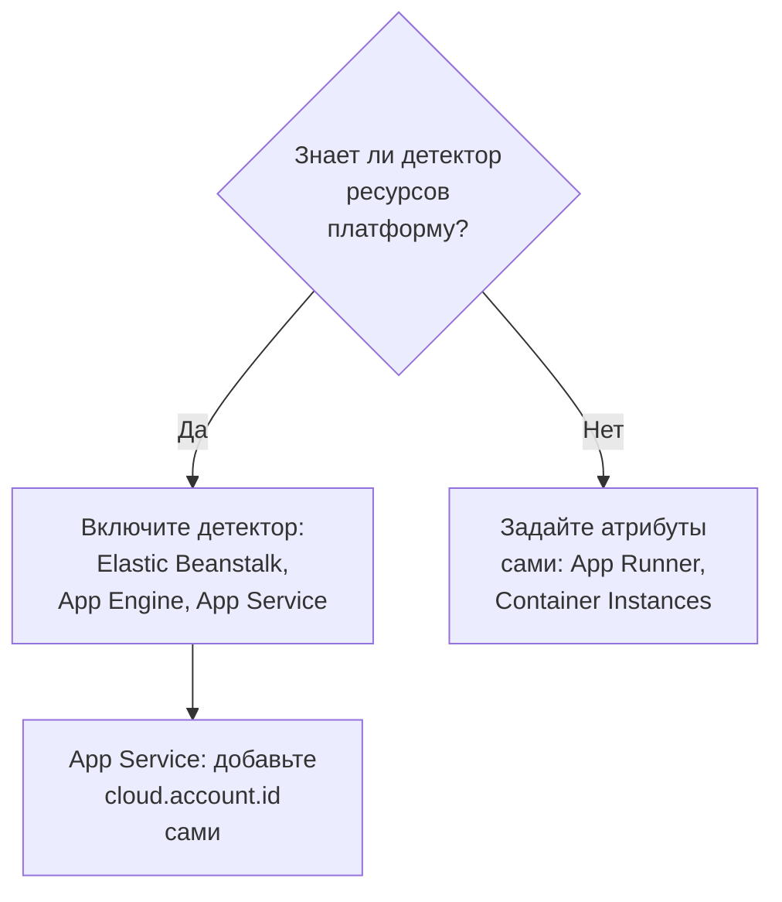

# Другие облачные платформы

Настройте управляемые платформы, у которых нет собственной страницы: AWS Elastic Beanstalk, AWS App Runner, Google App Engine, Azure App Service и Azure Container Instances. Правило то же, что и на любой платформе: телеметрия с управляемой `cloud.platform`, `cloud.account.id` и `cloud.region` попадает в один **Cloud Environment** на платформу, учётную запись и регион, а идентификатор экземпляра даёт каждому работающему экземпляру строку в разделе **Экземпляры**.

:::cards
- [AWS Elastic Beanstalk](#aws-elastic-beanstalk): Коллектор на каждом экземпляре с детекторами Beanstalk и EC2.
- [AWS App Runner](#aws-app-runner): Атрибуты задаются вручную, токен берётся из Secrets Manager.
- [Google App Engine](#google-app-engine): Детектор GCP с настройками в `app.yaml`.
- [Azure App Service](#azure-app-service): Детекторы Azure, ссылка на Key Vault и подписка, заданная вручную.
- [Azure Container Instances](#azure-container-instances): Атрибуты задаются вручную, токен — как защищённая переменная.
:::

## Что нужно каждой платформе

Эти платформы различаются тем, кто задаёт атрибуты `cloud.*` и где находятся настройки в консоли облака:



| Платформа | `cloud.platform` | Кто заполняет `cloud.*` | Идентификатор экземпляра |
| ------------------------- | --------------------------- | ------------------------------------------------------------------------------------------ | ----------------------------------------------------------- |
| AWS Elastic Beanstalk | `aws_elastic_beanstalk` | Детекторы `elastic_beanstalk` и `ec2` в Collector; `aws` в Node.js | `host.id` (удалите `service.instance.id` развёртывания) |
| AWS App Runner | `aws_app_runner` | Вы (детектора нет) | `host.name` |
| Google App Engine | `gcp_app_engine` | Детектор `gcp` (в Collector и в каждом SDK) | `faas.instance` |
| Azure App Service | `azure_app_service` | `azureappservice` в Collector, детекторы `azure` для Node.js и .NET; `cloud.account.id` задаёте вы | `service.instance.id`, затем `host.id` |
| Azure Container Instances | `azure_container_instances` | Вы (детектора нет) | `host.name` |

Для каждого раздела ниже нужен ключ приёма типа **Сервер** из раздела **Настройки проекта → Телеметрия и APM → Ключи приема** и приложение, инструментированное OpenTelemetry SDK. Если вы размещаете OneUptime самостоятельно, замените `https://oneuptime.com/otlp` на `https://YOUR-ONEUPTIME-HOST/otlp`.

> [!IMPORTANT]
> На каждой из этих платформ токен — это секрет. В каждом разделе указано хранилище секретов платформы. Токен, записанный в обычную переменную окружения, может прочитать любой, кто может прочитать конфигурацию приложения.

## AWS Elastic Beanstalk

`cloud.platform`: `aws_elastic_beanstalk`. Детектор Beanstalk читает `/var/elasticbeanstalk/xray/environment.conf` на экземпляре и задаёт `cloud.platform`, `service.instance.id`, `service.version` и имя среды. Он не знает ни учётной записи, ни региона, поэтому используйте его вместе с детектором EC2, который их знает и который также задаёт `host.id`.

Запустите OpenTelemetry Collector на каждом экземпляре с этой конфигурацией:

```yaml title="config.yaml"
receivers:
  otlp:
    protocols:
      http:
        endpoint: 0.0.0.0:4318
      grpc:
        endpoint: 0.0.0.0:4317
processors:
  # elastic_beanstalk sets cloud.platform and service.instance.id; ec2 adds
  # cloud.account.id, cloud.region and host.id. The first detector to set an
  # attribute wins, so elastic_beanstalk comes first.
  resourcedetection:
    detectors: [env, elastic_beanstalk, ec2]
    timeout: 5s
  # The Beanstalk detector's service.instance.id is the deployment ID, shared
  # by every instance of a deployment: drop it, so that ec2's host.id names
  # each instance.
  resource:
    attributes:
      - key: service.instance.id
        action: delete
  batch: {}
exporters:
  otlphttp/oneuptime:
    endpoint: https://oneuptime.com/otlp
    headers:
      x-oneuptime-token: ${env:ONEUPTIME_TOKEN}
service:
  pipelines:
    traces:
      receivers: [otlp]
      processors: [resourcedetection, resource, batch]
      exporters: [otlphttp/oneuptime]
    metrics:
      receivers: [otlp]
      processors: [resourcedetection, resource, batch]
      exporters: [otlphttp/oneuptime]
    logs:
      receivers: [otlp]
      processors: [resourcedetection, resource, batch]
      exporters: [otlphttp/oneuptime]
```

:::steps
1. Сохраните токен в Secrets Manager: `aws secretsmanager create-secret --name oneuptime/ingestion-token --secret-string "YOUR_TELEMETRY_INGESTION_TOKEN"`. Свойства среды Beanstalk хранятся в конфигурации среды, а не в хранилище секретов, поэтому читайте секрет из хука платформы, используя профиль экземпляра. Профилю экземпляра нужно `secretsmanager:GetSecretValue` для этого секрета.
2. Установите коллектор из скрипта в `.platform/hooks/postdeploy/` (или `.ebextensions`): пакет `otelcol-contrib` с конфигурацией выше и секретом в его окружении в виде `ONEUPTIME_TOKEN`.
3. **AWS Console → Elastic Beanstalk → Environments → your environment → Configuration**.
4. В категории **Updates, monitoring, and logging** нажмите **Edit** и прокрутите до **Environment properties**. Добавьте `OTEL_SERVICE_NAME`, `OTEL_EXPORTER_OTLP_ENDPOINT` со значением `http://localhost:4318` и `OTEL_EXPORTER_OTLP_PROTOCOL` со значением `http/protobuf`.
5. Нажмите **Apply**. Beanstalk перезапускает приложение с новыми свойствами.
:::

Приложения на Node.js могут обойтись без коллектора: детекторы SDK включают Beanstalk и EC2. Задайте `OTEL_EXPORTER_OTLP_ENDPOINT` равным `https://oneuptime.com/otlp`, `OTEL_EXPORTER_OTLP_HEADERS` равным `x-oneuptime-token=YOUR_TELEMETRY_INGESTION_TOKEN` и `OTEL_NODE_RESOURCE_DETECTORS=env,host,os,aws`. Токен тогда хранится в свойстве среды. После этого проверьте атрибуты ресурса у трассировки: если `cloud.platform` равен `aws_ec2`, ваша версия SDK позволила победить детектору EC2, и надёжный путь — коллектор.

**Сеть:** экземплярам в частной подсети нужен NAT-шлюз, а группа безопасности экземпляра должна разрешать исходящий трафик по TCP 443 к хосту OneUptime.

## AWS App Runner

`cloud.platform`: `aws_app_runner`. Детектора нет, поэтому атрибуты вы задаёте сами. App Runner умеет помещать секрет из Secrets Manager (или SSM Parameter Store) в переменную окружения.

```bash
OTEL_SERVICE_NAME=checkout-api
OTEL_EXPORTER_OTLP_ENDPOINT=https://oneuptime.com/otlp
OTEL_EXPORTER_OTLP_PROTOCOL=http/protobuf
# From Secrets Manager: the secret holds the whole header.
OTEL_EXPORTER_OTLP_HEADERS=x-oneuptime-token=YOUR_TELEMETRY_INGESTION_TOKEN
OTEL_RESOURCE_ATTRIBUTES=cloud.provider=aws,cloud.platform=aws_app_runner,cloud.region=us-east-1,cloud.account.id=123456789012
OTEL_NODE_RESOURCE_DETECTORS=env,host,os
```

Замените регион и ID учётной записи своими. Детектор `host` предоставляет `host.name`, имя хоста контейнера, которое у каждого экземпляра App Runner своё, и OneUptime называет экземпляр по нему.

:::steps
1. Сохраните весь заголовок в Secrets Manager: `aws secretsmanager create-secret --name oneuptime/otlp-headers --secret-string "x-oneuptime-token=YOUR_TELEMETRY_INGESTION_TOKEN"`. App Runner помещает значение секрета в переменную как есть.
2. **AWS Console → App Runner → Services → your service → Configuration → Configure service** (на вкладке **Configuration** нажмите **Edit**).
3. В разделе **Environment variables** нажмите **Add environment variable** для каждого обычного значения выше.
4. Добавьте `OTEL_EXPORTER_OTLP_HEADERS` с **Source: Secrets Manager** и ARN секрета. В разделе **Security → Instance role** выберите роль с `secretsmanager:GetSecretValue` для этого секрета: роль экземпляра, а не роль доступа, которая скачивает образ.
5. Нажмите **Save changes**. App Runner развернёт новую версию.
:::

**Сеть:** сервис без коннектора VPC выходит в интернет напрямую. С **Outgoing network traffic: Custom VPC** исходящий трафик идёт через ваш VPC, которому нужен NAT-шлюз и исходящее правило группы безопасности для TCP 443 к хосту OneUptime.

## Google App Engine

`cloud.platform`: `gcp_app_engine`. Детектор GCP распознаёт стандартную и гибкую среды App Engine по `GAE_SERVICE`, `GAE_VERSION` и `GAE_INSTANCE` и серверу метаданных. Он задаёт `cloud.account.id` (проект), `cloud.region`, `faas.name`, `faas.version` и `faas.instance`. Как и в Cloud Run, `faas.name` заставляет каждый сервис App Engine также появляться в разделе **Serverless-функции**, а среда объединяет проект и регион.

| Язык | Как включить детектор GCP |
| -------- | ------------------------------------------------------------------------------------------------------------------- |
| Node.js | `OTEL_NODE_RESOURCE_DETECTORS=env,host,os,gcp` |
| Python | `pip install opentelemetry-resourcedetector-gcp`, затем `OTEL_EXPERIMENTAL_RESOURCE_DETECTORS=gcp_resource_detector` |
| Java | `-Dotel.resource.providers.gcp.enabled=true` |
| Go | `go.opentelemetry.io/contrib/detectors/gcp` → `gcp.NewDetector()` |
| .NET | `OpenTelemetry.Resources.Gcp` → `.AddGcpDetector()` |

В консоли App Engine нет редактора переменных окружения: они задаются в `app.yaml`.

```yaml title="app.yaml"
runtime: nodejs22
env_variables:
  OTEL_SERVICE_NAME: checkout-api
  OTEL_EXPORTER_OTLP_ENDPOINT: https://oneuptime.com/otlp
  OTEL_EXPORTER_OTLP_PROTOCOL: http/protobuf
  OTEL_NODE_RESOURCE_DETECTORS: env,host,os,gcp
  # Do not commit the real value. Template it in CI, or read the secret at
  # start-up with the Secret Manager client instead.
  OTEL_EXPORTER_OTLP_HEADERS: x-oneuptime-token=YOUR_TELEMETRY_INGESTION_TOKEN
```

:::steps
1. Сохраните весь заголовок в Secret Manager: `printf '%s' "x-oneuptime-token=YOUR_TELEMETRY_INGESTION_TOKEN" | gcloud secrets create oneuptime-otlp-headers --data-file=-`. Выдайте сервисному аккаунту App Engine (`my-project@appspot.gserviceaccount.com`) `roles/secretmanager.secretAccessor` для этого секрета.
2. Подставляйте секрет в `app.yaml` в конвейере развёртывания, оставляя в зафиксированном файле заглушку. Или читайте `projects/PROJECT_ID/secrets/oneuptime-otlp-headers/versions/latest` при запуске и передавайте его в параметр `headers` экспортёра в коде.
3. Разверните командой `gcloud app deploy`. В консоли **App Engine → Versions** показывает новую версию, а **App Engine → Services** — сервис, который появляется в разделе **Serverless-функции**.
:::

**Сеть:** стандартная среда App Engine выходит в интернет напрямую. Экземпляры гибкой среды находятся в VPC: если у подсети нет внешних IP-адресов, им нужен Cloud NAT и исходящее правило брандмауэра для TCP 443 к хосту OneUptime.

## Azure App Service

`cloud.platform`: `azure_app_service`. Детекторы Azure для Node.js и .NET, а также детектор `azureappservice` в Collector читают переменные `WEBSITE_*`, которые задаёт App Service. Они заполняют `cloud.platform`, `cloud.region`, `service.instance.id` (из `WEBSITE_INSTANCE_ID`), `deployment.environment` (слот) и `host.id`. Ни один из них не задаёт `cloud.account.id`: добавьте ID подписки сами, иначе в ключе среды будет пустой сегмент учётной записи.

```bash
OTEL_SERVICE_NAME=checkout-api
OTEL_EXPORTER_OTLP_ENDPOINT=https://oneuptime.com/otlp
OTEL_EXPORTER_OTLP_PROTOCOL=http/protobuf
# The Key Vault reference, which resolves to the whole header.
OTEL_EXPORTER_OTLP_HEADERS=@Microsoft.KeyVault(SecretUri=https://my-vault.vault.azure.net/secrets/oneuptime-otlp-headers/)
OTEL_RESOURCE_ATTRIBUTES=cloud.account.id=00000000-0000-0000-0000-000000000000
# Node.js:
OTEL_NODE_RESOURCE_DETECTORS=env,host,os,azure
```

Детекторы SDK пишут платформу как `azure.app_service`, через точку; при получении OneUptime переписывает её в `azure_app_service`. В .NET добавьте `OpenTelemetry.Resources.Azure` и вызовите `.ConfigureResource(r => r.AddAzureAppServiceDetector())`. В других языках добавьте `cloud.provider=azure,cloud.platform=azure_app_service,cloud.region=<region>` в `OTEL_RESOURCE_ATTRIBUTES` и берите `service.instance.id` из `WEBSITE_INSTANCE_ID` в коде.

:::steps
1. Включите для приложения управляемое удостоверение, назначаемое системой (**Settings → Identity**), и выдайте ему **Key Vault Secrets User** в хранилище. Сохраните весь заголовок, `x-oneuptime-token=YOUR_TELEMETRY_INGESTION_TOKEN`, как секрет `oneuptime-otlp-headers`.
2. **Azure portal → App Services → your app → Settings → Environment variables** (**Configuration → Application settings** в старых версиях портала).
3. Добавьте каждую переменную выше через **+ Add**. Значение `OTEL_EXPORTER_OTLP_HEADERS` — это ссылка на Key Vault.
4. Нажмите **Apply**, затем **Confirm**: приложение перезапустится с новыми настройками. У слотов развёртывания свои настройки: отметьте токен как **deployment slot setting**, если телеметрию должен отправлять только один слот.
:::

**Сеть:** App Service выходит в интернет напрямую, если не включена **VNet integration** с **Route All**. Тогда виртуальной сети нужен NAT-шлюз или маршрут к брандмауэру, который разрешает TCP 443 к хосту OneUptime.

## Azure Container Instances

`cloud.platform`: `azure_container_instances`. Детектора нет, поэтому атрибуты вы задаёте сами. Переменные окружения группы контейнеров фиксируются при создании: чтобы изменить одну, нужно создать группу заново. Передайте токен через `--secure-environment-variables`, чтобы `az container show` его не возвращал:

```bash
az container create \
  --resource-group my-rg \
  --name checkout-api \
  --image myregistry.azurecr.io/checkout-api:1.4.2 \
  --location eastus \
  --environment-variables \
    OTEL_SERVICE_NAME=checkout-api \
    OTEL_EXPORTER_OTLP_ENDPOINT=https://oneuptime.com/otlp \
    OTEL_EXPORTER_OTLP_PROTOCOL=http/protobuf \
    "OTEL_RESOURCE_ATTRIBUTES=cloud.provider=azure,cloud.platform=azure_container_instances,cloud.region=eastus,cloud.account.id=00000000-0000-0000-0000-000000000000" \
    OTEL_NODE_RESOURCE_DETECTORS=env,host,os \
  --secure-environment-variables \
    "OTEL_EXPORTER_OTLP_HEADERS=x-oneuptime-token=YOUR_TELEMETRY_INGESTION_TOKEN"
```

`host.name` детектора `host`, имя хоста группы контейнеров, даёт имя экземпляру. Коллектор-sidecar здесь тоже работает, ведь группа контейнеров запускает несколько контейнеров, как задача ECS: используйте схему `detectors: [env]` плюс `OTEL_RESOURCE_ATTRIBUTES` из раздела [Azure Container Apps](/docs/telemetry/cloud-azure-container-apps). Он же заполняет плитки **CPU** и **Память**, если отправляет `container.cpu.utilization` и `container.memory.usage` с идентификатором группы.

:::steps
1. **Azure portal → Container Instances → + Create**. Заполните вкладку **Basics**: группа ресурсов, имя, регион и образ.
2. На вкладке **Advanced** в разделе **Environment variables** добавьте каждую переменную. Для `OTEL_EXPORTER_OTLP_HEADERS` установите **Mark as secure** в **Yes**, чтобы портал и API не показывали её значение.
3. Нажмите **Review + create**, затем **Create**. Чтобы позже изменить переменную, удалите группу и создайте её заново.
:::

**Сеть:** группа контейнеров с публичным IP-адресом выходит в интернет напрямую. Группа в подсети виртуальной сети выходит наружу только по маршруту виртуальной сети: добавьте NAT-шлюз или разрешите TCP 443 к хосту OneUptime на брандмауэре или в NSG.

## Проверьте подключение

Какую бы платформу вы ни настроили, сначала проверьте токен, а затем ищите среду:

```bash
curl -i https://oneuptime.com/otlp/v1/validate \
  -H "x-oneuptime-token: YOUR_TELEMETRY_INGESTION_TOKEN"
```

`200` с `"valid": true` означает, что токен принят. `401` означает, что он неизвестен, отозван, отключён или истёк. В течение минуты после первого спана, лога или метрики среда появляется в разделе **Облако → All Environments** с именем по платформе, региону и учётной записи.

## Устранение неполадок

:::details Экземпляры Beanstalk появляются в Хостах
Победил `cloud.platform=aws_ec2` детектора EC2. Побеждает первый детектор, задавший атрибут, поэтому ставьте `elastic_beanstalk` раньше `ec2` в `detectors`. Без коллектора детектору EC2 может отдавать предпочтение и Node.js SDK: запустите коллектор.
:::

:::details Все экземпляры Beanstalk делят одну строку в разделе Экземпляры
`service.instance.id` детектора Beanstalk — это ID развёртывания, общий для всех экземпляров развёртывания, и он читается раньше `host.id`. Оставьте в каждом конвейере процессор `resource`, который его удаляет.
:::

:::details Приложение App Service получает 401
Ссылка на Key Vault не разрешилась, поэтому App Service передал буквальный текст `@Microsoft.KeyVault(...)` в качестве заголовка. Выдайте управляемому удостоверению приложения **Key Vault Secrets User** в хранилище и проверьте, что секрет содержит весь заголовок `x-oneuptime-token=...`.
:::

:::details У среды App Service пустой сегмент учётной записи
Ни один из детекторов App Service не задаёт `cloud.account.id`. Добавьте ID подписки в `OTEL_RESOURCE_ATTRIBUTES` в каждом приложении: телеметрия с ним и без него попадает в две разные среды.
:::

:::details Изменённая переменная Container Instances не действует
Переменные окружения группы контейнеров фиксируются при создании. Удалите группу и создайте её заново с новыми значениями.
:::

Остальное см. на странице [Устранение неполадок в облаке](/docs/telemetry/cloud-troubleshooting), в частности среду, которая появляется в разделе **Хосты**, только в разделе **Serverless-функции** (App Engine без детектора GCP) или дважды (`cloud.account.id` задан в одних развёртываниях и не задан в других).

## Что дальше

:::cards
- [Облачные среды](/docs/telemetry/cloud-environments): Как определяются среды и экземпляры.
- [Устранение неполадок в облаке](/docs/telemetry/cloud-troubleshooting): Сбои, общие для всех платформ.
- [Serverless-функции](/docs/telemetry/serverless-functions): Lambda, Cloud Functions и Azure Functions.
- [Облачные ресурсы (IaaS и PaaS)](/docs/telemetry/cloud-resources): Ресурсы вокруг ваших приложений из собственного мониторинга вашего облака.
:::
