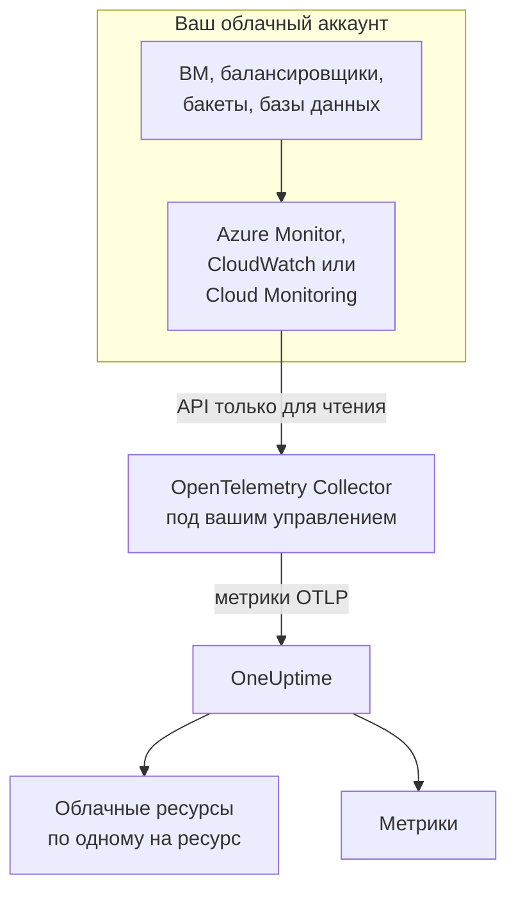
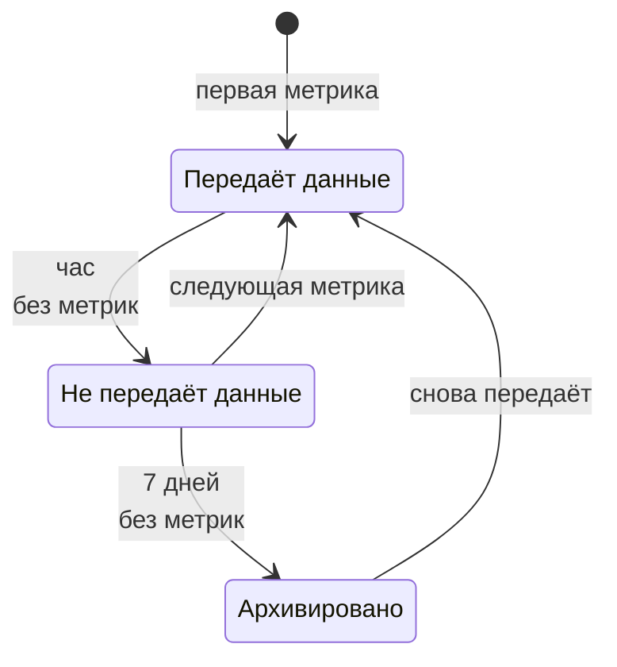

# Облачные ресурсы (IaaS и PaaS)

**Cloud Resources** перечисляет ресурсы IaaS и PaaS в ваших учётных записях AWS, Azure и Google Cloud: виртуальные машины, диски, балансировщики нагрузки, бакеты, управляемые базы данных, кэши, очереди, API-шлюзы и всё остальное. У каждого ресурса своя страница с его типом, регионом и учётной записью, собственным ID у поставщика, всеми метриками, которые поставщик о нём публикует, а также владельцами и метками, как у любого другого ресурса в OneUptime. Найдите их в разделе **Облако → Все ресурсы**.

:::cards
- [Подключение Azure](#подключение-azure): Чтение всех ресурсов подписки из Azure Monitor.
- [Подключение AWS](#подключение-aws): Опрос CloudWatch или потоковая передача через Amazon Data Firehose.
- [Подключение Google Cloud](#подключение-google-cloud): Чтение сервисов проекта из Cloud Monitoring.
- [Как определяется ресурс](#как-определяется-ресурс): Все типы ресурсов, которые распознаёт OneUptime, по поставщикам.
:::

## Как это работает



- **Поставщик уже измеряет ваши ресурсы.** Azure Monitor, Amazon CloudWatch и Google Cloud Monitoring публикуют метрики о каждом ресурсе, который они для вас запускают.
- **Их читает коллектор, которым управляете вы.** OpenTelemetry Collector с доступом только на чтение к этому сервису мониторинга экспортирует метрики в OneUptime. На ресурсы ничего не устанавливается, и OneUptime никогда не хранит ваши облачные учётные данные: их хранит коллектор, в вашей среде.
- **Каждый ресурс появляется вместе с первой метрикой.** По каждой точке данных OneUptime определяет, к какому ресурсу она относится, и создаёт облачный ресурс, когда видит его впервые.

Облачные ресурсы — лишь одно из нескольких мест, где появляется ваше облако:

| Что вы запускаете | Где это появляется | Как |
| --- | --- | --- |
| Контейнеры в ECS, Cloud Run, Container Apps, App Service, … | **Облако → All Environments** | Собственная телеметрия ваших рабочих нагрузок, по её `cloud.platform`. См. [Облачные среды](/docs/telemetry/cloud-environments) |
| Любой ресурс IaaS или PaaS, который отслеживает поставщик | **Облако → Все ресурсы** | API мониторинга поставщика, который читает коллектор: эта страница |
| Виртуальные машины с установленным OpenTelemetry Collector | **Хосты** | Собственные метрики и логи хоста. См. [OpenTelemetry-коллектор на хосте](/docs/telemetry/host-otel-collector) |
| Очереди и топики, которые используют ваши приложения | **Queues** | Спаны и те же облачные метрики. См. [Очереди](/docs/telemetry/queues) |

Ресурс может появляться в нескольких местах. Виртуальная машина с установленным коллектором — это **Хост**, а благодаря метрикам платформы (кредиты CPU, диск и сеть с точки зрения гипервизора) она одновременно и **Облачный ресурс**. Очередь SQS — это **Queue** и **Облачный ресурс**. Каждое представление показывает то, что знает его источник.

## Перед началом

- **Ключ приёма.** Создайте ключ типа **Сервер** в разделе **Настройки проекта → Телеметрия и APM → Ключи приема**. Коллекторы ниже читают его из переменной окружения `ONEUPTIME_TOKEN`, а не из файла конфигурации.
- **Где запустить OpenTelemetry Collector**: дистрибутив `otelcol-contrib`, образ `otel/opentelemetry-collector-contrib`, с исходящим доступом к вашему облачному поставщику и к OneUptime. Подойдёт небольшая ВМ, контейнер или ваш кластер Kubernetes, и один коллектор может читать несколько учётных записей и поставщиков.
- **Доступ на чтение к API мониторинга поставщика.** Его создаёт первый шаг для каждого поставщика ниже.

> [!TIP]
> Те же шаги есть в панели управления, с уже подставленным токеном: в разделе **Облако → Все ресурсы**, пока не появится первый ресурс, и на вкладке **Документация** каждого ресурса, которая открывается на его собственном поставщике.

Если вы размещаете OneUptime самостоятельно, замените `https://oneuptime.com/otlp` на `https://YOUR-ONEUPTIME-HOST/otlp`.

## Подключение Azure

Приёмник `azure_monitor` получает список ресурсов подписки и каждую минуту читает их метрики платформы. Без списка `services` он читает все типы ресурсов, поэтому каждый ресурс подписки становится облачным ресурсом.

:::steps
### Создайте субъект-службу с Monitoring Reader

**Monitoring Reader** читает метрики и перечисляет ресурсы, но ничего не может изменить:

```bash
az ad sp create-for-rbac \
  --name oneuptime-cloud-collector \
  --role "Monitoring Reader" \
  --scopes /subscriptions/<SUBSCRIPTION_ID>
```

Команда выводит `appId` (ID клиента), `password` (секрет клиента) и `tenant`. Выдайте тому же субъекту-службе роль в других подписках, чтобы читать их тем же коллектором.

### Настройте приёмник Azure Monitor

Сохраните это как `config.yaml`:

```yaml
extensions:
  azure_auth:
    service_principal:
      tenant_id: ${env:AZURE_TENANT_ID}
      client_id: ${env:AZURE_CLIENT_ID}
      client_secret: ${env:AZURE_CLIENT_SECRET}

receivers:
  azure_monitor:
    subscription_ids: ["${env:AZURE_SUBSCRIPTION_ID}"]
    auth:
      authenticator: azure_auth
    collection_interval: 60s
    # No `services` list: every resource type in the subscription.
    # Series Azure returns per metric and resource (default 10).
    maximum_number_of_records_per_resource: 50

processors:
  batch: {}

exporters:
  otlphttp/oneuptime:
    endpoint: https://oneuptime.com/otlp
    headers:
      x-oneuptime-token: ${env:ONEUPTIME_TOKEN}

service:
  extensions: [azure_auth]
  pipelines:
    metrics:
      receivers: [azure_monitor]
      processors: [batch]
      exporters: [otlphttp/oneuptime]
```

### Запустите коллектор для Azure

```bash
docker run -d --name oneuptime-cloud-collector --restart unless-stopped \
  -e ONEUPTIME_TOKEN=YOUR_TELEMETRY_INGESTION_TOKEN \
  -e AZURE_TENANT_ID=<TENANT> \
  -e AZURE_CLIENT_ID=<APP_ID> \
  -e AZURE_CLIENT_SECRET=<PASSWORD> \
  -e AZURE_SUBSCRIPTION_ID=<SUBSCRIPTION_ID> \
  -v "$(pwd)/config.yaml:/etc/otelcol-contrib/config.yaml" \
  otel/opentelemetry-collector-contrib:latest
```

Ресурсы появляются в разделе **Облако → Все ресурсы** в течение нескольких минут.
:::

Параметры приёмника `azure_monitor`:

| Параметр | Что делает |
| --- | --- |
| `resource_groups`, `services`, `resource_tags` | Читать меньше: список групп ресурсов, типов Resource Manager (`Microsoft.Compute/virtualMachines`) или тегов, которые должны быть у ресурса |
| `metrics` | Ограничивает каждый тип ресурса перечисленными метриками и агрегациями. Если тип указан в списке, читаются только его перечисленные метрики |
| `discover_subscriptions: true` | Читает все подписки, которые видит субъект-служба, вместо `subscription_ids` |
| `maximum_number_of_records_per_resource` | Сколько рядов Azure возвращает на метрику и ресурс (по умолчанию 10). Увеличьте, если метрика делится по измерению с большим числом значений |
| `use_batch_api: true` | Для больших подписок. Приёмник делает один вызов Resource Manager на ресурс и пакет из 20 метрик, а Resource Manager допускает около 12 000 чтений в час; пакетный API читает до 50 ресурсов за вызов из плоскости данных Azure Monitor, у которой лимит намного выше |
| `cache_resources` | Как часто, в секундах, приёмник получает список ресурсов: по умолчанию раз в сутки. Ресурс, созданный после запуска коллектора, может появиться только через сутки; перезапустите коллектор, чтобы получить список сразу |

## Подключение AWS

Метрики CloudWatch попадают в OneUptime одним из двух способов:

| | Polling | Metric Streams |
| --- | --- | --- |
| Как | Приёмник `aws_cloudwatch` коллектора опрашивает CloudWatch | CloudWatch отправляет данные через Amazon Data Firehose в приёмник `awsfirehose` коллектора |
| Что нужно на стороне AWS | Только учётные данные | Поток Firehose и metric stream в каждом регионе |
| Коллектор должен быть доступен из AWS | Нет | Да, по HTTPS на порту 443 |
| Задержка | От 10 до 20 минут | Несколько минут |
| Подходит для | Большинства учётных записей | Больших учётных записей |

### Опрос через приёмник aws_cloudwatch

:::steps
#### Разрешите коллектору читать CloudWatch

Прикрепите эту политику к роли, от имени которой работает коллектор (профиль экземпляра EC2, роль задачи ECS, сервисный аккаунт EKS), или к пользователю IAM, ключи доступа которого вы ему передаёте:

```json
{
  "Version": "2012-10-17",
  "Statement": [
    {
      "Effect": "Allow",
      "Action": [
        "cloudwatch:ListMetrics",
        "cloudwatch:GetMetricData",
        "sts:GetCallerIdentity"
      ],
      "Resource": "*"
    }
  ]
}
```

`sts:GetCallerIdentity` позволяет приёмнику сообщать ID учётной записи, который нужен для ARN каждого ресурса.

#### Настройте приёмники CloudWatch

Один приёмник читает одно пространство имён в одном регионе, поэтому добавьте по приёмнику на каждое нужное пространство имён и регион. Этот пример читает распространённые; сохраните его как `config.yaml`:

```yaml
receivers:
  aws_cloudwatch/ec2:
    region: ${env:AWS_REGION}
    metrics:
      collection_interval: 5m
      period: 5m
      delay: 10m
      discovery:
        filters:
          namespace: AWS/EC2
        # Metrics read per scrape, at most. Each costs 4 GetMetricData queries.
        limit: 1000
  aws_cloudwatch/ebs:
    region: ${env:AWS_REGION}
    metrics:
      collection_interval: 5m
      period: 5m
      delay: 10m
      discovery:
        filters:
          namespace: AWS/EBS
        # Metrics read per scrape, at most. Each costs 4 GetMetricData queries.
        limit: 1000
  aws_cloudwatch/applicationelb:
    region: ${env:AWS_REGION}
    metrics:
      collection_interval: 5m
      period: 5m
      delay: 10m
      discovery:
        filters:
          namespace: AWS/ApplicationELB
        # Metrics read per scrape, at most. Each costs 4 GetMetricData queries.
        limit: 1000
  aws_cloudwatch/rds:
    region: ${env:AWS_REGION}
    metrics:
      collection_interval: 5m
      period: 5m
      delay: 10m
      discovery:
        filters:
          namespace: AWS/RDS
        # Metrics read per scrape, at most. Each costs 4 GetMetricData queries.
        limit: 1000
  aws_cloudwatch/lambda:
    region: ${env:AWS_REGION}
    metrics:
      collection_interval: 5m
      period: 5m
      delay: 10m
      discovery:
        filters:
          namespace: AWS/Lambda
        # Metrics read per scrape, at most. Each costs 4 GetMetricData queries.
        limit: 1000
  aws_cloudwatch/dynamodb:
    region: ${env:AWS_REGION}
    metrics:
      collection_interval: 5m
      period: 5m
      delay: 10m
      discovery:
        filters:
          namespace: AWS/DynamoDB
        # Metrics read per scrape, at most. Each costs 4 GetMetricData queries.
        limit: 1000

processors:
  batch: {}

exporters:
  otlphttp/oneuptime:
    endpoint: https://oneuptime.com/otlp
    headers:
      x-oneuptime-token: ${env:ONEUPTIME_TOKEN}

service:
  pipelines:
    metrics:
      receivers: [aws_cloudwatch/ec2, aws_cloudwatch/ebs, aws_cloudwatch/applicationelb, aws_cloudwatch/rds, aws_cloudwatch/lambda, aws_cloudwatch/dynamodb]
      processors: [batch]
      exporters: [otlphttp/oneuptime]
```

#### Запустите коллектор для CloudWatch

```bash
docker run -d --name oneuptime-cloud-collector --restart unless-stopped \
  -e ONEUPTIME_TOKEN=YOUR_TELEMETRY_INGESTION_TOKEN \
  -e AWS_REGION=us-east-1 \
  -e AWS_ACCESS_KEY_ID=<ACCESS_KEY_ID> \
  -e AWS_SECRET_ACCESS_KEY=<SECRET_ACCESS_KEY> \
  -v "$(pwd)/config.yaml:/etc/otelcol-contrib/config.yaml" \
  otel/opentelemetry-collector-contrib:latest
```

На экземпляре EC2, в задаче ECS или поде EKS, у которых есть эта роль, не указывайте две переменные с ключами.
:::

- **Не задавайте `stats`.** Тогда каждая метрика читается как одна сводка за период: четыре статистики, четыре запроса `GetMetricData`, а AWS тарифицирует `GetMetricData` за каждую запрошенную метрику. `discovery.limit` ограничивает число метрик, которые приёмник читает за один сбор (задайте его: собственное значение приёмника по умолчанию — 100), а более длинный `collection_interval` читает их реже.
- **Данные приходят с опозданием.** `delay` ждёт, пока CloudWatch опубликует период, поэтому точки данных приходят через 10–20 минут после измеряемого момента, а ресурсы появляются примерно через двадцать минут.

### Потоковая передача через CloudWatch Metric Streams

:::steps
#### Настройте приёмник Firehose

Коллектору нужен сертификат для его адреса: Firehose доставляет данные только на `https://` на порт 443. Сохраните это как `config.yaml`:

```yaml
extensions:
  awscloudwatchmetricstreams_encoding:
    format: opentelemetry1.0

receivers:
  awsfirehose:
    # Firehose delivers to HTTPS on port 443 only: expose this port as
    # 443, for example behind a load balancer.
    endpoint: 0.0.0.0:4433
    encoding: awscloudwatchmetricstreams_encoding
    access_key: ${env:FIREHOSE_ACCESS_KEY}
    tls:
      cert_file: /etc/otelcol-contrib/tls/server.crt
      key_file: /etc/otelcol-contrib/tls/server.key

processors:
  batch: {}

exporters:
  otlphttp/oneuptime:
    endpoint: https://oneuptime.com/otlp
    headers:
      x-oneuptime-token: ${env:ONEUPTIME_TOKEN}

service:
  extensions: [awscloudwatchmetricstreams_encoding]
  pipelines:
    metrics:
      receivers: [awsfirehose]
      processors: [batch]
      exporters: [otlphttp/oneuptime]
```

#### Запустите коллектор для Firehose

```bash
docker run -d --name oneuptime-cloud-collector --restart unless-stopped \
  -e ONEUPTIME_TOKEN=YOUR_TELEMETRY_INGESTION_TOKEN \
  -e FIREHOSE_ACCESS_KEY=<A_LONG_RANDOM_SECRET> \
  -p 4433:4433 \
  -v "$(pwd)/tls:/etc/otelcol-contrib/tls:ro" \
  -v "$(pwd)/config.yaml:/etc/otelcol-contrib/config.yaml" \
  otel/opentelemetry-collector-contrib:latest
```

Сертификат и его ключ помещаются в `tls/` как `server.crt` и `server.key`. Опубликуйте порт 4433 за чем-то, что отвечает на 443, например за балансировщиком нагрузки.

#### Создайте поток Firehose и metric streams

1. **Amazon Data Firehose → Create Firehose stream**: источник **Direct PUT**, назначение **HTTP Endpoint**. URL эндпоинта — это адрес `https://` коллектора; ключ доступа — `FIREHOSE_ACCESS_KEY`. Выберите или создайте бакет S3 для неудачных доставок.
2. **CloudWatch → Metrics → Streams → Create metric stream**: включаемые пространства имён (или все), поток Firehose и формат вывода **OpenTelemetry 1.0**.
3. Повторите в каждом регионе: metric stream передаёт метрики только своего региона.
:::

AWS тарифицирует metric stream за каждое доставленное обновление метрики, плюс плата за данные Firehose, поэтому включайте только нужные пространства имён. Поток в формате **JSON** (`format: json` в расширении кодирования) называет те же ресурсы, но также записывает каждое пространство имён в `service.name`, поэтому каждое пространство имён появляется ещё и в разделе **Службы**: предпочитайте **OpenTelemetry 1.0**.

## Подключение Google Cloud

Приёмник `googlecloudmonitoring` читает типы метрик, перечисленные в его `metrics_list`, для одного проекта.

:::steps
### Создайте сервисный аккаунт с Monitoring Viewer

**Monitoring Viewer** читает метрики, но ничего не может изменить:

```bash
gcloud iam service-accounts create oneuptime-cloud-collector \
  --project <PROJECT_ID>

gcloud projects add-iam-policy-binding <PROJECT_ID> \
  --member "serviceAccount:oneuptime-cloud-collector@<PROJECT_ID>.iam.gserviceaccount.com" \
  --role roles/monitoring.viewer

gcloud iam service-accounts keys create key.json \
  --iam-account oneuptime-cloud-collector@<PROJECT_ID>.iam.gserviceaccount.com
```

В самом Google Cloud запускайте коллектор от имени этого сервисного аккаунта, а не создавайте ключ.

### Настройте приёмник Cloud Monitoring

Каждый фильтр читает все типы метрик одного сервиса. Сохраните это как `config.yaml`:

```yaml
receivers:
  googlecloudmonitoring:
    project_id: ${env:GCP_PROJECT_ID}
    collection_interval: 2m
    # Only the metric types these filters list are read.
    metrics_list:
      - metric_descriptor_filter: 'metric.type = starts_with("compute.googleapis.com/")'
      - metric_descriptor_filter: 'metric.type = starts_with("cloudsql.googleapis.com/")'
      - metric_descriptor_filter: 'metric.type = starts_with("loadbalancing.googleapis.com/")'
      - metric_descriptor_filter: 'metric.type = starts_with("storage.googleapis.com/")'
      - metric_descriptor_filter: 'metric.type = starts_with("redis.googleapis.com/")'
      - metric_descriptor_filter: 'metric.type = starts_with("run.googleapis.com/")'

processors:
  batch: {}

exporters:
  otlphttp/oneuptime:
    endpoint: https://oneuptime.com/otlp
    headers:
      x-oneuptime-token: ${env:ONEUPTIME_TOKEN}

service:
  pipelines:
    metrics:
      receivers: [googlecloudmonitoring]
      processors: [batch]
      exporters: [otlphttp/oneuptime]
```

### Запустите коллектор для Google Cloud

```bash
docker run -d --name oneuptime-cloud-collector --restart unless-stopped \
  -e ONEUPTIME_TOKEN=YOUR_TELEMETRY_INGESTION_TOKEN \
  -e GCP_PROJECT_ID=<PROJECT_ID> \
  -e GOOGLE_APPLICATION_CREDENTIALS=/etc/otelcol-contrib/key.json \
  -v "$(pwd)/key.json:/etc/otelcol-contrib/key.json:ro" \
  -v "$(pwd)/config.yaml:/etc/otelcol-contrib/config.yaml" \
  otel/opentelemetry-collector-contrib:latest
```
:::

- **Список читается при запуске коллектора:** после изменения перезапустите его. `metric_name: compute.googleapis.com/instance/cpu/utilization` читает один тип вместо всех типов сервиса.
- **Один приёмник читает один проект:** добавьте по приёмнику на проект.
- **У чтения есть стоимость и квота.** Каждый тип метрики — это одно чтение API Cloud Monitoring за интервал сбора. Чтение собственных метрик Google Cloud бесплатно в пределах месячного лимита API; более длинный `collection_interval` удерживает большой проект в этих пределах и в пределах поминутной квоты.

## Не допускайте определения ресурсов в конвейере

> [!WARNING]
> Не добавляйте процессор `resourcedetection` в конвейер, который читает облачный мониторинг. Он проставляет собственные `host.name` и `os.type` машины коллектора на каждую точку данных, и тогда OneUptime относит метрики вашего облака ещё и к этой машине в разделе **Хосты**. Коллектор, который также отслеживает свой хост, должен делать это в отдельном конвейере.

## Как определяется ресурс

Каждая точка данных от этих приёмников называет один ресурс, и OneUptime привязывает облачный ресурс к идентификатору этого ресурса, а не к его имени, которое можно изменить. Идентификатор сравнивается без учёта регистра, поэтому ресурс, о котором сообщают в двух написаниях, — это один ресурс.

### Azure

Каждая точка данных несёт ID ресурса Azure (`azuremonitor.resource_id`), поэтому каждый ресурс, который читает приёмник, становится облачным ресурсом: типы ниже — под понятным именем, все остальные — под своим типом Resource Manager. ID ресурса, регион, подписка и группа ресурсов показываются на ресурсе.

:::details Типы ресурсов Azure с понятным именем
| Тип ресурса | Отображается как | Модель |
| --- | --- | --- |
| `Microsoft.Compute/virtualMachines` | Virtual Machine | IaaS |
| `Microsoft.Compute/virtualMachineScaleSets` | Virtual Machine Scale Set | IaaS |
| `Microsoft.Compute/disks` | Managed Disk | IaaS |
| `Microsoft.Network/loadBalancers` | Load Balancer | IaaS |
| `Microsoft.Network/applicationGateways` | Application Gateway | IaaS |
| `Microsoft.Network/publicIPAddresses` | Public IP Address | IaaS |
| `Microsoft.Network/natGateways` | NAT Gateway | IaaS |
| `Microsoft.Network/virtualNetworkGateways` | Virtual Network Gateway | IaaS |
| `Microsoft.Network/expressRouteCircuits` | ExpressRoute Circuit | IaaS |
| `Microsoft.Network/azureFirewalls` | Azure Firewall | IaaS |
| `Microsoft.Network/frontdoors` | Front Door (classic) | IaaS |
| `Microsoft.Cdn/profiles` | Front Door and CDN Profile | IaaS |
| `Microsoft.Network/trafficmanagerprofiles` | Traffic Manager Profile | IaaS |
| `Microsoft.Network/networkInterfaces` | Network Interface | IaaS |
| `Microsoft.Network/virtualNetworks` | Virtual Network | IaaS |
| `Microsoft.Network/privateEndpoints` | Private Endpoint | IaaS |
| `Microsoft.Network/dnszones` | DNS Zone | IaaS |
| `Microsoft.Network/bastionHosts` | Bastion | IaaS |
| `Microsoft.Storage/storageAccounts` | Storage Account | IaaS |
| `Microsoft.RecoveryServices/vaults` | Recovery Services Vault | PaaS |
| `Microsoft.Web/sites` | App Service or Function App | PaaS |
| `Microsoft.Web/serverfarms` | App Service Plan | PaaS |
| `Microsoft.Web/staticSites` | Static Web App | PaaS |
| `Microsoft.App/containerApps` | Container App | PaaS |
| `Microsoft.App/managedEnvironments` | Container Apps Environment | PaaS |
| `Microsoft.ContainerInstance/containerGroups` | Container Instance | PaaS |
| `Microsoft.ContainerService/managedClusters` | AKS Cluster | PaaS |
| `Microsoft.ContainerRegistry/registries` | Container Registry | PaaS |
| `Microsoft.SignalRService/SignalR` | SignalR Service | PaaS |
| `Microsoft.Sql/servers/databases` | SQL Database | PaaS |
| `Microsoft.Sql/servers/elasticpools` | SQL Elastic Pool | PaaS |
| `Microsoft.Sql/managedInstances` | SQL Managed Instance | PaaS |
| `Microsoft.DBforPostgreSQL/flexibleServers` | PostgreSQL Flexible Server | PaaS |
| `Microsoft.DBforMySQL/flexibleServers` | MySQL Flexible Server | PaaS |
| `Microsoft.DocumentDB/databaseAccounts` | Cosmos DB Account | PaaS |
| `Microsoft.Cache/redis` | Azure Cache for Redis | PaaS |
| `Microsoft.Cache/redisEnterprise` | Azure Managed Redis | PaaS |
| `Microsoft.ServiceBus/namespaces` | Service Bus Namespace | PaaS |
| `Microsoft.EventHub/namespaces` | Event Hubs Namespace | PaaS |
| `Microsoft.EventGrid/topics` | Event Grid Topic | PaaS |
| `Microsoft.EventGrid/systemTopics` | Event Grid System Topic | PaaS |
| `Microsoft.EventGrid/namespaces` | Event Grid Namespace | PaaS |
| `Microsoft.ApiManagement/service` | API Management | PaaS |
| `Microsoft.Logic/workflows` | Logic App | PaaS |
| `Microsoft.DataFactory/factories` | Data Factory | PaaS |
| `Microsoft.Synapse/workspaces` | Synapse Workspace | PaaS |
| `Microsoft.Kusto/clusters` | Data Explorer Cluster | PaaS |
| `Microsoft.StreamAnalytics/streamingjobs` | Stream Analytics Job | PaaS |
| `Microsoft.CognitiveServices/accounts` | Azure AI Services or OpenAI | PaaS |
| `Microsoft.Search/searchServices` | AI Search Service | PaaS |
| `Microsoft.MachineLearningServices/workspaces` | Machine Learning Workspace | PaaS |
| `Microsoft.KeyVault/vaults` | Key Vault | PaaS |
| `Microsoft.Insights/components` | Application Insights | PaaS |
| `Microsoft.OperationalInsights/workspaces` | Log Analytics Workspace | PaaS |
| `Microsoft.Automation/automationAccounts` | Automation Account | PaaS |
| `Microsoft.Devices/IotHubs` | IoT Hub | PaaS |
:::

### AWS

Метрика CloudWatch называет свой ресурс в измерении, которое зависит от пространства имён. Точка данных, несущая измерения из столбца **Определяется по**, относится к этому ресурсу вместе с его учётной записью и регионом; дополнительные измерения сужают ряд, а не ресурс (ряды Application Load Balancer по целевым группам относятся к самому балансировщику). Точка данных, агрегированная по чему-то другому (`InstanceType`, `DatabaseClass`, итог по всей учётной записи), не называет ресурс и не обнаруживается. Как и пространство имён, которого нет в списке: его метрики всё равно попадают в раздел **Метрики**.

Каждый ресурс показывается со своим ARN, если метрики называют его полностью; если нет (ARN группы Auto Scaling содержит UUID, о котором не сообщает ни одна метрика), — со своим пространством имён и измерениями.

:::details Пространства имён CloudWatch и измерения, которые определяют ресурс
| Пространство имён | Определяется по | Отображается как | Тип ресурса | Модель |
| --- | --- | --- | --- | --- |
| `AWS/EC2` | `InstanceId` | EC2 Instance | `AWS::EC2::Instance` | IaaS |
| `AWS/EC2` | `AutoScalingGroupName` (without `InstanceId`) | Auto Scaling Group | `AWS::AutoScaling::AutoScalingGroup` | IaaS |
| `AWS/AutoScaling` | `AutoScalingGroupName` | Auto Scaling Group | `AWS::AutoScaling::AutoScalingGroup` | IaaS |
| `AWS/EBS` | `VolumeId` | EBS Volume | `AWS::EC2::Volume` | IaaS |
| `AWS/ELB` | `LoadBalancerName` | Classic Load Balancer | `AWS::ElasticLoadBalancing::LoadBalancer` | IaaS |
| `AWS/ApplicationELB` | `LoadBalancer` | Elastic Load Balancer (ALB, NLB, GWLB) | `AWS::ElasticLoadBalancingV2::LoadBalancer` | IaaS |
| `AWS/NetworkELB` | `LoadBalancer` | Elastic Load Balancer (ALB, NLB, GWLB) | `AWS::ElasticLoadBalancingV2::LoadBalancer` | IaaS |
| `AWS/GatewayELB` | `LoadBalancer` | Elastic Load Balancer (ALB, NLB, GWLB) | `AWS::ElasticLoadBalancingV2::LoadBalancer` | IaaS |
| `AWS/NATGateway` | `NatGatewayId` | NAT Gateway | `AWS::EC2::NatGateway` | IaaS |
| `AWS/TransitGateway` | `TransitGateway` | Transit Gateway | `AWS::EC2::TransitGateway` | IaaS |
| `AWS/VPN` | `VpnId` | Site-to-Site VPN Connection | `AWS::EC2::VPNConnection` | IaaS |
| `AWS/DX` | `ConnectionId` | Direct Connect Connection | `AWS::DirectConnect::Connection` | IaaS |
| `AWS/CloudFront` | `DistributionId` | CloudFront Distribution | `AWS::CloudFront::Distribution` | IaaS |
| `AWS/GlobalAccelerator` | `Accelerator` (without `Listener`, `EndpointGroup`) | Global Accelerator | `AWS::GlobalAccelerator::Accelerator` | IaaS |
| `AWS/Route53` | `HealthCheckId` | Route 53 Health Check | `AWS::Route53::HealthCheck` | IaaS |
| `AWS/NetworkFirewall` | `FirewallName` | Network Firewall | `AWS::NetworkFirewall::Firewall` | IaaS |
| `AWS/WAFV2` | `WebACL` (without `Rule`, `RuleGroup`) | WAF Web ACL | `AWS::WAFv2::WebACL` | PaaS |
| `AWS/S3` | `BucketName` | S3 Bucket | `AWS::S3::Bucket` | IaaS |
| `AWS/EFS` | `FileSystemId` | EFS File System | `AWS::EFS::FileSystem` | IaaS |
| `AWS/FSx` | `FileSystemId` | FSx File System | `AWS::FSx::FileSystem` | IaaS |
| `AWS/ECS` | `ClusterName` + `ServiceName` | ECS Service | `AWS::ECS::Service` | PaaS |
| `AWS/ECS` | `ClusterName` (without `ServiceName`) | ECS Cluster | `AWS::ECS::Cluster` | PaaS |
| `AWS/AppRunner` | `ServiceName` | App Runner Service | `AWS::AppRunner::Service` | PaaS |
| `AWS/ElasticBeanstalk` | `EnvironmentName` | Elastic Beanstalk Environment | `AWS::ElasticBeanstalk::Environment` | PaaS |
| `AWS/Lambda` | `FunctionName` | Lambda Function | `AWS::Lambda::Function` | PaaS |
| `AWS/States` | `StateMachineArn` | Step Functions State Machine | `AWS::StepFunctions::StateMachine` | PaaS |
| `AWS/RDS` | `DBInstanceIdentifier` | RDS DB Instance | `AWS::RDS::DBInstance` | PaaS |
| `AWS/RDS` | `DBClusterIdentifier` (without `DBInstanceIdentifier`) | Aurora / RDS DB Cluster | `AWS::RDS::DBCluster` | PaaS |
| `AWS/DocDB` | `DBInstanceIdentifier` | DocumentDB Instance | `AWS::DocDB::DBInstance` | PaaS |
| `AWS/DocDB` | `DBClusterIdentifier` (without `DBInstanceIdentifier`) | DocumentDB Cluster | `AWS::DocDB::DBCluster` | PaaS |
| `AWS/Neptune` | `DBInstanceIdentifier` | Neptune Instance | `AWS::Neptune::DBInstance` | PaaS |
| `AWS/Neptune` | `DBClusterIdentifier` (without `DBInstanceIdentifier`) | Neptune Cluster | `AWS::Neptune::DBCluster` | PaaS |
| `AWS/DynamoDB` | `TableName` | DynamoDB Table | `AWS::DynamoDB::Table` | PaaS |
| `AWS/ElastiCache` | `CacheClusterId` | ElastiCache Cluster | `AWS::ElastiCache::CacheCluster` | PaaS |
| `AWS/ElastiCache` | `ReplicationGroupId` (without `CacheClusterId`) | ElastiCache Replication Group | `AWS::ElastiCache::ReplicationGroup` | PaaS |
| `AWS/ElastiCache` | `clusterId` (without `CacheClusterId`) | ElastiCache Serverless Cache | `AWS::ElastiCache::ServerlessCache` | PaaS |
| `AWS/MemoryDB` | `ClusterName` | MemoryDB Cluster | `AWS::MemoryDB::Cluster` | PaaS |
| `AWS/Redshift` | `ClusterIdentifier` | Redshift Cluster | `AWS::Redshift::Cluster` | PaaS |
| `AWS/ES` | `DomainName` | OpenSearch Domain | `AWS::OpenSearchService::Domain` | PaaS |
| `AWS/SQS` | `QueueName` | SQS Queue | `AWS::SQS::Queue` | PaaS |
| `AWS/SNS` | `TopicName` | SNS Topic | `AWS::SNS::Topic` | PaaS |
| `AWS/Kinesis` | `StreamName` | Kinesis Data Stream | `AWS::Kinesis::Stream` | PaaS |
| `AWS/Firehose` | `DeliveryStreamName` | Data Firehose Stream | `AWS::KinesisFirehose::DeliveryStream` | PaaS |
| `AWS/AmazonMQ` | `Broker` | Amazon MQ Broker | `AWS::AmazonMQ::Broker` | PaaS |
| `AWS/Kafka` | `Cluster Name` | MSK Cluster | `AWS::MSK::Cluster` | PaaS |
| `AWS/Events` | `RuleName` | EventBridge Rule | `AWS::Events::Rule` | PaaS |
| `AWS/ApiGateway` | `ApiName` | API Gateway REST API | `AWS::ApiGateway::RestApi` | PaaS |
| `AWS/ApiGateway` | `ApiId` (without `ApiName`) | API Gateway HTTP or WebSocket API | `AWS::ApiGatewayV2::Api` | PaaS |
| `AWS/AppSync` | `GraphQLAPIId` | AppSync GraphQL API | `AWS::AppSync::GraphQLApi` | PaaS |
| `AWS/CertificateManager` | `CertificateArn` | ACM Certificate | `AWS::CertificateManager::Certificate` | PaaS |
| `AWS/KMS` | `KeyId` | KMS Key | `AWS::KMS::Key` | PaaS |
| `AWS/Cognito` | `UserPool` | Cognito User Pool | `AWS::Cognito::UserPool` | PaaS |
| `AWS/SageMaker` | `EndpointName` | SageMaker Endpoint | `AWS::SageMaker::Endpoint` | PaaS |
| `AWS/Logs` | `LogGroupName` | CloudWatch Log Group | `AWS::Logs::LogGroup` | PaaS |
:::

### Google Cloud

Cloud Monitoring называет отслеживаемый ресурс каждой метрики типом и метками. Точка данных одного из типов ниже относится к этому ресурсу, который определяется перечисленными метками; другие метки ресурса и его метки метаданных никогда его не разделяют. Типы Kubernetes (`k8s_container`, `k8s_pod`, …) оставлены продукту [Kubernetes](/docs/telemetry/kubernetes-agent).

:::details Типы ресурсов Cloud Monitoring и метки, которые их определяют
| Тип отслеживаемого ресурса | Определяется по | Отображается как | Модель |
| --- | --- | --- | --- |
| `gce_instance` | `project_id`, `zone`, `instance_id` | Compute Engine VM Instance | IaaS |
| `instance_group` | `project_id`, `location`, `instance_group_id` | Instance Group | IaaS |
| `gcs_bucket` | `project_id`, `bucket_name` | Cloud Storage Bucket | IaaS |
| `filestore_instance` | `project_id`, `location`, `instance_name` | Filestore Instance | IaaS |
| `https_lb_rule` | `project_id`, `url_map_name` | External Application Load Balancer | IaaS |
| `internal_http_lb_rule` | `project_id`, `region`, `url_map_name` | Internal Application Load Balancer | IaaS |
| `vpn_gateway` | `project_id`, `region`, `gateway_id` | Cloud VPN Gateway | IaaS |
| `nat_gateway` | `project_id`, `region`, `router_id`, `gateway_name` | Cloud NAT Gateway | IaaS |
| `gce_router` | `project_id`, `region`, `router_id` | Cloud Router | IaaS |
| `cloudsql_database` | `project_id`, `database_id` | Cloud SQL Instance | PaaS |
| `alloydb.googleapis.com/Instance` | `resource_container`, `location`, `cluster_id`, `instance_id` | AlloyDB Instance | PaaS |
| `redis_instance` | `project_id`, `region`, `instance_id` | Memorystore for Redis Instance | PaaS |
| `spanner_instance` | `project_id`, `instance_id` | Spanner Instance | PaaS |
| `bigtable_table` | `project_id`, `instance` | Bigtable Instance | PaaS |
| `bigquery_dataset` | `project_id`, `dataset_id` | BigQuery Dataset | PaaS |
| `cloud_function` | `project_id`, `region`, `function_name` | Cloud Run Function | PaaS |
| `cloud_run_revision` | `project_id`, `location`, `service_name` | Cloud Run Service | PaaS |
| `cloud_run_job` | `project_id`, `location`, `job_name` | Cloud Run Job | PaaS |
| `gae_app` | `project_id`, `module_id` | App Engine Service | PaaS |
| `pubsub_topic` | `project_id`, `topic_id` | Pub/Sub Topic | PaaS |
| `pubsub_subscription` | `project_id`, `subscription_id` | Pub/Sub Subscription | PaaS |
| `cloud_tasks_queue` | `project_id`, `location`, `queue_id` | Cloud Tasks Queue | PaaS |
| `cloud_composer_environment` | `project_id`, `location`, `environment_name` | Cloud Composer Environment | PaaS |
| `dataproc_cluster` | `project_id`, `region`, `cluster_name` | Dataproc Cluster | PaaS |
| `aiplatform.googleapis.com/Endpoint` | `resource_container`, `location`, `endpoint_id` | Vertex AI Endpoint | PaaS |
:::

### Имена

Ресурс получает имя, которым его называет поставщик (`vm-prod-01`, `checkout`, `orders`). Имена уникальны в пределах проекта, а имена поставщика — нет: в двух подписках может быть по `web-01`, а план App Service и его приложение могут оба называться `checkout`. Поэтому ресурс, имя которого уже занято, получает имя с его типом, затем группой ресурсов или регионом, затем учётной записью: `web-01 (Virtual Machine, rg-prod)`. Переименовать любой ресурс можно на его вкладке **Настройки**: метрики сопоставляются по его идентификатору, а не по имени.

## Статус, архивирование и ограничения



- **Передаёт данные** означает, что поставщик отправил метрику о ресурсе за последний час; через час без метрик статус меняется на **Не передаёт данные**. Некоторые ресурсы по своей природе молчат, например Key Vault, к которому никто не обращался, или бакет, метрики хранения которого CloudWatch публикует раз в сутки, и они возвращаются со следующей точкой данных.
- Ресурс, который **7 дней не отправляет ни одной метрики**, архивируется автоматически: экземпляр, который заменила группа Auto Scaling, удалённый том, исчезнувший бакет. Он сохраняет свои метки, владельцев и историю в разделе **Облако → Расширенный → Архивировано** и восстанавливается сам, как только снова начинает передавать данные. Ресурс, который вы архивировали сами, остаётся в архиве; ресурс, который вы восстановили, пока он молчит, остаётся в списке, пока не начнёт передавать данные.
- Удалять ресурс, о котором поставщик всё ещё сообщает, бесполезно: он снова обнаружится по следующим метрикам. Вместо этого архивируйте его.
- Обнаружение перестаёт создавать ресурсы, когда в проекте **5 000** активных (не архивированных) ресурсов, и пишет предупреждение в лог; архивированные ресурсы не учитываются.

В собственных установках эти значения можно изменить переменными окружения приложения:

| Переменная | По умолчанию | Значение |
| --- | --- | --- |
| `CLOUD_RESOURCE_AUTO_ARCHIVE_DAYS` | `7` | Дней без метрик до архивирования ресурса (не меньше 1) |
| `CLOUD_RESOURCE_AUTO_CREATE_BUDGET` | `5000` | Сколько активных ресурсов может быть в проекте, прежде чем обнаружение перестанет создавать новые (`0` отключает обнаружение) |

## Оповещения по ресурсу

:::steps
1. Откройте ресурс и его вкладку **Метрики**, где перечислены все метрики, которые поставщик сообщает о нём.
2. Откройте метрику, чтобы построить её график в обозревателе метрик, уже отфильтрованный по ресурсу.
3. Нажмите **Создать монитор из этого представления**: монитор будет следить за этой метрикой для этого ресурса.
:::

> [!IMPORTANT]
> Облачный мониторинг публикует каждое значение через несколько минут после измеряемого момента: через 10–20 минут для CloudWatch при опросе, как описано выше, и через несколько минут для Azure Monitor и Cloud Monitoring. Значение сохраняется с меткой измеряемого момента. Задайте монитору по этим метрикам окно длиннее этой задержки (30 минут для CloudWatch, 15 для остальных), иначе он не увидит данных и никогда не сработает.

## Инвентарь и правила

- **Инвентарь:** облачные ресурсы перечислены в [Инвентаре](/docs/inventory/overview) как элементы типа **Облачный ресурс**, с ID поставщика в `cloud.resource.id` и типом в `cloud.resource.type`. Инструменты ресурсов AI-агента тоже их перечисляют.
- **Правила:** **Облако → Настройки → Правила меток** и **Правила владельца** применяются к ним так же, как к облачным средам.

## Устранение неполадок

### Ресурсы не появляются

1. Проверьте токен: `curl -i https://oneuptime.com/otlp/v1/validate -H "x-oneuptime-token: YOUR_TELEMETRY_INGESTION_TOKEN"` должен вернуть `200` с `"valid": true`.
2. Прочитайте лог коллектора (`docker logs oneuptime-cloud-collector`). Ошибка авторизации называет недостающее разрешение: `AuthorizationFailed` (Azure: **Monitoring Reader** в подписке), `AccessDenied` для `cloudwatch:GetMetricData` (AWS: политика выше), `PermissionDenied` (Google Cloud: **Monitoring Viewer**).
3. Поищите в разделе **Метрики** метрики поставщика (`azure_…`, `amazonaws.com/aws/…`, `compute.googleapis.com/…`). Если они есть, а ресурсов нет, точки данных не называют ни одного ресурса, который распознаёт OneUptime: пространство имён AWS или тип Google Cloud, которого нет в списках выше, или точка данных, агрегированная не по ресурсу, а по чему-то другому.
4. Дождитесь запаздывающих данных: при опросе, как описано выше, CloudWatch отстаёт на 10–20 минут.

### Ресурс отсутствует

- **Azure:** приёмник получает список ресурсов раз в сутки; перезапустите коллектор, чтобы увидеть новые сейчас. У типа ресурса без метрик платформы в Azure Monitor нечего сообщать.
- **AWS:** каждый приёмник читает одно пространство имён в одном регионе, а `discovery.limit` ограничивает число метрик, которые он читает: увеличьте его, если в учётной записи их больше.
- **Google Cloud:** в `metrics_list` должен быть указан сервис ресурса.
- **Любой поставщик:** проект, достигший лимита, не создаёт новых ресурсов, пока часть не будет архивирована. См. [Статус, архивирование и ограничения](#статус-архивирование-и-ограничения).

### Один и тот же ресурс появляется дважды

Ресурс AWS, прочитанный один раз с ID учётной записи, а другой раз без него, — это два ресурса: приёмник опроса сообщает учётную запись, только если ему разрешено вызывать `sts:GetCallerIdentity`. Выдайте это разрешение каждому коллектору и архивируйте копию без учётной записи.

### Метрики моего облака появляются под хостом

В конвейере есть процессор `resourcedetection`. См. [Не допускайте определения ресурсов в конвейере](#не-допускайте-определения-ресурсов-в-конвейере).

## Ограничения

- **Только метрики.** API мониторинга поставщиков не публикуют логов или трассировок о ресурсе. Отправляйте их из своих рабочих нагрузок через OpenTelemetry.
- **Обнаружение следует за метриками.** Ресурс, о котором поставщик не публикует метрик или который коллектор не читает, не обнаруживается.
- **Нет собственной настройки хранения.** Метрики ресурса хранятся столько же, сколько остальные метрики, которые отправляет его коллектор.
- **Опрос стоит денег** и расходует лимиты облачных API: см. примечания для каждого поставщика выше.

## Что дальше

:::cards
- [Облачные среды](/docs/telemetry/cloud-environments): Ваши контейнеры в ECS, Cloud Run и Container Apps по их собственной телеметрии.
- [Очереди](/docs/telemetry/queues): SQS, Service Bus и Pub/Sub с теми же облачными метриками.
- [Правила меток и владельцев](/docs/configuration/label-and-owner-rules): Назначайте ресурсам метки и владельцев по мере их обнаружения.
- [Инвентарь](/docs/inventory/overview): Все хосты, устройства и облачные ресурсы в одном списке.
:::
