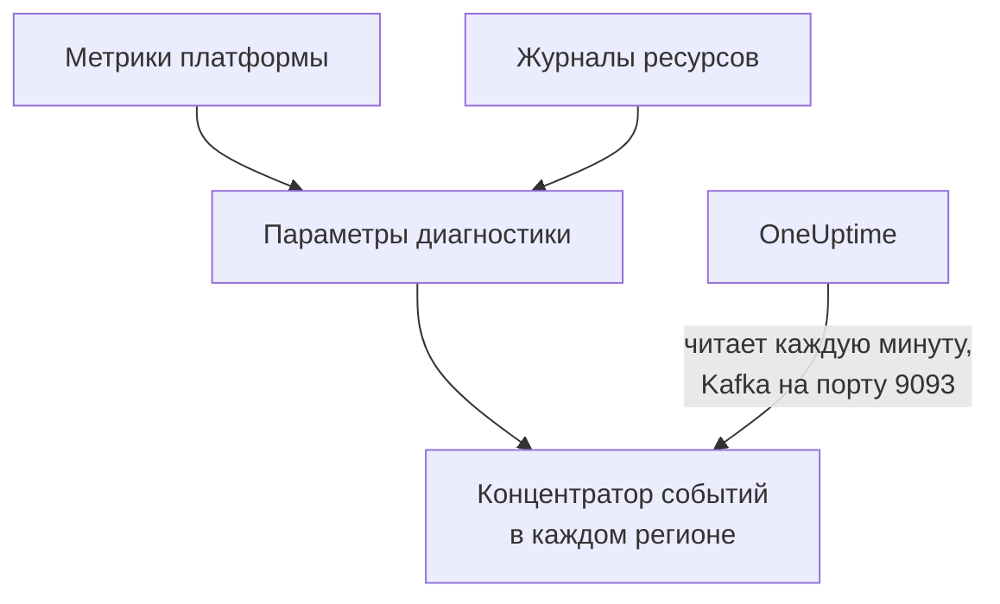

# Передача метрик и журналов Azure Monitor

Подключённая подписка Azure может передавать в OneUptime свои метрики Azure Monitor и журналы ресурсов. Параметры диагностики отправляют их в концентраторы событий вашей подписки, а OneUptime читает эти концентраторы каждую минуту: ключевые метрики приходят через несколько минут после того, как они появились в Azure Monitor, а не при следующем чтении подключения, а журналы ресурсов приходят как журналы OneUptime, каждый под тем ресурсом, к которому он относится. Одна команда в Azure Cloud Shell всё настраивает, и запускать у себя ничего не нужно.

:::cards
- [Как это работает](#как-это-работает): Параметры диагностики отправляют данные в концентратор событий в каждом регионе, а OneUptime их читает.
- [Настройка передачи](#настройка-передачи): Выберите, что передавать, включите чтение и выполните одну команду.
- [Что приходит](#что-приходит): Метрики на ресурсах, которые они измеряют, и журналы на ресурсах, откуда они пришли.
- [Что создаёт команда](#что-создаёт-команда): Каждый ресурс и каждое разрешение, которые команда создаёт в вашей подписке.
- [Остановка передачи](#остановка-передачи): Остановите чтение, затем удалите то, что создала команда.
:::

## Как это работает



- **Концентратор событий в каждом регионе.** Параметр диагностики отправляет данные только в концентратор событий в регионе своего ресурса, поэтому команда создаёт пространство имён Event Hubs в каждом регионе, где есть ваши ресурсы, все в одной группе ресурсов, и направляет параметр диагностики каждого ресурса в концентратор его региона.
- **OneUptime их читает.** Azure Monitor отправляет данные только в концентратор событий, учётную запись хранения или рабочую область Log Analytics и никогда на ваш адрес: концентратор событий, который читает OneUptime, — это способ, при котором вам ничего не нужно запускать. OneUptime входит как собственное приложение подключения, которому разрешено читать эти концентраторы событий и больше ничего.
- **Чтения оставляют переданные метрики потоку.** Пока поток доставляет ключевые метрики типа ресурсов в регионе, чтения подключения перестают их записывать, так что ни одна точка данных не учитывается дважды. Чтения продолжают находить ресурсы, их состояние и изменения и забирают метрики обратно после 15 минут без событий.
- **Ничего не теряется, пока OneUptime не может читать.** События ждут в концентраторах событий, пока OneUptime их не прочитает, столько, сколько концентраторы их хранят, а OneUptime помнит, до какого места прочитал каждую секцию, и продолжает с того места, где остановился.

## Перед началом

- **Подключённая подписка Azure.** Сначала подключите её в разделе **Облако → Подключить**: см. [Подключение облачного аккаунта](/docs/telemetry/cloud-accounts).
- **Владелец или администратор проекта.** Только они могут включить чтение и остановить передачу.
- **Azure Cloud Shell**, с входом как **Owner** подписок или как **Contributor**, который также является **User Access Administrator**: команда создаёт группу ресурсов и назначение роли и меняет параметры диагностики.
- **Выход в Azure, для OneUptime на своём сервере.** OneUptime читает каждое пространство имён по адресу `<namespace>.servicebus.windows.net` на порту 9093, а пространства имён принимают подключения из интернета.

## Настройка передачи

:::steps
### Откройте окно передачи

Перейдите в **Облако → Подключить** и в строке подписки Azure выберите **Передавать метрики и журналы**.

### Выберите, что передавать

**Метрики** передаёт каждую ключевую метрику каждого ресурса поминутно: метрики, по которым OneUptime строит графики и оценивает каждый ресурс. **Метрики и журналы** добавляет собственные журналы каждого ресурса, все категории, которые Azure ведёт для него, а **Журналы** передаёт только журналы ресурсов.

### Включите чтение

Выберите **Включить чтение**. OneUptime ищет концентраторы событий каждую минуту и ждёт их, пока команда их не создаст.

### Выполните команду в Azure Cloud Shell

Скопируйте команду, выполните её в Azure Cloud Shell и дождитесь завершения. Она сообщает каждый регион, где создала концентратор событий, сколько ресурсов отправляют в них данные и какие ресурсы она пропустила, с причиной от Azure.

### Дождитесь первых событий

Окно каждые несколько секунд спрашивает, что пришло. Azure начинает отправлять данные через несколько минут после завершения команды; окно затем сообщает, что откуда пришло, а в строке подключения появляется **Передаётся**.
:::

**Дополнительные поля** содержат остальное:

| Поле | Что оно делает |
| --- | --- |
| **Подписки** | Подписки, из которых передавать данные: сначала те, что читает подключение. В первой находятся концентраторы событий, и OneUptime читает их там. Не больше 50 |
| **Настроить по-другому** | Имена, которые использует команда, чтобы настроить всё с помощью Terraform или портала |

Если первая подписка — не та, в которой OneUptime читает концентраторы событий, окно сообщает об этом: выберите **Читать там**, прежде чем выполнять команду.

## Что приходит

| Что | Куда попадает |
| --- | --- |
| Ключевые метрики | На облачные ресурсы, которые они измеряют, в те же ряды, что записывают чтения подключения |
| Журналы ресурсов | В обозреватель журналов, под службой телеметрии подключения, с подпиской, регионом и категорией в качестве атрибутов |
| Журналы ресурса, который знает OneUptime | Также на этот ресурс: на его странице в Облаке появляется вкладка **Журналы** |

Поток несёт ключевые метрики, которые подключение читает поминутно. Метрика, которую оно читает с более крупным шагом, например использованный объём учётной записи хранения, остаётся за чтениями. Журнал попадает под свой ресурс по идентификатору ARM ресурса, передаваемому как `cloud.resource_id`, и сохраняет категорию, операцию, результат и свойства как атрибуты, например `azure.category`.

Виртуальные машины, масштабируемые наборы, диски, сетевые интерфейсы, виртуальные сети, частные конечные точки, шлюзы NAT, зоны DNS и планы App Service не отправляют собственных журналов ресурсов, поэтому на их страницах нет вкладки **Журналы**. Журналы учётной записи хранения — это журналы её служб, а журналы контейнерного приложения — журналы его среды.

## Что создаёт команда

Группа ресурсов называется `oneuptime-stream-` плюс первые 8 символов идентификатора подключения. Она не даёт OneUptime доступа к вашим ресурсам: приложение подключения может читать концентраторы событий, и не более того.

| Ресурс | Что ему разрешено |
| --- | --- |
| Группа ресурсов `oneuptime-stream-<suffix>` в первой подписке | Содержит концентраторы событий, помечена идентификатором подключения как `oneuptime-connection` |
| Пространство имён Event Hubs в каждом регионе, `oneuptime-<suffix>-<region>`, уровня Standard с 1 единицей пропускной способности | Принимает то, что отправляют параметры диагностики его региона |
| Концентратор событий в каждом, `oneuptime`, с 2 секциями | Хранит события, пока OneUptime их не прочитает |
| Роль **Azure Event Hubs Data Receiver** для приложения подключения, только на группу ресурсов | Разрешает приложению читать концентраторы событий, и ничего больше |
| Параметр диагностики на каждом ресурсе, `OneUptime-<suffix>` | Отправляет метрики, журналы или и то и другое ресурса в концентратор событий его региона |

Ресурс глобального региона, например Front Door, отправляет данные в концентратор событий первого региона. Ресурс, для которого Azure ведёт только метрики или только журналы, настраивается с тем, что у него есть, а ресурс, у которого уже 5 параметров диагностики — максимум, допустимый в Azure, — пропускается. Azure выставляет счёт за единицу пропускной способности каждого пространства имён почасово и за события, которые отправляют параметры диагностики.

## Остановка передачи

:::steps
### Остановите чтение

В строке подписки в разделе **Облако → Подключить** выберите **Остановить передачу**. OneUptime сразу перестаёт читать концентраторы событий, и подключение снова читает все свои метрики по расписанию. Прочитанное сохраняется.

### Удалите то, что создала команда

Концентраторы событий и параметры диагностики остаются в Azure, и Azure выставляет за них счёт, пока они не удалены. Окно показывает команду: она удаляет параметр диагностики каждого ресурса, а затем группу ресурсов, в какой бы подписке та ни находилась.

```bash
oneuptime_stream_stop() {
  local SUB ID N=0
  for SUB in '11111111-aaaa-4aaa-8aaa-111111111111' '22222222-bbbb-4bbb-8bbb-222222222222'; do
    while IFS= read -r ID; do
      if [ -z "$ID" ]; then continue; fi
      az monitor diagnostic-settings delete --name OneUptime-6f1c3a2e --resource "$ID" --output none 2> /dev/null &
      N=$((N + 1))
      if [ $((N % 4)) -eq 0 ]; then wait; fi
    done < <(az resource list --subscription "$SUB" --query "[].id" --output tsv)
  done
  wait
  for SUB in '11111111-aaaa-4aaa-8aaa-111111111111' '22222222-bbbb-4bbb-8bbb-222222222222'; do
    if [ "$(az group exists --subscription "$SUB" --name oneuptime-stream-6f1c3a2e 2> /dev/null)" = true ]; then
      az group delete --subscription "$SUB" --name oneuptime-stream-6f1c3a2e --yes --no-wait && echo "Deleting oneuptime-stream-6f1c3a2e in $SUB."
    fi
  done
}
oneuptime_stream_stop
```
:::

Чтобы изменить, что передаётся, снова откройте **Передавать метрики и журналы**, выберите, что передавать, и выполните новую команду: она обновит то, что создал первый запуск, и ничего не создаст дважды.

## Настроить по-другому

С помощью Terraform или портала создайте то, что создаёт команда, с такими именами:

| Параметр | Значение |
| --- | --- |
| Группа ресурсов | `oneuptime-stream-<suffix>`, в подписке, где OneUptime читает концентраторы событий |
| Пространство имён Event Hubs | `oneuptime-<suffix>-<region>`, по одному в каждом регионе ресурса для передачи |
| Концентратор событий | `oneuptime`, в каждом пространстве имён |
| Параметр диагностики | `OneUptime-<suffix>` на каждом ресурсе, в концентратор событий его региона, с правилом `RootManageSharedAccessKey` пространства имён |
| Роль | **Azure Event Hubs Data Receiver** для приложения подключения, на группу ресурсов |

Затем включите чтение, поставив эту подписку первой в поле **Подписки**.

## Устранение неполадок

:::details Окно всё ещё ждёт первых событий
Проверьте, что команда завершилась и сообщила, что концентратор событий региона готов: `az eventhubs namespace list --resource-group oneuptime-stream-6f1c3a2e` выводит список пространств имён. Параметр диагностики отправляет только то, что есть в Azure Monitor, поэтому ресурс, который ничего не делает, отправляет мало. Новая роль может начать действовать через несколько минут: до тех пор чтения не видят событий.
:::

:::details Подключение показывает Сбой потока
Окно и подсказка строки сообщают причину. Если приложению не разрешено читать концентраторы событий, выполните команду снова: она снова выдаст приложению его роль. Если OneUptime не смог до них достучаться, проверьте, что пространства имён принимают подключения из интернета и что OneUptime на своём сервере может достучаться до порта 9093.
:::

:::details Команда пропустила ресурсы
Она перечисляет их, каждый с причиной от Azure. Ресурс типа без параметров диагностики ничего не отправляет, а у ресурса, где уже 5 параметров диагностики, сначала нужно удалить один из них. Затем выполните команду снова.
:::

## Дальнейшие шаги

:::cards
- [Подключение облачного аккаунта](/docs/telemetry/cloud-accounts): Что читает подключение и как часто.
- [Передача журналов Google Cloud](/docs/telemetry/cloud-streaming-google-cloud): Журналы проекта Google Cloud, отправляемые через Pub/Sub.
- [Передача метрик и журналов CloudWatch](/docs/telemetry/cloud-streaming): Данные аккаунта AWS, доставляемые Amazon Data Firehose.
- [Обозреватель журналов](/docs/telemetry/logs-explorer): Ищите и фильтруйте то, что доставили потоки.
:::
