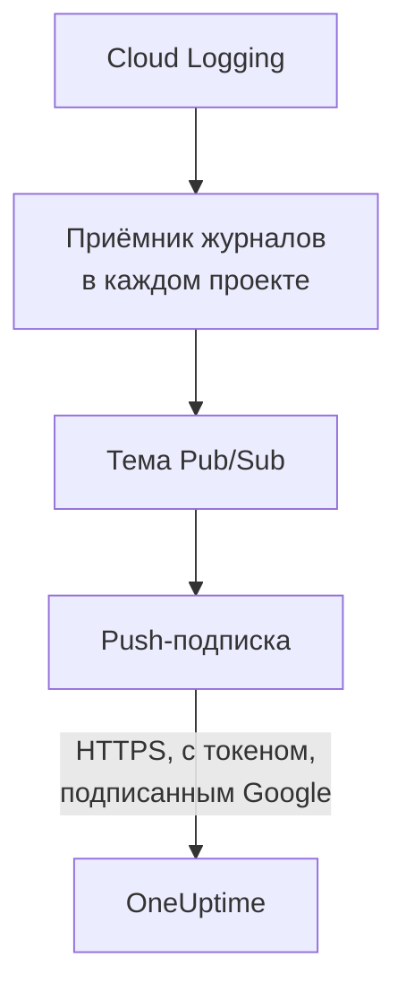

# Передача журналов Google Cloud

Подключённый проект Google Cloud может передавать свои журналы в OneUptime сразу после их записи. Cloud Logging направляет их через приёмник журналов в тему Pub/Sub, а push-подписка темы в течение минуты доставляет каждую запись в OneUptime как журнал OneUptime под тем ресурсом, к которому он относится. Одна команда в Google Cloud Shell всё настраивает, и запускать у себя ничего не нужно. В Cloud Monitoring нет экспорта, который отправлял бы метрики, поэтому подключение по-прежнему читает метрики по своему расписанию.

:::cards
- [Как это работает](#как-это-работает): Приёмник журналов в каждом проекте, тема и её push-подписка.
- [Настройка передачи](#настройка-передачи): Выберите журналы, создайте ключ потока и выполните одну команду.
- [Что приходит](#что-приходит): Журналы на ресурсах, откуда они пришли.
- [Что создаёт команда](#что-создаёт-команда): Каждый ресурс и каждое разрешение, которые команда создаёт в ваших проектах.
- [Остановка передачи](#остановка-передачи): Отключите ключи, затем удалите то, что создала команда.
:::

## Как это работает



- **Приёмник журналов в каждом проекте.** Приёмник каждого проекта направляет записи, подходящие под его фильтр, в одну тему Pub/Sub в проекте собственного сервисного аккаунта подключения.
- **Две проверки при каждой отправке.** Pub/Sub подписывает токен OpenID Connect для сервисного аккаунта, созданного только для отправок, а аудитория (audience) токена — это ключ потока подключения. OneUptime принимает отправку, только если Google подписал её токен для этого сервисного аккаунта и ключ — один из ключей подключения. Ключ называет подключение, а значит, и проект: ничто в отправке не решает, куда она записывается. OneUptime хранит только SHA-256 ключа.
- **Ничего не теряется, пока OneUptime не может принять данные.** Pub/Sub снова отправляет отклонённую запись, выжидая между попытками от 10 секунд до 10 минут, и хранит её сутки.

## Перед началом

- **Подключённый проект Google Cloud.** Сначала подключите его в разделе **Облако → Подключить**: см. [Подключение облачного аккаунта](/docs/telemetry/cloud-accounts).
- **Владелец или администратор проекта.** Только они могут создать ключ потока и остановить передачу.
- **Google Cloud Shell**, с входом как **Owner** проектов или как тот, кто может создавать в них сервисные аккаунты, темы Pub/Sub и приёмники журналов.
- **Адрес HTTPS, для OneUptime на своём сервере.** Pub/Sub отправляет данные только на адреса `https://` с сертификатом, которому доверяет Google, и адрес должен быть доступен из Google Cloud.

## Настройка передачи

:::steps
### Откройте окно передачи

Перейдите в **Облако → Подключить** и в строке проекта Google Cloud выберите **Передавать журналы**.

### Выберите журналы

**Предупреждения и ошибки** передаёт каждую запись с уровнем `WARNING` и выше: то, что пошло не так, а не каждый запрос. **Все журналы** передаёт каждую запись, кроме журналов аудита Data Access, где фиксируется каждое чтение и которые могут превзойти всё остальное, что пишет проект. **Собственный фильтр** передаёт записи, подходящие под запрос Cloud Logging, написанный в поле **Фильтр**.

### Создайте ключ потока

Выберите **Создать ключ потока**. Ключ показывается только один раз, в команде: OneUptime хранит только его SHA-256.

### Выполните команду в Google Cloud Shell

Скопируйте команду, выполните её в Google Cloud Shell и дождитесь завершения. Она сообщает каждый проект, где настроила приёмник, и останавливается на первом шаге, который отклонит Google, с причиной от Google.

### Дождитесь первой отправки

Окно каждые несколько секунд спрашивает, что пришло. Pub/Sub отправляет запись в течение минуты после того, как проект запишет запись, подходящую под фильтр; окно затем сообщает, что откуда пришло, а в строке подключения появляется **Передаётся**.
:::

**Дополнительные поля** содержат остальное:

| Поле | Что оно делает |
| --- | --- |
| **Проекты** | Проекты, журналы которых передавать: сначала те, что читает подключение. Тема создаётся в проекте сервисного аккаунта подключения. Не больше 100 |
| **Настроить по-другому** | Конечная точка отправки, сервисный аккаунт отправки и ключ, чтобы настроить всё с помощью Terraform или консоли |

## Что приходит

| Что | Куда попадает |
| --- | --- |
| Журналы | В обозреватель журналов, под службой телеметрии подключения, с проектом, регионом и именем журнала в качестве атрибутов |
| Журналы ресурса, который знает OneUptime | Также на этот ресурс: на его странице в Облаке появляется вкладка **Журналы** |

Каждый журнал сохраняет время своей записи с точностью до наносекунды, уровень, трассировку и span, а также HTTP-запрос под именами семантических соглашений OpenTelemetry. Он попадает под ресурс, если его отслеживаемый ресурс — тип, метрики которого читает OneUptime, например виртуальная машина (`gce_instance`), служба Cloud Run (`cloud_run_revision`) или экземпляр Cloud SQL (`cloudsql_database`), и несёт идентификатор ресурса как `cloud.resource_id`. Журналы запросов внешнего балансировщика нагрузки, записанные под `http_load_balancer`, попадают под его карту URL — ту `https_lb_rule`, куда попадают его метрики.

Журналы группы экземпляров — это журналы её виртуальных машин, поэтому на её странице нет вкладки **Журналы**. Запись другого типа всё равно передаётся, под своим проектом.

## Что создаёт команда

Её ресурсы названы по первым 8 символам идентификатора подключения. Она не даёт OneUptime доступа к вашим проектам: записи только уходят наружу.

| Ресурс | Что ему разрешено |
| --- | --- |
| Сервисный аккаунт `oneuptime-push-<suffix>` в проекте сервисного аккаунта подключения | Не имеет ролей: Pub/Sub подписывает для него токены своих отправок |
| Роль **Service Account OpenID Connect Identity Token Creator** для сервисного агента Pub/Sub, только на этот сервисный аккаунт | Разрешает Pub/Sub создавать эти токены, и ничего больше |
| Тема Pub/Sub `oneuptime-stream-<suffix>` | Содержит записи, которые направляют приёмники |
| Её push-подписка `oneuptime-stream-<suffix>-push` | Отправляет каждую запись в OneUptime со сроком подтверждения 60 секунд и хранит сутки то, что не смогла отправить |
| Приёмник журналов в каждом проекте, `oneuptime-stream-<suffix>` | Направляет в тему записи, подходящие под его фильтр |
| Роль **Pub/Sub Publisher** для автора каждого приёмника, только на тему | Разрешает приёмнику публиковать в тему, и ничего больше |

Команда включает API Pub/Sub и Cloud Logging в проекте темы, если они выключены. Google выставляет счёт за Pub/Sub по доставленным журналам: передавайте только нужные журналы.

## Остановка передачи

:::steps
### Отключите ключи

В строке проекта в разделе **Облако → Подключить** выберите **Остановить передачу**. Все ключи потока подключения сразу перестают работать, и OneUptime отклоняет то, что отправляет Pub/Sub. Доставленное сохраняется.

### Удалите то, что создала команда

Приёмники, тема и её push-подписка остаются в Google Cloud, и Pub/Sub продолжает отправлять, пока они не удалены. Окно показывает команду для проектов, которые читает подключение:

```bash
for SOURCE in 'acme-prod' 'acme-data'; do
  gcloud logging sinks delete oneuptime-stream-6f1c3a2e --project "$SOURCE" --quiet
done
gcloud pubsub subscriptions delete oneuptime-stream-6f1c3a2e-push --project 'acme-prod' --quiet
gcloud pubsub topics delete oneuptime-stream-6f1c3a2e --project 'acme-prod' --quiet
gcloud iam service-accounts delete 'oneuptime-push-6f1c3a2e@acme-prod.iam.gserviceaccount.com' --project 'acme-prod' --quiet
```
:::

Чтобы изменить, какие журналы передаются, снова откройте **Передавать журналы**, выберите **Создать новый ключ** и выполните новую команду. Ключ, который она заменяет, работает ещё 24 часа, поэтому ни одна отправка не отклоняется, пока подписка обновляется. Одновременно работают не больше 3 заменённых ключей.

## Настроить по-другому

Создайте для темы Pub/Sub push-подписку с этими значениями и разрешите сервисному агенту Pub/Sub создавать токены для сервисного аккаунта отправки:

| Параметр | Значение |
| --- | --- |
| Конечная точка отправки | `https://oneuptime.com/telemetry/gcp-pubsub/v1/logs` |
| Аутентификация | Токен OpenID Connect для `oneuptime-push-<suffix>@<project>.iam.gserviceaccount.com` |
| Аудитория (audience) | Ключ потока |
| Полезная нагрузка | В обёртке, как её отправляет Pub/Sub, если не указано иное |
| Срок подтверждения | 60 секунд |
| Хранение сообщений | 1 день |

Затем направьте журналы каждого проекта в тему приёмником журналов и дайте автору каждого приёмника роль **Pub/Sub Publisher** на тему. Для OneUptime на своём сервере замените `https://oneuptime.com` адресом HTTPS вашего OneUptime.

OneUptime отвечает на каждую отправку так, как ожидает Pub/Sub:

| Ответ | Когда | Что делает Pub/Sub |
| --- | --- | --- |
| `204` | Запись принята, или была принята раньше, или сообщение — не запись журнала | Идёт дальше |
| `400` | Это не отправка Pub/Sub, которую OneUptime может прочитать | Отправляет снова, каждый раз выжидая дольше, в течение суток |
| `401` | Токен подписан Google не для сервисного аккаунта отправки, или его аудитория — не ключ подключения | Отправляет снова, каждый раз выжидая дольше, в течение суток |
| `402` | За телеметрию проекта нельзя выставить счёт | Отправляет снова, каждый раз выжидая дольше, в течение суток |
| `403` | Подключение выключено, или проект не может принимать телеметрию | Отправляет снова, каждый раз выжидая дольше, в течение суток |
| `413` | Запрос больше 1 МиБ, или его запись больше 512 КиБ | Отправляет снова, каждый раз выжидая дольше, в течение суток |
| `429` | Подписка подключения отправила больше 12 000 записей за минуту | Отправляет снова, каждый раз выжидая дольше, в течение суток |
| `503` | OneUptime не смог в тот момент проверить токен или поставить запись в очередь | Отправляет снова, каждый раз выжидая дольше, в течение суток |

## Устранение неполадок

:::details Окно всё ещё ждёт первой отправки
Проверьте, что команда завершилась без остановки и что проект записал запись, подходящую под фильтр: с вариантом **Предупреждения и ошибки** спокойный проект ничего не отправляет. `gcloud pubsub subscriptions describe oneuptime-stream-6f1c3a2e-push --project acme-prod` показывает конечную точку подписки. Для OneUptime на своём сервере проверьте, что Google Cloud достигает его адреса по HTTPS.
:::

:::details Подключение показывает Поток отклонён
Окно и подсказка строки сообщают причину. Неверный ключ значит, что подписка отправляет данные с ключом, который больше не работает: создайте новый ключ и выполните команду снова. Отправка, не подписанная для сервисного аккаунта отправки, значит, что подписка подписывает от имени другого аккаунта или Pub/Sub не разрешено подписывать от его имени: выполните команду снова.
:::

:::details Журналы ресурса не видны на его странице
Страница показывает журналы, которые Cloud Logging помещает под отслеживаемый ресурс этого ресурса, с теми метками, что есть у его метрик. Журналы, которые рабочая нагрузка пишет под другой ресурс, например журналы контейнера, передаются только под своим проектом.
:::

## Дальнейшие шаги

:::cards
- [Подключение облачного аккаунта](/docs/telemetry/cloud-accounts): Что читает подключение и как часто.
- [Передача метрик и журналов Azure Monitor](/docs/telemetry/cloud-streaming-azure): Данные подписки Azure, прочитанные из концентраторов событий.
- [Передача метрик и журналов CloudWatch](/docs/telemetry/cloud-streaming): Данные аккаунта AWS, доставляемые Amazon Data Firehose.
- [Обозреватель журналов](/docs/telemetry/logs-explorer): Ищите и фильтруйте то, что доставили потоки.
:::
