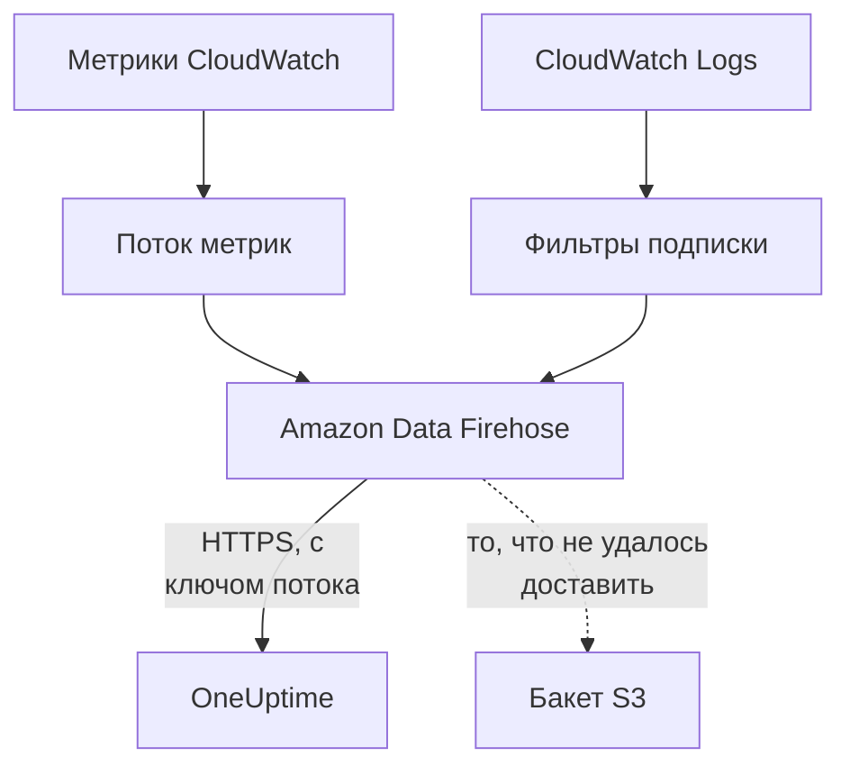

# Передача метрик и журналов CloudWatch

Подключённый аккаунт AWS может передавать свои метрики и журналы CloudWatch в OneUptime потоком через Amazon Data Firehose. Тогда метрики приходят через несколько минут после того, как они появились в CloudWatch, а не при следующем чтении подключения, а CloudWatch Logs приходит в виде журналов OneUptime, каждый из которых привязан к ресурсу, о котором он. Всё настраивает одна команда в AWS CloudShell, и запускать ничего не нужно.

:::cards
- [Как это работает](#как-это-работает): Поток метрик и подписки на журналы в каждом регионе, доставляемые через Firehose.
- [Настройка передачи](#настройка-передачи): Выберите, что передавать, создайте ключ потока и выполните одну команду.
- [Что приходит](#что-приходит): Метрики на ресурсах, которые они измеряют, и журналы на ресурсах, от которых они приходят.
- [Что создаёт стек](#что-создаёт-стек): Каждый ресурс и каждое разрешение, которые команда создаёт в вашем аккаунте.
- [Остановка передачи](#остановка-передачи): Отключите ключи, затем удалите стеки.
:::

## Как это работает



- **Один стек в каждом регионе.** Команда разворачивает стек CloudFormation в каждом регионе, из которого вы передаёте данные. Его поток метрик и фильтры подписки на журналы передают всё в два потока Firehose, а Firehose доставляет это в OneUptime по HTTPS.
- **Ключ потока говорит, чьё это.** Firehose отправляет ключ потока подключения с каждой доставкой. Ключ называет подключение, а значит, и проект: ничто в доставке не решает, куда она будет записана. OneUptime хранит только SHA-256 ключа.
- **Чтения оставляют переданные потоком метрики потоку.** Пока поток доставляет пространство имён региона, чтения подключения перестают записывать метрики этого пространства имён, поэтому ни одна точка данных не учитывается дважды. Чтения продолжают находить ресурсы, их состояние и изменения и снова берут пространство имён на себя после 15 минут без доставок.
- **Ничего не теряется, пока OneUptime не может это принять.** Firehose повторно отправляет отклонённый пакет в течение часа, а затем хранит его 30 дней в бакете S3 стека.

## Перед началом

- **Подключённый аккаунт AWS.** Сначала подключите его в разделе **Облако → Подключить**: см. [Подключение облачного аккаунта](/docs/telemetry/cloud-accounts).
- **Владелец или администратор проекта.** Только они могут создать ключ потока и остановить передачу.
- **AWS CloudShell в этом аккаунте**, с входом от имени пользователя, которому разрешено создавать стеки CloudFormation и роли IAM.
- **Адрес HTTPS, для OneUptime на собственном сервере.** Firehose доставляет данные только на адреса `https://` через порт 443, с сертификатом, которому доверяет AWS, и адрес должен быть доступен из AWS.

## Настройка передачи

:::steps
### Откройте окно передачи

Перейдите в **Облако → Подключить** и в строке аккаунта AWS выберите **Передавать метрики и журналы**.

### Выберите, что передавать

**Метрики** передаёт каждую ключевую метрику каждого ресурса раз в минуту: метрики, которые OneUptime показывает на графиках и по которым оценивает каждый ресурс. **Метрики и журналы** добавляет CloudWatch Logs, а **Журналы** передаёт только CloudWatch Logs.

Для журналов укажите **Группы журналов** по одной на строку, по имени в поле **Регион** рядом или по ARN в их собственном регионе, либо выберите **Все группы журналов аккаунта, включая новые**. Одна команда подписывает не более 50 групп журналов по имени, не более чем в 10 регионах.

### Создайте ключ потока

Выберите **Создать ключ потока**. Ключ показывается только в этот раз, в команде: OneUptime хранит только его SHA-256.

### Выполните команду в AWS CloudShell

Скопируйте команду, выполните её в AWS CloudShell и дождитесь завершения. Она записывает шаблон в `oneuptime-stream.json` и разворачивает его в каждом регионе, передавая ключ как параметр, который больше никогда не показывается.

### Дождитесь первой доставки

Окно каждые несколько секунд спрашивает, что пришло. Firehose доставляет данные в течение нескольких минут после завершения команды; тогда окно говорит, что и откуда пришло, а строка подключения показывает **Передаётся**.
:::

В **Дополнительные поля** находится остальное:

| Поле | Что оно делает |
| --- | --- |
| **Все метрики, а не только ключевые** | Передаёт все метрики, которые есть у CloudWatch для аккаунта, включая ваши собственные. AWS берёт плату за каждое обновление метрики, которое отправляет поток, поэтому это может стоить во много раз больше |
| **Регионы** | Откуда передавать: сначала это регионы, в которых подключение нашло ресурсы. Если оставить поле пустым, команда передаёт данные из региона самого AWS CloudShell. Не более 30 |
| **Настроить по-другому** | Конечные точки метрик и журналов и ключ, чтобы настроить потоки через Terraform или консоль |

**Скачать шаблон** сохраняет шаблон, который разворачивает команда, чтобы развернуть его по-своему.

## Что приходит

| Что | Куда попадает |
| --- | --- |
| Метрики | На облачные ресурсы, которые они измеряют, с теми именами и атрибутами, которые им дают чтения подключения |
| Журналы | В обозреватель журналов, под службой телеметрии подключения, с аккаунтом, регионом и группой журналов в атрибутах |
| Журналы группы журналов, которую AWS называет по ресурсу | Также на этот ресурс: его страница в Облаке получает вкладку **Журналы** |

Группа журналов привязывается к ресурсу, когда AWS назвал её по ресурсу:

| Группа журналов | Тип ресурса |
| --- | --- |
| `/aws/lambda/<function>` | `AWS::Lambda::Function` |
| `/aws/rds/instance/<instance>/<log>` | `AWS::RDS::DBInstance` |
| `/aws/rds/cluster/<cluster>/<log>` | `AWS::RDS::DBCluster` |
| `/aws/docdb/<cluster>/<log>` | `AWS::DocDB::DBCluster` |
| `/aws/neptune/<cluster>/<log>` | `AWS::Neptune::DBCluster` |
| `/aws/redshift/cluster/<cluster>/<log>` | `AWS::Redshift::Cluster` |
| `/aws/OpenSearchService/domains/<domain>/<log>` | `AWS::OpenSearchService::Domain` |
| `/aws/aes/domains/<domain>/<log>` | `AWS::OpenSearchService::Domain` |
| `/aws/apprunner/<service>/<service-id>/<log>` | `AWS::AppRunner::Service` |
| `/aws/elasticbeanstalk/<environment>/<log>` | `AWS::ElasticBeanstalk::Environment` |
| `/aws/ecs/containerinsights/<cluster>/performance` | `AWS::ECS::Cluster` |

Каждый журнал несёт ID ресурса в `cloud.resource_id`, а журналы функции Lambda несут ещё и `faas.name`, поэтому они появляются и на функции в разделе Serverless. Группа журналов с любым другим именем всё равно передаётся, под своим аккаунтом и регионом. Важность журнала — та, что указана в его сообщении, так, как её пишет Lambda.

## Что создаёт стек

Стек называется `OneUptimeStream-` с первыми 8 символами ID подключения. Он не даёт OneUptime никакого доступа к вашему аккаунту: данные только уходят наружу.

| Ресурс | Что ему разрешено |
| --- | --- |
| Поток метрик CloudWatch в формате OpenTelemetry 1.0 | Записывать записи только в поток Firehose для метрик |
| Фильтры подписки на журналы или одна политика подписки на весь аккаунт для каждой группы журналов | Записывать записи только в поток Firehose для журналов |
| Два потока Firehose, `OneUptime-<suffix>-metrics` и `OneUptime-<suffix>-logs` | Доставлять в OneUptime с GZIP, буфером 1 МиБ или 60 секунд и часом повторных попыток и записывать в бакет то, что не удалось доставить |
| Бакет S3 для того, что не удалось доставить | Публичный доступ заблокирован, шифруется, очищается через 30 дней и сохраняется при удалении стека |
| Группа журналов `/aws/kinesisfirehose/OneUptime-<suffix>` | Хранит ошибки доставки самого Firehose и никогда не передаётся |
| Три роли IAM | Каждая доверяет одной службе AWS этого аккаунта и разрешает только то, что сказано в строках выше |

AWS берёт плату за поток метрик за каждое отправленное обновление метрики, а за Firehose — за то, что он доставляет. Передавайте только нужные метрики и группы журналов.

## Остановка передачи

:::steps
### Отключите ключи

В строке аккаунта в разделе **Облако → Подключить** выберите **Остановить передачу**. Все ключи потока подключения сразу перестают работать, OneUptime отклоняет то, что доставляют потоки, а подключение снова читает все метрики по своему расписанию. То, что потоки уже доставили, сохраняется.

### Удалите стеки

Потоки остаются в AWS, и AWS берёт за них плату, пока их стеки не удалены. Окно показывает команду для регионов, из которых потоки доставляли данные, и регионов, в которых подключение нашло ресурсы:

```bash
for REGION in us-east-1 eu-west-1; do
  aws cloudformation delete-stack --region "$REGION" --stack-name OneUptimeStream-6f1c3a2e
done
```
:::

Чтобы изменить то, что передаёт стек, снова откройте **Передавать метрики и журналы**, выберите **Создать новый ключ** и выполните новую команду. Ключ, который он заменяет, работает ещё 24 часа, поэтому ни одна доставка не отклоняется, пока стеки обновляются. Одновременно работают не более 3 заменённых ключей.

## Настроить по-другому

Задайте каждому потоку Firehose назначение HTTP endpoint с этими значениями, а потоку метрик — формат вывода OpenTelemetry 1.0:

| Параметр | Значение |
| --- | --- |
| Конечная точка метрик | `https://oneuptime.com/telemetry/aws-firehose/v1/metrics` |
| Конечная точка журналов | `https://oneuptime.com/telemetry/aws-firehose/v1/logs` |
| Ключ доступа | Ключ потока, отправляемый как `X-Amz-Firehose-Access-Key` |
| Кодирование содержимого | `GZIP` |
| Буфер | 1 МиБ или 60 секунд |
| Длительность повторных попыток | 3600 секунд, с бакетом S3 для того, что не удалось доставить |

Для OneUptime на собственном сервере замените `https://oneuptime.com` на HTTPS-адрес вашего OneUptime. Конечная точка метрик также принимает поток метрик в формате JSON.

OneUptime отвечает на каждую доставку так, как этого ждёт Firehose:

| Ответ | Когда | Что делает Firehose |
| --- | --- | --- |
| `200` | Доставка принята или уже была принята раньше | Продолжает |
| `400` | Это не доставка Firehose, которую OneUptime может прочитать, например доставка более чем из 10 000 записей | Отправляет её снова в течение часа |
| `401` | Ключ не является ни одним из ключей подключения | Отправляет её снова в течение часа |
| `402` | Проекту нельзя выставить счёт за телеметрию | Отправляет её снова в течение часа |
| `403` | Подключение выключено, или проект не может принимать телеметрию | Отправляет её снова в течение часа |
| `413` | Запрос больше 4 МиБ или после распаковки больше 32 МиБ | Сохраняет её в бакете |
| `429` | Потоки подключения отправили больше 600 доставок за минуту | Отправляет её снова позже |

## Устранение неполадок

:::details Окно всё ещё ждёт первой доставки
Проверьте, что команда завершилась в каждом регионе без ошибок: `aws cloudformation describe-stacks --stack-name OneUptimeStream-6f1c3a2e` показывает состояние стека. Поток метрик доставляет только метрики, которые есть у CloudWatch, поэтому регион без ресурсов ничего не отправляет. Для OneUptime на собственном сервере проверьте, что AWS достигает его адреса по HTTPS через порт 443.
:::

:::details Подключение показывает Поток отклонён
Окно и подсказка строки говорят почему. Неверный ключ означает, что стеки работают с ключом, который больше не действует: создайте новый ключ и снова выполните команду. Firehose продолжает отправлять то, что удерживает, и это будет принято, как только ключ станет верным.
:::

:::details Журналы функции Lambda не показываются на её странице
Страница показывает журналы группы журналов, названной по функции, `/aws/lambda/<function>`. Функция, которая пишет в группу журналов с другим именем, передаёт свои журналы только под своим аккаунтом и регионом.
:::

## Дальнейшие шаги

:::cards
- [Подключение облачного аккаунта](/docs/telemetry/cloud-accounts): Что читает подключение и как часто.
- [Облачные ресурсы (IaaS и PaaS)](/docs/telemetry/cloud-resources): Каждый тип ресурса, который распознаёт OneUptime.
- [Обозреватель журналов](/docs/telemetry/logs-explorer): Ищите и фильтруйте то, что доставили потоки.
:::
