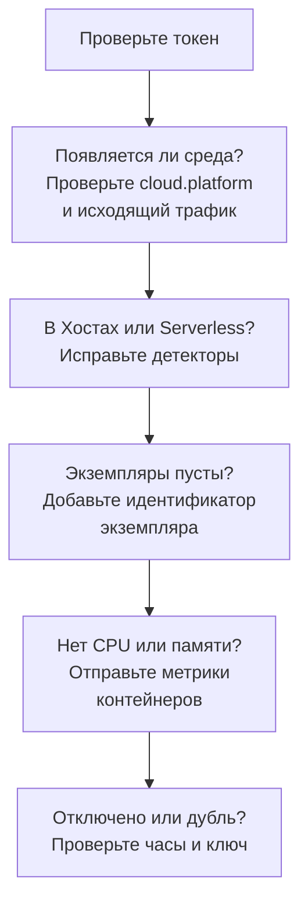

# Устранение неполадок в облаке

Выясните, почему облачная среда отсутствует, учтена не там, пуста или раздвоилась. Разделы идут в том порядке, в каком что-то ломается, и каждый исключает один уровень, поэтому двигайтесь сверху вниз. Сбои, относящиеся к одной платформе, описаны в конце её страницы: [AWS ECS / Fargate](/docs/telemetry/cloud-aws-ecs), [Google Cloud Run](/docs/telemetry/cloud-gcp-cloud-run), [Azure Container Apps](/docs/telemetry/cloud-azure-container-apps) и [Другие облачные платформы](/docs/telemetry/cloud-other-platforms).



## Сначала проверьте токен

Это самая дешёвая проверка, и без неё ничего ниже не заработает:

```bash
curl -i https://oneuptime.com/otlp/v1/validate \
  -H "x-oneuptime-token: YOUR_TELEMETRY_INGESTION_TOKEN"
```

| Ответ | Что это значит |
| ------------------------- | -------------------------------------------------------------------------------------------------------------------------- |
| `200`, `"valid": true` | Токен принят. Его `keyType` должен быть `Server`: ключ типа `Browser` отклоняется, если данные идут от коллектора или серверного сервиса. |
| `401`, `"valid": false` | Токен отсутствует, неизвестен, отозван, отключён или истёк, а `message` в ответе указывает, что именно. Создайте новый ключ в разделе **Настройки проекта → Телеметрия и APM → Ключи приема** и разверните его заново. |

Если вы размещаете OneUptime самостоятельно, используйте `https://YOUR-ONEUPTIME-HOST/otlp/v1/validate`. По возможности выполняйте проверку изнутри задачи, экземпляра или реплики (ECS Exec, `az containerapp exec`): так вы убедитесь, что до OneUptime достаёт сама рабочая нагрузка, а не только ваш ноутбук.

## Среда не появляется

Через минуту после первого запроса в разделе **Облако → All Environments** ничего нет. Проверьте эти три пункта по порядку.

**`cloud.platform` отсутствует или не является управляемым значением.** OneUptime относит телеметрию к облачным средам, только если ресурс несёт одно из этих значений: `aws_ecs`, `aws_elastic_beanstalk`, `aws_app_runner`, `gcp_cloud_run`, `gcp_app_engine`, `azure_container_apps`, `azure_container_instances` или `azure_app_service`. Обычные причины:

- Детектор ресурсов выключен в SDK (`OTEL_NODE_RESOURCE_DETECTORS`, `OTEL_EXPERIMENTAL_RESOURCE_DETECTORS`, `-Dotel.resource.providers.<cloud>.enabled=true`).
- Конвейер коллектора пропускает процессор `resourcedetection`.
- На платформе без детектора в `OTEL_RESOURCE_ATTRIBUTES` есть опечатка.

Детекторы Azure для Node.js и .NET пишут `azure.container_apps`, `azure.app_service` и `azure.functions`; OneUptime переписывает их в значения с подчёркиванием, так что они засчитываются. Чтобы увидеть, что несёт ваша телеметрия, откройте сервис в разделе **Службы**, откройте одну из его трассировок на вкладке **Трассировки** и посмотрите атрибуты ресурса. Если `cloud.platform` там нет, в этом вся проблема.

**Неверный токен.** Проверка токена вернула `401`. Коллектор пишет в лог `Permanent error: ... 401`. SDK пишет это один раз и прекращает повторные попытки — это правильное поведение OTLP, и его легко пропустить.

**Исходящий трафик заблокирован.** Коллектор пишет в лог `connection refused`, `context deadline exceeded`, `i/o timeout` или ошибку DNS:

- **ECS и Fargate:** частной подсети нужен NAT-шлюз или `assignPublicIp=ENABLED`, а группа безопасности должна разрешать исходящий трафик по TCP 443.
- **Cloud Run:** для **VPC egress: All traffic** нужен Cloud NAT.
- **Container Apps:** пользовательский маршрут к брандмауэру должен разрешать хост OneUptime.
- **Везде:** самостоятельно размещённый OneUptime за частным DNS-именем должен разрешаться из сети рабочей нагрузки.

## Она появляется в Хостах

Ресурс несёт платформу виртуальной машины (`aws_ec2`, `gcp_compute_engine` или `azure_vm`), поэтому OneUptime относит его к разделу **Хосты**: это правильно для виртуальной машины и неправильно для управляемых вычислений. Детектор виртуальной машины победил управляемый: `detectors: [ec2, elastic_beanstalk]` в коллекторе, где побеждает первый детектор, задавший `cloud.platform`, или SDK, порядок которого отдаёт предпочтение детектору EC2. Поставьте `elastic_beanstalk` первым или задайте `cloud.platform` сами в `OTEL_RESOURCE_ATTRIBUTES` и оставьте только детектор `env`.

## Она появляется только в Serverless-функциях

Ресурс несёт `faas.name`, но не управляемую `cloud.platform`. Cloud Run и App Engine задают и то и другое, когда работает детектор GCP. Если вы задаёте `faas.name` вручную или коллектор отбрасывает атрибуты ресурса, заданные детектором SDK, выполняется только serverless-часть. Включите детектор или сами задайте `cloud.platform=gcp_cloud_run` (или `gcp_app_engine`), `cloud.account.id` и `cloud.region`.

> [!NOTE]
> В Cloud Run и App Engine сервис и должен появляться в обоих местах: среда объединяет проект и регион, а **Serverless-функции** показывают отдельный сервис.

## Раздел Экземпляры пуст

Среда есть, но её вкладка **Экземпляры** ничего не показывает: в телеметрии нет идентификатора экземпляра. OneUptime называет экземпляр по первому из этих атрибутов ресурса, который найдёт:

1. `aws.ecs.task.id`
2. `aws.ecs.task.arn` (сокращается до ID задачи)
3. `faas.instance`
4. `azure.container_app.instance.id`
5. `service.instance.id`
6. `container.id`
7. `host.id`
8. `host.name`

Собственный идентификатор платформы идёт раньше `service.instance.id`, поэтому ID, который SDK придумывает для каждого процесса (Node.js SDK делает так по умолчанию), не может отделить задачу от CPU и памяти её sidecar. Что задаёт идентификатор на каждой платформе:

| Платформа | Что задаёт идентификатор |
| ----------------------------------------- | ------------------------------------------------------------------------------------------------------------------------------------------------ |
| ECS | Детектор `ecs` задаёт ARN задачи |
| Cloud Run, App Engine | Детектор `gcp` задаёт `faas.instance` |
| Container Apps | Детектор `azurecontainerapps` в Collector задаёт ID реплики; или задайте `service.instance.id` из `CONTAINER_APP_REPLICA_NAME`, или запустите детектор хоста |
| App Runner, Container Instances | `host.name` детектора хоста |
| App Service, Elastic Beanstalk | Детектор платформы задаёт `service.instance.id`; в Beanstalk удалите его, чтобы каждый экземпляр назывался по `host.id` |

Экземпляр появляется в течение минуты после первого сигнала с этим атрибутом.

## CPU и память пусты

Экземпляры перечислены, но плитки **CPU** и **Память** в обзоре и столбцы CPU и памяти в разделе **Экземпляры** пусты. Эти данные берутся из метрик, а не из трассировок: точек данных `container.cpu.utilization` и `container.memory.usage` (или `container.memory.usage.total`), ресурс которых несёт тот же идентификатор экземпляра, что и трассировки, и `cloud.platform`.

- **В ECS** их предоставляет приёмник `awsecscontainermetrics` в коллекторе-sidecar в виде `ecs.task.cpu.utilized` и `ecs.task.memory.utilized`. Оставьте его в конвейере `metrics` и оставьте в этом конвейере `resourcedetection`, иначе метрики придут без `cloud.platform` и будут учтены в другом месте.
- **В Cloud Run, Container Apps и на других платформах** платформа не показывает sidecar потребление ресурсов контейнеров. Плитки остаются пустыми, если вы сами не отправляете эти метрики: смотрите вместо них плитки запросов.
- **При SDK direct** метрики контейнеров никто не отправляет, поэтому пустые плитки ожидаемы.

## Среда показывает Отключено

Среда показывает **Отключено**, когда по ней 15 минут не приходила телеметрия, а следующий спан, лог или метрика возвращают её обратно. Время, когда сам OneUptime не работал или наверстывал отставание, не засчитывается. Пока телеметрия идёт, время последнего появления может отставать до пяти минут, поэтому порог и составляет 15.

- **Загруженная среда показывает Отключено:** экспортёр остановился. Поищите в логах коллектора ошибки `401` и ошибки исходящего трафика, описанные выше.
- **Тестовая среда, которая ночью масштабируется до нуля,** показывает Отключено до первого утреннего запроса, и это верно.

У экземпляров два таймера:

- **Stale:** вкладка **Экземпляры** помечает задачу, экземпляр или реплику как **Stale**, если они не передавали данные последние 15 минут, а обзор считает работающими только остальные.
- **Удаление:** очистка удаляет строки экземпляров, которых не было видно `CLOUD_INSTANCE_STALE_MINUTES` (по умолчанию 15, не меньше 10), считая от последней телеметрии самой среды, так что сбой коллектора замораживает этот таймер, а не стирает последний известный список задач. Serverless-функции используют `SERVERLESS_INSTANCE_STALE_MINUTES`. Увеличение порога дольше хранит строки, но не меняет момент, когда они становятся **Stale**.

## Две среды вместо одной

Ключ среды — `cloud.platform|cloud.account.id|cloud.region`, и сравнивается он посимвольно. Если одни рабочие нагрузки задают `cloud.account.id`, а другие нет, одна пишет `eastus`, а другая `East US`, или один коллектор запускает детектор `ecs`, а другой нет, вы получите `aws_ecs|123456789012|us-east-1` и `aws_ecs||us-east-1` рядом.

Откройте **Обзор** каждой среды: её **Ключ окружения** показывает, какая часть отличается. Исправьте рабочую нагрузку, в которой не хватает значения. Среда с пустой частью перестанет получать телеметрию, и её можно архивировать.

## Созданная вручную среда ни с чем не сопоставляется

Приём данных сопоставляет среду только по её ключу, и ключ должен быть ровно `platform|account|region`, например `aws_ecs|123456789012|us-east-1`: то же значение платформы, ID учётной записи и регион, что несёт телеметрия. Форма создания (**Создать: Облачный ресурс** в разделе **Облако → All Environments**) строит ключ из полей **Облачная платформа**, **ID облачной учётной записи** и **Облачный регион**, поэтому эти три значения должны совпадать с телеметрией символ в символ. Если они не совпадают, приём данных создаёт вторую среду с вычисленным им ключом, а ваша остаётся пустой. Архивируйте среду, созданную вручную, и позвольте приёму данных создать правильную, или создайте её заново с исправленными значениями.

## Всё ещё не работает

Прежде чем обращаться за помощью, соберите следующее:

- Атрибуты ресурса одного реального спана или записи лога рабочей нагрузки. Их выводит экспортёр `debug` коллектора, или откройте трассировку сервиса в разделе **Службы**.
- Ответ проверки `/otlp/v1/validate`, выполненной изнутри рабочей нагрузки.
- Последние 50 строк лога коллектора или диагностический лог SDK с `OTEL_LOG_LEVEL=debug`.
- **Ключ окружения** каждой среды, которая появилась.

Затем напишите на support@oneuptime.com или создайте issue на [GitHub](https://github.com/OneUptime/oneuptime).

## Что дальше

:::cards
- [Облачные среды](/docs/telemetry/cloud-environments): Как определяются среды и экземпляры.
- [AWS ECS / Fargate](/docs/telemetry/cloud-aws-ecs): Настройка ECS с полным определением задачи.
- [OpenTelemetry](/docs/telemetry/open-telemetry): Эндпоинты, ограничения и что означает каждый ответ.
:::
