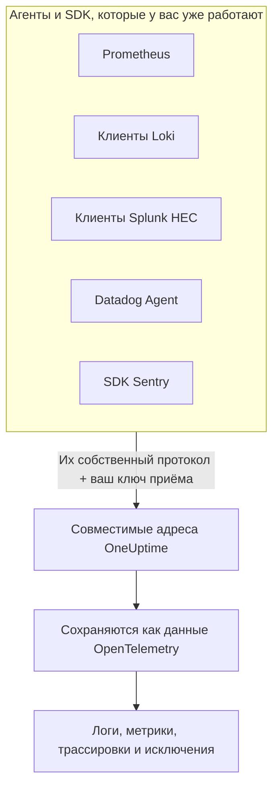

# Prometheus, Loki, Splunk, Datadog & Sentry

Уже используете Prometheus, клиент Loki, форвардер Splunk, Datadog Agent или SDK Sentry? Оставьте его. OneUptime принимает то, что отправляет каждый из этих инструментов, по тем путям, которые инструмент уже использует, и сохраняет это как данные OpenTelemetry. Чтобы попробовать OneUptime, достаточно сменить URL и ключ — заново инструментировать ничего не нужно, — а ваши фильтры отбрасывания, правила очистки, конвейеры логов, хранение данных и бюджеты приёма применяются к этим данным так же, как к любым другим.

:::cards
- [Prometheus remote write](#prometheus-remote-write): Метрики из Prometheus, Grafana Alloy или любого другого отправителя remote write.
- [Loki](#loki): Логи из Promtail, Grafana Alloy, Fluent Bit или Vector.
- [Splunk HTTP Event Collector](#splunk-http-event-collector): Логи и метрические события от любого клиента HEC.
- [Datadog Agent](#datadog-agent): Метрики и логи из Datadog Agent.
- [SDK Sentry](#sdk-sentry): Ошибки, транзакции и логи из любого SDK Sentry.
:::

## Как это работает



Каждый адрес отвечает так, как этого ждёт его инструмент, — `204` для Prometheus и Loki, `{"text": "Success", "code": 0}` для HEC, `202` для Datadog, идентификатор события для Sentry, — поэтому инструмент сообщает об успехе и ошибках так же, как всегда. Затем данные обрабатываются точно так же, как данные из SDK OpenTelemetry.

## Перед началом

- **Проект OneUptime** — в OneUptime Cloud телеметрия оплачивается за каждый принятый ГБ, а проекту на плане Free нужен способ оплаты, прежде чем он сможет отправлять телеметрию.
- **Ключ приёма телеметрии** — создайте ключ типа **Сервер** в **Продукты → Настройки проекта → Телеметрия и APM → Ключи приема** и скопируйте его **Секретный ключ**. Каждый инструмент передаёт его там же, где передаёт свои учётные данные. Для DSN Sentry в браузерном приложении вместо него нужен ключ типа **Браузер**, в котором указаны источники вашего сайта.
- **Ваш хост** — в примерах используется `oneuptime.com`. Если OneUptime установлен у вас, используйте свой хост.

> [!TIP]
> Вкладка «Руководство по настройке» в разделах Журналы, Метрики, Трассировки и Исключения перечисляет эти инструменты среди своих способов отправки, с уже подставленными вашим хостом и выбранным вами ключом.

## Адреса

| Инструмент | Куда направить | Где передаётся ключ |
| --- | --- | --- |
| Prometheus remote write | `https://oneuptime.com/telemetry/prometheus/api/v1/write` | Bearer-токен или basic auth с ключом в качестве пароля. |
| Loki | `https://oneuptime.com/telemetry/loki/api/v1/push` | Basic auth с ключом в качестве пароля или bearer-токен. |
| Splunk HTTP Event Collector | `https://oneuptime.com/telemetry/services/collector` | Токен HEC: `Authorization: Splunk <key>`. |
| Datadog Agent | `https://oneuptime.com/telemetry/datadog` | Ключ API: `DD-API-KEY`. |
| SDK Sentry | DSN `https://<key>@oneuptime.com/telemetry/sentry/1` | Публичный ключ из DSN. |

Каждый адрес также принимает ключ в заголовке `x-oneuptime-token`, а заголовок `x-oneuptime-service-name` задаёт сервис, к которому относится всё, что отправляет инструмент. Ключ можно записать как 32 шестнадцатеричные цифры без дефисов; в DSN Sentry и в ключе API Datadog его нужно записывать именно так.

## Prometheus remote write

Добавьте OneUptime как получателя remote write. Prometheus продолжает собирать метрики, как и сейчас, и отправляет копию каждого сэмпла:

```yaml title="prometheus.yml"
remote_write:
  - url: https://oneuptime.com/telemetry/prometheus/api/v1/write
    authorization:
      credentials: YOUR_TELEMETRY_KEY
```

В Grafana Alloy добавьте компонент `prometheus.remote_write` и направьте в него собранные метрики:

```text title="config.alloy"
prometheus.remote_write "oneuptime" {
  endpoint {
    url          = "https://oneuptime.com/telemetry/prometheus/api/v1/write"
    bearer_token = "YOUR_TELEMETRY_KEY"
  }
}
```

Принимаются обе версии remote write — 1.0 и 2.0 — со сжатием snappy, как их отправляет любой отправитель.

### Во что превращается временной ряд

- **Имя и метки сохраняются.** `http_requests_total{job="checkout", code="500"}` становится метрикой `http_requests_total` с атрибутами `job` и `code`, поэтому запрос, перенесённый из Grafana, её находит.
- **Задание (job) — это сервис.** Каждый `job` становится сервисом, а каждый `instance` — экземпляром этого сервиса, как их сопоставляют правила OpenTelemetry для Prometheus.
- **Типы сохраняются.** Счётчики, а также бакеты и количества наблюдений гистограмм — это накопительные суммы, поэтому их скорости на графиках считаются правильно. Тип берётся из метаданных, которые передаёт отправитель; без них имя с окончанием `_total` считается счётчиком, а `_bucket` с меткой `le` — бакетом гистограммы.
- **Нативные гистограммы** становятся экспоненциальными гистограммами, а нативные гистограммы с пользовательскими бакетами — обычными гистограммами.
- **Не сохраняются:** маркеры устаревания и другие сэмплы со значениями NaN или бесконечностью, ряды `_created` у счётчиков, а также exemplars.

## Loki

OneUptime принимает push API Loki по собственному пути Loki — в JSON или в виде сжатого snappy protobuf, который отправляют Promtail и Grafana Alloy. Добавьте OneUptime в список клиентов:

```yaml title="promtail.yaml"
clients:
  - url: https://oneuptime.com/telemetry/loki/api/v1/push
    bearer_token: YOUR_TELEMETRY_KEY
```

Выход `loki` в Fluent Bit принимает хост и путь по отдельности:

```text title="fluent-bit.conf"
[OUTPUT]
    Name         loki
    Match        *
    Host         oneuptime.com
    Port         443
    Tls          On
    Uri          /telemetry/loki/api/v1/push
    Http_User    oneuptime
    Http_Passwd  YOUR_TELEMETRY_KEY
    Labels       job=fluent-bit
```

### Во что превращается поток

- **Каждая запись становится логом** с собственной отметкой времени с точностью до наносекунды и своей строкой в качестве тела.
- **Метки и структурированные метаданные становятся атрибутами** с теми же именами, что и в Loki.
- **Сервис** берётся из первого из полей `service_name`, `service`, `app`, `application`, `name`, `app_kubernetes_io_name`, `container`, `container_name`, `component`, `workload` и `job`, которое есть у потока, — так же, как его находит Loki. Метка `host` или `hostname` задаёт хост.
- **Уровень** берётся из метки или метаданных `level`, `detected_level` или `severity`, а если их нет — из `level=` в logfmt или из поля `level` строки JSON.
- **Контекст трассировки:** `trace_id` и `span_id` в структурированных метаданных связывают лог с его трассировкой.

## Splunk HTTP Event Collector

Используйте OneUptime как HTTP Event Collector, а ключ приёма — как токен HEC. Драйвер логирования Splunk для Docker сам добавляет путь, поэтому ему нужен только хост:

```bash
docker run \
  --log-driver=splunk \
  --log-opt splunk-url=https://oneuptime.com \
  --log-opt splunk-token=YOUR_TELEMETRY_KEY \
  --log-opt splunk-format=json \
  your-image
```

Любой другой клиент HEC отправляет данные на `/services/collector/event` или `/services/collector/raw`. Чтобы отправить одно событие:

```bash
curl https://oneuptime.com/telemetry/services/collector/event \
  -H "Authorization: Splunk YOUR_TELEMETRY_KEY" \
  -d '{"event": "Payment failed for order 42", "sourcetype": "app", "fields": {"service": "checkout"}}'
```

Ответ `200` с `{"text": "Success", "code": 0}` означает, что событие принято. Адрес отвечает и собственными кодами HEC — `No data` (5), `Invalid data format` (6) с номером события, которое оказалось некорректным, и `Event field is required` (12), — а на `GET /services/collector/health` отвечает без токена.

### Во что превращается событие

- **В лог**, отметкой времени которого становится `time` события. Событие-строка становится телом; у события-объекта телом становится `message`, `msg`, `log`, `line` или `text`, а остальные его поля — атрибутами.
- **Метаданные сохраняются:** `host` становится хостом, а `source`, `sourcetype` и `index` сохраняются как `com.splunk.source`, `com.splunk.sourcetype` и `com.splunk.index`. Параметры `host`, `source`, `sourcetype` и `index` в строке запроса дополняют то, чего нет в событии.
- **Поля становятся атрибутами.** Поле `service.name` задаёт сервис, как и поле `service` у лога.
- **Метрические события** (`"event": "metric"` с `metric_name` и `_value` или с полями `metric_name:<name>`) сохраняются как метрики и никогда — как логи.
- **Не поддерживается:** подтверждение индексации (indexer acknowledgement). Клиент, который его запрашивает, не получает `ackId`.

## Datadog Agent

Направьте метрики и логи агента в OneUptime, указав ключ приёма в качестве его ключа API:

```yaml title="datadog.yaml"
api_key: YOUR_TELEMETRY_KEY_WITHOUT_HYPHENS
dd_url: https://oneuptime.com/telemetry/datadog
logs_enabled: true
logs_config:
  use_http: true
  logs_dd_url: oneuptime.com:443
apm_config:
  enabled: false
process_config:
  process_collection:
    enabled: false
```

Агент добавляет к `dd_url` свои пути, а логи отправляет на `/api/v2/logs` на хост и порт, указанные в `logs_dd_url`. В корне OneUptime отвечает на эти пути только на запросы с заголовком `DD-API-KEY`. После изменения перезапустите агент; когда OneUptime принимает ключ, `datadog-agent status` показывает ключ API как действительный.

### Во что превращаются данные агента

- **Метрики** сохраняют свои имена. Gauge остаются gauge, count становятся суммами, а rate — gauge со значением в секунду.
- **Распределения** становятся сводками (summary) с количеством, суммой, минимумом и максимумом.
- **Проверки сервисов** становятся метрикой с именем проверки, значение которой — статус проверки: 0 OK, 1 предупреждение, 2 критично, 3 неизвестно.
- **Логи** сохраняют сообщение, статус, хост и сервис, а остальные их поля становятся атрибутами.
- **Теги становятся атрибутами**, а теги `service`, `env` и `version` задают сервис, его окружение и его версию.
- **Пока не читаются:** трассировки APM, процессы, контейнеры, сетевые данные и профили. Оставьте их выключенными в `datadog.yaml`, как показано выше.

Клиенты HTTP API Datadog — библиотека логирования, отправляющая данные на `/api/v2/logs`, скрипт, отправляющий ряды, — могут отправлять данные на тот же адрес с заголовком `DD-API-KEY`.

## SDK Sentry

Замените DSN там, где вы настраиваете Sentry. Остальной код Sentry остаётся как есть:

```javascript
Sentry.init({
  dsn: "https://YOUR_TELEMETRY_KEY_WITHOUT_HYPHENS@oneuptime.com/telemetry/sentry/1",
  release: "checkout@1.4.2",
  environment: "production",
});
```

```python
sentry_sdk.init(
    dsn="https://YOUR_TELEMETRY_KEY_WITHOUT_HYPHENS@oneuptime.com/telemetry/sentry/1",
    release="checkout@1.4.2",
    environment="production",
)
```

Цифра `1` в конце DSN обязательна для SDK Sentry и не читается. DSN браузерного приложения публичен, поэтому используйте там ключ приёма типа **Браузер**, в котором указаны источники вашего сайта.

### Во что превращается конверт

- **Ошибки** появляются в разделе Исключения вместе с трассировками стека и исключениями, которые их вызвали, и группируются, как любое другое исключение. Каждая ошибка — это спан в своей трассировке, под спаном, который был активен.
- **Транзакции** и их спаны появляются в разделе Трассировки.
- **Логи Sentry** и сообщения, записанные через `capture_message`, появляются в разделе Журналы.
- **Сервис** — это тег `service`, а если его нет, имя релиза до `@`: `checkout@1.4.2` — это `checkout`. Релиз становится версией сервиса, а окружение сохраняется.
- **Не сохраняются:** сеансы, записи сеансов, вложения, профили и чек-ины. SDK по-прежнему их отправляет; OneUptime принимает и отбрасывает их.

## Ограничения и бюджеты приёма

- **Размер запроса** — входной шлюз OneUptime принимает под `/telemetry` запросы до 4 МБ, а тело каждого запроса после распаковки может занимать не более 64 МБ.
- **Бюджеты приёма** — Prometheus remote write и Loki проверяются по бюджету метрик или логов ещё до чтения тела запроса и отклоняются с `403`, когда бюджет исчерпан. Пакет HEC, полезная нагрузка Datadog или конверт Sentry могут нести несколько сигналов, поэтому каждый сигнал учитывается в своём бюджете при сохранении и отбрасывается, когда этот бюджет исчерпан.

## Устранение неполадок

### Каждый запрос отклоняется с кодом 401

Ключ пришёл не туда, где адрес его ищет, или это ключ не из этого проекта. Сверьте настройку учётных данных инструмента с таблицей [Адреса](#адреса) и проверьте, что ключ не отключён и не истёк.

### SDK Sentry сообщает, что DSN недействителен

SDK Sentry отклоняют DSN, в ключе которого есть дефисы. Запишите ключ как 32 шестнадцатеричные цифры, без дефисов.

### Метрики Datadog приходят, а логи нет

Проверьте, что `logs_config.use_http` равно `true`, а `logs_config.logs_dd_url` — это хост и порт, а не URL. Если `use_http` не задан, агент отправляет логи по TCP.

### Prometheus сообщает 415

Отправитель запросил протокол remote write, который OneUptime не читает. Отправляйте remote write 1.0 или 2.0.
