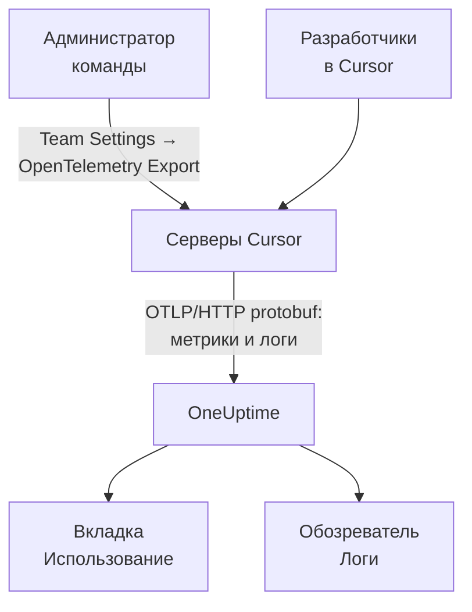

# Cursor

Cursor экспортирует телеметрию своей команды с собственных серверов Cursor. Администратор команды один раз добавляет OneUptime как получателя в панели Cursor, и приходят токены, оценочная стоимость и вызовы инструментов всей команды: на машинах разработчиков ничего не нужно ставить или настраивать.

:::cards
- [Настройка](#настройка): Создайте ключ в OneUptime и получателя в Cursor.
- [Что вы получаете](#что-вы-получаете-а-что-нет): Метрики и логи; без трассировок.
- [Кто сколько потратил](#привязка-к-сотрудникам): Люди приходят как идентификаторы пользователей Cursor.
- [Устранение неполадок](#устранение-неполадок): Что проверить, если ничего не приходит.
:::

## Как это работает



## Перед началом

- **Тариф Enterprise в Cursor.** Экрана OpenTelemetry Export на других тарифах нет.
- **Адрес, до которого Cursor может достучаться из интернета.** Подключается сам Cursor, с фиксированного набора адресов. OneUptime Cloud больше ничего не нужно; самостоятельно размещённому OneUptime за файрволом нужно разрешить исходящие адреса, которые Cursor перечисляет на своей странице [OpenTelemetry Export](https://cursor.com/docs/enterprise/opentelemetry-export).

## Настройка

:::steps
### Создайте ключ приёма

В OneUptime откройте **Настройки проекта → Телеметрия и APM → Ключи приема**, нажмите **Создать ключ приёма** и скопируйте ключ. Ваш базовый URL OTLP — `https://oneuptime.com/otlp` или `https://YOUR-ONEUPTIME-HOST/otlp`, если вы размещаете OneUptime у себя.

### Создайте получателя в Cursor

В веб-панели Cursor от имени администратора команды откройте **Team Settings → OpenTelemetry Export** и создайте получателя:

| Поле | Значение |
| --- | --- |
| Endpoint (base URL) | `https://oneuptime.com/otlp` |
| Header name | `x-oneuptime-token` |
| Header value | `YOUR_INGESTION_TOKEN` |

Указывайте базовый URL без `/v1`: Cursor сам добавляет `/v1/metrics` и `/v1/logs`, а `https://oneuptime.com/otlp/v1` отправлял бы данные на `/otlp/v1/v1/metrics`, где ничего не принимается.

### Проверьте и включите

Нажмите **Test connection**, чтобы проверить URL и заголовок, затем **Enable**. Экспорт начинается примерно через минуту; последующие изменения заголовка применяются примерно за 30 секунд.

### Проверьте, что данные приходят

Поработайте в Cursor минуту-другую, затем откройте **Логи** в OneUptime и отфильтруйте по имени сервиса `cursor`: записи `cursor.api.request` с числом токенов означают, что ключ и URL верны.
:::

Cursor говорит на OTLP по HTTP только в двоичном protobuf (без gRPC и без JSON), который OneUptime принимает как есть. Он хранит заголовок в зашифрованном виде и отправляет данные одному получателю на команду: чтобы отправлять и в OneUptime, и куда-то ещё, поставьте перед ними коллектор.

## Что вы получаете, а что нет

| Сигнал | От Cursor |
| --- | --- |
| Метрики: токены, оценочная стоимость, вызовы инструментов | Да, как дельты |
| События логов: запросы, ошибки, корректировки, навыки, хуки, плагины, облачные агенты | Да |
| Текст промптов и ответов | Только если включить семейство `conversation_content` |
| Трассировки | Нет |
| Что-либо до включения получателя | Нет |

Поэтому в OneUptime Cursor появляется на вкладке **Использование** в **Продукты → AI / LLM** по данным `cursor.token.usage` и `cursor.cost.usage`, но никогда в **Вызовы** или **Разговоры**, которые строятся из трассировок. Детализация по запросам — событие `cursor.api.request` в обозревателе **Логи**.

### Семейства

У каждого сигнала и каждого семейства телеметрии есть свой переключатель в настройках Cursor:

| Семейство | Что охватывает |
| --- | --- |
| `model_usage` | `cursor.token.usage`, `cursor.cost.usage` и события `cursor.api.request`, `cursor.api.error` и `cursor.api.correction` |
| `tool_calls` | `cursor.tool.calls` |
| `skills_hooks_plugins` | События навыков, хуков и плагинов |
| `cloud_agents` | События `cursor.cloud_agent.*` |
| `grok_bot_agent_actions` | События `cursor.grok_bot.*`; требует Action Recording |
| `conversation_content` | Текст сообщений, а также ввод и вывод инструментов MCP; по умолчанию выключено |

Все семейства, кроме `conversation_content`, изначально включены. Семейства, которые Cursor добавит позже, тоже включаются сразу, если вы не отключите `auto_enable_new_families`.

## Метрики и события

Все три метрики — дельта-суммы:

| Метрика | Единица | Атрибуты |
| --- | --- | --- |
| `cursor.token.usage` | `{token}` | `cursor.token.type`: `input`, `output`, `cache_read`, `cache_creation`; `cursor.model.name`; `cursor.api.status`: `success`, `errored`, `aborted`; `cursor.api.billable` |
| `cursor.cost.usage` | `USD` | `cursor.model.name` |
| `cursor.tool.calls` | `{call}` | `cursor.tool.kind`: `builtin`, `mcp`; `cursor.tool.name`; `cursor.tool.status`: `success`, `failure`, `aborted`; `cursor.mcp.server.name` |

Точки данных не несут идентификатора разговора или запроса, поэтому стоимости по сессиям в метриках нет. `cursor.model.name` — запрошенная модель, а маршрутизированные варианты свёрнуты: в разбивке по моделям есть строка `Auto`, которую нельзя разделить по моделям, на которые Cursor её направил.

Событие логов, которое вам понадобится чаще всего, — `cursor.api.request`: одно на запрос, с числом входных, выходных и кэшированных токенов, моделью и признаком того, был ли запрос оплачен. `cursor.api.error` фиксирует неудачный запрос (без текста ошибки), а `cursor.api.correction` приходит позже и сообщает, что запрос в итоге не был оплачен. В [справочнике по формату](https://cursor.com/docs/enterprise/opentelemetry-export/wire) Cursor перечислены все события и атрибуты.

Каждая запись несёт следующие атрибуты ресурса:

| Атрибут | Что это |
| --- | --- |
| `service.name` | Всегда `cursor`: фильтруйте по нему обозреватели **Логи** и **Метрики** |
| `cursor.team.id` | Ваша команда, целое число; есть всегда |
| `cursor.user.id` | Человек, целое число в пределах команды; необязательный |
| `cursor.surface` | Откуда пришла активность, например `desktop`, `cli`, `cloud_agent` или `bugbot` |
| `cursor.entrypoint` | Как она началась, например `desktop`, `cli`, `web`, `api` или `github_pr` |

## Привязка к сотрудникам

**Cursor обозначает человека через `cursor.user.id` — целое число, которое только Cursor может превратить в имя, и часто опускает его для облачных агентов.** OneUptime читает его как сотрудника, а `cursor.team.id` — как команду, поэтому вкладка **Использование** ранжирует людей и команды без настройки, но люди отображаются как целые числа.

- Оба приходят как атрибуты ресурса (`resource.cursor.user.id`, `resource.cursor.team.id`), которые OneUptime читает.
- Cursor может отправлять и `cursor.user.email`, но OneUptime его пока не читает, поэтому колонка email сотрудника для Cursor остаётся пустой.
- `gen_ai.user`, `llm.user` и идентификаторы конечных пользователей LiteLLM никогда не читаются как сотрудник: они обозначают ваших клиентов, а не ваших сотрудников. См. [Привязка к сотрудникам и командам](/docs/telemetry/ai-coding-assistants#привязка-к-сотрудникам-и-командам).

### Где Cursor отображается на вкладке Использование

Cursor отправляет метрики и не отправляет спанов GenAI, а метрики лишь дополняют спаны: **если тот же проект получает спаны GenAI со стоимостью, расходы Cursor не отображаются.** Отправляйте Cursor в отдельный проект. См. [Сначала спаны, метрики дополняют](/docs/telemetry/ai-llm-observability#сначала-спаны-метрики-дополняют).

| Разбивка | Для Cursor |
| --- | --- |
| **Сотрудник** | Да, по `cursor.user.id` |
| **Команда** | Да, по `cursor.team.id` |
| **Модель** | Да, по `cursor.model.name` |
| **Провайдер** | Нет: Cursor никогда не сообщает, какой провайдер обслужил вызов |
| **Приложение / Сервис** | Нет: метрики Cursor не принадлежат ни одному сервису OneUptime |

Строка Cursor несёт только стоимость: её ячейки вызовов и токенов показывают `—`, потому что у `cursor.cost.usage` нет детализации по вызовам. `cursor.token.usage` по-прежнему питает итоги токенов над таблицей (его типы `input` и `output`; токены кэша не учитываются), и его можно вывести на дашборд по `cursor.token.type`.

:::details Как превратить идентификатор пользователя Cursor в человека
Имена и выставленные суммы находятся в Admin API Cursor, который OneUptime не вызывает: обращайтесь к нему сами, если нужно. Он доступен только на Enterprise, по адресу `https://api.cursor.com`, и принимает ключ API администратора в качестве имени пользователя с пустым паролем:

```bash
curl -u YOUR_API_KEY: https://api.cursor.com/teams/members
```

`GET /teams/members` перечисляет email и имя каждого участника. `POST /teams/filtered-usage-events` возвращает оплаченное использование по событиям; сложите его `chargedCents`, чтобы получить расходы. Его `conversationId` совпадает с `cursor.conversation.id` в событиях логов Cursor, что связывает человека и оплаченную сумму с сессией, которую вы уже видите, если обе стороны его несут. Cursor не документирует, что целое число `cursor.user.id` и идентификаторы пользователей Admin API совпадают, поэтому проверьте это на своей команде, прежде чем выставлять кому-то счёт на этом основании.
:::

## Как Cursor доставляет данные

Эти правила влияют на то, что вы видите на графиках, поэтому знайте их, прежде чем сообщать о пропуске:

- **Метрики отправляются не более одного раза.** Неудачный экспорт не повторяется, поэтому короткий пропуск после сбоя — нормально: не поднимайте дежурных из-за пропусков в метриках Cursor.
- **Логи отправляются как минимум один раз**, дедуплицируются по `cursor.event.id` и автоматически повторяются около 7 дней.
- **Порядка нет.** `cursor.api.correction` приходит после запроса, который он корректирует: сортируйте по метке времени записи, а не по времени поступления.
- **Ничего не догружается задним числом.** Данные до включения получателя не приходят, а получатель, оставленный в неисправном состоянии, теряет то, что Cursor не смог отправить.
- **Отключение или удаление получателя теряет данные в пути.** Чтобы сменить ключ приёма, отредактируйте заголовок получателя, а не удаляйте и не создавайте его заново.

## Стоимость — это оценка, а не счёт

Cursor документирует `cursor.cost.usage` как оценку по мере возможности. Она не отделяет включённое использование от оплачиваемого по требованию; при ваших собственных ключах моделей отражает только тариф Cursor за токены, а не счёт вашего провайдера; а более поздний `cursor.api.correction` может отменить уже учтённое использование. Читайте её как тренд. Чтобы получить цифру, совпадающую со счётом, сложите `chargedCents` из Admin API Cursor.

## Устранение неполадок

:::details Ничего не приходит
Снова нажмите **Test connection** в Cursor. Проверьте, что базовый URL не заканчивается на `/v1`, что имя заголовка — `x-oneuptime-token`, а его значение — в точности ключ, и что семейство `model_usage` включено. Экспорт начинается примерно через минуту после включения получателя.
:::

:::details Ничего не приходит в самостоятельно размещённый OneUptime
Cursor подключается со своих серверов: ваш OTLP-адрес должен быть доступен из интернета по публичному DNS-имени и пропускать исходящие адреса Cursor через ваш файрвол.
:::

:::details Логи приходят, но вкладка Использование не показывает расходов Cursor
Проект также получает спаны GenAI со стоимостью, поэтому метрики Cursor не читаются. Отправляйте Cursor в отдельный проект с собственным ключом приёма.
:::

:::details Люди отображаются как числа
Это `cursor.user.id` — единственный идентификатор человека, который OneUptime сегодня читает из Cursor. Сопоставьте его с именами через Admin API Cursor.
:::

## Дальнейшие шаги

:::cards
- [ИИ-ассистенты для программирования](/docs/telemetry/ai-coding-assistants): Как расходы привязываются для всех ассистентов для программирования.
- [Шлюзы ИИ](/docs/telemetry/ai-gateways): Полные трассировки и промпты для вызовов моделей, которые делают ваши собственные приложения.
- [Мониторинг метрик](/docs/monitor/metrics-monitor): Оповещения по `cursor.cost.usage`, `cursor.token.usage` или `cursor.tool.calls`.
:::
