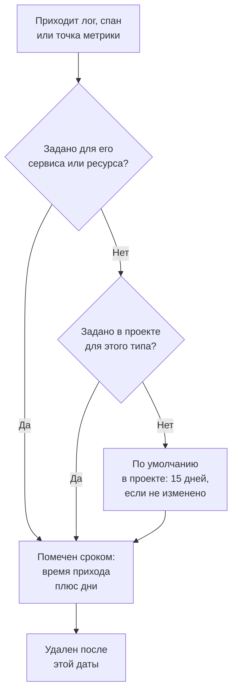

# Хранение данных

OneUptime хранит ваши логи, трассировки, метрики и профили определенное число дней, а затем удаляет их: 15 дней, если вы это не измените. На этой странице показано, как определяется это число, как изменить его для всего проекта и как хранить часть телеметрии дольше или меньше остального.

:::cards
- [Как долго хранится телеметрия](#как-долго-хранится-телеметрия): Порядок, в котором OneUptime читает настройки.
- [Изменить срок хранения проекта](#изменить-срок-хранения-проекта): Одно число для всей вашей телеметрии.
- [Хранить часть телеметрии дольше или меньше](#хранить-часть-телеметрии-дольше-или-меньше): По типу, серьезности, статусу или сервису.
- [Сколько стоит хранение](#сколько-стоит-хранение): Оплата в OneUptime Cloud, диск при самостоятельном размещении.
:::

## Как долго хранится телеметрия

Каждый лог, спан, точка метрики и образец профиля получает срок хранения при поступлении. OneUptime вычисляет, сколько дней его хранить, проставляет дату, когда он истекает, и удаляет его после этой даты. Побеждает самая конкретная настройка:

Полностью: OneUptime читает эти настройки в таком порядке, и решает первая заданная:

| Порядок | Настройка | Где она задается |
| --- | --- | --- |
| 1 | Дни для одного уровня серьезности логов или статуса спанов, для одного сервиса или ресурса | **Хранение по типу телеметрии**, на его странице **Настройки** |
| 2 | Дни для одного типа телеметрии, для одного сервиса или ресурса | Та же карточка |
| 3 | Дни для всего, что приходит от одного сервиса или ресурса | **Срок хранения данных телеметрии**, на той же странице |
| 4 | Дни для одного уровня серьезности логов или статуса спанов, для проекта | **Хранение по типу телеметрии**, на странице **Хранение данных** |
| 5 | Дни для одного типа телеметрии, для проекта | Та же карточка |
| 6 | Дни для всего остального | **Срок хранения по умолчанию (дни)**, на странице **Хранение данных** |

- **Настройки 1–5 — это переопределения срока хранения.** Они входят в [Редакцию Enterprise](/docs/self-hosted/enterprise) и в план Scale в OneUptime Cloud. Без них каждая запись хранится по умолчанию проекта.
- **Изменение применяется к новой телеметрии.** Запись сохраняет проставленную ей дату: более короткий срок не удалит ее раньше, а более длинный не сохранит дольше. Новые записи следуют изменению примерно через пять минут.
- **Исключения следуют за тем, в чем их нашли.** Исключение хранится столько же, сколько спан или лог, из которого оно получено. У Session Replays свой срок хранения: см. [Другие данные со своим сроком хранения](#другие-данные-со-своим-сроком-хранения).

## Перед началом

- **Роль, которая меняет проект.** Project Owner или Project Admin меняют срок хранения проекта. Срок хранения сервиса или ресурса требует роли, которая меняет его другие настройки.
- **Для переопределений — Редакция Enterprise или план Scale.** Самостоятельно размещенной установке нужна лицензия Enterprise, а проекту OneUptime Cloud — план Scale или выше. Срок хранения проекта по умолчанию есть во всех редакциях и планах.

## Изменить срок хранения проекта

:::steps
### Открыть хранение данных

Перейдите в **Настройки проекта → Телеметрия и APM → Хранение данных**. **Телеметрия и APM** сначала свернут в боковом меню: нажмите на него, чтобы открыть. Карточка **Срок хранения данных телеметрии** показывает **Срок хранения по умолчанию (дни)**.

### Задать число дней

Нажмите **Edit Retention Settings**, введите число дней, не меньше 1, и нажмите **Сохранить изменения**.
:::

Новое число применяется к каждой записи, которая приходит с этого момента и не имеет собственного переопределения.

## Хранить часть телеметрии дольше или меньше

Переопределения хранят нужное дольше, а остальное меньше: например, логи ошибок — квартал, а отладочные логи — несколько дней.

### Для всего проекта

Под значением по умолчанию карточка **Хранение по типу телеметрии** задает дни для каждого типа телеметрии. Нажмите **Edit Overrides**, заполните нужные поля, а остальные оставьте пустыми:

| Тип | Поля |
| --- | --- |
| Логи | **Logs default (days)** и по одному полю для каждого уровня серьезности логов |
| Трассировки | **Traces default (days)** и по одному полю для каждого статуса спанов: Ошибка, Ок и Не задано |
| Метрики | **Metrics default (days)** |
| Профили | **Profiles default (days)** |

Пустое поле переходит к следующей настройке в порядке выше, поэтому уровень серьезности без собственных дней хранит свои логи по значению по умолчанию для логов.

### Для одного сервиса или ресурса

Откройте страницу **Настройки** сервиса или ресурса. Его карточка **Срок хранения данных телеметрии** содержит **Хранить данные телеметрии (дней)**, одно число для всего, что он отправляет, а его карточка **Хранение по типу телеметрии** содержит те же поля, что и у проекта. Оставьте поле пустым, чтобы использовать настройки проекта.

Сервисы, хосты, кластеры Kubernetes, хосты Docker и Podman, кластеры Docker Swarm, Proxmox и Ceph, системы хранения, vCenter, базы данных, бессерверные функции, облачные ресурсы, приложения RUM и парки IoT — у всех есть эти карточки. См. [Каталог служб](/docs/telemetry/services#изменить-сервис), чтобы найти страницу **Настройки** сервиса.

### Когда план или лицензия больше не включает переопределения

- **В самостоятельно размещенной установке** переопределения перестают применяться, когда пробный период Enterprise или льготный период заканчивается без лицензии. Новая телеметрия хранится по умолчанию проекта, карточки становятся доступны только для чтения, и ничего из заданного вами не удаляется: активируйте лицензию, и они снова применяются. См. [Редакция Enterprise](/docs/self-hosted/enterprise#когда-лицензия-истекла-или-отсутствует).
- **В OneUptime Cloud** переопределение, оставшееся после пробного периода, продолжает применяться ниже плана Scale. Его страница показывает его под карточкой перехода на другой план, с кнопкой **Удалить переопределение**, которая работает на любом плане. Чтобы снова задать переопределение, нужен план Scale.

## Другие данные со своим сроком хранения

| Данные | Хранятся | Где изменить |
| --- | --- | --- |
| Session Replays | 7 дней, если не изменено | Политика записи приложения RUM: см. [Управление приложениями](/docs/rum/applications#хранение-воспроизведений-сеансов). |
| Логи мониторов, по одной строке на проверку | 1 день, если не изменено | В самостоятельно размещенной установке — **Срок хранения логов монитора (дни)** в Admin Dashboard |
| Метрики мониторов и метрики, которые записывают SLO | 30 дней, если не изменено | В самостоятельно размещенной установке — **Срок хранения метрик монитора (дни)** в Admin Dashboard |

## Сколько стоит хранение

- **В OneUptime Cloud** телеметрия оплачивается за каждый принятый ГБ, и цена за ГБ включает 15 дней хранения. Более долгое хранение стоит пропорционально дороже: 30 дней стоят вдвое больше за ГБ, чем 15. Более короткое хранение стоит пропорционально дешевле, но хранение меньше 7 дней оплачивается как 7 дней. **Настройки проекта → Биллинг и счета → История использования** показывает по дням, сколько отправил каждый сервис и как долго это хранится.
- **При самостоятельном размещении** телеметрия хранится в ClickHouse, и срок хранения умножает занимаемое ею место на диске. См. [Подбор размеров](/docs/installation/sizing#срок-хранения-и-его-влияние-на-хранилище).

Ненужная телеметрия ничего не стоит, если ее никогда не сохранять: [Фильтры отбрасывания и правила очистки](/docs/telemetry/drop-filters-and-scrub-rules) отбрасывают ее при поступлении.

## Устранение неполадок

:::details Я уменьшил срок хранения, но старые данные все еще на месте
Запись сохраняет дату истечения, проставленную при поступлении. Записи, сохраненные до изменения, удаляются в свои даты, и новому сроку хранения следуют только новые записи.
:::

:::details Карточки переопределений предлагают перейти на другой план
Переопределения срока хранения требуют Редакцию Enterprise в самостоятельно размещенной установке и план Scale в OneUptime Cloud. До тех пор все хранится по умолчанию проекта.
:::

:::details Место на диске освобождается через день после истечения данных
Истекшие записи перестают появляться в поиске, на графиках и в списках сразу после истечения. На диске логи и метрики удаляются в первую полночь после этого, поэтому их место освобождается в течение суток.
:::

## Дальнейшие шаги

:::cards
- [Ключи приема](/docs/telemetry/ingestion-keys): Отправляйте телеметрию в свой проект.
- [Фильтры отбрасывания и правила очистки](/docs/telemetry/drop-filters-and-scrub-rules): Храните только нужную телеметрию.
- [Каталог служб](/docs/telemetry/services): Задайте собственный срок хранения сервиса.
- [Редакция Enterprise](/docs/self-hosted/enterprise): Что дают переопределения срока хранения.
:::
