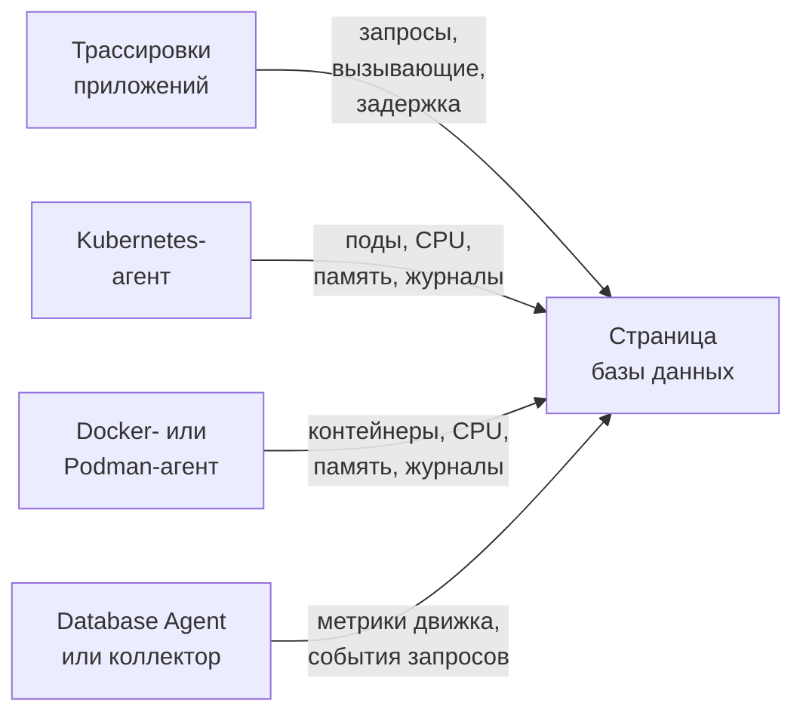

# Базы данных

**Databases** даёт каждому серверу баз данных, который ваш проект запускает или с которым работает, собственную страницу: кто к нему обращается и как быстро, где он работает, собственные метрики работоспособности движка, его журналы и трассировки, связанные с ним инциденты, оповещения и плановое обслуживание, а также мониторы оповещений, рекомендованные для его движка. У баз данных есть метки, владельцы, правила меток и владельцев, срок хранения для каждой базы данных и архивирование, как у любого другого ресурса. Откройте их в **Продукты → Ресурсы → Базы данных**.

:::cards
- [Database Agent](#database-agent): Метрики движка для PostgreSQL, MySQL, SQL Server, Oracle, Redis, MongoDB, Elasticsearch и Memcached.
- [Как обнаруживаются базы данных](#как-обнаруживаются-базы-данных): Из трассировок, Kubernetes, Docker, Podman и коллекторов.
- [Оповещения для базы данных](#оповещения-для-базы-данных): Рекомендованные мониторы и мониторы, которые вы создаёте сами.
- [Устранение неполадок](#устранение-неполадок): Диагностический скрипт и типичные проблемы.
:::

## Как это работает

Большинство баз данных появляются сами. OneUptime собирает каждую из них максимум из четырёх источников, и каждый источник добавляет что-то своё:

| Источник | Что от вас требуется | Что он добавляет на страницу базы данных |
| --- | --- | --- |
| **Трассировки приложений** | Инструментированные приложения (OpenTelemetry) | Запросы от приложений: частота вызовов, ошибки, задержка и службы, которые к ней обращаются |
| **Kubernetes** | [Kubernetes-агент OneUptime](/docs/telemetry/kubernetes-agent) | Где она работает: поды, CPU и память, а также журналы подов |
| **Docker / Podman** | [Docker-агент](/docs/telemetry/docker-host) или [Podman-агент](/docs/telemetry/podman-host) | Где она работает: контейнеры, их CPU и память, а также их журналы |
| **Database Agent** (OpenTelemetry Collector) | [Database Agent](#database-agent) или ваш собственный коллектор | **Engine metrics**: подключения, пропускная способность, доля попаданий в кэш, блокировки, задержка репликации, память, насколько они есть у движка (см. [Что собирается](#что-собирается)), а также необязательные образцы запросов, топ-запросы и файл журнала движка |



Метрики движка поступают только от коллектора, который обращается к самой базе данных (или, для управляемой облачной базы данных, к API мониторинга её провайдера). Трассировки и инвентаризация контейнеров сообщают OneUptime, что база данных существует и как она используется, но не то, как у неё дела внутри; статус **Engine metrics** у каждой базы данных показывает, подключена ли эта часть.

Базу данных можно добавить и вручную: **Databases → Создать: База данных** с её движком, адресом и портом. Для проверки работоспособности с зонда, которой агент вообще не нужен, см. [Мониторинг состояния баз данных](/docs/monitor/database-health-monitor).

## Поддерживаемые базы данных

OneUptime знает перечисленные ниже движки по имени: он приводит то, что инструментирование записывает в `db.system.name` (или в более старый `db.system`), к значению во втором столбце, показывает имя движка, подставляет его порт по умолчанию, когда у спана или адреса порта нет, распознаёт его образы контейнеров и Helm-чарты и знает, откуда берутся метрики его движка. Движок, которого нет в списке, всё равно работает везде, где база данных определяется по адресу; он просто отображается под тем исходным именем, которое сообщают ваши спаны, и никогда не создаётся только из трассировок.

**Семейство** — это движок, через который обращаются к форку или к совместимому по протоколу движку: клиентские библиотеки не могут отличить MariaDB от MySQL или Valkey от Redis, поэтому спан говорит `mysql` или `redis`, а образ контейнера, Helm-чарт или Database Agent называет форк. Оба попадают в одну и ту же базу данных, и база данных показывает более конкретный движок, как только его называет её образ контейнера или источник, не менее надёжный, чем тот, что стоит за её текущим движком (см. [Какой движок показывает база данных](#какой-движок-показывает-база-данных)).

**Создаётся из трассировок** показывает, создают ли клиентские спаны сами по себе базу данных этого движка (см. [Из трассировок приложений](#из-трассировок-приложений)): управляемый сервис, к которому обращаются через общий API-хост провайдера, и движок, работающий внутри процесса вашего приложения, не создают её никогда. **Engine metrics** показывает, откуда берутся собственные метрики работоспособности движка: конфигурация Database Agent, приёмник collector-contrib, который вы добавляете в свой коллектор, собственная конечная точка Prometheus у движка (`:port/path`, опрашивается приёмником `prometheus` коллектора), API мониторинга облачного провайдера или ничего встроенного. Вкладка **Документация** каждой базы данных превращает это в готовую конфигурацию коллектора для этой базы данных.

| Движок | `db.system.name` | Порт по умолчанию | Семейство | Создаётся из трассировок | Engine metrics |
| --- | --- | --- | --- | --- | --- |
| Actian Ingres | `actian.ingres` | — | — | Да | Встроенных нет |
| Actian Zen (Pervasive PSQL) | `pervasive` | 1583 | — | Да | Встроенных нет |
| Aerospike | `aerospike` | 3000 | — | Да | приёмник `aerospike` |
| Amazon DocumentDB | `aws.documentdb` | 27017 | MongoDB | Да | приёмник `awsfirehose` (облачный мониторинг) |
| Amazon DynamoDB | `aws.dynamodb` | 443 | — | Нет (облачный API) | приёмник `awsfirehose` (облачный мониторинг) |
| Amazon Neptune | `aws.neptune` | 8182 | — | Да | приёмник `awsfirehose` (облачный мониторинг) |
| Amazon Redshift | `aws.redshift` | 5439 | PostgreSQL | Да | приёмник `awsfirehose` (облачный мониторинг) |
| Apache Derby | `derby` | 1527 | — | Нет (внутри процесса) | Нет (внутри процесса) |
| Apache Doris | `doris` | 9030 | MySQL | Да | Prometheus, `:8030/metrics` |
| Apache Druid | `druid` | 8888 | — | Да | Встроенных нет |
| Apache Geode | `geode` | 10334 | — | Да | Встроенных нет |
| Apache HBase | `hbase` | — | — | Да | Встроенных нет |
| Apache Hive | `hive` | 10000 | — | Да | Встроенных нет |
| Apache Ignite | `ignite` | 10800 | — | Да | Встроенных нет |
| Apache Impala | `impala` | 21050 | — | Да | Встроенных нет |
| Apache Pinot | `pinot` | 8099 | — | Да | Встроенных нет |
| Apache Solr | `solr` | 8983 | — | Да | Встроенных нет |
| ArangoDB | `arangodb` | 8529 | — | Да | Prometheus, `:8529/_admin/metrics/v2` |
| Azure Cosmos DB | `azure.cosmosdb` | 443 | — | Нет (облачный API) | приёмник `azure_monitor` (облачный мониторинг) |
| Cassandra | `cassandra` | 9042 | — | Да | Встроенных нет |
| Chroma | `chroma` | 8000 | — | Да | Встроенных нет |
| Claris FileMaker | `filemaker` | 2399 | — | Да | Встроенных нет |
| ClickHouse | `clickhouse` | 9000 | — | Да | Prometheus, `:9363/metrics` |
| Cloud Bigtable | `gcp.bigtable` | 443 | — | Нет (облачный API) | приёмник `googlecloudmonitoring` (облачный мониторинг) |
| Cloud Firestore | `gcp.firestore` | 443 | — | Нет (облачный API) | приёмник `googlecloudmonitoring` (облачный мониторинг) |
| Cloud Spanner | `gcp.spanner` | 443 | — | Нет (облачный API) | приёмник `google_cloud_spanner` |
| CockroachDB | `cockroachdb` | 26257 | PostgreSQL | Да | Prometheus, `:8080/_status/vars` |
| Couchbase | `couchbase` | 11210 | — | Да | Prometheus, `:8091/metrics` |
| CouchDB | `couchdb` | 5984 | — | Да | приёмник `couchdb` |
| Databricks | `databricks` | 443 | — | Да | Встроенных нет |
| Dragonfly | `dragonfly` | 6379 | Redis | Да | Database Agent (приёмник `redis`) |
| DuckDB | `duckdb` | — | — | Нет (внутри процесса) | Нет (внутри процесса) |
| Elasticsearch | `elasticsearch` | 9200 | — | Да | Database Agent (приёмник `elasticsearch`) |
| etcd | `etcd` | 2379 | — | Да | Prometheus, `:2379/metrics` |
| FerretDB | `ferretdb` | 27017 | MongoDB | Да | Prometheus, `:8088/debug/metrics` |
| Firebird | `firebirdsql` | 3050 | — | Да | Встроенных нет |
| FoundationDB | `foundationdb` | 4500 | — | Да | Встроенных нет |
| Google BigQuery | `bigquery` | 443 | — | Нет (облачный API) | приёмник `googlecloudmonitoring` (облачный мониторинг) |
| Greenplum | `greenplum` | 5432 | PostgreSQL | Да | Встроенных нет |
| H2 | `h2database` | 9092 | — | Нет (внутри процесса) | Нет (внутри процесса) |
| Hazelcast | `hazelcast` | 5701 | — | Да | Встроенных нет |
| HyperSQL | `hsqldb` | 9001 | — | Нет (внутри процесса) | Нет (внутри процесса) |
| IBM Db2 | `ibm.db2` | 50000 | — | Да | Встроенных нет |
| IBM Informix | `ibm.informix` | 9088 | — | Да | Встроенных нет |
| IBM Netezza | `ibm.netezza` | 5480 | — | Да | Встроенных нет |
| InfluxDB | `influxdb` | 8086 | — | Да | Prometheus, `:8086/metrics` |
| InstantDB | `instantdb` | — | — | Нет (внутри процесса) | Нет (внутри процесса) |
| InterBase | `interbase` | 3050 | Firebird | Да | Встроенных нет |
| InterSystems IRIS / Caché | `intersystems.cache` | 1972 | — | Да | Prometheus, `:52773/api/monitor/metrics` |
| KeyDB | `keydb` | 6379 | Redis | Да | Database Agent (приёмник `redis`) |
| MariaDB | `mariadb` | 3306 | MySQL | Да | Database Agent (приёмник `mysql`) |
| Meilisearch | `meilisearch` | 7700 | — | Да | Prometheus, `:7700/metrics` |
| Memcached | `memcached` | 11211 | — | Да | Database Agent (приёмник `memcached`) |
| Milvus | `milvus` | 19530 | — | Да | Prometheus, `:9091/metrics` |
| MongoDB | `mongodb` | 27017 | — | Да | Database Agent (приёмник `mongodb`) |
| MySQL | `mysql` | 3306 | — | Да | Database Agent (приёмник `mysql`) |
| Neo4j | `neo4j` | 7687 | — | Да | Prometheus, `:2004/metrics` |
| OceanBase | `oceanbase` | 2881 | MySQL | Да | Встроенных нет |
| OpenSearch | `opensearch` | 9200 | Elasticsearch | Да | Database Agent (приёмник `elasticsearch`) |
| Oracle | `oracle.db` | 1521 | — | Да | Database Agent (приёмник `oracledb`) |
| Pinecone | `pinecone` | 443 | — | Нет (облачный API) | Встроенных нет |
| PostgreSQL | `postgresql` | 5432 | — | Да | Database Agent (приёмник `postgresql`) |
| Presto | `presto` | 8080 | — | Да | Встроенных нет |
| Progress OpenEdge | `progress` | — | — | Да | Встроенных нет |
| Qdrant | `qdrant` | 6333 | — | Да | Prometheus, `:6333/metrics` |
| QuestDB | `questdb` | 8812 | PostgreSQL | Да | Prometheus, `:9003/metrics` |
| RavenDB | `ravendb` | 8080 | — | Да | Встроенных нет |
| Redis | `redis` | 6379 | — | Да | Database Agent (приёмник `redis`) |
| Riak KV | `riak` | 8087 | — | Да | приёмник `riak` |
| SAP ASE (Sybase) | `sybase` | 5000 | — | Да | Встроенных нет |
| SAP HANA | `sap.hana` | 30015 | — | Да | приёмник `saphana` |
| SAP MaxDB | `sap.maxdb` | 7210 | — | Да | Встроенных нет |
| ScyllaDB | `scylladb` | 9042 | Cassandra | Да | Prometheus, `:9180/metrics` |
| SingleStore | `singlestore` | 3306 | MySQL | Да | Prometheus, `:9104/metrics` |
| Snowflake | `snowflake` | 443 | — | Да | приёмник `snowflake` |
| Software AG Adabas | `softwareag.adabas` | — | — | Да | Встроенных нет |
| SQL Server | `microsoft.sql_server` | 1433 | — | Да | Database Agent (приёмник `sqlserver`) |
| SQLite | `sqlite` | — | — | Нет (внутри процесса) | Нет (внутри процесса) |
| StarRocks | `starrocks` | 9030 | MySQL | Да | Prometheus, `:8030/metrics` |
| SurrealDB | `surrealdb` | 8000 | — | Да | Встроенных нет |
| Teradata | `teradata` | 1025 | — | Да | Встроенных нет |
| TiDB | `tidb` | 4000 | MySQL | Да | Prometheus, `:10080/metrics` |
| Trino | `trino` | 8080 | — | Да | Prometheus, `:8080/metrics` |
| Typesense | `typesense` | 8108 | — | Да | Встроенных нет |
| Valkey | `valkey` | 6379 | Redis | Да | Database Agent (приёмник `redis`) |
| Vertica | `vertica` | 5433 | — | Да | Встроенных нет |
| Vitess | `vitess` | 3306 | MySQL | Да | Prometheus, `:15000/metrics` |
| Weaviate | `weaviate` | 8080 | — | Да | Prometheus, `:2112/metrics` |
| YugabyteDB | `yugabytedb` | 5433 | PostgreSQL | Да | Prometheus, `:9000/prometheus-metrics` |

Принимаются и другие распространённые написания: `postgres` и `pg`, `mssql` и `sqlserver`, `oracle`, `mongo`, `scylla`, `dragonflydb`, `memsql` и все устаревшие значения `db.system`, которые использовал OpenTelemetry (`db2`, `hanadb`, `cosmosdb`, `dynamodb`, `spanner`, `redshift`, `informix`, `maxdb`, `cache`, `h2`, `firebird`, `edb`, `cloudscape`, …). Управляемый сервис, который говорит на протоколе движка (Amazon RDS и Aurora, Azure Database, Cloud SQL, AlloyDB, Neon, Supabase, PlanetScale, ElastiCache, Memorystore, MongoDB Atlas), и есть этот движок.

## Как обнаруживаются базы данных

Каждая база данных помнит источник, который её создал (столбец **Discovered from**), а первая запись в её **Лента** говорит, что её нашло: рабочая нагрузка Kubernetes и её кластер, контейнер Docker или Podman (или сервис Compose или Swarm) и его хост, конечная точка, к которой обращались приложения, или Database Agent (с его версией) либо коллектор, который о ней сообщил. Более поздние источники дополняют ту же базу данных, а не создают новую, если они описывают ту же конечную точку (см. [Конечные точки](#конечные-точки-и-правило-одного-владельца)).

### Из трассировок приложений

Каждые 10 минут OneUptime сводит CLIENT-спаны, которые ваши приложения отправили за последние 15 минут и которые несут `db.system.name` (или более старый `db.system`). Сервер берётся из `server.address` (или более старого `net.peer.name`, затем `network.peer.address` / `net.sock.peer.addr`), а порт из `server.port` (или `net.peer.port`, `network.peer.port`, `net.sock.peer.port`); если у спана нет порта, предполагается порт движка по умолчанию. Имена движков нормализуются (см. [Поддерживаемые базы данных](#поддерживаемые-базы-данных)), поэтому `postgres`, `pg` и `postgresql` — один движок, как и `mssql` и `microsoft.sql_server`; `mariadb` и `mysql` — два движка одного семейства.

База данных **создаётся** из трассировок, только когда выполняются все эти условия; всё остальное по-прежнему учитывается для уже существующей базы данных, но никогда её не создаёт:

- адрес называет один сервер в пределах всего проекта: DNS-имя, а не IP-литерал и не имя, которое разрешается только на одной машине или внутри одной сети, если только его не уточняет кластер Kubernetes вызывающей стороны (см. [Конечные точки](#конечные-точки-и-правило-одного-владельца));
- порт — один из тех, которые слушает сервер. Операционные системы выделяют клиентскому концу соединения порт от 32768 и выше (диапазон эфемерных портов Linux по умолчанию начинается там; Windows и macOS используют 49152–65535), поэтому порт от 32768 и выше никогда не создаёт базу данных, если только это не собственный порт движка по умолчанию (50000 у IBM Db2). eBPF-инструментирование, в том числе у Kubernetes-агента, может подключиться к долгоживущему соединению посреди потока и поменять местами два его конца. Тогда спан называет собственный порт клиента портом сервера, и без этого правила каждое соединение стало бы отдельной базой данных;
- движок известен OneUptime и имеет собственный адрес: столбец **Создаётся из трассировок** в разделе [Поддерживаемые базы данных](#поддерживаемые-базы-данных). Облачные API, хост которых общий для всех клиентов (DynamoDB, BigQuery, Spanner, Firestore, Bigtable, Cosmos DB, Pinecone), движки, работающие внутри вашего приложения (SQLite, DuckDB, H2, HyperSQL, Derby), и движки, которых OneUptime не знает, никогда не создаются из трассировок; добавляйте их вручную;
- конечная точка получила не менее 10 запросов за 15-минутное окно, которое просматривает запуск, чтобы разовый скрипт не создавал базу данных. Спаны клиентской библиотеки для управления соединениями (`pg.connect` и `pg-pool.connect` из node-postgres, `redis-connect`, `connect`, …) — не запросы: они не учитываются ни здесь, ни в **Queries** базы данных;
- проект не превысил свой [бюджет автосоздания](#бюджет-автосоздания).

Каждый CLIENT-спан к базе данных при приёме также помечается своей конечной точкой, поэтому, как только база данных владеет конечной точкой, раздел **Queries from applications** и вкладка **Трассировки** показывают каждый вызов к ней, включая вызовы, сделанные до создания базы данных. Метрики `db.client.*` (например, `db.client.operation.duration`), которые несут `server.address`, помечаются так же.

**Кластеры и списки хостов.** Строка подключения, в которой перечислено несколько хостов (`m1:27017,m2:27017,m3:27017`), — это одна база данных, в каком бы порядке клиент их ни перечислял. Участники MongoDB Atlas (`cluster0-shard-00-01.ab1cd.mongodb.net`) становятся одной базой данных, названной по их кластеру (`cluster0.ab1cd.mongodb.net`), и каждый замеченный участник становится одной из её конечных точек. Драйверы, которые сообщают о каждом участнике кольца Cassandra, Redis Cluster, кластера Elasticsearch или об узлах ElastiCache по отдельности, по-прежнему дают одну базу данных на участника: ничто в этих именах хостов не говорит, к какому кластеру они относятся. Оставьте одну и [объедините](#конечные-точки-и-правило-одного-владельца) с ней остальные.

### Из Kubernetes

Каждые 5 минут OneUptime просматривает поды каждого подключённого кластера Kubernetes и распознаёт рабочие нагрузки баз данных:

1. **Сначала метки операторов и чартов**: CloudNativePG, Zalando (Spilo), Crunchy PGO, чарты Bitnami, ECK, Altinity ClickHouse, cass-operator, Percona, оператор Oracle MySQL и оператор Vitess (его поды `vtgate` — это база данных; `vttablet`, `vtctld`, `vtorc` и `vtbackup` — её части, а не участники). Один кластер оператора становится одной базой данных. У собственного vtgate-Service кластера Vitess хешированное имя, поэтому добавьте его на вкладке **Конечные точки** базы данных, если приложения подключаются через него.
2. **Иначе образы контейнеров**, по точному имени образа: официальные образы, образы Bitnami (включая перенесённые репозитории `bitnamilegacy` и `bitnamisecure`) и Red Hat / OpenShift для каждого движка из раздела [Поддерживаемые базы данных](#поддерживаемые-базы-данных), у которого они есть (`postgres`, `bitnami/postgresql`, `rhel9/postgresql-16`, `mysql`, `mariadb`, `mssql/server`, `gvenzl/oracle-free`, `redis`, `valkey/valkey`, `mongo`, `cockroachdb/cockroach`, `pingcap/tidb`, `clickhouse/clickhouse-server`, `qdrant/qdrant`, …). Форк распознаётся как он сам: образ `mariadb` — это MariaDB, образ `valkey/valkey` — это Valkey. Экспортеры, операторы, административные интерфейсы, пулеры соединений (pgbouncer, pgpool, ProxySQL, HAProxy, Cloud SQL Proxy) и инструменты резервного копирования — не базы данных. Под, в котором также работает контейнер приложения, тоже не считается базой данных (приложение с сайдкаром базы данных — это всё равно приложение), хотя у StatefulSet, контейнер базы данных которого объявляет порт движка по умолчанию, может быть один дополнительный контейнер, который OneUptime не распознаёт (например, отправщик журналов).

Образ базы данных не делает под сервером баз данных, но сделать его чем-то другим могут только положительные признаки. Контейнер, программа которого — клиент или инструмент дампа (`psql`, `redis-cli`, `mongosh`, `pg_dump`, `mysql`), заглушка, поддерживающая контейнер живым (`sleep infinity`, `tail -f /dev/null`), или интерактивная оболочка (или чей скрипт `sh -c` не запускает ничего, кроме таких инструментов, встроенных команд оболочки и простых утилит вроде `echo` и `cp`), — это клиентский или отладочный запуск, а не база данных; то же относится к Redis или Valkey Sentinel (`redis-sentinel`, `redis-server --sentinel`). Это верно и за загрузчиком: `env` (с его настройками `NAME=value`), `nohup`, `setsid`, `tini`, `dumb-init` и `docker-entrypoint.sh` образа просматриваются насквозь до программы, которую они запускают, как и `exec`, `env` и `nohup` внутри скрипта, поэтому `env PGPASSWORD=… psql` и `tini -- redis-cli` — клиентские запуски, а `tini -- docker-entrypoint.sh postgres` — сервер, как и `docker-entrypoint.sh -c max_connections=200`, собственный сервер образа, запущенный с флагом. Скрипт, который затем запускает что-то ещё (`sleep 5 && exec redis-server`, `bash -ecx 'exec cockroach start …'`), файл скрипта (`sh /start.sh`), обёртка, принимающая собственные аргументы перед программой (`gosu postgres …`, `timeout 30 …`), или скрипт, слишком длинный для чтения, считается возможным сервером. Завершённые поды, пакетные задания и разовые поды `kubectl run`, не объявляющие порт, тоже не являются базами данных.

База данных появляется, когда один из её подов пробыл в состоянии Ready около 10 минут (если стать Ready поду мешает только сайдкар, вместо этого учитывается готовый контейнер базы данных). Под в цикле сбоев становится Ready заново при каждом перезапуске, поэтому никогда не становится базой данных, как и задание CI или под, который упал через минуту. После создания база данных обновляется при каждом запуске.

Поды группируются по их StatefulSet, Deployment или кластеру оператора, поэтому StatefulSet из трёх участников — это одна база данных с тремя участниками. **Экземпляры** на её странице подсчитывает поды, в которых работает контейнер базы данных: не тот, что ждёт в `CrashLoopBackOff` или `ImagePullBackOff`, и не завершившийся, хотя Kubernetes может по-прежнему сообщать о таком поде как о Running; рабочая нагрузка, масштабированная до нуля, показывает 0 и сохраняет свою страницу, пока её не уберёт [автоматическое архивирование](#жизненный-цикл-архивирование-и-хранение). Обратный путь тоже работает: страница StatefulSet или Deployment рабочей нагрузки и страница каждого из её подов называют базу данных, которую она запускает, со ссылкой **Open database**, в том числе StatefulSet или Deployment с именем, отличным от имени базы данных (`shop-redis-master` у Bitnami для `shop-redis`, `cluster1-pxc` у Percona для `cluster1`), а рабочая нагрузка пулера или резервного копирования, которую оператор помечает как часть кластера, сообщает, что она входит в кластер этой базы данных.

Kubernetes-агент не сообщает об объектах Service, поэтому имена Service базы данных берутся из соглашений, которым следуют чарты и операторы: имя владеющего StatefulSet или Deployment, headless-Service у StatefulSet (и каждый участник за ним, `<pod>.<headless-service>`), а также прокси- и пулер-Service операторов: HAProxy и ProxySQL в Percona XtraDB Cluster, router и HAProxy в Percona Server for MySQL, mongos в Percona Server for MongoDB, pgBouncer от Crunchy и пулеры Zalando и CloudNativePG. Каждое из них становится конечной точкой, уточнённой кластером (`postgres.prod.svc.cluster.local:5432@my-cluster`), поэтому одно и то же имя в двух кластерах остаётся двумя базами данных. Пока в проекте ровно один кластер, добавляется и неуточнённое `postgres.prod.svc.cluster.local:5432`, которое снова освобождается примерно через 2 часа после появления второго кластера. Service с любым другим именем добавьте на вкладке **Конечные точки** базы данных.

Приложения, телеметрия которых идёт через Kubernetes-агент, несут своё пространство имён и кластер, поэтому их вызовы читаются так, как их читает резолвер их пода: `postgres` (из того же пространства имён), `postgres.prod` (Service `postgres` в пространстве имён `prod`), `postgres.prod.svc` и полное имя сопоставляются с базой данных, как и `mongo-0.mongo-headless`, участник StatefulSet в собственном пространстве имён вызывающей стороны.

OneUptime читает метаданные подов, метки, образы, объявленные порты и то, что запускает командная строка контейнера (имя программы, флаги оболочки и то, какие известные клиентские команды, команды поддержания жизни и команды оболочки запускает её скрипт; любая другая команда лишь отмечается как нераспознанная), но никогда не читает переменные окружения, значения аргументов, текст скриптов или секреты.

### Из Docker и Podman

Каждые 5 минут контейнеры каждого подключённого хоста Docker или Podman классифицируются по образу тем же способом, затем группируются и фильтруются по их именам и меткам Compose, Swarm и Testcontainers, но никогда по команде, которую они выполняют (см. ниже). Контейнеры одного сервиса Compose (по меткам проекта и сервиса Compose) или одного сервиса Swarm — это одна база данных с несколькими участниками, и её рабочая нагрузка — этот сервис (`Compose service/<project>-<service>`, `Swarm service/<service>`). Любой другой контейнер — это отдельная база данных под своим точным именем (`Container/<name>`), поэтому `redis-6379` и `redis-6380` остаются двумя. Testcontainers, разовые запуски `docker compose run`, контейнеры, которые kubelet запускает на узле Docker (обнаружение Kubernetes находит их как поды), и контейнеры, работающие меньше 10 минут, никогда не становятся базами данных. Возраст контейнера — это время его работы, поэтому контейнер, который уже проработал столько, становится базой данных при первом запуске после установки агента. **Экземпляры** подсчитывает работающие контейнеры, а страница каждого контейнера ссылается обратно на его базу данных (**Open database**). Хост, зарегистрированный дважды под одним именем, читается один раз, через регистрацию, замеченную последней.

Агент отправляет эти метки вместе с метриками каждого контейнера, когда его `otel-collector-config.yaml` их копирует (`container_labels_to_metric_labels`). Более старый агент Docker или Podman этого не делает: обновите его, иначе каждый контейнер будет отдельной базой данных, включая запуски Testcontainers и разовые запуски.

В отличие от Kubernetes, командная строка контейнера никогда не читается (агенты её не отправляют, так как в ней могут быть секреты), поэтому долго работающий клиентский или отладочный контейнер из образа базы данных (`sleep infinity`, цикл `psql` или `redis-cli`) становится базой данных, проработав 10 минут. Заархивируйте его, чтобы убрать: база данных, которую заархивировал человек, остаётся в архиве. Если её не трогать, она [архивируется автоматически](#жизненный-цикл-архивирование-и-хранение) через 7 дней после остановки контейнера.

Имена контейнеров разрешаются только внутри одной сети Docker, поэтому эти базы данных автоматически **не** получают конечных точек; их страница показывает собственные метрики и журналы контейнеров. Чтобы присоединить запросы, которые отправляют ваши приложения, добавьте адрес, который они используют, на вкладке [Конечные точки](#конечные-точки-и-правило-одного-владельца).

Для метрик движка установите [Database Agent](#database-agent) с вкладки **Документация** самой базы данных: его команда установки и `.env` содержат уже заполненный `DATABASE_SERVER_ID`, поэтому данные агента попадают в эту базу данных. Агент, установленный без него, сопоставляется по своему `DATABASE_SERVER_ADDRESS`, которым база данных контейнера не владеет: DNS-имя регистрирует сервер как вторую базу данных (одна страница с контейнерами, другая с метриками движка; см. [Две базы данных для одного сервера](#две-базы-данных-для-одного-сервера)), а частный IP или имя контейнера ни к чему не присоединяются.

### Из Database Agent или вашего собственного коллектора

Когда метрики или журналы движка поступают от приёмника баз данных в коллекторе, OneUptime сопоставляет их с базой данных в момент приёма: напрямую по id, если данные несут `oneuptime.database.server.id` (`DATABASE_SERVER_ID` агента), иначе по конечной точке, которую называют данные (`server.address` / `server.port`):

- данные, связанные по id, присоединяются к этой базе данных и отображаются на её страницах (и только там), какой бы адрес они ни сообщали: частный IP, локальное для кластера имя, адрес, которым владеет другая база данных, или вообще никакого. Сообщённый адрес, который называет один сервер в пределах всего проекта и ещё не принадлежит ни одной базе данных, добавляется к базе данных как конечная точка, чтобы трассировки приложений к этому адресу тоже попадали туда;
- иначе конечная точка, которой уже владеет база данных, присоединяет данные к этой базе данных, что бы её ни создало;
- иначе база данных **создаётся**, но только из имени, которое означает один сервер в пределах всего проекта (DNS-имя, публичный IP или локальное для кластера имя, имя `.internal` или `.local`, которое данные уточняют своим кластером Kubernetes, `k8s.cluster.name`, который Database Agent никогда не проставляет), и только для движка, который может создаваться сам (столбец **Создаётся из трассировок** в разделе [Поддерживаемые базы данных](#поддерживаемые-базы-данных): никогда общий облачный API, движок внутри процесса или неизвестный движок). Частные и link-local IP, одноуровневые имена (`db`) и неуточнённые локальные для кластера имена (`postgres.prod.svc.cluster.local`), имена `.internal` или `.local` могут означать разные серверы в каждой сети; IP пода меняется при каждом перезапуске; а одноуровневое имя, дополненное собственным пространством имён коллектора, может быть Service или собственным подом коллектора. Данные с таким именем присоединяются только к базе данных, у которой оно уже есть в качестве конечной точки: к рабочей нагрузке, обнаруженной в Kubernetes, для её имён Service. Создайте такую базу данных вручную (**Databases → Создать: База данных**, тот же адрес и порт) или свяжите с ней агент через `DATABASE_SERVER_ID`. В проекте с кластером Kubernetes локальное для кластера имя Service без кластера отклоняется: создайте базу данных как `postgres.prod.svc.cluster.local:5432@my-cluster`, а затем добавьте неуточнённое `postgres.prod.svc.cluster.local:5432` (то, что сообщает агент) на её вкладке **Конечные точки**;
- пакет приёмника, который вообще не называет сервер, игнорируется (см. [Использование собственного OpenTelemetry Collector](#использование-собственного-opentelemetry-collector)).

Базы данных, которые создаёт коллектор, учитываются в [бюджете автосоздания](#бюджет-автосоздания), как и любые другие обнаруженные базы данных; базу данных, которую вы создали вручную и связали через `DATABASE_SERVER_ID`, создавать никогда не нужно. См. [Database Agent](#database-agent).

### Какой движок показывает база данных

Когда источники расходятся во мнении о движке базы данных, побеждает более сильное свидетельство: движок, заданный человеком, затем коллектор или Database Agent (движок, сообщающий о себе), затем образ контейнера или Helm-чарт, затем клиентские спаны; драйвер PostgreSQL сообщает `postgresql`, даже когда работает с CockroachDB. Источник переводит базу данных в другое семейство движков, только когда его свидетельство сильнее того, что назвало текущий движок, а движок, заданный человеком, обнаружение никогда не меняет. Внутри семейства форк уточняет движок, когда источник, который его называет, не слабее того, что назвал текущий движок, или является образом контейнера: спан говорит `redis`, образ говорит `valkey`, и база данных показывает Valkey, даже там, где приёмник `redis` коллектора сказал `redis`, поскольку он не может их различить. Одни лишь трассировки приложений никогда не уточняют движок, определённый образом или коллектором: клиент называет протокол, на котором говорит, и MariaDB Connector/J сообщает `mariadb` при работе с сервером MySQL. Коллектор называет форк, когда проставляет его в `db.system.name` (Database Agent делает это на основе `DATABASE_SYSTEM`) или когда его называет `db.system.version` пакета: строка версии, содержащая имя форка (`8.0.11-TiDB-v7.5.1`), или основная версия, которую выпускал только форк; у MySQL нет 10.x или 11.x, поэтому `mysql` с `11.4.13`, голым номером, который приёмник `mysql` сообщает для MariaDB 11.4, — это MariaDB (см. [Использование собственного OpenTelemetry Collector](#использование-собственного-opentelemetry-collector)). Форк отменяется только образом контейнера, называющим движок его семейства, и только когда форк называли лишь трассировки приложений; коллектор или трассировка, называющие семейство, никогда его не отменяют. Рабочая нагрузка Kubernetes, образ которой переходит на форк того же семейства (`redis` на `valkey`), остаётся той же базой данных.

### Бюджет автосоздания

Трассировки, Kubernetes, Docker, Podman и коллекторы создают базы данных сами, только пока в проекте меньше 500 активных неархивированных обнаруженных баз данных (`DATABASE_SERVER_AUTO_CREATE_BUDGET`, см. [Настройка для самостоятельного размещения](#настройка-для-самостоятельного-размещения)). Базы данных, созданные вручную, никогда не учитываются и никогда не блокируются; архивированные базы данных не учитываются, поэтому [автоматическое архивирование](#жизненный-цикл-архивирование-и-хранение) освобождает бюджет; а уже существующие базы данных продолжают сопоставляться и обновляться. Когда бюджет исчерпан, данные коллектора для новой конечной точки ничего не создают (они только присоединяются к уже существующим базам данных), и OneUptime записывает в журнал предупреждение не чаще одного раза в 10 минут для каждого проекта.

## Database Agent

OneUptime Database Agent — это преднастроенный OpenTelemetry Collector для **PostgreSQL**, **MySQL / MariaDB**, **SQL Server**, **Oracle**, **Redis / Valkey / KeyDB / Dragonfly**, **MongoDB**, **Elasticsearch / OpenSearch** и **Memcached**. Он состоит только из конфигурации: стандартный контейнер `otel/opentelemetry-collector-contrib`, который запускает встроенный приёмник коллектора для вашего движка с конфигурацией, помечающей каждый пакет идентификацией базы данных и отправляющей его в OneUptime по OTLP. На сервер базы данных ничего не устанавливается. Тот же `docker-compose.yml` также запускает рядом с коллектором [ИИ-агент базы данных](#ии-агент) для OneUptime AI. Для остальных движков из раздела [Поддерживаемые базы данных](#поддерживаемые-базы-данных) см. [Использование собственного OpenTelemetry Collector](#использование-собственного-opentelemetry-collector); конфигурация есть на вкладке **Документация** каждой базы данных.

**Один агент отслеживает один сервер баз данных.** Идентификация проставляется на всё, что отправляет агент, поэтому запускайте один агент (один каталог установки) на сервер и по одному на реплику, если хотите видеть реплики на отдельных страницах.

Агент находится в [каталоге DatabaseAgent](https://github.com/OneUptime/oneuptime/tree/master/agents/DatabaseAgent): `docker-compose.yml`, по одной конфигурации коллектора на приёмник (`configs/postgresql.yaml`, `configs/mysql.yaml`, `configs/sqlserver.yaml`, `configs/oracledb.yaml`, `configs/redis.yaml`, `configs/mongodb.yaml`, `configs/elasticsearch.yaml`, `configs/memcached.yaml`), `install.sh`, `troubleshoot.sh` и юнит systemd. Форк или совместимая замена запускает конфигурацию своего семейства и сообщает собственное имя: `DATABASE_SYSTEM=mariadb` запускает `configs/mysql.yaml`, и база данных отображается как MariaDB.

### Перед началом

- Docker Engine 20.10 или новее с плагином Docker Compose v2 на машине, которая может достучаться до порта базы данных (или кластер Kubernetes: см. [Kubernetes](#kubernetes)).
- Учётная запись в базе данных, которая может создать пользователя для мониторинга и выдать ему перечисленные ниже права на статистику.
- Ключ приёма. Создайте его в разделе **Настройки проекта → Телеметрия и APM → Ключи приема** и скопируйте значение.

:::steps
### Создание пользователя для мониторинга

Дайте агенту собственную учётную запись с доступом на чтение статистики движка: никогда не администратора и никогда не учётную запись приложения. Если вы уже создали пользователя для мониторинга для [Мониторинга состояния баз данных](/docs/monitor/database-health-monitor#создать-пользователя-для-мониторинга), его права для PostgreSQL, MySQL и SQL Server покрывают и агент.

:::tabs
@tab PostgreSQL
```sql
CREATE USER oneuptime_monitor WITH PASSWORD 'a-strong-password';
GRANT pg_monitor TO oneuptime_monitor;
```

`pg_monitor` — это встроенная роль (PostgreSQL 10 и новее), которая даёт доступ на чтение к представлениям статистики и мониторинга и не даёт доступа к вашим таблицам. Она обязательна: без неё `pg_stat_activity` не выдаёт ошибку, а возвращает только собственный сеанс агента, поэтому число подключений показывает `1` на сервере, который на самом деле заполнен. Приёмник подключается к каждой базе данных, чтобы читать статистику по базам, поэтому пользователю также нужно право `CONNECT` на каждую из них (у `PUBLIC` оно есть по умолчанию). Приёмник PostgreSQL не запускается без пароля.

Топ-запросы (`DATABASE_QUERY_EVENTS=true`) также читают `pg_stat_statements`: загрузите расширение через `shared_preload_libraries = 'pg_stat_statements'` (нужен перезапуск) и создайте его в каждой отслеживаемой базе данных:

```sql
CREATE EXTENSION IF NOT EXISTS pg_stat_statements;
```

Планам выполнения для топ-запросов нужно право `SELECT` на таблицы, которые затрагивают запросы, а `pg_monitor` его не даёт; выдайте его по схемам (`GRANT SELECT ON ALL TABLES IN SCHEMA app TO oneuptime_monitor`), если вам нужны планы. Без него топ-запросы всё равно поступают, но с пустыми планами, и коллектор записывает в журнал `failed to explain` для каждого из них; диагностический скрипт сообщает об этом как о предупреждении, а не как о недостающем праве.

В управляемом сервисе, где `pg_monitor` недоступна, те же представления покрывает `pg_read_all_stats`. Агент уже пропускает внутренние базы данных Amazon RDS, Azure, Cloud SQL и AlloyDB, которые не может открыть ни одна учётная запись клиента.
@tab MySQL / MariaDB
```sql
CREATE USER 'oneuptime_monitor'@'%' IDENTIFIED BY 'a-strong-password';
GRANT PROCESS, REPLICATION CLIENT ON *.* TO 'oneuptime_monitor'@'%';
GRANT SELECT ON performance_schema.* TO 'oneuptime_monitor'@'%';
```

`PROCESS` и `REPLICATION CLIENT` покрывают глобальные счётчики состояния, состояние InnoDB и состояние реплики; `performance_schema` (включена по умолчанию начиная с MySQL 5.6) читается для образцов запросов и топ-запросов. В MariaDB 10.5.9 и новее состояние реплики вынесено в отдельную привилегию, поэтому там также выполните `GRANT SLAVE MONITOR ON *.* TO 'oneuptime_monitor'@'%';`. Для сервера MariaDB задайте `DATABASE_SYSTEM=mariadb`: та же конфигурация отслеживает его, и база данных отображается как MariaDB. Это надёжный способ. Агент, установленный как `mysql` для MariaDB 10 или новее, тоже придёт к этому по номеру версии (`11.4.13`; MySQL никогда не выпускала 10.x или 11.x), но MariaDB 5.5 останется MySQL.
@tab SQL Server
```sql
CREATE LOGIN oneuptime_monitor WITH PASSWORD = 'a-strong-password';
GRANT VIEW SERVER STATE TO oneuptime_monitor;
GRANT VIEW ANY DEFINITION TO oneuptime_monitor;
```

`VIEW SERVER STATE` (в SQL Server 2022 и новее достаточно `VIEW SERVER PERFORMANCE STATE`) читает динамические административные представления, из которых берётся каждая метрика, и не даёт доступа к вашим данным. Приёмник вставляет учётные данные в строку подключения без кавычек, поэтому имя пользователя и пароль не должны содержать точку с запятой (`;`) или двойную кавычку (`"`), а также начинаться или заканчиваться пробелом; `install.sh` их отклоняет. Драйвер сам согласует шифрование с сервером, поэтому переменные TLS здесь не применяются.

Для именованного экземпляра (`sql1.corp\INST01`) направьте `DATABASE_ENDPOINT` на собственный TCP-порт экземпляра, а не на порт 1433 экземпляра по умолчанию, который вместо этого приводит к экземпляру по умолчанию. Его показывает SQL Server Configuration Manager (протокол TCP/IP экземпляра, IPAll), или выполните `SELECT local_tcp_port FROM sys.dm_exec_connections WHERE session_id = @@SPID;` на экземпляре. `install.sh` отклоняет `host\instance` и просит `host:port`.
@tab Oracle
```sql
-- In the pluggable database the agent connects to, e.g. ALTER SESSION SET CONTAINER = FREEPDB1;
CREATE USER oneuptime_monitor IDENTIFIED BY "a-strong-password";
GRANT CREATE SESSION TO oneuptime_monitor;
GRANT SELECT_CATALOG_ROLE TO oneuptime_monitor;
```

`SELECT_CATALOG_ROLE` читает представления `V$` и `DBA_`, из которых берутся метрики, образцы запросов и топ-запросы, и не даёт доступа к вашим таблицам. `DATABASE_ORACLE_SERVICE` задаёт службу, к которой подключается агент (`FREEPDB1`, `ORCLPDB1`, …).
@tab Redis / Valkey / KeyDB / Dragonfly
```text
ACL SETUSER oneuptime_monitor on >a-strong-password -@all +info +ping
```

Приёмник выполняет только `INFO`. Сохраните пользователя командой `ACL SAVE` (или строкой `user` в `redis.conf` / вашем файле ACL). На сервере, защищённом только `requirepass`, оставьте `DATABASE_USERNAME` пустым и задайте `DATABASE_PASSWORD`; на сервере без аутентификации оставьте пустыми оба. Для таких серверов задайте `DATABASE_SYSTEM` равным `valkey`, `keydb` или `dragonfly`. Приёмник читает версию из `redis_version` в выводе `INFO`, которую Valkey держит на `7.2.4` (версии Redis, от которой он отделился), а Dragonfly выставляет равной версии Redis, которую эмулирует. Для них OneUptime её игнорирует, поэтому база данных Valkey или Dragonfly показывает версию своего образа контейнера, когда её запускает Kubernetes, Docker или Podman, и никакую, если есть только агент.
@tab MongoDB
```js
db.getSiblingDB("admin").createUser({
  user: "oneuptime_monitor",
  pwd: "a-strong-password",
  roles: [{ role: "clusterMonitor", db: "admin" }],
});
```

`clusterMonitor` покрывает все метрики. Планам выполнения для топ-запросов дополнительно нужна роль `{ role: "read", db: "<database>" }` для каждой отслеживаемой базы данных; без неё топ-запросы всё равно поступают, но с пустыми планами. Агент подключается ровно к одному участнику (`direct_connection`), поэтому запускайте по одному агенту на каждого участника набора реплик.
@tab Elasticsearch / OpenSearch
```text
POST /_security/role/oneuptime_monitor
{ "cluster": ["monitor"], "indices": [{ "names": ["*"], "privileges": ["monitor"] }] }

POST /_security/user/oneuptime_monitor
{ "password": "a-strong-password", "roles": ["oneuptime_monitor"] }
```

Привилегии `monitor` читают статистику узлов, кластера и индексов и не читают документы. В OpenSearch с плагином безопасности вместо этого выдайте разрешение кластера `cluster_monitor` и разрешение индексов `indices_monitor` на `*`; в кластере без безопасности оставьте `DATABASE_USERNAME` и `DATABASE_PASSWORD` пустыми. Один агент отслеживает весь кластер через одну конечную точку, URL (`http://search.internal:9200` или `https://` для TLS). Для кластера OpenSearch задайте `DATABASE_SYSTEM=opensearch`.
@tab Memcached
У Memcached нет пользователей: приёмник выполняет `stats` по текстовому протоколу, поэтому оставьте `DATABASE_USERNAME` и `DATABASE_PASSWORD` пустыми. Сервер, запущенный с аутентификацией SASL (`-S`), так отслеживать нельзя.
:::

### Установите и запустите агент

:::tabs
@tab install.sh
Скачайте скрипт установки и запустите его на машине, где будет работать агент:

```bash
curl -sSL https://raw.githubusercontent.com/OneUptime/oneuptime/master/agents/DatabaseAgent/install.sh -o install.sh
bash install.sh
```

Скрипт спрашивает URL вашего OneUptime и ключ приёма, движок, конечную точку для подключения и учётные данные для мониторинга (пароль вводится без отображения), а для движка, который поддерживает [ИИ-агент](#ии-агент), ещё и то, может ли он применять исправления, и если да, то собственную учётную запись для него. Он скачивает `docker-compose.yml` и соответствующий `configs/<receiver>.yaml` (сохраняется как `otel-collector-config.yaml`) в `/opt/oneuptime-database-agent`, записывает файл `.env` с правами `0600` и запускает агент. Если конечная точка имеет смысл только на этой машине (`localhost`, `host.docker.internal`), он также спрашивает имя хоста, которое используют ваши приложения, потому что это имя и есть идентификация базы данных; если это имя разрешается только внутри одной сети (частный или link-local IP, одноуровневое имя, локальное для кластера имя, имя `.internal` или `.local`), он запрашивает id базы данных в OneUptime (`DATABASE_SERVER_ID`), потому что такое имя никогда не создаёт базу данных само.

На каждый вопрос можно ответить экспортированной переменной с тем же именем, а `INSTALL_DIR` выбирает каталог, например `INSTALL_DIR=/opt/oneuptime-database-agent-orders bash install.sh` для второй базы данных. При повторном запуске скрипт повторно использует все значения из существующего `.env` (см. [Обновление и удаление](#обновление-и-удаление)).

В пароле допустим любой символ, кроме тех немногих, которые не может передать строка подключения SQL Server (см. вкладку SQL Server в разделе [Создание пользователя для мониторинга](#создание-пользователя-для-мониторинга)). Коллектор ещё раз раскрывает `$` внутри значений, которые читает (`$$` превращается в `$`, а `${NAME}` в другую переменную), поэтому скрипт записывает каждый `$` в `DATABASE_USERNAME` и `DATABASE_PASSWORD` удвоенным, а также берёт значения в кавычки для Docker Compose.
@tab Docker Compose
Скачайте `docker-compose.yml` и конфигурацию для вашего движка из [каталога DatabaseAgent](https://github.com/OneUptime/oneuptime/tree/master/agents/DatabaseAgent) в одну папку, сохранив конфигурацию как `otel-collector-config.yaml`:

```bash
curl -fsSL https://raw.githubusercontent.com/OneUptime/oneuptime/master/agents/DatabaseAgent/docker-compose.yml -o docker-compose.yml
curl -fsSL https://raw.githubusercontent.com/OneUptime/oneuptime/master/agents/DatabaseAgent/configs/postgresql.yaml -o otel-collector-config.yaml
```

Создайте рядом с ними файл `.env` (`chmod 600 .env`; в нём хранится пароль):

```bash
# DATABASE_USERNAME and DATABASE_PASSWORD are escaped for the collector: every $ is written as $$.
ONEUPTIME_URL=YOUR_ONEUPTIME_URL
ONEUPTIME_TELEMETRY_INGESTION_KEY=YOUR_TELEMETRY_INGESTION_KEY
DATABASE_SYSTEM=postgresql
DATABASE_ENDPOINT=db.example.com:5432
DATABASE_ENDPOINT_HOST=db.example.com
DATABASE_ENDPOINT_PORT=5432
DATABASE_ORACLE_SERVICE=
DATABASE_SERVER_ADDRESS=db.example.com
DATABASE_SERVER_PORT=5432
DATABASE_USERNAME=oneuptime_monitor
DATABASE_PASSWORD='a-strong-password'
DATABASE_TLS_INSECURE=true
DATABASE_TLS_INSECURE_SKIP_VERIFY=false
DATABASE_COLLECTION_INTERVAL=30s
DATABASE_QUERY_EVENTS=false
DATABASE_SERVER_ID=
```

Заключите пароль в одинарные кавычки и запишите каждый `$` в нём как `$$`. Об этом говорит первая строка, словами того `.env`, который записывает `install.sh`, и `install.sh`, запущенный повторно для этой папки (`INSTALL_DIR`), читает файл так же. Запустите его:

```bash
docker compose up -d
```
:::

### Как найти базу данных в OneUptime

После первого сбора база данных появляется в **Databases**, или, если OneUptime уже обнаружил её по трассировкам или контейнерам с тем же адресом, её статус **Engine metrics** меняется на «Подключено». Для частного IP или имени, которое разрешается только внутри вашей сети (`db.prod.internal`, локальное для кластера имя), сначала создайте базу данных или задайте `DATABASE_SERVER_ID` (см. [Из Database Agent или вашего собственного коллектора](#из-database-agent-или-вашего-собственного-коллектора)).
:::

### Переменные окружения

| Переменная | Обязательна | Описание |
| --- | --- | --- |
| `ONEUPTIME_URL` | Да | URL вашего экземпляра OneUptime (например, `https://oneuptime.com` или ваш собственный хост) |
| `ONEUPTIME_TELEMETRY_INGESTION_KEY` | Да | Ключ приёма из **Настройки проекта → Телеметрия и APM → Ключи приема** |
| `DATABASE_SYSTEM` | Да | Движок, проставляется как `db.system.name`: `postgresql`, `mysql`, `mariadb`, `redis`, `valkey`, `keydb`, `dragonfly`, `mongodb`, `microsoft.sql_server`, `oracle.db`, `elasticsearch`, `opensearch` или `memcached`. `install.sh` принимает распространённые написания и скачивает соответствующую конфигурацию |
| `DATABASE_ENDPOINT` | Да | `host:port`, к которому подключается агент. Используйте `host.docker.internal:<port>`, когда агент работает на машине базы данных (см. [Устранение неполадок](#устранение-неполадок), если подключение отклоняется). Для Elasticsearch / OpenSearch это URL: `http://host:9200` или `https://` для TLS |
| `DATABASE_ENDPOINT_HOST` | SQL Server | Хост из `DATABASE_ENDPOINT` отдельно; приёмник SQL Server принимает хост и порт раздельно. Его записывает `install.sh` |
| `DATABASE_ENDPOINT_PORT` | SQL Server | Порт из `DATABASE_ENDPOINT` отдельно. Его записывает `install.sh` |
| `DATABASE_ORACLE_SERVICE` | Oracle | Служба Oracle для подключения, например `FREEPDB1` или `ORCLPDB1` |
| `DATABASE_SERVER_ADDRESS` | Да | Идентификация базы данных, проставляется как `server.address`: имя хоста, по которому ваши **приложения** к ней обращаются. Никогда не `localhost`; OneUptime игнорирует адреса, которые имеют смысл только на одной машине. Имя, которое разрешается только внутри одной сети (частный IP, одноуровневое имя, локальное для кластера имя, имя `.internal` или `.local`), присоединяется только к базе данных, у которой оно уже есть в качестве конечной точки. Не меняйте его; изменение регистрирует вторую базу данных |
| `DATABASE_SERVER_PORT` | Да | Порт, который используют ваши приложения, проставляется как `server.port` |
| `DATABASE_USERNAME` | PostgreSQL, MySQL, SQL Server, Oracle | Пользователь для мониторинга. Необязателен для серверов Redis, MongoDB и Elasticsearch без аутентификации; не используется для Memcached |
| `DATABASE_PASSWORD` | PostgreSQL, SQL Server, Oracle | Его пароль. В `.env` заключите его в одинарные кавычки и запишите каждый `$` как `$$` (`install.sh` делает и то и другое за вас) |
| `DATABASE_TLS_INSECURE` | Нет | `true` (по умолчанию) подключается без TLS; `false` включает TLS |
| `DATABASE_TLS_INSECURE_SKIP_VERIFY` | Нет | `true` принимает сертификат, которому образ коллектора не доверяет (самоподписанный, частный УЦ). По умолчанию `false` |
| `DATABASE_COLLECTION_INTERVAL` | Нет | Как часто читается статистика движка. По умолчанию `30s` |
| `DATABASE_QUERY_EVENTS` | Нет | `true` отправляет образцы запросов и топ-запросы как журналы (PostgreSQL, MySQL, MongoDB, SQL Server и Oracle). Они содержат текст запросов. По умолчанию `false` |
| `DATABASE_SERVER_ID` | Нет | Id базы данных, которую OneUptime уже показывает (он есть на её вкладке **Документация**, уже заполненный). Тогда данные напрямую присоединяются к этой базе данных и отображаются на её страницах, какой бы адрес они ни сообщали (или никакого); это нужный путь в Kubernetes и для частных IP. Это должна быть база данных в проекте, которому принадлежит ключ приёма |

### Что собирается

| Движок | Приёмник | Также включено агентом (выключено в upstream) | События запросов |
| --- | --- | --- | --- |
| PostgreSQL | `postgresql`: подключения относительно `max_connections`, фиксации и откаты, чтения блоков, размеры баз данных и таблиц, операции со строками, отставание репликации в байтах, возраст WAL, контрольные точки, очистки (vacuum) | `postgresql.blks_hit` / `postgresql.blks_read` (доля попаданий в кэш), `postgresql.deadlocks`, `postgresql.temp_files`, `postgresql.tup_*` (пропускная способность по строкам), `postgresql.database.locks`, `postgresql.wal.delay` (отставание репликации по времени) | образцы запросов (`pg_stat_activity`), топ-запросы (`pg_stat_statements`) |
| MySQL / MariaDB | `mysql`: потоки и подключения, использование и чтения буферного пула, блокировки строк и таблиц, обработчики, операции со строками (только MySQL), время работы | `mysql.query.count`, `mysql.query.slow.count`, `mysql.commands`, `mysql.connection.count`, `mysql.connection.errors`, `mysql.max_used_connections`, `mysql.replica.time_behind_source`, `mysql.client.network.io` | образцы запросов, топ-запросы (`performance_schema`) |
| SQL Server | `sqlserver`: пользовательские подключения, пакетные запросы, компиляции, доля попаданий в буферный кэш, ожидаемый срок жизни страницы, ожидания блокировок | `sqlserver.deadlock.rate`, `sqlserver.processes.blocked`, `sqlserver.memory.grants.pending.count`, `sqlserver.cpu.utilization`, `sqlserver.database.io`, `sqlserver.database.latency`, `sqlserver.availability_group.database_replica.secondary_lag` | образцы запросов, топ-запросы (динамические административные представления) |
| Oracle | `oracledb`: сеансы, выполнения, фиксации и откаты, разборы, логические и физические чтения, время CPU, PGA, размеры табличных пространств (подключение к подключаемой базе данных не сообщает ни число процессов, ни лимиты сеансов и процессов) | `oracledb.db.time`, `oracledb.tablespace.utilization`, `oracledb.sga.usage`, `oracledb.sga.limit` | образцы запросов, топ-запросы (`V$SESSION`, `V$SQL`) |
| Redis / Valkey / KeyDB / Dragonfly | `redis`: клиенты, команды в секунду, попадания и промахи keyspace, память, вытеснения, истечения, смещение репликации, время работы | `redis.maxmemory`, `redis.role`, `redis.replication.replica_offset`, `redis.cmd.latency` | — |
| MongoDB | `mongodb`: подключения, операции и их время, операции кэша, память, размеры данных, хранилища и индексов, курсоры, сеансы | `mongodb.uptime`, `mongodb.operation.latency.time`, `mongodb.page_faults`, `mongodb.lock.deadlock.count`, `mongodb.active.reads`, `mongodb.active.writes` | образцы запросов (`$currentOp`), топ-запросы (профилировщик или `getLog`) |
| Elasticsearch / OpenSearch | `elasticsearch`: состояние кластера, шарды и ожидающие задачи, документы по узлам, операции и их время, пулы потоков, кэши, диск, куча JVM и GC, размеры и операции по индексам | `jvm.memory.heap.utilization`, `elasticsearch.process.cpu.usage`, `elasticsearch.node.operations.current` | — |
| Memcached | `memcached`: подключения, команды, попадания и промахи, вытеснения, элементы, байты, сеть, потоки, CPU (всё включено по умолчанию) | — | — |

Флаг функции `postgresqlreceiver.preciselagmetrics` приёмника PostgreSQL, включённый по умолчанию, записывает отставание репликации по времени как `postgresql.wal.delay` вместо `postgresql.wal.lag`, а эта метрика в upstream выключена; поэтому агент её включает. В каждой конфигурации в комментарии перечислены дополнительные необязательные метрики; включайте любую из них так же. Раздел **Engine metrics** на обзоре базы данных показывает подобранный набор для каждого движка из этой таблицы (для Elasticsearch / OpenSearch это состояние кластера, узлы, неназначенные шарды, ожидающие задачи, куча JVM, свободное место на диске, поиски и индексирование; для Memcached это подключения, память, элементы, попадания и промахи get, команды и вытеснения), а на вкладке **Метрики** есть всё. Там метрика, которую показывает обзор, отображает значение обзора (её ряды объединены так же, счётчик показан как скорость в секунду) с подписью, объясняющей как (_total of series_, _per second, all series_); каждая другая строка показывает среднее своих рядов, как и каждая строка, пока вы фильтруете список по атрибуту. MariaDB сообщает `mysql.buffer_pool.limit` как число страниц буферного пула, а не в байтах, которые объявляет приёмник, поэтому в базе данных MariaDB эта строка и её график читаются в страницах. У MariaDB нет счётчиков состояния `Innodb_rows_*`, поэтому приёмник не отправляет для неё `mysql.row_operations`, и на обзоре MariaDB нет графика **Row operations**; её чтения и записи строк показывает **Handler operations**.

**Версия** базы данных берётся из приёмника, если он её сообщает: `db.system.version` (MySQL / MariaDB, MongoDB), `redis.version` (Redis, KeyDB), `oracle.db.version` (Oracle) и `elasticsearch.node.version` (Elasticsearch / OpenSearch). Приёмники PostgreSQL, SQL Server и Memcached её не сообщают, поэтому, если есть только агент, эти базы данных не показывают версию; база данных, которая также работает в Kubernetes, Docker или Podman, показывает версию своего образа контейнера.

Образцы запросов и топ-запросы поступают на вкладку **Журналы** базы данных с текстом запроса в качестве сообщения. Приёмники отправляют их с пустым телом и запросом в `db.query.text`; процессор `transform/query_event_body` конфигурации копирует его в тело, сохраняет атрибут и даёт событию без текста запроса его имя события (`db.server.query_sample`, `db.server.top_query`).

Каждый пакет несёт `db.system.name` (из `DATABASE_SYSTEM`), `server.address`, `server.port`, `oneuptime.database.agent` и `oneuptime.agent.version`, а также `oneuptime.database.server.id`, когда задан `DATABASE_SERVER_ID`. Конфигурация удаляет `service.name`, чтобы данные никогда не могли зарегистрировать фантомную службу, конфигурации SQL Server и Oracle отключают `host.name` своих приёмников (имя машины базы данных), и ни в одной конфигурации нет процессора `resourcedetection`, поэтому никакая машина никогда не подменяет идентификацию базы данных.

### Необязательно — отправка файла журнала базы данных

В конфигурациях PostgreSQL, MySQL, Redis и MongoDB есть закомментированный приёмник `filelog`. Раскомментируйте его, добавьте в конвейер `logs` и смонтируйте каталог журналов движка в `/var/log/database` в `docker-compose.yml` (например, `- /var/log/postgresql:/var/log/database:ro`). Коллектор работает от имени пользователя без прав root, поэтому файлы должны быть ему доступны для чтения. Процессор `resource` проставляет ту же идентификацию, поэтому строки попадают на вкладку **Журналы** базы данных.

### Запуск как службы systemd

```bash
sudo cp /opt/oneuptime-database-agent/systemd/oneuptime-database-agent.service /etc/systemd/system/
sudo systemctl daemon-reload
sudo systemctl enable --now oneuptime-database-agent
```

Юнит предполагает `/opt/oneuptime-database-agent` (каталог скрипта установки по умолчанию). Для второй базы данных скопируйте его под новым именем и измените `WorkingDirectory`.

### Обновление и удаление

Запустите `install.sh` повторно: он повторно использует все значения из существующего `.env`, заменяет `docker-compose.yml`, `otel-collector-config.yaml` и юнит systemd текущими версиями и пересоздаёт контейнер агента, чтобы новая конфигурация вступила в силу. Файл, который вы редактировали (`network_mode: host`, приёмник `filelog` и его монтирование, дополнительные метрики), сохраняется рядом с новым как `<file>.bak.<timestamp>`, и скрипт перечисляет его в конце, чтобы вы могли применить правку снова. Применяйте любую правку `.env` или `otel-collector-config.yaml` командой `docker compose up -d --force-recreate`: коллектор читает свою конфигурацию только при запуске, а обычный `docker compose up -d` не трогает работающий контейнер, если изменился только файл конфигурации. Скрипт записывает в `.agent-files.sha256`, что он установил, поэтому файл, который никто не редактировал, заменяется без копии, как бы сильно ни изменилась новая версия; в каталоге без этой записи (настроенном вручную) сохраняется каждый файл, который отличается от новой версии, так как в нём могут быть правки. Чтобы удалить агент, выполните `cd /opt/oneuptime-database-agent && docker compose down`, затем удалите пользователя для мониторинга (и собственную учётную запись ИИ-агента, если вы её создавали).

Агент сообщает версию коллектора, которую закрепляют его файлы, как свою **Agent version**. Если она старше версии, которую закрепляет этот выпуск OneUptime, рядом с ней на **Обзор** базы данных появляется предупреждающий значок. Выберите его, чтобы увидеть, как обновиться: скриптом установки, с помощью Docker Compose или, для базы данных в Kubernetes, с помощью Deployment из руководства по настройке.

## ИИ-агент

`docker-compose.yml` агента Database Agent также запускает **ИИ-агент баз данных**, сервис `oneuptime-database-ai-agent` (образ `oneuptime/resource-ai-agent:release`). Пока OneUptime AI расследует инцидент или оповещение по этой базе данных, она запрашивает у агента диагностику (`db sessions --limit 20`, `db long-queries --min-seconds 30`, `db locks`, `db replication`, `db settings work_mem`) и, только если вы это разрешите, применяет исправление: отменяет один выполняющийся запрос или завершает один сеанс. `db` — это не SQL: каждая команда — одна операция из фиксированного каталога, которую агент выполняет через собственный драйвер движка в сеансе только для чтения с ограничением времени на каждую инструкцию. OneUptime AI никогда не пишет SQL, команды Redis или код оболочки MongoDB, а текст запросов возвращается с каждым литералом, заменённым на `?`.

- **ИИ-расследования включены по умолчанию.** Как только агент подключается, OneUptime AI расследует с его помощью инциденты и оповещения по этой базе данных, а **Обзор** базы данных показывает статус агента. Чтобы отключить это, задайте `ONEUPTIME_AI_INVESTIGATION=false` там, где работает агент (как это сделать, показывает **Изменить** в разделе **Что может делать ИИ** на странице ИИ-агента), или не устанавливайте агента.
- Он поддерживает PostgreSQL, MySQL (а также MariaDB и Percona Server), Redis (а также Valkey, KeyDB и Dragonfly) и MongoDB. Для SQL Server, Oracle, Elasticsearch / OpenSearch и Memcached он ничего не выполняет и сообщает об этом на странице **ИИ → ИИ-агент** базы данных.
- Он регистрируется как база данных, о которой сообщает коллектор (`DATABASE_SERVER_ID` или `DATABASE_SYSTEM`, `DATABASE_SERVER_ADDRESS` и `DATABASE_SERVER_PORT`), и подключается к `DATABASE_ENDPOINT` с учётной записью мониторинга коллектора из того же `.env`. **Жёсткая граница — учётная запись**: учётная запись мониторинга может читать и ничего больше.
- Он работает **только для чтения**, если вы не зададите `ONEUPTIME_AI_ALLOW_WRITES=true`. Исправлениям нужна собственная учётная запись ИИ-агента, которая может отправлять сигналы другим сеансам (`pg_signal_backend` в PostgreSQL, привилегия `CONNECTION_ADMIN` в MySQL 8, `+client|kill` для пользователя Redis ACL, действие `killop` в MongoDB), заданная как `ONEUPTIME_AI_DATABASE_USERNAME` / `ONEUPTIME_AI_DATABASE_PASSWORD` в том же `.env`, чтобы учётная запись коллектора оставалась только для чтения (права перечислены в README агента, а для других ресурсов в разделе [Учётные данные и минимальные привилегии](/docs/ai/infrastructure-ai-agents#учётные-данные-и-минимальные-привилегии)). Он никогда не завершает собственный сеанс. `ONEUPTIME_AI_FIXES` в том же `.env` задаёт, как выполняются исправления (`ask-for-approval`, когда каждое одобряет человек, `automatic` или `bypass-approval`), а страница ИИ-агента показывает это только для чтения ([Что может делать ИИ, заданное агентом](/docs/ai/infrastructure-ai-agents#что-может-делать-ии-задаёт-агент)).
- Он работает под UID 1000 без capabilities. Удалите сервис `oneuptime-database-ai-agent` из `docker-compose.yml`, если не используете OneUptime AI.

Его собственные переменные, в том же `.env` (compose-файл передаёт их только ИИ-агенту; после изменения любой из них выполните `docker compose up -d`):

| Переменная | По умолчанию | Описание |
| --- | --- | --- |
| `ONEUPTIME_AI_INVESTIGATION` | `true` | `false` не даёт OneUptime AI выполнять даже диагностику только для чтения во время расследования |
| `ONEUPTIME_AI_FIXES` | `ask-for-approval` при `ONEUPTIME_AI_ALLOW_WRITES=true`, иначе `off` | Как выполняются исправления: `off`, `ask-for-approval`, `automatic` или `bypass-approval`. Любому режиму, кроме `off`, также нужен `ONEUPTIME_AI_ALLOW_WRITES=true`. Страница ИИ-агента базы данных показывает оба значения только для чтения |
| `ONEUPTIME_AI_ALLOW_WRITES` | `false` | `true` позволяет применять исправления; любое другое значение оставляет агент только для чтения |
| `ONEUPTIME_AI_WRITE_TARGETS` | любой сеанс | Шаблоны `session:<id>` через запятую, которые может затронуть исправление |
| `ONEUPTIME_AI_PROTECTED_TARGETS` | — | Шаблоны `session:<id>` через запятую, которые исправление никогда не затрагивает |
| `ONEUPTIME_AI_DATABASE_USERNAME` | учётная запись мониторинга | Собственная учётная запись ИИ-агента, которая используется вместо `DATABASE_USERNAME` / `DATABASE_PASSWORD`, когда задана любая из этих двух переменных. Записывается как есть: в отличие от учётной записи коллектора, её `$` не удваиваются |
| `ONEUPTIME_AI_DATABASE_PASSWORD` | — | Пароль этой учётной записи; заключите его в одинарные кавычки |
| `ONEUPTIME_AI_DATABASE_NAME` | `postgres` / `admin` | PostgreSQL: база данных, к которой подключается агент. MongoDB: база данных аутентификации учётной записи |
| `ONEUPTIME_AI_DATABASE_CA_FILE` | — | Пакет УЦ в формате PEM, смонтированный в контейнер (см. закомментированные `volumes` у `oneuptime-database-ai-agent`), по которому проверяется сертификат сервера, когда `DATABASE_TLS_INSECURE=false` |
| `ONEUPTIME_AI_AGENT_RESOURCE_NAME` | идентификация коллектора | Регистрирует ИИ-агента как другую базу данных, чем у коллектора: её id в OneUptime или `<engine>\|<address>:<port>`. Оставьте пустым |
| `LOG_LEVEL` | `info` | Уровень журналирования ИИ-агента: `debug`, `info`, `warn` или `error` |

Что он может выполнять, как работают исправления и как устранять его неполадки: [Infrastructure AI Agents](/docs/ai/infrastructure-ai-agents#серверы-баз-данных).

## Kubernetes

Базы данных, работающие в кластере с Kubernetes-агентом OneUptime, [обнаруживаются автоматически](#из-kubernetes) вместе с их подами, использованием ресурсов и журналами. Для метрик движка рядом с ними нужен Database Agent: запустите его как небольшой Deployment в пространстве имён базы данных, связанный с обнаруженной базой данных по её id.

Вкладка **Документация** обнаруженной базы данных в приложении выводит этот манифест, уже заполненный для этой базы данных: пространство имён, движок, адрес и id. Вручную:

:::steps
### Поместите конфигурацию и секреты в пространство имён

Поместите конфигурацию для вашего движка в ConfigMap, а секреты в Secret (запишите каждый `$` в пароле как `$$`; коллектор его раскрывает):

```bash
curl -fsSL https://raw.githubusercontent.com/OneUptime/oneuptime/master/agents/DatabaseAgent/configs/postgresql.yaml -o config.yaml
kubectl -n prod create configmap oneuptime-database-agent --from-file=config.yaml=config.yaml
kubectl -n prod create secret generic oneuptime-database-agent \
  --from-literal=ONEUPTIME_TELEMETRY_INGESTION_KEY='YOUR_TELEMETRY_INGESTION_KEY' \
  --from-literal=DATABASE_PASSWORD='a-strong-password'
```

### Примените Deployment

```yaml
apiVersion: apps/v1
kind: Deployment
metadata:
  name: oneuptime-database-agent
  namespace: prod
spec:
  replicas: 1
  selector:
    matchLabels:
      app.kubernetes.io/name: oneuptime-database-agent
  template:
    metadata:
      labels:
        app.kubernetes.io/name: oneuptime-database-agent
    spec:
      containers:
        - name: otel-collector
          image: otel/opentelemetry-collector-contrib:0.161.0
          env:
            - name: ONEUPTIME_URL
              value: "YOUR_ONEUPTIME_URL"
            - name: ONEUPTIME_TELEMETRY_INGESTION_KEY
              valueFrom:
                secretKeyRef:
                  name: oneuptime-database-agent
                  key: ONEUPTIME_TELEMETRY_INGESTION_KEY
            - name: DATABASE_SYSTEM
              value: "postgresql"
            - name: DATABASE_ENDPOINT
              value: "postgres.prod.svc.cluster.local:5432"
            - name: DATABASE_ENDPOINT_HOST
              value: "postgres.prod.svc.cluster.local"
            - name: DATABASE_ENDPOINT_PORT
              value: "5432"
            - name: DATABASE_ORACLE_SERVICE
              value: ""
            - name: DATABASE_SERVER_ADDRESS
              value: "postgres.prod.svc.cluster.local"
            - name: DATABASE_SERVER_PORT
              value: "5432"
            - name: DATABASE_USERNAME
              value: "oneuptime_monitor"
            - name: DATABASE_PASSWORD
              valueFrom:
                secretKeyRef:
                  name: oneuptime-database-agent
                  key: DATABASE_PASSWORD
            - name: DATABASE_TLS_INSECURE
              value: "true"
            - name: DATABASE_TLS_INSECURE_SKIP_VERIFY
              value: "false"
            - name: DATABASE_COLLECTION_INTERVAL
              value: "30s"
            - name: DATABASE_QUERY_EVENTS
              value: "false"
            - name: DATABASE_SERVER_ID
              value: "YOUR_DATABASE_ID"
          volumeMounts:
            - name: config
              mountPath: /etc/otelcol-contrib
              readOnly: true
          resources:
            requests:
              cpu: 50m
              memory: 64Mi
            limits:
              memory: 320Mi
      volumes:
        - name: config
          configMap:
            name: oneuptime-database-agent
```
:::

Два значения связывают метрики с базой данных, которую OneUptime уже обнаружил:

- `DATABASE_SERVER_ID`: id базы данных с её вкладки **Документация**. Локальное для кластера имя уникально только внутри одного кластера, поэтому оно никогда не создаёт базу данных само; id присоединяет данные к обнаруженной базе данных напрямую, и они отображаются на страницах этой базы данных, даже когда в проекте несколько кластеров. Без него данные присоединяются только к базе данных, у которой уже есть простое `<service>.<namespace>.svc.cluster.local:<port>` в качестве конечной точки, а OneUptime добавляет его автоматически, только пока в проекте ровно один кластер.
- `DATABASE_SERVER_ADDRESS`: полное имя Service, `<service>.<namespace>.svc.cluster.local`, при этом `DATABASE_ENDPOINT` указывает на тот же Service. Для метрик по участникам запустите по одному агенту на участника, задав в обеих переменных headless-имя этого пода (`<pod>.<headless-service>.<namespace>.svc.cluster.local`) и тот же `DATABASE_SERVER_ID`: тогда ряды участников разделяются по `server.address`.

Агент никогда не проставляет `k8s.cluster.name`. OneUptime читает этот атрибут как собственный heartbeat Kubernetes-агента, поэтому Database Agent поддерживал бы видимость подключённого кластера или регистрировал бы новый кластер из-за опечатки.

Образ коллектора монтирует ConfigMap по пути, который уже читает его команда по умолчанию, поэтому `args` не нужны. Сам он не обнаруживается как база данных: коллекторы распознаются как инфраструктура.

## Использование собственного OpenTelemetry Collector

Если вы уже запускаете коллекторы, добавьте приёмник в один из них вместо запуска агента. OneUptime распознаёт данные от приёмников collector-contrib `postgresql`, `mysql`, `sqlserver`, `oracledb`, `redis`, `mongodb`, `mongodbatlas`, `elasticsearch`, `memcached`, `couchdb`, `riak`, `saphana`, `snowflake`, `aerospike` и `googlecloudspanner` (текущие коллекторы настраивают приёмники Atlas и Spanner как `mongodb_atlas` и `google_cloud_spanner`), а также от любого ресурса, который несёт и `db.system.name` (или более старый `db.system`), и `server.address` (например, опрос Prometheus собственной конечной точки метрик движка, которую вы помечаете сами). Вкладка **Документация** каждой базы данных выводит полную конфигурацию коллектора для её движка: приёмник или опрос Prometheus, пометку идентификации, экспортер и конвейер. Три правила:

1. **Каждый пакет должен называть сервер.** OneUptime читает `server.address` / `server.port`, затем `host:port` в `service.instance.id`, затем `mysql.instance.endpoint`, затем `mongodb_atlas.host.name` / `mongodb_atlas.process.port`, затем `saphana.host` (с портом SAP HANA по умолчанию, 30015); значения, которые ничего не идентифицируют (`unknown`, id контейнера, собственное имя пода), считаются отсутствующими. Приёмники, которые не сообщают ни одного из них (Redis, если не включены `resource_attributes.server.address` и `server.port`, Memcached, Elasticsearch, CouchDB, Snowflake, Riak, Aerospike и Cloud Spanner), игнорируются, пока вы не проставите `server.address` и `server.port` процессором `resource`, как это делают конфигурации агента (или не проставите `oneuptime.database.server.id`). Пакеты приёмника `saphana` присоединяются по собственному имени хоста HANA; всё равно проставьте `server.address` и `server.port` (или id), если это имя хоста одноуровневое (такое имя присоединяется только к базе данных, у которой оно уже есть, и никогда её не создаёт) или не совпадает с адресом, который используют ваши приложения. Один экземпляр приёмника на конвейер, иначе пометка их объединит. Приёмник, направленный на форк, сообщает его семейство: с настройками по умолчанию приёмник `mysql` говорит `mysql` для MariaDB и TiDB, а приёмник `redis` говорит `redis` для Valkey. Приёмник `mysql` сам называет MariaDB, когда включён его `resource_attributes.db.system.name` (по умолчанию он выключен): тогда он сообщает `mariadb`. `db.system.version` с собственной строкой версии сервера тоже уточняет движок, когда называет MariaDB, TiDB, Vitess или OceanBase (`8.0.11-TiDB-v7.5.1` — это TiDB). Приёмник `mysql` сообщает там только номер (`11.4.13`, никогда `11.4.13-MariaDB`); он всё равно указывает на MariaDB 10 и новее, потому что MySQL никогда не выпускала 10.x или 11.x, но не на MariaDB 5.5 и не на TiDB, Vitess или OceanBase, номера которых совпадают с номерами MySQL. Проставить в `db.system.name` имя форка — надёжный способ видеть его как самого себя; Database Agent так и делает, на основе `DATABASE_SYSTEM`.
2. **Не держите `service.name` в ресурсе.** Данные с `service.name` сначала направляются в эту службу. Приёмник Prometheus всегда его задаёт (равным имени задания), поэтому удалите его, а также `service.instance.id`, цель опроса, в процессоре `resource`.
3. **Называйте сервер так, как его называют ваши приложения.** Loopback-конечная точка (`localhost:5432`) не называет никакого сервера. OneUptime использует `host.name` машины коллектора как запасной вариант только для коллектора, работающего прямо на ВМ или физическом хосте (детектор `system` процессора `resourcedetection` сообщает `os.type`, и ничто не помечает его как контейнер, под или бессерверную задачу); во всех остальных случаях пакет игнорируется. Проставлять в `server.address` имя, которое используют приложения, в любом случае надёжнее, и именно это связывает метрики движка с трассировками приложений. Давайте приёмникам баз данных собственный конвейер, как это делают конфигурации агента: данные приёмника в любом случае принадлежат его базе данных (см. [Метрики попадают на хост](#метрики-попадают-на-хост-или-появляется-новая-служба)), но процессор `resource`, который проставляет идентификацию базы данных, проставляет её на каждый ресурс своего конвейера, включая метрики хоста.

Чтобы присоединить приёмник к базе данных, которую OneUptime уже показывает, каким бы ни был её адрес, также проставьте `oneuptime.database.server.id` с id этой базы данных (он есть на её вкладке **Документация**). Значения, которые коллектор читает из окружения, раскрываются ещё раз, поэтому записывайте каждый `$` в пароле как `$$`.

Если вы включаете события запросов приёмника (`db.server.query_sample`, `db.server.top_query`), копируйте текст запроса в тело журнала так же, как это делают конфигурации агента: приёмники оставляют тело пустым, и вкладка **Журналы** показывала бы `{}` в качестве сообщения каждого события:

```yaml
processors:
  transform/query_event_body:
    error_mode: ignore
    log_statements:
      - set(log.body, log.attributes["db.query.text"]) where (log.body == nil or log.body == "") and log.attributes["db.query.text"] != nil and log.attributes["db.query.text"] != ""
      - set(log.body, log.event_name) where (log.body == nil or log.body == "") and log.event_name != ""
```

Добавьте его в конвейер `logs` перед `batch`.

## Конечные точки и правило одного владельца

Конечная точка — это `host:port`, на котором отвечает база данных. Вкладка **Конечные точки** базы данных перечисляет их: основную (конечную точку, из которой была создана база данных; её нельзя удалить) и любые псевдонимы. Всё, что называет конечную точку (спан, метрика `db.client.*`, пакет приёмника, монитор состояния базы данных или SQL-запроса), относится к базе данных, которая ею владеет, поэтому именно конечные точки связывают трассировки, Kubernetes, метрики движка и оповещения в одну страницу.

- **Один владелец.** Конечная точка принадлежит не более чем одной базе данных в проекте. Добавление псевдонима, которым уже владеет другая база данных, отклоняется с указанием этой базы данных, если она вам видна.
- **Добавление или удаление псевдонима — это правка.** Для этого нужно разрешение на правку этой базы данных (разрешение на правку, ограниченное метками или владельцами, покрывает только те базы данных, до которых оно дотягивается), а основную конечную точку удалить нельзя никогда. Каждый псевдоним, добавленный или удалённый таким образом, попадает в **Лента** базы данных с указанием конечной точки и того, кто её изменил; собственные изменения конечных точек при обнаружении туда не попадают.
- **Объединение двух баз данных, которые являются одним сервером.** Запишите конечные точки той, которую не оставляете, удалите её и сразу же добавьте эти конечные точки как псевдонимы к другой. Удаление освобождает каждую конечную точку удалённой базы данных, включая основную; архивирование этого не делает: архивированная база данных сохраняет свои конечные точки. Как только псевдонимы добавлены, всё, что их называет, попадает в оставленную базу данных, поэтому удалённая не возвращается.
- **Канонические формы.** Конечные точки хранятся в нижнем регистре с портом (портом движка по умолчанию, если он не указан), IPv6 в квадратных скобках. Имена Kubernetes раскрываются до `<service>.<namespace>.svc.cluster.local`, а имена, которые разрешаются только внутри одной сети, получают кластер в качестве суффикса (`postgres.prod.svc.cluster.local:5432@my-cluster`), когда кластер известен. Строка подключения, в которой перечислено несколько хостов, — это одна конечная точка, в каком бы порядке они ни были перечислены.
- **Именованные экземпляры SQL Server.** Два именованных экземпляра на одном хосте — это две базы данных. Адрес, который называет экземпляр, но не порт (`sql1.corp\INST01`, или `db.mssql.instance_name` спана, или часть с экземпляром в `db.namespace` вида `instance|database`), становится конечной точкой `sql1.corp\inst01` без порта. Известный порт уже идентифицирует экземпляр, поэтому `sql1.corp:14330` не нужно имя экземпляра, а `MSSQLSERVER`, экземпляр по умолчанию, вообще не считается экземпляром. Если одни приложения называют экземпляр, а другие его порт, объедините две базы данных, как описано выше.
- **Имена, действующие только локально, никогда не идентифицируют базу данных.** `localhost`, `127.0.0.1`, `::1`, `host.docker.internal`, `host.containers.internal`, все прочие имена `*.docker.internal` и имена `host.<tool>.internal` в minikube, k3d, Lima, OrbStack и Rancher Desktop указывают на разное для каждой вызывающей стороны, обычно на прокси-сайдкар вроде Cloud SQL Auth Proxy или pgbouncer на localhost. Вызовы к ним не относятся ни к какой базе данных, и их нельзя добавить как псевдонимы.
- **Имена, которые разрешаются только внутри одной сети** (одноуровневое имя вроде `postgres`, локальное для кластера имя, имя `.internal`, `.local`, `.home.arpa` или `.localdomain`, частный IP вроде `10/8`, `172.16/12`, `192.168/16`, `100.64/10` или `fc00::/7`), уточняются кластером вызывающей стороны, когда она работает в Kubernetes. Без кластера (вызов с ВМ, ноутбука, из бессерверной функции или от Database Agent) они записываются в спаны и данные приёмников, но никогда не создают базу данных: они присоединяются только к базе данных, у которой уже есть ровно эта конечная точка, то есть к созданной вами с этим адресом или к той, в которую вы добавили его как псевдоним, потому что имя действительно уникально в вашем проекте. Link-local-адреса (`169.254/16`, `fe80::/10`) никогда не создают базу данных, даже из пода: у каждого сетевого канала свои.
- **Вызовы из Kubernetes несут свой кластер.** Приложение, телеметрия которого идёт через Kubernetes-агент, сообщает своё пространство имён и кластер, поэтому его вызовы читаются так, как их читает резолвер его пода (`postgres` как Service в его собственном пространстве имён, `postgres.prod` как Service `postgres` в пространстве имён `prod`), а имена, которые разрешаются только внутри кластера, записываются с привязанным кластером. Имя из двух частей, вызванное с ВМ, — это обычное DNS-имя.
- **Указание кластера вручную.** Когда вы вводите конечную точку (адрес создаваемой базы данных или псевдоним на её вкладке «Конечные точки»), для имени, которое разрешается только внутри одного кластера или сети, указывайте кластер после `@`: `postgres.prod.svc.cluster.local:5432@my-cluster` или `postgres.prod:5432@my-cluster`, с именем кластера, под которым был установлен ваш Kubernetes-агент; иначе вызовы из этого кластера не будут с ней совпадать. У базы данных, обнаруженной в Kubernetes, имя, введённое без кластера, получает собственный кластер базы данных. Уточнение отклоняется для имени, которое везде разрешается одинаково (`db.example.com@prod`), одноуровневому имени сначала нужно пространство имён (`postgres.prod@prod`, а не `postgres@prod`), а `user@host` (`admin@10.0.0.5:5432`) отклоняется: пользователю базы данных не место в конечной точке.
- **Независимость от движка.** Конечные точки не несут движка, поэтому совместимые по протоколу движки объединяются: кластер CockroachDB или YugabyteDB, к которому приложения обращаются через драйвер PostgreSQL, сервер MariaDB, к которому они обращаются через драйвер MySQL, или кластер OpenSearch, о котором клиенты сообщают как об Elasticsearch, всё равно попадает в свою базу данных, которая показывает конкретный движок, как только его называет образ, чарт или агент.
- **Обнаруженные конечные точки переходят дальше.** Столбец **Added by** показывает, добавил ли конечную точку человек или обнаружение. Обнаружение поддерживает собственные: имя Service Kubernetes освобождается примерно через 2 часа после того, как рабочая нагрузка перестаёт его производить (переименованный Service или неуточнённая форма, когда в проекте появляется второй кластер), а когда рабочая нагрузка заменяется (Deployment, перенесённый в StatefulSet, образ, распознанный как другой движок), конечные точки старой базы данных переходят к новой, как только старую рабочую нагрузку не видно в течение часа. Они также уходят от нетронутого дубликата, который трассировки приложений создали до обнаружения рабочей нагрузки, то есть от такого, который за последние 30 дней никто не переименовывал, не описывал, не помечал, не назначал ему владельца, не связывал с инцидентом, оповещением или плановым обслуживанием, не добавлял в него конечную точку, не менял для него срок хранения и не восстанавливал из архива. Конечные точки, добавленные человеком, никогда не переносятся и не освобождаются. **Last Matched** обновляется не чаще раза в час; для имени Service Kubernetes это время, когда рабочая нагрузка последний раз его производила.

Имя базы данных по умолчанию состоит из движка и её конечной точки (`PostgreSQL db.example.com:5432`) или, для базы данных, обнаруженной по её контейнерам, из движка и её рабочей нагрузки: `<namespace>/<workload>` в Kubernetes (`PostgreSQL data/postgres`), а в Docker или Podman это имя контейнера, его сервис Compose (`<project>-<service>`) или его сервис Swarm. Её можно свободно переименовать; имя не является идентификацией. Такое значение по умолчанию упрощает правила меток и владельцев по имени: шаблон имени `^PostgreSQL` совпадает с каждой базой данных PostgreSQL, а `^MariaDB` с каждой базой данных MariaDB.

## Оповещения для базы данных

Вкладки **Оповещения** и **Инциденты** базы данных показывают, что открыли называющие её мониторы. Пока база данных находится в текущем окне планового обслуживания, эти мониторы не открывают новых инцидентов или оповещений, если только они не называют ещё и ресурс вне окна. Их статус по-прежнему обновляется, а то, что они открыли до окна, по-прежнему разрешается. Базы данных также можно вручную привязать к инцидентам, оповещениям и плановому обслуживанию, как любой другой ресурс: если создать их с собственной вкладки **Инциденты**, **Оповещения** или **Плановое обслуживание** базы данных, база данных уже будет выбрана.

### Рекомендованные мониторы

Вкладка **Рекомендации** базы данных предлагает готовые мониторы метрик для её движка (подключения около лимита, отставание репликации, нехватка памяти и кэша, заблокированные сеансы, заполненные табличные пространства, состояние кластера, перезапуски и проверка **Engine Metrics Stopped**, которая срабатывает, когда метрики движка перестают поступать) для следующих движков: PostgreSQL, MySQL, MariaDB, SQL Server, Oracle, Redis, Valkey, KeyDB, Dragonfly, Memcached, MongoDB, CouchDB, Elasticsearch и OpenSearch. Они читают метрики, которые сообщает приёмник коллектора для движка, поэтому предлагаются, когда одна из этих метрик поступила с пометкой `oneuptime.database.server.id` базы данных за последние 30 дней (её журналы, другой приёмник, например приёмник `mongodbatlas` кластера MongoDB Atlas, или экспортер не считаются, а до тех пор вкладка объясняет, почему она пуста), и каждый из них фильтрует по `oneuptime.database.server.id` базы данных. Значок рядом с вкладкой показывает число ещё не созданных.

Документация приёмника перечисляет, что он может сообщать, а не то, что поступает из каждой установки, поэтому мониторы для SQL Server и Oracle читают только метрики, поступление которых наблюдалось из собственных конфигураций Database Agent. Поэтому у SQL Server нет монитора журнала транзакций или времени ожидания блокировок (их сообщают только счётчики производительности Windows, а агент подключается напрямую), а у Oracle нет монитора лимита сеансов или процессов (подключение к подключаемой базе данных их не сообщает).

### Мониторы, которые вы создаёте сами

Монитор, который вы создаёте сами, привязывает свои оповещения и инциденты к базе данных, когда называет её:

- **По id.** Монитор **Метрики** по метрике движка или монитор **Журналы** по её событиям запросов и файлу журнала, который фильтрует по `oneuptime.database.server.id`, id на вкладке **Документация** базы данных. Чтобы следить за многими базами данных одним монитором, вместо этого группируйте запрос по `oneuptime.database.server.id`: тогда каждый ряд привязывается к своей базе данных и заглушается только плановым обслуживанием этой базы данных.
- **По конечной точке.** Мониторы **Database Health** и **SQL Query** привязываются к базе данных, конечные точки которой включают хост и порт, к которым они подключаются (для именованного экземпляра SQL Server, `host\instance`, это его хост и экземпляр: драйвер игнорирует порт для именованного экземпляра и запрашивает у SQL Browser собственный порт экземпляра), как и мониторы метрик и **Трассировки**, которые фильтруют по `server.address`, вместе с `server.port`, а иначе с портом по умолчанию того движка, который называет фильтр по `db.system.name` или метрика приёмника (`postgresql.backends`). Монитор трассировок по неудачным вызовам к `orders-db.example.com` принадлежит этой базе данных. Адрес читается так же, как адрес спана, поэтому фильтр по `k8s.namespace.name` или `k8s.cluster.name` рядом с локальным для кластера именем дополняет и уточняет его; зонд не несёт кластера, поэтому совпадает с именем, которое разрешается только внутри одного кластера, только пока у базы данных оно есть и в неуточнённом виде (проект с одним кластером Kubernetes).

Быстрее всего создать монитор с самого графика: у графика, открытого с вкладки **Метрики** базы данных, есть **Create monitor**, который открывает новый монитор метрик по этой метрике (с агрегацией, фильтрами атрибутов и диапазоном времени графика), отфильтрованный по `oneuptime.database.server.id` базы данных, поэтому он с самого начала принадлежит базе данных. Подобранный gauge, который график суммирует по рядам (подключения по базам данных, по одному агенту на участника набора реплик), становится монитором, который оповещает по каждому ряду (монитор не умеет складывать ряды), а тот, чей график показывает наибольший или наименьший из своих рядов, читается с Max или Min; об этом говорит строка под кнопкой. Кнопка отключена и объясняет причину для накопительного счётчика (график показывает его скорость, а у монитора нет скорости) и для метрики, которая не несёт id базы данных: метрики `db.client.*` от приложений, которые к ней обращаются, или CPU и память подов и контейнеров, в которых она работает. Такие мониторы создавайте в обозревателе метрик.

Группировка по `server.address` ничего не привязывает: группируйте по `oneuptime.database.server.id`. Графики накладывают инциденты и оповещения базы данных, когда они отфильтрованы по `oneuptime.database.server.id`, но никогда по `oneuptime.database.server.name`, которое является отображаемым именем, составленным из данных, а не собственным именем базы данных.

### По чему оповещать

Пороговые gauge (подключения относительно лимита, память, отставание репликации, доля попаданий в кэш, заблокированные сеансы) или отношение двух gauge из одного опроса. Накопительный счётчик (медленные запросы, взаимоблокировки, отклонённые подключения, вытеснения) только растёт, а у мониторов нет функции скорости, поэтому порог по его исходному значению срабатывает один раз и никогда не сбрасывается; вкладка **Метрики** всё равно показывает его как скорость. Чтобы оповещать по такому счётчику, превратите его в дельты в коллекторе процессором `cumulativetodelta`: тогда каждая точка — это прирост с предыдущей, а сумма за окно монитора сравнивается с порогом. В `otel-collector-config.yaml` агента добавьте процессор и поставьте его в конвейер `metrics` перед `batch`:

```yaml
processors:
  cumulativetodelta/alerting:
    include:
      metrics:
        - postgresql.deadlocks
        - postgresql.rollbacks
      match_type: strict

service:
  pipelines:
    metrics:
      processors: [memory_limiter, resource, transform/optional_identity, cumulativetodelta/alerting, batch]
```

Перечисляйте только счётчики, по которым оповещаете: с этого момента графики базы данных показывают эти метрики за интервал. Обновление заменяет конфигурацию и сохраняет вашу отредактированную копию рядом (см. [Обновление и удаление](#обновление-и-удаление)), поэтому после него примените правку снова.

Метрики `sqlserver.*.rate` в SQL Server (пакетные запросы, компиляции, ожидания блокировок, взаимоблокировки) — замаскированные счётчики: при прямом подключении агента они несут итог счётчика с момента запуска сервера, а не скорость в секунду (скорость сообщают только счётчики производительности Windows), и `cumulativetodelta` их не трогает, потому что приёмник сообщает их как gauge. Вместо этого оповещайте по мгновенным значениям SQL Server: заблокированные сеансы, ожидающие выделения памяти, ожидаемый срок жизни страницы, доля попаданий в буферный кэш.

Для проверки базы данных с зонда без какого-либо агента см. [Мониторинг состояния баз данных](/docs/monitor/database-health-monitor).

## Жизненный цикл, архивирование и хранение

- **Последнее появление** обновляется каждым источником, и его читает плашка в заголовке базы данных: _Недавно на связи_, пока какой-либо источник видел базу данных за последние 30 минут, _Давно не на связи_ после этого и _Связи ещё не было_, пока её не видел ни один источник. Она ничего не говорит о метриках движка, у которых свой статус.
- **Engine metrics** показывает _Подключено_, пока продолжают поступать данные коллектора, _Отключено_, когда коллектор, который отправлял данные, замолкает на 15 минут, и _Не подключено_, когда ни Database Agent, ни коллектор никогда не отправляли данных. 15 минут — это нижняя граница: OneUptime записывает heartbeat коллектора лишь примерно раз в 5 минут, пока поступают данные, поэтому ждёт ещё 7 минут сверх них, считая от последнего записанного heartbeat, и проверяет каждые 5 минут; остановившийся коллектор показывает _Отключено_ в промежутке от 15 до примерно 27 минут после последней точки данных. Фильтр **Engine metrics** в списке предлагает все три значения.
- **Архивируйте, чтобы убрать.** Удаление обнаруженной базы данных убирает её только до тех пор, пока её снова не увидит источник: следующий спан или под вернёт её как новую базу данных. Чтобы убрать базу данных навсегда, **заархивируйте** её: архивированная база данных сохраняет свои конечные точки, поэтому всё, что с ними совпадает, остаётся привязанным к архивированной базе данных, а не создаёт новую.
- **Базы данных, созданные для порта клиента.** База данных, которую трассировки приложений создали для порта от 32768 и выше (кроме порта движка по умолчанию), удаляется, а не архивируется, если в неё никто ничего не вложил, не переименовал, не описал, не заархивировал и не восстановил её. Обнаружение больше не создаёт такие базы данных (см. [Одна база данных на подключение](#одна-база-данных-на-подключение-каждая-на-своём-высоком-порту)), и удалённая база данных не возвращается.
- **Автоматическое архивирование.** Обнаруженная база данных, которую ни один источник не видел 7 дней, архивируется автоматически, если только в неё никто ничего не вложил: метки или владельцы, добавленные человеком, инцидент, оповещение или плановое обслуживание, конечная точка, добавленная человеком, или настройка срока хранения. Метки и владельцы, которые сами привязали правила меток или владельцев либо атрибуты `oneuptime.label.*`, не считаются (иначе общее правило сохраняло бы каждую базу данных навсегда), пока человек не сохранит их в базе данных. Базы данных кластера Kubernetes или хоста Docker или Podman, который сам затих, не архивируются, пока он молчит: база данных считается невидимой, только если она пропала задолго до того, как пропали её кластер или хост.
- **Восстановление.** Автоматически архивированная база данных автоматически восстанавливается, как только её снова видит источник, кроме базы данных рабочей нагрузки Kubernetes, Docker или Podman, которую возвращает только её рабочая нагрузка или коллектор: трассировки приложений, которые по-прежнему называют её Service, не восстанавливают её и не считаются за то, что её видели (её **Последнее появление** не меняется). Базы данных, которые вы создали, и базы данных, которые заархивировал человек, обнаружение никогда не архивирует и не восстанавливает. База данных, которую восстановил человек, остаётся восстановленной 30 дней (или в течение окна архивирования, если оно длиннее), даже если её ничто не видит; с её следующего появления снова действует правило 7 дней.
- **Хранение.** Настройка срока хранения на вкладке **Настройки** базы данных применяется к телеметрии, которую коллектор или агент собирает с самой базы данных: метрикам движка, событиям запросов и её файлу журнала, включая данные приёмника баз данных, который делит коллектор с метриками хоста или Kubernetes. Без настройки действует значение проекта по умолчанию. Трассировки приложений следуют сроку хранения службы, которая их отправила, а журналы и метрики контейнеров следуют сроку хранения своего кластера или хоста.

## Настройка для самостоятельного размещения

Если вы размещаете OneUptime сами, обнаружение можно настроить этими переменными окружения в приложении OneUptime:

| Переменная | По умолчанию | Что она определяет |
| --- | --- | --- |
| `DATABASE_SERVER_MIN_CALLS` | `10` | Сколько запросов нужно конечной точке в 15-минутном окне, которое просматривает каждый 10-минутный запуск, прежде чем трассировки создадут для неё базу данных (спаны подключения, такие как `pg.connect`, не считаются) |
| `DATABASE_SERVER_AUTO_CREATE_BUDGET` | `500` | Сколько активных неархивированных обнаруженных баз данных может быть у проекта, прежде чем трассировки, Kubernetes, Docker, Podman и коллекторы перестанут создавать новые. Исключение только для баз данных, созданных вручную; `0` отключает автоматическое создание |
| `DATABASE_SERVER_AUTO_ARCHIVE_DAYS` | `7` | Сколько дней нетронутая обнаруженная база данных может оставаться невидимой, прежде чем будет архивирована (минимум 1) |
| `DATABASE_SERVER_COLLECTOR_STALE_MINUTES` | `15` | Сколько минут коллектор может молчать, прежде чем Engine metrics покажет Отключено (минимум 10): не меньше этого после последних данных и примерно до 12 минут сверх того (см. [Жизненный цикл](#жизненный-цикл-архивирование-и-хранение)) |

## Устранение неполадок

### Сначала запустите диагностический скрипт

```bash
curl -sSL https://raw.githubusercontent.com/OneUptime/oneuptime/master/agents/DatabaseAgent/troubleshoot.sh -o troubleshoot.sh
bash troubleshoot.sh    # add -d <dir> if you installed outside /opt/oneuptime-database-agent
```

Он проверяет контейнер, идентификацию в `.env`, доступность базы данных по TCP из собственной сети агента, ошибки входа, прав и TLS в журнале коллектора (и называет любую другую найденную там ошибку приёмника), а также ключ приёма. Проверка ключа важна: конечные точки OTLP в OneUptime отклоняют неверный ключ с `401` (`422` для отключённого ключа или ключа браузера), а коллектор отбрасывает каждый пакет, который не может доставить, и записывает в журнал по одной строке `Exporting failed` на пакет, которую легко пропустить среди вывода приёмника. Скрипт вызывает `GET <url>/otlp/v1/validate`, который сразу отвечает `200` или `401`. Он выполняет свои проверки из закреплённого образа curl и передаёт ему ключ через stdin, а не в командной строке.

### Агент работает, но база данных не появляется

- `DATABASE_SERVER_ADDRESS` равен `localhost`, `127.0.0.1` или `host.docker.internal`: адреса, действующие только локально, игнорируются. Используйте имя, которое используют ваши приложения.
- Это частный IP, одноуровневое имя или локальное для кластера имя (`*.svc.cluster.local`): такие имена никогда не создают базу данных сами. Создайте базу данных вручную с этим адресом и портом или задайте `DATABASE_SERVER_ID`. В проекте с кластером Kubernetes создайте локальное для кластера имя Service с его кластером (`postgres.prod.svc.cluster.local:5432@my-cluster`), так как неуточнённое имя там отклоняется, а затем добавьте неуточнённое имя, которое сообщает агент, на вкладке **Конечные точки** базы данных.
- `DATABASE_SERVER_ID` не является id базы данных в проекте, которому принадлежит ключ приёма.
- Ключ приёма неверен: запустите диагностический скрипт.
- Ваш собственный коллектор отправляет пакеты приёмника без `server.address`: **пакеты приёмников, которые не называют свой сервер, игнорируются**. Включите `resource_attributes.server.address` / `server.port` (Redis) или проставьте оба процессором `resource` (Memcached, Elasticsearch, CouchDB, Snowflake, Riak, Aerospike, Cloud Spanner). Ресурсу, который вы помечаете сами, рядом с `server.address` нужен `db.system.name` (или более старый `db.system`).
- Пакеты вашего собственного коллектора называют сервер только одноуровневым именем (например, собственным именем хоста SAP HANA), которое никогда не создаёт базу данных. Проставьте `server.address` / `server.port` с именем, которое используют приложения, или `oneuptime.database.server.id`.

### Коллектор не может подключиться к базе данных

Внутри контейнера агента `localhost` — это сам контейнер. Используйте `host.docker.internal:<port>` (compose-файл сопоставляет его с машиной и в Linux), при этом база данных должна слушать и адрес моста Docker, или раскомментируйте `network_mode: host` в `docker-compose.yml` и используйте `localhost:<port>`. Для удалённых серверов проверьте DNS, межсетевые экраны и собственный список разрешений сервера (`pg_hba.conf`, `bind-address`, `bind`, `net.bindIp`).

### Ошибки входа, прав или TLS в журнале коллектора

- `password authentication failed`, `Access denied for user`, `Login failed for user`, `ORA-01017`, `WRONGPASS`, `Authentication failed`: проверьте учётные данные. Коллектор ещё раз раскрывает `$` внутри них, поэтому каждый `$` нужно записывать как `$$` в `.env` или в Secret Kubernetes (`install.sh` делает это). Пароль, содержащий `#`, пробелы или кавычки, заключайте в `.env` в кавычки. В SQL Server учётная запись, содержащая `;` или `"` либо окружённая пробелами, всегда отклоняется: её строка подключения не может их передать (см. вкладку SQL Server в разделе [Создание пользователя для мониторинга](#создание-пользователя-для-мониторинга)).
- Подключений всегда `1`, `permission denied`, `Access denied; you need … privilege(s)` (ошибка MySQL / MariaDB 1227: `PROCESS` или `SLAVE MONITOR` в MariaDB 10.5.9 и новее), `NOPERM`, `not authorized`, `VIEW SERVER STATE`, `ORA-00942`: пользователю для мониторинга не хватает права; см. [Создание пользователя для мониторинга](#создание-пользователя-для-мониторинга).
- `ORA-12514` или `ORA-12505`: прослушиватель Oracle отвечает (поэтому проверка подключения проходит), но не знает службу, которую называет `DATABASE_ORACLE_SERVICE`; `lsnrctl services` на хосте базы данных перечисляет известные ему службы.
- `ORA-28000` или `ORA-28001`: пользователь Oracle для мониторинга заблокирован или срок действия его пароля истёк.
- `failed to explain` у топ-запросов PostgreSQL — это не недостающее право: планам выполнения нужно `SELECT` на ваши таблицы, которое `pg_monitor` намеренно не даёт. Метрики и топ-запросы это не затрагивает; пустыми остаются только планы.
- `SSL is not enabled on the server`: задайте `DATABASE_TLS_INSECURE=true`. Сервер, который требует TLS: `DATABASE_TLS_INSECURE=false`, плюс `DATABASE_TLS_INSECURE_SKIP_VERIFY=true` для сертификата, которому образ не доверяет. Для Elasticsearch / OpenSearch это определяет `http://` или `https://` в `DATABASE_ENDPOINT`.
- Ошибки `pg_stat_statements`: создайте расширение или задайте `DATABASE_QUERY_EVENTS=false`.
- Для любой другой ошибки приёмника диагностический скрипт выводит самую частую в той формулировке, которую дал драйвер базы данных (с удалённым паролем).

### Метрики попадают на хост, или появляется новая служба

OneUptime относит пакет к базе данных, только когда пакет называет сервер базы данных или несёт её `oneuptime.database.server.id`. Пакет, который этого не делает, относится по другим своим атрибутам: к хосту коллектора, когда `resourcedetection` добавил `host.name`, или к службе, когда он несёт `service.name`, который побеждает даже идентификацию базы данных. Проставьте `server.address` / `server.port` (см. [Использование собственного OpenTelemetry Collector](#использование-собственного-opentelemetry-collector)) и удалите `service.name` в процессоре `resource`.

Данные приёмника баз данных принадлежат базе данных, даже когда приёмник делит коллектор (и конвейер) с метриками хоста или Kubernetes: каждый приёмник выдаёт собственный ресурс, поэтому приёмник PostgreSQL, добавленный в конвейер агента метрик хоста или Kubernetes, относится к своей базе данных, а не к хосту или кластеру, и не регистрирует хост инвентаря и не поддерживает его жизнь с помощью heartbeat. Хостом остаётся только отдельный ресурс, который сам также несёт метрики `system.*` или `process.*`. Коллекторы, настроенные так до появления базы данных, теперь отправляют эти данные в базу данных (созданную автоматически, когда это позволяет её адрес), поэтому:

- к ним применяется срок хранения базы данных (задайте его на вкладке **Настройки** базы данных), а пока вы его не задали, значение проекта по умолчанию, а не срок хранения хоста или кластера;
- их строки несут `oneuptime.database.server.id`, а не `oneuptime.host.id`: монитор или дашборд, который группировал такие метрики по `oneuptime.host.id`, должен вместо этого фильтровать или группировать по `oneuptime.database.server.id`.

### Две базы данных для одного сервера

Источники назвали его по-разному: IP в одном месте и DNS-имя в другом, два DNS-имени, экземпляр SQL Server, названный по экземпляру в одном месте и по порту в другом, или участник кластера, о котором драйвер сообщил отдельно (Cassandra, Redis Cluster, Elasticsearch, ElastiCache). Удалите ту, которую не оставляете, и добавьте её конечные точки как псевдонимы к другой (см. [Конечные точки](#конечные-точки-и-правило-одного-владельца)). Если направить агент на базу данных через `DATABASE_SERVER_ID`, проблема для метрик движка не возникает, особенно для базы данных, обнаруженной по её контейнерам Docker или Podman, у которой нет конечной точки, с которой мог бы совпасть адрес агента: установите агент с вкладки **Документация** этой базы данных, где id уже заполнен.

### Одна база данных на подключение, каждая на своём высоком порту

Множество баз данных с одним хостом и разными портами от 32768 и выше, например `Redis my-worker.default.svc.cluster.local:46600`, `…:46482` и `…:60538`, все найденные через **Трассировки приложений**, — это не базы данных. Это собственный конец каждого подключения на стороне клиента. eBPF-инструментирование, подключившееся к соединениям посреди потока, поменяло местами их два конца, поэтому каждый спан называл сервером вызывающую рабочую нагрузку и её эфемерный порт. Обнаружение больше не создаёт базу данных для такого порта (см. [Из трассировок приложений](#из-трассировок-приложений)). Созданные раньше удаляются в течение 5 минут, если только кто-то не переименовал, не описал, не пометил, не назначил владельца, не заархивировал или не восстановил одну из них, не связал её с инцидентом, оповещением или плановым обслуживанием, не добавил в неё конечную точку и не изменил её срок хранения. Такие удалите сами.

### База данных, которую используют мои приложения, не была создана

Скорее всего, она не прошла [правило создания](#из-трассировок-приложений): IP-адрес, имя, действующее только локально, или одноуровневое имя, имя, которое разрешается только внутри одной сети (имя `.internal` или `.local`, локальное для кластера имя), вызванное не из Kubernetes, порт от 32768 и выше, который не является портом движка по умолчанию (например, случайно опубликованный порт Docker), меньше 10 запросов за последние 15 минут (спаны подключения, такие как `pg.connect` и `pg-pool.connect`, не считаются), движок, который никогда не создаётся из трассировок (общий облачный API, движок внутри процесса или неизвестный OneUptime движок), или [бюджет автосоздания](#бюджет-автосоздания) проекта. Создайте её вручную с адресом, который используют ваши приложения: её раздел **Queries from applications** заполнится из уже сохранённых спанов.

### База данных в Kubernetes не обнаружена

Кластер должен быть подключён (Kubernetes-агент работает), а один из подов базы данных должен пробыть в состоянии Ready около 10 минут; под в `CrashLoopBackOff` становится Ready заново при каждом перезапуске. Под, в котором также работает контейнер приложения, клиентский или отладочный запуск образа базы данных (напрямую, через `sh -c` или за `env`, `nohup`, `tini`, `dumb-init` или `docker-entrypoint.sh`), под `kubectl run`, не объявляющий порт, образ, который OneUptime не распознаёт, или пулер соединений не являются базой данных. Создайте её вручную и добавьте её имена Service как конечные точки с привязанным кластером (`postgres.prod.svc.cluster.local:5432@my-cluster`), чтобы вызовы от приложений в кластере совпадали.

### Раздел Queries from applications пуст

У спанов нет `db.system.name` / `db.system` или `server.address`, или они используют адрес, который не является одной из конечных точек базы данных: сравните вкладку **Конечные точки** с `server.address` у спана в обозревателе **Трассировки** и добавьте недостающий псевдоним.

### Engine metrics показывает Отключено или Не подключено

_Не подключено_: ни Database Agent, ни коллектор никогда не отправляли данных для этой базы данных; установите агент с её вкладки **Документация**. _Отключено_: один из них отправлял данные и ничего не отправлял как минимум 15 минут (см. [Жизненный цикл](#жизненный-цикл-архивирование-и-хранение)); запустите [диагностический скрипт](#сначала-запустите-диагностический-скрипт) там, где он работает. Рекомендованные мониторы появляются на вкладке **Рекомендации**, как только поступают собственные метрики приёмника движка.

### Оповещения монитора не отображаются в базе данных

Монитор не называет базу данных. Фильтруйте или группируйте монитор метрик или журналов по `oneuptime.database.server.id` или проверьте, что хост и порт, которые называет монитор состояния базы данных, SQL-запроса, метрик или трассировок, являются одной из конечных точек базы данных точно в том виде, в каком их перечисляет вкладка **Конечные точки** (см. [Мониторы, которые вы создаёте сами](#мониторы-которые-вы-создаёте-сами)).

## Дальнейшие шаги

:::cards
- [Мониторинг метрик](/docs/monitor/metrics-monitor): Оповещения по метрикам движка базы данных с фильтром по её `oneuptime.database.server.id`.
- [Мониторинг состояния баз данных](/docs/monitor/database-health-monitor): Проверка PostgreSQL, MySQL или SQL Server с зонда без агента.
- [OpenTelemetry](/docs/telemetry/open-telemetry): Инструментируйте свои приложения, чтобы их вызовы баз данных заполняли **Queries from applications**.
- [Infrastructure AI Agents](/docs/ai/infrastructure-ai-agents): Что может выполнять ИИ-агент баз данных и как работают исправления.
:::
