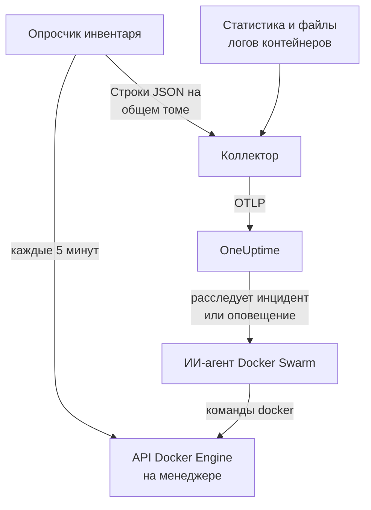

# Агент Docker Swarm

Агент Docker Swarm от OneUptime отслеживает кластер Docker Swarm: его узлы, сервисы, задачи, стеки, overlay-сети, секреты, конфиги и тома, а также метрики и логи каждого контейнера. Вы запускаете его через Docker Compose на узле-менеджере swarm, и кластер появляется в OneUptime со всем перечисленным. [Мониторы Docker Swarm](/docs/monitor/docker-swarm-monitor) оповещают о том, что поступает.

:::cards
- [Установка агента](#установка-агента): Скрипт установки или Docker Compose на узле-менеджере.
- [Что собирает агент](#что-собирает-агент): Инвентарь, счётчики кластера, а также метрики и логи контейнеров.
- [ИИ-агент](#ии-агент): Позвольте OneUptime AI читать swarm во время расследования.
- [Устранение неполадок](#устранение-неполадок): Диагностический скрипт и типичные проблемы.
:::

## Как это работает

Агент — это три контейнера, все описаны в одном `docker-compose.yml`:

1. **Коллектор**: OpenTelemetry Collector, который читает `docker_stats` для метрик каждого контейнера, отслеживает файлы логов контейнеров и файл со снимком инвентаря. Он проставляет на всё имя вашего кластера (`docker.swarm.cluster.name`) и отправляет данные в OneUptime по OTLP.
2. **Опросчик инвентаря**: небольшой sidecar на `curl` и `jq`, который каждые 5 минут обходит API менеджера swarm (`/nodes`, `/services`, `/tasks`, `/networks`, `/secrets`, `/configs`, `/volumes`) и определяет стеки по метке сервиса `com.docker.stack.namespace`. Он пишет по одной строке JSON на объект, а коллектор их пересылает.
3. **ИИ-агент**: `oneuptime-docker-swarm-ai-agent`, который выполняет команды `docker`, запрошенные OneUptime AI, пока она расследует инцидент или оповещение в этом кластере. Он работает только для чтения, если вы не разрешите исправления (см. [ИИ-агент](#ии-агент)).



Кластер регистрируется по своим первым данным под именем кластера, которое вы задали.

## Перед началом

- Узел swarm с ролью **manager**, на котором будет работать агент: опросчик инвентаря и ИИ-агент вызывают эндпоинты API, на которые отвечают только менеджеры.
- Docker Engine 20.10 или новее с плагином Docker Compose v2.
- Ключ приёма. Создайте его в разделе **Настройки проекта → Телеметрия и APM → Ключи приема** и скопируйте значение.
- Исходящий HTTPS с узла на ваш URL OneUptime.

### Где запускать агент

Запускайте его на узле-менеджере. Коллектор сообщает о контейнерах узла, на котором работает, поэтому для метрик контейнеров всех узлов запустите коллектор на каждом узле, везде с одним и тем же `DOCKER_SWARM_CLUSTER_NAME`; опросчику инвентаря и ИИ-агенту достаточно работать на одном менеджере. `install.sh` не ставит ИИ-агента на узел, который не является менеджером (и удаляет того, что поставил там раньше). ИИ-агент, всё же запущенный на рабочем узле, никогда не регистрируется для кластера: он ждёт, пока его узел станет менеджером, поэтому не может вытеснить ИИ-агента менеджера. Разворачиваете агента как стек swarm, а не через Compose? Держите опросчик инвентаря и ИИ-агента на менеджерах с ограничением `node.role == manager`.

## Установка агента

:::steps
### Установите и запустите агент

:::tabs
@tab install.sh
Скачайте скрипт установки и запустите его на узле-менеджере:

```bash
curl -sSL https://raw.githubusercontent.com/OneUptime/oneuptime/master/agents/DockerSwarmAgent/install.sh -o install.sh
sh install.sh
```

Скрипт спрашивает URL вашего OneUptime, ключ приёма и имя кластера. Он устанавливает агента в `/opt/oneuptime-docker-swarm-agent`, записывает файл `.env`, который может читать только его владелец, и запускает все три контейнера. Добавьте `--no-ai-agent`, чтобы не ставить ИИ-агента.
@tab Docker Compose
Скачайте `docker-compose.yml`, `otel-collector-config.yaml` и `inventory-snapshot.sh` из [каталога DockerSwarmAgent](https://github.com/OneUptime/oneuptime/tree/master/agents/DockerSwarmAgent) в новую папку на узле-менеджере:

```bash
curl -fsSL https://raw.githubusercontent.com/OneUptime/oneuptime/master/agents/DockerSwarmAgent/docker-compose.yml -o docker-compose.yml
curl -fsSL https://raw.githubusercontent.com/OneUptime/oneuptime/master/agents/DockerSwarmAgent/otel-collector-config.yaml -o otel-collector-config.yaml
curl -fsSL https://raw.githubusercontent.com/OneUptime/oneuptime/master/agents/DockerSwarmAgent/inventory-snapshot.sh -o inventory-snapshot.sh
chmod +x inventory-snapshot.sh
```

Создайте рядом с ними файл `.env`. В нём хранится ключ приёма, поэтому закройте к нему доступ командой `chmod 600 .env`:

```bash title=".env"
ONEUPTIME_URL=https://oneuptime.com
ONEUPTIME_SERVICE_TOKEN=your-telemetry-ingestion-key
DOCKER_SWARM_CLUSTER_NAME=my-swarm
```

Запустите агента:

```bash
docker compose up -d
```
:::

### Убедитесь, что агент работает

```bash
docker compose ps
docker compose logs --tail 50 oneuptime-docker-swarm-agent oneuptime-docker-swarm-inventory
```

`docker compose ps` показывает три контейнера: коллектор (`oneuptime-docker-swarm-agent`), опросчик инвентаря (`oneuptime-docker-swarm-inventory`) и ИИ-агента (`oneuptime-docker-swarm-ai-agent`).

### Найдите кластер в OneUptime

Откройте **Продукты → Инфраструктура → Docker Swarm → Все кластеры**. Кластер появляется через несколько минут, а его страницы **Узлы**, **Службы**, **Задачи**, **Stacks**, **Сети**, **Секреты**, **Configs** и **Тома** заполняются после первого снимка инвентаря, в течение 5 минут.
:::

## Переменные окружения

Скрипт установки записывает первые три в `/opt/oneuptime-docker-swarm-agent/.env`; при установке через Docker Compose они читаются из `.env` рядом с `docker-compose.yml`. Добавьте или измените там любую из них, затем выполните `docker compose up -d` в этой папке.

| Переменная | Обязательна | Описание |
| --- | --- | --- |
| `ONEUPTIME_URL` | Да | Ваш URL OneUptime, например `https://oneuptime.com`, или ваш собственный экземпляр. Если экземпляр работает только по HTTP, используйте `http://` и его порт. |
| `ONEUPTIME_SERVICE_TOKEN` | Да | Ключ приёма из раздела **Настройки проекта → Телеметрия и APM → Ключи приема**. |
| `DOCKER_SWARM_CLUSTER_NAME` | Да | Имя кластера в OneUptime и ключ, по которому объединяются данные всех узлов: проставляется на всё как атрибут ресурса `docker.swarm.cluster.name`. Не меняйте его: изменение позже регистрирует второй кластер. По умолчанию `docker-swarm`. |
| `DOCKER_INVENTORY_INTERVAL_SECONDS` | Нет | Как часто опросчик инвентаря делает снимок, в секундах. По умолчанию `300`. |
| `DOCKER_API_VERSION` | Нет | Версия API Docker Engine, на которой говорят коллектор и опросчик инвентаря. По умолчанию `1.44`; пустое значение согласует её с демоном (см. [Устранение неполадок](#устранение-неполадок)). ИИ-агент согласует её сам, если вы не зададите версию. |

Собственные настройки ИИ-агента описаны в разделе [ИИ-агент](#ии-агент).

## Что собирает агент

| Сигнал | Источник | Где отображается |
| --- | --- | --- |
| Узлы, сервисы, задачи, стеки, сети, секреты, конфиги и тома | Опросчик инвентаря, из API менеджера swarm | Списки и страницы с подробностями кластера |
| Счётчики кластера (готовые узлы, работающие задачи, сервисы, стеки, …) | Тот же снимок | Карточки обзора и значки бокового меню |
| ЦП, память, число процессов и время работы контейнеров | Приёмник `docker_stats` | Страница **Метрики** |
| Логи stdout и stderr контейнеров | Приёмник `filelog` | Страница **Журналы** |

### Чем он отличается от агента Docker

[Агент Docker](/docs/telemetry/docker-host) описывает один хост и проставляет `host.name` и `container.runtime=docker`. Агент Docker Swarm намеренно проставляет только `docker.swarm.cluster.name`: тогда OneUptime относит данные к кластеру swarm, а не регистрирует каждый узел как отдельный хост.

## Пометка кластера метками проекта

Атрибут ресурса, начинающийся с `oneuptime.label.`, становится меткой проекта на кластере: `oneuptime.label.<dimension>=<value>` — это метка `<dimension>:<value>`. Добавьте атрибуты в процессор `resource` в `otel-collector-config.yaml` рядом с `docker.swarm.cluster.name`:

```yaml
processors:
  resource:
    attributes:
      # ...existing attributes...
      - key: oneuptime.label.team
        value: platform
        action: upsert
      - key: oneuptime.label.env
        value: production
        action: upsert
```

Коллектор читает конфигурацию только при запуске: выполните `docker compose restart oneuptime-docker-swarm-agent`. После этого кластер показывает метки `team:platform` и `env:production`. Метки сравниваются без учёта регистра, поэтому существующая метка `Production` используется повторно, а не дублируется, и агент никогда не удаляет метку, добавленную кем-то в OneUptime.

## Запуск как службы systemd

Чтобы агент запускался вместе с узлом и перезапускался при сбое, установите его юнит systemd. Он предполагает, что агент находится в `/opt/oneuptime-docker-swarm-agent`, куда его помещает скрипт установки:

```bash
sudo curl -fsSL https://raw.githubusercontent.com/OneUptime/oneuptime/master/agents/DockerSwarmAgent/systemd/oneuptime-docker-swarm-agent.service -o /etc/systemd/system/oneuptime-docker-swarm-agent.service
sudo systemctl daemon-reload
sudo systemctl enable --now oneuptime-docker-swarm-agent
```

## Обновление агента

Агент сообщает версию коллектора, которую запускает. Если она старше версии, закреплённой в этом выпуске OneUptime, рядом с версией агента на странице **Обзор** кластера появляется предупреждающий значок. Выберите его, чтобы увидеть эти команды.

Снова запустите скрипт установки на узле-менеджере и ответьте на его вопросы тем же URL, ключом и именем кластера. Он скачивает последние файлы, скачивает образы и перезапускает агента:

```bash
curl -sSL https://raw.githubusercontent.com/OneUptime/oneuptime/master/agents/DockerSwarmAgent/install.sh -o install.sh
sh install.sh
```

Скрипт заново записывает `.env` по вашим ответам. Он сохраняет только списки целей ИИ-агента и то, что может делать ИИ (`ONEUPTIME_AI_INVESTIGATION`, `ONEUPTIME_AI_FIXES`): снова добавьте любые переменные, которые задавали сами, например `DOCKER_API_VERSION`. Включали исправления ИИ? Запустите его как `ONEUPTIME_AI_ALLOW_WRITES=true sh install.sh`, чтобы они остались включены. Не ставили ИИ-агента? Снова передайте `--no-ai-agent`.

При установке через Docker Compose снова скачайте три файла в папку агента (затем повторите изменения, которые вносили в `docker-compose.yml`), скачайте образы и перезапустите:

```bash
docker compose pull
docker compose up -d
```

Версия коллектора закреплена в файлах, поэтому одно лишь скачивание образов не продвигает агента вперёд.

## Удаление агента

```bash
cd /opt/oneuptime-docker-swarm-agent
docker compose down
```

## ИИ-агент

`docker-compose.yml` для swarm (и `install.sh`) также запускает **ИИ-агент Docker Swarm** — третий контейнер, `oneuptime-docker-swarm-ai-agent` (образ `oneuptime/resource-ai-agent:release`), который выполняет команды `docker` только для чтения, запрошенные OneUptime AI, пока она расследует инцидент или оповещение в этом кластере, — `docker node ls`, `docker service ps web --no-trunc`, `docker service logs --tail 200 web`, — и, только если вы это разрешите, применяет исправления, например поочерёдный перезапуск указанного сервиса. Он читает те же `ONEUPTIME_URL`, `ONEUPTIME_SERVICE_TOKEN` и `DOCKER_SWARM_CLUSTER_NAME`, что и коллектор, поэтому обслуживает именно этот кластер, и появляется в OneUptime на странице **ИИ → ИИ-агент** кластера.

- **ИИ-расследования включены по умолчанию.** Как только агент подключается, OneUptime AI расследует с его помощью инциденты и оповещения в этом кластере, а страница **Обзор** кластера показывает статус агента. Чтобы отключить это, задайте `ONEUPTIME_AI_INVESTIGATION=false` там, где работает агент (как это сделать, показывает **Изменить** в разделе **Что может делать ИИ** на странице ИИ-агента), или не устанавливайте агента.
- Как и опросчик инвентаря, он **должен работать на узле-менеджере**: команды для узлов, сервисов и задач есть только у менеджеров. На рабочем узле он ничего не выполняет и не регистрируется для кластера, пока узел не станет менеджером (его `/status` объясняет почему). Запускайте по одному на кластер.
- Он работает **только для чтения**, если вы не зададите `ONEUPTIME_AI_ALLOW_WRITES=true` в `.env` и не выполните `docker compose up -d` (или не запустите с ней `install.sh`; установщик записывает `ONEUPTIME_AI_ALLOW_WRITES`, `ONEUPTIME_AI_INVESTIGATION`, `ONEUPTIME_AI_FIXES`, `ONEUPTIME_AI_WRITE_TARGETS` и `ONEUPTIME_AI_PROTECTED_TARGETS` из своего окружения в `.env`, а повторный запуск сохраняет то, что уже есть в `.env` для последних четырёх, если вы не передадите эту переменную, пусть даже пустую); `ONEUPTIME_AI_WRITE_TARGETS` (шаблоны имён сервисов и узлов, например `web_*,api_*`) ограничивает, что может затронуть исправление. `ONEUPTIME_AI_FIXES` в том же `.env` задаёт, как выполняются исправления — `ask-for-approval` (каждое одобряет человек), `automatic` или `bypass-approval`, — а страница ИИ-агента показывает это только для чтения ([Что может делать ИИ, заданное агентом](/docs/ai/infrastructure-ai-agents#what-ai-may-do-set-by-the-agent)). Вывод узла из работы (drain) всегда требует одобрения человека, в любом режиме.
- Он работает от root со смонтированным сокетом Docker, потому что сокет принадлежит root, — а на менеджере тот, кто может пользоваться сокетом, управляет всем swarm, с `:ro` или без. Границу задаёт политика команд агента: он никогда не создаёт и не удаляет сервисы или стеки, никогда не трогает секреты и конфиги и никогда не меняет себя, коллектор, опросчик инвентаря или что-либо из `ONEUPTIME_AI_PROTECTED_TARGETS` (шаблоны имён сервисов и узлов).
- `install.sh --no-ai-agent` не ставит его; можно также удалить сервис `oneuptime-docker-swarm-ai-agent` из `docker-compose.yml`.

Что он может выполнять, как работают исправления и как устранять неполадки: [Infrastructure AI Agents](/docs/ai/infrastructure-ai-agents#docker-swarm-clusters).

## Устранение неполадок

:::details Сначала запустите диагностический скрипт
Агент поставляется со скриптом [`troubleshoot.sh`](https://github.com/OneUptime/oneuptime/blob/master/agents/DockerSwarmAgent/troubleshoot.sh), который проверяет всю цепочку: контейнеры, то, что опросчик инвентаря работает на менеджере (`docker node ls`), файл снимка, имя кластера, проставленное на всё, формат токена, собственные метрики коллектора и то, принимает ли OneUptime ключ приёма. Последняя проверка важнее всего. OneUptime отклоняет неверный ключ с `401` (`422` для отключённого ключа или ключа браузера), а коллектор пишет это одной строкой `Exporting failed` на пакет, которую легко пропустить. Скрипт запрашивает `GET <url>/otlp/v1/validate`, чтобы получить прямой ответ `200` (действителен) или `401` (недействителен). Запустите его на узле-менеджере:

```bash
curl -sSL https://raw.githubusercontent.com/OneUptime/oneuptime/master/agents/DockerSwarmAgent/troubleshoot.sh -o troubleshoot.sh
bash troubleshoot.sh    # add -d <dir> if you installed outside /opt/oneuptime-docker-swarm-agent
```
:::

:::details Кластер так и не появляется
Сначала запустите диагностический скрипт. Иначе прочитайте логи коллектора (`docker compose logs oneuptime-docker-swarm-agent`), проверьте, что `ONEUPTIME_SERVICE_TOKEN` и `ONEUPTIME_URL` в `.env` верны и что узел достигает вашего URL OneUptime.
:::

:::details Инвентарь не появляется
Проверьте, что опросчик инвентаря работает на менеджере: `docker node ls` должна там выполняться успешно. Затем поищите строки `failed to emit ...` в его логах: `docker compose logs oneuptime-docker-swarm-inventory`.
:::

:::details Кластер переходит в состояние «отключён»
Кластер становится отключённым, когда OneUptime ничего не получал от него 15 минут; OneUptime проверяет это каждые 5 минут, и время, когда он сам не получал данные, не учитывается. Убедитесь, что контейнер коллектора продолжает работать: `docker compose ps` его показывает.
:::

:::details Коллектор завершается с "client version is too new"
В логах коллектора видно:

```text
Error: cannot start pipelines: failed to start "docker_stats" receiver:
Error response from daemon: client version 1.44 is too new.
Maximum supported API version is 1.41
```

Наибольшая версия API демона ниже значения по умолчанию `1.44` (Docker Engine 20.10 останавливается на `1.41`), поэтому приёмник `docker_stats` не может запуститься, а контейнер перезапускается по кругу. Узнайте наибольшую версию демона:

```bash
docker version --format '{{ .Server.APIVersion }}'
```

Задайте в `.env` это значение для `DOCKER_API_VERSION` и выполните `docker compose up -d` на каждом узле, где работает агент. Новые демоны по-прежнему поддерживают старые версии API, поэтому настройка продолжит работать и после обновления Docker. Или задайте `DOCKER_API_VERSION=` (пусто), чтобы коллектор согласовывал версию с демоном, а не закреплял её.
:::

:::details Кластер появляется под неверным именем
Имя кластера берётся из `DOCKER_SWARM_CLUSTER_NAME`. Измените его в `.env` и выполните `docker compose up -d`: новое имя регистрирует новый кластер, а не переименовывает старый.
:::

## Дальнейшие шаги

:::cards
- [Мониторинг Docker Swarm](/docs/monitor/docker-swarm-monitor): Оповещения по узлам, сервисам, задачам и контейнерам.
- [Infrastructure AI Agents](/docs/ai/infrastructure-ai-agents): Что может выполнять ИИ-агент Docker Swarm и как работают исправления.
- [Агент Docker](/docs/telemetry/docker-host): Вместо этого отслеживайте отдельный хост Docker.
:::
